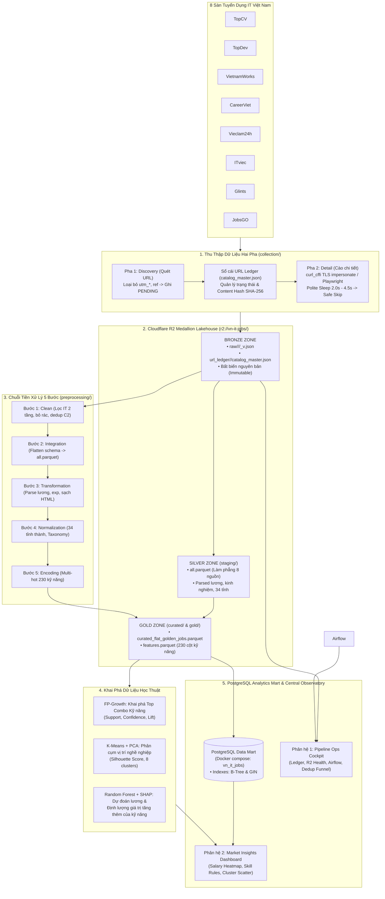

# MASTER SYSTEM BLUEPRINT & AGENT OPERATIONAL PLAYBOOK

> **Dự án:** VN-IT-Job-Mining — Hệ thống Tích hợp & Khai phá Dữ liệu Thị trường Lao động IT Việt Nam  
> **Thời điểm nghiên cứu:** Tháng 10 – Tháng 11/2026 trên 8 sàn tuyển dụng hàng đầu: **TopCV, TopDev, VietnamWorks, CareerViet, Vieclam24h, ITviec, Glints, JobsGO**  
> **Mục tiêu nghiên cứu:** Phân tích nhu cầu kỹ năng (Skills Intelligence) và định hình nghề nghiệp (Occupational Demand) trong ngành CNTT, hướng tới đối tượng người dùng là **Sinh viên IT Việt Nam**.

---

## 1. Sứ Mệnh & Bản Thiết Kế Kiến Trúc Tổng Thể (Master Blueprint)

Hệ thống được thiết kế theo mô hình **Modern ELT (Extract - Load - Transform)** kết hợp kiến trúc **Medallion Lakehouse** trên nền tảng **Cloudflare R2 Object Storage** và **PostgreSQL Analytics Data Mart** (tận dụng cụm PostgreSQL có sẵn trong Docker Compose của Apache Airflow). 

Khác với các pipeline ETL cổ điển cố ép dữ liệu vào một schema định sẵn ngay khi cào, hệ thống duy trì tính bất biến của dữ liệu thô (Bronze Zone), sau đó tinh chế dữ liệu qua chuỗi tiền xử lý 5 bước không dùng mô hình ngôn ngữ lớn (LLM-Free Deterministic Preprocessing) để tạo ra tập dữ liệu **Golden Master Parquet** với 230 cột đặc trưng phục vụ các thuật toán Data Mining học thuật chuẩn mực, đồng thời nạp vào PostgreSQL Mart để phục vụ các API Dashboard và truy vấn SQL phân tích tốc độ cao.



---

## 2. Bảng Ánh Xạ Danh Mục Tài Liệu Đặc Tả (Specification Catalog 01 – 13)

Toàn bộ hệ thống được đặc tả chi tiết qua 13 tài liệu chuẩn mực tại thư mục `docs/spec/`. Bất kỳ kỹ sư hay AI Agent nào khi thực hiện nhiệm vụ đều phải đối chiếu tài liệu đặc tả tương ứng:

| Mã Đặc Tả | Tên Tài Liệu Đặc Tả | Đường Dẫn Tệp Trong Repo | Phạm Vi Nghiệp Vụ & Mục Tiêu Kỹ Thuật | Trạng Thái |
|:---:|---|---|---|:---:|
| **`SPEC-01`** | **Đặc tả Sản phẩm & Nghiên cứu Thị trường (Product Spec)** | [`docs/spec/01_product_spec.md`](docs/spec/01_product_spec.md) | Định nghĩa 5 mục tiêu chiến lược SD1-SD5, phạm vi thời gian tháng 10-11/2026, 8 sàn tuyển dụng, chân dung người dùng sinh viên CNTT | Hoàn tất |
| **`SPEC-02`** | **Giới hạn Phạm vi & Ràng buộc Kỹ thuật (Out of Scope)** | [`docs/spec/02_out_of_scope.md`](docs/spec/02_out_of_scope.md) | Phân định ranh giới nghiệm thu đợt này, các thành phần ngoài phạm vi, chính sách phi LLM (Zero-LLM policy) | Hoàn tất |
| **`SPEC-03`** | **Vòng đời Khai phá Dữ liệu (CRISP-DM & KDD Lifecycle)** | [`docs/spec/03_data_mining_lifecycle.md`](docs/spec/03_data_mining_lifecycle.md) | Tích hợp chuẩn CRISP-DM với mô hình Modern ELT, chuyển đổi từ Raw Lakehouse sang Golden Master | Hoàn tất |
| **`SPEC-04`** | **Đặc tả Kỹ thuật Hạ tầng Thu thập Dữ liệu (Collection Spec)** | [`docs/spec/04_collection_spec.md`](docs/spec/04_collection_spec.md) | Kiến trúc Hai Pha (Discovery & Detail), URL Ledger contract, TLS Impersonation, Safe Skip trên 8 sàn | Hoàn tất |
| **`SPEC-05`** | **Đặc tả Tiền xử lý & Chất lượng Dữ liệu (Preprocessing Spec)** | [`docs/spec/05_preprocessing_spec.md`](docs/spec/05_preprocessing_spec.md) | Quy trình Clean 5 bước, bộ lọc IT 2 tầng không dùng LLM, loại bỏ JD rỗng, khử trùng lặp nội sàn theo mã job_id | Hoàn tất |
| **`SPEC-06`** | **Đặc tả Biến đổi Dữ liệu & Trích xuất Thuộc tính (Processing Spec)** | [`docs/spec/06_processing_spec.md`](docs/spec/06_processing_spec.md) | Hợp nhất 8 nguồn về Target Schema, `json_flattener.py`, chuẩn hóa 34 tỉnh, parse lương, Multi-Hot 230 cột | Hoàn tất |
| **`SPEC-07`** | **Đặc tả Thuật toán & Khai phá Dữ liệu (Mining Spec)** | [`docs/spec/07_mining_spec.md`](docs/spec/07_mining_spec.md) | Chi tiết bộ 3 thuật toán: FP-Growth (Skill combos), K-Means Clustering + PCA (Job clusters), Random Forest + SHAP | Hoàn tất |
| **`SPEC-08`** | **Đặc tả Đánh giá & Kiểm chứng Tri thức (Evaluation Spec)** | [`docs/spec/08_evaluation_spec.md`](docs/spec/08_evaluation_spec.md) | Tiêu chí đánh giá Lift, Silhouette Score, $R^2$ hồi quy lương, đối chiếu tri thức thực tiễn cho sinh viên | Hoàn tất |
| **`SPEC-09`** | **Đặc tả Phân hệ Giám sát & Bảng điều khiển (Monitoring Spec)** | [`docs/spec/09_monitoring_spec.md`](docs/spec/09_monitoring_spec.md) | Central Observatory: Data Pipeline Ops Cockpit + Market Insights Dashboard (Salary Heatmap, Skills, Clusters) | Hoàn tất |
| **`SPEC-10`** | **Kiến trúc Tổng thể Hệ thống Lakehouse (Architecture Spec)** | [`docs/spec/10_architecture.md`](docs/spec/10_architecture.md) | Kiến trúc End-to-End Cloudflare R2 Medallion Lakehouse, Apache Airflow Postgres backend, Zero Egress | Hoàn tất |
| **`SPEC-11`** | **Các Bản ghi Quyết định Kiến trúc (Technical Decisions - ADR)** | [`docs/spec/11_technical_decisions.md`](docs/spec/11_technical_decisions.md) | Biện luận kỹ thuật ADR-01 đến ADR-05: R2 vs DWH, Parquet vs JSON, Chống bot, Khử trùng 2 lớp, Bộ 3 thuật toán | Hoàn tất |
| **`SPEC-12`** | **Tiêu chuẩn Lập trình & Quy tắc An toàn Mã nguồn (Coding Standards)** | [`docs/spec/12_coding_standards.md`](docs/spec/12_coding_standards.md) | Chuẩn Python 3.12, 14 tiêu chuẩn Crawler C1-C14, Quy tắc bảo mật .env, Pytest phân tầng & Zero-Network | Hoàn tất |
| **`SPEC-13`** | **Hướng dẫn Vận hành Hàng ngày & Sổ tay Sự cố (Working Documentation)** | [`docs/spec/13_working_documentation.md`](docs/spec/13_working_documentation.md) | Thiết lập môi trường từ 0, lệnh CLI Collection/Preprocessing/Mining/Monitoring, Runbook khắc phục 5 sự cố | Hoàn tất |

---

## 3. Quy Tắc Hoạt Động Cốt Tử Dành Cho AI Agent (Rules of Engagement)

Khi làm việc trong repository này, các AI Agent (Claude Code, Google Antigravity, Cursor,...) **bắt buộc phải tuân thủ nghiêm ngặt 6 nguyên tắc sau**:

### 1. Nguyên Tắc "Số Liệu Thật Tuyệt Đối" (Real Numbers Only — No Mocking)
- Tuyệt đối không sinh dữ liệu giả định, số ngẫu nhiên (`Math.random()`), hoặc hardcode các chỉ số đẹp mắt trong giao diện Monitoring và báo cáo.
- Khi dữ liệu chưa có (ví dụ: pipeline bước đó chưa chạy), service backend phải trả về `null` kèm lý do cụ thể (`reason: "NO_DATA"`), và giao diện frontend phải hiển thị trạng thái rỗng (**Empty State**) trung thực. Vấn đề `L-19` từng xảy ra khi trang ML 3D trả số giả và đã bị xóa bỏ toàn bộ.

### 2. Nguyên Tắc Thao Tác Cloudflare R2 An Toàn (Dry-Run First)
- Mọi thao tác ghi đè (`upload`), di chuyển cấu trúc (`migrate`) hoặc xóa (`delete`) trên Cloudflare R2 đều bắt buộc phải chạy ở chế độ kiểm tra an toàn `--dry-run` trước.
- Tuyệt đối không tự ý thực thi các lệnh có cờ `--apply` hoặc `--push` nếu chưa có sự phê duyệt rõ ràng từ người dùng.

### 3. Nguyên Tắc Raw Bất Biến (Immutable Raw Data)
- Dữ liệu thô tại tầng Bronze (`raw/<source>/<YYYY-MM-DD>/<job_id>_v<N>.json`) là tài sản gốc bất biến.
- Nếu phát hiện crawler parse thiếu trường hoặc parse sai định dạng, sửa đổi logic tại tầng Tiền xử lý (`preprocessing/`), **nghiêm cấm viết script ghi đè sửa chữa các file raw cũ**.

### 4. Không Bao Giờ Tự Ý Bật Airflow Scheduler
- Script khởi động `./start_monitoring.sh` đã có chốt chặn an toàn: không bao giờ bật daemon `airflow scheduler`.
- AI Agent tuyệt đối không chạy lệnh `airflow scheduler` trong phiên làm việc, vì scheduler sẽ tự động kích hoạt các DAG cào 8 sàn và ghi dữ liệu chưa kiểm soát lên Cloudflare R2.

### 5. Bảo Vệ Thông Tin Nhạy Cảm & Không In Secret
- Không hardcode API key, token hoặc secret trong code.
- Toàn bộ cấu hình đọc từ `.env`. Không bao giờ in (print/log) giá trị secret ra màn hình console; nếu cần đối chiếu cấu hình, chỉ được in mã băm ngắn SHA-256 (`CLAUDE.md`).

### 6. Quy Trình Sửa Lỗi Chuẩn Mực
- Khi khắc phục xong một sự cố, Agent phải:
  1. Ghi nhận lỗi vào `docs/issue_log.md` theo định dạng `L-<số tiếp theo>` (Lỗi $\rightarrow$ Nguyên nhân $\rightarrow$ Cách xử lý $\rightarrow$ Bằng chứng kiểm chứng).
  2. Xóa mục lỗi tương ứng khỏi danh sách `KNOWN_ISSUED.md`.
  3. Bổ sung cảnh báo vào file `CLAUDE.md` thuộc thư mục liên quan nếu đó là bẫy kỹ thuật dễ tái diễn.

---

## 4. Sơ Đồ Điều Hướng Codebase & Các Điểm Vào Trọng Yếu

```
VN-IT-Job-Mining/
├── AGENTS.md                      # [BẠN ĐANG Ở ĐÂY] Master Blueprint & Operational Playbook
├── CLAUDE.md                      # Hướng dẫn quy tắc ngắn gọn cho Claude Code CLI
├── KNOWN_ISSUED.md                # Danh mục các vấn đề tồn đọng đang mở
├── Makefile                       # Lệnh tắt chuẩn hóa: make test, make lint, make monitor
├── run.py                         # Điểm vào thực thi crawler: --phase discover|detail, --source <name>
├── start_monitoring.sh            # Script khởi động buồng lái giám sát FastAPI + Vite
│
├── collection/                    # PHÂN HỆ THU THẬP DỮ LIỆU
│   ├── CLAUDE.md                  # Quy tắc crawler, sổ cái ledger, envelope CDC, tiêu chuẩn C1-C14
│   ├── common/                    # url_ledger.py, r2_storage.py, anti_blocking.py, adaptive_router.py
│   ├── topcv/                     # Crawler TopCV (hỗ trợ curl_cffi & playwright)
│   ├── topdev/                    # Crawler TopDev (API crawler, lưu DETAIL_FIELDS)
│   ├── vietnamworks/              # Crawler VietnamWorks (GraphQL API crawler)
│   ├── itviec/                    # Crawler ITviec (HTML crawler)
│   └── ...                        # careerviet, vieclam24h, glints, jobsgo
│
├── preprocessing/                 # PHÂN HỆ TIỀN XỬ LÝ DỮ LIỆU 5 BƯỚC
│   ├── CLAUDE.md                  # Hợp đồng ranh giới các bước, phân loại IT 2 tầng không dùng LLM
│   ├── clean/                     # Bước 1: Lọc IT 2 tầng, bỏ JD rỗng, khử trùng C2
│   ├── integration/               # Bước 2: json_flattener.py làm phẳng 8 nguồn về all.parquet
│   ├── transformation/            # Bước 3: salary_parser.py, kinh nghiệm, làm sạch HTML
│   ├── normalization/             # Bước 4: 34 tỉnh thành, Taxonomy chuẩn hóa
│   ├── encoding/                  # Bước 5: Multi-hot encoding ma trận 230 cột kỹ năng
│   └── dictionaries/              # provinces_34.json, skills.json, it_policy.json
│
├── preprocessing/                 # PHÂN HỆ TIỀN XỬ LÝ DỮ LIỆU 5 BƯỚC
│   └── ...                        # careerviet, vieclam24h, glints, jobsgo
│
├── monitoring/                    # PHÂN HỆ GIÁM SÁT CENTRAL OBSERVATORY
│   ├── CLAUDE.md                  # Quy tắc Zero-Auth, Real Numbers, palette tokens
│   ├── backend/                   # FastAPI service (:8000), router /api/v1/monitor, /insights
│   └── frontend/                  # React 18 + Vite (:5173), Tailwind CSS, 100% TypeScript
│
├── airflow/                       # PHÂN HỆ ĐIỀU PHỐI APACHE AIRFLOW
│   ├── CLAUDE.md                  # Cấu hình DAGs, Pools, Zero-SQLite policy
│   └── dags/                      # dag_discovery_daily, crawler_detail_<source>
│
├── docs/                          # TÀI LIỆU DỰ ÁN
│   ├── spec/                      # [QUAN TRỌNG] 13 tài liệu đặc tả chuẩn mực (01 đến 13)
│   ├── issue_log.md               # Nhật ký ghi nhận toàn bộ lỗi đã xử lý (L-01 đến L-28+)
│   └── presentation/              # Slide báo cáo và thuyết trình đồ án tốt nghiệp
│
├── scripts/                       # KỊCH BẢN VẬN HÀNH & KIỂM TOÁN DỮ LIỆU
│   ├── sync_cloud_lakehouse.py    # Đồng bộ 2 chiều máy cá nhân <-> Cloudflare R2
│   ├── audit_raw_data.py          # Kiểm toán chất lượng dữ liệu thô đối chiếu ledger
│   └── run_preprocessing.py       # Driver chạy chuỗi 5 bước tiền xử lý
│
└── tests/                         # HỆ THỐNG KIỂM THỬ PHÂN TẦNG
    ├── unit/                      # Test độc lập logic, hash, parsing, clean
    ├── contract/                  # Test kiểm tra tuân thủ C1-C14 qua fixtures offline
    ├── integration/               # Test tích hợp API endpoints và pipeline
    └── fixtures/                  # 3 mẫu offline cho mỗi sàn tuyển dụng
```
