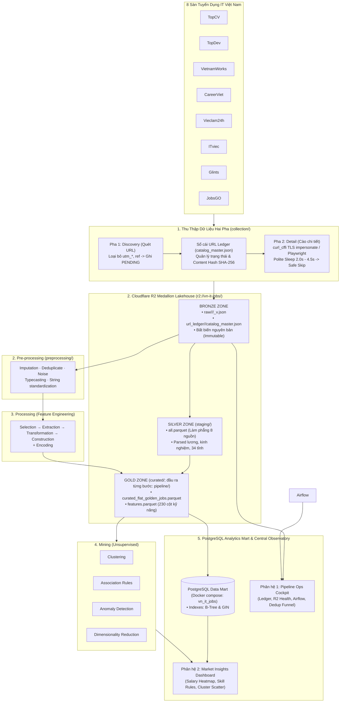

# CLAUDE.md

This file provides guidance to Claude Code (claude.ai/code) when working with code in this repository.

## Project

Pipeline that mines IT job postings from 8 Vietnamese job boards (topcv, topdev, vietnamworks, careerviet, vieclam24h, itviec, glints, jobsgo) into a deduplicated "Golden Master" dataset, with a monitoring dashboard on top. Docs, comments, and log messages are mostly Vietnamese. `README.md` describes the intended design and is stale in places; see "Known mismatches" below.

## Standard process and quality criteria

Output data must meet 5 criteria: completeness, accuracy, consistency, timeliness, uniqueness. The target process has 4 stages:

1. **Collection** (`collection/`): crawl, filter and dedupe; output is clean JSON with every field the source provides.
2. **Pre-processing** (`preprocessing/`): imputation, deduplicate, noise, typecasting, string standardization.
3. **Processing**: feature engineering (selection, extraction, transformation, construction) plus encoding.
4. **Mining** (`mining/`): unsupervised only (clustering, association rules, anomaly detection, dimensionality reduction).

ML/AI models may help at any stage, but they must run on real data (no mocks) and be reproducible. Details and the stage-to-criteria table are in the blueprint at the end of this file.

## Commands

Setup needs Python 3.12 (`careerviet/crawler.py` uses 3.12-only f-string syntax). Makefile targets assume the venv is at `.venv/`.

```bash
python3.12 -m venv .venv && source .venv/bin/activate
pip install -r requirements-dev.txt
touch .env   # config lives only in .env; there is no .env.example
```

Tests (process and folder rules in `tests/README.md`):

```bash
make test-fast                                            # unit only
make test                                                 # everything except live; network is blocked
make check                                                # test + code quality report (docs/code_quality.md) + frontend build
pytest tests/unit/test_url_ledger_dedup.py::test_name     # one test
```

Tests live in `tests/unit/`, `tests/integration/`, `tests/contract/` (crawler standards C1–C14, offline fixtures in `tests/fixtures/<source>/`), and `tests/data/`. `tests/conftest.py` marks tests by folder, blocks non-localhost network unless `@pytest.mark.live` with `--run-live`, and skips `@pytest.mark.needs_data(paths)` tests when the local `data/` or `reports/` paths are missing.

Lint: `make lint` / `make format` (ruff on `collection/` and `tests/` only). The tree currently has ~1,300 ruff findings, so check only the lines you change rather than aiming for a clean run.

Pipeline:

```bash
# Collection: --phase discover|detail|all, --source <name>|all
python run.py --source topcv --phase discover --max-pages 2 --sync-r2
python run.py --source topcv --phase detail --max-items 30 --sync-r2   # without --sync-r2 nothing reaches R2; --engine only applies to topcv
python scripts/sync_cloud_lakehouse.py --status|--download|--upload [--source topcv]
python scripts/push_raw_to_r2.py [--source topcv] [--dry-run]

# Preprocessing (reads data/<source>/raw/, so download first)
python scripts/read_eda_diagnosis.py --source topcv           # run before changing preprocessing for a source
python scripts/run_preprocessing.py --step integration --source all   # flatten only -> data/preprocessing/02_integration/
python scripts/run_staging_integration_pipeline.py            # full chain -> data/staging/, data/curated/, reports/<source>/
python scripts/push_integration_to_r2.py                      # pushes data/integration/ + reports/integration/ JSON only
python scripts/sync_cloud_lakehouse.py --upload               # pushes everything else in data/, including staging and curated
```

Monitoring: `./start_monitoring.sh` (or `make monitor`) checks `.env` without printing values, creates `.venv` and runs `npm ci` when needed, starts PostgreSQL through docker for the Airflow cards, then runs FastAPI on 127.0.0.1:8000 (`/docs`) and Vite on :5173, which proxies `/api` to the backend. Logs go to `logs/monitoring/`. `--check` only verifies; `--no-db` and `--no-browser` skip those steps. It never starts the Airflow scheduler, because the scheduler crawls and writes to R2. `monitoring/run_all.sh` is a wrapper for it. Frontend type-check and build: `npm run build`. There is no frontend test or lint script.

Airflow: `make setup`, `make db-up` (Postgres via docker compose), `make airflow-webserver`, `make airflow-scheduler`. Airflow is installed by `scripts/setup_airflow.sh`, not `requirements.txt`.

## Folder guides

Each code folder has its own `CLAUDE.md` with the context for that area. Read it before working there:

| Folder | Covers |
|---|---|
| `collection/CLAUDE.md` | two-phase flow, ledger lifecycle and merge rule, R2 layout, envelope and CDC, per-source pitfalls, crawler standards C1–C14 |
| `airflow/CLAUDE.md` | DAGs, operators, pools, adaptive router, `run_crawler` as an API |
| `monitoring/CLAUDE.md` | backend and frontend layout, real-numbers rule, `feature_targets.py`, UI tokens, 390px checks |
| `preprocessing/CLAUDE.md` | step boundaries, EDA-first, deliverables, open PRE items |
| `processing/CLAUDE.md` | stage 3 skeleton (selection, extraction, transformation, construction, encoding); logic not built yet |
| `scripts/CLAUDE.md` | which scripts only read, which write locally, which write or delete on R2 |
| `tests/CLAUDE.md` | test pitfalls and how to write a contract test (process in `tests/README.md`) |
| `docs/CLAUDE.md` | map of docs and how to log a fixed bug |

Fixed bugs, with cause and fix, are in `docs/issue_log.md`; open items are in `KNOWN_ISSUED.md`.

## Architecture

Collection (`collection/`, entry point `run.py`) → R2 (`url_ledger/`, `raw/`) → preprocessing (`preprocessing/`, driver `scripts/run_staging_integration_pipeline.py`) → `data/curated/curated_flat_golden_jobs.parquet`. Airflow (`airflow/`) schedules collection. Monitoring (`monitoring/`) reads `data/`, `reports/`, R2 and Airflow.

Crawlers are two-phase and decoupled; the URL Ledger (`collection/common/url_ledger.py`, `data/<source>/url_ledger/catalog_master.json`) is the contract between Discovery (registers `PENDING` URLs) and Detail (writes a `RawJobEnvelope` and a canonical JSON hash for CDC). The ledger on R2 is the source of truth. Seven sources subclass `BaseCrawler`; Glints runs through `GlintsRawPipeline`. `run.py` dispatches through hand-written `if/elif` branches and introspects `__code__.co_varnames` for an optional `online` argument, so a new source needs a branch there plus `SOURCES` lists in `scripts/run_staging_integration_pipeline.py`, `preprocessing/integration/run.py`, `scripts/read_eda_diagnosis.py`, monitoring `config.py`, and a `_flatten_<source>` in `json_flattener.py`.

**Storage is Cloudflare R2 only.** Every connection goes through `collection/common/r2_storage.get_r2_client()`; missing config raises instead of falling back to localhost. All MinIO names were renamed to R2 on 2026-11-02 (`--sync-minio` is kept as an alias of `--sync-r2`). `canonicalize_lakehouse_key` enforces the bucket layout `url_ledger/`, `raw/`, `staging/`, `curated/`, `pipeline/` (decided 2026-11-10; the old `silver/`, `gold/` map to `staging/`, `curated/`). R2 was migrated on 2026-11-10: only these 5 prefixes remain.

Raw data is immutable: fixes to parsed fields belong in preprocessing, not in stored raw files.

`reports/` holds pipeline outputs (health cards, manifests, integration reports) that the monitoring pages read; it is tracked in git. Do not put ad-hoc reports there; audit output (`reports/data_audit_*`) is git-ignored.

Safety rules that apply everywhere: config lives only in `.env` and its values are never printed (compare hashes instead); any write or delete on R2 is dry-run first and needs the user's approval; never start the Airflow scheduler, because it crawls and writes to R2.

## Agent resources

`.agents/skills/` holds project playbooks for other agents (for example `crawling-architect`, `data-integration-miner`, `collection-submission`). Claude Code does not load them automatically, so read the relevant `SKILL.md` when working in that area. Per-source site analysis is in `docs/spec/crawl/<source>.md` (the "Hiện trạng 03/11/2026" box at the top of each is current; the rest may be stale), and crawler conventions are in `docs/guides/two_phase_r2_crawler_playbook.md`. `docs/archive/` is historical.

## Known mismatches

Trust the code over the docs on these:

- The golden file is `data/curated/curated_flat_golden_jobs.parquet`; `docs/tasks/legacy_TASKS.md` still uses the old planned name.
- `docs/tasks/legacy_TASKS.md` is the original plan: `master_pipeline.py` was never built (the driver is `scripts/run_staging_integration_pipeline.py`), and dedup uses Jaccard plus TF-IDF cosine rather than Jaro-Winkler.
- The code still splits preprocessing into `clean/ integration/ transformation/ normalization/ encoding/`, and `mining/` may still hold supervised parts (Random Forest + SHAP); `docs/spec/05-07` describe that older split. The 4-stage process above is the target.
- Airflow runs on Postgres ("Zero-SQLite Policy"), so the `airflow.db` reference in the monitoring rules is outdated.

---

## Master Blueprint & Agent Playbook (từ AGENTS.md)

## MASTER SYSTEM BLUEPRINT & AGENT OPERATIONAL PLAYBOOK

> **Dự án:** VN-IT-Job-Mining — Hệ thống Tích hợp & Khai phá Dữ liệu Thị trường Lao động IT Việt Nam  
> **Thời điểm nghiên cứu:** Tháng 10 – Tháng 11/2026 trên 8 sàn tuyển dụng hàng đầu: **TopCV, TopDev, VietnamWorks, CareerViet, Vieclam24h, ITviec, Glints, JobsGO**  
> **Mục tiêu nghiên cứu:** Phân tích nhu cầu kỹ năng (Skills Intelligence) và định hình nghề nghiệp (Occupational Demand) trong ngành CNTT, hướng tới đối tượng người dùng là **Sinh viên IT Việt Nam**.

---

### 1. Sứ Mệnh & Bản Thiết Kế Kiến Trúc Tổng Thể (Master Blueprint)

Hệ thống được thiết kế theo mô hình **Modern ELT (Extract - Load - Transform)** kết hợp kiến trúc **Medallion Lakehouse** trên nền tảng **Cloudflare R2 Object Storage** và **PostgreSQL Analytics Data Mart** (tận dụng cụm PostgreSQL có sẵn trong Docker Compose của Apache Airflow). 

Khác với các pipeline ETL cổ điển cố ép dữ liệu vào một schema định sẵn ngay khi cào, hệ thống duy trì tính bất biến của dữ liệu thô (Bronze Zone), sau đó tinh chế dữ liệu qua quy trình chuẩn 4 giai đoạn (Collection → Pre-processing → Processing → Mining, xem mục *Quy trình chuẩn* bên dưới) để tạo ra tập dữ liệu **Golden Master Parquet** phục vụ các thuật toán Data Mining unsupervised, đồng thời nạp vào PostgreSQL Mart để phục vụ các API Dashboard và truy vấn SQL phân tích tốc độ cao.



#### Quy trình chuẩn 4 giai đoạn & 5 tiêu chí chất lượng

Dữ liệu đầu ra của pipeline phải thỏa **5 tiêu chí**: **Completeness** (đủ trường, đủ bản ghi), **Accuracy** (đúng giá trị so với nguồn), **Consistency** (cùng kiểu, cùng định dạng, cùng taxonomy giữa 8 sàn), **Timeliness** (đúng kỳ thu thập, ledger/CDC cập nhật), **Uniqueness** (không trùng bản ghi).

| Giai đoạn | Việc phải làm | Tiêu chí chính |
|---|---|---|
| 1. Collection (`collection/`) | Cào, lọc, khử trùng (ledger, hash); đầu ra JSON chuẩn, đầy đủ trường của nguồn, raw bất biến | Completeness, Timeliness, Uniqueness |
| 2. Pre-processing (`preprocessing/`) | Clean sơ bộ: imputation, deduplicate, noise, typecasting, string standardization | Accuracy, Consistency, Uniqueness |
| 3. Processing | Feature Engineering 4 bước: feature selection, extraction, transformation, construction; kèm encoding | Consistency, Completeness |
| 4. Mining (`mining/`) | Unsupervised learning: clustering, association rules, anomaly detection, dimensionality reduction | Dùng dữ liệu đã đạt 5 tiêu chí |

- Được dùng model ML/AI hỗ trợ xử lý, nhưng phải chạy trên **dữ liệu thật**, không mock, kết quả tái lập được (xem Nguyên tắc 1).
- Code hiện tại còn tổ chức theo `clean/ integration/ transformation/ normalization/ encoding/` và `mining/` có thể còn thuật toán supervised (Random Forest + SHAP): xem là lệch so với quy trình chuẩn, chưa phải chuẩn đích.

---

### 2. Bảng Ánh Xạ Danh Mục Tài Liệu Đặc Tả (Specification Catalog 01 – 13)

Toàn bộ hệ thống được đặc tả chi tiết qua 13 tài liệu chuẩn mực tại thư mục `docs/spec/`. Bất kỳ kỹ sư hay AI Agent nào khi thực hiện nhiệm vụ đều phải đối chiếu tài liệu đặc tả tương ứng:

| Mã Đặc Tả | Tên Tài Liệu Đặc Tả | Đường Dẫn Tệp Trong Repo | Phạm Vi Nghiệp Vụ & Mục Tiêu Kỹ Thuật | Trạng Thái |
|:---:|---|---|---|:---:|
| **`SPEC-01`** | **Đặc tả Sản phẩm & Nghiên cứu Thị trường (Product Spec)** | [`docs/spec/01_product_spec.md`](docs/spec/01_product_spec.md) | Định nghĩa 5 mục tiêu chiến lược SD1-SD5, phạm vi thời gian tháng 10-11/2026, 8 sàn tuyển dụng, chân dung người dùng sinh viên CNTT | Hoàn tất |
| **`SPEC-02`** | **Giới hạn Phạm vi & Ràng buộc Kỹ thuật (Out of Scope)** | [`docs/spec/02_out_of_scope.md`](docs/spec/02_out_of_scope.md) | Phân định ranh giới nghiệm thu đợt này, các thành phần ngoài phạm vi, chính sách dùng ML/AI (chỉ trên dữ liệu thật) | Hoàn tất |
| **`SPEC-03`** | **Vòng đời Khai phá Dữ liệu (CRISP-DM & KDD Lifecycle)** | [`docs/spec/03_data_mining_lifecycle.md`](docs/spec/03_data_mining_lifecycle.md) | Tích hợp chuẩn CRISP-DM với mô hình Modern ELT, chuyển đổi từ Raw Lakehouse sang Golden Master | Hoàn tất |
| **`SPEC-04`** | **Đặc tả Kỹ thuật Hạ tầng Thu thập Dữ liệu (Collection Spec)** | [`docs/spec/04_collection_spec.md`](docs/spec/04_collection_spec.md) | Kiến trúc Hai Pha (Discovery & Detail), URL Ledger contract, TLS Impersonation, Safe Skip trên 8 sàn | Hoàn tất |
| **`SPEC-05`** | **Đặc tả Tiền xử lý & Chất lượng Dữ liệu (Preprocessing Spec)** | [`docs/spec/05_preprocessing_spec.md`](docs/spec/05_preprocessing_spec.md) | Pre-processing: imputation, deduplicate, noise, typecasting, string standardization; bộ lọc IT 2 tầng, loại bỏ JD rỗng, khử trùng lặp nội sàn theo mã job_id | Hoàn tất |
| **`SPEC-06`** | **Đặc tả Biến đổi Dữ liệu & Trích xuất Thuộc tính (Processing Spec)** | [`docs/spec/06_processing_spec.md`](docs/spec/06_processing_spec.md) | Hợp nhất 8 nguồn về Target Schema, `json_flattener.py`, Feature Engineering (selection, extraction, transformation, construction), encoding | Hoàn tất |
| **`SPEC-07`** | **Đặc tả Thuật toán & Khai phá Dữ liệu (Mining Spec)** | [`docs/spec/07_mining_spec.md`](docs/spec/07_mining_spec.md) | Mining unsupervised: clustering (K-Means + PCA), association rules (FP-Growth), anomaly detection, dimensionality reduction | Hoàn tất |
| **`SPEC-08`** | **Đặc tả Đánh giá & Kiểm chứng Tri thức (Evaluation Spec)** | [`docs/spec/08_evaluation_spec.md`](docs/spec/08_evaluation_spec.md) | Tiêu chí đánh giá Lift, Silhouette Score, $R^2$ hồi quy lương, đối chiếu tri thức thực tiễn cho sinh viên | Hoàn tất |
| **`SPEC-09`** | **Đặc tả Phân hệ Giám sát & Bảng điều khiển (Monitoring Spec)** | [`docs/spec/09_monitoring_spec.md`](docs/spec/09_monitoring_spec.md) | Central Observatory: Data Pipeline Ops Cockpit + Market Insights Dashboard (Salary Heatmap, Skills, Clusters) | Hoàn tất |
| **`SPEC-10`** | **Kiến trúc Tổng thể Hệ thống Lakehouse (Architecture Spec)** | [`docs/spec/10_architecture.md`](docs/spec/10_architecture.md) | Kiến trúc End-to-End Cloudflare R2 Medallion Lakehouse, Apache Airflow Postgres backend, Zero Egress | Hoàn tất |
| **`SPEC-11`** | **Các Bản ghi Quyết định Kiến trúc (Technical Decisions - ADR)** | [`docs/spec/11_technical_decisions.md`](docs/spec/11_technical_decisions.md) | Biện luận kỹ thuật ADR-01 đến ADR-05: R2 vs DWH, Parquet vs JSON, Chống bot, Khử trùng 2 lớp, Bộ 3 thuật toán | Hoàn tất |
| **`SPEC-12`** | **Tiêu chuẩn Lập trình & Quy tắc An toàn Mã nguồn (Coding Standards)** | [`docs/spec/12_coding_standards.md`](docs/spec/12_coding_standards.md) | Chuẩn Python 3.12, 14 tiêu chuẩn Crawler C1-C14, Quy tắc bảo mật .env, Pytest phân tầng & Zero-Network | Hoàn tất |
| **`SPEC-13`** | **Hướng dẫn Vận hành Hàng ngày & Sổ tay Sự cố (Working Documentation)** | [`docs/spec/13_working_documentation.md`](docs/spec/13_working_documentation.md) | Thiết lập môi trường từ 0, lệnh CLI Collection/Preprocessing/Mining/Monitoring, Runbook khắc phục 5 sự cố | Hoàn tất |

---

### 3. Quy Tắc Hoạt Động Cốt Tử Dành Cho AI Agent (Rules of Engagement)

Khi làm việc trong repository này, các AI Agent (Claude Code, Google Antigravity, Cursor,...) **bắt buộc phải tuân thủ nghiêm ngặt 6 nguyên tắc sau**:

#### 1. Nguyên Tắc "Số Liệu Thật Tuyệt Đối" (Real Numbers Only — No Mocking)
- Tuyệt đối không sinh dữ liệu giả định, số ngẫu nhiên (`Math.random()`), hoặc hardcode các chỉ số đẹp mắt trong giao diện Monitoring và báo cáo.
- Khi dữ liệu chưa có (ví dụ: pipeline bước đó chưa chạy), service backend phải trả về `null` kèm lý do cụ thể (`reason: "NO_DATA"`), và giao diện frontend phải hiển thị trạng thái rỗng (**Empty State**) trung thực. Vấn đề `L-19` từng xảy ra khi trang ML 3D trả số giả và đã bị xóa bỏ toàn bộ.

#### 2. Nguyên Tắc Thao Tác Cloudflare R2 An Toàn (Dry-Run First)
- Mọi thao tác ghi đè (`upload`), di chuyển cấu trúc (`migrate`) hoặc xóa (`delete`) trên Cloudflare R2 đều bắt buộc phải chạy ở chế độ kiểm tra an toàn `--dry-run` trước.
- Tuyệt đối không tự ý thực thi các lệnh có cờ `--apply` hoặc `--push` nếu chưa có sự phê duyệt rõ ràng từ người dùng.

#### 3. Nguyên Tắc Raw Bất Biến (Immutable Raw Data)
- Dữ liệu thô tại tầng Bronze (`raw/<source>/<YYYY-MM-DD>/<job_id>_v<N>.json`) là tài sản gốc bất biến.
- Nếu phát hiện crawler parse thiếu trường hoặc parse sai định dạng, sửa đổi logic tại tầng Tiền xử lý (`preprocessing/`), **nghiêm cấm viết script ghi đè sửa chữa các file raw cũ**.

#### 4. Không Bao Giờ Tự Ý Bật Airflow Scheduler
- Script khởi động `./start_monitoring.sh` đã có chốt chặn an toàn: không bao giờ bật daemon `airflow scheduler`.
- AI Agent tuyệt đối không chạy lệnh `airflow scheduler` trong phiên làm việc, vì scheduler sẽ tự động kích hoạt các DAG cào 8 sàn và ghi dữ liệu chưa kiểm soát lên Cloudflare R2.

#### 5. Bảo Vệ Thông Tin Nhạy Cảm & Không In Secret
- Không hardcode API key, token hoặc secret trong code.
- Toàn bộ cấu hình đọc từ `.env`. Không bao giờ in (print/log) giá trị secret ra màn hình console; nếu cần đối chiếu cấu hình, chỉ được in mã băm ngắn SHA-256 (`CLAUDE.md`).

#### 6. Quy Trình Sửa Lỗi Chuẩn Mực
- Khi khắc phục xong một sự cố, Agent phải:
  1. Ghi nhận lỗi vào `docs/issue_log.md` theo định dạng `L-<số tiếp theo>` (Lỗi $\rightarrow$ Nguyên nhân $\rightarrow$ Cách xử lý $\rightarrow$ Bằng chứng kiểm chứng).
  2. Xóa mục lỗi tương ứng khỏi danh sách `KNOWN_ISSUED.md`.
  3. Bổ sung cảnh báo vào file `CLAUDE.md` thuộc thư mục liên quan nếu đó là bẫy kỹ thuật dễ tái diễn.

---

### 4. Sơ Đồ Điều Hướng Codebase & Các Điểm Vào Trọng Yếu

```
VN-IT-Job-Mining/
├── AGENTS.md                      # [BẠN ĐANG Ở ĐÂY] Master Blueprint & Operational Playbook
├── CLAUDE.md                      # Hướng dẫn quy tắc ngắn gọn cho Claude Code CLI
├── KNOWN_ISSUED.md                # Danh mục các vấn đề tồn đọng đang mở
├── Makefile                       # Lệnh tắt chuẩn hóa: make test, make lint, make monitor
├── run.py                         # Điểm vào thực thi crawler: --phase discover|detail, --source <name>
├── start_monitoring.sh            # Script khởi động buồng lái giám sát FastAPI + Vite
│
├── collection/                    # PHÂN HỆ THU THẬP DỮ LIỆU
│   ├── CLAUDE.md                  # Quy tắc crawler, sổ cái ledger, envelope CDC, tiêu chuẩn C1-C14
│   ├── common/                    # url_ledger.py, r2_storage.py, anti_blocking.py, adaptive_router.py
│   ├── topcv/                     # Crawler TopCV (hỗ trợ curl_cffi & playwright)
│   ├── topdev/                    # Crawler TopDev (API crawler, lưu DETAIL_FIELDS)
│   ├── vietnamworks/              # Crawler VietnamWorks (GraphQL API crawler)
│   ├── itviec/                    # Crawler ITviec (HTML crawler)
│   └── ...                        # careerviet, vieclam24h, glints, jobsgo
│
├── preprocessing/                 # GIAI ĐOẠN 2-3: PRE-PROCESSING + PROCESSING
│   ├── CLAUDE.md                  # Hợp đồng ranh giới các bước, phân loại IT 2 tầng
│   ├── clean/                     # Lọc IT 2 tầng, bỏ JD rỗng, khử trùng C2
│   ├── integration/               # json_flattener.py làm phẳng 8 nguồn về all.parquet
│   ├── transformation/            # salary_parser.py, kinh nghiệm, làm sạch HTML
│   ├── normalization/             # 34 tỉnh thành, Taxonomy chuẩn hóa
│   ├── encoding/                  # Multi-hot encoding ma trận kỹ năng
│   └── dictionaries/              # provinces_34.json, skills.json, it_policy.json
│
├── mining/                        # GIAI ĐOẠN 4: MINING (clustering, rules, anomaly, giảm chiều)
│
├── monitoring/                    # PHÂN HỆ GIÁM SÁT CENTRAL OBSERVATORY
│   ├── CLAUDE.md                  # Quy tắc Zero-Auth, Real Numbers, palette tokens
│   ├── backend/                   # FastAPI service (:8000), router /api/v1/monitor, /insights
│   └── frontend/                  # React 18 + Vite (:5173), Tailwind CSS, 100% TypeScript
│
├── airflow/                       # PHÂN HỆ ĐIỀU PHỐI APACHE AIRFLOW
│   ├── CLAUDE.md                  # Cấu hình DAGs, Pools, Zero-SQLite policy
│   └── dags/                      # dag_discovery_daily, crawler_detail_<source>
│
├── docs/                          # TÀI LIỆU DỰ ÁN
│   ├── spec/                      # [QUAN TRỌNG] 13 tài liệu đặc tả chuẩn mực (01 đến 13)
│   ├── issue_log.md               # Nhật ký ghi nhận toàn bộ lỗi đã xử lý (L-01 đến L-28+)
│   └── presentation/              # Slide báo cáo và thuyết trình đồ án tốt nghiệp
│
├── scripts/                       # KỊCH BẢN VẬN HÀNH & KIỂM TOÁN DỮ LIỆU
│   ├── sync_cloud_lakehouse.py    # Đồng bộ 2 chiều máy cá nhân <-> Cloudflare R2
│   ├── audit_raw_data.py          # Kiểm toán chất lượng dữ liệu thô đối chiếu ledger
│   └── run_preprocessing.py       # Driver chạy chuỗi tiền xử lý
│
└── tests/                         # HỆ THỐNG KIỂM THỬ PHÂN TẦNG
    ├── unit/                      # Test độc lập logic, hash, parsing, clean
    ├── contract/                  # Test kiểm tra tuân thủ C1-C14 qua fixtures offline
    ├── integration/               # Test tích hợp API endpoints và pipeline
    └── fixtures/                  # 3 mẫu offline cho mỗi sàn tuyển dụng
```
