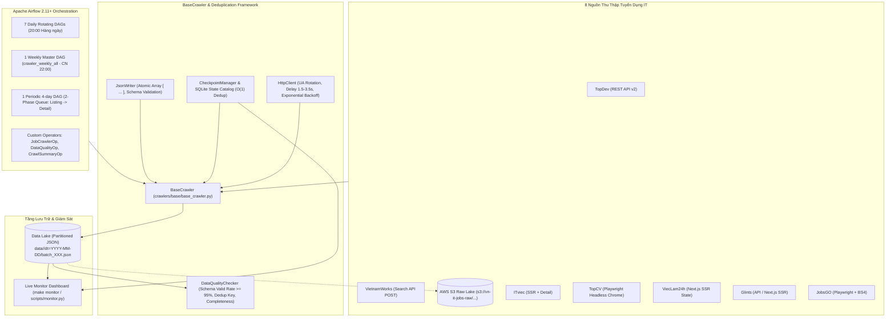

# **VN IT Job Mining Data Collection System**

Hệ thống thu thập dữ liệu tuyển dụng IT tự động tại Việt Nam, orchestrate bằng **Apache Airflow**, lưu trữ dữ liệu dạng **JSON mảng phân vùng (partitioned)**, kiểm soát chất lượng dữ liệu (**DataQualityChecker**) và chuẩn hóa theo **Data Contract Schema v1**.

---

## 🏛️ Kiến Trúc Hệ Thống



---

## 📐 Data Contract & Unified Schema v1

Toàn bộ dữ liệu sau khi thu thập được chuẩn hóa theo định dạng **Compact Schema v1** ([`crawlers/common/schema.py`](crawlers/common/schema.py)), loại bỏ các trường HTML thô và văn bản trùng lặp để tối ưu dung lượng lưu trữ:

### Cấu Trúc Record Chuẩn:
```json
{
  "_meta": {
    "source": "topcv",
    "source_job_id": "2157137",
    "url": "https://www.topcv.vn/viec-lam/2157137.html",
    "dedup_key": "topcv:2157137",
    "crawled_at": "2026-10-09T09:02:58Z",
    "batch_id": "2026-10-09_topcv_001",
    "crawler_version": "0.5.0",
    "language": "vi"
  },
  "raw": {
    "title": "Business Analyst - YC 3 Năm KN - Ưu Tiên CCBA",
    "company": "TỔNG CÔNG TY GIẢI PHÁP DOANH NGHIỆP VIETTEL",
    "salary": {
      "salary_text": "25 - 60 triệu",
      "salary_min": 25.0,
      "salary_max": 60.0,
      "salary_currency": "VND",
      "pay_period": "month",
      "is_negotiable": false,
      "has_commission": false
    },
    "tags": {
      "requirements": ["3 năm kinh nghiệm chuyên môn", "Đại Học trở lên", "Tiếng Anh TOEIC 650"],
      "benefits": null,
      "skills": ["Business Analyst (Phân tích nghiệp vụ)", "IT - Phần mềm"]
    },
    "description_list": [
      "Xây dựng giải pháp nghiệp vụ đối với dự án nâng cấp...",
      "Quản lý tiến độ dự án..."
    ],
    "requirements_list": [
      "Tốt nghiệp Đại học chuyên ngành CNTT...",
      "Có tối thiểu 3 năm kinh nghiệm ở vị trí ứng tuyển..."
    ],
    "benefits_list": [
      "Lương thưởng cạnh tranh trên thị trường...",
      "Chế độ chăm sóc y tế đặc biệt..."
    ],
    "location_text": "Hà Nội",
    "deadline_text": "09/10/2026",
    "employment_type_text": "Toàn thời gian",
    "seniority_text": "Nhân viên",
    "extra": {
      "work_schedule": "Thứ 2 - Thứ 6 (08:00 - 17:30)",
      "education": "Đại Học trở lên"
    }
  }
}
```

---

## 📊 Ma Trận Đối Chiếu Trường Dữ Liệu 8 Nguồn Tuyển Dụng

Để thống nhất Schema v1 trên toàn hệ thống, dưới đây là bảng đối chiếu khả năng trích xuất của từng nguồn:

| Trường Dữ Liệu | TopCV | TopDev | ITviec | VietnamWorks | CareerViet | ViecLam24h | Glints | JobsGO | Quy Chuẩn Schema v1 |
|:---|:---:|:---:|:---:|:---:|:---:|:---:|:---:|:---:|:---|
| **`title`** | ✅ H1 | ✅ API | ✅ JSON-LD | ✅ API | ✅ DOM | ✅ SSR State | ✅ API | ✅ DOM | `str` (Bắt buộc) |
| **`company`** | ✅ Label | ✅ API | ✅ JSON-LD | ✅ API | ✅ DOM | ✅ SSR State | ✅ API | ✅ DOM | `str` (Bắt buộc) |
| **`salary`** | ✅ Lồng | ⚠️ Text | ⚠️ Gated/Text | ✅ Min/Max | ⚠️ Text | ⚠️ Text/Range | ✅ Min/Max | ⚠️ Text/Range | `JobSalary` (Lồng chuẩn) |
| **`tags.requirements`** | ✅ Nhóm riêng | ⚠️ Thuộc tính | ⚠️ Gộp chung | ⚠️ Gộp chung | ⚠️ Gộp chung | ⚠️ Gộp chung | ⚠️ Tag | ⚠️ Tag | `list[str] \| null` |
| **`tags.benefits`** | ✅ (null nếu thiếu)| ⚠️ Icon | ⚠️ Gộp chung | ⚠️ Tag phúc lợi | ⚠️ Icon phúc lợi | ⚠️ Tag | ⚠️ Tag | ⚠️ Tag | `list[str] \| null` |
| **`tags.skills`** | ✅ Chuyên môn | ✅ Tech stack | ✅ Key skills | ✅ Skills tag | ✅ Kỹ năng | ✅ Kỹ năng | ✅ Skills | ✅ Kỹ năng | `list[str] \| null` |
| **`description_list`** | ✅ (`list[str]`) | HTML/Text | Text | HTML/Text | HTML/Text | Text | Text | Text | `list[str]` (Bắt buộc) |
| **`requirements_list`**| ✅ (`list[str]`) | List/Text | Section text | HTML/Text | Section text | List/Text | Section text | List/Text | `list[str] \| null` |
| **`benefits_list`** | ✅ (`list[str]`) | Text | Section text | HTML/Text | Section text | List/Text | Section text | List/Text | `list[str] \| null` |
| **`location_text`** | ✅ Địa điểm | ✅ Addresses | ✅ JobLocation | ✅ City | ✅ Tỉnh thành | ✅ Tỉnh/Thành | ✅ City | ✅ Địa điểm | `str \| null` |
| **`deadline_text`** | ✅ Deadline | ⚠️ | ⚠️ | ✅ Expired date | ✅ Hạn nộp | ✅ Hạn nộp | ⚠️ | ✅ Hạn nộp | `str \| null` |

> [!TIP]
> **Bộ thích ứng tương thích ngược (Smart Ingestion)**: `crawlers/common/schema.py` được trang bị `@model_validator(mode="before")` giúp tự động chuyển đổi các crawler đang xuất định dạng cũ sang cấu trúc chuẩn mà không làm vỡ hệ thống hay gãy pipeline Airflow.

---

## 🚀 Vận Hành Hệ Thống Sản Xuất (Production Operations)

Hệ thống được đóng gói với các lệnh Makefile tiêu chuẩn:

```bash
# 1. Khởi động Airflow Production (chạy ngầm background daemon với PID tracking)
make start-airflow

# 2. Bật màn hình Giám Sát Thời Gian Thực (Live Terminal Monitor)
make monitor

# 3. Dừng an toàn toàn bộ tiến trình Airflow
make stop-airflow
```

---

## 📦 Chạy Thử Nghiệm Từng Crawler Riêng Lẻ

Mỗi nguồn được đóng gói gọn trong đúng **1 file duy nhất** tại `crawlers/sources/<source>/crawler.py`:

```bash
# TopCV (Playwright Headless Chrome)
python3 crawlers/sources/topcv/crawler.py --max-items 30

# TopDev (REST API v2)
python3 crawlers/sources/topdev/crawler.py --max-items 30

# VietnamWorks (Search API POST)
python3 crawlers/sources/vietnamworks/crawler.py --max-items 50

# CareerViet (SSR + Detail)
python3 crawlers/sources/careerviet/crawler.py --max-items 30

# ViecLam24h (Next.js SSR State)
python3 crawlers/sources/vieclam24h/crawler.py --max-items 30

# ITviec (SSR + Detail)
python3 crawlers/sources/itviec/crawler.py --max-items 30

# Glints (API / Next.js)
python3 crawlers/sources/glints/crawler.py --max-items 30

# JobsGO (Playwright + BS4)
python3 crawlers/sources/jobsgo/crawler.py --max-items 30
```

---

## 🧪 Kiểm Thử Tự Động (Unit Testing)

```bash
pytest
```
Toàn bộ **195/195 test cases** đạt trạng thái **100% Passed** (bao gồm schema validation, anti-bot http client, checkpoints, state catalog, json writers, data quality gates và crawler parsers).

---

## 🕒 Lịch Trình Điều Phối 9 DAGs Trên Apache Airflow

| STT | Tên DAG | Loại DAG | Nguồn / Chức năng | Lịch Chạy (Cron) |
|:---:|:---|:---|:---|:---|
| 1 | `crawler_topdev` | Rotating Daily | TopDev REST API | `0 20 * * 1` (Thứ Hai 20:00) |
| 2 | `crawler_careerviet` | Rotating Daily | CareerViet SSR | `0 20 * * 2` (Thứ Ba 20:00) |
| 3 | `crawler_itviec` | Rotating Daily | ITviec SSR | `0 20 * * 3` (Thứ Tư 20:00) |
| 4 | `crawler_vietnamworks` | Rotating Daily | VietnamWorks API | `0 20 * * 4` (Thứ Năm 20:00) |
| 5 | `crawler_topcv` | Rotating Daily | TopCV Playwright | `0 20 * * 5` (Thứ Sáu 20:00) |
| 6 | `crawler_vieclam24h` | Rotating Daily | Việc Làm 24h SSR | `0 20 * * 6` (Thứ Bảy 20:00) |
| 7 | `crawler_glints` | Rotating Daily | Glints API/SSR | `0 20 * * 0` (Chủ Nhật 20:00) |
| 8 | `crawler_weekly_all` | Master Weekly | Cào toàn bộ 8 nguồn song song + `CrawlSummaryOperator` | `0 22 * * 0` (Chủ Nhật 22:00) |
| 9 | `periodic_it_job_mining_4days` | Periodic Pipeline | Hàng đợi 2 pha: Harvest Listing -> Dedup $O(1)$ -> Detail Queue Worker | `0 2 * * *` (Mỗi 4 ngày) |

---

## 📚 Tài Liệu Hướng Dẫn & Báo Cáo

- **Tài liệu Hướng dẫn Thuyết trình & Bảo vệ**: [`docs/presentation_content_guide.md`](docs/presentation_content_guide.md)
- **Sơ đồ Kiến trúc & Data Flow (.excalidraw)**: [`docs/architecture/data_collection_architecture.excalidraw`](docs/architecture/data_collection_architecture.excalidraw)
- **Báo cáo Thu thập & Giám sát Hệ thống**: [`docs/06_collection_and_monitoring_guide.md`](docs/06_collection_and_monitoring_guide.md)
- **Hướng dẫn Vận hành Airflow chi tiết**: [`docs/03_airflow_guide.md`](docs/03_airflow_guide.md)
- **Quy trình chuẩn bóc tách nguồn mới**: [`docs/crawl_documents/01_crawler_analysis_methodology.md`](docs/crawl_documents/01_crawler_analysis_methodology.md)
