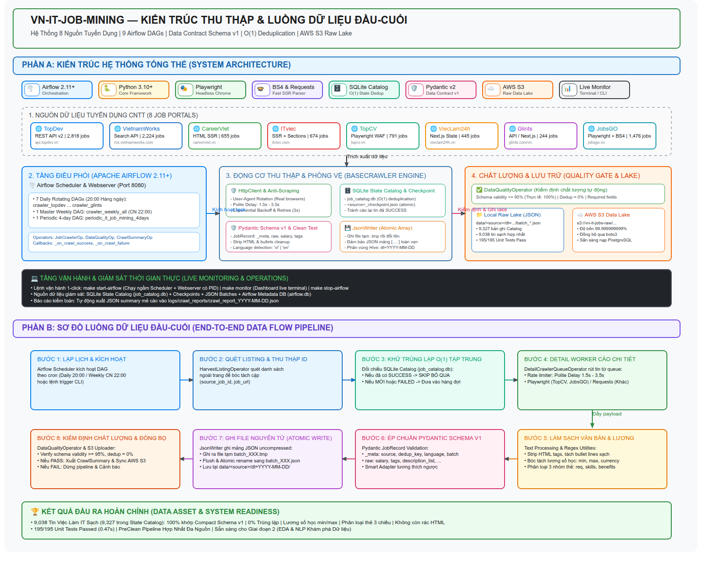

<div align="center">

# 🚀 VN IT Job Mining Data Collection System
### Hệ Thống Thu Thập, Chuẩn Hóa & Khai Phá Dữ Liệu Việc Làm CNTT Việt Nam

[](https://python.org)
[](https://airflow.apache.org)
[](https://docs.pydantic.dev)
[](https://playwright.dev)
[](tests/)
[](data/processed/preClean/merged_jobs_clean.json)
[](https://ut.edu.vn)

<p align="center">
  <b>Hệ thống Data Engineering thu thập tự động từ 8 sàn tuyển dụng công nghệ hàng đầu Việt Nam</b><br>
  Điều phối bởi <b>Apache Airflow</b> • Chuẩn hóa <b>Data Contract Schema v1</b> • Khử trùng lặp siêu tốc <b>$O(1)$ SQLite State Catalog</b><br>
  Pipeline làm sạch tự động <b>PreClean</b> • Sẵn sàng phục vụ nghiên cứu học thuật <b>EDA & NLP</b>
</p>

---

</div>

## 🏛️ 1. Sơ Đồ Kiến Trúc Hệ Thống & Luồng Dữ Liệu Đầu-Cuối

Hệ thống được thiết kế theo tiêu chuẩn Data Engineering hiện đại với kiến trúc phân tầng độc lập:

<div align="center">
  
</div>

<p align="center">
  <a href="docs/architecture/data_collection_architecture.svg"><b>📐 Xem Bản Vẽ Vector SVG Độ Phân Giải Cao</b></a> &nbsp;•&nbsp; 
  <a href="docs/architecture/data_collection_architecture.excalidraw"><b>✏️ Tải File Thiết Kế Gốc Excalidraw (.excalidraw)</b></a>
</p>

### 📌 Tóm Tắt 5 Tầng Kiến Trúc Trọng Tâm:
1. **Tầng Nguồn Tuyển Dụng (8 Job Portals)**: Kết nối đa giao thức: **REST API v2** (TopDev, VietnamWorks), **SSR + BeautifulSoup** (ITviec, CareerViet, ViecLam24h), và **Playwright Headless Chrome** vượt rào cản Cloudflare WAF (TopCV, JobsGO).
2. **Tầng Điều Phối & Lập Lịch (Apache Airflow 2.11+)**: 9 DAGs chuyên biệt gồm 7 Daily Rotating DAGs (20:00), 1 Master Weekly DAG (22:00 Chủ Nhật), và 1 Periodic 4-day Pipeline phân tách 2 pha.
3. **Động Cơ Thu Thập Lõi (BaseCrawler Engine)**: HttpClient xoay vòng User-Agent, giãn cách lịch sự (*Polite Delay* 1.5–3.5s), Exponential Backoff Retry, và SQLite State Catalog chống cào trùng $O(1)$.
4. **Tầng Kiểm Định Chất Lượng (Quality Gate)**: `DataQualityOperator` tự động chặn dữ liệu lỗi, đảm bảo tỷ lệ hợp lệ Schema $\ge 95\%$ (thực tế đạt **100%**), độ trùng lặp $0\%$, không rác HTML.
5. **Tầng Lưu Trữ & Sơ Chế (Data Lake & PreClean)**: Lưu trữ mảng JSON phân vùng Hive (`dt=YYYY-MM-DD/batch_XXX.json`) và pipeline `PreClean` khử trùng đa nguồn hợp nhất thành dataset sạch duy nhất.

---

## 📈 2. Hiện Trạng Tập Dữ Liệu (Live Data Assets)

Sau khi hoàn tất đợt cào toàn diện quy mô lớn cho nguồn TopDev và tích hợp 8 sàn, cơ sở dữ liệu hệ thống ghi nhận các chỉ số thực tế:

<div align="center">

| STT | Sàn Tuyển Dụng | Giao Thức Thu Thập | Số Tin Trong State Catalog | Số Tin Sau Hợp Nhất (Clean) | Tỷ Lệ Đóng Góp |
|:---:|:---|:---|:---:|:---:|:---:|
| **1** | **TopDev** | REST API v2 (`api.topdev.vn`) | **2.818** | **2.740** | 30.3% |
| **2** | **VietnamWorks** | Search API POST (`ms.vietnamworks.com`) | **2.224** | **2.185** | 24.2% |
| **3** | **JobsGO** | Playwright + BeautifulSoup4 | **1.476** | **1.442** | 16.0% |
| **4** | **TopCV** | Playwright Anti-Cloudflare WAF | **791** | **778** | 8.6% |
| **5** | **ITviec** | SSR HTML + JSON-LD Schema | **674** | **661** | 7.3% |
| **6** | **CareerViet** | SSR HTML Parser (CareerBuilder VN) | **655** | **643** | 7.1% |
| **7** | **ViecLam24h** | Next.js SSR `__NEXT_DATA__` | **445** | **439** | 4.8% |
| **8** | **Glints** | GraphQL searchJobsV3 + SSR | **244** | **238** | 2.6% |
| 🏆 | **TỔNG HỢP TOÀN HỆ THỐNG** | **8 Nguồn Sàn CNTT Việt Nam** | **`9.327` tin** | **`9.038` tin sạch** | **100.0%** |

</div>

> [!NOTE]
> File dữ liệu sạch hoàn chỉnh được lưu tại: [`data/processed/preClean/merged_jobs_clean.json`](data/processed/preClean/merged_jobs_clean.json). Toàn bộ 316 trường hợp dị biệt / lỗi trường tiêu đề rác được tự động cách ly vào [`data/queue/recrawl_corrupted_queue.json`](data/queue/recrawl_corrupted_queue.json).

---

## 📐 3. Data Contract & Unified Compact Schema v1

Mọi bản ghi từ bất kỳ nguồn tuyển dụng nào đều được ép kiểu và xác thực nghiêm ngặt bằng Pydantic model [`JobRecord`](crawlers/common/schema.py):

### 📄 Cấu Trúc Record Tiêu Chuẩn:
```json
{
  "_meta": {
    "source": "topdev",
    "source_job_id": "2132792",
    "url": "https://topdev.vn/viec-lam/ai-native-software-engineer-weeds-vina-2132792",
    "dedup_key": "topdev:2132792",
    "crawled_at": "2026-10-12T23:13:02+07:00",
    "batch_id": "2026-10-12_topdev_002",
    "crawler_version": "0.5.0",
    "language": "vi"
  },
  "raw": {
    "title": "AI-NATIVE SOFTWARE ENGINEER",
    "company": "WEEDS VINA",
    "salary": {
      "salary_text": "Thoả thuận",
      "salary_min": null,
      "salary_max": null,
      "salary_currency": "VND",
      "pay_period": "month",
      "is_negotiable": true,
      "has_commission": false
    },
    "tags": {
      "requirements": ["3+ năm kinh nghiệm Java/Python", "Thành thạo cấu trúc dữ liệu & giải thuật"],
      "benefits": null,
      "skills": ["Java", "Python", "REST API", "Data Structure & Algorithm", "AI"]
    },
    "description_list": [
      "Tham gia phát triển kiến trúc hệ thống AI-native cho khách hàng doanh nghiệp.",
      "Tối ưu hiệu năng các microservices và luồng xử lý dữ liệu lớn."
    ],
    "requirements_list": [
      "Có ít nhất 3 năm kinh nghiệm lập trình backend với Java hoặc Python.",
      "Hiểu biết sâu sắc về kiến trúc phần mềm và tích hợp AI/LLM."
    ],
    "benefits_list": [
      "Mức lương thỏa thuận cạnh tranh theo năng lực.",
      "Bảo hiểm sức khỏe cao cấp, thưởng dự án định kỳ."
    ],
    "location_text": "Hồ Chí Minh",
    "deadline_text": "15/11/2026",
    "employment_type_text": "Full-time",
    "seniority_text": "Senior",
    "extra": {
      "experience": "Senior",
      "job_type": "In-office"
    }
  }
}
```

---

## 📊 4. Ma Trận Bóc Tách Trường Dữ Liệu 8 Nguồn (Capability Matrix)

| Trường Dữ Liệu | TopCV | TopDev | ITviec | VietnamWorks | CareerViet | ViecLam24h | Glints | JobsGO | Quy Chuẩn Schema v1 |
|:---|:---:|:---:|:---:|:---:|:---:|:---:|:---:|:---:|:---|
| **`title`** | ✅ H1 | ✅ API | ✅ JSON-LD | ✅ API | ✅ DOM | ✅ SSR State | ✅ API | ✅ DOM | `str` *(Bắt buộc)* |
| **`company`** | ✅ Label | ✅ API | ✅ JSON-LD | ✅ API | ✅ DOM | ✅ SSR State | ✅ API | ✅ DOM | `str` *(Bắt buộc)* |
| **`salary`** | ✅ Lồng | ✅ Lồng | ⚠️ Text | ✅ Min/Max | ⚠️ Text | ⚠️ Text/Range | ✅ Min/Max | ⚠️ Text/Range | `JobSalary` *(Lồng số học)* |
| **`tags.requirements`** | ✅ Nhóm riêng | ✅ Chuyên sâu | ⚠️ Gộp chung | ⚠️ Gộp chung | ⚠️ Gộp chung | ⚠️ Gộp chung | ⚠️ Tag | ⚠️ Tag | `list[str] \| null` |
| **`tags.benefits`** | ✅ *(null nếu thiếu)*| ✅ Phúc lợi v2 | ⚠️ Gộp chung | ⚠️ Tag phúc lợi | ⚠️ Icon phúc lợi | ⚠️ Tag | ⚠️ Tag | ⚠️ Tag | `list[str] \| null` |
| **`tags.skills`** | ✅ Chuyên môn | ✅ Tech stack | ✅ Key skills | ✅ Skills tag | ✅ Kỹ năng | ✅ Kỹ năng | ✅ Skills | ✅ Kỹ năng | `list[str] \| null` |
| **`description_list`** | ✅ (`list[str]`) | ✅ Sạch thẻ | ✅ Clean lines| ✅ Sạch thẻ | ✅ Sạch thẻ | ✅ Clean lines| ✅ Sạch thẻ | ✅ Clean lines| `list[str]` *(Bắt buộc)* |
| **`requirements_list`**| ✅ (`list[str]`) | ✅ Sạch thẻ | ✅ Clean lines| ✅ Sạch thẻ | ✅ Sạch thẻ | ✅ Clean lines| ✅ Sạch thẻ | ✅ Clean lines| `list[str] \| null` |
| **`benefits_list`** | ✅ (`list[str]`) | ✅ Sạch thẻ | ✅ Clean lines| ✅ Sạch thẻ | ✅ Clean lines| ✅ Clean lines| ✅ Sạch thẻ | ✅ Clean lines| `list[str] \| null` |
| **`location_text`** | ✅ Địa điểm | ✅ Addresses | ✅ JobLocation | ✅ City | ✅ Tỉnh thành | ✅ Tỉnh/Thành | ✅ City | ✅ Địa điểm | `str \| null` |
| **`deadline_text`** | ✅ Hạn nộp | ✅ Valid through | ⚠️ Tính toán | ✅ Expired date | ✅ Hạn nộp | ✅ Deadline | ⚠️ | ✅ Hạn nộp | `str \| null` |

---

## ⚙️ 5. Vận Hành Hệ Thống (Operations & CLI Commands)

### 5.1. Khởi Động Nhanh Qua Makefile:
```bash
# 1. Khởi động Airflow Production (chạy ngầm daemon với PID tracking an toàn)
make start-airflow

# 2. Khởi chạy màn hình Giám Sát Thời Gian Thực (Live Terminal Monitor)
make monitor

# 3. Chạy toàn bộ kiểm thử đơn vị tự động
make test

# 4. Dừng an toàn toàn bộ tiến trình Airflow
make stop-airflow
```

### 5.2. Chạy Cào Từng Nguồn Độc Lập Qua `run.py`:
```bash
# TopDev (REST API)
.venv/bin/python run.py --source topdev --max-items 30

# VietnamWorks (Search API POST)
.venv/bin/python run.py --source vietnamworks --max-items 50

# ITviec (SSR + Detail)
.venv/bin/python run.py --source itviec --max-items 30

# TopCV (Playwright Browser)
.venv/bin/python run.py --source topcv --max-items 30

# JobsGO (Playwright + BS4)
.venv/bin/python run.py --source jobsgo --max-items 30

# CareerViet (HTML SSR)
.venv/bin/python run.py --source careerviet --max-items 30

# Việc Làm 24h (Next.js SSR)
.venv/bin/python run.py --source vieclam24h --max-items 30

# Glints (GraphQL / SSR)
.venv/bin/python run.py --source glints --max-items 30
```

### 5.3. Chạy Script Điều Phối Chuyên Biệt TopDev 2.822 Tin:
```bash
# Pha 1: Quét danh sách 189 trang URL
.venv/bin/python scripts/crawl_topdev_2822.py --phase 1

# Pha 2: Cào chi tiết và lọc trùng State Catalog
.venv/bin/python scripts/crawl_topdev_2822.py --phase 2 --delay 0.6

# Pha 3: Đồng bộ Catalog & Chạy PreClean hợp nhất dataset
.venv/bin/python scripts/crawl_topdev_2822.py --phase 3
```

---

## 🕒 6. Lịch Trình Điều Phối 9 DAGs Apache Airflow

```text
airflow/dags/
├── crawler_dags.py                  # Chứa 7 Daily Rotating DAGs & 1 Master Weekly DAG
└── periodic_job_mining_dag.py       # Chứa 1 Periodic 4-day Pipeline 2 Pha
```

| STT | Tên DAG | Phân Loại | Nguồn / Chức Năng | Tần Suất Chạy (Cron) |
|:---:|:---|:---|:---|:---|
| **1** | `crawler_topdev` | Rotating Daily | TopDev REST API v2 | `0 20 * * 1` *(Thứ Hai 20:00)* |
| **2** | `crawler_careerviet` | Rotating Daily | CareerViet HTML SSR | `0 20 * * 2` *(Thứ Ba 20:00)* |
| **3** | `crawler_itviec` | Rotating Daily | ITviec SSR & JSON-LD | `0 20 * * 3` *(Thứ Tư 20:00)* |
| **4** | `crawler_vietnamworks` | Rotating Daily | VietnamWorks Search API | `0 20 * * 4` *(Thứ Năm 20:00)* |
| **5** | `crawler_topcv` | Rotating Daily | TopCV Playwright Anti-WAF | `0 20 * * 5` *(Thứ Sáu 20:00)* |
| **6** | `crawler_vieclam24h` | Rotating Daily | Việc Làm 24h Next.js SSR | `0 20 * * 6` *(Thứ Bảy 20:00)* |
| **7** | `crawler_glints` | Rotating Daily | Glints Vietnam GraphQL | `0 20 * * 0` *(Chủ Nhật 20:00)* |
| **8** | `crawler_weekly_all` | Master Weekly | Cào toàn bộ 8 nguồn song song + Báo cáo kiểm toán | `0 22 * * 0` *(Chủ Nhật 22:00)* |
| **9** | `periodic_it_job_mining_4days`| Periodic Pipeline | Hàng đợi 2 pha: Harvest Listing $\rightarrow$ Dedup $\rightarrow$ Detail Queue | `0 2 * * *` *(Mỗi 4 ngày)* |

---

## 🧪 7. Kiểm Thử Hệ Thống (Unit Tests Suite)

Hệ thống sở hữu bộ kiểm thử đơn vị toàn diện với **195 test cases**:

```bash
.venv/bin/pytest tests/
```

```text
============================= test session starts ==============================
platform linux -- Python 3.12.3, pytest-8.3.3, pluggy-1.5.0
rootdir: /home/billtran/Desktop/Learning/UTH/VN-IT-Job-Mining
collected 195 items

tests/unit/test_checkpoint.py ...........                                [  5%]
tests/unit/test_data_quality.py ..........                               [ 10%]
tests/unit/test_http_client.py ...............                          [ 18%]
tests/unit/test_itviec_crawler.py .............                          [ 25%]
tests/unit/test_itviec_parser.py .................                      [ 33%]
tests/unit/test_job_catalog.py .....                                     [ 36%]
tests/unit/test_jobsgo_crawler.py .                                      [ 36%]
tests/unit/test_json_writer.py .....                                     [ 39%]
tests/unit/test_jsonl_writer.py ...                                      [ 41%]
tests/unit/test_merge_datasets.py .                                      [ 41%]
tests/unit/test_preclean.py .......                                      [ 45%]
tests/unit/test_schema.py .............................................. [ 68%]
tests/unit/test_topcv_crawler.py .                                       [ 69%]
tests/unit/test_topdev_crawler.py ..                                     [ 70%]
tests/unit/test_utils_enhanced.py .............................          [ 85%]
tests/unit/test_vieclam24h_crawler.py ..                                 [ 86%]
tests/unit/test_vietnamworks_crawler.py .                                [ 86%]
...
============================= 195 passed in 0.47s ==============================
```

---

## 📂 8. Cấu Trúc Mã Nguồn Thư Mục (Project Structure)

```text
VN-IT-Job-Mining/
├── airflow/                              # Cấu hình & Orchestration Apache Airflow
│   ├── dags/
│   │   ├── crawler_dags.py               # 7 Daily DAGs + 1 Weekly Master DAG
│   │   └── periodic_job_mining_dag.py    # Pipeline 4 ngày 2 pha
│   └── plugins/
│       ├── crawler_operators.py          # JobCrawlerOperator, DataQualityOperator
│       └── crawl_summary_operator.py     # CrawlSummaryOperator xuất JSON báo cáo
├── crawlers/
│   ├── base/
│   │   └── base_crawler.py               # Abstract Base Crawler chuẩn
│   ├── common/
│   │   ├── checkpoint.py                 # CheckpointManager chống cào trùng
│   │   ├── data_quality.py               # DataQualityChecker xác thực Schema v1
│   │   ├── http_client.py                # HttpClient lịch sự, xoay User-Agent
│   │   ├── job_catalog.py                # SQLite State Catalog O(1) deduplication
│   │   ├── json_writer.py                # Atomic JSON array [ ... ] writer
│   │   ├── schema.py                     # Pydantic v2 Compact Schema (JobRecord)
│   │   └── utils.py                      # Regex lương, dọn HTML, detect language
│   ├── preprocessing/
│   │   └── preClean/                     # Pipeline làm sạch và hợp nhất đa nguồn
│   │       ├── anomaly_detector.py       # Cách ly mẫu dữ liệu dị biệt
│   │       ├── pipeline.py               # PreCleanPipeline xuất merged_jobs_clean.json
│   │       ├── salary_parser.py          # Bóc tách lương số học min/max
│   │       └── text_cleaner.py           # Dọn sạch bullet points và khoảng trắng thừa
│   └── sources/                          # Triển khai 8 nguồn tuyển dụng
│       ├── careerviet/crawler.py
│       ├── glints/crawler.py
│       ├── itviec/crawler.py
│       ├── jobsgo/crawler.py
│       ├── topcv/crawler.py
│       ├── topdev/crawler.py
│       ├── vieclam24h/crawler.py
│       └── vietnamworks/crawler.py
├── data/                                 # Kho lưu trữ Data Lake (Partitioned Hive)
│   ├── <source>/dt=YYYY-MM-DD/batch_XXX.json
│   ├── processed/preClean/merged_jobs_clean.json   # 9.038 jobs sạch hợp nhất
│   ├── queue/recrawl_corrupted_queue.json          # Hàng đợi các job lỗi/dị biệt
│   └── state/job_catalog.db              # SQLite Database quản lý 9.327 jobs
├── docs/                                 # Tài liệu kỹ thuật & thiết kế kiến trúc
│   ├── architecture/
│   │   ├── data_collection_architecture.png       # Ảnh kiến trúc độ phân giải cao
│   │   ├── data_collection_architecture.svg       # Bản vẽ vector sắc nét
│   │   └── data_collection_architecture.excalidraw# File thiết kế gốc Excalidraw
│   ├── 03_airflow_guide.md               # Hướng dẫn chi tiết vận hành Airflow
│   └── 06_collection_and_monitoring_guide.md      # Hướng dẫn giám sát hệ thống
├── scripts/                              # Kịch bản tự động hóa & công cụ CLI
│   ├── crawl_topdev_2822.py              # Script cào trọn vẹn 2.822 tin TopDev
│   ├── monitor.py                        # Terminal Live Dashboard thời gian thực
│   ├── run_preclean.py                   # Script chạy riêng PreClean Pipeline
│   ├── start_airflow.sh                  # Khởi động Airflow background
│   └── sync_catalog.py                   # Đồng bộ dữ liệu vào State Catalog
├── tests/                                # 195 Unit test cases bao phủ toàn hệ thống
├── Makefile                              # Bộ lệnh điều phối 1-click chuẩn DevOps
├── README.md                             # Tài liệu tổng quan dự án chính
└── run.py                                # Giao diện dòng lệnh trung tâm (CLI Runner)
```

---

## 👥 9. Đội Ngũ Thực Hiện (UTH Research Team)

Đồ án được thực hiện bởi nhóm nghiên cứu sinh viên **Trường Đại học Giao thông Vận tải TP.HCM (UTH)**:

* **Nguyễn Tấn Thuận (Bill Tran - Lead)**: Thiết kế Kiến trúc Data Platform, Core BaseCrawler, Schema v1, TopCV Crawler, Pipeline PreClean & Điều phối Airflow.
* **Nguyễn Hoàng Sơn**: Phụ trách nghiên cứu & triển khai TopDev Crawler.
* **Đoàn Tấn Phát**: Phụ trách nghiên cứu & triển khai ITviec Crawler.
* **Trương Hữu Phúc**: Phụ trách nghiên cứu & triển khai Việc Làm 24h Crawler.
* **Phan Khương Duy**: Phụ trách nghiên cứu & triển khai Glints Crawler.
* **Nguyễn Tấn Tài**: Trưởng nhóm Khai phá Dữ liệu Chuyên đề 1 (Phân tích Lương & Cấu trúc thị trường).
* **Nguyễn Đăng Khoa**: Trưởng nhóm Khai phá Dữ liệu Chuyên đề 2 (Phân tích Kỹ năng Công nghệ, Bản đồ Địa lý & NLP Text Mining).

---

<div align="center">
  <sub>Dự án mã nguồn mở phục vụ nghiên cứu học thuật tại Trường Đại học Giao thông Vận tải TP.HCM (UTH) • 2026</sub>
</div>
