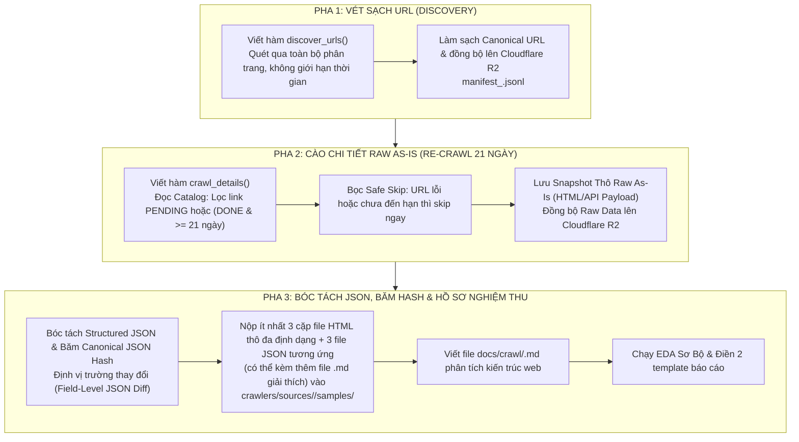

# BẢNG PHÂN CÔNG NHIỆM VỤ DỰ ÁN (TASKS & MILESTONES)

> **Dự án:** Phân tích thị trường lao động IT và nhu cầu kỹ năng nghề nghiệp tại Việt Nam (VN-IT-Job-Mining)  
> **Quy định Git:** Toàn bộ thành viên bắt đầu làm việc từ nhánh `main` và chuyển sang nhánh độc lập của mình: `crawls/<tenweb>`.  
> **Bộ 3 tài liệu quy trình bắt buộc phải đọc trước khi bắt tay vào code:**
> 1. [01_modern_data_mining_overview.md](file:///run/media/billtran/Data/Archduker/Study/UTH/Core/DataMining/VN-IT-Job-Mining/docs/01_modern_data_mining_overview.md)
> 2. [02_crawling_architecture_guide.md](file:///run/media/billtran/Data/Archduker/Study/UTH/Core/DataMining/VN-IT-Job-Mining/docs/02_crawling_architecture_guide.md)
> 3. [03_eda_and_integration_guide.md](file:///run/media/billtran/Data/Archduker/Study/UTH/Core/DataMining/VN-IT-Job-Mining/docs/03_eda_and_integration_guide.md)

---

## 1. MA TRẬN PHÂN CÔNG THÀNH VIÊN & NHÁNH LÀM VIỆC

| Thành viên | Nguồn phụ trách | Phương thức thu thập chính | Nhánh Git làm việc | File Báo cáo & Tài liệu cần nộp |
| :--- | :--- | :--- | :--- | :--- |
| **Sơn** | **TopDev** | REST API (`/api/v1/jobs`) | `crawls/topdev` | `docs/crawl/topdev.md`<br>`reports/topdev_inventory.md`<br>`reports/topdev_eda.md` |
| **Thuận** | **TopCV** | SSR HTML / HTTP Parsing | `crawls/topcv` | `docs/crawl/topcv.md`<br>`reports/topcv_inventory.md`<br>`reports/topcv_eda.md` |
| **Khoa** | **VietnamWorks** | REST / Algolia Search API | `crawls/vietnamworks` | `docs/crawl/vietnamworks.md`<br>`reports/vietnamworks_inventory.md`<br>`reports/vietnamworks_eda.md` |
| **Tài** | **CareerViet** | SSR DOM Parsing | `crawls/careerviet` | `docs/crawl/careerviet.md`<br>`reports/careerviet_inventory.md`<br>`reports/careerviet_eda.md` |
| **Phúc** | **Vieclam24h** | SSR DOM / Next.js Data | `crawls/vieclam24h` | `docs/crawl/vieclam24h.md`<br>`reports/vieclam24h_inventory.md`<br>`reports/vieclam24h_eda.md` |
| **Phát** | **ITViec** | Playwright Headless Chrome | `crawls/itviec` | `docs/crawl/itviec.md`<br>`reports/itviec_inventory.md`<br>`reports/itviec_eda.md` |
| **Duy** | **Glints & JobsGO** | GraphQL API & SSR DOM | `crawls/glints-jobsgo` | `docs/crawl/glints_jobsgo.md`<br>`reports/glints_jobsgo_inventory.md`<br>`reports/glints_jobsgo_eda.md` |

---

## 2. QUY TRÌNH THỰC HIỆN 2 PHA CỦA TỪNG THÀNH VIÊN



> [!IMPORTANT]
> **Quy định bắt buộc về Lưu trữ Đám mây (Multi-Cloud Lakehouse Sync):**  
> Mọi thành viên khi cào dữ liệu (cả Pha 1: URL Ledger Manifest và Pha 2: Raw Data / Raw HTML) **bắt buộc phải đồng bộ lên cả Cloudflare R2 Object Storage** nhằm đảm bảo tính sẵn sàng cao, sao lưu an toàn và phục vụ khai phá tập trung.

---

## 3. CHI TIẾT CÔNG VIỆC TỪNG BẠN

### 3.1. Sơn — Phụ trách `TopDev` (Nhánh: `crawls/topdev`)
- [ ] **Pha 1 (URL Discovery):** Viết `discover_urls()` gọi REST API `/api/v1/jobs` lấy toàn bộ URL/Job IDs của tất cả các trang, ghi vào manifest và đồng bộ lên **Cloudflare R2** + **Cloudflare**.
- [ ] **Pha 2 (Detail Extraction):** Viết `crawl_details()` cào 100% payload chi tiết. Áp dụng cơ chế Safe Skip khi gặp lỗi. Đổi trạng thái sang `DONE`, chu kỳ re-crawl 21 ngày. Đồng bộ raw payload lên **Cloudflare R2** + **Cloudflare**.
- [ ] **Hồ sơ nghiệm thu bắt buộc:**
  - `crawlers/sources/topdev/samples/`: **Tối thiểu 3 file HTML thô (hoặc response DOM/web) kèm 3 file JSON tương ứng** có định dạng khác nhau (tin lương VND, lương USD, tin nhiều tech tags). *Có thể nộp kèm file `.md` mô tả chi tiết từng sample*.
  - Tự viết `docs/crawl/topdev.md` phân tích kiến trúc API, phân trang và cấu trúc trường của TopDev.
  - Điền báo cáo theo 2 mẫu [raw_crawl_inventory_template.md](file:///run/media/billtran/Data/Archduker/Study/UTH/Core/DataMining/VN-IT-Job-Mining/templates/raw_crawl_inventory_template.md) và [preliminary_eda_template.md](file:///run/media/billtran/Data/Archduker/Study/UTH/Core/DataMining/VN-IT-Job-Mining/templates/preliminary_eda_template.md).

### 3.2. Thuận — Phụ trách `TopCV` (Nhánh: `crawls/topcv`)
- [ ] **Pha 1 (URL Discovery):** Viết `discover_urls()` cào sạch danh sách link bài đăng từ trang tìm kiếm TopCV (không giới hạn thời gian), ghi vào URL Ledger và đồng bộ lên **Cloudflare R2** + **Cloudflare**.
- [ ] **Pha 2 (Detail Extraction):** Viết `crawl_details()` cào raw HTML bài đăng nguyên bản (Zero Info Loss). Bóc tách trường vào JSON và áp dụng Canonical JSON Hashing để quản lý phiên bản CDC và repost. Đổi trạng thái sang `DONE`, kiểm tra re-crawl 21 ngày. Đồng bộ lên **Cloudflare R2** + **Cloudflare**.
- [ ] **Hồ sơ nghiệm thu bắt buộc:**
  - `crawlers/sources/topcv/samples/`: **Ít nhất 3 file HTML thô** có layout khác nhau (tin thường, tin Hot/VIP, tin có badge đặc thù) kèm **3 file JSON tương ứng**. *Có thể nộp kèm file `.md` mô tả chi tiết từng sample*.
  - Tự viết `docs/crawl/topcv.md` phân tích DOM và cấu trúc trường bóc tách của TopCV.
  - Điền 2 báo cáo kiểm kê trường và EDA sơ bộ.

### 3.3. Khoa — Phụ trách `VietnamWorks` (Nhánh: `crawls/vietnamworks`)
- [ ] **Pha 1 (URL Discovery):** Viết `discover_urls()` quét Algolia search hits, thu thập toàn bộ job links ghi vào manifest và đồng bộ lên **Cloudflare R2** + **Cloudflare**.
- [ ] **Pha 2 (Detail Extraction):** Viết `crawl_details()` lấy đầy đủ trường kỹ năng và phúc lợi của VietnamWorks. Tích hợp Safe Skip và quản lý trạng thái `DONE`. Đồng bộ raw batch lên **Cloudflare R2** + **Cloudflare**.
- [ ] **Hồ sơ nghiệm thu bắt buộc:**
  - `crawlers/sources/vietnamworks/samples/`: **Ít nhất 3 file HTML thô (hoặc web snapshot) kèm 3 file JSON tương ứng**. *Có thể nộp kèm file `.md` mô tả chi tiết từng sample*.
  - Tự viết `docs/crawl/vietnamworks.md` phân tích headers, tokens và API search.
  - Điền 2 báo cáo kiểm kê trường và EDA sơ bộ.

### 3.4. Tài — Phụ trách `CareerViet` (Nhánh: `crawls/careerviet`)
- [ ] **Pha 1 (URL Discovery):** Viết `discover_urls()` duyệt toàn bộ danh mục IT của CareerViet lấy danh sách link, ghi vào manifest và đồng bộ lên **Cloudflare R2** + **Cloudflare**.
- [ ] **Pha 2 (Detail Extraction):** Viết `crawl_details()` bóc tách nguyên vẹn SSR HTML. Lưu raw HTML, chuyển đổi sang JSON và băm Canonical JSON Hash. Đổi trạng thái `DONE`, re-crawl 21 ngày. Đồng bộ lên **Cloudflare R2** + **Cloudflare**.
- [ ] **Hồ sơ nghiệm thu bắt buộc:**
  - `crawlers/sources/careerviet/samples/`: **Ít nhất 3 file HTML thô** có cấu trúc khác nhau kèm **3 file JSON tương ứng**. *Có thể nộp kèm file `.md` mô tả chi tiết từng sample*.
  - Tự viết `docs/crawl/careerviet.md` phân tích DOM và kỹ thuật cào.
  - Điền 2 báo cáo kiểm kê trường và EDA sơ bộ.

### 3.5. Phúc — Phụ trách `Vieclam24h` (Nhánh: `crawls/vieclam24h`)
- [ ] **Pha 1 (URL Discovery):** Viết `discover_urls()` cào sạch link việc làm IT trên Vieclam24h, ghi vào manifest và đồng bộ lên **Cloudflare R2** + **Cloudflare**.
- [ ] **Pha 2 (Detail Extraction):** Viết `crawl_details()` bóc tách JSON-LD hoặc `__NEXT_DATA__` thô. Bọc khối Safe Skip bắt lỗi. Quản lý trạng thái `DONE`. Đồng bộ lên **Cloudflare R2** + **Cloudflare**.
- [ ] **Hồ sơ nghiệm thu bắt buộc:**
  - `crawlers/sources/vieclam24h/samples/`: **Ít nhất 3 file HTML thô** kèm **3 file JSON tương ứng**. *Có thể nộp kèm file `.md` mô tả chi tiết từng sample*.
  - Tự viết `docs/crawl/vieclam24h.md` phân tích cấu trúc dữ liệu Next.js của 24h.
  - Điền 2 báo cáo kiểm kê trường và EDA sơ bộ.

### 3.6. Phát — Phụ trách `ITViec` (Nhánh: `crawls/itviec`)
- [ ] **Pha 1 (URL Discovery):** Sử dụng Playwright / httpx duyệt toàn bộ danh sách việc làm ITviec lưu vào manifest và đồng bộ lên **Cloudflare R2** + **Cloudflare**.
- [ ] **Pha 2 (Detail Extraction):** Viết `crawl_details()` cào raw HTML chi tiết (thẻ kỹ năng, "3 reasons to join us", văn bản JD). Bóc tách JSON và băm Canonical JSON Hash. Trạng thái `DONE`, re-crawl 21 ngày. Đồng bộ lên **Cloudflare R2** + **Cloudflare**.
- [ ] **Hồ sơ nghiệm thu bắt buộc:**
  - `crawlers/sources/itviec/samples/`: **Ít nhất 3 file HTML thô** (tin lương công khai, tin lương ẩn, tin Spotlight) kèm **3 file JSON tương ứng**. *Có thể nộp kèm file `.md` mô tả chi tiết từng sample*.
  - Tự viết `docs/crawl/itviec.md` phân tích cơ chế vượt Cloudflare nhẹ và selector chính.
  - Điền 2 báo cáo kiểm kê trường và EDA sơ bộ.

### 3.7. Duy — Phụ trách `Glints & JobsGO` (Nhánh: `crawls/glints-jobsgo`)
- [ ] **Pha 1 (URL Discovery):** Viết `discover_urls()` cho cả Glints (GraphQL) và JobsGO (SSR) lấy toàn bộ danh mục link, đồng bộ lên **Cloudflare R2** + **Cloudflare**.
- [ ] **Pha 2 (Detail Extraction):** Viết `crawl_details()` bóc tách dữ liệu thô, áp dụng Safe Skip khi một link bị lỗi, lưu trạng thái `DONE`, chu kỳ 21 ngày. Đồng bộ lên **Cloudflare R2** + **Cloudflare**.
- [ ] **Hồ sơ nghiệm thu bắt buộc:**
  - `crawlers/sources/glints/samples/` và `jobsgo/samples/`: **Ít nhất 3 file HTML thô** kèm **3 file JSON tương ứng** cho mỗi sàn. *Có thể nộp kèm file `.md` mô tả chi tiết từng sample*.
  - Tự viết `docs/crawl/glints_jobsgo.md` phân tích kiến trúc của 2 trang web.
  - Điền 2 báo cáo kiểm kê trường và EDA sơ bộ.

---

## 4. TIÊU CHUẨN NGHIỆM THU (DEFINITION OF DONE - DOD)

Một thành viên được tính là hoàn thành nhiệm vụ khi thỏa mãn 7 điều kiện bắt buộc:
1. **Phân tách 2 pha:** Có đủ 2 hàm `discover_urls()` (vét sạch link, không giới hạn thời gian) và `crawl_details()` (cào chi tiết).
2. **Safe Skip & Fault-Tolerance:** Script cào không bị crash khi gặp 1 link lỗi 404/500/timeout; tự động skip qua link tiếp theo.
3. **Cơ chế Re-crawl 21 ngày:** Đặt trạng thái `DONE`, chỉ cào lại bài viết khi đã đủ $\ge 21$ ngày.
4. **Bộ kiểm thử đa định dạng (Samples):** Có tối thiểu **3 file HTML mẫu thô** có cấu trúc layout khác biệt kèm **3 file JSON kết quả tương ứng** trong thư mục `crawlers/sources/<tenweb>/samples/` (khuyến khích kèm theo file `.md` mô tả/hướng dẫn phân tích sample).
5. **Đồng bộ lưu trữ Đám mây & Lakehouse (Cloudflare R2 & Cloudflare):** Toàn bộ dữ liệu cào (URL Ledger Manifest ở Pha 1 & Raw Data ở Pha 2) bắt buộc phải được đồng bộ đầy đủ lên **cả Cloudflare R2 Object Storage**.
6. **Tự viết file phân tích kiến trúc:** Nộp file `docs/crawl/<tenweb>.md` giải thích chi tiết cơ chế cào và container selector của web mình.
7. **Đầy đủ 2 báo cáo chất lượng:**
   - `reports/<source>_inventory.md` (theo [raw_crawl_inventory_template.md](file:///run/media/billtran/Data/Archduker/Study/UTH/Core/DataMining/VN-IT-Job-Mining/templates/raw_crawl_inventory_template.md)).
   - `reports/<source>_eda.md` (theo [preliminary_eda_template.md](file:///run/media/billtran/Data/Archduker/Study/UTH/Core/DataMining/VN-IT-Job-Mining/templates/preliminary_eda_template.md)).

---

## 5. PHÂN CÔNG GIAI ĐOẠN 2: EDA KIỂM TRA CHẤT LƯỢNG DỮ LIỆU & KHAI PHÁ KHOẢNG TRỐNG ĐA NGUỒN

Sau khi dữ liệu thô (Raw As-Is) đã được kéo về Lakehouse (Cloudflare R2), dự án kích hoạt 2 nhóm chuyên trách theo phương pháp luận đi lên từ câu hỏi kỹ thuật (**Inquiry-Driven Framework**) phục vụ trực tiếp cho bước Pre-processing:

### 5.1. Nhóm EDA Kiểm Tra Chất Lượng Dữ Liệu (3 Thành Viên)
- **Nhiệm vụ:** Đóng vai trò là "kính hiển vi chẩn đoán chất lượng dữ liệu thô", kiểm tra toàn diện 5 trụ cột kỹ thuật: Độ hoàn thiện (Completeness / Missingness), Tính hợp lệ & Kiểu dữ liệu (Validity & Schema Types), Tính duy nhất (Uniqueness / Duplication), Hình thái phân phối & Ngoại lai (Distribution & Outliers via IQR), và Độ thiên lệch & Mất cân bằng (Bias & Class Balance). Xuất bộ 7 biểu đồ chẩn đoán chất lượng dữ liệu để làm cơ sở cho kế hoạch Tiền xử lý.
- **Phân công Hybrid:**
  - *Thành viên 1:* Chuyên môn Sức khỏe dữ liệu & Phân phối số $\to$ Phụ trách **TopCV, Vieclam24h, CareerViet**.
  - *Thành viên 2:* Chuyên môn Tech Stack & Xử lý văn bản NLP $\to$ Phụ trách **ITViec, TopDev, VietnamWorks**.
  - *Thành viên 3:* Chuyên môn Tương quan đa chiều & Pipeline đa nguồn $\to$ Phụ trách **Glints, JobsGO** (+ Cross-Platform Master Pipeline).
- **Tài liệu hướng dẫn & nghiệm thu chi tiết:** 👉 [01_huong_dan_eda_nhom_3_nguoi.md](file:///run/media/billtran/Data/Archduker/Study/UTH/Core/DataMining/VN-IT-Job-Mining/docs/tasks/01_huong_dan_eda_nhom_3_nguoi.md)

### 5.2. Nhóm Khai Phá Khoảng Trống Dữ Liệu & So Sánh Bù Trừ Đa Nguồn (Nhóm Còn Lại)
- **Nhiệm vụ:** Áp dụng mô hình câu hỏi **Why - What - How** để đào sâu câu hỏi cốt tử: **"Bộ dữ liệu nguồn đó THIẾU GÌ?" (Data Gap Analysis)**. Tự do bắt cặp song song (mỗi cặp 2 người) để thực hiện đối chiếu chéo **2 nguồn trên 8 nguồn**, tìm kiếm sự bù trừ (complementarity) khoảng trống thông tin giữa 2 sàn, và đề xuất giải pháp kỹ thuật (Imputation, Master Source Rule, Bias Mitigation) nộp cho Leader phục vụ bước Data Integration.
- **5 Trục đối chiếu khoảng trống kỹ thuật:**
  1. Khoảng trống Schema & Độ phủ trường (Schema Coverage & Gaps)
  2. Khoảng trống Minh bạch lương & Nhu cầu Imputation (Salary Gaps)
  3. Khoảng trống Thẻ kỹ năng & Chất lượng JD (Skills & Text Gaps)
  4. Khoảng trống Phân khúc cấp bậc & Thiên lệch mẫu (Segment Bias)
  5. Xung đột dữ liệu thực thể & Luật hợp nhất (Entity Conflicts)
- **Tài liệu hướng dẫn, mẫu báo cáo & nghiệm thu chi tiết:** 👉 [02_huong_dan_insight_va_so_sanh_nguon.md](file:///run/media/billtran/Data/Archduker/Study/UTH/Core/DataMining/VN-IT-Job-Mining/docs/tasks/02_huong_dan_insight_va_so_sanh_nguon.md)

---

## 6. GIAI ĐOẠN 3: TIỀN XỬ LÝ DỮ LIỆU & TÍCH HỢP TẦNG SILVER/GOLD (PREPROCESSING & INTEGRATION)

> **Mục tiêu:** Chuyển hóa toàn bộ dữ liệu thô (Raw As-Is) từ 8 sàn tuyển dụng thành **Một Bảng Phẳng Chuẩn Vàng (Golden Flat Dataset)** duy nhất trên Lakehouse.  
> **Khế ước kiến trúc:** Tuân thủ triệt để [00_architecture_overview.md](file:///run/media/billtran/Data/Archduker/Study/UTH/Core/DataMining/VN-IT-Job-Mining/docs/preprocessing/00_architecture_overview.md) và nguyên tắc ranh giới đanh thép (Ironclad Boundaries).  
> **Trạng thái cốt lõi:**  
> - **Phạm Nguyễn Minh Phúc (Integration Lead):** <mark>**ĐÃ HOÀN THÀNH 100% (STATUS: DONE)**</mark> — Đã hoàn thành Data Contract, Schema phẳng chuẩn 20 cột, và module ép phẳng JSON đa nguồn `preprocessing/integration/json_flattener.py`.  
> - **6 Thành viên còn lại (Khoa, Sơn, Tài, Duy, Phát, Thuận):** Triển khai song song trên các nhánh `feature/...` độc lập, lấy đầu ra Staging của Phúc làm dữ liệu đầu vào.

### 6.0. QUY TẮC BẮT BUỘC: ĐỌC BỆNH ÁN EDA TRƯỚC KHI CODE (EDA-FIRST PROTOCOL)

> [!IMPORTANT]
> **Khế ước Tiên quyết cho AI Agent và Toàn bộ 6 Thành viên:**  
> Tuyệt đối **KHÔNG ĐƯỢC TIỀN XỬ LÝ MÙ (NO BLIND PREPROCESSING)** hoặc tự áp đặt công thức chung.  
> Trước khi viết logic tiền xử lý cho bất kỳ sàn nào, thành viên và AI Agent **bắt buộc phải nạp và đối chiếu 5 phân vùng lỗi (WHAT — WHY — HOW) cùng Bản thiết kế tiền xử lý trong file `collection/reports/EDA_<source>.ipynb` của sàn đó.**  
> 
> 👉 **Công cụ trích xuất bệnh án tự động (tiết kiệm 95% token, lọc sạch mã ảnh Base64):**
> ```bash
> python scripts/read_eda_diagnosis.py --source <source_name>
> # Ví dụ tra cứu bệnh án TopCV:       python scripts/read_eda_diagnosis.py --source topcv
> # Ví dụ tra cứu bệnh án Vieclam24h:  python scripts/read_eda_diagnosis.py --source vieclam24h
> # Ví dụ tra cứu toàn bộ 8 sàn:       python scripts/read_eda_diagnosis.py --source all
> ```
> Mọi quyết định xử lý (Null markers nào, dải lương ẩn nằm ở đâu, ngoại lai IQR bao nhiêu, lỗi nhập liệu số nào) đều phải có cơ sở trực tiếp từ Bệnh án EDA này.

### 6.1. Kiến Trúc Luồng Dữ Liệu Liên Hoàn (Data Flow Pipeline)

```text
+----------------------------------------------------------------------------------------------------+
|                      LUỒNG DỮ LIỆU TIỀN XỬ LÝ & TÍCH HỢP LIÊN HOÀN (7 BƯỚC)                         |
+----------------------------------------------------------------------------------------------------+
|                                                                                                    |
|  [ĐẦU VÀO]: 9,390 files JSON thô tại data/<source>/raw/ (8 sàn)                                    |
|                                     │                                                              |
|                                     ▼                                                              |
|  [BƯỚC 1: SCHEMA MAPPING & FLATTENING] ─── (PHẠM NGUYỄN MINH PHÚC - ĐÃ XONG ✅)                   |
|  * Ép phẳng nested JSON -> Staging Flat DataFrame (20 cột phẳng)                                   |
|  * Sinh khóa toàn cục job_id_global, bảo toàn mảng skills_list, benefits_list                      |
|                                     │                                                              |
|                     ┌───────────────┴───────────────┐                                              |
|                     ▼                               ▼                                              |
|  [BƯỚC 2: TRANSFORMATION] (ANH KHOA)   [BƯỚC 3: TEXT & SKILL PROCESSING] (PHÁT NGUYỄN)             |
|  * Regex cascade bóc dải lương         * Làm sạch văn bản, bullet stitching                        |
|  * Đổi USD->VND (25,400), năm->tháng   * Taxonomy 12 Job Families chuẩn (SD2)                      |
|  * Parse kinh nghiệm, ngày ISO 8601    * Chuẩn hóa 6 Seniorities, Skill Taxonomy ESCO (SD3)        |
|                     │                               │                                              |
|                     └───────────────┬───────────────┘                                              |
|                                     ▼                                                              |
|  [BƯỚC 4: MISSING VALUES & GENAI IMPUTATION] ─── (BÁO NGỌC SƠN)                                    |
|  * Bóc trần 9+ sneaky null markers, giữ cờ is_salary_negotiable=1 (MNAR)                           |
|  * GenAI Gemini đọc JD bù khuyết kinh nghiệm, cấp bậc, thành phố, skills                          |
|                                     │                                                              |
|                                     ▼                                                              |
|  [BƯỚC 5: OUTLIER & QUALITY RULES] ─── (PHAN NHẬT TÀI)                                             |
|  * Kiểm định IQR, nhận diện & tự sửa 3 lỗi nhập liệu số                                            |
|  * Winsorization (Capping P1 - P99, KHÔNG drop hàng), tính cột quality_score                       |
|                                     │                                                              |
|                                     ▼                                                              |
|  [BƯỚC 6: DEDUPLICATION & RECORD LINKAGE] ─── (NGUYỄN KIM HOÀNG DUY)                               |
|  * Blocking (normalized_company + primary_city + job_family)                                       |
|  * So khớp ngữ nghĩa Cosine Similarity (ngưỡng >= 0.88), gán cluster_id                            |
|  * Quy tắc chọn Bản ghi Vàng (Golden Record Survivorship Rule)                                     |
|                                     │                                                              |
|                                     ▼                                                              |
|  [BƯỚC 7: PIPELINE INTEGRATION & VALIDATION] ─── (THUẬN)                                           |
|  * Orchestration liên hoàn toàn bộ 6 bước thành Master Pipeline tự động                            |
|  * Kiểm thử tích hợp End-to-End trên 9,390 bài đăng                                                |
|  * Xuất bản chuẩn Bộ 3 Deliverables lên Lakehouse & Báo cáo Audit chất lượng cuối                  |
|                                                                                                    |
+----------------------------------------------------------------------------------------------------+
```

### 6.2. Bảng Ma Trận Phân Công & Theo Dõi Nhiệm Vụ (Task Tracking Matrix)

| STT | Thành viên | Vai trò chuyên trách | Trạng thái | Nhánh Git | Thư mục & Module chịu trách nhiệm | Dữ liệu Đầu vào (Input) | Kết quả Đầu ra (Output) |
| :-: | :--- | :--- | :---: | :--- | :--- | :--- | :--- |
| **1** | **Phạm Nguyễn Minh Phúc** | **Integration Lead**:<br>Schema, Mapping, kiến trúc Silver | <mark>**ĐÃ HOÀN THÀNH**<br>(DONE)</mark> | `integration/silver-schema`<br>*(Ready to rebase/merge)* | `preprocessing/integration/`<br>- `json_flattener.py`<br>- `__init__.py`<br>`docs/preprocessing/` | 9,390 files JSON thô tại `data/<source>/raw/` | Bảng phẳng `staging_flat_jobs` (20 cột), Data Contract, `json_flattener.py` |
| **2** | **Anh Khoa** | **Transformation**:<br>Type, format, salary, dates, locations | **ĐANG TRIỂN KHAI**<br>(IN PROGRESS) | `feature/transform-parsing`<br>*(hoặc `transformation/anh-khoa`)* | `preprocessing/transformation/`<br>- `salary_parser.py`<br>- `date_experience_parser.py`<br>`tests/test_transformation.py` | Cột chuỗi thô từ Staging (`raw_salary_text`, `raw_experience_text`,...) | Cột định lượng: `salary_min_vnd`, `salary_max_vnd`, `min_experience_years`, ngày ISO |
| **3** | **Phát Nguyễn** | **Text & Skill Processing**:<br>Text cleaning, skill dictionary, taxonomy | **ĐANG TRIỂN KHAI**<br>(IN PROGRESS) | `feature/text-skill-processing`<br>*(hoặc `nlp/phat-nguyen`)* | `preprocessing/normalization/`<br>- `text_cleaner.py`<br>- `skill_normalizer.py`<br>- `taxonomy_mapper.py`<br>`data/dictionaries/` | Cột text thô (`raw_description_text`, `skills_list`, `job_title`) | `jd_clean_text`, `standardized_job_family`, `standardized_seniority`, kỹ năng ESCO |
| **4** | **Báo Ngọc Sơn** | **Missing Values**:<br>Missing analysis, policy, module xử lý | **ĐANG TRIỂN KHAI**<br>(IN PROGRESS) | `feature/missing-values`<br>*(hoặc `missing/bao-ngoc-son`)* | `preprocessing/missing_outlier/`<br>- `sneaky_null_detector.py`<br>- `genai_text_imputer.py`<br>`reports/missing_policy.md` | Bảng sau Transform còn chứa null marker hoặc ô rỗng | Bảng sạch null trá hình, cột bù GenAI (`is_imputed_by_genai`), báo cáo chính sách |
| **5** | **Phan Nhật Tài** | **Outlier & Quality Rules**:<br>Phát hiện, báo cáo, xử lý ngoại lệ | **ĐANG TRIỂN KHAI**<br>(IN PROGRESS) | `feature/outliers-quality`<br>*(hoặc `quality/phan-nhat-tai`)* | `preprocessing/missing_outlier/`<br>- `outlier_handler.py`<br>- `quality_rules.py`<br>`reports/quality/` | Các cột số sau bóc tách dải lương và số năm kinh nghiệm | Sửa 3 lỗi số, Capping Winsorization P1-P99, tính `quality_score`, audit report |
| **6** | **Nguyễn Kim Hoàng Duy** | **Deduplication & Record Linkage**:<br>Duplicate matching, Golden Record | **ĐANG TRIỂN KHAI**<br>(IN PROGRESS) | `feature/deduplication-linkage`<br>*(hoặc `dedup/hoang-duy`)* | `preprocessing/deduplication/`<br>- `record_linkage.py`<br>- `golden_record_resolver.py`<br>`reports/deduplication_report.md` | Toàn bộ bản ghi sau khi đã chuẩn hóa text và thuộc tính | Nhận diện cặp trùng (Blocking + Cosine), gán `cluster_id`, sinh bản ghi Golden Record |
| **7** | **Thuận** | **Pipeline Integration & Validation**:<br>Master pipeline, audit chất lượng cuối | **ĐANG TRIỂN KHAI**<br>(IN PROGRESS) | `integration/Thuan`<br>*(nhánh cục bộ đã có)* | `preprocessing/pipeline/`<br>- `master_pipeline.py`<br>`reports/validation/`<br>`tests/test_master_pipeline.py` | Các module của 6 thành viên trong `preprocessing/` | `curated_flat_jobs.parquet`, Bộ 3 Deliverables Lakehouse, Báo cáo Audit cuối |

### 6.3. Chi Tiết Nhiệm Vụ, Yêu Cầu Cụ Thể Từng Thành Viên & Tiêu Chuẩn Bàn Giao

#### 6.3.1. Phạm Nguyễn Minh Phúc — Integration Lead (Trạng thái: ĐÃ HOÀN THÀNH 100% ✅)
- **Tài liệu & Module phụ trách:**
  - `preprocessing/integration/json_flattener.py`
  - `docs/preprocessing/00_architecture_overview.md`
  - `docs/preprocessing/integration/01_schema_mapping_and_flattening.md`
  - `docs/preprocessing/05_post_integration_master_pipeline.md`
- **Công việc đã hoàn thành:**
  - [x] **Data Contract & Schema:** Định nghĩa cấu trúc Canonical Flat Schema (Single Flat Table) gồm 20 trường chuẩn hóa, xóa bỏ cấu trúc lồng nhau phức tạp.
  - [x] **Module `json_flattener.py`:** Ép phẳng JSON thô thành công cho cả 8 sàn (`careerviet`, `glints`, `itviec`, `jobsgo`, `topcv`, `topdev`, `vieclam24h`, `vietnamworks`).
  - [x] **Định danh toàn cục:** Sinh khóa `job_id_global = f"{source}_{job_id}"`.
  - [x] **Mảng chuẩn Python:** Chuẩn hóa `skills_list` và `benefits_list` về kiểu `list[str]`.
  - [x] **Tài liệu kiến trúc:** Hoàn thiện hướng dẫn ranh giới đanh thép (Ironclad Boundaries) và chuẩn xuất bản Bộ 3 tài liệu.
- **Lưu ý cho nhóm:** Module của Phúc đã sẵn sàng và đã vượt qua bộ test trong `tests/test_preprocessing_pipeline.py`. Các bạn khác sẽ sử dụng kết quả ép phẳng từ `json_flattener.py` làm đầu vào trực tiếp.

---

#### 6.3.2. Anh Khoa — Transformation: Type, Format, Salary, Dates, Locations
- **Nhánh Git:** `feature/transform-parsing` *(hoặc `transformation/anh-khoa`)*
- **Thư mục phụ trách:** `preprocessing/transformation/` và `tests/test_transformation.py`
- **Việc đang xử lý & cần làm tiếp theo:**
  - [ ] **Đọc bệnh án EDA (`python scripts/read_eda_diagnosis.py --source <source>`):** Nắm rõ Trụ cột 2 (Validity) của từng sàn về dải lương, ngoại tệ USD, lương năm, và tỷ lệ lương ẩn trong JD trước khi viết parser.
  - [ ] **Hoàn thiện Cascade Salary Parser (`salary_parser.py`):**
    - Tầng 1 (Header Regex): Bóc tách min, max, currency (`VND`, `USD`), chu kỳ (`tháng`, `năm`, `giờ`).
    - Tầng 2 (JD Regex Scanner): Khi lương header là "Thỏa thuận", tự động quét nội dung JD tìm lương ẩn (ví dụ: "upto 25 triệu", "1000 - 1500 USD"), gán `salary_source = 'jd_regex'`.
    - Chuẩn hóa tiền tệ: Quy đổi toàn bộ USD sang VND theo tỷ giá $1 \text{ USD} = 25,400 \text{ VND}$. Bảo toàn cột gốc `salary_currency_original`.
    - Chuẩn hóa chu kỳ: Lương năm $\to$ tháng (`/12`), lương giờ $\to$ tháng (`* 160`).
  - [ ] **Xây dựng Date & Experience Parser (`date_experience_parser.py`):**
    - Bóc tách chuỗi `raw_experience_text` sang số thực `min_experience_years` (`float`): Fresher/không yêu cầu $\to 0.0$, 6 tháng $\to 0.5$, 1-2 năm $\to 1.0$, 5+ năm $\to 5.0$.
    - Ép kiểu ngày đăng (`raw_posted_date`) và hạn nộp (`raw_deadline`) về định dạng chuẩn ISO 8601 (`YYYY-MM-DD`).
  - [ ] **Xây dựng bộ Test Cases (`tests/test_transformation.py`):**
    - Kiểm thử ít nhất 15 trường hợp dải lương biên (lương nghìn USD, lương triệu VND, lương năm, thỏa thuận, lương giờ).
- **Tiêu chuẩn nghiệm thu (DoD):**
  - Không có trường hợp nào lương USD bị lưu nhầm vào VNĐ mà chưa nhân tỷ giá $25,400$.
  - 100% test cases trong `tests/test_transformation.py` đều PASS (`pytest`).

---

#### 6.3.3. Phát Nguyễn — Text & Skill Processing: Cleaning, Taxonomy & ESCO Normalization
- **Nhánh Git:** `feature/text-skill-processing` *(hoặc `nlp/phat-nguyen`)*
- **Thư mục phụ trách:** `preprocessing/normalization/`, `data/dictionaries/`, và `tests/test_skill_processing.py`
- **Việc đang xử lý & cần làm tiếp theo:**
  - [x] **Đọc bệnh án EDA (`python scripts/read_eda_diagnosis.py --source <source>`):** Nắm rõ Trụ cột 5 (Bias) và cấu trúc văn bản/tags (Trụ cột 1 & 2) của từng sàn (ví dụ lỗi bullet ngắt dòng ở Vieclam24h/CareerViet, 3 mảng tags ở TopCV) trước khi chuẩn hóa.
  - [x] **Nâng cấp bộ làm sạch văn bản (`text_cleaner.py`):**
    - Loại bỏ sạch sẽ các thẻ HTML, emoji, ký tự điều khiển ẩn.
    - Xử lý kỹ thuật **Bullet Stitching**: Nối các câu mô tả bị ngắt dòng giữa chừng từ nguồn Vieclam24h/CareerViet.
    - Làm sạch tiêu đề (`clean_job_title`): Bỏ tiền tố địa danh `[HN]`, `[HCM]`, bỏ đuôi quảng cáo lương `Lương 20M`, `Thu nhập cao`.
    - Chuẩn hóa địa danh làm việc về danh mục 63 Tỉnh thành chuẩn Việt Nam và gắn cờ `is_remote = 1`.
  - [x] **Xây dựng Taxonomy Mapper (`taxonomy_mapper.py`):**
    - Phân loại tiêu đề công việc vào **12 Job Family chuẩn ngành IT** (Backend, Frontend, Fullstack, Mobile, DevOps, Data Eng, Data AI, QA QC, Security, BA PM, UI UX, Embedded) phục vụ mục tiêu **SD2**.
    - Chuẩn hóa cấp bậc nghề nghiệp về **6 bậc chuẩn** (`INTERN`, `FRESHER`, `JUNIOR`, `MIDDLE`, `SENIOR`, `LEAD_MGR`).
  - [x] **Xây dựng Skill Normalizer & Từ điển ESCO IT Skills (`skill_normalizer.py`):**
    - Xây dựng từ điển `data/dictionaries/esco_it_skills.json`.
    - Chuẩn hóa đồng nhất các biến thể kỹ năng công nghệ (`ReactJS`, `React.js`, `React JS` $\to$ `React`; `VueJS` $\to$ `Vue`; `Golang` $\to$ `Go`; `NodeJS` $\to$ `Node.js`).
    - Phân chia danh mục kỹ năng thành 3 nhóm rõ rệt: `hard_skills`, `domain_knowledge`, `soft_skills` (phục vụ mục tiêu **SD3**).
- **Tiêu chuẩn nghiệm thu (DoD):**
  - 100% tiêu đề công việc được ánh xạ vào 1 trong 12 Job Family hoặc gắn cờ `Other IT`.
  - Không còn hiện tượng trùng lặp kỹ năng do chữ hoa/thường hoặc ký tự dấu chấm.

---

#### 6.3.4. Báo Ngọc Sơn — Missing Values: Analysis, Policy, Sneaky Nulls & GenAI Imputer
- **Nhánh Git:** `feature/missing-values` *(hoặc `missing/bao-ngoc-son`)*
- **Thư mục phụ trách:** `preprocessing/missing_outlier/` (phần missing), `reports/missing_values_policy.md`, và `tests/test_missing_imputation.py`
- **Việc đang xử lý & cần làm tiếp theo:**
  - [ ] **Đọc bệnh án EDA (`python scripts/read_eda_diagnosis.py --source <source>`):** Nắm rõ Trụ cột 1 (Completeness) của từng sàn để bóc trần đúng các null marker đặc thù (`salary=0` của VietnamWorks, `…` của CareerViet, `[]` của Glints) trước khi xử lý.
  - [ ] **Hoàn thiện bộ phát hiện Null trá hình (`sneaky_null_detector.py`):**
    - Bóc trần 9+ sneaky null markers: `""`, `"nan"`, `"null"`, `"n/a"`, `"-"`, `"[]"`, `"{}"`, `"0"`, `"thỏa thuận"`, `"cạnh tranh"`, `"Đăng nhập để xem"`.
    - Phân loại bản chất: Đối với lương "Thỏa thuận" (MNAR), chuyển lương số về `NaN` nhưng bật cờ `is_salary_negotiable = 1`, **tuyệt đối không điền Mean/Median**.
  - [ ] **Tối ưu hóa GenAI Text Imputer (`genai_text_imputer.py`):**
    - Ứng dụng Gemini 1.5 Flash (kèm heuristic fallback offline) đọc hiểu sâu văn bản JD để bù khuyết: `min_experience_years`, `job_seniority`, `primary_city`, `skills_list`.
    - Áp dụng nguyên tắc an toàn: Chỉ bù khuyết khi ô gốc bị rỗng, không được ghi đè trường đã có dữ liệu hợp lệ.
    - Cắm cờ minh bạch kiểm toán: `is_imputed_by_genai = True`, danh sách trường được bù `imputed_fields`.
  - [ ] **Biên soạn Báo cáo Chính sách Khuyết thiếu (`reports/missing_values_policy.md`):**
    - Thống kê tỷ lệ missing trước và sau khi xử lý của 8 sàn.
    - Xác lập Ma trận Chính sách Khuyết thiếu (Missing Policy Matrix) cho từng cột dữ liệu.
- **Tiêu chuẩn nghiệm thu (DoD):**
  - Triệt tiêu 100% null marker trá hình lọt vào bảng dữ liệu dưới dạng chuỗi hợp lệ.
  - Độ chính xác bù khuyết của GenAI/Heuristic đạt $\ge 85\%$ trên tập mẫu kiểm thử.

---

#### 6.3.5. Phan Nhật Tài — Outlier Detection, Quality Rules & Exception Handling
- **Nhánh Git:** `feature/outliers-quality` *(hoặc `quality/phan-nhat-tai`)*
- **Thư mục phụ trách:** `preprocessing/missing_outlier/` (phần outlier), `reports/quality/`, và `tests/test_outliers_quality.py`
- **Việc đang xử lý & cần làm tiếp theo:**
  - [ ] **Đọc bệnh án EDA (`python scripts/read_eda_diagnosis.py --source <source>`):** Nắm rõ Trụ cột 4 (Distribution & Outliers) của từng sàn để lấy chính xác các ngưỡng phân vị IQR Bounds và 3 lỗi nhập liệu đã được cảnh báo trong notebook.
  - [ ] **Hoàn thiện Outlier Handler (`outlier_handler.py`):**
    - Cài đặt phương pháp Khoảng Phân Vị IQR ($Q_1, Q_3$, Bounds) cho `salary_max_vnd` và `min_experience_years`.
    - Tự động nhận diện và sửa **3 lỗi nhập liệu số phổ biến**:
      1. *Lỗi gõ USD vào VNĐ:* $100 < \text{salary} < 50,000 \to \text{nhân } 25,400$.
      2. *Lỗi thừa số 0 (Over-zeroing):* $\text{salary} > 300,000,000$ cho vị trí non-Director $\to$ điều chỉnh logic.
      3. *Lỗi nhầm lương năm vào tháng:* $\text{salary} > 200,000,000$ và có từ "năm/annual" $\to \text{chia } 12$.
    - Áp dụng kỹ thuật **Winsorization (Capping tại phân vị 1% và 99%)**: Tuyệt đối **không drop dòng** để bảo toàn dữ liệu kỹ năng. Gắn cờ `is_outlier_capped = True`.
  - [ ] **Xây dựng Quality Rules (`quality_rules.py`):**
    - Thiết lập các luật kiểm thử toàn vẹn logic: `salary_min <= salary_max`, `min_experience_years >= 0`, `deadline >= posted_date`.
    - Tính toán điểm tin cậy chất lượng cho mỗi bản ghi: `quality_score` (0.0 đến 1.0).
  - [ ] **Biên soạn Báo cáo Kiểm định Ngoại lai (`reports/quality/outlier_and_quality_audit_report.md`):**
    - Thống kê số lượng bản ghi ngoại lệ và số lượng lỗi nhập liệu đã được tự động sửa.
- **Tiêu chuẩn nghiệm thu (DoD):**
  - Tự động sửa đúng 3 lỗi nhập liệu số trong bộ test.
  - Winsorization capping chặn đúng ngưỡng P1-P99 và không gây crash khi gặp NaN.

---

#### 6.3.6. Nguyễn Kim Hoàng Duy — Deduplication & Record Linkage
- **Nhánh Git:** `feature/deduplication-linkage` *(hoặc `dedup/hoang-duy`)*
- **Thư mục phụ trách:** `preprocessing/deduplication/`, `reports/deduplication_report.md`, và `tests/test_deduplication.py`
- **Việc đang xử lý & cần làm tiếp theo:**
  - [ ] **Đọc bệnh án EDA (`python scripts/read_eda_diagnosis.py --source <source>`):** Nắm rõ Trụ cột 3 (Uniqueness & Duplication) của 8 sàn để đối chiếu tỷ lệ trùng lặp nội sàn (reposting) và các cặp trùng chéo tiêu biểu.
  - [ ] **Xây dựng thuật toán Record Linkage (`record_linkage.py`):**
    - Khử trùng lặp 2 cấp độ: Nội sàn (Repost) và Xuyên sàn (Cross-platform duplicate giữa TopCV, VietnamWorks, ITviec,...).
    - Cấp 1 (Blocking): Phân nhóm theo khối `(normalized_company, primary_city, standardized_job_family)`.
    - Cấp 2 (Matching): Tính độ tương đồng tiêu đề (Jaro-Winkler) và văn bản JD / mảng kỹ năng qua Cosine Similarity (ngưỡng tương đồng $\ge 0.88$).
    - Gán mã cụm định danh: `cluster_id` chung cho các bài trùng lặp.
  - [ ] **Xây dựng Golden Record Resolver (`golden_record_resolver.py`):**
    - Áp dụng Survivorship Rules (Luật kế thừa thông tin) để tạo bản ghi Vàng:
      - Ưu tiên mức lương từ bài đăng có số rõ ràng nhất.
      - Ưu tiên mảng kỹ năng từ bài đăng có số lượng skills phong phú nhất.
      - Ưu tiên mô tả JD dài và đầy đủ nhất.
    - Đánh dấu cờ: `is_duplicate = True`, `duplicate_count`, và danh sách các sàn gốc `source_platforms`.
  - [ ] **Biên soạn Báo cáo Khử trùng lặp (`reports/deduplication_report.md`):**
    - Lập ma trận đối chiếu tỷ lệ trùng chéo giữa 8 sàn.
- **Tiêu chuẩn nghiệm thu (DoD):**
  - Thuật toán nhận diện chính xác các cặp tin trùng mẫu thực tế với Precision $\ge 90\%$.
  - Golden Record không làm mất thông tin của các bài đăng thành viên trong cụm.

---

#### 6.3.7. Thuận — Pipeline Integration, Orchestration & Validation
- **Nhánh Git:** `integration/Thuan` *(nhánh cục bộ đã có sẵn trong repo)*
- **Thư mục phụ trách:** `preprocessing/pipeline/`, `scripts/`, `reports/validation/`, và `tests/test_master_pipeline.py`
- **Việc đang xử lý & cần làm tiếp theo:**
  - [ ] **Đọc bệnh án EDA (`python scripts/read_eda_diagnosis.py --source all`):** Nắm toàn diện Chương 7 Preprocessing Blueprint của cả 8 sàn để định tuyến orchestrator thích ứng cho từng nhóm sàn.
  - [ ] **Xây dựng Master Pipeline Orchestrator (`master_pipeline.py`):**
    - Kết nối liên hoàn 6 module độc lập của cả nhóm:
      `json_flattener (Phúc)` $\to$ `transformation (Khoa)` $\to$ `text & skills (Phát)` $\to$ `missing & genai (Sơn)` $\to$ `outliers & quality (Tài)` $\to$ `deduplication (Duy)`.
    - Hỗ trợ tham số dòng lệnh linh hoạt: `--source <source>` (chạy đơn nguồn) và `--all` (chạy tích hợp cả 8 nguồn).
  - [ ] **Đóng gói xuất bản Bộ 3 Deliverables Chuẩn lên Lakehouse:**
    - File 1: `staging/<source>/<source>_flat_clean.parquet` & `curated/curated_golden_flat_jobs.parquet`.
    - File 2: `reports/<source>/<source>_quality_health_card.json`.
    - File 3: `reports/<source>/<source>_transformation_manifest.md`.
  - [ ] **Kiểm thử tích hợp End-to-End & Tự động hóa:**
    - Viết `tests/test_master_pipeline.py` kiểm thử toàn trình 9,390 bài đăng.
    - Bổ sung lệnh chạy vào `Makefile` (`make run-preprocessing`) và tích hợp kết nối Airflow DAGs.
  - [ ] **Thực hiện Audit Chất Lượng Cuối (`reports/validation/final_data_quality_audit.md`):**
    - Đo lường SLA: Độ hoàn thiện dữ liệu ($> 95\%$), tỷ lệ mất thông tin ($= 0\%$), tốc độ xử lý ($> 100 \text{ records/giây}$).
- **Tiêu chuẩn nghiệm thu (DoD):**
  - Toàn bộ pipeline chạy trơn tru từ đầu đến cuối trên 9,390 bài đăng mà không bị crash.
  - Bộ 3 Deliverables được sinh ra đầy đủ và đồng bộ lên Lakehouse.

---

### 6.4. Hướng Dẫn Git Flow & Quy Trình Phối Hợp Nhánh

1. **Khởi tạo nhánh làm việc từ Staging của Phúc:**
   ```bash
   # Cập nhật code mới nhất từ nhánh integration của Phúc
   git checkout main
   git pull origin main
   
   # Tạo nhánh làm việc độc lập theo đúng tên quy định:
   git checkout -b feature/transform-parsing     # Khoa
   git checkout -b feature/text-skill-processing # Phát
   git checkout -b feature/missing-values        # Sơn
   git checkout -b feature/outliers-quality      # Tài
   git checkout -b feature/deduplication-linkage # Duy
   ```
2. **Quy tắc Commit & Push:**
   - Commit thường xuyên theo chuẩn Conventional Commits: `feat(transform): add cascade salary regex`, `test(missing): add sneaky null unit tests`.
   - Chạy kiểm thử cục bộ trước khi push: `pytest tests/ -v`.
3. **Quy trình Tích hợp vào nhánh của Thuận:**
   - Khi hoàn thành module, tạo Pull Request (PR) về nhánh `integration/Thuan`.
   - Thuận sẽ review code, chạy kiểm thử tích hợp liên hoàn `test_master_pipeline.py`, và chỉ merge khi 100% test cases đạt chuẩn.

