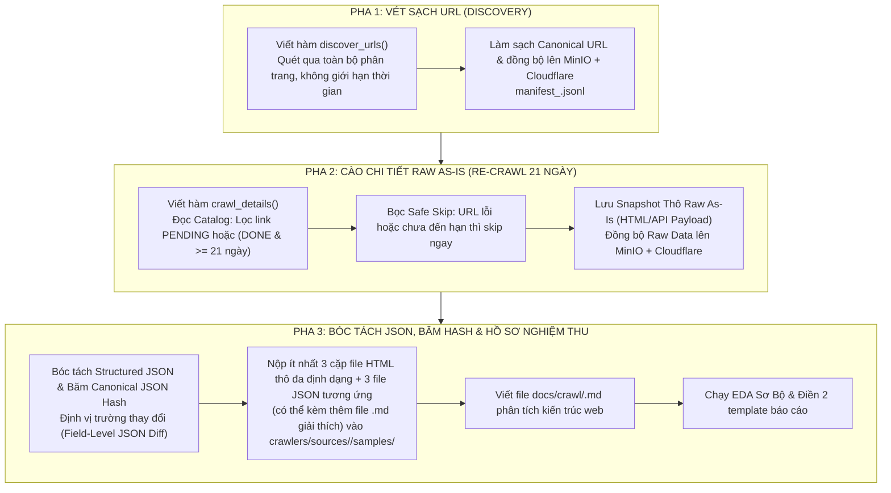

# BẢNG PHÂN CÔNG NHIỆM VỤ DỰ ÁN (TASKS & MILESTONES)

> **Dự án:** Phân tích thị trường lao động IT và nhu cầu kỹ năng nghề nghiệp tại Việt Nam (VN-IT-Job-Mining)  
> **Quy định Git:** Toàn bộ thành viên bắt đầu làm việc từ nhánh `main` và chuyển sang nhánh độc lập của mình: `crawls/<tenweb>`.  
> **Bộ 3 tài liệu quy trình bắt buộc phải đọc trước khi bắt tay vào code:**
> 1. [01_modern_data_mining_overview.md](file:///run/media/billtran/Data/Archduker/Study/UTH/Core/DataMining/VN-IT-Job-Mining/docs/01_modern_data_mining_overview.md)
> 2. [02_crawling_architecture_guide.md](file:///run/media/billtran/Data/Archduker/Study/UTH/Core/DataMining/VN-IT-Job-Mining/docs/02_crawling_architecture_guide.md)
> 3. [03_eda_and_integration_guide.md](file:///run/media/billtran/Data/Archduker/Study/UTH/Core/DataMining/VN-IT-Job-Mining/docs/03_eda_and_integration_guide.md)

---

## 1. MA TRẬN PHÂN CÔNG THÀNH VIÊN & NHÁNH LÀM VIỆC

| Thành viên | Nguồn phụ trách | Phương thức thu thập chính | Nhánh Git làm việc | File Báo cáo & Tài liệu cần nộp |
| :--- | :--- | :--- | :--- | :--- |
| **Sơn** | **TopDev** | REST API (`/api/v1/jobs`) | `crawls/topdev` | `docs/crawl/topdev.md` `reports/topdev_inventory.md` `reports/topdev_eda.md` |
| **Thuận** | **TopCV** | SSR HTML / HTTP Parsing | `crawls/topcv` | `docs/crawl/topcv.md` `reports/topcv_inventory.md` `reports/topcv_eda.md` |
| **Khoa** | **VietnamWorks** | REST / Algolia Search API | `crawls/vietnamworks` | `docs/crawl/vietnamworks.md` `reports/vietnamworks_inventory.md` `reports/vietnamworks_eda.md` |
| **Tài** | **CareerViet** | SSR DOM Parsing | `crawls/careerviet` | `docs/crawl/careerviet.md` `reports/careerviet_inventory.md` `reports/careerviet_eda.md` |
| **Phúc** | **Vieclam24h** | SSR DOM / Next.js Data | `crawls/vieclam24h` | `docs/crawl/vieclam24h.md` `reports/vieclam24h_inventory.md` `reports/vieclam24h_eda.md` |
| **Phát** | **ITViec** | Playwright Headless Chrome | `crawls/itviec` | `docs/crawl/itviec.md` `reports/itviec_inventory.md` `reports/itviec_eda.md` |
| **Duy** | **Glints & JobsGO** | GraphQL API & SSR DOM | `crawls/glints-jobsgo` | `docs/crawl/glints_jobsgo.md` `reports/glints_jobsgo_inventory.md` `reports/glints_jobsgo_eda.md` |

---

## 2. QUY TRÌNH THỰC HIỆN 2 PHA CỦA TỪNG THÀNH VIÊN

> [!IMPORTANT]
> **Quy định bắt buộc về Lưu trữ Đám mây (Multi-Cloud Lakehouse Sync):**  
> Mọi thành viên khi cào dữ liệu (cả Pha 1: URL Ledger Manifest và Pha 2: Raw Data / Raw HTML) **bắt buộc phải đồng bộ lên cả MinIO Lakehouse cục bộ VÀ Cloudflare (Cloudflare R2 Object Storage)** nhằm đảm bảo tính sẵn sàng cao, sao lưu an toàn và phục vụ khai phá tập trung.

---

## 3. CHI TIẾT CÔNG VIỆC TỪNG BẠN

### 3.1. Sơn — Phụ trách `TopDev` (Nhánh: `crawls/topdev`)
- [ ] **Pha 1 (URL Discovery):** Viết `discover_urls()` gọi REST API `/api/v1/jobs` lấy toàn bộ URL/Job IDs của tất cả các trang, ghi vào manifest và đồng bộ lên **MinIO** + **Cloudflare**.
- [ ] **Pha 2 (Detail Extraction):** Viết `crawl_details()` cào 100% payload chi tiết. Áp dụng cơ chế Safe Skip khi gặp lỗi. Đổi trạng thái sang `DONE`, chu kỳ re-crawl 21 ngày. Đồng bộ raw payload lên **MinIO** + **Cloudflare**.
- [ ] **Hồ sơ nghiệm thu bắt buộc:**
  - `crawlers/sources/topdev/samples/`: **Tối thiểu 3 file HTML thô (hoặc response DOM/web) kèm 3 file JSON tương ứng** có định dạng khác nhau (tin lương VND, lương USD, tin nhiều tech tags). *Có thể nộp kèm file `.md` mô tả chi tiết từng sample*.
  - Tự viết `docs/crawl/topdev.md` phân tích kiến trúc API, phân trang và cấu trúc trường của TopDev.
  - Điền báo cáo theo 2 mẫu [raw_crawl_inventory_template.md](file:///run/media/billtran/Data/Archduker/Study/UTH/Core/DataMining/VN-IT-Job-Mining/templates/raw_crawl_inventory_template.md) và [preliminary_eda_template.md](file:///run/media/billtran/Data/Archduker/Study/UTH/Core/DataMining/VN-IT-Job-Mining/templates/preliminary_eda_template.md).

### 3.2. Thuận — Phụ trách `TopCV` (Nhánh: `crawls/topcv`)
- [ ] **Pha 1 (URL Discovery):** Viết `discover_urls()` cào sạch danh sách link bài đăng từ trang tìm kiếm TopCV (không giới hạn thời gian), ghi vào URL Ledger và đồng bộ lên **MinIO** + **Cloudflare**.
- [ ] **Pha 2 (Detail Extraction):** Viết `crawl_details()` cào raw HTML bài đăng nguyên bản (Zero Info Loss). Bóc tách trường vào JSON và áp dụng Canonical JSON Hashing để quản lý phiên bản CDC và repost. Đổi trạng thái sang `DONE`, kiểm tra re-crawl 21 ngày. Đồng bộ lên **MinIO** + **Cloudflare**.
- [ ] **Hồ sơ nghiệm thu bắt buộc:**
  - `crawlers/sources/topcv/samples/`: **Ít nhất 3 file HTML thô** có layout khác nhau (tin thường, tin Hot/VIP, tin có badge đặc thù) kèm **3 file JSON tương ứng**. *Có thể nộp kèm file `.md` mô tả chi tiết từng sample*.
  - Tự viết `docs/crawl/topcv.md` phân tích DOM và cấu trúc trường bóc tách của TopCV.
  - Điền 2 báo cáo kiểm kê trường và EDA sơ bộ.

### 3.3. Khoa — Phụ trách `VietnamWorks` (Nhánh: `crawls/vietnamworks`)
- [ ] **Pha 1 (URL Discovery):** Viết `discover_urls()` quét Algolia search hits, thu thập toàn bộ job links ghi vào manifest và đồng bộ lên **MinIO** + **Cloudflare**.
- [ ] **Pha 2 (Detail Extraction):** Viết `crawl_details()` lấy đầy đủ trường kỹ năng và phúc lợi của VietnamWorks. Tích hợp Safe Skip và quản lý trạng thái `DONE`. Đồng bộ raw batch lên **MinIO** + **Cloudflare**.
- [ ] **Hồ sơ nghiệm thu bắt buộc:**
  - `crawlers/sources/vietnamworks/samples/`: **Ít nhất 3 file HTML thô (hoặc web snapshot) kèm 3 file JSON tương ứng**. *Có thể nộp kèm file `.md` mô tả chi tiết từng sample*.
  - Tự viết `docs/crawl/vietnamworks.md` phân tích headers, tokens và API search.
  - Điền 2 báo cáo kiểm kê trường và EDA sơ bộ.

### 3.4. Tài — Phụ trách `CareerViet` (Nhánh: `crawls/careerviet`)
- [ ] **Pha 1 (URL Discovery):** Viết `discover_urls()` duyệt toàn bộ danh mục IT của CareerViet lấy danh sách link, ghi vào manifest và đồng bộ lên **MinIO** + **Cloudflare**.
- [ ] **Pha 2 (Detail Extraction):** Viết `crawl_details()` bóc tách nguyên vẹn SSR HTML. Lưu raw HTML, chuyển đổi sang JSON và băm Canonical JSON Hash. Đổi trạng thái `DONE`, re-crawl 21 ngày. Đồng bộ lên **MinIO** + **Cloudflare**.
- [ ] **Hồ sơ nghiệm thu bắt buộc:**
  - `crawlers/sources/careerviet/samples/`: **Ít nhất 3 file HTML thô** có cấu trúc khác nhau kèm **3 file JSON tương ứng**. *Có thể nộp kèm file `.md` mô tả chi tiết từng sample*.
  - Tự viết `docs/crawl/careerviet.md` phân tích DOM và kỹ thuật cào.
  - Điền 2 báo cáo kiểm kê trường và EDA sơ bộ.

### 3.5. Phúc — Phụ trách `Vieclam24h` (Nhánh: `crawls/vieclam24h`)
- [ ] **Pha 1 (URL Discovery):** Viết `discover_urls()` cào sạch link việc làm IT trên Vieclam24h, ghi vào manifest và đồng bộ lên **MinIO** + **Cloudflare**.
- [ ] **Pha 2 (Detail Extraction):** Viết `crawl_details()` bóc tách JSON-LD hoặc `__NEXT_DATA__` thô. Bọc khối Safe Skip bắt lỗi. Quản lý trạng thái `DONE`. Đồng bộ lên **MinIO** + **Cloudflare**.
- [ ] **Hồ sơ nghiệm thu bắt buộc:**
  - `crawlers/sources/vieclam24h/samples/`: **Ít nhất 3 file HTML thô** kèm **3 file JSON tương ứng**. *Có thể nộp kèm file `.md` mô tả chi tiết từng sample*.
  - Tự viết `docs/crawl/vieclam24h.md` phân tích cấu trúc dữ liệu Next.js của 24h.
  - Điền 2 báo cáo kiểm kê trường và EDA sơ bộ.

### 3.6. Phát — Phụ trách `ITViec` (Nhánh: `crawls/itviec`)
- [ ] **Pha 1 (URL Discovery):** Sử dụng Playwright / httpx duyệt toàn bộ danh sách việc làm ITviec lưu vào manifest và đồng bộ lên **MinIO** + **Cloudflare**.
- [ ] **Pha 2 (Detail Extraction):** Viết `crawl_details()` cào raw HTML chi tiết (thẻ kỹ năng, "3 reasons to join us", văn bản JD). Bóc tách JSON và băm Canonical JSON Hash. Trạng thái `DONE`, re-crawl 21 ngày. Đồng bộ lên **MinIO** + **Cloudflare**.
- [ ] **Hồ sơ nghiệm thu bắt buộc:**
  - `crawlers/sources/itviec/samples/`: **Ít nhất 3 file HTML thô** (tin lương công khai, tin lương ẩn, tin Spotlight) kèm **3 file JSON tương ứng**. *Có thể nộp kèm file `.md` mô tả chi tiết từng sample*.
  - Tự viết `docs/crawl/itviec.md` phân tích cơ chế vượt Cloudflare nhẹ và selector chính.
  - Điền 2 báo cáo kiểm kê trường và EDA sơ bộ.

### 3.7. Duy — Phụ trách `Glints & JobsGO` (Nhánh: `crawls/glints-jobsgo`)
- [ ] **Pha 1 (URL Discovery):** Viết `discover_urls()` cho cả Glints (GraphQL) và JobsGO (SSR) lấy toàn bộ danh mục link, đồng bộ lên **MinIO** + **Cloudflare**.
- [ ] **Pha 2 (Detail Extraction):** Viết `crawl_details()` bóc tách dữ liệu thô, áp dụng Safe Skip khi một link bị lỗi, lưu trạng thái `DONE`, chu kỳ 21 ngày. Đồng bộ lên **MinIO** + **Cloudflare**.
- [ ] **Hồ sơ nghiệm thu bắt buộc:**
  - `crawlers/sources/glints/samples/` và `jobsgo/samples/`: **Ít nhất 3 file HTML thô** kèm **3 file JSON tương ứng** cho mỗi sàn. *Có thể nộp kèm file `.md` mô tả chi tiết từng sample*.
  - Tự viết `docs/crawl/glints_jobsgo.md` phân tích kiến trúc của 2 trang web.
  - Điền 2 báo cáo kiểm kê trường và EDA sơ bộ.

---

## 4. TIÊU CHUẨN NGHIỆM THU (DEFINITION OF DONE - DOD)

Một thành viên được tính là hoàn thành nhiệm vụ khi thỏa mãn 7 điều kiện bắt buộc:
1. **Phân tách 2 pha:** Có đủ 2 hàm `discover_urls()` (vét sạch link, không giới hạn thời gian) và `crawl_details()` (cào chi tiết).
2. **Safe Skip & Fault-Tolerance:** Script cào không bị crash khi gặp 1 link lỗi 404/500/timeout; tự động skip qua link tiếp theo.
3. **Cơ chế Re-crawl 21 ngày:** Đặt trạng thái `DONE`, chỉ cào lại bài viết khi đã đủ $\ge 21$ ngày.
4. **Bộ kiểm thử đa định dạng (Samples):** Có tối thiểu **3 file HTML mẫu thô** có cấu trúc layout khác biệt kèm **3 file JSON kết quả tương ứng** trong thư mục `crawlers/sources/<tenweb>/samples/` (khuyến khích kèm theo file `.md` mô tả/hướng dẫn phân tích sample).
5. **Đồng bộ lưu trữ Đám mây & Lakehouse (MinIO & Cloudflare):** Toàn bộ dữ liệu cào (URL Ledger Manifest ở Pha 1 & Raw Data ở Pha 2) bắt buộc phải được đồng bộ đầy đủ lên **cả MinIO Lakehouse cục bộ VÀ Cloudflare (Cloudflare R2 Object Storage)**.
6. **Tự viết file phân tích kiến trúc:** Nộp file `docs/crawl/<tenweb>.md` giải thích chi tiết cơ chế cào và container selector của web mình.
7. **Đầy đủ 2 báo cáo chất lượng:**
   - `reports/<source>_inventory.md` (theo [raw_crawl_inventory_template.md](file:///run/media/billtran/Data/Archduker/Study/UTH/Core/DataMining/VN-IT-Job-Mining/templates/raw_crawl_inventory_template.md)).
   - `reports/<source>_eda.md` (theo [preliminary_eda_template.md](file:///run/media/billtran/Data/Archduker/Study/UTH/Core/DataMining/VN-IT-Job-Mining/templates/preliminary_eda_template.md)).

---

## 5. PHÂN CÔNG GIAI ĐOẠN 2: EDA KIỂM TRA CHẤT LƯỢNG DỮ LIỆU & KHAI PHÁ KHOẢNG TRỐNG ĐA NGUỒN

Sau khi dữ liệu thô (Raw As-Is) đã được kéo về Lakehouse (MinIO & Cloudflare R2), dự án kích hoạt 2 nhóm chuyên trách theo phương pháp luận đi lên từ câu hỏi kỹ thuật (**Inquiry-Driven Framework**) phục vụ trực tiếp cho bước Pre-processing:

### 5.1. Nhóm EDA Kiểm Tra Chất Lượng Dữ Liệu (3 Thành Viên)
- **Nhiệm vụ:** Đóng vai trò là "kính hiển vi chẩn đoán chất lượng dữ liệu thô", kiểm tra toàn diện 5 trụ cột kỹ thuật: Độ hoàn thiện (Completeness / Missingness), Tính hợp lệ & Kiểu dữ liệu (Validity & Schema Types), Tính duy nhất (Uniqueness / Duplication), Hình thái phân phối & Ngoại lai (Distribution & Outliers via IQR), và Độ thiên lệch & Mất cân bằng (Bias & Class Balance). Xuất bộ 7 biểu đồ chẩn đoán chất lượng dữ liệu để làm cơ sở cho kế hoạch Tiền xử lý.
- **Phân công Hybrid:**
  - *Thành viên 1:* Chuyên môn Sức khỏe dữ liệu & Phân phối số $\to$ Phụ trách **TopCV, Vieclam24h, CareerViet**.
  - *Thành viên 2:* Chuyên môn Tech Stack & Xử lý văn bản NLP $\to$ Phụ trách **ITViec, TopDev, VietnamWorks**.
  - *Thành viên 3:* Chuyên môn Tương quan đa chiều & Pipeline đa nguồn $\to$ Phụ trách **Glints, JobsGO** (+ Cross-Platform Master Pipeline).
- **Tài liệu hướng dẫn & nghiệm thu chi tiết:** 👉 [01_huong_dan_eda_nhom_3_nguoi.md](file:///run/media/billtran/Data/Archduker/Study/UTH/Core/DataMining/VN-IT-Job-Mining/docs/tasks/01_huong_dan_eda_nhom_3_nguoi.md)

### 5.2. Nhóm Khai Phá Khoảng Trống Dữ Liệu & So Sánh Bù Trừ Đa Nguồn (Nhóm Còn Lại)
- **Nhiệm vụ:** Áp dụng mô hình câu hỏi **Why - What - How** để đào sâu câu hỏi cốt tử: **"Bộ dữ liệu nguồn đó THIẾU GÌ?" (Data Gap Analysis)**. Tự do bắt cặp song song (mỗi cặp 2 người) để thực hiện đối chiếu chéo **2 nguồn trên 8 nguồn**, tìm kiếm sự bù trừ (complementarity) khoảng trống thông tin giữa 2 sàn, và đề xuất giải pháp kỹ thuật (Imputation, Master Source Rule, Bias Mitigation) nộp cho Leader phục vụ bước Data Integration.
- **5 Trục đối chiếu khoảng trống kỹ thuật:**
  1. Khoảng trống Schema & Độ phủ trường (Schema Coverage & Gaps)
  2. Khoảng trống Minh bạch lương & Nhu cầu Imputation (Salary Gaps)
  3. Khoảng trống Thẻ kỹ năng & Chất lượng JD (Skills & Text Gaps)
  4. Khoảng trống Phân khúc cấp bậc & Thiên lệch mẫu (Segment Bias)
  5. Xung đột dữ liệu thực thể & Luật hợp nhất (Entity Conflicts)
- **Tài liệu hướng dẫn, mẫu báo cáo & nghiệm thu chi tiết:** 👉 [02_huong_dan_insight_va_so_sanh_nguon.md](file:///run/media/billtran/Data/Archduker/Study/UTH/Core/DataMining/VN-IT-Job-Mining/docs/tasks/02_huong_dan_insight_va_so_sanh_nguon.md)
