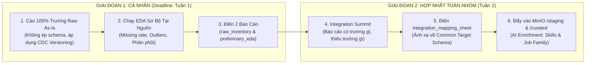

# BẢNG PHÂN CÔNG NHIỆM VỤ DỰ ÁN (TASKS & MILESTONES)

> **Dự án:** Phân tích thị trường lao động IT và nhu cầu kỹ năng nghề nghiệp tại Việt Nam (VN-IT-Job-Mining)  
> **Quy định Git:** Toàn bộ thành viên bắt đầu làm việc từ nhánh `main` và tạo nhánh độc lập: `crawls/<tenweb>`. Các nhánh cũ không dùng nữa sẽ được lưu trữ/bỏ qua.  
> **Bộ 3 tài liệu quy trình bắt buộc phải đọc trước khi code:**
> 1. [01_modern_data_mining_overview.md](file:///home/billtran/Desktop/Learning/UTH/VN-IT-Job-Mining/docs/01_modern_data_mining_overview.md)
> 2. [02_crawling_architecture_guide.md](file:///home/billtran/Desktop/Learning/UTH/VN-IT-Job-Mining/docs/02_crawling_architecture_guide.md)
> 3. [03_eda_and_integration_guide.md](file:///home/billtran/Desktop/Learning/UTH/VN-IT-Job-Mining/docs/03_eda_and_integration_guide.md)

---

## 1. MA TRẬN PHÂN CÔNG THÀNH VIÊN & NHÁNH LÀM VIỆC

| Thành viên | Nguồn website phụ trách | Phương thức thu thập chính | Nhánh Git làm việc | File Báo cáo cần nộp |
| :--- | :--- | :--- | :--- | :--- |
| **Sơn** | **TopDev** | REST API (`/api/v1/jobs`) | `crawls/topdev` | `reports/topdev_inventory.md` `reports/topdev_eda.md` |
| **Thuận** | **TopCV** | SSR HTML / HTTP Parsing | `crawls/topcv` | `reports/topcv_inventory.md` `reports/topcv_eda.md` |
| **Khoa** | **VietnamWorks** | REST / Algolia Search API | `crawls/vietnamworks` | `reports/vietnamworks_inventory.md` `reports/vietnamworks_eda.md` |
| **Tài** | **CareerViet** | SSR DOM Parsing | `crawls/careerviet` | `reports/careerviet_inventory.md` `reports/careerviet_eda.md` |
| **Phúc** | **Vieclam24h** | SSR DOM / Next.js Data | `crawls/vieclam24h` | `reports/vieclam24h_inventory.md` `reports/vieclam24h_eda.md` |
| **Phát** | **ITViec** | Playwright Headless Chrome | `crawls/itviec` | `reports/itviec_inventory.md` `reports/itviec_eda.md` |
| **Duy** | **Glints & JobsGO** | GraphQL API & SSR DOM | `crawls/glints-jobsgo` | `reports/glints_jobsgo_inventory.md` `reports/glints_jobsgo_eda.md` |

---

## 2. LỘ TRÌNH 2 GIAI ĐOẠN CỦA TỪNG BẠN

---

## 3. CHI TIẾT CÔNG VIỆC TỪNG BẠN

### 3.1. Sơn — Phụ trách `TopDev` (Nhánh: `crawls/topdev`)
- [ ] **Giai đoạn 1 - Crawl Raw:**
  - Viết crawler gọi REST API `/api/v1/jobs` của TopDev.
  - Lưu nguyên bản 100% payload JSON trả về từ API vào `data/raw/topdev/` (hoặc MinIO `raw/topdev/`).
  - Áp dụng hàm `content_hash = SHA256(...)` và quản lý phiên bản `version` trong catalog khi có bài viết cập nhật.
  - Không lọc bỏ các trường lồng nhau như `addresses`, `salary_range`, `company_profile`.
- [ ] **Giai đoạn 1 - EDA Sơ bộ:**
  - Tạo notebook `notebooks/eda_preliminary_topdev.ipynb`.
  - Tính tỷ lệ null của các trường; phát hiện lương ngoại lai (lưu ý TopDev có lương USD cần theo dõi).
  - Xuất báo cáo theo mẫu [raw_crawl_inventory_template.md](file:///home/billtran/Desktop/Learning/UTH/VN-IT-Job-Mining/templates/raw_crawl_inventory_template.md) và [preliminary_eda_template.md](file:///home/billtran/Desktop/Learning/UTH/VN-IT-Job-Mining/templates/preliminary_eda_template.md).
- [ ] **Giai đoạn 2 - Integration:**
  - Báo cáo với nhóm các trường độc đáo của TopDev (tech tags chuẩn, level phân loại rõ ràng).
  - Điền [integration_mapping_template.md](file:///home/billtran/Desktop/Learning/UTH/VN-IT-Job-Mining/templates/integration_mapping_template.md).

### 3.2. Thuận — Phụ trách `TopCV` (Nhánh: `crawls/topcv`)
- [ ] **Giai đoạn 1 - Crawl Raw:**
  - Cào toàn bộ HTML của bài đăng chi tiết TopCV.
  - Lưu giữ nguyên vẹn các selector đặc thù của TopCV: `"box-header-job__title"`, `"box-header-job__salary--title"`, `"badge-tag-list"`, `"job-detail__box--requirements"`, `"job-detail__box--benefits"`.
  - Áp dụng CDC versioning: Nếu nhà tuyển dụng sửa lương hoặc sửa yêu cầu $\rightarrow$ tạo snapshot version mới.
- [ ] **Giai đoạn 1 - EDA Sơ bộ:**
  - Tạo notebook `notebooks/eda_preliminary_topcv.ipynb`.
  - Đánh giá tỷ lệ bài viết có lương "Thỏa thuận", phân tích phân phối kinh nghiệm.
  - Xuất báo cáo kiểm kê trường và EDA sơ bộ.
- [ ] **Giai đoạn 2 - Integration:**
  - Báo cáo danh sách trường với nhóm; xây dựng logic bóc tách lương chữ TopCV ("Từ 20 triệu" $\rightarrow$ min: 20, max: null).

### 3.3. Khoa — Phụ trách `VietnamWorks` (Nhánh: `crawls/vietnamworks`)
- [ ] **Giai đoạn 1 - Crawl Raw:**
  - Cào thông qua Algolia / Search API của VietnamWorks, lấy toàn bộ search hit payload và job detail.
  - Lưu thô 100% thuộc tính vào `data/raw/vietnamworks/` kèm `content_hash`.
- [ ] **Giai đoạn 1 - EDA Sơ bộ:**
  - Tạo notebook `notebooks/eda_preliminary_vietnamworks.ipynb`.
  - Đánh giá cấu trúc trường skills và benefits của VietnamWorks.
  - Điền báo cáo theo 2 template nộp bài.
- [ ] **Giai đoạn 2 - Integration:**
  - Tham gia đối chiếu trường, đặc biệt là trường `skills` dạng danh mục chuẩn của VietnamWorks để hỗ trợ nhóm xây dựng Skill Taxonomy.

### 3.4. Tài — Phụ trách `CareerViet` (Nhánh: `crawls/careerviet`)
- [ ] **Giai đoạn 1 - Crawl Raw:**
  - Cào SSR HTML bài đăng CareerViet (trước đây là CareerBuilder).
  - Lấy toàn bộ các trường: thông tin đãi ngộ, hạn nộp hồ sơ, địa điểm làm việc, ngày cập nhật.
  - Tích hợp CDC Versioning kiểm tra cập nhật bài viết.
- [ ] **Giai đoạn 1 - EDA Sơ bộ:**
  - Tạo notebook `notebooks/eda_preliminary_careerviet.ipynb`.
  - Kiểm tra outliers lương và tỷ lệ missing của trường kinh nghiệm.
- [ ] **Giai đoạn 2 - Integration:**
  - Điền bảng ánh xạ trường CareerViet sang Common Target Schema.

### 3.5. Phúc — Phụ trách `Vieclam24h` (Nhánh: `crawls/vieclam24h`)
- [ ] **Giai đoạn 1 - Crawl Raw:**
  - Cào SSR DOM hoặc bóc tách trực tiếp object JSON `__NEXT_DATA__` của Vieclam24h.
  - Thu thập nguyên bản 100% các trường không cắt xén.
  - Tích hợp tính `content_hash` để sinh phiên bản mới khi tin được sửa.
- [ ] **Giai đoạn 1 - EDA Sơ bộ:**
  - Tạo notebook `notebooks/eda_preliminary_vieclam24h.ipynb`.
  - Khảo sát đặc thù tin IT trên Vieclam24h (mức độ bao phủ tin Fresher/Junior).
- [ ] **Giai đoạn 2 - Integration:**
  - Đối chiếu trường và điền bảng ánh xạ.

### 3.6. Phát — Phụ trách `ITViec` (Nhánh: `crawls/itviec`)
- [ ] **Giai đoạn 1 - Crawl Raw:**
  - Sử dụng Playwright Headless Chrome (với stealth flag) để cào chi tiết bài đăng ITViec.
  - Lấy toàn bộ: Thẻ kỹ năng, lý do gia nhập công ty ("Top 3 reasons to join us"), dải lương (nếu có hoặc hiển thị "Sign in to view").
  - Lưu snapshot CDC versioning đầy đủ.
- [ ] **Giai đoạn 1 - EDA Sơ bộ:**
  - Tạo notebook `notebooks/eda_preliminary_itviec.ipynb`.
  - Phân tích độ phong phú của thẻ kỹ năng trên ITViec (nguồn dữ liệu chất lượng cao nhất cho SD3).
- [ ] **Giai đoạn 2 - Integration:**
  - Đóng góp bộ từ khóa kỹ năng của ITViec làm từ điển nòng cốt cho AI Skill Extraction.

### 3.7. Duy — Phụ trách `Glints & JobsGO` (Nhánh: `crawls/glints-jobsgo`)
- [ ] **Giai đoạn 1 - Crawl Raw:**
  - Glints: Bóc tách qua GraphQL API hoặc SSR DOM.
  - JobsGO: Cào danh mục việc làm IT với đầy đủ metadata.
  - Lưu raw nguyên bản và tích hợp CDC versioning cho cả 2 sàn.
- [ ] **Giai đoạn 1 - EDA Sơ bộ:**
  - Tạo notebook `notebooks/eda_preliminary_glints_jobsgo.ipynb`.
  - Đánh giá sự khác biệt giữa 2 nền tảng về tỷ lệ công khai mức lương.
- [ ] **Giai đoạn 2 - Integration:**
  - Báo cáo bảng kiểm kê trường của cả 2 web và đề xuất cách map về Common Schema.

---

## 4. TIÊU CHUẨN NGHIỆM THU (DEFINITION OF DONE - DOD)

Một thành viên được tính là hoàn thành nhiệm vụ khi thỏa mãn 5 điều kiện:
1. **Mã nguồn sạch sẽ:** Đẩy lên đúng nhánh `crawls/<tenweb>`, không xung đột (conflict) với `main`.
2. **Bảo toàn dữ liệu 100%:** Dữ liệu cào về ở dạng thô nguyên bản (không parse vội, không drop trường).
3. **Có cơ chế CDC:** Script cào tự động tính `content_hash` và phát hiện bài viết bị sửa để sinh version mới.
4. **Notebook EDA chạy thông suốt:** Sinh đủ số liệu thống kê Missing Rate, Outlier IQR, và các biểu đồ phân phối cơ bản.
5. **Nộp đủ 3 file báo cáo theo Template:**
   - `reports/<source>_inventory.md` (theo mẫu `templates/raw_crawl_inventory_template.md`).
   - `reports/<source>_eda.md` (theo mẫu `templates/preliminary_eda_template.md`).
   - `reports/<source>_mapping.md` (theo mẫu `templates/integration_mapping_template.md`).