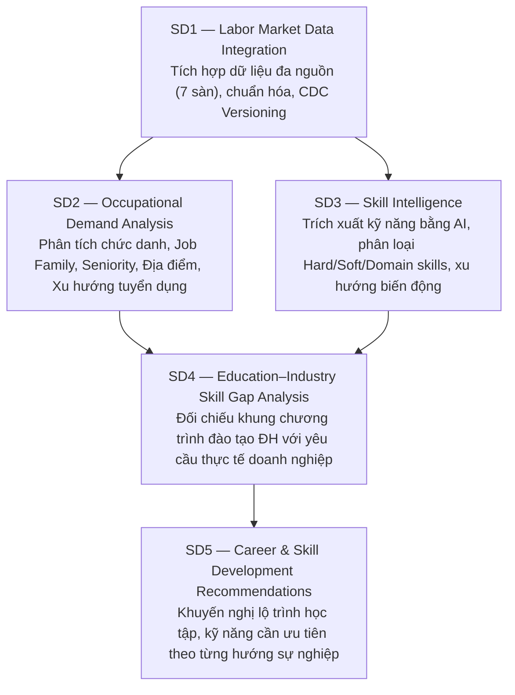
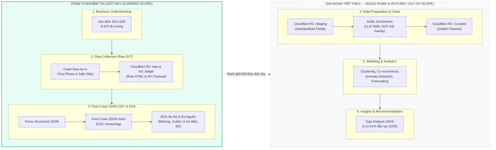
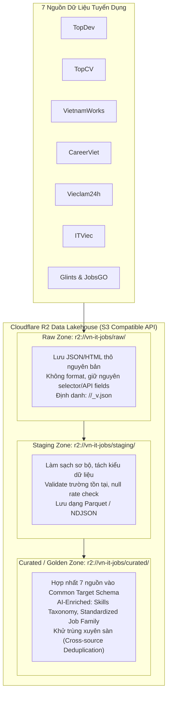

# QUY TRÌNH DATA MINING & THU THẬP DỮ LIỆU HIỆN ĐẠI (VN-IT-JOB-MINING)

> **Tài liệu quy trình cốt lõi số 1 (Core Document 01)**  
> **Business Domain:** Phân tích thị trường lao động IT và nhu cầu kỹ năng nghề nghiệp tại Việt Nam.  
> **Mục tiêu tối thượng của môn học:** Xây dựng bộ dữ liệu tuyển dụng IT hoàn chỉnh, chuẩn hóa và sâu sắc, tập trung vào **Kỹ năng (Skills)** và **Nghề nghiệp (Occupations)**, ứng dụng công nghệ hiện đại (Cloudflare R2, CDC, ELT, AI/ML).

> [!IMPORTANT]
> **RANH GIỚI BÁO CÁO & NGHIỆM THU ĐỢT NÀY:**  
> Toàn bộ phạm vi thực hiện của đợt nộp bài này **DỪNG LẠI TRỌN VẸN TẠI BƯỚC DATA COLLECTION (GỒM CRAWL RAW AS-IS VÀ EDA PHÂN TÍCH KHÁM PHÁ)**.  
> Hệ thống lưu trữ dữ liệu tập trung hoàn toàn tại **Raw Zone (`r2://vn-it-jobs/raw/`)** và **URL Ledger (`r2://vn-it-jobs/url_ledger/`)**.  
> Các bước Integration Summit, chuẩn hóa sang tầng `/staging` & `/curated`, và các mô hình AI/ML (SD2 - SD5) là định hướng giai đoạn tiếp theo (Future Roadmap — Out of Scope), tuyệt đối không thuộc phạm vi nghiệm thu đợt này.

---

## 1. 5 Mục Tiêu Nghiệp Vụ Chiến Lược (SD1 — SD5)

Hệ thống được thiết kế xoay quanh 5 mục tiêu nghiệp vụ liên hoàn:

- **SD1 — Labor Market Data Integration:** Thu thập thô nguyên bản từ 7 sàn tuyển dụng hàng đầu (TopDev, TopCV, VietnamWorks, CareerViet, Vieclam24h, ITViec, Glints & JobsGO), lưu trữ Cloudflare R2 Lakehouse, xử lý phiên bản thay đổi (CDC), làm sạch và hợp nhất thành Common Target Schema.
- **SD2 — Occupational Demand Analysis:** Phân tích nhu cầu nghề nghiệp IT: phân loại vào 12 Job Family chuẩn (Backend, Frontend, Fullstack, Mobile, DevOps/Cloud, Data Engineer, Data Scientist/AI, QA/QC, Security, Product/Project, System/Network, Embedded/IoT), phân bổ cấp bậc (Intern, Junior, Middle, Senior, Lead, Manager) và địa bàn địa lý.
- **SD3 — Skill Intelligence:** Phân tích kỹ năng chuyên sâu: Trích xuất kỹ năng ngầm định và tường minh từ JD, chuẩn hóa danh mục kỹ năng (Skill Taxonomy), ma trận đồng xuất hiện (Co-occurrence Matrix), mức độ khan hiếm và mức lương tương ứng.
- **SD4 — Education–Industry Skill Gap Analysis:** Đối chiếu giữa chuẩn đầu ra của khối ngành Công nghệ thông tin tại các trường Đại học với yêu cầu thực tiễn của doanh nghiệp để xác định chính xác kỹ năng sinh viên còn thiếu hụt.
- **SD5 — Career & Skill Development Recommendations:** Dự báo xu hướng kỹ năng mới nổi (Emerging Skills) và đề xuất lộ trình nâng cao năng lực cho người học và người lao động.

---

## 2. Khung Quy Trình CRISP-DM Hiện Đại Kết Hợp Modern Data Stack (ELT)

Dự án áp dụng quy trình chuẩn **CRISP-DM (Cross-Industry Standard Process for Data Mining)** nhưng được nâng cấp bằng tư duy **Modern ELT (Extract - Load - Transform)** thay cho ETL truyền thống:

### Tại sao phải là Modern ELT (Extract $\rightarrow$ Load Raw $\rightarrow$ Transform)?
- Trong kiến trúc ETL cổ điển, người cào dữ liệu vội vã parse/lọc bớt cột để khớp với một schema giả định. Hậu quả: Khi phát sinh nhu cầu phân tích mới (ví dụ phân tích đãi ngộ "MacBook Pro" hay "Remote policy"), dữ liệu gốc đã bị xóa mất, buộc phải cào lại toàn bộ.
- Trong **Modern ELT**:
  1. **Extract & Load (E & L):** Cào **nguyên vẹn 100%** trang web có gì lưu nấy vào Data Lake Cloudflare R2 (`/raw`).
  2. **Transform (T):** Sau khi đã hiểu rõ toàn bộ các trường từ 7 sàn thông qua bước EDA sơ bộ, nhóm mới thống nhất xây dựng pipeline làm sạch và chuyển hóa vào tầng (`/staging` và `/curated`).

---

## 3. Kiến Trúc Data Lakehouse Phân Tầng Trên Cloudflare R2

Hệ thống sử dụng **Cloudflare R2 Object Storage** cục bộ/tập trung để thay thế cho AWS S3, đảm bảo chi phí 0 đồng, tốc độ cao, và quyền kiểm soát tuyệt đối:

---

## 4. Giải Quyết Phản Biện Của Thầy: Cơ Chế CDC & Content Hash

### Phản biện từ Giảng viên:
> *"Nếu người ta sửa tin tuyển dụng mà hệ thống vẫn lọc duplicate theo job_id thì sao? Làm thế nào để biết tin đó đã thay đổi mức lương hay đổi yêu cầu kỹ năng?"*

### Giải pháp kỹ thuật chuẩn mực: Change Data Capture (CDC)
Hệ thống không dùng cơ chế deduplicate thô bạo (gặp ID cũ thì bỏ qua). Thay vào đó, áp dụng cơ chế **Content Hashing Snapshotting**:

1. **Sinh mã băm nội dung `content_hash`:**
   $$\text{content\_hash} = \text{SHA256}(\text{title} + \text{raw\_salary} + \text{description} + \text{requirements})$$
2. **Quy tắc kiểm định Catalog:**
   - **Trường hợp 1 (Tin mới - NEW):** `job_id` chưa từng tồn tại $\rightarrow$ Lưu bản ghi vào Cloudflare R2 với `version = 1`, `status = "NEW"`, `first_seen_at = now()`.
   - **Trường hợp 2 (Tin được sửa - UPDATED):** `job_id` đã có nhưng `content_hash` hiện tại khác `content_hash` đã lưu $\rightarrow$ **Nhà tuyển dụng đã cập nhật bài đăng!** Hệ thống sinh bản snapshot mới:
     - `version = version_cu + 1`
     - `status = "UPDATED"`
     - `updated_at = now()`
     - Lưu snapshot mới vào Cloudflare R2: `raw/<source>/<date>/<job_id>_v2.json`.
     - *Ý nghĩa khoa học:* Đây là nguồn dữ liệu cực kỳ quý giá phục vụ **SD3**, cho phép đo lường sự dịch chuyển yêu cầu kỹ năng hoặc điều chỉnh mức lương của doanh nghiệp theo thời gian!
   - **Trường hợp 3 (Tin không đổi - UNCHANGED):** `job_id` và `content_hash` trùng khớp $\rightarrow$ Chỉ cập nhật `last_seen_at = now()`, không tạo file trùng lặp.
   - **Trường hợp 4 (Tin hết hạn - EXPIRED):** Tin biến mất khỏi danh sách trang web trong $K$ chu kỳ cào liên tiếp $\rightarrow$ Đánh dấu `status = "CLOSED"`.

---

## 5. Bản Đồ Ứng Dụng AI & Machine Learning (Định Hướng Giai Đoạn Sau)

> [!NOTE]
> Bảng dưới đây thể hiện định hướng ứng dụng AI/ML cho các giai đoạn tiếp theo của đề tài (Integration, SD2–SD5). Trong đợt nghiệm thu Data Collection hiện tại, trọng tâm hoàn toàn tập trung vào việc thu thập thô bảo toàn thông tin (Raw As-Is) và phân tích EDA định lượng.

| Giai đoạn (Tiếp theo) | Nhiệm vụ | Kỹ thuật AI / ML áp dụng | Vai trò & Giá trị |
| :--- | :--- | :--- | :--- |
| **Data Integration** | Nhận diện tin trùng lặp xuyên sàn (Cross-source Duplication) | **Sentence-Transformers (Sentence-BERT)** Semantic Embeddings + Cosine Similarity | Cùng 1 vị trí FPT tuyển nhưng đăng trên cả TopCV và ITViec với tiêu đề hơi khác nhau $\rightarrow$ AI nhận diện được qua độ tương đồng ngữ nghĩa của JD. |
| **SD2 (Occupations)** | Phân loại vị trí tuyển dụng vào 12 Job Family chuẩn | **Zero-Shot Classification** / **Fine-tuned PhoBERT** | Chuyển đổi hàng nghìn tiêu đề tự do (*"Hiệp sĩ Coder"*, *"Ninja Python"*, *"Tech Guru"*) về đúng danh mục chuẩn. |
| **SD3 (Skills)** | Trích xuất kỹ năng ngầm định (Implicit Skills) từ JD | **LLM (Gemini / Llama 3) Few-shot NER** | Regex chỉ bắt được kỹ năng có tên rõ ràng. LLM bắt được kỹ năng tiềm ẩn: *"làm việc với hàng triệu RPS và kiến trúc phân tán"* $\rightarrow$ High Availability, Distributed Systems. |
| **SD3 (Skills)** | Chuẩn hóa danh mục kỹ năng (Skill Normalization) | **Embedding Nearest Neighbor (FAISS)** map vào taxonomy chuẩn ESCO / O*NET | Đồng nhất các biến thể: `ReactJS`, `React.js`, `React JS`, `react` $\rightarrow$ `React`. |
| **SD4 & SD5** | Khuyến nghị lộ trình học tập & dự báo xu hướng | **Association Rule Mining (FP-Growth)** + Graph Neural Networks (Skill Graph) | Khai phá cặp kỹ năng thường đi kèm với nhau (ví dụ: Biết Docker thì 85% cần thêm Kubernetes & CI/CD). |

---

## 6. Lộ Trình Phối Hợp & Phân Kỳ Thực Hiện

### 🟢 Giai Đoạn Hiện Tại (Hoàn Thành 100% Nghiệm Thu Đợt Này):
- **Thu thập Dữ liệu & Kiểm kê Chất lượng (Data Collection & Raw Lakehouse):**
  - Vận hành Two-Phase Crawler cho toàn bộ 8 nguồn tuyển dụng (TopCV, TopDev, VietnamWorks, CareerViet, Vieclam24h, ITViec, Glints, JobsGO).
  - Lưu trữ Raw As-Is tại **Raw Zone (`r2://vn-it-jobs/raw/`)** và **URL Ledger (`r2://vn-it-jobs/url_ledger/`)**, đồng bộ Cloudflare R2.
  - Bộ mẫu chuẩn 21 Benchmark Samples (3 HTML + 3 JSON + README.md).
- **Phân tích Khám phá Dữ liệu (Preliminary EDA & Cross-Platform Profiling):**
  - Bảng kiểm kê trường dữ liệu & phân loại tỷ lệ missing theo 3 mức độ khoa học.
  - Phân tích ngoại lai định lượng số học bằng IQR ($Q_1, Q_3$, Outliers) và Z-score.
  - Hoàn thiện Bộ 5 Họ Biểu Đồ Bắt Buộc (Distribution, Relationship, Dispersion, Correlation, Pareto).
  - Xuất bản đầy đủ báo cáo chất lượng cho từng nguồn (`reports/*_inventory.md`, `reports/*_eda.md`) và Báo cáo EDA tổng hợp đa nguồn `reports/cross_platform_preliminary_eda.md`.
  - Toàn bộ 8 nguồn đạt 100–110/100 điểm theo `submission_scoring_rubric.md` và vượt qua toàn bộ unit tests.

### ⚪ Giai Đoạn Tiếp Theo (Định Hướng Dài Hạn — Ngoài Phạm Vi Đợt Này):
- **Giai đoạn Tích hợp (Data Integration & Harmonization):** Tổ chức đối chiếu schema, ánh xạ về Common Target Schema, khử trùng lặp ngữ nghĩa (Semantic Deduplication).
- **Giai đoạn Tiền xử lý & Làm giàu (Data Preparation & AI Enrichment):** Đẩy dữ liệu chuẩn hóa vào Cloudflare R2 `/staging` và ứng dụng LLM/NLP làm giàu dữ liệu kỹ năng vào `/curated`.
- **Giai đoạn Khai phá Chuyên sâu (Advanced Mining & ML):** Khai phá luật kết hợp FP-Growth, mô hình hóa và xây dựng Dashboard phân tích SD1–SD5.

