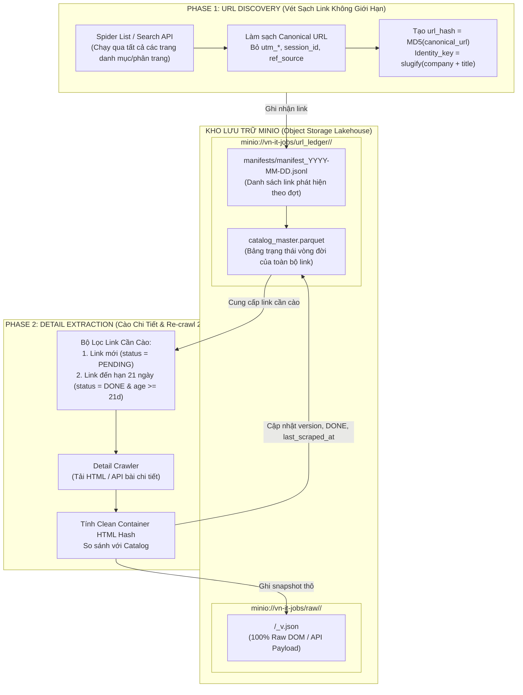
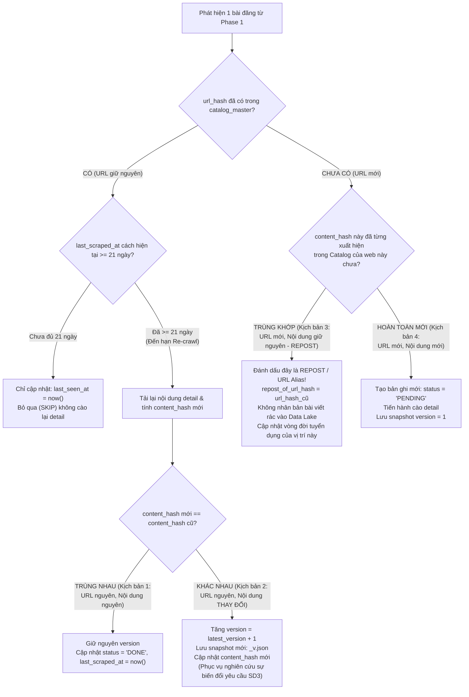
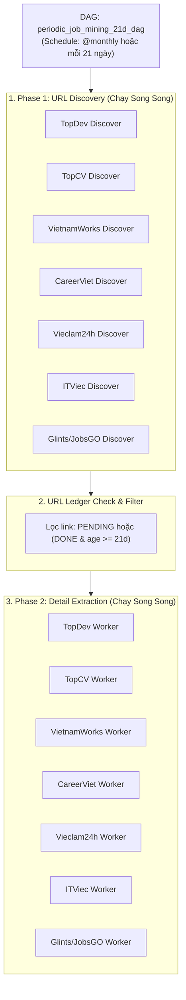

# CẨM NANG KIẾN TRÚC CRAWL RAW DATA, MINIO URL LEDGER & CDC VERSIONING

> **Tài liệu quy trình cốt lõi số 2 (Core Document 02)**  
> **Nguyên tắc cốt tử:**  
> 1. *"Cào là phải cào HẾT — Trang tuyển dụng có trường gì phải lấy nguyên vẹn trường đó, giữ nguyên tên trường gốc, không tự ý format hay ép schema ở bước cào."*  
> 2. *"Tách biệt 2 pha: Phase 1 vét sạch URL không giới hạn thời gian $\rightarrow$ Lưu URL Ledger vào MinIO $\rightarrow$ Phase 2 cào chi tiết với chu kỳ Re-crawl 21 ngày."*

---

## 1. Triết Lý Cào Dữ Liệu Raw As-Is (Zero Information Loss)

Trong các hệ thống Data Mining hiện đại, bước thu thập dữ liệu tuân thủ nghiêm ngặt nguyên lý **Bảo Toàn Thông Tin Tuyệt Đối**:
- **Không tự ý format lương:** Không được tự ý đổi "Thỏa thuận", "Cạnh tranh", "Từ 20 triệu" thành số rỗng hay số 0 ngay trong lúc cào. Hãy lưu nguyên chuỗi văn bản gốc (Raw String) cùng toàn bộ thẻ HTML bao quanh nó.
- **Không vội chuẩn hóa tên trường:** Mỗi trang web có cấu trúc DOM hoặc khóa API riêng. Hãy cào nguyên văn các key đó.
  - Ví dụ ở TopCV: Giữ nguyên `"box-header-job__salary--title": "From 20 million"`, `"job-detail__info--deadline": "30/11/2026"`, `"badge-tag-list": [...]`.
  - Ví dụ ở VietnamWorks: Giữ nguyên toàn bộ cấu trúc object JSON trả về từ API mà không xóa bất kỳ thuộc tính lồng nhau nào.
- **Tại sao?** Bởi vì nếu bạn tự ý cắt bớt dữ liệu ở tầng cào, khi bước EDA và Integration phát hiện ra cần dùng trường đó (ví dụ: ngày hết hạn tin, hình thức làm việc, phúc lợi thưởng), nhóm sẽ phải cào lại từ đầu!

---

## 2. Kiến Trúc Thu Thập 2 Pha Độc Lập (Two-Phase Decoupled Pipeline)

Hệ thống tách biệt hoàn toàn việc **Thu thập Link (Discovery)** và **Bóc tách Chi tiết (Extraction)** thông qua trạm trung chuyển **URL Ledger trên MinIO**:



### Ưu điểm vượt trội của kiến trúc 2 pha:
1. **Không giới hạn thời gian chạy:** Phase 1 chạy độc lập, vét sạch hàng ngàn link từ trang danh mục mà không sợ nghẽn mạng hay bị gián đoạn giữa chừng.
2. **Kiểm soát độ phủ (Coverage):** Nhóm biết chính xác toàn thị trường đang có bao nhiêu vị trí tuyển dụng trước khi tiến hành cào chi tiết.
3. **Tiết kiệm tài nguyên:** Nếu một link đã cào thành công và chưa đủ 21 ngày, Phase 2 tự động bỏ qua (Skip), không gửi request dư thừa lên website tuyển dụng.

---

## 3. Cấu Trúc URL Ledger & Phân Tầng Trên MinIO

Hệ thống lưu trữ trực tiếp trên **MinIO Object Storage** dưới định dạng file phẳng chuẩn Big Data (JSONL & Parquet), không phụ thuộc SQL server:

### 3.1. Phân tầng thư mục trong bucket `vn-it-jobs`:
- **`url_ledger/<source>/manifests/manifest_<YYYY-MM-DD>.jsonl`**: Danh sách toàn bộ URL tìm thấy trong ngày cào (Append-only).
- **`url_ledger/<source>/catalog_master.parquet`**: Bảng trạng thái vòng đời tổng hợp của toàn bộ các link của nguồn đó.
- **`raw/<source>/<YYYY-MM-DD>/<job_id>_v<version>.json`**: File snapshot nội dung thô nguyên bản của từng bài đăng.

### 3.2. Cấu trúc bản ghi URL trong `manifest_<date>.jsonl`:
```json
{
  "url_hash": "e4d909c290d0fb1ca068ffaddf22cbd0",
  "canonical_url": "https://topcv.vn/viec-lam/senior-python-engineer/1948291.html",
  "source": "topcv",
  "job_id": "1948291",
  "discovered_at": "2026-10-16T08:00:00Z",
  "preliminary_title": "Senior Python Backend Engineer",
  "preliminary_company": "FPT Software",
  "identity_key": "fpt_software__senior_python_backend_engineer"
}
```

### 3.3. Bảng trạng thái vòng đời `catalog_master.parquet`:
| Tên cột | Kiểu dữ liệu | Ý nghĩa |
| :--- | :--- | :--- |
| `url_hash` | `VARCHAR(32)` (PK) | Mã băm MD5 của canonical URL |
| `canonical_url` | `TEXT` | URL gốc sau khi loại bỏ token theo dõi (`utm_*`, `ref`) |
| `identity_key` | `TEXT` (Index) | Chuỗi định danh bản chất công việc (`clean_company + clean_title`) |
| `status` | `VARCHAR(16)` | `PENDING`, `DONE`, `RECHECK_DUE`, `FAILED`, `CLOSED` |
| `first_seen_at` | `TIMESTAMP` | Thời điểm lần đầu tiên tìm thấy link |
| `last_seen_at` | `TIMESTAMP` | Thời điểm gần nhất thấy link vẫn còn trên trang danh mục |
| `last_scraped_at`| `TIMESTAMP` | Thời điểm gần nhất cào thành công chi tiết |
| `latest_version` | `INTEGER` | Phiên bản snapshot hiện tại ($1, 2, 3, \dots$) |
| `content_hash` | `VARCHAR(64)` | Mã băm SHA256 của nội dung HTML chính bài viết |
| `repost_of_url_hash` | `VARCHAR(32)` | Trỏ đến `url_hash` gốc nếu đây là tin đăng lại (Repost) |

---

## 4. Cơ Chế Băm HTML Khối Nội Dung (Clean Container HTML Hashing)

### 4.1. So sánh: Băm HTML Thô vs Băm Parsed Fields vs Băm Container Sạch
- **Băm toàn bộ HTML thô (`response.text`):** Rất dễ bị **dương tính giả (False Positive)** vì các trang web luôn chèn mã CSRF, số lượt xem (`views: 104`), ngày giờ server thay đổi từng giây $\rightarrow$ làm hash thay đổi liên tục dù nội dung tuyển dụng không đổi!
- **Băm các trường đã parse:** Mất công viết parser chi tiết trước khi kiểm tra hash, dễ bỏ sót trường.
- **Giải pháp tối ưu: Clean Container HTML Hashing:** Bóc tách khối thẻ bao bọc nội dung tuyển dụng (ví dụ `<div class="job-detail">`), loại bỏ các thẻ rác động (`<script>`, `<style>`, `<iframe>`, số lượt xem) rồi mới băm SHA256.

### 4.2. Mã nguồn chuẩn (`calculate_html_hash`):
```python
import hashlib
import re
from bs4 import BeautifulSoup

def calculate_html_hash(html_content: str, container_selector: str = "body") -> str:
    """
    Băm HTML khối nội dung chính, tự động loại bỏ các thành phần rác động:
    - Thẻ <script>, <style>, <iframe>, <noscript>, <svg>
    - Số lượt xem (views), timestamp hiển thị
    - Thuộc tính ngẫu nhiên (CSRF token, nonce)
    """
    soup = BeautifulSoup(html_content, "html.parser")
    target = soup.select_one(container_selector) or soup.body or soup
    
    # Xóa sạch các thẻ động gây nhảy hash oan
    for tag in target(["script", "style", "iframe", "noscript", "svg"]):
        tag.decompose()
        
    # Chuẩn hóa khoảng trắng
    clean_text = re.sub(r"\s+", " ", target.get_text(separator=" ", strip=True))
    return hashlib.sha256(clean_text.encode("utf-8")).hexdigest()
```

---

## 5. Chu Kỳ Re-crawl 21 Ngày & Ma Trận 4 Kịch Bản (URL vs Nội Dung)

Hệ thống đặt chu kỳ kiểm tra lại độ tươi là **21 ngày** (3 tuần) — chu kỳ lý tưởng tương ứng với thời hạn trung bình của một tin tuyển dụng IT tại Việt Nam (thường là 30 ngày).



### Giải nghĩa chuyên sâu Kịch bản 3 (URL thay đổi mà Nội dung giữ nguyên - Repost):
- **Bản chất thực tế:** HR không tuyển được người sau 1 tháng, tin cũ bị trôi, HR bấm nút "Đăng lại tin". Hệ thống web sinh ra URL mới và ID mới, nhưng nội dung tuyển dụng giống hệt tin cũ.
- **Xử lý:** Nhờ có `content_hash`, khi cào xong bài viết ở URL mới, hệ thống đối chiếu thấy `content_hash` này trùng khớp 100% với một bài đăng cũ.
- **Hành động:** Hệ thống **không tạo file snapshot mới** làm phình to Data Lake, mà chỉ cập nhật Catalog: `repost_of_url_hash = url_hash_cũ`. Điều này giúp nhóm phát hiện vị trí này đã được tuyển kéo dài qua bao nhiêu đợt tuyển dụng!

---

## 6. Cơ Chế Bắt Lỗi An Toàn (Fault-Tolerant Skip Loop)

Trong quá trình cào chi tiết hàng nghìn link ở Phase 2, một link bị lỗi (404, 500, timeout) **tuyệt đối không được làm chết toàn bộ crawler**. Mã nguồn thực thi vòng lặp bảo vệ:

```python
for item in links_to_crawl:
    url = item["canonical_url"]
    
    # 1. SKIP NẾU ĐÃ HOÀN THÀNH VÀ CHƯA ĐẾN HẠN 21 NGÀY
    if item["status"] == "DONE" and not is_due_for_recrawl(item["last_scraped_at"], days=21):
        continue

    try:
        response = http_client.get(url, timeout=15)
        
        # Link bị gỡ bỏ
        if response.status_code == 404:
            mark_url_status(item["url_hash"], status="CLOSED")
            continue
            
        if response.status_code != 200:
            raise Exception(f"HTTP Status {response.status_code}")
            
        new_hash = calculate_html_hash(response.text, container_selector=CONTAINER_SELECTOR)
        
        # Kiểm tra kịch bản Repost (URL mới nhưng content trùng tin cũ)
        existing_repost = find_by_content_hash(new_hash)
        if existing_repost and existing_repost["url_hash"] != item["url_hash"]:
            update_url_ledger(item["url_hash"], status="DONE", repost_of_url_hash=existing_repost["url_hash"], last_scraped_at=now())
            continue

        if item.get("content_hash") == new_hash:
            # Nội dung không đổi sau 21 ngày
            update_url_ledger(item["url_hash"], status="DONE", last_scraped_at=now())
        else:
            # Tin mới hoặc tin có sửa đổi!
            new_version = (item.get("latest_version") or 0) + 1
            save_raw_to_minio(source, item["job_id"], response.text, version=new_version)
            update_url_ledger(item["url_hash"], status="DONE", content_hash=new_hash, 
                              latest_version=new_version, last_scraped_at=now())
            
    except Exception as e:
        # BẮT LỖI AN TOÀN - GHI NHẬN FAILED VÀ SKIP TIẾP TỤC BÀI SAU
        logger.error(f"❌ Failed to crawl {url}: {str(e)}")
        update_url_ledger(item["url_hash"], status="FAILED", error_log=str(e), retry_count=item.get("retry_count", 0) + 1)
        continue
```

---

## 7. Tự Động Hóa Điều Phối Với Apache Airflow

Hệ thống được thiết lập một DAG định kỳ **21 ngày** mang tên `periodic_job_mining_21d_dag`:



---

## 8. Danh Sách Kiểm Tra & Hồ Sơ Bắt Buộc Khi Nộp Bài

Trước khi tạo Pull Request vào nhánh `crawls/<tenweb>`, thành viên phải chuẩn bị:
1. **Mã nguồn 2 hàm:** `discover_urls()` và `crawl_details()`.
2. **Bộ mẫu đa định dạng (Multi-Format Test Suite):**
   - Lưu ít nhất 3 file HTML thô có cấu trúc layout khác nhau vào `crawlers/sources/<tenweb>/samples/sample_*.html`.
   - Lưu 3 file JSON đầu ra tương ứng vào `crawlers/sources/<tenweb>/samples/sample_*.json`.
3. **File phân tích kiến trúc riêng:** Viết tại `docs/crawl/<tenweb>.md` giải thích chi tiết kiến trúc mạng, container selector dùng để băm HTML và các ngoại lệ của web mình.
