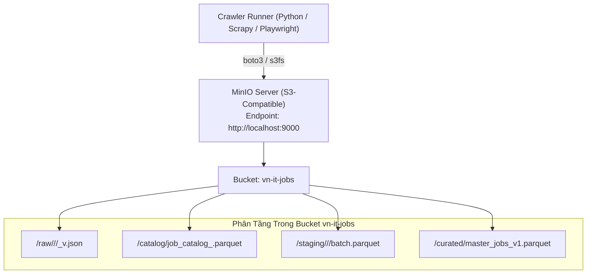
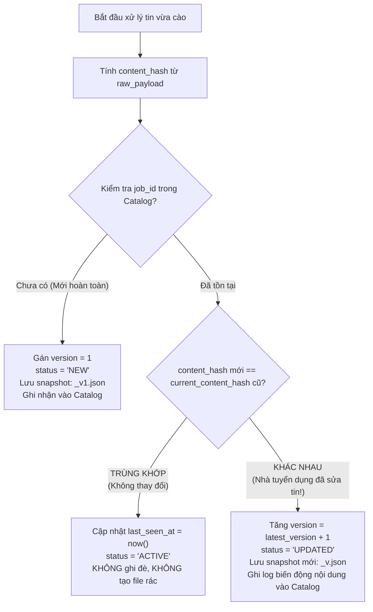

# CẨM NANG KIẾN TRÚC CRAWL RAW DATA & CDC VERSIONING (MINIO)

> **Tài liệu quy trình cốt lõi số 2 (Core Document 02)**  
> **Nguyên tắc cốt tử:** *"Cào là phải cào HẾT — Trang tuyển dụng có trường gì phải lấy nguyên vẹn trường đó, giữ nguyên tên trường gốc, không tự ý format hay ép schema ở bước cào."*

---

## 1. Triết Lý Cào Dữ Liệu Raw As-Is (Zero Information Loss)

Trong các hệ thống Data Mining hiện đại, bước thu thập dữ liệu (Collection) tuân thủ nghiêm ngặt nguyên lý **Bảo Toàn Thông Tin Tuyệt Đối**:
- **Không tự ý format lương:** Không được tự ý đổi "Thỏa thuận", "Cạnh tranh", "Từ 20 triệu" thành số rỗng hay số 0 ngay trong lúc cào. Hãy lưu nguyên chuỗi văn bản gốc (Raw String) cùng toàn bộ thẻ HTML bao quanh nó.
- **Không vội chuẩn hóa tên trường:** Mỗi trang web có cấu trúc DOM hoặc khóa API riêng. Hãy cào nguyên văn các key đó.
  - Ví dụ ở TopCV: Giữ nguyên `"box-header-job__salary--title": "From 20 million"`, `"job-detail__info--deadline": "30/11/2026"`, `"badge-tag-list": [...]`.
  - Ví dụ ở VietnamWorks: Giữ nguyên toàn bộ cấu trúc object JSON trả về từ API mà không xóa bất kỳ thuộc tính lồng nhau nào.
- **Tại sao?** Bởi vì nếu bạn tự ý cắt bớt dữ liệu ở tầng cào, khi bước EDA và Integration phát hiện ra cần dùng trường đó (ví dụ: ngày hết hạn tin, hình thức làm việc, phúc lợi thưởng), nhóm sẽ phải cào lại từ đầu!

---

## 2. Kiến Trúc Lưu Trữ MinIO Object Storage

Hệ thống sử dụng **MinIO** — giải pháp Object Storage mã nguồn mở tương thích 100% với chuẩn S3 API.



### Cấu trúc file Raw chuẩn (`<job_id>_v<version>.json`)
Mỗi tin cào về được bọc trong một **Envelop Metadata Chuẩn**:

```json
{
  "metadata": {
    "job_id": "topcv_1948291",
    "source": "topcv",
    "source_url": "https://www.topcv.vn/viec-lam/senior-python-engineer/1948291.html",
    "scraped_at": "2026-10-14T14:40:00.123456Z",
    "scraper_version": "2.0.0",
    "version": 1,
    "content_hash": "a1b2c3d4e5f67890abcdef1234567890abcdef1234567890abcdef1234567890",
    "http_status": 200
  },
  "raw_payload": {
    "box-header-job__title": "Senior Python Backend Engineer (FastAPI, Redis)",
    "box-header-job__salary--title": "Từ 25 - 45 triệu",
    "box-header-job__company-name": "Công ty Cổ phần Công nghệ ABC",
    "job-detail__box--experience": "3 - 5 năm",
    "job-detail__box--level": "Senior",
    "job-detail__box--location": "Tầng 5, Tòa nhà Techno, Quận Cầu Giấy, Hà Nội",
    "job-detail__box--description_html": "<div>...</div>",
    "job-detail__box--requirements_html": "<div>...</div>",
    "job-detail__box--benefits_html": "<div>...</div>",
    "badge_tags": ["Python", "FastAPI", "Docker", "Thưởng tháng 13", "Laptop cấp riêng"],
    "raw_deadline": "25/11/2026"
  }
}
```

---

## 3. Cơ Chế Change Data Capture (CDC) & Content Hashing

Đây là giải pháp trả lời trực diện câu hỏi hóc búa của Giảng viên: *"Nếu nhà tuyển dụng sửa tin thì sao?"*.

### 3.1. Thuật toán tạo mã băm nội dung (`content_hash`)
Thuật toán lấy toàn bộ các trường nội dung cốt lõi, chuẩn hóa khoảng trắng thừa và băm bằng thuật toán SHA256:

```python
import hashlib
import json

def calculate_content_hash(raw_payload: dict) -> str:
    """
    Sinh mã SHA256 từ các trường nội dung có khả năng bị sửa đổi.
    Bỏ qua các trường động như lượt xem, ngày hiện tại.
    """
    significant_content = {
        "title": raw_payload.get("box-header-job__title") or raw_payload.get("title", ""),
        "salary": raw_payload.get("box-header-job__salary--title") or raw_payload.get("salary", ""),
        "experience": raw_payload.get("job-detail__box--experience") or raw_payload.get("experience", ""),
        "description": raw_payload.get("job-detail__box--description_html") or raw_payload.get("description", ""),
        "requirements": raw_payload.get("job-detail__box--requirements_html") or raw_payload.get("requirements", ""),
        "tags": sorted(raw_payload.get("badge_tags") or [])
    }
    
    # Serialize ổn định (sắp xếp key)
    serialized = json.dumps(significant_content, sort_keys=True, ensure_ascii=False)
    return hashlib.sha256(serialized.encode("utf-8")).hexdigest()
```

### 3.2. Bảng Trạng Thái Catalog (CDC State Table)
Catalog duy trì trạng thái của từng bài đăng trong toàn bộ vòng đời của nó:

| Cột | Ý nghĩa | Ví dụ |
| :--- | :--- | :--- |
| `source` | Tên sàn tuyển dụng | `topcv` |
| `job_id` | Định danh bài đăng trên sàn | `1948291` |
| `latest_version` | Phiên bản snapshot hiện tại | `2` |
| `current_content_hash` | Mã băm nội dung mới nhất | `e3b0c44298fc1c149...` |
| `first_seen_at` | Thời điểm lần đầu cào thấy | `2026-10-01 08:00:00` |
| `last_seen_at` | Thời điểm gần nhất thấy bài đăng còn online | `2026-10-14 14:00:00` |
| `status` | Trạng thái vòng đời | `NEW` / `ACTIVE` / `UPDATED` / `CLOSED` |

### 3.3. Quy trình Quyết định Phiên bản (Decision Flowchart)



---

## 4. Kỹ Thuật Vượt Chướng Ngại Vật & Phòng Vệ (Anti-Bot & Reliability)

### 4.1. Phân loại hình thái kỹ thuật từng trang web
| Nguồn | Kiểu Render | Công nghệ thu thập tối ưu | Lưu ý đặc thù |
| :--- | :--- | :--- | :--- |
| **TopDev** | REST API | `httpx` / `requests` | Gọi trực tiếp endpoint `/api/v1/jobs`, có phân trang `page` & `page_size`. |
| **TopCV** | SSR HTML | `httpx` + `BeautifulSoup` | Server-side Rendering, HTML chứa đầy đủ văn bản. Lưu ý xoay tua User-Agent. |
| **VietnamWorks** | Algolia Search API | `httpx` JSON POST | API trả về JSON rất sạch nhưng có rate limit token. Cần bắt header `x-algolia-api-key`. |
| **CareerViet** | SSR HTML | `httpx` + `BeautifulSoup` | Render DOM cổ điển, thẻ class phân biệt rõ ràng. |
| **Vieclam24h** | Next.js SSR / API | `httpx` parsing `__NEXT_DATA__` | Có thể bóc trực tiếp JSON trong thẻ script `__NEXT_DATA__` mà không cần render trình duyệt. |
| **ITViec** | Cloudflare / SPA | `Playwright` Headless Chrome | Có lớp bảo vệ Cloudflare nhẹ. Cần bật cờ stealth `--disable-blink-features=AutomationControlled`. |
| **Glints & JobsGO** | GraphQL / SSR | `httpx` GraphQL query / BeautifulSoup | Glints gọi GraphQL query, JobsGO parse HTML với pagination rõ ràng. |

### 4.2. Bộ quy tắc An Toàn (Polite Crawling Rules)
1. **Jitter Delay ngẫu nhiên:** Giữa 2 request liên tiếp luôn sleep một khoảng ngẫu nhiên từ $1.5$ đến $3.5$ giây:
   ```python
   import random, time
   time.sleep(random.uniform(1.5, 3.5))
   ```
2. **User-Agent Rotation:** Luôn xoay tua ít nhất 5 User-Agent của các trình duyệt hiện đại (Chrome, Edge, Firefox trên Windows/Mac).
3. **Exponential Backoff:** Nếu gặp lỗi HTTP 429 (Too Many Requests) hoặc 503, tự động chờ $2^k$ giây ($2s \rightarrow 4s \rightarrow 8s$) trước khi retry (tối đa 3 lần).
4. **Không chạy quá 3 worker song song trên 1 domain:** Tránh gây tải lên hạ tầng của website tuyển dụng.

---

## 5. Danh Sách Kiểm Tra Khi Nộp Code Cào (Checklist)

Trước khi tạo Pull Request vào nhánh `crawls/<tenweb>`, thành viên phải tự kiểm tra:
- [ ] Không có bất kỳ logic nào tự ý format lương thành số hoặc bỏ qua chuỗi lương chữ.
- [ ] Mọi trường dữ liệu DOM/API đều được lưu đầy đủ vào `raw_payload`.
- [ ] Đã tích hợp hàm tính `content_hash` và kiểm tra CDC versioning.
- [ ] File output lưu đúng cấu trúc `raw/<source>/<YYYY-MM-DD>/<job_id>_v<ver>.json`.
- [ ] Đã hoàn thành bảng kiểm kê trường dữ liệu theo mẫu `templates/raw_crawl_inventory_template.md`.
