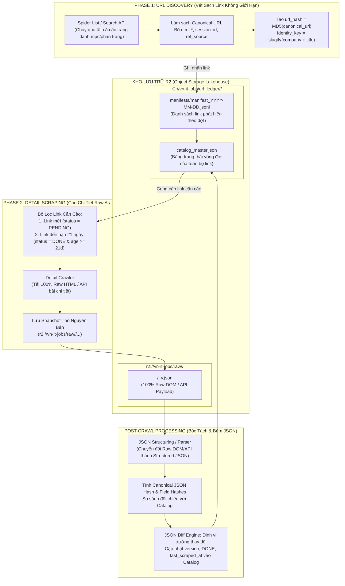
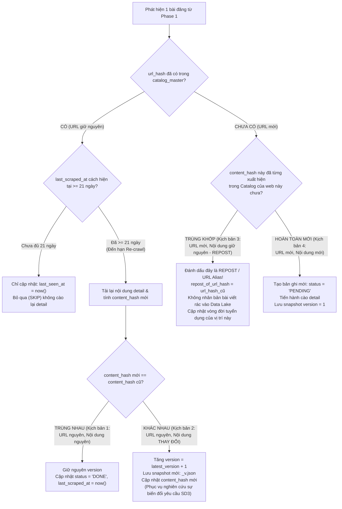

# CẨM NANG KIẾN TRÚC CRAWL RAW DATA, R2 URL LEDGER & CDC VERSIONING

> **Cập nhật 03/11/2026.** Tài liệu mô tả thiết kế. Tiêu chuẩn chính thức (C1–C14) và các bẫy đã gặp nằm ở `collection/CLAUDE.md`; lỗi đã sửa ở `docs/issue_log.md`. Các đoạn đã sửa theo code: catalog lưu dạng JSON, hash tính trên JSON chứ không trên HTML, version quyết định bằng `UrlLedger.next_version`, Airflow dùng `dag_discovery_daily` và 8 DAG `crawler_detail_<nguồn>`.

> **Tài liệu quy trình cốt lõi số 2 (Core Document 02)**  
> **Nguyên tắc cốt tử:**  
> 1. *"Cào là phải cào HẾT — Trang tuyển dụng có trường gì phải lấy nguyên vẹn trường đó, giữ nguyên tên trường gốc, không tự ý format hay ép schema ở bước cào."*  
> 2. *"Tách biệt 2 pha: Phase 1 vét sạch URL không giới hạn thời gian $\rightarrow$ Lưu URL Ledger vào Cloudflare R2 $\rightarrow$ Phase 2 cào chi tiết với chu kỳ Re-crawl 21 ngày."*

---

## 1. Triết Lý Cào Dữ Liệu Raw As-Is (Zero Information Loss)

Trong các hệ thống Data Mining hiện đại, bước thu thập dữ liệu tuân thủ nghiêm ngặt nguyên lý **Bảo Toàn Thông Tin Tuyệt Đối**:
- **Không tự ý format lương:** Không được tự ý đổi "Thỏa thuận", "Cạnh tranh", "Từ 20 triệu" thành số rỗng hay số 0 ngay trong lúc cào. Hãy lưu nguyên chuỗi văn bản gốc (Raw String) cùng toàn bộ thẻ HTML bao quanh nó.
- **Không vội chuẩn hóa tên trường:** Mỗi trang web có cấu trúc DOM hoặc khóa API riêng. Hãy cào nguyên văn các key đó.
  - Ví dụ ở TopCV: Giữ nguyên `"box-header-job__salary--title": "From 20 million"`, `"job-detail__info--deadline": "30/11/2026"`, `"badge-tag-list": [...]`.
  - Ví dụ ở VietnamWorks: Giữ nguyên toàn bộ cấu trúc object JSON trả về từ API mà không xóa bất kỳ thuộc tính lồng nhau nào.
- **Tại sao?** Bởi vì nếu bạn tự ý cắt bớt dữ liệu ở tầng cào, khi bước EDA và Integration phát hiện ra cần dùng trường đó (ví dụ: ngày hết hạn tin, hình thức làm việc, phúc lợi thưởng), nhóm sẽ phải cào lại từ đầu!

---

## 2. Kiến Trúc Thu Thập 2 Pha Độc Lập (Two-Phase Decoupled Pipeline)

Hệ thống tách biệt hoàn toàn việc **Thu thập Link (Discovery)** và **Bóc tách Chi tiết (Extraction)** thông qua trạm trung chuyển **URL Ledger trên Cloudflare R2**:



### Ưu điểm vượt trội của kiến trúc 2 pha:
1. **Không giới hạn thời gian chạy:** Phase 1 chạy độc lập, vét sạch hàng ngàn link từ trang danh mục mà không sợ nghẽn mạng hay bị gián đoạn giữa chừng.
2. **Kiểm soát độ phủ (Coverage):** Nhóm biết chính xác toàn thị trường đang có bao nhiêu vị trí tuyển dụng trước khi tiến hành cào chi tiết.
3. **Tiết kiệm tài nguyên:** Nếu một link đã cào thành công và chưa đủ 21 ngày, Phase 2 tự động bỏ qua (Skip), không gửi request dư thừa lên website tuyển dụng.

---

## 3. Cấu Trúc URL Ledger & Phân Tầng Trên Cloudflare R2

Hệ thống lưu trữ trực tiếp trên **Cloudflare R2 Object Storage** dưới định dạng file phẳng chuẩn Big Data (JSONL & Parquet), không phụ thuộc SQL server:

### 3.1. Phân tầng thư mục trong bucket `vn-it-jobs`:
- **`url_ledger/<source>/manifests/manifest_<YYYY-MM-DD>.jsonl`**: Danh sách toàn bộ URL tìm thấy trong ngày cào (Append-only).
- **`url_ledger/<source>/catalog_master.json`**: Bảng trạng thái vòng đời tổng hợp của toàn bộ các link của nguồn đó (dict `url_hash → bản ghi`).
- **`raw/<source>/<YYYY-MM-DD>/<job_id>_v<version>.json`**: File snapshot nội dung thô nguyên bản của từng bài đăng.

### 3.2. Cấu trúc bản ghi URL trong `manifest_<date>.jsonl`:
```json
{
  "url_hash": "e4d909c290d0fb1ca068ffaddf22cbd0",
  "canonical_url": "https://topcv.vn/viec-lam/senior-python-engineer/1948291.html",
  "source": "topcv",
  "job_id": "1948291",
  "discovered_at": "2026-10-16T08:00:00Z",
  "preliminary_title": "Senior Python Backend Engineer",
  "preliminary_company": "FPT Software",
  "identity_key": "fpt_software__senior_python_backend_engineer"
}
```

### 3.3. Các trường của một bản ghi trong `catalog_master.json`:
| Tên cột | Kiểu dữ liệu | Ý nghĩa |
| :--- | :--- | :--- |
| `url_hash` | `VARCHAR(32)` (PK) | Mã băm MD5 của canonical URL |
| `canonical_url` | `TEXT` | URL gốc sau khi loại bỏ token theo dõi (`utm_*`, `ref`) |
| `identity_key` | `TEXT` (Index) | Chuỗi định danh bản chất công việc (`clean_company + clean_title`) |
| `status` | `VARCHAR(16)` | `PENDING`, `DONE`, `RECHECK_DUE`, `FAILED`, `CLOSED` |
| `first_seen_at` | `TIMESTAMP` | Thời điểm lần đầu tiên tìm thấy link |
| `last_seen_at` | `TIMESTAMP` | Thời điểm gần nhất thấy link vẫn còn trên trang danh mục |
| `last_scraped_at`| `TIMESTAMP` | Thời điểm gần nhất cào thành công chi tiết |
| `latest_version` | `INTEGER` | Phiên bản snapshot hiện tại ($1, 2, 3, \dots$) |
| `content_hash` | `VARCHAR(64)` | SHA-256 của `raw_payload` dạng JSON chuẩn hóa (`calculate_json_canonical_hash`), không phải của HTML |
| `repost_of_url_hash` | `VARCHAR(32)` | Trỏ đến `url_hash` gốc nếu đây là tin đăng lại (Repost); repost không có file raw |
| `updated_at` | `TIMESTAMP` | Lần đổi trạng thái gần nhất, do `mark_done`/`mark_failed`/`mark_closed` ghi. `save_catalog()` gộp theo trường này: bản mới hơn thắng (từ 03/11/2026) |
| `error_log`, `retry_count` | `TEXT`, `INTEGER` | Lỗi gần nhất và số lần lỗi, khi `FAILED` |

---

## 4. Cơ Chế Băm Cấu Trúc JSON Sau Cào (Post-Crawl Canonical JSON & Field Hashing)

### 4.1. Tại sao Hash phải là bước thực hiện SAU BƯỚC CÀO trên dữ liệu JSON?
Trong quy trình Modern ELT, **bước cào (Crawler)** chỉ thuần túy làm nhiệm vụ **Extract & Load Raw As-Is (Zero Information Loss)**: tải nguyên vẹn mã HTML hoặc API response về Data Lake. Việc băm kiểm tra thay đổi (Change Data Capture - CDC) được thực hiện ở **bước xử lý sau cào trên đối tượng JSON**:
1. **Giải phóng hoàn toàn Crawler:** Crawler không bị nghẽn CPU vì parse DOM, không bị crash khi trang web đổi CSS class, và không phải phụ thuộc vào việc chỉ băm 1 selector cụ thể.
2. **Miễn nhiễm 100% với rác động của HTML:** Các thành phần như CSRF tokens, view counters (`Lượt xem: 1,420`), timestamp server, và box việc làm liên quan bị loại bỏ hoàn toàn khỏi đối tượng JSON nghiệp vụ.
3. **Thống nhất cho cả 7 sàn tuyển dụng:** Nguồn dữ liệu từ API JSON (TopDev, VietnamWorks) hay từ SSR HTML (TopCV, CareerViet, ITViec, Vieclam24h) sau khi bóc tách đều thành JSON $\rightarrow$ dùng chung 1 engine băm và diff duy nhất.
4. **Biết chính xác "Người ta thay đổi ở đâu":** Bằng cách băm theo từng trường (`salary`, `requirements`, `deadline`, `benefits`), ta so sánh được trực tiếp key-value giữa 2 phiên bản để chỉ rõ trường nào bị chỉnh sửa.

### 4.2. Mã nguồn chuẩn Băm JSON Canonical & Băm Đa Trường (`collection/common/url_ledger.py`):
```python
import hashlib
import json
import re
from typing import Any, Dict, List, Optional

def calculate_json_canonical_hash(payload: Any, exclude_keys: Optional[List[str]] = None) -> str:
    """Băm SHA-256 trên dictionary JSON sau khi đã chuẩn hóa khóa (Canonical JSON)."""
    if payload is None:
        return ""
    exclude = set(exclude_keys or ["scraped_at", "version", "content_hash", "crawler_version", "scraper_version"])
    
    def _filter_obj(obj: Any) -> Any:
        if isinstance(obj, dict):
            return {k: _filter_obj(v) for k, v in obj.items() if k not in exclude}
        elif isinstance(obj, list):
            return [_filter_obj(x) for x in obj]
        return obj

    filtered = _filter_obj(payload)
    canonical_str = json.dumps(filtered, ensure_ascii=False, sort_keys=True, separators=(",", ":"))
    return hashlib.sha256(canonical_str.encode("utf-8")).hexdigest()

def calculate_json_field_hashes(payload: Dict[str, Any]) -> Dict[str, str]:
    """Băm riêng biệt từng trường nghiệp vụ (salary, deadline, requirements, benefits, etc.)."""
    field_hashes: Dict[str, str] = {}
    for key, val in payload.items():
        if key in ["scraped_at", "version", "content_hash", "raw_html"]:
            continue
        norm_str = json.dumps(val, ensure_ascii=False, sort_keys=True, separators=(",", ":")) if isinstance(val, (dict, list)) else re.sub(r"\s+", " ", str(val).strip())
        field_hashes[key] = hashlib.sha256(norm_str.encode("utf-8")).hexdigest()
    return field_hashes

def diff_json_versions(old_payload: Dict[str, Any], new_payload: Dict[str, Any]) -> Dict[str, Any]:
    """So sánh đối chiếu chi tiết giữa 2 phiên bản JSON (v1 vs v2) để chỉ ra trường nào bị sửa đổi."""
    # (Định vị cụ thể trường changed, added, removed và giá trị before/after)
    ...
```

### 4.3. Đối chiếu 2 phiên bản:
Script `diff_job_versions.py` chưa được viết. Tạm thời so hai file bằng `diff <(jq -S .raw_payload a_v1.json) <(jq -S .raw_payload a_v2.json)`.

---

## 5. Chu Kỳ Re-crawl 21 Ngày & Ma Trận 4 Kịch Bản (URL vs Nội Dung)

Hệ thống đặt chu kỳ kiểm tra lại độ tươi là **21 ngày** (3 tuần) — chu kỳ lý tưởng tương ứng với thời hạn trung bình của một tin tuyển dụng IT tại Việt Nam (thường là 30 ngày).



### Giải nghĩa chuyên sâu Kịch bản 3 (URL thay đổi mà Nội dung giữ nguyên - Repost):
- **Bản chất thực tế:** HR không tuyển được người sau 1 tháng, tin cũ bị trôi, HR bấm nút "Đăng lại tin". Hệ thống web sinh ra URL mới và ID mới, nhưng nội dung tuyển dụng giống hệt tin cũ.
- **Xử lý:** Nhờ có `content_hash`, khi cào xong bài viết ở URL mới, hệ thống đối chiếu thấy `content_hash` này trùng khớp 100% với một bài đăng cũ.
- **Hành động:** Hệ thống **không tạo file snapshot mới** làm phình to Data Lake, mà chỉ cập nhật Catalog: `repost_of_url_hash = url_hash_cũ`. Điều này giúp nhóm phát hiện vị trí này đã được tuyển kéo dài qua bao nhiêu đợt tuyển dụng!

---

## 6. Cơ Chế Bắt Lỗi An Toàn (Fault-Tolerant Skip Loop)

Trong quá trình cào chi tiết hàng nghìn link ở Phase 2, một link bị lỗi (404, 500, timeout) **tuyệt đối không được làm chết toàn bộ crawler**. Mã nguồn thực thi vòng lặp bảo vệ:

Bản dưới theo code hiện tại (xem `crawl_details()` của TopCV hoặc JobsGO):

```python
for rec in ledger.get_pending_or_due_records(21):   # tin DONE đến hạn bị đổi sang RECHECK_DUE trong bộ nhớ
    try:
        html = client.get_html(rec["canonical_url"])
        if is_removed(html):                          # 404, "tin đã hết hạn"
            ledger.mark_closed(rec["url_hash"])
            continue

        payload = build_raw_payload(html)
        content_hash = calculate_json_canonical_hash(payload, exclude_keys=["raw_html"])

        # Kịch bản 3: URL mới, nội dung trùng tin khác -> repost, không ghi file
        existing = ledger.find_by_content_hash(content_hash)
        if existing and existing["url_hash"] != rec["url_hash"]:
            ledger.mark_done(rec["url_hash"], content_hash=content_hash, repost_of_url_hash=existing["url_hash"])
            continue

        # Kịch bản 1 và 2: next_version coi RECHECK_DUE như DONE (không so status == "DONE")
        changed, version = UrlLedger.next_version(rec, content_hash)
        if changed:
            save_raw(source, rec["job_id"], payload, version=version)   # <job_id>_v<version>.json
        ledger.mark_done(rec["url_hash"], content_hash=content_hash, new_version=version)

    except Exception as exc:
        # Safe Skip: ghi FAILED (kèm error_log, retry_count) rồi đi tiếp
        ledger.mark_failed(rec["url_hash"], str(exc))

ledger.save_catalog()
if sync_r2:
    ledger.sync_final()   # raise LedgerSyncError nếu không đẩy được lên R2
```

---

## 7. Tự Động Hóa Điều Phối Với Apache Airflow

Chi tiết vận hành ở `docs/03_airflow_guide.md`. Tóm tắt:

- `dag_discovery_daily` (05:00 mỗi ngày) chạy discovery cho 8 nguồn, 2 luồng song song.
- 8 DAG `crawler_detail_<nguồn>` chạy theo `DETAIL_CRON` (`collection/common/detail_schedule.py`): route check (`adaptive_router.py`, tối đa 30 tin, nghỉ 55 phút giữa các ca) → cào → kiểm tra chất lượng → tiền xử lý nhẹ.
- Discovery và detail của cùng nguồn dùng chung `pool_<nguồn>` (1 slot) nên không chạy chồng.
- Mọi task gọi `run_crawler(..., sync_r2=True)`.

---

## 8. Danh Sách Kiểm Tra & Hồ Sơ Bắt Buộc Khi Nộp Bài

Trước khi tạo Pull Request vào nhánh `crawls/<tenweb>`, thành viên phải chuẩn bị:
1. **Mã nguồn 2 hàm:** `discover_urls()` và `crawl_details()`.
2. **Mẫu và contract test (C13):**
   - 3 trang thật (tin thường, tin VIP/hot, lương thỏa thuận) trong `tests/fixtures/<tenweb>/`.
   - `tests/contract/test_<tenweb>_contract.py` chạy offline, dùng `tests/contract/standards.py`.
3. **File phân tích kiến trúc riêng:** Viết tại `docs/crawl/<tenweb>.md` giải thích chi tiết kiến trúc mạng, cách bóc tách `raw_payload` và các ngoại lệ của web mình.
