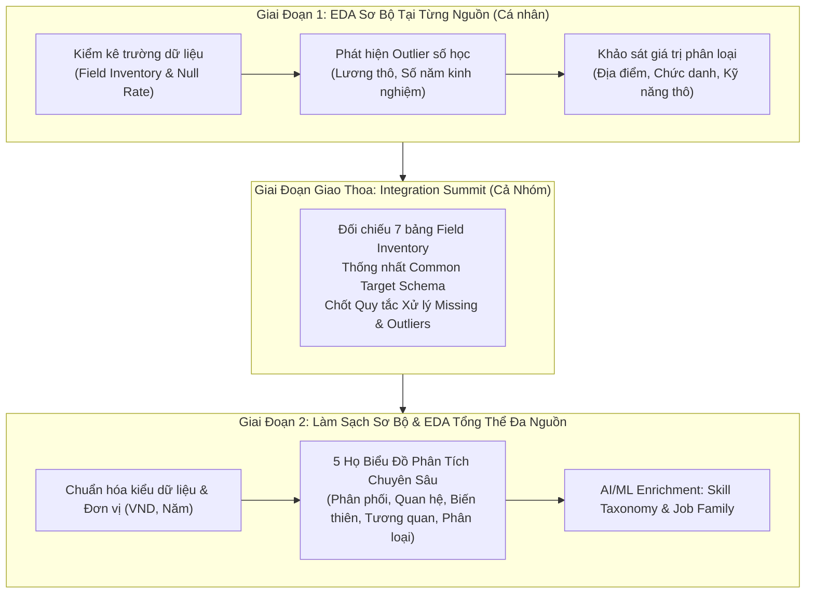
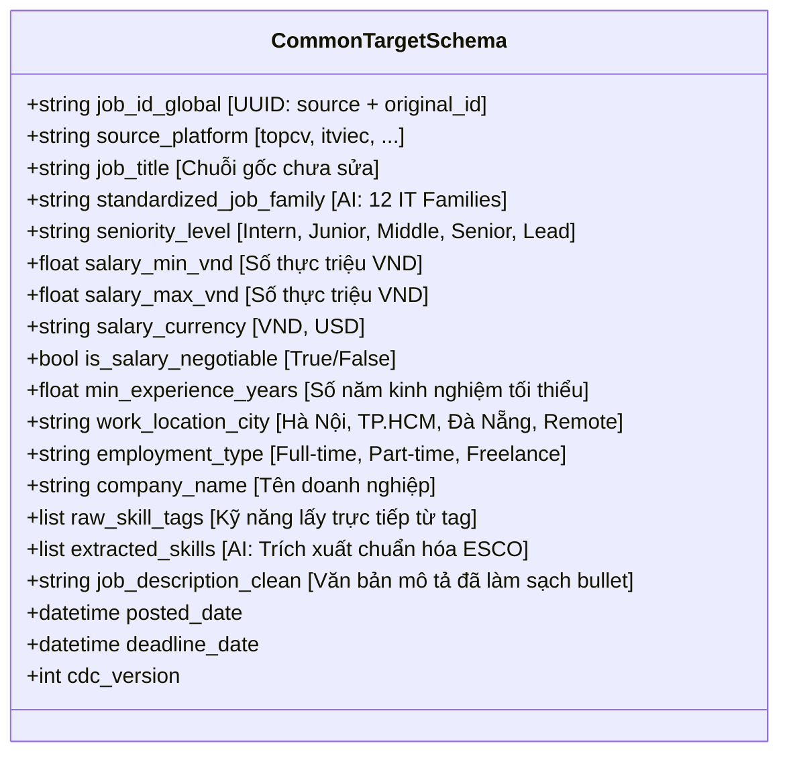

# CẨM NANG EDA SƠ BỘ, DATA INTEGRATION & ỨNG DỤNG AI/ML

> **Tài liệu quy trình cốt lõi số 3 (Core Document 03)**  
> **Sứ mệnh:** Biến dữ liệu thô đa nguồn, phân mảnh, dị cấu trúc từ 7 sàn tuyển dụng thành **Bộ dữ liệu Vàng (Golden Dataset)** thống nhất, sạch sẽ, có căn cứ khoa học thống kê và áp dụng AI/ML hiện đại để phục vụ 5 mục tiêu SD1 — SD5.

---

## 1. Bản Đồ 2 Giai Đoạn: Từ EDA Sơ Bộ Đến Data Integration

---

## 2. Giai Đoạn 1: Quy Trình EDA Sơ Bộ (Preliminary EDA) Tại Từng Nguồn

Mỗi thành viên sau khi cào xong tập dữ liệu thô của website được phân công PHẢI tiến hành EDA sơ bộ để trả lời 3 câu hỏi lớn:
1. **Source của tôi có những trường gì, trường nào luôn có, trường nào hay bị khuyết (Missing Values)?**
2. **Có bao nhiêu bài đăng bị bất thường (Outliers) về mức lương hoặc số năm kinh nghiệm?**
3. **Các giá trị phân loại (Địa điểm, Chức danh) được thể hiện dưới dạng nào?**

### 2.1. Đánh giá Khuyết Thiếu Dữ Liệu (Missing Value Profiling)
Tính toán tỷ lệ khuyết thiếu của từng trường thô:
$$\text{Missing Rate} (\%) = \frac{\text{Số lượng bản ghi bị NULL / Rỗng}}{\text{Tổng số bản ghi cào được}} \times 100\%$$

**Quy tắc phân loại mức độ khuyết thiếu:**
- $< 5\%$: Khuyết thiếu nhẹ $\rightarrow$ Có thể Impute bằng Median/Mode hoặc gắn nhãn `"Chưa cập nhật"`.
- $5\% - 30\%$: Khuyết thiếu trung bình $\rightarrow$ Cần xem xét có thể trích xuất bổ sung từ văn bản JD hay không (ví dụ: lương ghi "Thỏa thuận" nhưng tiêu đề có ghi *"Upto 30 Triệu"*).
- $> 60\%$: Khuyết thiếu nghiêm trọng $\rightarrow$ Không thể dùng làm trường phân tích chính độc lập, chỉ dùng làm thuộc tính phụ (Optional Metadata).

### 2.2. Đánh giá Ngoại Lai (Outlier Detection) Bằng Phương Pháp Giá Trị Số
Áp dụng cho 2 biến định lượng quan trọng: **Mức lương (Triệu VNĐ/tháng)** và **Kinh nghiệm (Năm)**.

1. **Phương pháp Khoảng Phân vị (IQR Method):**
   - Tính $Q_1$ (phân vị 25%), $Q_3$ (phân vị 75%), và $\text{IQR} = Q_3 - Q_1$.
   - Giới hạn dưới: $\text{Lower Bound} = \max(0, Q_1 - 1.5 \times \text{IQR})$.
   - Giới hạn trên: $\text{Upper Bound} = Q_3 + 1.5 \times \text{IQR}$.
   - Mọi giá trị nằm ngoài khoảng $[\text{Lower Bound}, \text{Upper Bound}]$ bị đánh dấu là Outlier nghi vấn.
2. **Phương pháp Độ Lệch Chuẩn (Z-Score):**
   - $Z = \frac{X - \mu}{\sigma}$. Với $|Z| > 3$, giá trị có xác suất xuất hiện $< 0.3\%$ trong phân phối chuẩn $\rightarrow$ Ngoại lai cực đoan.
3. **Nhận diện lỗi nhập liệu phổ biến trong tin tuyển dụng IT:**
   - Nhầm đơn vị tiền tệ: Tuyển tại Việt Nam nhưng nhập 2000 (USD) vào ô VNĐ $\rightarrow$ Lương 2000 VNĐ!
   - Gõ thừa số 0: Gõ 500,000,000 VNĐ thay vì 50,000,000 VNĐ.
   - Lương theo năm nhưng ghi vào ô lương tháng: 400 triệu/tháng thay vì 400 triệu/năm.

---

## 3. Hội Nghị Integration (Schema Harmonization Summit)

Sau khi có 7 bản báo cáo EDA sơ bộ, cả nhóm họp để xác định **Common Target Schema** — bộ khung dữ liệu chung mà mọi nguồn đều phải ánh xạ về:

### Nguyên tắc xử lý xung đột trường khi Integration:
1. **Trường nào tất cả các web đều có:** Đưa vào `Core Mandatory Fields` (Tiêu đề, Công ty, Địa điểm, Mô tả công việc).
2. **Trường một số web có, web khác không có:**
   - Ví dụ: ITViec có trường *"3 Lý do gia nhập công ty"*, TopCV không có.
   - Giải pháp: Lưu vào trường mở rộng `extended_attributes (JSONB)` để không làm mất thông tin quý giá của web có trường đó, đồng thời không làm gãy schema của web không có!
3. **Trường biểu diễn khác nhau:**
   - Lương TopDev lưu dạng Object `{ "min": 1000, "max": 2000, "currency": "USD" }`.
   - Lương TopCV lưu chuỗi text `"Từ 15 - 25 triệu"`.
   - Giải pháp: Xây dựng hàm `Standard Salary Converter` quy đổi toàn bộ về `salary_min_vnd` và `salary_max_vnd` theo tỷ giá cố định (1 USD = 25,400 VND).

---

## 4. 5 Họ Biểu Đồ Bắt Buộc Trong EDA Chính

Sau khi dữ liệu đã được làm sạch sơ bộ và tích hợp vào staging, nhóm phải tiến hành trực quan hóa toàn diện bằng 5 nhóm biểu đồ sau:

### 4.1. Biểu đồ Phân Phối (Distribution Plots)
- **Mục đích:** Khảo sát hình dạng phân bố của các biến liên tục (Lương, Kinh nghiệm, Độ dài văn bản JD).
- **Loại biểu đồ:**
  - **Histogram kết hợp đường cong KDE (Kernel Density Estimation):** Xem mức lương có bị lệch phải (Right-skewed) hay không.
  - **Boxplot đơn biến:** Quan sát vị trí trung vị (Median), khoảng $Q_1 - Q_3$ và các điểm ngoại lai.

### 4.2. Biểu đồ Quan Hệ (Relationship Plots)
- **Mục đích:** Khảo sát mối liên hệ phụ thuộc giữa 2 hay nhiều biến số.
- **Loại biểu đồ:**
  - **Scatter Plot (Biểu đồ phân tán) giữa Kinh Nghiệm và Mức Lương:** Kèm đường hồi quy tuyến tính (Trendline) để kiểm chứng giả thuyết: *Số năm kinh nghiệm càng cao thì lương càng tăng theo tỷ lệ nào?*
  - **Pairplot đa biến:** Xem tương quan đồng thời giữa Lương min, Lương max, Số năm kinh nghiệm và Số lượng kỹ năng yêu cầu.

### 4.3. Biểu đồ Độ Biến Thiên / Phân Tán (Dispersion & Variance Plots)
- **Mục đích:** So sánh độ biến thiên của mức lương giữa các nhóm danh mục khác nhau.
- **Loại biểu đồ:**
  - **Boxplot phân tầng (Stratified Boxplot):** Mức lương biến thiên thế nào giữa các cấp bậc (Junior vs Senior vs Lead).
  - **Violin Plot:** Kết hợp giữa Boxplot và KDE để quan sát độ dày của mật độ lương theo từng Job Family (ví dụ: AI/Data Engineer có dải phân tán rộng hơn Web Frontend).

### 4.4. Ma Trận Tương Quan (Correlation Matrix)
- **Mục đích:** Đo lường mức độ tương quan tuyến tính và phi tuyến tính giữa các biến định lượng.
- **Loại biểu đồ:** **Heatmap Ma Trận Tương Quan**
  - Hệ số tương quan **Pearson** (cho phân phối gần chuẩn).
  - Hệ số tương quan hạng **Spearman** (cho biến thứ bậc như Seniority hoặc dữ liệu có phân phối lệch/outlier).
  - Các biến đưa vào ma trận: `[salary_min, salary_max, min_experience_years, jd_word_count, total_skills_required]`.

### 4.5. Tần Suất Giá Trị Phân Loại (Categorical Frequency Plots)
- **Mục đích:** Khảo sát cơ cấu và độ phổ biến của các biến rời rạc.
- **Loại biểu đồ:**
  - **Horizontal Bar Chart Top 20 Kỹ Năng IT được săn đón nhất** (Python, Java, Docker, React, AWS,...).
  - **Biểu đồ Pareto (80/20):** 80% nhu cầu tuyển dụng tập trung vào những ngôn ngữ/công nghệ nào?
  - **Donut Chart / Treemap:** Cơ cấu thị trường theo địa phương (TP.HCM chiếm bao nhiêu %, Hà Nội chiếm bao nhiêu %, Remote chiếm bao nhiêu %).

---

## 5. Quyết Định Kỹ Thuật Điều Chỉnh Dữ Liệu Dựa Trên EDA

Từ kết quả trực quan hóa và thống kê ở trên, nhóm đưa ra quyết định kỹ thuật xử lý dữ liệu (Feature Engineering & Preprocessing Decision Matrix):

| Hiện tượng phát hiện qua EDA | Quyết định điều chỉnh dữ liệu | Lý do & Căn cứ kỹ thuật |
| :--- | :--- | :--- |
| **Phân phối lương bị lệch phải cực đoan (Right-skewed)** | Áp dụng biến đổi **Log Transform:** $y = \log(1 + \text{salary})$ | Giúp phân phối đưa về dạng chuẩn (Gaussian-like), ổn định phương sai cho các mô hình hồi quy. |
| **Outlier lương cực đại do gõ nhầm (ví dụ: 1 tỷ/tháng)** | Áp dụng kỹ thuật **Winsorization (Capping 99th Percentile)** | Thay vì xóa bỏ bản ghi (làm mất các thông tin kỹ năng quý giá khác), ta kéo giá trị outlier về ngưỡng phân vị 99%. |
| **Lương ghi "Thỏa thuận" (Missing lương ~40%)** | Tạo thêm biến nhị phân cờ chỉ thị **`is_salary_negotiable = 1`** kết hợp KNN Imputation nếu cần mô hình hóa | Không được gán bừa giá trị trung bình vì tin "Thỏa thuận" thường có xu hướng trả lương cao hơn trung bình thị trường! |
| **Biến Chức danh có hàng nghìn giá trị rời rạc** | Dùng AI phân loại về **12 Job Families chuẩn** + One-Hot Encoding hoặc Target Encoding | Giảm số chiều không gian (Dimensionality Reduction), tránh curse of dimensionality. |

---

## 6. Ứng Dụng AI & Machine Learning Vào Xử Lý Dữ Liệu

### 6.1. Trích Xuất & Chuẩn Hóa Kỹ Năng Bằng LLM (Skill Intelligence - SD3)
Thay vì dùng danh sách từ khóa tĩnh (Static Keyword Matching) vốn bỏ sót các kỹ năng mới nổi, hệ thống kết hợp:
1. **Rule-based Trie Matcher:** Bắt nhanh 500 kỹ năng IT phổ biến nhất (tốc độ $< 1$ms).
2. **LLM Few-shot Prompting:** Với những đoạn văn mô tả phức tạp, đưa vào LLM để trích xuất 3 nhóm:
   - **Hard Skills:** Python, Kubernetes, Redis, PyTorch.
   - **Domain Knowledge:** Fintech, Payment Gateway, E-commerce, DICOM (Y tế).
   - **Soft/Methodology Skills:** Agile, Scrum, CI/CD mindset, English communication.
3. **Skill Embedding Normalization:** Dùng Sentence-Transformers chuyển đổi tên kỹ năng thành vector 384 chiều, tính Cosine Similarity với từ điển chuẩn ESCO / O*NET để gộp biến thể (`Vue`, `VueJS`, `Vue.js 3` $\rightarrow$ `Vue.js`).

### 6.2. Phân Cụm Nghề Nghiệp & Job Family Bằng NLP (SD2)
- Áp dụng mô hình **Zero-Shot Classification** (`facebook/bart-large-mnli` hoặc mô hình tiếng Việt) để gán nhãn tự động một bài đăng vào 1 trong 12 Job Family chuẩn dựa trên sự kết hợp giữa Tiêu đề và Mô tả công việc:
  $$\text{Target Labels} = [\text{"Backend"}, \text{"Frontend"}, \text{"DevOps"}, \text{"Data/AI"}, \text{"Mobile"}, \dots]$$

### 6.3. Khử Trùng Lặp Xuyên Sàn (Cross-Platform Semantic Deduplication)
- Cùng một vị trí tuyển dụng thường được nhà tuyển dụng đăng chéo lên cả ITViec, TopCV và VietnamWorks.
- **Thuật toán Khử Trùng:**
  1. Lọc các cặp bài đăng có cùng Tên Công Ty (đã chuẩn hóa qua Levenshtein Distance $> 0.85$).
  2. Tính Cosine Similarity giữa vector ngữ nghĩa của 2 văn bản JD:
     $$\text{Similarity}(JD_A, JD_B) = \frac{\vec{E}_{A} \cdot \vec{E}_{B}}{\|\vec{E}_{A}\| \|\vec{E}_{B}\|}$$
  3. Nếu $\text{Similarity} > 0.92$ và thời gian đăng cách nhau không quá 15 ngày $\rightarrow$ Đánh dấu là cùng một cơ hội việc làm, giữ lại 1 bản ghi chính và lưu liên kết tham chiếu chéo (`cross_platform_references`).
