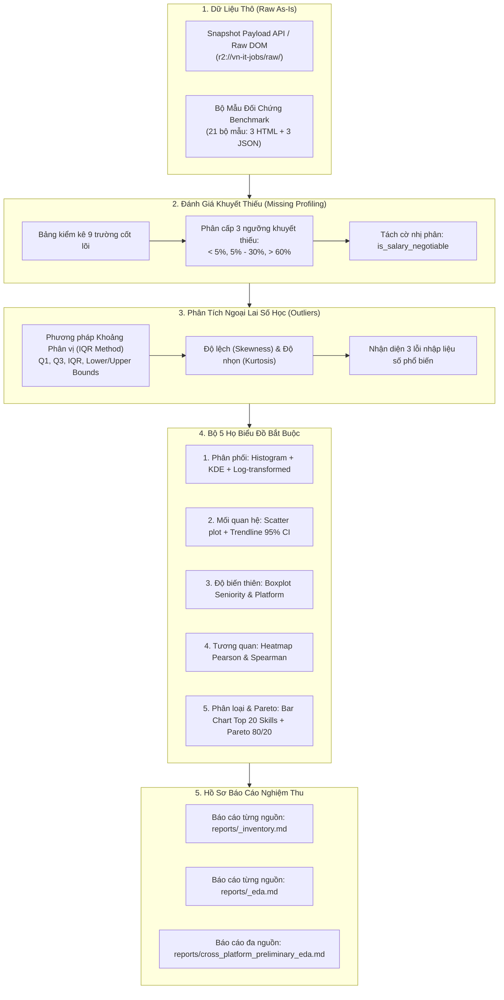

# CẨM NANG PHÂN TÍCH DỮ LIỆU KHÁM PHÁ (EDA INTELLIGENCE GUIDE)

> **Tài liệu quy trình cốt lõi số 3 (Core Document 03)**  
> **Sứ mệnh:** Quy chuẩn hóa toàn diện quy trình phân tích dữ liệu khám phá (Exploratory Data Analysis - EDA) cho dữ liệu tuyển dụng IT thô thu thập từ các sàn tuyển dụng tại Việt Nam (TopCV, TopDev, VietnamWorks, CareerViet, Vieclam24h, ITViec, Glints, JobsGO).

> [!IMPORTANT]
> **RANH GIỚI NGHIỆM THU ĐỢT NÀY:**  
> Đợt nghiệm thu này **DỪNG LẠI HOÀN TOÀN TẠI BƯỚC DATA COLLECTION (CRAWL VÀ EDA)**.  
> Tài liệu này tập trung 100% vào việc đánh giá chất lượng dữ liệu thô (Raw As-Is Profiling), tỷ lệ khuyết thiếu (Missing Values), phát hiện ngoại lai số học (Outliers) và trực quan hóa **Bộ 5 Họ Biểu Đồ Bắt Buộc**.  
> Mọi nội dung liên quan đến Integration Summit, Common Target Schema, và ứng dụng AI/ML mô hình hóa được phân loại vào **Phụ lục: Định hướng tương lai (Future Outlook — Out of Scope)**, tuyệt đối không thuộc tiêu chuẩn nghiệm thu của đợt này.

---

## 1. Bản Đồ Quy Trình EDA Chuẩn Mực Trong Giai Đoạn Data Collection

---

## 2. Đánh Giá Khuyết Thiếu Dữ Liệu (Missing Value Profiling)

Mỗi thành viên sau khi cào xong tập dữ liệu thô của website được phân công PHẢI tiến hành đánh giá chất lượng trường dữ liệu để trả lời 3 câu hỏi lớn:
1. **Source của tôi có những trường gì, trường nào luôn có, trường nào hay bị khuyết (Missing Values)?**
2. **Có bao nhiêu bài đăng bị bất thường (Outliers) về mức lương hoặc số năm kinh nghiệm?**
3. **Các giá trị phân loại (Địa điểm, Chức danh) được thể hiện dưới dạng nào?**

### 2.1. Công thức tính toán
$$\text{Missing Rate} (\%) = \frac{\text{Số lượng bản ghi bị NULL / Rỗng}}{\text{Tổng số bản ghi cào được}} \times 100\%$$

### 2.2. Quy tắc phân loại mức độ khuyết thiếu chuẩn khoa học:
- **Khuyết thiếu nhẹ ($< 5\%$):** Các trường định danh bắt buộc (`title`, `company`, `job_url`) phải đạt mức này (toàn hệ thống đạt $0.0\% - 0.1\%$).
- **Khuyết thiếu trung bình ($5\% - 30\%$):** Cần xem xét trích xuất bổ sung từ văn bản JD (ví dụ: bóc tách số năm kinh nghiệm từ câu văn yêu cầu).
- **Khuyết thiếu nặng ($> 60\%$):** Điển hình là trường dải lương số (`salary_min`, `salary_max` khuyết thiếu khoảng $70\%$).
  - **Quy tắc tuyệt đối:** Bắt buộc duy trì cờ nhị phân **`is_salary_negotiable = 1`** cho tin thỏa thuận.
  - **Nghiêm cấm:** Không được điền 0, không được gán bừa bằng giá trị Mean/Median của toàn bộ tập dữ liệu vì tin thỏa thuận có phân phối bản chất khác tin công khai dải lương.

---

## 3. Phân Tích Ngoại Lai Định Lượng Số Học (Quantitative Outlier Detection)

Áp dụng cho 2 biến định lượng quan trọng: **Mức lương (Triệu VNĐ/tháng)** và **Kinh nghiệm (Năm)**.

### 3.1. Phương pháp Khoảng Phân Vị (IQR Method)
- Tính $Q_1$ (phân vị 25%), $Q_3$ (phân vị 75%), và khoảng tứ phân vị $\text{IQR} = Q_3 - Q_1$.
- Giới hạn dưới: $\text{Lower Bound} = \max(0, Q_1 - 1.5 \times \text{IQR})$.
- Giới hạn trên: $\text{Upper Bound} = Q_3 + 1.5 \times \text{IQR}$.
- Bản ghi có giá trị $> \text{Upper Bound}$ hoặc $< \text{Lower Bound}$ được thống kê là Outlier.

### 3.2. Đánh giá Hình dạng Phân Phối
- **Độ lệch (Skewness):** Đánh giá mức độ bất đối xứng của phân phối. Nếu $\text{Skewness} > 1.5$ (dữ liệu IT thực tế đạt $+5.36$), phân phối bị lệch phải nặng, đuôi kéo dài về phía lương cao.
- **Độ nhọn (Kurtosis):** Đo lường độ nhọn của đỉnh và độ dày của đuôi (dữ liệu thực tế đạt $+32.39$, phân phối dạng Leptokurtic).

### 3.3. Nhận diện 3 Lỗi Nhập Liệu Phổ Biến Trong Dữ Liệu Tuyển Dụng:
1. **Nhầm đơn vị tiền tệ:** Tuyển dụng tại Việt Nam nhưng nhập 1,500 - 3,000 (USD) vào ô VNĐ $\rightarrow$ Lương bị hiển thị 3,000 VNĐ.
2. **Gõ thừa số 0:** Nhập 500,000,000 VNĐ thay vì 50,000,000 VNĐ.
3. **Lương năm ghi vào ô lương tháng:** 400 triệu/tháng thay vì 400 triệu/năm.

---

## 4. Bộ 5 Họ Biểu Đồ Bắt Buộc Trong EDA

Toàn bộ biểu đồ phân tích bắt buộc phải được xuất ra bằng mã nguồn Python tự động (Matplotlib/Seaborn) với độ phân giải cao ($\ge 300$ DPI), lưu tại `reports/figures/`:

### 4.1. Biểu Đồ Họ 1: Phân Phối (Distribution Plots)
- **Cấu trúc:** Subplots 1x2.
  - *Hình bên trái:* Histogram kết hợp KDE cho mức lương tối đa gốc (thể hiện rõ độ lệch phải).
  - *Hình bên phải:* Histogram kết hợp KDE sau phép biến đổi Log Transformation $y = \log(1 + \text{Salary})$ chứng minh phân phối được nén về gần chuẩn (Gaussian-like).

### 4.2. Biểu Đồ Họ 2: Mối Quan Hệ (Relationship Plots)
- **Cấu trúc:** Scatter Plot giữa **Số năm kinh nghiệm tối thiểu** (Trục X) và **Mức lương tối đa** (Trục Y).
- **Yêu cầu:** Kèm theo đường hồi quy tuyến tính (Trendline) và dải tin cậy 95% (Confidence Interval) nhằm đánh giá mức gia tăng thu nhập tương ứng với mỗi năm thâm niên IT.

### 4.3. Biểu Đồ Họ 3: Độ Biến Thiên & Phân Tán (Dispersion & Variance Plots)
- **Cấu trúc:** Boxplot / Violin plot phân tầng:
  - *Phân tầng theo Cấp bậc (Seniority):* Intern $\rightarrow$ Fresher $\rightarrow$ Junior $\rightarrow$ Middle $\rightarrow$ Senior $\rightarrow$ Lead/Manager.
  - *Phân tầng theo Sàn tuyển dụng:* So sánh biên độ dao động lương giữa các nền tảng (TopCV, VietnamWorks, TopDev,...).

### 4.4. Biểu Đồ Họ 4: Ma Trận Tương Quan (Correlation Matrix Heatmaps)
- **Cấu trúc:** Heatmap ma trận tương quan giữa 5 biến định lượng: `salary_min_vnd`, `salary_max_vnd`, `min_experience_years`, `jd_word_count`, `total_skills_count`.
- **Yêu cầu:** Đối chiếu song song **Pearson** (tương quan tuyến tính) và **Spearman** (tương quan đơn điệu phi tuyến).

### 4.5. Biểu Đồ Họ 5: Tần Suất Giá Trị Phân Loại & Pareto (Categorical Frequency & Pareto)
- **Cấu trúc:** Dual-axis chart (Trục kép).
  - *Trục Bar chart:* Tần suất xuất hiện của Top 20 Kỹ năng Công nghệ (Python, Java, SQL, React, Docker, AWS,...).
  - *Trục Line chart:* Đường cong tích lũy Pareto (80/20 rule) kèm đường gióng ngang tại mốc 80% để xác định nhóm kỹ năng chi phối thị trường.

---

## 5. Khung Quyết Định Tiền Xử Lý Dựa Trên Kết Quả EDA

Từ kết quả phân tích thống kê thực tế, báo cáo EDA đưa ra các khuyến nghị kỹ thuật làm cơ sở dữ liệu học thuật:

| Hiện tượng phát hiện qua EDA | Quyết định điều chỉnh dữ liệu | Lý do & Căn cứ kỹ thuật |
| :--- | :--- | :--- |
| **Phân phối lương bị lệch phải cực đoan ($\text{Skewness} > 1.5$)** | Đề xuất biến đổi **Log Transform:** $y = \log(1 + \text{salary})$ | Giúp phân phối đưa về dạng chuẩn (Gaussian-like), ổn định phương sai cho các mô hình phân tích sau này. |
| **Outlier lương cực đại do gõ nhầm (ví dụ: $> 100$ triệu)** | Đề xuất kỹ thuật **Winsorization (Capping 99th Percentile)** | Thay vì xóa bỏ bản ghi (làm mất thông tin kỹ năng quý giá), kéo giá trị outlier về ngưỡng phân vị 99%. |
| **Lương ghi "Thỏa thuận" (Missing lương $\approx 70\%$)** | Duy trì cờ nhị phân **`is_salary_negotiable = 1`** | Tuyệt đối không gán bừa giá trị trung bình vì tin thỏa thuận có chính sách đãi ngộ khác tin công khai. |
| **Biến Chức danh đa dạng, tự do** | Chuẩn hóa về **12 Job Families chuẩn** CNTT | Giảm số chiều không gian, phân nhóm có ý nghĩa nghiệp vụ. |

---

## 6. Phụ Lục: Định Hướng Giai Đoạn Tiếp Theo (Future Outlook — Out of Scope)

> [!NOTE]
> **CÁC NỘI DUNG DƯỚI ĐÂY THUỘC GIAI ĐOẠN TIẾP THEO (DATA INTEGRATION & AI/ML), PHỤC VỤ ĐỊNH HƯỚNG DÀI HẠN VÀ KHÔNG THUỘC PHẠM VI NGHIỆM THU ĐỢT NÀY.**

### 6.1. Khái Niệm Về Schema Harmonization & Common Target Schema
Sau khi hoàn tất giai đoạn Data Collection & EDA, khi bước vào giai đoạn Integration, nhóm sẽ tiến hành ánh xạ các trường dị cấu trúc từ 8 nguồn về một khung chung (`CommonTargetSchema`):
- `job_id_global`, `source_platform`, `job_title`, `company_name`, `salary_min_vnd`, `salary_max_vnd`, `is_salary_negotiable`, `work_location_city`, `raw_skill_tags`, `job_description_clean`.
- Các trường đặc thù của từng sàn (ví dụ "3 lý do gia nhập" của ITViec) được bảo toàn trong `extended_attributes (JSONB)`.

### 6.2. Định Hướng Ứng Dụng AI & Machine Learning Vào Xử Lý Dữ Liệu
1. **Trích xuất kỹ năng ngầm định bằng LLM (Task SD3):** Sử dụng Few-shot NER để bóc tách Hard skills, Domain skills và Soft skills từ văn bản mô tả.
2. **Chuẩn hóa kỹ năng qua Vector Embeddings:** Dùng Sentence-Transformers kết nối với taxonomy chuẩn quốc tế (ESCO / O*NET).
3. **Phân loại nghề nghiệp bằng NLP Zero-shot (Task SD2):** Phân loại tự động các chức danh tự do về 12 Job Family chuẩn.
4. **Khử trùng lặp ngữ nghĩa xuyên sàn (Cross-Platform Deduplication):** So khớp Cosine Similarity trên vector văn bản JD của các bài đăng cùng công ty giữa các website.
