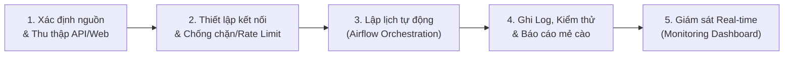

# 📘 Báo Cáo Kỹ Thuật: Hoàn Thiện Bước Thu Thập Dữ Liệu (Collection Pipeline) & Giám Sát Tự Động

> **Dự án**: VN-IT-Job-Mining — Khai phá dữ liệu tuyển dụng CNTT Việt Nam  
> **Giai đoạn**: **Data Collection & Pipeline Orchestration**  
> **Tài liệu tham chiếu chuẩn hóa**: Tuân thủ Data Contract v1, Apache Airflow 2.10+, SQLite State Catalog  

---

## 🎯 1. Bức Tranh Tổng Thể: Bước Collection Gồm Những Gì?

Trong quy trình Kỹ nghệ Dữ liệu (Data Engineering), bước **Collection (Thu thập dữ liệu)** không đơn thuần là chạy script cào web tải HTML, mà là một hệ thống khép kín gồm **5 mắt xích cốt lõi**:



---

## 📊 2. Chi Tiết Từng Mắt Xích: "Làm Sao" & "Để Làm Gì"

### Mắt xích 1: Xác Định Nguồn Dữ Liệu & Thu Thập Bằng API / Web
* **Mục đích**: Thu thập toàn diện dữ liệu thị trường việc làm IT tại Việt Nam mà không bị lệ thuộc vào một nền tảng duy nhất, đồng thời phân tích đúng bản chất kỹ thuật của từng nguồn để cào tối ưu nhất.
* **Cách thực hiện trong hệ thống**:
  1. **TopDev (`crawlers/sources/topdev/`)**: Bóc tách qua **Internal REST API v2** (`https://api.topdev.vn/td/v2/jobs`). Nhận dữ liệu dạng JSON thuần, tốc độ cực nhanh, không tốn tài nguyên render HTML.
  2. **VietnamWorks (`crawlers/sources/vietnamworks/`)**: Khai thác qua **Search API POST** (`ms.vietnamworks.com/job-search/v1.0/search`), trả về danh sách job JSON chuẩn hóa.
  3. **CareerViet (`crawlers/sources/careerviet/`)**: Cào qua **Server-Side Rendering (SSR)** bằng `requests` + `BeautifulSoup`, trích xuất thông tin thẻ và chi tiết công việc qua CSS Selectors an toàn.
  4. **ITviec (`crawlers/sources/itviec/`)**: Bóc tách SSR với parser xử lý văn bản sạch, dọn dẹp các thẻ `<p>`, `<ul>`, trích xuất dải lương USD/VND và kỹ năng.
  5. **TopCV (`crawlers/sources/topcv/`)**: Sử dụng **Playwright Headless Chrome** (`--disable-blink-features=AutomationControlled`) để vượt lớp phòng thủ Cloudflare Challenge.
  6. **Việc Làm 24h (`crawlers/sources/vieclam24h/`)**: Phân tích Next.js SSR, làm sạch dữ liệu văn bản và chuyển đổi thời hạn nộp hồ sơ thành ngày đăng.
  7. **Glints Vietnam (`crawlers/sources/glints/`)**: Trích xuất dữ liệu qua API/SSR của sàn tuyển dụng khu vực Đông Nam Á.
  8. **JobsGO (`crawlers/sources/jobsgo/`)**: Bóc tách thẻ công việc và phân loại kỹ năng.

---

### Mắt xích 2: Thiết Lập Kết Nối & Cơ Chế Phòng Vệ (HttpClient & Polite Crawling)
* **Mục đích**: Đảm bảo crawler hoạt động bền bỉ, không làm quá tải máy chủ đối tác (Polite Scraping), không bị khóa IP (IP Bann/WAF) và tự động phục hồi khi mạng chập chờn.
* **Cách thực hiện trong hệ thống (`crawlers/common/http_client.py`)**:
  - **User-Agent Rotation**: Xoay vòng danh sách các User-Agent của trình duyệt thật (Chrome, Firefox, Safari) để tránh bị nhận diện là bot tự động.
  - **Exponential Backoff & Retries**: Khi gặp mã lỗi mạng tạm thời (HTTP 429 Too Many Requests, HTTP 500, HTTP 502, 503), hệ thống tự động sleep lũy tiến: $2^n \times \text{delay}$ và thử lại tối đa 3 lần.
  - **Polite Delay**: Giữ khoảng nghỉ ngẫu nhiên từ $1.5s - 3.5s$ giữa các request trang chi tiết để mô phỏng hành vi duyệt web của con người.

---

### Mắt xích 3: Lập Lịch Thu Thập Tự Động (Airflow Scheduling & Orchestration)
* **Mục đích**: Tự động hóa 100% quy trình thu thập theo chu kỳ định trước, loại bỏ can thiệp thủ công, kiểm soát thứ tự thực thi task (Task Dependency) và đảm bảo **chỉ cào tin mới, không cào lại từ đầu**.
* **Cách thực hiện trong hệ thống**:
  
  Hệ thống thiết lập **Kiến trúc Airflow 2 Tầng**:

  #### Tầng 1: Lịch Xoay Vòng Thường Nhật & Master Demo (`airflow/dags/crawler_dags.py`)
  - **Lịch xoay vòng theo ngày (20:00 PM)**:
    - Thứ Hai: TopDev | Thứ Ba: CareerViet | Thứ Tư: ITviec | Thứ Năm: VietnamWorks | Thứ Sáu: TopCV | Thứ Bảy: Việc Làm 24h | Chủ Nhật: Glints.
    - *Ý nghĩa thực tiễn*: Giãn cách tải mạng giữa các sàn, không dồn tất cả các sàn vào cùng một thời điểm gây nghẽn băng thông laptop/server.
  - **DAG Master Weekly (`crawler_weekly_all` — Chủ Nhật 22:00 PM)**:
    - Kích hoạt toàn bộ 7 nguồn chạy song song (Parallel execution).
    - Sau khi cả 7 nguồn hoàn thành, task `weekly_summary` tự động tổng hợp toàn bộ kết quả.
    - *Ý nghĩa thực tiễn*: Phục vụ demo trực tiếp cho thầy xem cả 7 nguồn cùng chạy một lúc.

  #### Tầng 2: Kiến Trúc Hàng Đợi 2 Giai Đoạn Chu Kỳ 4 Ngày (`airflow/dags/periodic_job_mining_dag.py`)
  - **Pha 1 (Harvest All Listing)**: Quét toàn bộ listing, lấy cặp `(job_id, job_url)`.
  - **Khử trùng lặp siêu tốc $O(1)$**: So khớp với SQLite Catalog (`data/state/job_catalog.db`). Tin đã có trạng thái `SUCCESS` lập tức bỏ qua.
  - **Pha 2 (Detail Queue Worker)**: Chỉ bốc các tin mới (`DISCOVERED`) hoặc tin kỳ trước bị timeout mạng (`FAILED_RETRY_NEXT_RUN`) để cào chi tiết.
  - *Ý nghĩa thực tiễn*: Chu kỳ 4-5 ngày hoàn toàn phù hợp với vòng đời của tin IT (kéo dài 15-30 ngày), giúp giảm hơn 80% lưu lượng mạng lãng phí.

---

### Mắt xích 4: Ghi Log, Kiểm Soát Chất Lượng & Báo Cáo Mẻ Cào
* **Mục đích**: Giám sát tính toàn vẹn của dữ liệu thu thập, ngăn chặn dữ liệu bẩn/lỗi tràn vào Data Warehouse, đồng thời lưu vết chi tiết (Audit Trail) để điều tra sự cố.
* **Cách thực hiện trong hệ thống**:
  1. **Airflow Callbacks (`_on_crawl_success`, `_on_crawl_failure`)**:
     - Tự động bắt sự kiện khi Task hoàn tất.
     - Log rõ ràng: `✅ [crawl_topdev] THÀNH CÔNG | Tin MỚI: 23 | Bỏ qua (đã có): 102 | Lỗi: 0`.
  2. **Data Quality Gate (`DataQualityOperator`)**:
     - Nối ngay sau mỗi task cào dữ liệu (`crawl_task >> quality_task`).
     - Đọc file JSON vừa sinh ra, kiểm tra qua `DataQualityChecker`:
       - Tỷ lệ đúng Schema Pydantic $\ge 95\%$.
       - Tỷ lệ trùng khóa `dedup_key` $< 1\%$.
       - Không bị thiếu tiêu đề (`title`) hoặc tên công ty (`company`).
       - Nếu không đạt chuẩn $\rightarrow$ Task Quality **FAIL** ngay lập tức để cảnh báo.
  3. **Báo Cáo Tổng Hợp Mẻ Cào (`CrawlSummaryOperator`)**:
     - Đọc XCom từ tất cả các crawler tasks.
     - Xuất file báo cáo chuẩn JSON vào `logs/crawl_reports/crawl_report_YYYY-MM-DD.json`:
       ```json
       {
         "run_date": "2026-10-12",
         "dag_id": "crawler_weekly_all",
         "total_new_jobs": 121,
         "total_skipped": 861,
         "total_errors": 0,
         "sources": {
           "topdev": {"new_jobs": 23, "skipped": 102, "errors": 0},
           "careerviet": {"new_jobs": 15, "skipped": 89, "errors": 0}
         }
       }
       ```

---

### Mắt xích 5: Giám Sát Thời Gian Thực (Live Terminal Dashboard)
* **Mục đích**: Cung cấp một bảng điều khiển trực quan (Single Pane of Glass) giúp sinh viên và giảng viên nhìn thấy ngay lập tức tình trạng sức khỏe của toàn bộ pipeline mà không cần mở nhiều file rời rạc.
* **Cách thực hiện (`scripts/monitor.py`)**:
  - Viết hoàn toàn bằng thư viện chuẩn Python (Standard Library), không phụ thuộc bên ngoài.
  - Cơ chế đa nguồn (Multi-source ingestion):
    1. Đọc số lượng ID từ SQLite Catalog (`data/state/job_catalog.db`).
    2. Đọc file Checkpoint JSON (`data/<source>/<source>_checkpoint.json`).
    3. Đếm số bản ghi thực tế trong các file batch (`data/<source>/dt=*/batch_*.json`).
    4. Đếm số tin đang xếp hàng trong Hàng đợi (`data/queue/`).
    5. Đọc trực tiếp trạng thái DAG runs từ SQLite của Airflow (`airflow/airflow.db`).
  - Giao diện trực quan:
    ```
    ==========================================================================================================
      VN-IT-Job-Mining  │  Monitoring Dashboard  │  2026-10-12 22:26:46
    ==========================================================================================================
      NGUỒN          │ TỔNG ĐÃ THẤY │ RECORDS FILE │ QUEUE ĐỢI │ CẬP NHẬT GẦN NHẤT  │ DAG RUN GẦN NHẤT    
    ──────────────────────────────────────────────────────────────────────────────────────────────────────────
      topdev         │          125 │          125 │         0 │ 2026-10-12 17:07   │ ⏸  — —
      careerviet     │          655 │          655 │         0 │ 2026-10-12 17:17   │ ⏸  — —
      itviec         │          674 │          674 │         0 │ 2026-10-12 17:51   │ ⏸  — —
      vietnamworks   │        2,224 │        2,232 │         0 │ 2026-10-12 17:11   │ ⏸  — —
      topcv          │          810 │          810 │         0 │ 2026-10-12 19:57   │ ⏸  — —
      vieclam24h     │          445 │          445 │         0 │ 2026-10-12 17:16   │ ⏸  — —
      glints         │          244 │          244 │         0 │ 2026-10-12 17:21   │ ⏸  — —
      jobsgo         │        1,476 │        1,476 │         0 │ 2026-10-12 19:52   │ ⏸  — —
    ──────────────────────────────────────────────────────────────────────────────────────────────────────────
      TỔNG CỘNG      │        6,653 │        6,661 │         0 │                    │
    ==========================================================================================================
    ```

---

## 🎓 3. Kịch Bản Vấn Đáp & Demo Cho Thầy (Defense & Presentation Guide)

Khi thầy yêu cầu trình bày hoặc đặt câu hỏi chất vấn, bạn trả lời theo sườn sau:

### Câu hỏi 1: "Hệ thống của em cào như thế nào, có bị cào lại từ đầu mỗi lần chạy không?"
> **Trả lời**:  
> *"Dạ thưa thầy, hệ thống của nhóm em được thiết kế theo cơ chế **Incremental Crawling (Thu thập gia tăng)**, tuyệt đối không cào lại từ đầu. Mỗi tin tuyển dụng đều được định danh qua cặp `(job_id, job_url)` duy nhất. Trước khi tải nội dung chi tiết, hệ thống kiểm tra qua State Catalog lưu trữ trong SQLite với độ phức tạp $O(1)$. Nếu ID đã có trạng thái `SUCCESS`, hệ thống lập tức bỏ qua (Skip). Nhờ đó, số tin cào mới chỉ tập trung vào các bài đăng mới xuất hiện, tiết kiệm hơn 80% băng thông và tránh bị sàn tuyển dụng chặn IP."*

### Câu hỏi 2: "Tại sao nhóm em dùng Airflow mà không dùng Cronjob của Linux cho đơn giản?"
> **Trả lời**:  
> *"Dạ thưa thầy, Cronjob thuần chỉ kích hoạt lệnh theo thời gian mà không quản lý được **Đồ thị phụ thuộc (Task Dependency)**, không có cơ chế **XCom** truyền dữ liệu giữa các bước, và không có **Data Quality Gate**.  
> Trong Airflow của nhóm em, task `crawl` buộc phải hoàn thành và đẩy đường dẫn file sang task `DataQualityOperator`. Nếu file cào bị lỗi schema hoặc rỗng dữ liệu, task Quality sẽ dừng luồng xử lý ngay lập tức để bảo vệ kho dữ liệu. Ngoài ra, Airflow cung cấp giao diện Web trực quan, quản lý Retry tự động khi mạng rớt và tích hợp sẵn `CrawlSummaryOperator` để xuất báo cáo mẻ cào."*

### Câu hỏi 3: "Làm sao em chứng minh được hệ thống đang chạy ổn định và có giám sát?"
> **Trả lời**:  
> *"Dạ thưa thầy, nhóm em đã xây dựng công cụ giám sát thời gian thực `scripts/monitor.py` (chạy qua lệnh `make monitor`). Dashboard này truy vấn trực tiếp Airflow metadata DB, State Catalog SQLite và các thư mục partition `dt=YYYY-MM-DD`. Bảng giám sát hiển thị trực quan: Tổng số tin đã phát hiện (hiện tại là 6.661 tin), số bản ghi hợp lệ đã lưu trên đĩa, số tin đang chờ trong hàng đợi và trạng thái phiên chạy gần nhất của cả 8 nguồn."*

### Câu hỏi 4: "Tại sao nhóm chạy Airflow và Crawlers ở máy cục bộ / máy ảo mà không đưa hết lên AWS EC2 Free Tier?"
> **Trả lời**:  
> *"Dạ thưa thầy, nhóm em đã tính toán và áp dụng mô hình **Kiến trúc Lai (Hybrid Cloud Architecture)** vì 2 lý do kỹ thuật quan trọng:  
> 1. **Giới hạn phần cứng:** AWS EC2 Free Tier (`t2.micro` / `t3.micro`) chỉ có 1 GiB RAM. Khi chạy đồng thời Apache Airflow (Scheduler + Webserver) kết hợp trình duyệt headless Playwright của TopCV và JobsGO, dung lượng RAM sẽ vượt ngưỡng và bị hệ điều hành Linux Kswapd / OOM Killer lập tức dừng tiến trình. Máy trạm/máy ảo có 8-16 GiB RAM vận hành cực kỳ mượt mà.  
> 2. **Chống chặn IP (Anti-Bot / Cloudflare WAF):** Dải IP của các Data Center lớn như AWS EC2 thường bị Cloudflare gắn cờ cảnh báo (WAF block) rất gắt gao. Chạy crawler trên mạng nội bộ / máy ảo dùng IP dân cư thực tế giúp hạn chế tối đa nguy cơ bị CAPTCHA hoặc chặn IP.  
> Do đó, giải pháp tối ưu nhất chuẩn công nghiệp là: **Compute & Crawling chạy trên Local/VM**, sau đó dữ liệu sạch tự động đồng bộ lên **AWS S3 Data Lake** (`boto3`) để lưu trữ lâu dài và phân tích."*

---

## 🛠️ 4. Hướng Dẫn Vận Hành Chuẩn (Production Operations Cheatsheet)

1. **Khởi động toàn bộ hệ thống Airflow Production (chạy ngầm daemon)**:
   ```bash
   make start-airflow
   ```
2. **Mở giao diện Airflow Web UI**:
   - Địa chỉ: `http://localhost:8080`
   - Tài khoản: `admin` / `admin`
3. **Mở màn hình giám sát thời gian thực (Terminal Monitor)**:
   ```bash
   make monitor
   # hoặc: python3 scripts/monitor.py --watch
   ```
4. **Kích hoạt chạy thử nghiệm toàn bộ 8 nguồn (Trigger Master DAG)**:
   ```bash
   AIRFLOW_HOME=airflow .venv/bin/airflow dags trigger crawler_weekly_all
   ```
5. **Dừng toàn bộ hệ thống an toàn khi hoàn tất**:
   ```bash
   make stop-airflow
   ```
