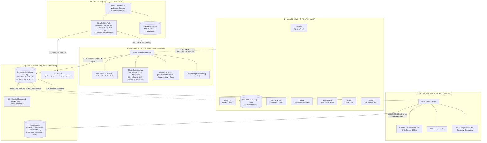

# Kiến Trúc Thu Thập Dữ Liệu Tuyển Dụng IT (Data Collection Architecture)

Tài liệu này mô tả chi tiết kiến trúc hệ thống thu thập, kiểm tra chất lượng và lưu trữ dữ liệu việc làm IT tự động của đồ án **VN-IT-Job-Mining**.

---

## 1. Sơ Đồ Kiến Trúc Tổng Thể (System Architecture)

---

## 2. Giải Thích Chi Tiết Từng Thành Phần

### Bước 1: Nguồn Dữ Liệu (8 Job Portals)
Hệ thống kết nối đến 8 nền tảng tuyển dụng IT lớn nhất Việt Nam:
- **TopDev, ITviec**: Chuyên biệt ngành CNTT/Lập trình viên.
- **VietnamWorks, CareerViet, TopCV, ViecLam24h, JobsGO**: Các sàn tuyển dụng hàng đầu có quy mô lớn.
- **Glints**: Nền tảng tuyển dụng công nghệ khu vực Đông Nam Á.
- **Chiến lược đa dạng kỹ thuật:** Kết hợp REST API trực tiếp (TopDev, VietnamWorks), SSR với BeautifulSoup (CareerViet, ITviec, ViecLam24h), và trình duyệt tự động Playwright vượt WAF (TopCV, JobsGO).

### Bước 2: Tầng Điều Phối (Apache Airflow Orchestrator)
- **Quản lý lịch trình (9 DAGs):**
  - *7 Daily Rotating DAGs:* `0 20 * * 1` (Thứ 2) đến `0 20 * * 0` (Chủ Nhật). Giãn cách tải mạng giữa các sàn, không dồn tất cả các sàn vào cùng một thời điểm.
  - *1 Master Weekly DAG (`crawler_weekly_all`):* Chạy lúc 22:00 Chủ Nhật, cào toàn bộ 8 nguồn song song và kích hoạt `CrawlSummaryOperator` xuất báo cáo.
  - *1 Periodic 4-day Pipeline (`periodic_it_job_mining_4days`):* Cơ chế hàng đợi 2 pha: Harvest Listing $\rightarrow$ Dedup $O(1)$ $\rightarrow$ Detail Queue Worker, tiết kiệm hơn 80% băng thông.
- **Cơ chế Retry & Failure Alert:** Tự động retry với backoff (`retries=1`, `retry_delay=5 phút`), ghi nhận callback `_on_crawl_success` và `_on_crawl_failure`.
- **Airflow Metadata DB:** SQLite (`airflow/airflow.db`) cho môi trường cục bộ/máy ảo nhẹ nhàng, hỗ trợ chuyển đổi PostgreSQL cho cụm phân tán.

### Bước 3: Động Cơ Thu Thập (BaseCrawler Framework)
Toàn bộ crawler đều kế thừa từ class chuẩn [`BaseCrawler`](file:///home/billtran/Desktop/Learning/UTH/VN-IT-Job-Mining/crawlers/base/base_crawler.py):
1. **Lịch sự & Chống chặn (Polite Crawling):** Thiết lập delay ngẫu nhiên 1.5 - 3.5 giây giữa các lượt request, tự động xoay vòng User-Agent Header, exponential backoff retry.
2. **Khử trùng lặp siêu tốc $O(1)$ (SQLite State Catalog & Checkpoint):** Quản lý trạng thái từng job ID trong `data/state/job_catalog.db`. Lần cào sau lập tức bỏ qua tin đã có trạng thái `SUCCESS`.
3. **Chuẩn hóa dữ liệu với Pydantic (`JobRecord`):** Mọi tin việc làm bất kể từ nguồn nào cũng được ép về một chuẩn duy nhất gồm:
   - `_meta`: `source`, `source_job_id`, `url`, `dedup_key`, `crawled_at`, `batch_id`, `language`
   - `raw`: `title`, `company`, `salary` (lồng chuẩn), `tags` (requirements, benefits, skills), `description_list`, `requirements_list`, `benefits_list`, `location_text`, `deadline_text`
4. **Ghi mảng JSON an toàn nguyên tử (`JsonWriter`):** Ghi file tạm `.tmp` rồi đổi tên nguyên tử, đảm bảo file `batch_XXX.json` luôn mở được bằng `json.load()` không bao giờ bị lỗi cú pháp dở dang.

### Bước 4: Tầng Kiểm Tra Chất Lượng (Data Quality Gate)
Sau khi cào xong, task `DataQualityOperator` sẽ kích hoạt ngay lập tức:
- Đọc file JSON vừa sinh ra và kiểm tra qua `DataQualityChecker`:
  - Tỷ lệ đúng chuẩn Schema $\ge 95\%$ (thực tế toàn hệ thống đạt 100%).
  - Tỷ lệ trùng lặp nội bộ trong file = 0%.
  - Các trường cốt lõi không được rỗng (`title`, `company`, `description`).
- Nếu không đạt chất lượng ➡️ Task báo Fail, dừng pipeline và cảnh báo.

### Bước 5: Tầng Lưu Trữ & Giám Sát (Storage & Monitoring)
- **Tầng 1 - Data Lake Cục Bộ (Partitioned JSON):** Lưu file có cấu trúc theo ngày `data/<source>/dt=YYYY-MM-DD/batch_XXX.json` (hiện có 6.661 tin việc làm).
- **Tầng 2 - Cloud Data Lake (AWS S3):** Sẵn sàng đồng bộ lên AWS S3 Raw Zone (`s3://vn-it-jobs-raw/...`) thông qua `boto3`.
- **Tầng 3 - Giám Sát Thời Gian Thực (Live Terminal Monitor):** Chạy `make monitor` đọc trực tiếp số liệu từ SQLite Catalog, Checkpoints, Hàng đợi và Airflow DB.
- **Tầng 4 - SQL Database (PostgreSQL / Relational Data Warehouse):** Dữ liệu sạch sẵn sàng nạp vào các bảng quan hệ (`jobs`, `companies`, `job_skills`) để phục vụ truy vấn phân tích.

---

## 3. Ưu Điểm Nổi Bật Của Thiết Kế Này
1. **Kiến Trúc Đám Mây Lai (Hybrid Cloud):** Chạy compute/crawler trên máy trạm/máy ảo nội bộ để tối ưu RAM (8-16 GB) và sử dụng IP dân cư tránh Cloudflare WAF, đồng thời lưu trữ dài hạn trên AWS S3 siêu bền vững.
2. **Tính Mô-đun Hóa Tuyệt Đối (Modularity):** Thêm nguồn mới chỉ cần viết 1 file crawler kế thừa `BaseCrawler`, hệ thống tự động kết nối vào schema, checkpoint, chất lượng và Airflow.
3. **Cơ Chế Khử Trùng Lặp 2 Lớp:** Kết hợp Checkpoint JSON nhanh của từng crawler và SQLite State Catalog tập trung cho hàng đợi 2 pha chu kỳ.
4. **Tự Động Hóa 100%:** Khởi động, vận hành, kiểm thử và dừng hệ thống đều thông qua 1 dòng lệnh duy nhất (`make start-airflow`, `pytest`, `make monitor`, `make stop-airflow`).
