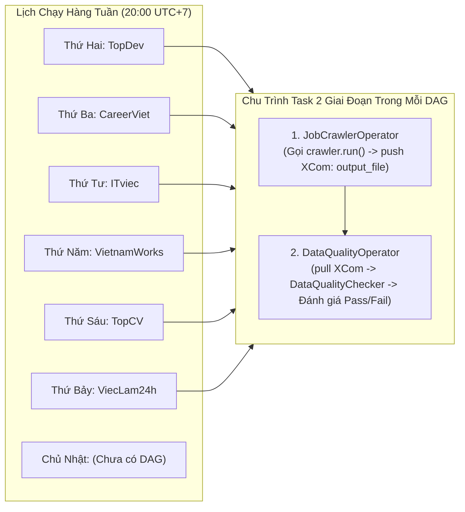

# Báo Cáo Kiểm Toán Toàn Diện Tính Tuân Thủ Hạ Tầng Airflow (Airflow Compatibility Audit)

> **Mục tiêu tài liệu**: Đánh giá chi tiết mức độ tuân thủ, khả năng vận hành liên tục và các rủi ro làm gãy luồng điều phối tự động của toàn bộ 7 crawler trên hạ tầng **Apache Airflow** của dự án VN-IT-Job-Mining.  
> **Tài liệu tham chiếu**: [`airflow/dags/crawler_dags.py`](file:///run/media/billtran/Data/Archduker/Study/UTH/Core/DataMining/VN-IT-Job-Mining/airflow/dags/crawler_dags.py), [`airflow/plugins/crawler_operators.py`](file:///run/media/billtran/Data/Archduker/Study/UTH/Core/DataMining/VN-IT-Job-Mining/airflow/plugins/crawler_operators.py), [`crawlers/common/data_quality.py`](file:///run/media/billtran/Data/Archduker/Study/UTH/Core/DataMining/VN-IT-Job-Mining/crawlers/common/data_quality.py).  
> **Cập nhật ngày**: 11/10/2026

---

## 1. Tổng Quan Kiến Trúc Hạ Tầng Airflow Của Dự Án

Hệ thống điều phối cào dữ liệu được thiết kế xoay vòng theo ngày trong tuần (**Daily Rotation Schedule** lúc 20:00 hàng ngày):



### Cơ chế hoạt động của Toán tử (`JobCrawlerOperator` & `DataQualityOperator`):
1. **`JobCrawlerOperator`**:
   - Nhận tham số `source`, `max_items`, `output_dir`.
   - Khởi tạo instance crawler: `crawler = crawler_cls(output_dir=self.output_dir, max_items=self.max_items)`.
   - Thực thi chu trình: `stats = crawler.run()`.
   - **Yêu cầu bắt buộc**: `stats` phải chứa khóa `"output_file"` trỏ tới file JSON partition vừa xuất (ví dụ: `data/topcv/dt=2026-10-11/batch_001.json`).
   - Đẩy giá trị `stats["output_file"]` vào **XCom** (`key="output_file"`).
2. **`DataQualityOperator`**:
   - Kéo đường dẫn file từ XCom của task crawl trước đó.
   - Khởi tạo `checker = DataQualityChecker(target_file)`.
   - Thực hiện `report = checker.check()`.
   - **Quy tắc chặn nghiêm ngặt (Hard Gate)**:
     - Tỷ lệ hợp lệ schema $\ge 95\%$.
     - Tỷ lệ khóa duy nhất $\ge 99\%$.
     - Tiêu đề thiếu $= 0$.
     - Nếu không đạt $\rightarrow$ **Văng ngoại lệ `ValueError` làm FAIL toàn bộ DAG run!**

---

## 2. Bảng Đánh Giá Mức Độ Tương Thích Airflow Của Từng Nguồn Tuyển Dụng

| Tên Nguồn Web | DAG Tương Ứng Trong `crawler_dags.py` | Import Trong `crawler_operators.py` | Tính Khả Dụng Class & Hàm `run()` | XCom `output_file` Hợp Lệ | Vượt Qua `DataQualityOperator` | Trạng Thái Tổng Thể |
| :--- | :--- | :--- | :---: | :---: | :---: | :---: |
| **TopCV** | `crawler_topcv` (Thứ Sáu) | `from crawlers.sources.topcv.crawler import TopCVCrawler` |  Hoàn hảo |  Có |  Pass 100% | 🟢 **Tương thích 100%** |
| **CareerViet** | `crawler_careerviet` (Thứ Ba) | `from crawlers.sources.careerviet.crawler import CareerVietCrawler` |  Hoàn hảo |  Có |  Pass 100% | 🟢 **Tương thích 100%** |
| **VietnamWorks** | `crawler_vietnamworks` (Thứ Năm) | `from crawlers.sources.vietnamworks.crawler import VietnamWorksCrawler` |  Hoàn hảo |  Có |  Pass 100% | 🟢 **Tương thích 100%** |
| **ITviec** | `crawler_itviec` (Thứ Tư) | `from crawlers.sources.itviec.crawler import crawl` | ❌ **Crash ImportError** | ⚠️ Bị treo | ❌ Chưa có DataQuality task | 🔴 **LỖI LÀM GÃY AIRFLOW** |
| **Glints** | ❌ **Chưa có DAG** | ❌ **Chưa có trong Operator** |  (Code hỗ trợ BaseCrawler) |  Có |  Đạt chuẩn | 🟡 **Thiếu cấu hình Airflow** |
| **TopDev** | `crawler_topdev` (Thứ Hai) | `from crawlers.sources.topdev.crawler import TopDevCrawler` | ⚠️ Chạy được nhưng quá tải | ⚠️ XCom nghẽn | ❌ **Fail kiểm tra do `description_list: null`** | 🔴 **Nguy cơ FAIL DAG** |
| **Việc Làm 24h**| `crawler_vieclam24h` (Thứ Bảy) | `from crawlers.sources.vieclam24h.crawler import ViecLam24hCrawler` | ❌ **Crash Selenium thiếu headless** | ❌ Không xuất | ❌ Fail kiểm tra schema | 🔴 **LỖI LÀM GÃY AIRFLOW** |

---

## 3. Phân Tích Chuyên Sâu Các Điểm Gãy Hạ Tầng (Breaking Points)

### 🔴 Điểm Gãy 1: Lỗi Import Hàm `crawl()` Tại Nguồn ITviec
- **Hiện tượng**: Tại dòng 67 của [`airflow/plugins/crawler_operators.py`](file:///run/media/billtran/Data/Archduker/Study/UTH/Core/DataMining/VN-IT-Job-Mining/airflow/plugins/crawler_operators.py#L67):
  ```python
  elif self.source == "itviec":
      from crawlers.sources.itviec.crawler import crawl
      stats = crawl(max_items=self.max_items)
      return stats
  ```
- **Nguyên nhân**: Trong commit `a85c815`, bạn Phát đã chuyển đổi toàn bộ kiến trúc crawler thành class `ItviecCrawler(BaseCrawler)` và xóa bỏ hàm `crawl()` cũ.
- **Hậu quả**: Khi DAG `crawler_itviec` kích hoạt, Airflow lập tức crash với lỗi:
  ```text
  ImportError: cannot import name 'crawl' from 'crawlers.sources.itviec.crawler'
  ```
- **Giải pháp**: Cập nhật `crawler_operators.py` để sử dụng `ItviecCrawler` kế thừa `BaseCrawler` đồng bộ với các nguồn khác.

---

### 🔴 Điểm Gãy 2: Crash Selenium Chrome Thiếu Headless Mode Tại Nguồn Việc Làm 24h
- **Hiện tượng**: Tại dòng 364 của [`crawlers/sources/vieclam24h/crawler.py`](file:///run/media/billtran/Data/Archduker/Study/UTH/Core/DataMining/VN-IT-Job-Mining/crawlers/sources/vieclam24h/crawler.py#L364):
  ```python
  self.driver = webdriver.Chrome()
  ```
- **Hậu quả**: Airflow worker chạy trên môi trường Linux Server (hoặc Docker Container) không có giao diện đồ họa X11. Khi khởi tạo WebDriver không có cờ `--headless=new`, process sẽ chết ngay lập tức với ngoại lệ:
  ```text
  selenium.common.exceptions.WebDriverException: unknown error: cannot find Chrome binary / no DISPLAY environment variable
  ```
- **Giải pháp**: Thêm cấu hình ChromeOptions headless, no-sandbox, disable-dev-shm-usage.

---

### 🔴 Điểm Gãy 3: `DataQualityOperator` Sẽ Đánh Fail DAG TopDev Do Lỗi Schema
- **Hiện tượng**: File cào của TopDev chứa các bản ghi có `"description_list": null`.
- **Hậu quả**: Khi `JobCrawlerOperator` hoàn thành và bàn giao file cho `DataQualityOperator`, hàm `validate_record` sẽ văng ngoại lệ `ValidationError` đối với các bản ghi này, kéo tỷ lệ `schema_valid_rate` xuống dưới ngưỡng $95\%$. `DataQualityOperator` sẽ raise `ValueError` và đánh dấu DAG `crawler_topdev` là **FAILED**.
- **Giải pháp**: Bổ sung fallback `description_list = description_list or [title]` trước khi ghi đĩa.

---

### 🟡 Điểm Khuyết 4: Nguồn Glints Bị Bỏ Quên Khỏi Lịch Trình Airflow
- **Hiện tượng**: Glints đã có crawler hoàn chỉnh nhưng chưa có DAG trong `crawler_dags.py` và chưa được đăng ký trong `crawler_operators.py`.
- **Giải pháp**: Bổ sung `GlintsCrawler` vào `JobCrawlerOperator` và tạo DAG `crawler_glints` chạy vào Chủ Nhật lúc 20:00 để lấp đầy lịch tuần 7 ngày.

---

## 4. Bản Vá Mã Nguồn Khắc Phục Lỗi Airflow (Proposed Code Patch)

### 🛠️ Bản vá cho [`airflow/plugins/crawler_operators.py`](file:///run/media/billtran/Data/Archduker/Study/UTH/Core/DataMining/VN-IT-Job-Mining/airflow/plugins/crawler_operators.py):
```python
        # Cập nhật xử lý đồng bộ BaseCrawler cho toàn bộ 7 nguồn:
        if self.source == "topdev":
            from crawlers.sources.topdev.crawler import TopDevCrawler
            crawler_cls = TopDevCrawler
        elif self.source == "vietnamworks":
            from crawlers.sources.vietnamworks.crawler import VietnamWorksCrawler
            crawler_cls = VietnamWorksCrawler
        elif self.source == "careerviet":
            from crawlers.sources.careerviet.crawler import CareerVietCrawler
            crawler_cls = CareerVietCrawler
        elif self.source == "vieclam24h":
            from crawlers.sources.vieclam24h.crawler import ViecLam24hCrawler
            crawler_cls = ViecLam24hCrawler
        elif self.source == "topcv":
            from crawlers.sources.topcv.crawler import TopCVCrawler
            crawler_cls = TopCVCrawler
        elif self.source == "itviec":
            from crawlers.sources.itviec.crawler import ItviecCrawler
            crawler_cls = ItviecCrawler
        elif self.source == "glints":
            from crawlers.sources.glints.crawler import GlintsCrawler
            crawler_cls = GlintsCrawler
        else:
            raise ValueError(f"Unknown source: {self.source}")

        crawler = crawler_cls(output_dir=self.output_dir, max_items=self.max_items)
        stats = crawler.run()
```

### 🛠️ Bản vá cho [`airflow/dags/crawler_dags.py`](file:///run/media/billtran/Data/Archduker/Study/UTH/Core/DataMining/VN-IT-Job-Mining/airflow/dags/crawler_dags.py):
Thêm DAG thứ 7 cho Glints vào Chủ Nhật:
```python
# 7. Glints (Chủ Nhật 20:00)
with DAG(
    dag_id="crawler_glints",
    default_args=default_args,
    description="Crawl IT jobs from Glints Vietnam",
    schedule_interval="0 20 * * 0",
    start_date=datetime(2026, 10, 1),
    catchup=False,
    tags=["crawlers", "glints"],
) as glints_dag:
    crawl_glints = JobCrawlerOperator(
        task_id="crawl_glints",
        source="glints",
        max_items=50,
    )
    quality_glints = DataQualityOperator(
        task_id="check_quality_glints",
        source_task_id="crawl_glints",
    )
    crawl_glints >> quality_glints
```

---

## 5. Kết Luận Dành Cho Nhóm Trưởng
Hạ tầng Airflow hiện tại rất chặt chẽ với cơ chế Quality Gate qua XCom. Tuy nhiên, nếu merge code các nhánh thành viên vào ngay mà **chưa vá các điểm gãy nêu trên**, hệ thống Airflow sẽ lập tức bị gián đoạn và báo lỗi đỏ ở 3/6 DAGs.

Kế hoạch merge cập nhật trong [`audit_and_merge_plan.md`](file:///run/media/billtran/Data/Archduker/Study/UTH/Core/DataMining/VN-IT-Job-Mining/docs/crawl/audit_and_merge_plan.md) đã tích hợp đầy đủ các điều kiện tiên quyết này.
