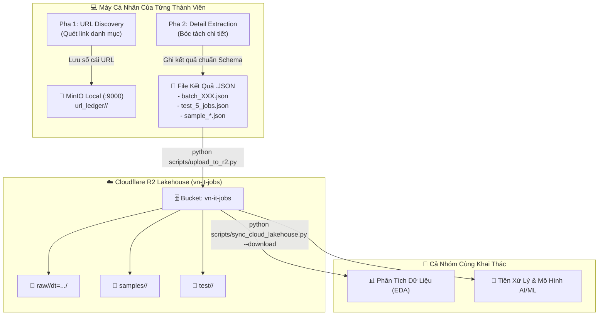

# ☁️ Cẩm Nang Thiết Lập, Lưu Trữ & Đồng Bộ Kết Quả .JSON Lên Cloudflare R2 Cho Team

---

## 1. 🌟 Tại Sao Nhóm Sử Dụng Cloudflare R2?

Trong dự án **VN-IT-Job-Mining**, các thành viên cào dữ liệu độc lập trên máy cá nhân theo 7 nguồn tuyển dụng khác nhau (TopCV, TopDev, ITViec, VietnamWorks, CareerViet, ViecLam24h, Glints). 

Để phối hợp nhóm hiệu quả, hệ thống phân định rạch ròi 2 trụ cột lưu trữ:
- **MinIO Cục Bộ (`localhost:9000`)**: Chuyên dùng cho **Phase 1 (Up link & Quản lý Sổ cái URL Ledger)** để tốc độ cào nhanh nhất, không tốn băng thông mạng và chạy offline an toàn (Xem cẩm nang [`docs/minio_docker_setup_guide.md`](minio_docker_setup_guide.md)).
- **Cloudflare R2 (Remote Cloud Data Lakehouse)**: Chuyên dùng làm **Kho Lưu Trữ Kết Quả `.json` Tập Trung** cho cả nhóm:
  - **Tương thích chuẩn Amazon S3 API**: Tương thích 100% với `boto3`, DuckDB và Apache Spark.
  - **Hoàn toàn miễn phí**: 10 GB lưu trữ miễn phí và **0đ phí tải về (Free Egress)** trọn đời.
  - **Tránh phình to mã nguồn Git**: Tuyệt đối không commit các file kết quả `.json` lớn hay hàng ngàn file HTML thô vào GitHub; toàn bộ kết quả cào sẽ được đẩy lên Cloudflare R2.
  - **Chia sẻ dữ liệu thời gian thực (24/7)**: Thành viên cào xong nguồn nào, dữ liệu lập tức có mặt trên Cloud R2 để các bạn làm EDA, tiền xử lý và tích hợp AI/ML tải về sử dụng.



---

## 2. 🔑 Cách Lấy Thông Số Kết Nối Trên Cloudflare (Mất 2 Phút)

*(Nếu bạn là nhóm trưởng tạo bucket hoặc muốn tự tạo bucket cá nhân)*

1. Đăng nhập vào [Cloudflare Dashboard](https://dash.cloudflare.com/).
2. Chọn **R2 Object Storage** ở menu bên trái.
3. **Lấy Account ID**:
   - Nhìn sang góc phải màn hình, mục **Account Details** $\to$ Sao chép **Account ID** (chuỗi 32 ký tự, ví dụ: `9a8b7c6d5e4f...`).
4. **Tạo Bucket**:
   - Bấm nút **Create bucket** $\to$ Đặt tên: **`vn-it-jobs`** $\to$ Bấm **Create Bucket**.
5. **Tạo API Token (Khóa truy cập)**:
   - Ở trang chủ R2, bấm vào liên kết **Manage R2 API Tokens** (góc phải).
   - Bấm **Create API Token**.
   - Quyền hạn (Permissions): Chọn **Object Read & Write**.
   - Áp dụng cho: Chọn bucket **`vn-it-jobs`** (hoặc All buckets).
   - Bấm **Create API Token**.
   - Màn hình sẽ hiện ra:
     - **Access Key ID** (chuỗi 32 ký tự)
     - **Secret Access Key** (chuỗi 64 ký tự)
     - **Endpoint URL**: `https://<account_id>.r2.cloudflarestorage.com`
   *(Hãy lưu lại khóa này cẩn thận vì Secret Key chỉ hiển thị 1 lần duy nhất).*

---

## 3. 🚀 Cấu Hình Tự Động 1-Lệnh Cho Từng Thành Viên

### Cách 1: Chạy Wizard tương tác tự động (Khuyến nghị)
Bạn chỉ cần mở terminal tại thư mục gốc dự án và gõ:
```bash
python scripts/setup_cloud_storage.py
```
Script sẽ lần lượt hỏi Account ID, Access Key ID, Secret Access Key:
- Tự động kiểm tra bắt tay S3 API.
- Tự động tạo bucket `vn-it-jobs` nếu chưa có.
- Tự động lưu cấu hình an toàn vào `.env` (file này đã nằm trong `.gitignore` nên an toàn tuyệt đối).

### Cách 2: Điền trực tiếp qua dòng lệnh CLI:
```bash
python scripts/setup_cloud_storage.py \
  --account-id <YOUR_ACCOUNT_ID> \
  --access-key <YOUR_ACCESS_KEY_ID> \
  --secret-key <YOUR_SECRET_ACCESS_KEY> \
  --bucket vn-it-jobs
```

---

## 4. 📤 Hướng Dẫn Tải & Lưu Trữ File Kết Quả `.json` Lên Cloudflare R2

Dự án cung cấp công cụ chuyên dụng **`scripts/upload_to_r2.py`** để tự động xác thực cú pháp và đồng bộ các file kết quả `.json` lên Cloudflare R2.

### 4.1. Các loại file kết quả `.json` cần lưu lên R2

| Loại file kết quả | Đường dẫn cục bộ | Vị trí phân tầng chuẩn trên R2 | Ý nghĩa nghiệp vụ |
| :--- | :--- | :--- | :--- |
| **Batch kết quả cào** | `data/<source>/dt=YYYY-MM-DD/batch_XXX.json` | `raw/<source>/dt=YYYY-MM-DD/batch_XXX.json` | Dữ liệu việc làm bóc tách chi tiết đã validate Schema v1. |
| **Bộ mẫu thử nghiệm (DoD)** | `crawlers/sources/<source>/samples/sample_*.json` | `samples/<source>/sample_*.json` | Bộ 3 mẫu đại diện (chuẩn, VIP, lương đặc biệt) nộp hồ sơ nghiệm thu. |
| **File kiểm thử 5 tin** | `crawlers/sources/<source>/test_5_jobs.json` | `test/<source>/test_5_jobs.json` | Dữ liệu mẫu kiểm thử nhanh của từng sàn. |
| **Sổ cái URL Ledger** | `data/url_ledger/<source>/catalog_master.json` | `url_ledger/<source>/catalog_master.json` | Danh mục toàn bộ URL đã băm và phân loại trạng thái. |

### 4.2. Các câu lệnh tải lên thông dụng

#### 🔹 Trường hợp 1: Tải tất cả kết quả `.json` của 1 nguồn bạn phụ trách (Sau khi cào xong)
Ví dụ sau khi cào xong nguồn **ViecLam24h**:
```bash
python scripts/upload_to_r2.py --source vieclam24h
```
Script sẽ tự động quét thư mục `data/vieclam24h/`, file `test_5_jobs.json` và thư mục `samples/`, kiểm tra cú pháp JSON và đẩy lên R2.

#### 🔹 Trường hợp 2: Tải 1 file kết quả cụ thể
Ví dụ bạn vừa tạo xong file mẫu kiểm thử hoặc 1 batch dữ liệu:
```bash
# Tải file test_5_jobs.json của VietnamWorks
python scripts/upload_to_r2.py --file crawlers/sources/vietnamworks/test_5_jobs.json

# Tải 1 file mẫu nghiệm thu DoD
python scripts/upload_to_r2.py --file crawlers/sources/topcv/samples/sample_standard_job.json
```

#### 🔹 Trường hợp 3: Tải toàn bộ kết quả của cả 7 nguồn (Nhóm trưởng / Merge Data)
```bash
python scripts/upload_to_r2.py --all-results
```
*(Hoặc dùng lệnh ngắn: `make upload-r2`)*

#### 🔹 Trường hợp 4: Chạy thử nghiệm xem trước (Dry-Run)
Nếu muốn kiểm tra file có hợp lệ và xem trước các khóa trên R2 mà không thực sự tải lên:
```bash
python scripts/upload_to_r2.py --source topcv --dry-run
python scripts/upload_to_r2.py --all-results --dry-run
```

---

## 5. 📥 Hướng Dẫn Tải Dữ Liệu Kết Quả Của Đồng Đội Về Máy

Khi các thành viên khác đã cào xong và đẩy kết quả lên Cloudflare R2, bạn có thể dễ dàng kéo dữ liệu về máy để làm EDA hoặc ghép dataset:

### 5.1. Xem tình trạng dữ liệu hiện có trên Cloud R2:
```bash
python scripts/sync_cloud_lakehouse.py --status
```
*(Hoặc dùng lệnh: `make r2-status`)*  
Màn hình sẽ hiển thị tổng số file, dung lượng và phân bổ theo các thư mục `raw`, `samples`, `url_ledger`.

### 5.2. Tải toàn bộ kết quả về máy:
```bash
python scripts/sync_cloud_lakehouse.py --download
```
*(Hoặc dùng lệnh: `make download-r2`)*  
Toàn bộ dữ liệu của cả 7 nguồn sẽ được tải về thư mục `data/` trên máy bạn.

### 5.3. Tải kết quả của riêng 1 nguồn cụ thể:
```bash
python scripts/sync_cloud_lakehouse.py --download --source itviec
python scripts/sync_cloud_lakehouse.py --download --source vietnamworks
```

---

## 6. 🐍 Cách Đọc Trực Tiếp File Kết Quả .JSON Từ R2 Bằng Python (EDA / ML)

Bạn không bắt buộc phải tải file về ổ cứng mà có thể đọc trực tiếp từ Cloudflare R2 vào Pandas DataFrame:

```python
import io
import json
import os
import boto3
import pandas as pd
from botocore.client import Config
from dotenv import load_dotenv

load_dotenv()

# 1. Kết nối Cloudflare R2
s3 = boto3.client(
    "s3",
    endpoint_url=os.getenv("S3_ENDPOINT_URL"),
    aws_access_key_id=os.getenv("AWS_ACCESS_KEY_ID"),
    aws_secret_access_key=os.getenv("AWS_SECRET_ACCESS_KEY"),
    config=Config(signature_version="s3v4"),
    region_name="auto",
)

# 2. Đọc trực tiếp file kết quả JSON từ R2
bucket = os.getenv("S3_BUCKET_NAME", "vn-it-jobs")
key = "raw/vietnamworks/raw/2026-10-16/raw_batch.json"

response = s3.get_object(Bucket=bucket, Key=key)
job_records = json.loads(response["Body"].read().decode("utf-8"))

# 3. Phân tích dữ liệu bằng Pandas
df = pd.DataFrame(job_records)
print(f"✅ Đã nạp thành công {len(df)} bài đăng tuyển dụng từ Cloudflare R2!")
print(df.head())
```

---

## 7. 🔒 Quy Tắc Bảo Mật & Tiêu Chuẩn Nghiệm Thu (DoD) Cho Nhóm

1. **Tuyệt đối không commit file `.env` lên GitHub**:
   - File `.env` chứa Secret Access Key của Cloudflare R2. File này đã được đưa vào `.gitignore`.
2. **Chia sẻ khóa an toàn**:
   - Nhóm trưởng chia sẻ file `.env` mẫu qua kênh chat riêng (Zalo/Telegram/Discord).
3. **Tiêu chuẩn nghiệm thu trước khi nộp (DoD Checklist)**:
   - [x] Đã cào và tạo file kết quả `.json` tuân thủ Schema v1 (`_meta` và `raw`).
   - [x] File JSON không rỗng và parse hợp lệ không có lỗi cú pháp.
   - [x] Đã chạy `python scripts/upload_to_r2.py --source <tên_sàn>` thành công 100%.
   - [x] Kiểm tra lại trên Cloud bằng `python scripts/sync_cloud_lakehouse.py --status`.

---

## 8. ⚡ Bảng Tra Cứu Nhanh Cho Team (Quick Cheat-Sheet)

| Mục tiêu thao tác | Lệnh thực hiện |
| :--- | :--- |
| **Cấu hình R2 1 chạm** | `python scripts/setup_cloud_storage.py` |
| **Tải kết quả 1 nguồn lên R2** | `python scripts/upload_to_r2.py --source <source>` |
| **Tải 1 file .json cụ thể** | `python scripts/upload_to_r2.py --file <path_to_json>` |
| **Chạy thử nghiệm (Dry-Run)** | `python scripts/upload_to_r2.py --source <source> --dry-run` |
| **Tải toàn bộ kết quả lên R2** | `make upload-r2` *(hoặc `--all-results`)* |
| **Xem tình trạng Cloud R2** | `make r2-status` *(hoặc `sync_cloud_lakehouse.py --status`)* |
| **Kéo kết quả cả nhóm về máy** | `make download-r2` *(hoặc `sync_cloud_lakehouse.py --download`)* |
