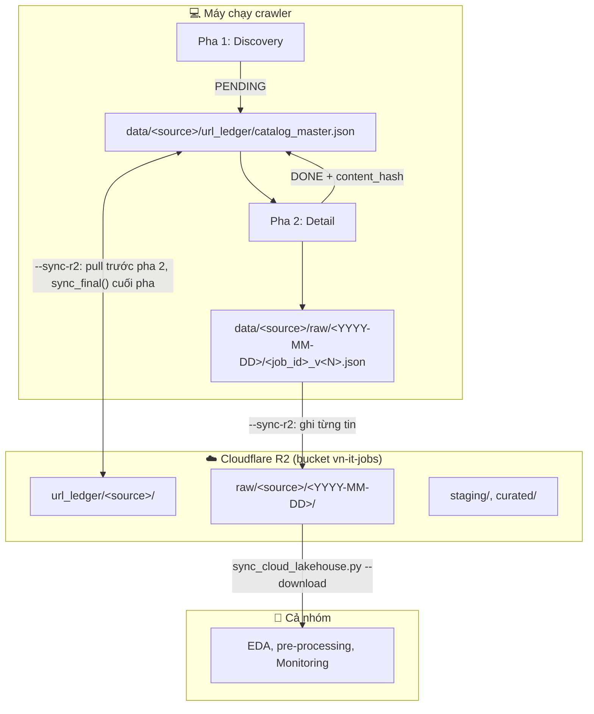

# ☁️ Cẩm Nang Thiết Lập, Lưu Trữ & Đồng Bộ Kết Quả .JSON Lên Cloudflare R2 Cho Team

---

## 1. 🌟 Tại Sao Nhóm Sử Dụng Cloudflare R2?

Trong dự án **VN-IT-Job-Mining**, các thành viên cào dữ liệu độc lập trên máy cá nhân theo 8 nguồn tuyển dụng khác nhau (TopCV, TopDev, ITViec, VietnamWorks, CareerViet, ViecLam24h, Glints, JobsGO). 

Để phối hợp nhóm hiệu quả, hệ thống phân định rạch ròi 2 trụ cột lưu trữ:
- **Cloudflare R2 (Remote Cloud Data Lakehouse)**: Chuyên dùng làm **Kho Lưu Trữ Kết Quả `.json` Tập Trung** cho cả nhóm:
  - **Tương thích chuẩn Amazon S3 API**: Tương thích 100% với `boto3`, DuckDB và Apache Spark.
  - **Hoàn toàn miễn phí**: 10 GB lưu trữ miễn phí và **0đ phí tải về (Free Egress)** trọn đời.
  - **Tránh phình to mã nguồn Git**: Tuyệt đối không commit các file kết quả `.json` lớn hay hàng ngàn file HTML thô vào GitHub; toàn bộ kết quả cào sẽ được đẩy lên Cloudflare R2.
  - **Chia sẻ dữ liệu thời gian thực (24/7)**: Thành viên cào xong nguồn nào, dữ liệu lập tức có mặt trên Cloud R2 để các bạn làm EDA, tiền xử lý và tích hợp AI/ML tải về sử dụng.

> **Cập nhật 03/11/2026.** Hệ thống chỉ dùng Cloudflare R2 (MinIO cục bộ đã bỏ). Mọi kết nối đi qua `collection/common/r2_storage.get_r2_client()`; thiếu cấu hình thì báo lỗi, không rơi về localhost. Layout `dt=YYYY-MM-DD/batch_XXX.json` và thư mục `samples/` trên R2 đã bỏ. Các lỗi đã gặp: `docs/issue_log.md` (L-01, L-10, L-11).



Bucket chỉ có 4 tầng: `url_ledger/`, `raw/`, `staging/`, `curated/`. `canonicalize_lakehouse_key` từ chối key không đúng layout.

**Bố cục theo kiến trúc medallion (bronze → silver → gold):**

| Tầng | Prefix trên R2 | Nội dung | Ai ghi |
|---|---|---|---|
| Quản lý URL | `url_ledger/<nguồn>/catalog_master.json` | Danh sách URL và trạng thái cào (nguồn sự thật của crawler) | crawler |
| **Bronze** (thô, bất biến) | `raw/<nguồn>/<YYYY-MM-DD>/<job_id>_v<N>.json` | Mỗi tin một envelope JSON đúng như lúc cào; không bao giờ sửa | crawler, `push_raw_to_r2.py` |
| **Silver** (đã làm sạch, theo từng bước) | `staging/<nguồn>/preprocessing/01_clean.jsonl` → `02_integration.parquet` → `03_transformation.parquet` → `04_normalization.parquet` | Output của 4 bước pre-processing; output bước trước là input bước sau. Từ bước 02 dữ liệu đã gộp 8 nguồn, trên R2 tách lại theo nguồn vì tầng `staging/` bắt buộc có tên nguồn ở cấp 2 | `push_preprocessing_to_r2.py` |
| **Gold** (sẵn cho mô hình) | `curated/preprocessing/features.parquet`, `curated/preprocessing/encoding_dictionary.json` | Bảng đặc trưng số (bước 05 Encoding) và từ điển mã hóa | `push_preprocessing_to_r2.py` |

Mỗi object silver/gold có metadata `step`, `generated-at` (thời điểm chạy bước, lấy từ `reports/preprocessing/<bước>/_all.json`) và `rows`. Script và trang Monitoring so từng key theo hai giá trị này để biết R2 khớp hay lệch với máy.

---

## 2. 🔑 Cách Lấy Thông Số Kết Nối Trên Cloudflare (Mất 2 Phút)

*(Nếu bạn là nhóm trưởng tạo bucket hoặc muốn tự tạo bucket cá nhân)*

1. Đăng nhập vào [Cloudflare Dashboard](https://dash.cloudflare.com/).
2. Chọn **R2 Object Storage** ở menu bên trái.
3. **Lấy Account ID**:
   - Nhìn sang góc phải màn hình, mục **Account Details** $\to$ Sao chép **Account ID** (chuỗi 32 ký tự, ví dụ: `9a8b7c6d5e4f...`).
4. **Tạo Bucket**:
   - Bấm nút **Create bucket** $\to$ Đặt tên: **`vn-it-jobs`** $\to$ Bấm **Create Bucket**.
5. **Tạo API Token (Khóa truy cập)**:
   - Ở trang chủ R2, bấm vào liên kết **Manage R2 API Tokens** (góc phải).
   - Bấm **Create API Token**.
   - Quyền hạn (Permissions): Chọn **Object Read & Write**.
   - Áp dụng cho: Chọn bucket **`vn-it-jobs`** (hoặc All buckets).
   - Bấm **Create API Token**.
   - Màn hình sẽ hiện ra:
     - **Access Key ID** (chuỗi 32 ký tự)
     - **Secret Access Key** (chuỗi 64 ký tự)
     - **Endpoint URL**: `https://<account_id>.r2.cloudflarestorage.com`
   *(Hãy lưu lại khóa này cẩn thận vì Secret Key chỉ hiển thị 1 lần duy nhất).*

---

## 3. 🚀 Cấu Hình Tự Động 1-Lệnh Cho Từng Thành Viên

### Cách 1: Chạy Wizard tương tác tự động (Khuyến nghị)
Bạn chỉ cần mở terminal tại thư mục gốc dự án và gõ:
```bash
python scripts/setup_cloud_storage.py
```
Script sẽ lần lượt hỏi Account ID, Access Key ID, Secret Access Key:
- Tự động kiểm tra bắt tay S3 API.
- Tự động tạo bucket `vn-it-jobs` nếu chưa có.
- Tự động lưu cấu hình an toàn vào `.env` (file này đã nằm trong `.gitignore` nên an toàn tuyệt đối).

### Cách 2: Điền trực tiếp qua dòng lệnh CLI:
```bash
python scripts/setup_cloud_storage.py \
  --account-id <YOUR_ACCOUNT_ID> \
  --access-key <YOUR_ACCESS_KEY_ID> \
  --secret-key <YOUR_SECRET_ACCESS_KEY> \
  --bucket vn-it-jobs
```

---

## 4. 📤 Đưa dữ liệu lên Cloudflare R2

### 4.1. Cách chính: crawler tự đồng bộ

Chạy crawler với `--sync-r2`. Crawler kéo ledger về trước pha 2, ghi từng file raw lên R2 ngay khi cào, đồng bộ ledger mỗi khoảng 15 tin, và gọi `sync_final()` cuối pha. Đồng bộ cuối pha lỗi thì crawler báo `LedgerSyncError`.

```bash
python run.py --source topcv --phase all --max-pages 1 --max-items 2 --sync-r2
```

Airflow luôn bật đồng bộ (`sync_r2=True`). Trang Crawling trên Monitoring có ô "Đồng bộ R2", bật sẵn.

### 4.2. Đẩy bù raw đã cào mà chưa lên R2

```bash
python scripts/push_raw_to_r2.py --source topcv --dry-run   # xem trước
python scripts/push_raw_to_r2.py --source topcv             # đẩy raw, rồi đẩy ledger
```

Script đẩy cả ledger sau raw (đẩy raw mà không đẩy ledger là nguyên nhân của L-01). Ledger không được đẩy khi catalog trên máy rỗng, bản trên R2 mới hơn, hoặc R2 có URL mà máy không có.

### 4.3. Ledger lệch với raw

```bash
python scripts/audit_raw_data.py --r2                       # cột "Ledger chậm hơn raw"
python scripts/reconcile_ledger_from_raw.py --source topcv  # chạy thử
python scripts/reconcile_ledger_from_raw.py --source topcv --apply         # ghi trên máy
python scripts/reconcile_ledger_from_raw.py --source topcv --push         # ghi trên máy, sao lưu bản R2 rồi đẩy
```

### 4.4. Dữ liệu sau pre-processing

Pipeline 5 bước mới: `python scripts/push_preprocessing_to_r2.py` chạy thử (chỉ đọc R2, liệt kê key mới/lệch/khớp), thêm `--push` để ghi. Chỉ đẩy key chưa có hoặc lệch. Bố cục key: `preprocessing/common/r2_export.py`; trang Monitoring `/preprocessing` có khối "Lưu trữ" so từng key.

Pipeline cũ: `python scripts/sync_cloud_lakehouse.py --upload` đẩy `data/` (gồm `staging/`, `curated/`); `python scripts/push_integration_to_r2.py` đẩy kết quả integration.

> `scripts/upload_to_r2.py` (công cụ cũ cho layout `dt=YYYY-MM-DD/batch_XXX.json` và `samples/`) đã bị xóa ngày 03/11/2026; dùng `push_raw_to_r2.py`.

**Mọi lệnh ghi hoặc xóa trên R2 đều chạy thử trước** và cần người phụ trách đồng ý.

---

## 5. 📥 Hướng Dẫn Tải Dữ Liệu Kết Quả Của Đồng Đội Về Máy

Khi các thành viên khác đã cào xong và đẩy kết quả lên Cloudflare R2, bạn có thể dễ dàng kéo dữ liệu về máy để làm EDA hoặc ghép dataset:

### 5.1. Xem tình trạng dữ liệu hiện có trên Cloud R2:
```bash
python scripts/sync_cloud_lakehouse.py --status
```
Màn hình sẽ hiển thị tổng số file, dung lượng và phân bổ theo các tầng `url_ledger`, `raw`, `staging`, `curated`.

### 5.2. Tải toàn bộ kết quả về máy:
```bash
python scripts/sync_cloud_lakehouse.py --download
```
Toàn bộ dữ liệu của cả 8 nguồn sẽ được tải về thư mục `data/` trên máy bạn. Lệnh này chỉ tải về, không ghi lên R2. Key theo layout cũ được đặt vào đúng thư mục nhờ `normalize_legacy_key`.

### 5.3. Tải kết quả của riêng 1 nguồn cụ thể:
```bash
python scripts/sync_cloud_lakehouse.py --download --source itviec
python scripts/sync_cloud_lakehouse.py --download --source vietnamworks
```

---

## 6. 🐍 Cách Đọc Trực Tiếp File Kết Quả .JSON Từ R2 Bằng Python (EDA / ML)

Bạn không bắt buộc phải tải file về ổ cứng mà có thể đọc trực tiếp từ Cloudflare R2 vào Pandas DataFrame:

```python
import json
import pandas as pd
from collection.common.r2_storage import get_r2_client, resolve_r2_bucket

s3 = get_r2_client()           # đọc .env, dùng đúng thứ tự khóa như crawler
bucket = resolve_r2_bucket(None)

key = "raw/vietnamworks/2026-11-01/<job_id>_v1.json"
envelope = json.loads(s3.get_object(Bucket=bucket, Key=key)["Body"].read())
df = pd.json_normalize(envelope["raw_payload"])
print(envelope["metadata"]["content_hash"], df.shape)
```

---

## 7. 🔒 Quy Tắc Bảo Mật & Tiêu Chuẩn Nghiệm Thu (DoD) Cho Nhóm

1. **Tuyệt đối không commit file `.env` lên GitHub**:
   - File `.env` chứa Secret Access Key của Cloudflare R2. File này đã được đưa vào `.gitignore`.
2. **Chia sẻ khóa an toàn**:
   - Nhóm trưởng chia sẻ file `.env` mẫu qua kênh chat riêng (Zalo/Telegram/Discord).
3. **Tiêu chuẩn nghiệm thu trước khi nộp (DoD Checklist)**:
   - [ ] Envelope có `metadata` (job_id, source, source_url, scraped_at, version, content_hash) và `raw_payload`.
   - [ ] Đã chạy crawler với `--sync-r2` (hoặc `push_raw_to_r2.py`, đẩy cả ledger).
   - [ ] `python scripts/audit_raw_data.py --r2`: không có key layout cũ, "Ledger chậm hơn raw" bằng 0.
4. **Cấu hình chỉ nằm trong `.env`.** Không in giá trị khóa ra log hay chat; muốn so sánh hai khóa thì so hash.

---

## 8. ⚡ Bảng Tra Cứu Nhanh Cho Team (Quick Cheat-Sheet)

| Mục tiêu thao tác | Lệnh thực hiện |
| :--- | :--- |
| **Cấu hình R2 1 chạm** | `python scripts/setup_cloud_storage.py` |
| **Kiểm tra kết nối** | `make check-r2` |
| **Cào và đồng bộ** | `python run.py --source <source> --sync-r2` |
| **Đẩy bù raw và ledger** | `python scripts/push_raw_to_r2.py --source <source> [--dry-run]` |
| **Dựng lại ledger từ raw** | `python scripts/reconcile_ledger_from_raw.py --source <source> [--apply hoặc --push]` |
| **Kiểm tra dữ liệu** | `python scripts/audit_raw_data.py --r2` |
| **Xem tình trạng Cloud R2** | `python scripts/sync_cloud_lakehouse.py --status` |
| **Kéo dữ liệu cả nhóm về máy** | `python scripts/sync_cloud_lakehouse.py --download [--source <source>]` |
