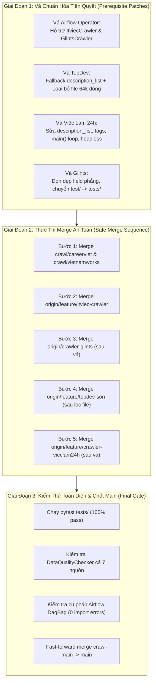

# Kế Hoạch Kiểm Toán & Lộ Trình Merge Chuẩn Hóa Toàn Diện (Comprehensive Audit & Harmonized Merge Plan)

> **Mục tiêu**: Hướng dẫn chi tiết chiến lược giải quyết bất đồng bộ Schema giữa các nhánh, bảo vệ hạ tầng Apache Airflow không bị gãy luồng, và lộ trình merge code an toàn cho Nhóm trưởng phê duyệt.  
> **Tài liệu nền tảng kèm theo**:  
> 1. [`docs/crawl/schema_comparison_matrix.md`](file:///home/billtran/Desktop/Learning/UTH/VN-IT-Job-Mining/docs/crawl/schema_comparison_matrix.md) — Ma trận đối chiếu 15 trường dữ liệu JSON thực tế giữa 7 nguồn.  
> 2. [`docs/crawl/airflow_compatibility_audit.md`](file:///home/billtran/Desktop/Learning/UTH/VN-IT-Job-Mining/docs/crawl/airflow_compatibility_audit.md) — Báo cáo kiểm toán tương thích hạ tầng Airflow.  
> 3. [`docs/crawl/crawl_data_issues.md`](file:///home/billtran/Desktop/Learning/UTH/VN-IT-Job-Mining/docs/crawl/crawl_data_issues.md) — Sổ nhật ký theo dõi lỗi dữ liệu và sự cố kỹ thuật.  
> **Cập nhật ngày**: 11/10/2026

---

## 1. Nguyên Tắc Cốt Lõi: Chưa Merge Trực Tiếp Khi Chưa Vá Lỗi Tiên Quyết

> [!CAUTION]
> **Cảnh Báo Dành Cho Nhóm Trưởng**:
> Nếu tiến hành `git merge` các nhánh thành viên vào ngay thời điểm này, hệ thống sẽ gặp 3 sự cố nghiêm trọng:
> 1. **Gãy Airflow Pipeline**: DAG `crawler_itviec` sẽ crash vì hàm `crawl()` đã bị xóa; DAG `crawler_vieclam24h` sẽ crash vì Selenium thiếu headless; và Glints không có lịch cào.
> 2. **Chặn Task Kiểm Tra Chất Lượng (`DataQualityOperator`)**: `DataQualityOperator` sẽ raise lỗi `ValueError` đánh fail DAG TopDev và ViecLam24h do tỷ lệ hợp lệ schema < 95% (`description_list` bị `null`).
> 3. **Phình To Git Repository**: File `batch_001.json` (64,948 dòng, 3.13MB) của Sơn sẽ bị kéo vĩnh viễn vào lịch sử Git.
> 
> 👉 **Giải pháp**: Áp dụng quy trình **3 Giai Đoạn Có Kiểm Soát** dưới đây.

---

## 2. Quy Trình 3 Giai Đoạn Triển Khai



---

## 3. Chi Tiết Các Bước Vá Chuẩn Hóa (Giai Đoạn 1)

### Bước 1.1: Vá Hạ Tầng Airflow ([`airflow/plugins/crawler_operators.py`](file:///home/billtran/Desktop/Learning/UTH/VN-IT-Job-Mining/airflow/plugins/crawler_operators.py))
- **Mục tiêu**: Khắc phục lỗi `ImportError` cho ITviec và bổ sung nguồn Glints.
- **Thực hiện**:
  Cập nhật hàm `JobCrawlerOperator.execute`:
  ```python
  if self.source == "topdev":
      from crawlers.sources.topdev.crawler import TopDevCrawler
      crawler_cls = TopDevCrawler
  elif self.source == "vietnamworks":
      from crawlers.sources.vietnamworks.crawler import VietnamWorksCrawler
      crawler_cls = VietnamWorksCrawler
  elif self.source == "careerviet":
      from crawlers.sources.careerviet.crawler import CareerVietCrawler
      crawler_cls = CareerVietCrawler
  elif self.source == "vieclam24h":
      from crawlers.sources.vieclam24h.crawler import ViecLam24hCrawler
      crawler_cls = ViecLam24hCrawler
  elif self.source == "topcv":
      from crawlers.sources.topcv.crawler import TopCVCrawler
      crawler_cls = TopCVCrawler
  elif self.source == "itviec":
      from crawlers.sources.itviec.crawler import ItviecCrawler
      crawler_cls = ItviecCrawler
  elif self.source == "glints":
      from crawlers.sources.glints.crawler import GlintsCrawler
      crawler_cls = GlintsCrawler
  else:
      raise ValueError(f"Unknown source: {self.source}")

  crawler = crawler_cls(output_dir=self.output_dir, max_items=self.max_items)
  stats = crawler.run()
  ```
- **Bổ sung DAG Glints**: Thêm DAG `crawler_glints` vào [`airflow/dags/crawler_dags.py`](file:///home/billtran/Desktop/Learning/UTH/VN-IT-Job-Mining/airflow/dags/crawler_dags.py) chạy lúc 20:00 Chủ Nhật.

---

### Bước 1.2: Chuẩn Hóa Nhánh ITviec (Bạn Phát - `origin/feature/itviec-crawler`)
- **Đánh giá**: Mã nguồn `ItviecCrawler` và `parser.py` của Phát viết rất sạch và tuân thủ 100% Schema v1.
- **Hành động**: Sau khi vá Airflow Operator ở Bước 1.1, nhánh của Phát có thể merge trực tiếp mà không cần sửa code.

---

### Bước 1.3: Chuẩn Hóa Nhánh Glints (Bạn Duy - `origin/crawler-glints`)
- **Vấn đề**:
  1. Thư mục test đặt ở `test/unit/` (số ít).
  2. Dư thừa trường phẳng `description_html` và `description_text` ở root `raw`.
- **Hành động khi merge**:
  1. Di chuyển file test:
     ```bash
     mkdir -p tests/unit
     mv test/unit/test_glints_crawler.py tests/unit/test_glints_crawler.py
     rm -rf test/
     ```
  2. Xóa bỏ 2 trường phẳng `description_html` và `description_text` trong `raw_data` của `crawlers/sources/glints/crawler.py` để đồng nhất 100% Schema v1.

---

### Bước 1.4: Chuẩn Hóa Nhánh TopDev (Bạn Sơn - `origin/feature/topdev-son`)
- **Vấn đề**:
  1. File `crawlers/sources/topdev/batch_001.json` nặng 64,948 dòng (3.13MB).
  2. `description_list: null` gây lỗi Pydantic `ValidationError`.
- **Hành động khi merge**:
  1. Thêm fallback chống null trong `crawlers/sources/topdev/crawler.py`:
     ```python
     if not description_list:
         description_list = [title]
     ```
  2. Loại bỏ hoàn toàn file 64k dòng khỏi Git tracking:
     ```bash
     git rm -f crawlers/sources/topdev/batch_001.json
     ```
  3. Tạo file benchmark nhẹ: `crawlers/sources/topdev/test_5_jobs.json` (~500 dòng).

---

### Bước 1.5: Chuẩn Hóa Nhánh Việc Làm 24h (Bạn Phúc - `origin/feature/crawler-vieclam24h`)
- **Vấn đề**:
  1. Crash hàm `main()` do `for record in crawler.run(): record.to_jsonl_dict()`.
  2. Selenium Chrome thiếu cờ headless gây crash trên server không có màn hình.
  3. Gán `description_list = description_list or None` gây lỗi Pydantic.
  4. Nhồi nhét nội dung vào `tags`.
- **Hành động khi merge**:
  1. Thêm ChromeOptions headless cho WebDriver:
     ```python
     options = webdriver.ChromeOptions()
     options.add_argument("--headless=new")
     options.add_argument("--no-sandbox")
     options.add_argument("--disable-dev-shm-usage")
     self.driver = webdriver.Chrome(options=options)
     ```
  2. Sửa fallback: `description_list = description_list or [title]`.
  3. Gỡ bỏ nhồi nhét `tags` và gỡ hardcode các trường `extra`.
  4. Sửa hàm `main()` để chỉ in thống kê `print("Result:", crawler.run())`.

---

## 4. Lộ Trình Thực Thi Merge Chi Tiết (Giai Đoạn 2)

Sau khi Nhóm trưởng bấm duyệt kế hoạch, tiến hành thực hiện tuần tự trên nhánh `crawl-main`:

```bash
# Đảm bảo đang ở nhánh crawl-main
git checkout crawl-main

# Bước 2.1: Vá Airflow Operator và DAGs
# (Sửa crawler_operators.py và crawler_dags.py)
git add airflow/plugins/crawler_operators.py airflow/dags/crawler_dags.py
git commit -m "fix(airflow): harmonize JobCrawlerOperator with ItviecCrawler and add Glints DAG"

# Bước 2.2: Merge ITviec của Phát
git merge origin/feature/itviec-crawler --no-ff -m "merge: integrate itviec crawler refactor by Phat"

# Bước 2.3: Merge Glints của Duy & Chuẩn hóa test path
git merge origin/crawler-glints --no-ff -m "merge: add glints crawler by Duy"
mkdir -p tests/unit
mv test/unit/test_glints_crawler.py tests/unit/test_glints_crawler.py
rm -rf test/
git add tests/unit/test_glints_crawler.py test/
git commit -m "fix(glints): standardize test directory to tests/unit/"

# Bước 2.4: Merge TopDev của Sơn & Loại bỏ file 64k dòng
git merge origin/feature/topdev-son --no-ff -m "merge: topdev parser improvements by Son"
git rm -f crawlers/sources/topdev/batch_001.json
git commit -m "chore(topdev): exclude 64k-line raw json from git index"

# Bước 2.5: Merge Việc Làm 24h của Phúc & Vá lỗi fatal
git merge origin/feature/crawler-vieclam24h --no-ff -m "merge: integrate vieclam24h crawler by Phuc"
# (Áp dụng patch headless và sửa main loop)
git commit -m "fix(vieclam24h): add headless options, fix main loop and schema fallback"
```

---

## 5. Kiểm Thử Hồi Quy Cuối Cùng (Giai Đoạn 3)

Trước khi merge vào `main`, bắt buộc chạy 3 vòng kiểm tra:

1. **Vòng 1: Kiểm thử toàn bộ Unit Tests**
   ```bash
   pytest tests/ -v
   # Yêu cầu: 100% tests pass (dự kiến >120 tests sau khi gộp Glints và ITviec)
   ```

2. **Vòng 2: Kiểm thử DataQualityChecker cho toàn bộ 7 nguồn**
   ```bash
   python -c "
   from crawlers.common.data_quality import DataQualityChecker
   import glob
   files = sorted(glob.glob('crawlers/sources/**/test_5_jobs.json', recursive=True))
   print(f'Kiểm tra {len(files)} files benchmark...')
   for f in files:
       res = DataQualityChecker(f).check()
       print(f, '-> Passed:', res['passed'], 'Valid:', res['schema_valid_rate'], '%')
       assert res['passed'] is True
   "
   ```

3. **Vòng 3: Kiểm thử Cú Pháp & Tương Thích Airflow**
   ```bash
   python -c "
   from airflow.models import DagBag
   bag = DagBag(dag_folder='airflow/dags')
   assert len(bag.import_errors) == 0, f'Lỗi import DAG: {bag.import_errors}'
   print('Toàn bộ 7 DAGs hợp lệ 100%! Danh sách:', list(bag.dags.keys()))
   "
   ```

4. **Chốt Hạ: Merge Vào Nhánh `main`**
   ```bash
   git checkout main
   git merge crawl-main --ff-only
   git push origin main
   ```
