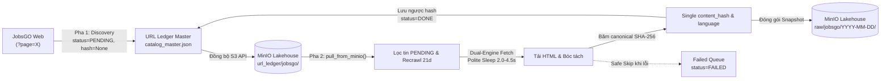

# JobsGO Crawler — Kiến Trúc Kỹ Thuật & Vượt Rào Cản Cloudflare WAF

> **Tài liệu tham chiếu:** [`cloudflare.md`](file:///run/media/billtran/Data/Archduker/Study/UTH/Core/DataMining/VN-IT-Job-Mining/cloudflare.md), [`docs/two_phase_minio_crawler_playbook.md`](file:///run/media/billtran/Data/Archduker/Study/UTH/Core/DataMining/VN-IT-Job-Mining/docs/two_phase_minio_crawler_playbook.md).

---

## 1. Khảo Sát Kiến Trúc Mạng & Thử Thách Cloudflare WAF

- **Entry Point Tuyển Dụng CNTT:** `https://jobsgo.vn/viec-lam-cong-nghe-thong-tin.html`
- **Mẫu URL Chi Tiết:** `https://jobsgo.vn/viec-lam/<slug>-<job_id>.html`
- **Cơ chế phân trang:** Phân trang SSR thông qua tham số URL `?page=X`.
- **Rào cản phòng vệ (Bot Mitigation):**
  - JobsGO áp dụng hệ thống bảo vệ **Cloudflare WAF** chặn tất cả request từ các thư viện HTTP tiêu chuẩn (`requests`, `curl`, `httpx` thông thường) với mã lỗi **HTTP 403 Forbidden** (`cf-mitigated: challenge`).
  - Gắn cờ User-Agent Linux Desktop đối với các request không mang TLS fingerprint hợp lệ.

---

## 2. Giải Pháp Vượt Cloudflare: Mô Hình Dual-Engine

Theo tài liệu [`cloudflare.md`](file:///run/media/billtran/Data/Archduker/Study/UTH/Core/DataMining/VN-IT-Job-Mining/cloudflare.md), crawler triển khai kiến trúc 2 tầng engine linh hoạt:

1. **Engine 1: `curl_cffi` (Mặc định cho Batch & Airflow Pipelines):**
   - Giả lập trọn vẹn TLS/JA3/JA4 fingerprint của Chrome 124 (`impersonate="chrome124"`).
   - Tối ưu pool User-Agent ưu tiên Windows 10/11 & macOS Chrome (loại bỏ Linux Desktop UA để tránh bị Cloudflare cắm cờ).
   - Thời gian phản hồi: `< 1.0 giây / request`.
   - Tiêu thụ tài nguyên tối thiểu: chỉ ~15MB RAM, vận hành ổn định trên Airflow workers mà không lo crash memory.
2. **Engine 2: `playwright` (Chromium dự phòng & chống chặn chuyên sâu):**
   - Khởi chạy trình duyệt Playwright Chromium (`/usr/bin/google-chrome`) với các cờ chống phát hiện bot:
     `--disable-blink-features=AutomationControlled`, `--no-sandbox`.
   - Thực hiện tương tác người dùng giả lập (`human_like_interaction`) để vượt qua các thử thách JavaScript Turnstile nếu có.
3. **Cơ chế Fallback Tự Động:**
   - Trong quá trình chạy với `curl_cffi`, nếu phát hiện mã phản hồi 403 hoặc chứa nội dung Cloudflare Challenge (`is_cloudflare_challenge`), crawler tự động kích hoạt fallback sang Playwright để tải trang an toàn mà không làm gián đoạn tiến trình.

---

## 3. Kiến Trúc 2 Pha Độc Lập (Two-Phase Decoupled Pipeline)



1. **Pha 1 (URL Discovery):**
   - Quét qua phân trang danh mục CNTT.
   - Trích xuất URL canonical sạch, loại bỏ tracking tokens (`utm_*`, `ref`, v.v.).
   - Đăng ký vào Ledger: `status = "PENDING"`, `content_hash = None` (tuyệt đối không sinh hash giả khi chưa tải chi tiết).
   - Xuất daily manifest `manifest_YYYY-MM-DD.jsonl` và đồng bộ master catalog lên MinIO Lakehouse `minio://vn-it-jobs/url_ledger/jobsgo/`.
2. **Pha 2 (Detail Extraction):**
   - Kéo URL mới nhất từ MinIO về máy (`ledger.pull_from_minio()`).
   - Lọc các bài đăng cần xử lý: `status == "PENDING"` hoặc đã cào quá 21 ngày (`RECHECK_DUE`).
   - Hỗ trợ chế độ cào lại lỗi: `--retry-failed` lọc các bài đăng trong `Failed Queue` (`status == "FAILED"`).
   - Checkpoint Sync định kỳ: Cứ sau mỗi 15 bài đăng thành công, tự động lưu tiến trình và đồng bộ lên MinIO.

---

## 4. Chuẩn Hóa Schema & Quy Tắc Hash Duy Nhất (Single content_hash)

Theo đúng quy chuẩn dữ liệu và yêu cầu dự án:
- **Duy nhất 1 trường `content_hash`:**
  - Băm mã SHA-256 trên toàn vẹn đối tượng `raw_payload` đã sắp xếp khóa (`calculate_json_canonical_hash`).
  - Trong `metadata`, chỉ lưu duy nhất 1 khóa `content_hash` (không lưu thừa `canonical_hash` hay `field_hashes`).
- **Trường `language`:** Nhận diện tự động qua `detect_language()` từ tiêu đề và nội dung bài đăng.
- **Bóc tách 100% trường dữ liệu theo `neccessary.md` (Zero Information Loss):**
  - Trích xuất đầy đủ: `title`, `salary_raw`, `location`, `experience`, `education`, `deadline_raw`, `working_time`, `working_places` (kèm ghi chú trước/sau sáp nhập), `description_bullets`, `requirements_bullets`, `benefits_bullets`, `occupations`, `company`, `company_field`, `company_address`, `general_info` (`employment_type`, `job_level`, `posted_date`, `hiring_quantity`).

---

## 5. Hướng Dẫn Sử Dụng Giao Diện Dòng Lệnh (CLI)

```bash
# 1. Quét URL danh mục Pha 1 (Discovery) đồng bộ lên MinIO
.venv/bin/python crawlers/sources/jobsgo/crawler.py --phase discovery --online --sync-minio --max-pages 5

# 2. Cào chi tiết Pha 2 (Details) với động cơ curl_cffi mặc định
.venv/bin/python crawlers/sources/jobsgo/crawler.py --phase details --online --sync-minio --limit 20

# 3. Cào chi tiết với động cơ Playwright
.venv/bin/python crawlers/sources/jobsgo/crawler.py --phase details --engine playwright --online --sync-minio --limit 10

# 4. Cào lại các URL trong hàng đợi lỗi (Failed Queue)
.venv/bin/python crawlers/sources/jobsgo/crawler.py --phase details --retry-failed --online --sync-minio

# 5. Xem thống kê trạng thái URL Ledger
.venv/bin/python crawlers/sources/jobsgo/crawler.py --phase view

# 6. Kiểm tra URL Ledger trực tiếp từ MinIO Lakehouse
.venv/bin/python scripts/view_urls.py --source jobsgo --minio
```
