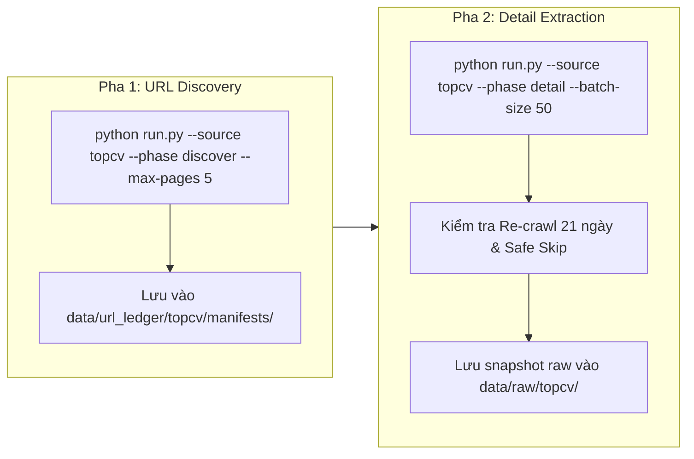

# PHÂN TÍCH KIẾN TRÚC THU THẬP NGUỒN TOPCV (TOPCV CRAWLER ARCHITECTURE)

> **Người phụ trách:** Thuận (Leader)  
> **Nguồn mục tiêu:** [TopCV Việt Nam](https://www.topcv.vn)  
> **Nhánh Git:** `crawls/topcv`  
> **Loại hình website:** Server-Side Rendering (SSR) kết hợp bảo vệ Cloudflare nhẹ  
> **Chu kỳ Re-crawl:** 21 ngày

---

## 1. Khảo Sát Kiến Trúc Mạng & Cơ Chế Hiển Thị (Network & Anti-Bot Survey)

### 1.1. Khảo sát Render:
- TopCV chủ yếu render nội dung trực tiếp từ Server (SSR) trong tài liệu HTML ban đầu (`curl` có thể lấy được tiêu đề và nội dung).
- Tuy nhiên, trang tìm kiếm danh mục (`/tim-viec-lam-it-phan-mem...`) và một số trang chi tiết có thể kích hoạt thử thách Cloudflare Turnstile hoặc JavaScript Challenge nếu phát hiện User-Agent tự động (curl/python-requests không có header hợp lệ).

### 1.2. Giải pháp kỹ thuật:
- **Phase 1 (Discovery):** Dùng `playwright` với chế độ Headless Chrome và cờ `--disable-blink-features=AutomationControlled` để vượt qua bộ lọc Cloudflare, trích xuất 100% URL danh mục mà không bị chặn.
- **Phase 2 (Detail):** Dùng `httpx` xoay tua User-Agent thật kèm cookies phiên làm việc để tải nội dung chi tiết với tốc độ cao ($1.5 - 2.5$ giây/request kèm polite jitter).

---

## 2. Xác Định Container Selector Cho Clean Container HTML Hashing

Để tính mã băm nội dung ổn định mà không bị nhảy hash oan do các thành phần động (thời gian server, lượt xem, việc làm liên quan):
- **Container Selector khuyến nghị:** `div.job-detail` kết hợp `div.box-header-job`.
- **Thẻ bị loại bỏ trước khi băm:**
  - `<script>`, `<style>`, `<iframe>`, `<svg>`, `<noscript>`
  - Khối việc làm liên quan: `.box-suggest-job`, `.similar-jobs`
  - Các chỉ số động: `.view-count`, `.timestamp`

```python
from crawlers.common.url_ledger import calculate_container_html_hash

content_hash = calculate_container_html_hash(html_text, container_selector="div.job-detail")
```

---

## 3. Bản Đồ Selector Bóc Tách Trường Thô (Raw Field Inventory)

Tuân thủ nguyên tắc **Zero Information Loss (Raw As-Is)**, lưu trữ nguyên vẹn các trường gốc của TopCV:

| Tên trường raw | Selector CSS trên TopCV | Kiểu dữ liệu | Ví dụ giá trị |
| :--- | :--- | :--- | :--- |
| `box-header-job__title` | `h1.box-header-job__title` | String | `"Senior Python Backend Engineer"` |
| `box-header-job__company-name` | `.box-header-job__company-name a` | String | `"CÔNG TY CỔ PHẦN CÔNG NGHỆ ABC"` |
| `box-header-job__salary--title` | `.box-header-job__salary--title` | String | `"25 - 45 triệu"` hoặc `"Thỏa thuận"` |
| `job-detail__info--deadline` | `.job-detail__info--deadline` | String | `"30/11/2026"` |
| `experience` | `.box-general-group .box-item:has(.box-item__title:contains('Kinh nghiệm'))` | String | `"3 - 5 năm"` |
| `level` | `.box-general-group .box-item:has(.box-item__title:contains('Cấp bậc'))` | String | `"Senior"` |
| `badge_tags` | `.badge-tag-list .item` | List[String] | `["Python", "FastAPI", "Docker"]` |
| `description_list` | `.job-description ul li` | List[String] | `["Thiết kế backend...", "..."]` |
| `requirements_list` | `.job-requirements ul li` | List[String] | `["Tối thiểu 3 năm kinh nghiệm...", "..."]` |
| `benefits_list` | `.job-benefits ul li` | List[String] | `["Lương tháng 13...", "..."]` |

---

## 4. Quy Trình Vận Hành 2 Pha & Điều Phối Airflow



### Lệnh chạy kiểm thử:
```bash
# 1. Quét danh sách URL
.venv/bin/python run.py --source topcv --phase discover --max-pages 1

# 2. Cào chi tiết
.venv/bin/python run.py --source topcv --phase detail --max-items 3

# 3. Kiểm tra kiểm kê dữ liệu
.venv/bin/python .agents/skills/eda-intelligence/scripts/generate_eda_report.py --source topcv
```

---

## 5. Thư Mục Mẫu Kiểm Thử Đa Định Dạng (Multi-Format Test Suite)

Đã hoàn thành và lưu trữ tại `crawlers/sources/topcv/samples/`:
1. `sample_standard_job.html` & `.json`: Tin tuyển dụng thông thường có lương VNĐ.
2. `sample_hot_vip_job.html` & `.json`: Tin tuyển dụng VIP Hot có lương USD.
3. `sample_negotiable_salary.html` & `.json`: Tin tuyển dụng mức lương thỏa thuận.
