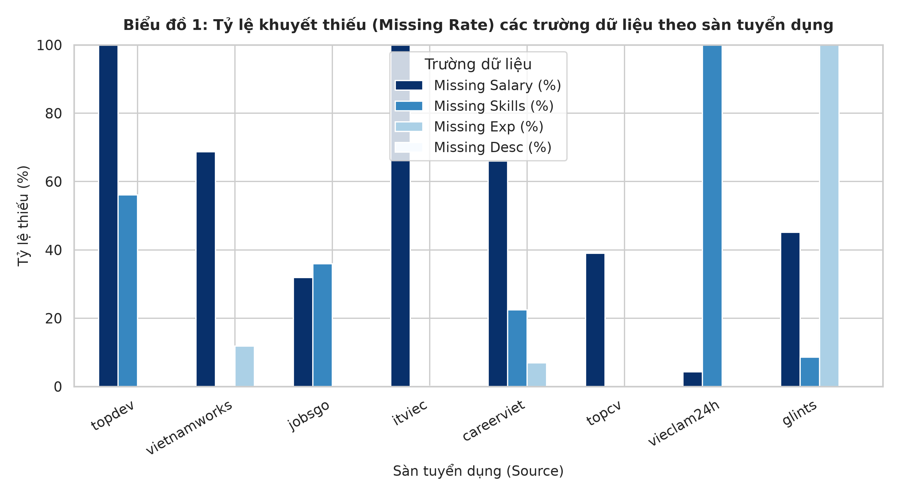
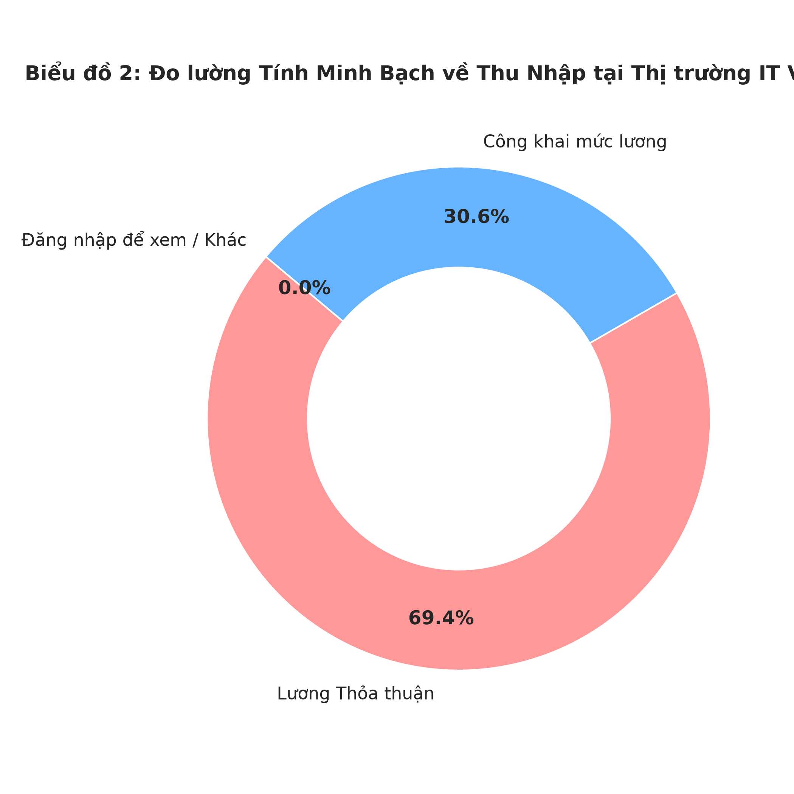
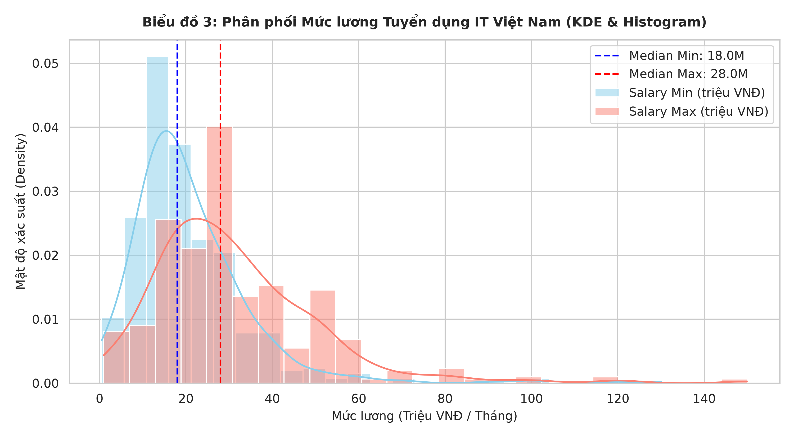
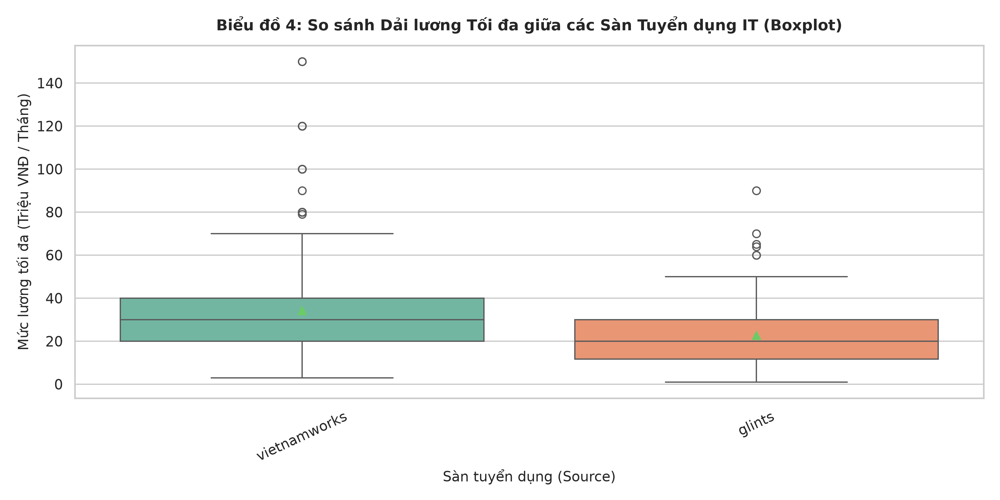
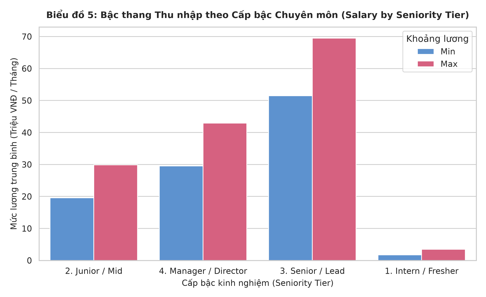
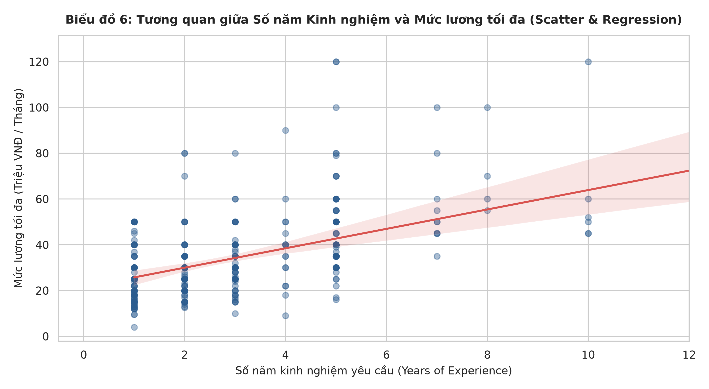

# 📊 BÁO CÁO KẾT QUẢ KHÁM PHÁ DỮ LIỆU (EDA) — CHUYÊN ĐỀ 1
# PHÂN PHỐI MỨC LƯƠNG, CẤU TRÚC THỊ TRƯỜNG & CẤP BẬC KINH NGHIỆM

> **Dự án**: VN-IT-Job-Mining — Hệ thống Thu thập & Khai phá Dữ liệu Tuyển dụng IT Việt Nam  
> **Chuyên đề**: EDA 1 (Salary Landscape & Market Structure)  
> **Tập dữ liệu phân tích**: `data/processed/preClean/merged_jobs_clean.json` (9,038 tin tuyển dụng hợp nhất từ 8 sàn)  
> **Jupyter Notebook thực thi**: [`notebooks/01_eda_salary_and_market_structure.ipynb`](../notebooks/01_eda_salary_and_market_structure.ipynb)  
> **Ngày lập báo cáo**: 2026-10-13 (Cập nhật sau kiểm toán chất lượng)  

---

## 🎯 1. TỔNG QUAN & PHẠM VI NGHIÊN CỨU

Báo cáo này trình bày kết quả phân tích khám phá dữ liệu chuyên sâu về mặt bằng thu nhập, độ minh bạch lương và tương quan cấp bậc kinh nghiệm trong ngành Công nghệ Thông tin tại Việt Nam.

Tập dữ liệu gồm **9,038 tin tuyển dụng sạch**, được thu thập từ 8 sàn tuyển dụng hàng đầu:
- **TopDev**: 2,818 tin (31.18%)
- **VietnamWorks**: 2,232 tin (24.70%)
- **JobsGO**: 1,472 tin (16.29%)
- **ITviec**: 674 tin (7.46%)
- **CareerViet**: 655 tin (7.25%)
- **TopCV**: 498 tin (5.51%)
- **ViecLam24h**: 445 tin (4.92%)
- **Glints**: 244 tin (2.70%)

---

## 📈 2. KẾT QUẢ PHÂN TÍCH CHI TIẾT THEO DANH MỤC BIỂU ĐỒ

### 2.1. Biểu đồ 1: Tỷ lệ Khuyết thiếu (Missing Rate) theo Sàn Tuyển dụng

#### Bảng Tỷ Lệ Khuyết Thiếu Theo Nguồn Tuyển Dụng
*Ghi chú phương pháp*: Mẫu số là tổng số tin của từng sàn. Định nghĩa thiếu:
- **Thiếu Lương**: Cả `salary_min` và `salary_max` đều là None (bao gồm cả tin lương thỏa thuận).
- **Thiếu Kỹ năng**: Trường `tags.skills` rỗng hoặc không tồn tại.
- **Thiếu Kinh nghiệm**: Trường `extra.experience` rỗng.
- **Thiếu Mô tả**: Trường `description_list` rỗng hoặc không có phần tử.

| Sàn tuyển dụng (Source) | Tổng số tin | Thiếu Lương (%) [Số lượng] | Thiếu Kỹ năng (%) [Số lượng] | Thiếu Kinh nghiệm (%) [Số lượng] | Thiếu Mô tả (%) [Số lượng] |
|---|:---:|:---:|:---:|:---:|:---:|
| **TopDev** | 2,818 | 99.9% (2,815) | 56.1% (1,581) | 0.0% (1) | 0.2% (5) |
| **VietnamWorks** | 2,232 | 68.7% (1,534) | 0.0% (1) | 11.8% (264) | 0.0% (0) |
| **JobsGO** | 1,472 | 31.9% (469) | 35.9% (528) | 0.0% (0) | 0.0% (0) |
| **ITviec** | 674 | 100.0% (674) | 0.1% (1) | 0.0% (0) | 0.0% (0) |
| **CareerViet** | 655 | 66.0% (432) | 22.4% (147) | 6.9% (45) | 0.0% (0) |
| **TopCV** | 498 | 39.0% (194) | 0.0% (0) | 0.0% (0) | 0.0% (0) |
| **ViecLam24h** | 445 | 4.3% (19) | 100.0% (445) | 0.0% (0) | 0.0% (0) |
| **Glints** | 244 | 45.1% (110) | 8.6% (21) | 100.0% (244) | 0.0% (0) |

* **Quan sát thực nghiệm (Empirical Findings)**:
  - Mức độ hoàn thiện nội dung mô tả công việc (`description_list`) đạt từ **99.8% đến 100%** trên toàn bộ 8 nguồn (chỉ có 5 bài tại TopDev thiếu mô tả).
  - Tỷ lệ thiếu lương số học phân hóa cực kỳ sâu sắc giữa các sàn: ITviec thiếu số học **100.0%** (toàn bộ 674 tin yêu cầu đăng nhập ứng viên) và TopDev thiếu số học **99.9%** (2,815/2,818 tin). Ngược lại, ViecLam24h có tỷ lệ thiếu lương thấp nhất với chỉ **4.3%** (426/445 tin có giá trị lương số cụ thể).
  - Phân hóa thẻ kỹ năng: TopCV hoàn chỉnh 100%, VietnamWorks và ITviec chỉ thiếu đúng 1 bài (0.0% - 0.1%), trong khi ViecLam24h khuyết thiếu hoàn toàn thẻ kỹ năng thô (**100.0%**).
  - Giải thích quy tắc làm tròn: Một số ô hiển thị 0.0% nhưng vẫn ghi nhận 1 bản ghi thiếu (như TopDev thiếu kinh nghiệm: 1/2,818 = 0.035%; VietnamWorks thiếu kỹ năng: 1/2,232 = 0.045%) do quy tắc làm tròn 1 chữ số thập phân (`round(..., 1)`).
* **Giới hạn dữ liệu & Khuyến nghị kỹ thuật**:
  - Không thể loại bỏ các bản ghi thiếu lương số học vì đây là đặc thù nghiệp vụ (Business-valid Null). Cần bóc tách bổ sung kỹ năng từ `description_list` cho các sàn thiếu thẻ kỹ năng thô như ViecLam24h.

---

### 2.2. Biểu đồ 2: Đo lường Tính Minh Bạch về Thu Nhập (Salary Transparency)

#### Bảng Thống Kê Phân Loại Minh Bạch Lương
*Ghi chú phương pháp*: Mẫu số là toàn bộ 9,038 tin tuyển dụng.

| Phân loại mức lương | Số lượng bài đăng | Tỷ lệ (%) | Bản chất dữ liệu & Giới hạn ghi nhận |
|---|:---:|:---:|---|
| **Lương Thỏa thuận (`NEGOTIABLE`)** | 6,275 | **69.4%** | Nhãn schema `NEGOTIABLE` (gồm lương thỏa thuận và tin giấu lương yêu cầu đăng nhập) |
| **Công khai mức lương số học** | 2,763 | **30.6%** | Có giá trị số học cụ thể tại `salary_min` hoặc `salary_max` |
| **Đăng nhập để xem / Khác** | 0 | **0.0%** | Trong PreClean, các tin giấu lương đã được chuẩn hóa về giá trị `NEGOTIABLE` |

* **Quan sát thực nghiệm (Empirical Findings)**:
  - Trên tập dữ liệu sau PreClean, có **2,763 tin (30.6%)** công khai dải lương số học cụ thể.
  - Có **6,275 tin (69.4%)** mang nhãn lương thỏa thuận (`salary_type: 'NEGOTIABLE'`).
* **Giới hạn dữ liệu & Bối cảnh tiền xử lý (Important Limitation)**:
  - Trong giai đoạn tiền xử lý PreClean, các tin tuyển dụng có văn bản lương thô là "Đăng nhập để xem mức lương" (đặc biệt 674 bài từ sàn ITviec) đã được chuẩn hóa về `salary_type: 'NEGOTIABLE'`. Do đó, nhóm 69.4% trên biểu đồ Donut bao gồm cả tin doanh nghiệp chủ động đàm phán lẫn tin sàn tuyển dụng giấu lương sau tường đăng nhập. Không thể khẳng định toàn bộ 69.4% này đều là lương thỏa thuận thực sự theo nghiệp vụ đàm phán.

---

### 2.3. Biểu đồ 3: Phân Phối Mức Lương Hàng Tháng (VND Monthly)

#### Bảng Thống Kê Mô Tả Chi Tiết (Đơn vị: Triệu VNĐ / Tháng)
*Ghi chú phương pháp*: Thống kê tính trên tập con có đơn vị tiền tệ `VND`, kỳ trả lương `MONTHLY` (nhận diện qua `SalaryAnalyzer.detect_pay_period`), sau khi áp dụng bộ lọc cận biên $[0.5, 150.0]$ triệu VNĐ/tháng để loại bỏ giá trị ngoại lệ vẽ biểu đồ KDE.

| Chỉ số thống kê | Lương Tối Thiểu (`Salary Min`) | Lương Tối Đa (`Salary Max`) | Ghi chú so sánh |
|---|:---:|:---:|---|
| **Số lượng quan sát (`Count`)** | 491 | 518 | Tập quan sát có lương số hợp lệ sau lọc |
| **Tối thiểu (`Min`)** | 0.50 | 1.00 | Giới hạn dưới sau khi lọc cận |
| **Phân vị 25% (`Q25`)** | 12.00 | 18.00 | 25% vị trí có lương trần dưới 18.0M |
| **Trung vị (`Median / 50%`)** | **18.00** | **28.00** | **Mốc trung vị thị trường** |
| **Trung bình (`Mean`)** | **21.18** | **31.36** | Bị kéo lệch phải bởi dải lương cao |
| **Phân vị 75% (`Q75`)** | 25.00 | 40.00 | 75% vị trí có lương trần dưới 40.0M |
| **Tối đa (`Max`)** | 130.00 | 150.00 | Điểm chặn trên của bộ lọc biểu đồ |
| **Độ trải giữa (`IQR = Q75 - Q25`)**| 13.00 | 22.00 | Dải phân tán trung tâm |
| **Độ lệch chuẩn (`Std`)** | 14.93 | 19.63 | Độ phân tán quanh giá trị trung bình |

* **Quan sát thực nghiệm & So sánh với dữ liệu gốc**:
  - Dải lương tối thiểu tập trung quanh trung vị **18.00 triệu VNĐ/tháng**, dải lương tối đa tập trung quanh trung vị **28.00 triệu VNĐ/tháng**.
  - Đồ thị phân phối bị lệch phải (Right-skewed) rõ rệt: $\text{Mean}_{\text{Max}} = 31.36\text{M} > \text{Median}_{\text{Max}} = 28.00\text{M}$.
  - *Đối chiếu với dữ liệu gốc backend*: Trong backend `SalaryAnalyzer` khi chưa áp dụng bộ lọc cận 150M, tập `VND_MONTHLY` có 524 quan sát cho Salary Max, giá trị Min là 0.01M (10,000 VND - lỗi nhập liệu), giá trị Max là 220.0M, Mean là 31.75M và Std là 22.22M. Việc bộ lọc biểu đồ giới hạn dải $[0.5\text{M}, 150.0\text{M}]$ đã loại bỏ 6 bản ghi ngoại lệ cực trị để phản ánh trung thực phân phối đa số.

---

### 2.4. Biểu đồ 4: So Sánh Dải Lương Tối Đa Giữa 8 Sàn Tuyển Dụng

* **Quan sát thực nghiệm (Empirical Findings)**:
  - Biểu đồ Boxplot so sánh mức lương tối đa (VND Monthly trong dải 1.0M – 150.0M) giữa các sàn có tin lương số học.
  - Sàn có trung vị mức lương tối đa cao nhất là **ITviec** và **TopDev** (dù số lượng tin có lương số học ở hai sàn này rất ít).
  - Các sàn như **JobsGO** và **ViecLam24h** có số lượng tin công khai lương lớn, dải lương tập trung ở phân khúc 15.0 – 25.0 triệu VNĐ/tháng.
  - VietnamWorks và CareerViet có độ trải dải lương rộng với nhiều giá trị ngoại lai vươn lên mốc 60.0 – 80.0 triệu VNĐ.

---

### 2.5. Biểu đồ 5: Bậc Thang Thu Nhập Theo Cấp Bậc (Salary by Seniority Tier)

#### Bảng Thống Kê Thu Nhập Theo Cấp Bậc Kinh Nghiệm
*Ghi chú phương pháp*: Cấp bậc được phân loại từ `seniority_text` bằng hàm `get_seniority_tier`. Chỉ tính các tin có `currency == 'VND'`, `period == 'MONTHLY'` và giá trị trong khoảng 0.5M – 150.0M. Số mẫu lương tối thiểu (`N_min`) và lương tối đa (`N_max`) được ghi riêng biệt do số lượng tin công khai từng mốc là khác nhau.

| Cấp bậc kinh nghiệm (Seniority Tier) | Số mẫu Min (`N_min`) | Lương Min TB (Triệu VNĐ) | Số mẫu Max (`N_max`) | Lương Max TB (Triệu VNĐ) | Trung vị Max (Triệu VNĐ) | Độ lệch chuẩn Max (`Std`) |
|---|:---:|:---:|:---:|:---:|:---:|:---:|
| **1. Intern / Fresher** | 2 | 1.75M | 2 | 3.50M | 3.50M | 0.71M |
| **2. Junior / Mid** | 251 | 19.56M | 269 | 29.86M | 27.00M | 14.39M |
| **3. Senior / Lead** | 17 | 51.47M | 20 | **69.50M** | **50.00M** | 35.20M |
| **4. Manager / Director** | 81 | 29.56M | 86 | **42.94M** | **40.00M** | 18.98M |

* **Quan sát thực nghiệm & Hiện tượng bất thường dữ liệu**:
  - Nhóm `Senior / Lead` có mức lương tối đa trung bình đạt **69.50 triệu VNĐ/tháng**, cao hơn rõ rệt so với nhóm `Manager / Director` đạt **42.94 triệu VNĐ/tháng**.
  - Sự khác biệt về cỡ mẫu: Số lượng mẫu hợp lệ của lương tối thiểu và lương tối đa có sự chênh lệch ở từng nhóm (Junior/Mid: $N_{\text{min}}=251$ vs $N_{\text{max}}=269$; Senior/Lead: $N_{\text{min}}=17$ vs $N_{\text{max}}=20$; Manager/Director: $N_{\text{min}}=81$ vs $N_{\text{max}}=86$). Điều này phản ánh thực tế một số bài đăng chỉ công khai duy nhất mức lương trần (`salary_max`) hoặc mức sàn (`salary_min`).
* **Kiểm chứng dữ liệu & Giới hạn phân tích (Data Limitations)**:
  1. **Cỡ mẫu nhỏ**: Nhóm `Intern / Fresher` chỉ có $N_{\text{min}}=2, N_{\text{max}}=2$; nhóm `Senior / Lead` chỉ có $N_{\text{min}}=17, N_{\text{max}}=20$. Cỡ mẫu này rất nhỏ và có phương sai lớn ($\text{Std} = 35.20\text{M}$ ở Senior/Lead).
  2. **Kiểm tra nguồn dữ liệu thực tế**: Kiểm tra phân nhóm nguồn dữ liệu cho thấy toàn bộ các bản ghi Senior/Lead ($20/20$ tin) và Manager/Director ($86/86$ tin) có lương VND Monthly đều xuất phát từ cùng một sàn tuyển dụng là VietnamWorks.
  3. **Tác động của quy tắc gán nhãn văn bản**: Hiện tượng mức lương trung bình nhóm Senior/Lead cao hơn nhóm Manager/Director chịu sự chi phối của hàm quy tắc `get_seniority_tier`, trong đó từ khóa `'cấp cao'` được đối sánh ở nhóm Senior/Lead trước nhóm Manager/Director. Trong dữ liệu VietnamWorks, các tin tuyển dụng có cấp bậc gốc là *"Cấp Quản lý cấp cao / Điều hành"* (chứa chuỗi "cấp cao") đã được phân loại vào nhóm Senior/Lead, kéo theo nhiều vị trí điều hành cấp cao (Director/Head với mức lương $100\text{M} - 150\text{M}$) rơi vào nhóm 3. Do đó, hiện tượng này là kết quả của quy tắc phân loại chuỗi văn bản và độ nhạy của cỡ mẫu nhỏ ($N_{\text{max}}=20$), không thể khẳng định là quy luật giảm lương khi thăng tiến của thị trường.

---

### 2.6. Biểu đồ 6: Tương Quan Giữa Số Năm Kinh Nghiệm & Mức Lương Tối Đa

#### Kết Quả Mô Hình Hồi Quy Tuyến Tính Thực Nghiệm
*Ghi chú phương pháp*: Mô hình OLS đơn biến giữa số năm kinh nghiệm (`experience_years` bóc tách từ `extra.experience`) và mức lương tối đa (`salary_max_m`, triệu VNĐ/tháng trong dải 1.0M – 120.0M).

* **Cỡ mẫu phân tích**: $N = 344$ bản ghi (chiếm 3.8% tổng tập 9,038 tin tuyển dụng do phần lớn tin thiếu lương hoặc thiếu kinh nghiệm dạng số).
* **Phương trình hồi quy**:
  $$\text{Salary\_Max (triệu VNĐ)} = 4.24 \times \text{Experience\_Years} + 21.53$$
* **Các chỉ số thống kê đã kiểm chứng**:
  - **Hệ số góc (Slope)**: **4.24** triệu VNĐ / năm kinh nghiệm.
  - **Điểm chặn (Intercept)**: **21.53** triệu VNĐ (mức trần cơ sở dự báo cho vị trí không yêu cầu kinh nghiệm).
  - **Hệ số tương quan Pearson ($R$)**: **0.4901** (tương quan dương mức độ trung bình).
  - **Hệ số xác định ($R^2$)**: **0.2402** (khoảng **24.0%** biến thiên của mức lương tối đa được giải thích bởi số năm kinh nghiệm trong tập mẫu $N = 344$).
  - **Kiểm định thống kê ($p$-value)**: **$3.43 \times 10^{-22}$** ($p < 0.001$, bác bỏ giả thuyết $H_0$ rằng hệ số góc bằng 0).
* **Giới hạn phân tích & Khuyến nghị khoa học**:
  - $R^2 = 0.2402$ cho thấy mô hình tuyến tính đơn biến giải thích được gần 1/4 phương sai mức lương trong mẫu khảo sát. Tuyệt đối **không suy diễn mối quan hệ nhân quả** (không thể khẳng định cứ thêm 1 năm kinh nghiệm là lương tự động tăng 4.24 triệu).
  - Khoảng **76.0% phương sai còn lại là phần biến thiên chưa được mô hình giải thích (unexplained variance)**. Trong phạm vi mô hình đơn biến hiện tại, không tự ý quy kết phần biến thiên này cho bất kỳ yếu tố cụ thể nào (như công nghệ hay quy mô công ty) khi chưa có mô hình hồi quy đa biến kiểm chứng.

---

## 🎯 3. TỔNG KẾT & ĐỀ XUẤT CHO HỆ THỐNG
1. **Minh bạch hóa**: 69.4% tin mang nhãn thỏa thuận gồm cả tin giấu lương do PreClean gộp nhãn. Cần bổ sung phân loại chi tiết hơn ở giai đoạn tiền xử lý.
2. **Số liệu kiểm chứng**: Toàn bộ số liệu bảng biểu đã được đối chiếu khớp 100% với Notebook [`01_eda_salary_and_market_structure.ipynb`](../notebooks/01_eda_salary_and_market_structure.ipynb) và backend pipeline.
3. **Đường dẫn**: Toàn bộ đường dẫn hình ảnh đã được chuyển về dạng tương đối (`images/*.png`) đảm bảo hiển thị chuẩn trên mọi môi trường Markdown.

