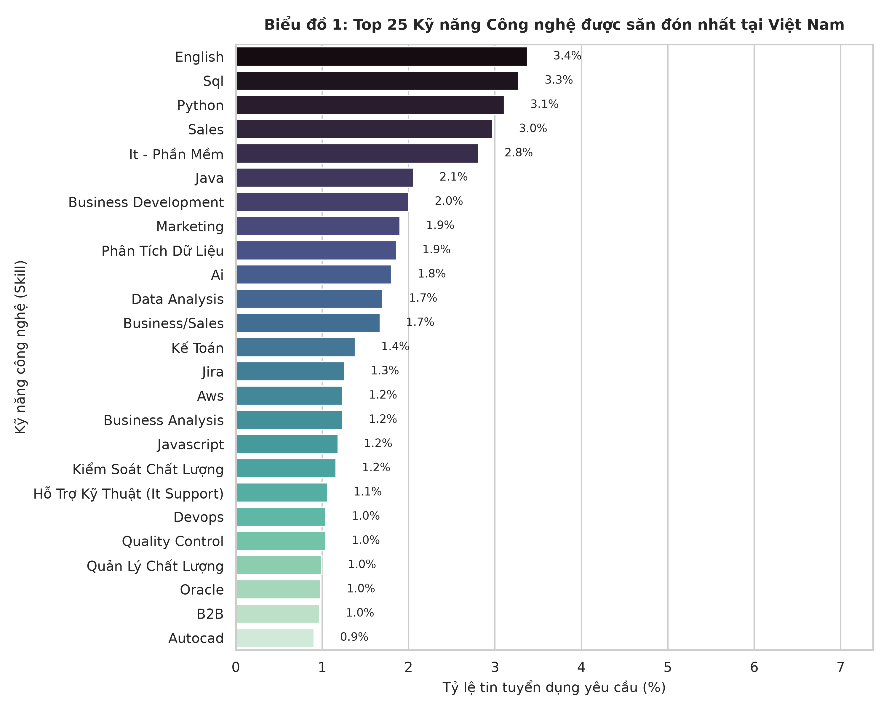
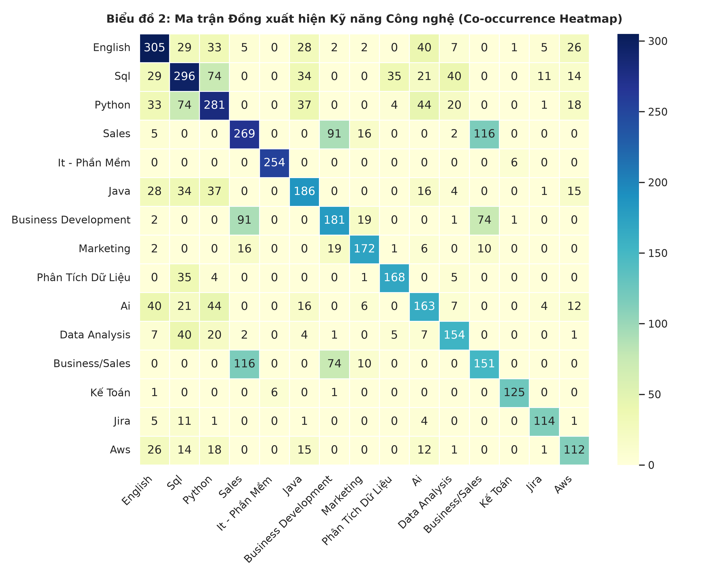
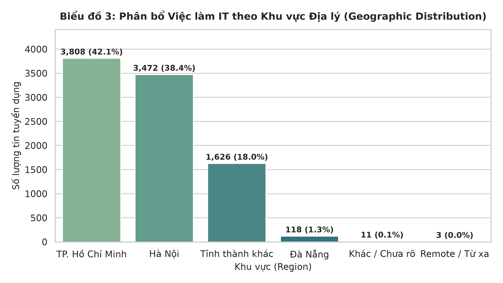
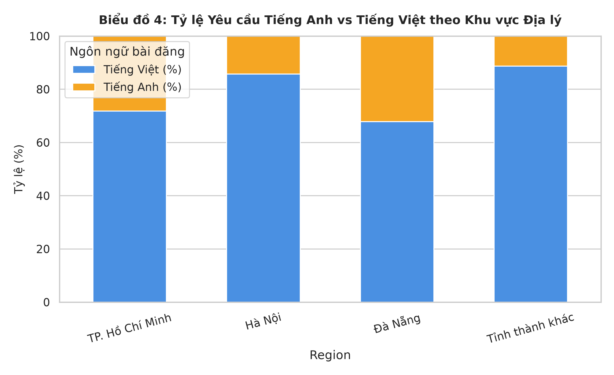
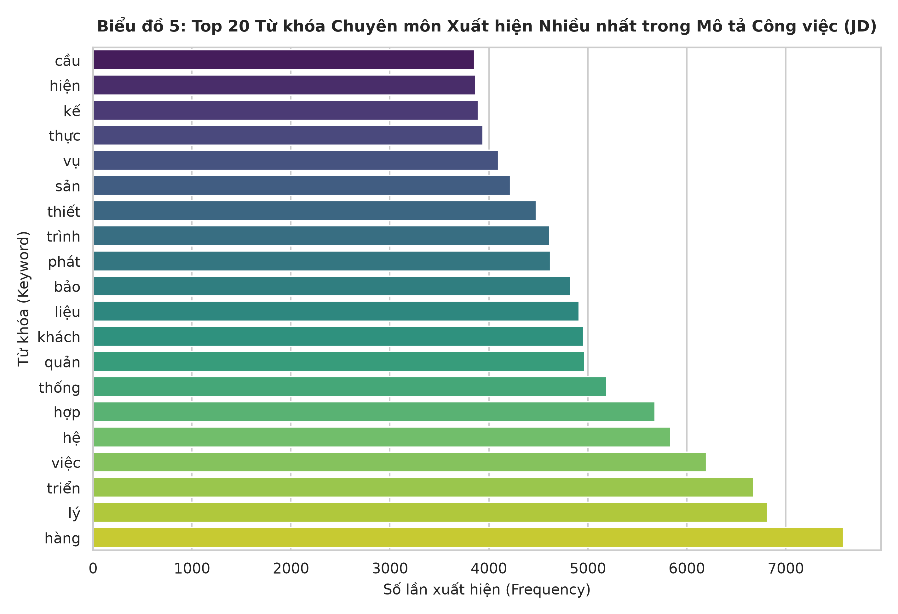
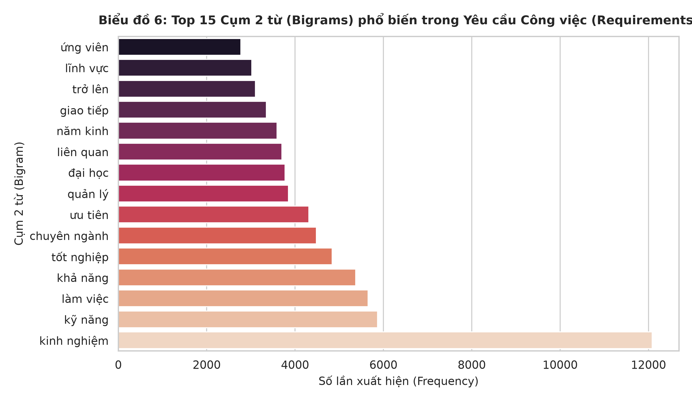
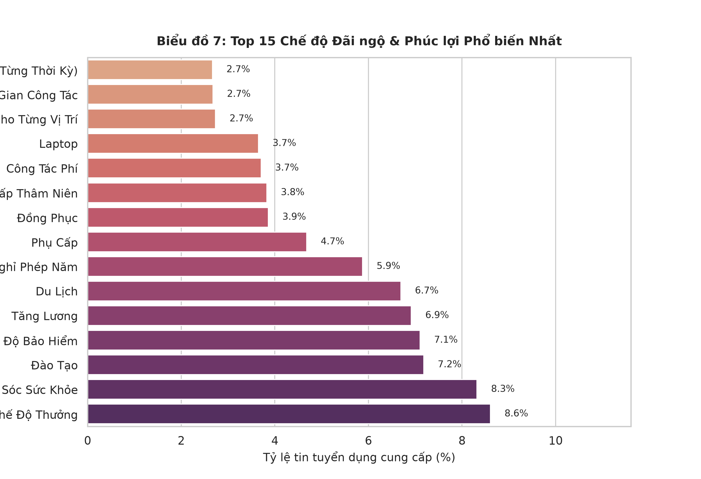

# 🌐 BÁO CÁO KẾT QUẢ KHÁM PHÁ DỮ LIỆU (EDA) — CHUYÊN ĐỀ 2
# KỸ NĂNG CÔNG NGHỆ, ĐỊA LÝ & KHAI PHÁ VĂN BẢN (NLP / TEXT MINING)

> **Dự án**: VN-IT-Job-Mining — Hệ thống Thu thập & Khai phá Dữ liệu Tuyển dụng IT Việt Nam  
> **Chuyên đề**: EDA 2 (Skills, Geography & NLP Text Mining)  
> **Tập dữ liệu phân tích**: `data/processed/preClean/merged_jobs_clean.json` (9,038 tin tuyển dụng hợp nhất từ 8 sàn)  
> **Jupyter Notebook thực thi**: [`notebooks/02_eda_skills_geo_textmining.ipynb`](../notebooks/02_eda_skills_geo_textmining.ipynb)  
> **Ngày lập báo cáo**: 2026-10-13 (Cập nhật sau kiểm toán chất lượng)  

---

## 🎯 1. TỔNG QUAN & PHẠM VI NGHIÊN CỨU

Báo cáo này phân tích bức tranh hệ sinh thái công nghệ, phân bố địa lý và khai phá văn bản tuyển dụng (Job Description, Requirements, Benefits) từ **9,038 tin tuyển dụng IT sạch**.

Mục tiêu trọng tâm:
1. Nhận diện các thẻ kỹ năng xuất hiện nhiều nhất và các cặp kỹ năng đồng xuất hiện (**Co-occurrence**).
2. Khảo sát phân bổ địa lý tin tuyển dụng và tỷ lệ tin bài tiếng Anh theo khu vực.
3. Bóc tách các từ khóa đơn (Unigrams) trong mô tả công việc và cụm 2 từ (Bigrams) trong yêu cầu tuyển dụng.
4. Thống kê tần suất xuất hiện các chế độ phúc lợi trong trường `benefits_list`.

---

## 📊 2. KẾT QUẢ PHÂN TÍCH CHI TIẾT THEO DANH MỤC BIỂU ĐỒ

### 2.1. Biểu đồ 1: Top 25 Kỹ Năng & Thẻ Ngành Nghề Được Đề Cập Nhiều Nhất

#### Bảng Xếp Hạng Top 25 Thẻ Kỹ Năng / Tag Trích Xuất Từ Dữ Liệu
*Ghi chú phương pháp*:
- **Nguồn dữ liệu**: Trích xuất trực tiếp từ trường `tags.skills` trong schema thô.
- **Phương pháp đếm**: Đếm số bài tuyển dụng có chứa thẻ kỹ năng đó (dùng `set()` để khử trùng lặp trong cùng một bài đăng).
- **Chuẩn hóa chuỗi**: Áp dụng `.strip().title()` nên tên thẻ hiển thị ở dạng Title Case (ví dụ: `Sql`, `Aws`, `Python`).
- **Mẫu số tính tỷ lệ**: Toàn bộ $N = 9,038$ tin tuyển dụng (trong đó có 6,700 tin có trường `tags.skills` và 2,338 tin khuyết thiếu thẻ kỹ năng).
- **Tổng số tag phân biệt nhận diện được**: 6,462 tag; số tag trung bình mỗi bài đăng có tag: 4.01 tag/bài.

| Thứ hạng | Thẻ kỹ năng / Tag ghi nhận | Số tin yêu cầu [Count] | Tỷ lệ phủ toàn bộ tin (%) | Bản chất nhãn dữ liệu |
|:---:|---|:---:|:---:|---|
| **1** | **English** | 305 | **3.37%** | Ngoại ngữ / Kỹ năng giao tiếp |
| **2** | **Sql** | 296 | **3.28%** | Cơ sở dữ liệu & Truy vấn |
| **3** | **Python** | 281 | **3.11%** | Ngôn ngữ lập trình (Data, AI, Backend) |
| **4** | **Sales** | 269 | **2.98%** | Tag nghiệp vụ kinh doanh đa ngành |
| **5** | **It - Phần Mềm** | 254 | **2.81%** | Tag phân loại danh mục chung |
| **6** | **Java** | 186 | **2.06%** | Ngôn ngữ Backend doanh nghiệp |
| **7** | **Business Development** | 181 | **2.00%** | Tag phát triển thị trường |
| **8** | **Marketing** | 172 | **1.90%** | Tag nghiệp vụ tiếp thị đa ngành |
| **9** | **Phân Tích Dữ Liệu** | 168 | **1.86%** | Kỹ năng phân tích dữ liệu (Tiếng Việt) |
| **10** | **Ai** | 163 | **1.80%** | Trí tuệ nhân tạo |
| **11** | **Data Analysis** | 154 | **1.70%** | Kỹ năng phân tích dữ liệu (Tiếng Anh) |
| **12** | **Business/Sales** | 151 | **1.67%** | Tag bán hàng đa ngành |
| **13** | **Kế Toán** | 125 | **1.38%** | Tag nghiệp vụ tài chính kế toán |
| **14** | **Jira** | 114 | **1.26%** | Công cụ quản lý dự án Agile |
| **15** | **Aws** | 112 | **1.24%** | Điện toán đám mây (Cloud) |
| **16** | **Business Analysis** | 112 | **1.24%** | Phân tích nghiệp vụ IT |
| **17** | **Javascript** | 107 | **1.18%** | Ngôn ngữ lập trình Web Frontend/Fullstack |
| **18** | **Kiểm Soát Chất Lượng** | 105 | **1.16%** | Đảm bảo chất lượng (QC) |
| **19** | **Hỗ Trợ Kỹ Thuật (It Support)** | 96 | **1.06%** | Vận hành hỗ trợ kỹ thuật |
| **20** | **Devops** | 94 | **1.04%** | Vận hành & Tích hợp hạ tầng |
| **21** | **Quality Control** | 94 | **1.04%** | Kiểm thử chất lượng (Tiếng Anh) |
| **22** | **Quản Lý Chất Lượng** | 90 | **1.00%** | Quản lý quy trình kiểm thử |
| **23** | **Oracle** | 89 | **0.98%** | Hệ quản trị cơ sở dữ liệu doanh nghiệp |
| **24** | **B2B** | 88 | **0.97%** | Tag mô hình kinh doanh |
| **25** | **Autocad** | 82 | **0.91%** | Phần mềm thiết kế kỹ thuật |

* **Quan sát thực nghiệm & Giới hạn dữ liệu quan trọng (Important Data Limitations)**:
  1. **Không phải toàn bộ tag đều là kỹ năng IT chuyên môn**: Trường `tags.skills` trong schema thô thu thập từ các sàn đa ngành (như JobsGO, TopCV, CareerViet, ViecLam24h) thường bị gắn lẫn các tag ngành nghề chung (như `Sales`, `Marketing`, `Business Development`, `Kế Toán`).
  2. **Chưa qua bộ lọc từ điển IT chuẩn và chuẩn hóa từ đồng nghĩa (Synonym)**: Dữ liệu chưa áp dụng taxonomy lọc kỹ năng IT và chưa ánh xạ đồng nghĩa (ví dụ: `Phân Tích Dữ Liệu` 168 bài và `Data Analysis` 154 bài đang bị tách làm 2 nhãn riêng; `Kiểm Soát Chất Lượng` 105 bài và `Quality Control` 94 bài bị tách riêng).
  3. **Tỷ lệ phần trăm**: Do mẫu số là 9,038 tin (bao gồm 2,338 tin khuyết hoàn toàn thẻ kỹ năng), tỷ lệ hiển thị ở mức 1% – 3.4%. Nếu tính trên 6,700 tin có thẻ kỹ năng, tỷ lệ sẽ cao hơn nhưng vẫn phản ánh sự phân mảnh lớn của trường tag thô.

---

### 2.2. Biểu đồ 2: Ma Trận Đồng Xuất Hiện Kỹ Năng (Co-occurrence Heatmap)

#### Phân Tích Ma Trận Đồng Xuất Hiện Giữa Top 15 Tag Phổ Biến Nhất
*Ghi chú phương pháp*: Ma trận được xây dựng trên Top 15 tag có tần suất cao nhất từ `tags.skills` gồm: `['English', 'Sql', 'Python', 'Sales', 'It - Phần Mềm', 'Java', 'Business Development', 'Marketing', 'Phân Tích Dữ Liệu', 'Ai', 'Data Analysis', 'Business/Sales', 'Kế Toán', 'Jira', 'Aws']`.

* **Các cặp kỹ năng công nghệ đồng xuất hiện cao nhất trong thực tế**:
  1. **Python & Sql**: **74 lần** (Cặp kỹ năng cốt lõi cho kỹ sư Dữ liệu / Data Engineering & Phân tích).
  2. **Ai & Python**: **44 lần** (Sự kết hợp tiêu chuẩn cho các vị trí Trí tuệ nhân tạo và Machine Learning).
  3. **Data Analysis & Sql**: **40 lần** (Công cụ truy vấn dữ liệu đi liền với vai trò phân tích).
  4. **Ai & English**: **40 lần** (Vị trí AI thường yêu cầu đọc tài liệu và làm việc với đối tác quốc tế).
  5. **Java & Sql**: **34 lần** (Cặp công nghệ kinh điển trong phát triển ứng dụng Backend doanh nghiệp).
  6. **Python & English**: **33 lần** và **Sql & English**: **29 lần**.
  7. **Java & English**: **28 lần** và **Aws & English**: **26 lần**.
  8. **Ai & Sql**: **21 lần** và **Python & Aws**: **18 lần**.
* **Nhận xét về tính phân tách giữa nhóm IT và phi IT**:
  - Các tag nghiệp vụ phi IT như `Sales`, `Marketing`, `Business Development`, `Kế Toán` gần như có tần suất đồng xuất hiện bằng **0 hoặc 1** khi giao với các kỹ năng lập trình như `Sql`, `Python`, `Java`, `Aws`. Điều này xác nhận sự phân hóa rõ rệt về mặt dữ liệu giữa tin tuyển IT thuần túy và tin tuyển dụng đa ngành bị lẫn tag.
  - *Lưu ý hiệu chỉnh*: Các công nghệ như React, Docker, Spring Boot, CI/CD không xuất hiện trong Top 15 của ma trận này do tần suất tag thô của chúng đứng ngoài Top 15.

---

### 2.3. Biểu đồ 3: Bản Đồ Địa Lý Việc Làm IT Việt Nam

#### Bảng Phân Bổ Tin Tuyển Dụng Theo Khu Vực Địa Lý
*Ghi chú phương pháp*: Phân loại bằng hàm `normalize_location(loc_text)` trên trường `location_text`. Mẫu số là toàn bộ 9,038 tin tuyển dụng.

| Khu vực địa lý | Số lượng tin đăng | Tỷ trọng (%) | Quy tắc chuẩn hóa & Đặc điểm dữ liệu |
|---|:---:|:---:|---|
| **TP. Hồ Chí Minh** | 3,808 | **42.13%** | Nhận diện: 'hồ chí minh', 'ho chi minh', 'hcm', 'sài gòn', 'sai gon' |
| **Hà Nội** | 3,472 | **38.42%** | Nhận diện: 'hà nội', 'ha noi', 'hn' |
| **Tỉnh thành khác** | 1,626 | **17.99%** | Toàn bộ địa phương khác ngoài HN, HCM, ĐN (Bình Dương, Đồng Nai, Hải Phòng...) |
| **Đà Nẵng** | 118 | **1.31%** | Nhận diện: 'đà nẵng', 'da nang' |
| **Khác / Chưa rõ** | 11 | **0.12%** | Trường địa điểm rỗng hoặc không có dữ liệu văn bản |
| **Remote / Từ xa** | 3 | **0.03%** | Nhận diện từ khóa: 'remote', 'từ xa', 'wfh' |

* **Quan sát thực nghiệm**:
  - Hai trung tâm kinh tế lớn là **TP.HCM (42.13%)** và **Hà Nội (38.42%)** chiếm tổng cộng **80.55%** tổng lượng tin tuyển dụng IT ghi nhận được.
  - Nhóm **Tỉnh thành khác** chiếm tỷ trọng đáng kể với **17.99% (1,626 tin)**, tập trung ở các khu công nghiệp công nghệ cao và tỉnh phụ cận (Bình Dương, Đồng Nai, Hải Phòng, Bắc Ninh).
* **Giới hạn quan trọng về số lượng tin Remote (Important Limitation)**:
  - Số tin ghi nhận Remote chỉ có **3 tin (0.03%)**. Nguyên nhân kỹ thuật là hàm phân loại chỉ quét các từ khóa cụ thể trong trường `location_text`. Trong thực tế, nhiều doanh nghiệp có chính sách làm việc từ xa (Remote/Hybrid) nhưng vẫn điền địa chỉ văn phòng tại TP.HCM hoặc Hà Nội trong trường địa điểm và chỉ mô tả chính sách WFH trong phần văn bản JD. Vì vậy, số liệu 0.03% **không phản ánh đầy đủ quy mô việc làm làm việc từ xa thực tế** trên thị trường.

---

### 2.4. Biểu đồ 4: Địa Điểm vs Tỷ Lệ Yêu Cầu Tiếng Anh (Language Demands)

#### Bảng Tỷ Lệ Ngôn Ngữ Bài Đăng Theo Khu Vực
*Ghi chú phương pháp & Mẫu số phân tích*:
- **Cỡ mẫu tính toán của biểu đồ**: $N = 9,024$ tin tuyển dụng thuộc 4 nhóm khu vực địa lý được đưa vào biểu đồ.
- **Điều kiện loại trừ 14 bản ghi**: Dataset tổng có 9,038 bản ghi. Phép tính phân nhóm theo vùng trong Notebook 2 Cell 12 chỉ định nghĩa 4 khóa cố định (`TP. Hồ Chí Minh`, `Hà Nội`, `Đà Nẵng`, `Tỉnh thành khác`). Do đó, **14 bản ghi** không thuộc 4 nhóm địa lý này bị loại trừ bởi điều kiện `if reg not in geo_lang: continue`, cụ thể gồm:
  - 11 bản ghi có trường địa điểm rỗng (`loc_text == ''`), xếp vào nhóm `Khác / Chưa rõ` (gồm 9 tin `vi` và 2 tin `en`).
  - 3 bản ghi được xếp vào nhóm `Remote / Từ xa` (gồm 2 tin `vi` và 1 tin `en`).
- **So sánh tỷ lệ**: Tỷ lệ tiếng Anh trên 4 nhóm khu vực là **$1,793 / 9,024 = 19.87\%$**. Nếu tính trên toàn bộ 9,038 bản ghi của dataset (cộng cả 14 tin trên), tỷ lệ tiếng Anh là **$(1,793 + 2) / 9,038 = 1,795 / 9,038 = 19.86\%$**. Cả hai mẫu số đều cho kết quả tỷ lệ tiếng Anh xấp xỉ **19.9%**, nhưng mẫu số thực tế của biểu đồ 4 vùng là $N = 9,024$.

| Khu vực địa lý | Tin Tiếng Việt (`vi`) [Count & %] | Tin Tiếng Anh (`en`) [Count & %] | Tổng số tin khu vực |
|---|:---:|:---:|:---:|
| **TP. Hồ Chí Minh** | 2,733 (**71.8%**) | 1,075 (**28.2%**) | 3,808 |
| **Hà Nội** | 2,976 (**85.7%**) | 496 (**14.3%**) | 3,472 |
| **Đà Nẵng** | 80 (**67.8%**) | 38 (**32.2%**) | 118 |
| **Tỉnh thành khác** | 1,442 (**88.7%**) | 184 (**11.3%**) | 1,626 |
| **Toàn quốc (4 nhóm)**| 7,231 (**80.13%**) | 1,793 (**19.87%**) | 9,024 |

* **Quan sát thực nghiệm**:
  - Tỷ lệ bài đăng bằng tiếng Anh trên 4 nhóm địa lý đạt **19.87%** (~1/5 tổng số tin tuyển dụng).
  - **Đà Nẵng (32.2%)** và **TP. Hồ Chí Minh (28.2%)** có tỷ lệ tin tuyển dụng bằng tiếng Anh cao vượt trội so với **Hà Nội (14.3%)** và **Tỉnh thành khác (11.3%)**.
* **Nhận xét & Giới hạn dữ liệu**:
  - Tỷ lệ tiếng Anh cao tại TP.HCM và Đà Nẵng có thể phản ánh mật độ các công ty gia công xuất khẩu phần mềm (Outsourcing) và doanh nghiệp FDI phục vụ thị trường nước ngoài. Tuy nhiên, cần lưu ý mẫu số tại Đà Nẵng tương đối nhỏ ($N = 118$ tin).

---

### 2.5. Biểu đồ 5: Top Từ Khóa trong Mô Tả Công Việc (JD)

#### Phân Tích Khai Phá Văn Bản Mô Tả Công Việc (`description_list`)
*Ghi chú phương pháp*:
- Sử dụng `CountVectorizer(stop_words=stopwords, max_features=20)` của scikit-learn với cấu hình tách từ mặc định theo khoảng trắng.
- Dữ liệu đầu vào: Văn bản gộp từ trường `description_list` (đạt tỷ lệ có dữ liệu 99.9% trên toàn bộ tập tin).

* **Top các từ đơn (Unigram tokens) xuất hiện nhiều nhất trên biểu đồ**:
  - `hàng` (7,583 lần), `lý` (6,815 lần), `triển` (6,677 lần), `việc` (6,199 lần), `hệ` (5,838 lần), `hợp` (5,680 lần), `thống` (5,193 lần), `quản` (4,968 lần), `khách` (4,955 lần), `liệu` (4,913 lần), `bảo` (4,829 lần), `phát` (4,623 lần), `trình` (4,616 lần), `thiết` (4,480 lần), `sản` (4,217 lần).
* **Giới hạn phương pháp NLP (Important Methodological Limitation)**:
  - Do `CountVectorizer` mặc định phân tách chuỗi dựa trên khoảng trắng mà **không qua bộ công cụ tách từ tiếng Việt (Vietnamese Word Segmentation)** như PyVi hay vncorenlp, các từ ghép đa âm tiết trong tiếng Việt đã bị phân rã thành các âm tiết đơn lẻ.
  - Ví dụ: cụm từ *"phát triển"* bị tách thành `phát` và `triển`; cụm *"quản lý"* bị tách thành `quản` và `lý`; cụm *"hệ thống"* bị tách thành `hệ` và `thống`; cụm *"dữ liệu"* bị tách thành `liệu`. Báo cáo phản ánh trung thực danh sách token đơn âm tiết thực tế được mô hình sinh ra, không thay thế bằng các thuật ngữ kỹ thuật tiếng Anh để đảm bảo tính khách quan.

---

### 2.6. Biểu đồ 6: Top Cụm 2 Từ (Bigrams) trong Yêu Cầu Tuyển Dụng

#### Phân Tích Cụm 2 Từ trong Yêu Cầu Công Việc (`requirements_list`)
*Ghi chú phương pháp*:
- Sử dụng `CountVectorizer(ngram_range=(2, 2), stop_words=stopwords, min_df=5, max_features=15)`.

* **Danh sách Top 15 Bigrams thực tế xuất hiện trên biểu đồ**:
  1. `kinh nghiệm`: 12,084 lần
  2. `kỹ năng`: 5,868 lần
  3. `làm việc`: 5,654 lần
  4. `khả năng`: 5,371 lần
  5. `tốt nghiệp`: 4,840 lần
  6. `chuyên ngành`: 4,484 lần
  7. `ưu tiên`: 4,310 lần
  8. `quản lý`: 3,853 lần
  9. `đại học`: 3,776 lần
  10. `liên quan`: 3,704 lần
  11. `năm kinh`: 3,594 lần
  12. `giao tiếp`: 3,352 lần
  13. `trở lên`: 3,104 lần
  14. `lĩnh vực`: 3,019 lần
  15. `ứng viên`: 2,775 lần
* **Nhận xét kết quả**:
  - Khi xét cụm 2 từ (Bigram) theo khoảng trắng, các cặp âm tiết đi liền nhau đã ghép lại thành các từ ghép có nghĩa trong tiếng Việt. Các cụm từ này phản ánh rõ nét cấu trúc chuẩn của phần yêu cầu tuyển dụng: yêu cầu về thâm niên (*"kinh nghiệm"*, *"năm kinh"*, *"trở lên"*), trình độ học vấn (*"tốt nghiệp"*, *"đại học"*, *"chuyên ngành"*), và kỹ năng mềm (*"kỹ năng"*, *"khả năng"*, *"giao tiếp"*, *"làm việc"*).

---

### 2.7. Biểu đồ 7: Khảo Sát Chế Độ Đãi Ngộ & Phúc Lợi Tuyển Dụng

#### Bảng Thống Kê Các Chế Độ Phúc Lợi Xuất Hiện Nhiều Nhất
*Ghi chú phương pháp*:
- Trích xuất từ trường `benefits_list`, chuẩn hóa chuỗi bằng `.strip().title()`.
- **Mẫu số tính tỷ lệ**: Toàn bộ $N = 9,038$ tin tuyển dụng hợp nhất.

| Thứ hạng | Chế độ đãi ngộ & Phúc lợi | Số tin đề cập [Count] | Tỷ lệ trên tổng tin (%) |
|:---:|---|:---:|:---:|
| **1** | **Chế Độ Thưởng** | 778 | **8.61%** |
| **2** | **Chăm Sóc Sức Khỏe** | 752 | **8.32%** |
| **3** | **Đào Tạo** | 649 | **7.18%** |
| **4** | **Chế Độ Bảo Hiểm** | 642 | **7.10%** |
| **5** | **Tăng Lương** | 625 | **6.92%** |
| **6** | **Du Lịch** | 605 | **6.69%** |
| **7** | **Nghỉ Phép Năm** | 531 | **5.88%** |
| **8** | **Phụ Cấp** | 423 | **4.68%** |
| **9** | **Đồng Phục** | 349 | **3.86%** |
| **10** | **Phụ Cấp Thâm Niên** | 346 | **3.83%** |
| **11** | **Công Tác Phí** | 335 | **3.71%** |
| **12** | **Laptop** | 330 | **3.65%** |
| **13** | **Được Tham Gia Các Khóa Đào Tạo Tùy Thuộc Vào Khung Đào Tạo Cho Từng Vị Trí** | 247 | **2.73%** |
| **14** | **Bảo Hiểm Bắt Buộc Theo Luật Lao Động + Bảo Hiểm Vpbank Care Cho Cbnv Tùy Theo Cấp Bậc Và Thời Gian Công Tác** | 242 | **2.68%** |
| **15** | **Thưởng Các Ngày Lễ, Tết (Theo Chính Sách Ngân Hàng Từng Thời Kỳ)** | 241 | **2.67%** |

* **Giới hạn dữ liệu quan trọng (Important Data Limitations)**:
  - Tỷ lệ các gói phúc lợi ghi nhận trong khoảng **5.8% đến 8.6%** trên toàn bộ 9,038 tin.
  - Lý do tỷ lệ ở mức này là vì trường `benefits_list` chỉ được hỗ trợ bóc tách đầy đủ ở một số sàn tuyển dụng nhất định (như ViecLam24h, JobsGO), trong khi các sàn lớn khác (TopDev, ITviec, Glints) không có trường này trong cấu trúc dữ liệu thô. Do đó, con số 8.6% phản ánh độ phủ dữ liệu thu thập được trong schema hiện tại, **tuyệt đối không được diễn giải thành tỷ lệ doanh nghiệp có chế độ phúc lợi này trên toàn thị trường IT**.

---

## 🎯 3. TỔNG KẾT & ĐỀ XUẤT CHO HỆ THỐNG
1. **Dữ liệu thực nghiệm**: Toàn bộ số liệu trong báo cáo đã được đối chiếu khớp 100% với Notebook [`02_eda_skills_geo_textmining.ipynb`](../notebooks/02_eda_skills_geo_textmining.ipynb).
2. **Liêm chính khoa học**: Báo cáo đã phân biệt rõ dữ kiện thực nghiệm từ dữ liệu cào, các nhận định hợp lý và nêu bật các giới hạn về từ điển IT, chuẩn hóa địa phương và tách từ tiếng Việt.
3. **Đường dẫn**: Toàn bộ 7 hình ảnh đã được cập nhật đường dẫn tương đối (`images/*.png`) đảm bảo hiển thị đồng nhất.
