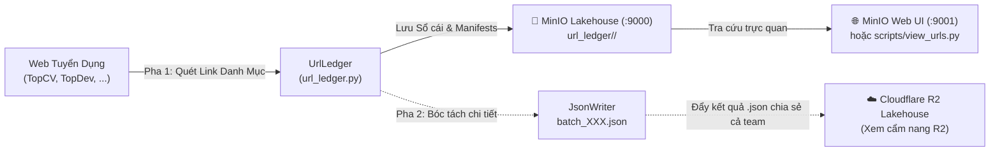
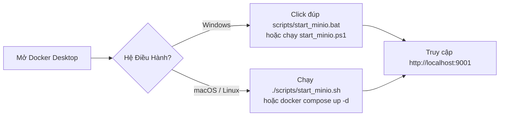

# 📘 Hướng Dẫn Cài Đặt & Sử Dụng MinIO Object Storage Cho Team (VN-IT-Job-Mining)

---

## 1. 🌟 Tổng Quan Về MinIO Trong Dự Án

Trong kiến trúc **Modern Data Stack** của dự án **VN-IT-Job-Mining**, nhóm phân định rạch ròi 2 hạ tầng lưu trữ đối tượng:
- **MinIO (Local Object Storage Lakehouse)**: Chuyên dùng làm **Sổ Cái Quản Lý & Lưu Trữ URL Tuyển Dụng (Phase 1: URL Discovery & URL Ledger)** trên máy cá nhân, đảm bảo tốc độ cào nhanh, không tốn băng thông internet và bảo toàn nguyên trạng link bài đăng (`Zero Information Loss`).
- **Cloudflare R2 (Remote Cloud Data Lakehouse)**: Chuyên dùng làm **Kho Lưu Trữ Kết Quả `.json` Tập Trung** (Phase 2 Detail batches, bộ mẫu `samples/`, và deliverables) để chia sẻ cho cả nhóm làm EDA, tiền xử lý và tích hợp AI/ML.



**MinIO** là hệ thống lưu trữ đối tượng mã nguồn mở đạt chuẩn **Amazon S3 API**. Nhóm sử dụng MinIO trên máy cục bộ để:
- **Vét sạch và up link không giới hạn**: Lưu trữ hàng chục ngàn URL việc làm IT, phân vùng theo từng ngày phát hiện (`manifest_YYYY-MM-DD.jsonl`).
- **Chống trùng lặp & Re-crawl 21 ngày**: Kiểm soát trạng thái `PENDING`, `DONE`, `RECHECK_DUE`, `FAILED`, `CLOSED`.
- **Xem trực quan qua Web UI**: Bất kỳ thành viên nào cũng có thể mở trình duyệt xem cây thư mục, tải file và kiểm tra trạng thái cào theo thời gian thực tại cổng `:9001`.

---

## 2. 🚀 Hướng Dẫn Khởi Chạy 1-Lệnh Theo Từng Hệ Điều Hành

Dự án đã đóng gói sẵn toàn bộ cấu hình MinIO bằng **Docker Compose**. Bạn chỉ cần chọn cách khởi chạy phù hợp với máy của mình:



### A. Dành cho Windows (Đơn giản nhất)
1. **Bước 1**: Đảm bảo ứng dụng **Docker Desktop** đã được mở (biểu tượng cá voi màu xanh góc phải thanh Taskbar).
2. **Bước 2**: Có 2 cách chạy:
   - **Cách 1 (Click chuột)**: Vào thư mục `scripts/` và click đúp chuột vào file **`start_minio.bat`**.
   - **Cách 2 (PowerShell)**: Mở PowerShell tại thư mục gốc dự án và gõ:
     ```powershell
     .\scripts\start_minio.ps1
     ```

### B. Dành cho macOS (MacBook M-series & Intel)
1. Mở ứng dụng **Docker Desktop**.
2. Mở Terminal tại thư mục dự án và chạy:
   ```bash
   ./scripts/start_minio.sh
   ```
   *(Hoặc gõ trực tiếp: `docker compose up -d`)*

### C. Dành cho Linux (Ubuntu / Debian / Fedora)
1. Đảm bảo dịch vụ Docker đang chạy:
   ```bash
   sudo systemctl start docker
   ```
2. Chạy script khởi động:
   ```bash
   ./scripts/start_minio.sh
   ```

---

## 3. 🌐 Cách Đăng Nhập & Sử Dụng Giao Diện MinIO Web Console

Sau khi chạy xong script ở mục 2, hệ thống MinIO đã hoạt động ngay trên máy của bạn:

1. **Mở trình duyệt Web**: Truy cập đường dẫn **[http://localhost:9001](http://localhost:9001)**.
2. **Thông tin đăng nhập mặc định**:
   - **Username**: `minioadmin`
   - **Password**: `minioadmin`

3. **Cấu trúc dữ liệu trong Bucket `vn-it-jobs`**:
   - `url_ledger/<source>/catalog_master.json`: Toàn bộ sổ cái URL việc làm IT đã phát hiện (ví dụ: hơn 2.700 bài đăng của TopCV).
   - `url_ledger/<source>/manifests/manifest_YYYY-MM-DD.jsonl`: Danh sách link phát hiện theo từng ngày.
   - `raw/<source>/`: Chứa các file HTML và JSON thô nguyên bản (`Raw As-Is`).
   - `staging/`: Dữ liệu đã làm sạch cơ bản chuẩn bị nạp vào pipeline.
   - `curated/`: Dữ liệu phân tích cuối cùng.

4. **Cách xem và tải file trên Web Console**:
   - Bấm vào tên bucket `vn-it-jobs`.
   - Điều hướng vào thư mục muốn xem (ví dụ: `url_ledger` $\to$ `topcv`).
   - Nhấp vào file để xem chi tiết kích thước, thời gian tạo, hoặc bấm nút **Download** để tải về máy.

---

## 4. 🔗 Hướng Dẫn Up Link & Quản Lý Sổ Cái URL Tuyển Dụng (Phase 1: URL Discovery)

Đây là chức năng cốt lõi của **MinIO** trong dự án: **Up link, lưu trữ sổ cái và chống trùng lặp URL**.

### 4.1. Quy trình Up Link diễn ra như thế nào?

Khi bạn chạy lệnh thu thập Pha 1 (`discover`):
1. Crawler duyệt qua các trang danh mục việc làm CNTT của sàn.
2. **Làm sạch Canonical URL**: Loại bỏ toàn bộ query rác và tracking (`utm_*`, `fbclid`, token phiên) để tạo URL duy nhất.
3. **Băm MD5 (`url_hash`)**: Làm khóa chính trong sổ cái.
4. **Lưu vào Sổ Cái (`catalog_master.json`) & Manifest ngày (`manifest_YYYY-MM-DD.jsonl`)**:
   - Ghi nhận `preliminary_title`, `preliminary_company`, `discovered_at`, trạng thái ban đầu là `PENDING`.
5. **Tự động Up Link lên MinIO**: Cứ mỗi 5 trang danh mục hoặc khi kết thúc cào, crawler tự động gọi `ledger.sync_to_minio()` đẩy toàn bộ danh sách lên MinIO bucket `vn-it-jobs/url_ledger/<source>/`.

### 4.2. Lệnh cào quét link (URL Discovery) cho từng sàn:

```bash
# Kích hoạt môi trường
source .venv/bin/activate

# 1. Quét link nguồn TopCV
python run.py --source topcv --phase discover

# 2. Quét link nguồn TopDev
python run.py --source topdev --phase discover

# 3. Quét link nguồn VietnamWorks (hoặc các nguồn khác)
python run.py --source vietnamworks --phase discover
```

*(Bạn cũng có thể giới hạn số trang quét thử nghiệm: `python run.py --source topcv --phase discover --max-pages 3`)*

### 4.3. Cách kiểm tra danh sách link đã lưu trên MinIO

Sau khi cào xong, bạn có 2 cách để kiểm tra ngay lập tức:

#### Cách 1: Xem bằng lệnh dòng lệnh CLI (Khuyên dùng)
Dự án có sẵn script `scripts/view_urls.py` hỗ trợ tra cứu trực tiếp từ MinIO:
```bash
# Xem 20 link mới nhất đã lưu trên MinIO của TopCV
python scripts/view_urls.py --source topcv --minio --limit 20

# Xem các link đang ở trạng thái chờ cào chi tiết (PENDING)
python scripts/view_urls.py --source topcv --minio --status PENDING --limit 15

# Xem thống kê tổng quan (tổng số link, số link PENDING, DONE, FAILED)
python scripts/view_urls.py --source topcv --minio --stats
```

#### Cách 2: Xem trực tiếp trên MinIO Web Console UI
1. Mở `http://localhost:9001` và đăng nhập (`minioadmin` / `minioadmin`).
2. Vào **Buckets** $\to$ **`vn-it-jobs`** $\to$ **`url_ledger`** $\to$ **`<tên_sàn>`**.
3. Bạn sẽ thấy 2 mục:
   - `catalog_master.json`: Sổ cái toàn diện chứa toàn bộ các link đã băm.
   - `manifests/`: Thư mục chứa các file `manifest_YYYY-MM-DD.jsonl` ghi nhận các link phát hiện theo từng ngày.

### 4.4. Độc lập lưu trữ: MinIO vs Cloudflare R2

> [!IMPORTANT]
> **Ghi nhớ phân định cho team:**
> - **Up link và lưu Sổ cái URL**: Dùng **MinIO** (theo hướng dẫn ở mục 4 này).
> - **Lưu các file kết quả `.json` (kết quả cào chi tiết, batches, samples)**: Dùng **Cloudflare R2** (theo tài liệu [`docs/cloud_r2_setup_guide.md`](cloud_r2_setup_guide.md)).

---

## 5. 🐍 Cách Lấy & Đọc Dữ Liệu MinIO Bằng Python (Boto3)

Nếu bạn cần viết script Python hoặc Jupyter Notebook để đọc trực tiếp danh sách link từ MinIO:

```python
import io
import json
import boto3
import pandas as pd
from botocore.client import Config

# 1. Khởi tạo S3 Client kết nối tới MinIO cục bộ
s3 = boto3.client(
    "s3",
    endpoint_url="http://localhost:9000",
    aws_access_key_id="minioadmin",
    aws_secret_access_key="minioadmin",
    config=Config(signature_version="s3v4"),
    region_name="us-east-1",
)

# 2. Tải catalog_master.json của nguồn tuyển dụng từ bucket vn-it-jobs
response = s3.get_object(Bucket="vn-it-jobs", Key="url_ledger/topcv/catalog_master.json")
raw_json = json.loads(response["Body"].read().decode("utf-8"))

# 3. Chuyển đổi thành Pandas DataFrame để kiểm tra link
df = pd.DataFrame(list(raw_json.values()))
print(f"Tổng số URL tuyển dụng trong sổ cái MinIO: {len(df)}")
print(df[["job_id", "status", "preliminary_company", "preliminary_title"]].head(10))
```

---

## 6. 🛠️ Kiểm Tra Sức Khỏe & Xử Lý Sự Cố Thường Gặp (Troubleshooting)

### 6.1. Chạy script tự động kiểm tra kết nối:
Dự án đã có sẵn công cụ kiểm tra tự động:
```bash
python scripts/check_minio.py
```
Script sẽ tự động kiểm tra cổng 9000, cổng 9001, xác thực tài khoản và kiểm tra bucket `vn-it-jobs`.

### 6.2. Các lỗi thường gặp và cách xử lý:

| Triệu chứng lỗi | Nguyên nhân | Cách khắc phục |
| :--- | :--- | :--- |
| **`pull access denied for minio/minio`** | Docker Hub đã hạn chế image `minio/minio` | Đảm bảo file `docker-compose.yml` đang dùng image cộng đồng miễn phí: `elestio/minio:latest`. |
| **`Error response from daemon: Ports are not available: 0.0.0.0:9000`** | Cổng 9000 hoặc 9001 bị ứng dụng khác chiếm dụng | Kiểm tra xem có container MinIO cũ đang chạy ngầm không: gõ `docker ps` và `docker stop <container_id>`. |
| **`Cannot connect to the Docker daemon`** | Docker Desktop chưa được bật | Mở ứng dụng Docker Desktop trên máy và đợi biểu tượng báo trạng thái "Running" (xanh lá). |
| **Không thấy bucket `vn-it-jobs` sau khi chạy** | Container `minio-init` chưa chạy xong | Chạy lệnh: `python scripts/check_minio.py` để tự động tạo bucket. |

### 6.3. Cách dừng hoặc dọn dẹp MinIO khi không dùng:
- **Tạm dừng**:
  ```bash
  docker compose stop
  ```
- **Xóa container nhưng giữ nguyên dữ liệu đã cào**:
  ```bash
  docker compose down
  ```
- **Xóa toàn bộ container và xóa trắng dữ liệu để làm lại từ đầu**:
  ```bash
  docker compose down -v
  ```

---

## 7. ⚡ Bảng Tra Cứu Nhanh Cho Team (Cheat-Sheet)

| Thao tác | Câu lệnh thực thi |
| :--- | :--- |
| **Bật MinIO (Docker)** | `make minio-up` *(hoặc chạy `scripts/start_minio.sh` / `.bat`)* |
| **Tắt MinIO** | `make minio-down` |
| **Kiểm tra trạng thái MinIO** | `python scripts/check_minio.py` |
| **Up link TopCV vào MinIO** | `python run.py --source topcv --phase discover` |
| **Up link TopDev vào MinIO** | `python run.py --source topdev --phase discover` |
| **Xem danh sách link trên MinIO** | `python scripts/view_urls.py --source topcv --minio --limit 20` |
| **Mở giao diện Web Console** | Truy cập `http://localhost:9001` (user: `minioadmin` / pass: `minioadmin`) |
| **Đẩy kết quả cào .json lên Cloud R2** | `python scripts/upload_to_r2.py --source <source>` *(Xem cẩm nang R2)* |
