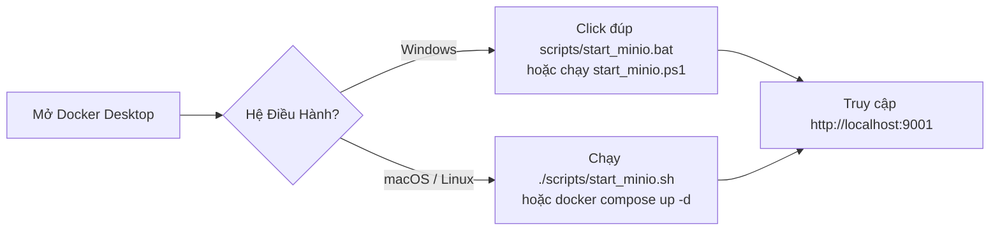

# 📘 Hướng Dẫn Cài Đặt & Sử Dụng MinIO Object Storage Cho Team (VN-IT-Job-Mining)

---

## 1. 🌟 Tổng Quan Về MinIO Trong Dự Án

Trong dự án **VN-IT-Job-Mining**, dữ liệu tuyển dụng cào từ các sàn (TopCV, ITViec, VietnamWorks,...) có khối lượng lớn bao gồm hàng ngàn file HTML thô (`Raw As-Is`), các tệp kiểm kê sổ cái (`URL Ledger`) và dữ liệu bán cấu trúc (`JSON / JSONL`).

**MinIO** là hệ thống lưu trữ đối tượng (Object Storage) mã nguồn mở đạt chuẩn **Amazon S3 API**. Nhóm sử dụng MinIO để:
- **Tập trung hóa dữ liệu (Data Lakehouse)**: Mọi crawler đều đẩy dữ liệu trực tiếp lên bucket chung `vn-it-jobs`.
- **Tránh mất mát dữ liệu (Zero Information Loss)**: Dữ liệu được bảo toàn nguyên trạng, không bị phân mảnh hay thất lạc trên từng máy.
- **Xem trực quan qua Web UI**: Bất kỳ thành viên nào cũng có thể mở trình duyệt xem cây thư mục, tải file và kiểm tra trạng thái cào theo thời gian thực.

---

## 2. 🚀 Hướng Dẫn Khởi Chạy 1-Lệnh Theo Từng Hệ Điều Hành

Dự án đã đóng gói sẵn toàn bộ cấu hình MinIO bằng **Docker Compose**. Bạn chỉ cần chọn cách khởi chạy phù hợp với máy của mình:



### A. Dành cho Windows (Đơn giản nhất)
1. **Bước 1**: Đảm bảo ứng dụng **Docker Desktop** đã được mở (biểu tượng cá voi màu xanh góc phải thanh Taskbar).
2. **Bước 2**: Có 2 cách chạy:
   - **Cách 1 (Click chuột)**: Vào thư mục `scripts/` và click đúp chuột vào file **`start_minio.bat`**.
   - **Cách 2 (PowerShell)**: Mở PowerShell tại thư mục gốc dự án và gõ:
     ```powershell
     .\scripts\start_minio.ps1
     ```

### B. Dành cho macOS (MacBook M-series & Intel)
1. Mở ứng dụng **Docker Desktop**.
2. Mở Terminal tại thư mục dự án và chạy:
   ```bash
   ./scripts/start_minio.sh
   ```
   *(Hoặc gõ trực tiếp: `docker compose up -d`)*

### C. Dành cho Linux (Ubuntu / Debian / Fedora)
1. Đảm bảo dịch vụ Docker đang chạy:
   ```bash
   sudo systemctl start docker
   ```
2. Chạy script khởi động:
   ```bash
   ./scripts/start_minio.sh
   ```

---

## 3. 🌐 Cách Đăng Nhập & Sử Dụng Giao Diện MinIO Web Console

Sau khi chạy xong script ở mục 2, hệ thống MinIO đã hoạt động ngay trên máy của bạn:

1. **Mở trình duyệt Web**: Truy cập đường dẫn **[http://localhost:9001](http://localhost:9001)**.
2. **Thông tin đăng nhập mặc định**:
   - **Username**: `minioadmin`
   - **Password**: `minioadmin`

3. **Cấu trúc dữ liệu trong Bucket `vn-it-jobs`**:
   - `url_ledger/topcv/catalog_master.json`: Toàn bộ sổ cái URL việc làm IT đã phát hiện (ví dụ: hơn 2.700 bài đăng).
   - `url_ledger/topcv/manifests/manifest_YYYY-MM-DD.jsonl`: Danh sách phát hiện theo từng ngày.
   - `raw/<source>/`: Chứa các file HTML và JSON thô nguyên bản (`Raw As-Is`).
   - `staging/`: Dữ liệu đã làm sạch cơ bản chuẩn bị nạp vào pipeline.
   - `curated/`: Dữ liệu phân tích cuối cùng.

4. **Cách tải file hoặc xem trước**:
   - Bấm vào tên bucket `vn-it-jobs`.
   - Điều hướng vào thư mục muốn xem (ví dụ: `url_ledger` $\to$ `topcv`).
   - Nhấp vào file để xem chi tiết kích thước, thời gian tạo, hoặc bấm nút **Download** để tải về máy.

---

## 4. 🐍 Cách Lấy Dữ Liệu MinIO Bằng Python

### 4.1. Xem nhanh báo cáo kiểm kê bằng công cụ dòng lệnh (CLI):
```bash
# Xem 20 bài đăng mới nhất từ MinIO Lakehouse
.venv/bin/python scripts/view_urls.py --source topcv --minio --limit 20
```

### 4.2. Đọc dữ liệu trực tiếp vào Pandas DataFrame:
Bạn có thể dùng đoạn code Python ngắn sau trong notebook hoặc script phân tích:

```python
import io
import json
import boto3
import pandas as pd
from botocore.client import Config

# 1. Khởi tạo S3 Client kết nối tới MinIO cục bộ
s3 = boto3.client(
    "s3",
    endpoint_url="http://localhost:9000",
    aws_access_key_id="minioadmin",
    aws_secret_access_key="minioadmin",
    config=Config(signature_version="s3v4"),
    region_name="us-east-1",
)

# 2. Tải catalog_master.json của TopCV từ bucket vn-it-jobs
response = s3.get_object(Bucket="vn-it-jobs", Key="url_ledger/topcv/catalog_master.json")
raw_json = json.loads(response["Body"].read().decode("utf-8"))

# 3. Chuyển đổi thành Pandas DataFrame để phân tích
df = pd.DataFrame(list(raw_json.values()))
print(f"Tổng số bài đăng tải về: {len(df)}")
print(df[["job_id", "status", "preliminary_company", "preliminary_title"]].head())
```

---

## 5. 🛠️ Kiểm Tra Sức Khỏe & Xử Lý Sự Cố Thường Gặp (Troubleshooting)

### 5.1. Chạy script tự động kiểm tra kết nối:
Dự án đã có sẵn công cụ kiểm tra tự động:
```bash
.venv/bin/python scripts/check_minio.py
```
Script sẽ tự động kiểm tra cổng 9000, cổng 9001, xác thực tài khoản và kiểm tra bucket `vn-it-jobs`.

### 5.2. Các lỗi thường gặp và cách xử lý:

| Triệu chứng lỗi | Nguyên nhân | Cách khắc phục |
| :--- | :--- | :--- |
| **`pull access denied for minio/minio`** | Docker Hub đã hạn chế image `minio/minio` | Đảm bảo file `docker-compose.yml` đang dùng image cộng đồng miễn phí: `elestio/minio:latest`. |
| **`Error response from daemon: Ports are not available: 0.0.0.0:9000`** | Cổng 9000 hoặc 9001 bị ứng dụng khác chiếm dụng | Kiểm tra xem có container MinIO cũ đang chạy ngầm không: gõ `docker ps` và `docker stop <container_id>`. |
| **`Cannot connect to the Docker daemon`** | Docker Desktop chưa được bật | Mở ứng dụng Docker Desktop trên máy và đợi biểu tượng báo trạng thái "Running" (xanh lá). |
| **Không thấy bucket `vn-it-jobs` sau khi chạy** | Container `minio-init` chưa chạy xong | Chạy lệnh: `.venv/bin/python scripts/check_minio.py` để tự động tạo bucket. |

### 5.3. Cách dừng hoặc dọn dẹp MinIO khi không dùng:
- **Tạm dừng**:
  ```bash
  docker compose stop
  ```
- **Xóa container nhưng giữ nguyên dữ liệu đã cào**:
  ```bash
  docker compose down
  ```
- **Xóa toàn bộ container và xóa trắng dữ liệu để làm lại từ đầu**:
  ```bash
  docker compose down -v
  ```
