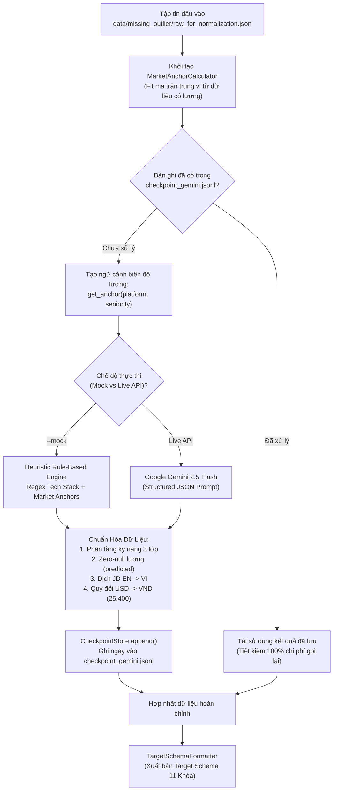

# HƯỚNG DẪN SỬ DỤNG GEMINI PREPROCESSING AGENT & MARKET ANCHOR ENGINE
*(Gemini All-in-One Preprocessing Agent & Resumable Pipeline User Guide)*

> **Tài liệu hướng dẫn vận hành:** `preprocessing/missing_outlier/`  
> **Các module chính:**  
> - [`GeminiAllInOneAgent`](file:///run/media/billtran/Data/Archduker/Study/UTH/Core/DataMining/VN-IT-Job-Mining/preprocessing/missing_outlier/gemini_all_in_one_agent.py): Agent đa nhiệm xử lý kỹ năng, dịch thuật, quy đổi tỷ giá và bù khuyết lương.  
> - [`MarketAnchorCalculator`](file:///run/media/billtran/Data/Archduker/Study/UTH/Core/DataMining/VN-IT-Job-Mining/preprocessing/missing_outlier/market_anchor_calculator.py): Động cơ tính ma trận trung vị lương theo sàn và cấp bậc.  
> - [`CheckpointStore`](file:///run/media/billtran/Data/Archduker/Study/UTH/Core/DataMining/VN-IT-Job-Mining/preprocessing/missing_outlier/checkpoint_store.py): Bộ nhớ đệm append-only JSONL đảm bảo khả năng phục hồi (Resumability).  
> - [`run_gemini_enrichment.py`](file:///run/media/billtran/Data/Archduker/Study/UTH/Core/DataMining/VN-IT-Job-Mining/preprocessing/missing_outlier/run_gemini_enrichment.py): CLI Runner điều phối xử lý theo lô với Worker Pool.

---

## 1. Kiến Trúc Hoạt Động (Architecture Overview)

Quy trình làm giàu dữ liệu bằng AI được tích hợp chặt chẽ theo sơ đồ luồng dưới đây:



---

## 2. Thiết Lập Môi Trường (Environment Setup)

### 2.1. Cài Đặt Thư Viện
Đảm bảo môi trường ảo Python 3.12 đã được kích hoạt và cài đặt đầy đủ phụ thuộc:
```bash
# Kích hoạt virtualenv
source .venv/bin/activate

# Cài đặt thư viện Google GenAI (nếu chưa có)
pip install google-generativeai pydantic pytest
```

### 2.2. Cấu Hình Biến Môi Trường (.env)
Tạo hoặc cập nhật tệp `.env` tại thư mục gốc dự án:
```bash
# Khóa API Google Gemini (bắt buộc khi chạy chế độ Live API)
GEMINI_API_KEY=AIzaSyYourGeminiApiKeyHere

# Mô hình chỉ định (mặc định: gemini-2.5-flash)
GEMINI_MODEL=gemini-2.5-flash

# Cấu hình rate limit an toàn (tránh lỗi 429 ResourceExhausted)
GEMINI_RPM_LIMIT=60
GEMINI_TPM_LIMIT=1000000
```

---

## 3. Các Tính Năng Cốt Lõi Của Agent

### 3.1. Phân Tầng Kỹ Năng 3 Lớp (Tri-Level Skills Extraction)
Thay vì gom toàn bộ từ khóa vào một danh sách phẳng hỗn độn, Agent tự động phân loại:
- `primary_tech_stack`: 1-5 công nghệ cốt lõi nhất (ví dụ: `["python", "fastapi"]`).
- `required_technical`: Các công nghệ, CSDL, công cụ bắt buộc (ví dụ: `["postgresql", "docker", "redis"]`).
- `preferred_skills`: Các công nghệ ưu tiên/điểm cộng (ví dụ: `["kubernetes", "aws", "kafka"]`).
- `soft_skills`: Kỹ năng mềm (ví dụ: `["làm việc nhóm", "tư duy phản biện"]`).

### 3.2. Dự Đoán Lương Zero-Null Bằng Khung Neo Thị Trường (Market Anchors)
Khi bài đăng bị khuyết lương hoặc ghi lương thỏa thuận (`is_salary_negotiable = true`):
1. [`MarketAnchorCalculator`](file:///run/media/billtran/Data/Archduker/Study/UTH/Core/DataMining/VN-IT-Job-Mining/preprocessing/missing_outlier/market_anchor_calculator.py) tính toán trước ma trận trung vị lương `(median_min, median_max)` từ tất cả các tin có lương minh bạch.
2. Áp dụng hệ phân cấp dự phòng 4 tầng (4-Tier Fallback):
   - **Tầng 1 (Cell Anchor):** Khớp chính xác `(platform, seniority)` (ví dụ: `vietnamworks` + `senior`).
   - **Tầng 2 (Seniority Anchor):** Trung vị cấp bậc trên toàn thị trường (ví dụ: `senior` bất kể sàn nào).
   - **Tầng 3 (Platform Anchor):** Trung vị lương của riêng sàn tuyển dụng đó.
   - **Tầng 4 (Global Baseline):** Trung vị toàn bộ thị trường CNTT Việt Nam (15,000,000 - 30,000,000 VND).
3. Agent kết hợp nội dung văn bản JD và khung Market Anchor này để ước lượng dải lương phù hợp nhất, đồng thời gán nhãn:
   ```json
   "salary_source": "predicted"
   ```

### 3.3. Dịch Thuật Tiếng Anh Sang Tiếng Việt Tự Động
- Nếu bài đăng gốc bằng tiếng Anh (`language == "en"`):
  - Agent dịch toàn bộ `title`, `description`, `requirements`, `benefits` sang tiếng Việt chuẩn, tự nhiên.
  - Loại bỏ các thẻ HTML rác và tiền tố lặp thừa.
  - Gắn cờ đánh dấu: `translated_from_en = true` và `language = "vi"`.

### 3.4. Quy Đổi Tỷ Giá Ngoại Tệ Chuẩn Xác
- Toàn bộ mức lương có tiền tệ gốc là `USD` sẽ tự động được nhân với tỷ giá quy ước của dự án:
  $$\text{VND} = \text{USD} \times 25,400$$
- Đảm bảo 100% mức lương lưu trữ cuối cùng đều dùng đơn vị Đồng Việt Nam (VND).

### 3.5. Cơ Chế Resumable Checkpoint Bền Vững
- Module [`CheckpointStore`](file:///run/media/billtran/Data/Archduker/Study/UTH/Core/DataMining/VN-IT-Job-Mining/preprocessing/missing_outlier/checkpoint_store.py) ghi trực tiếp từng bản ghi đã xử lý vào file `data/missing_outlier/checkpoint_gemini.jsonl`.
- Khi tiến trình bị ngắt đột ngột (mất điện, đứt mạng, hết quota), lần chạy kế tiếp sẽ tự động nạp danh sách các ID đã hoàn thành qua `get_processed_ids()` và chỉ tiếp tục xử lý các bài đăng còn thiếu.

---

## 4. Hướng Dẫn Vận Hành Bằng Lệnh CLI

### 4.1. Chế Độ Thử Nghiệm Mocking (`--mock`) - Khuyến Nghị Dùng Khi Dev & CI/CD
Chế độ `--mock` sử dụng 100% Heuristic Engine cục bộ và Market Anchor Matrix, không tốn bất kỳ quota API nào, tốc độ xử lý hàng nghìn bản ghi chỉ trong vài giây:

```bash
# 1. Chạy thử nghiệm trên 50 bản ghi mẫu
python preprocessing/missing_outlier/run_gemini_enrichment.py --mock --limit 50

# 2. Chạy toàn bộ dữ liệu ở chế độ mock
python preprocessing/missing_outlier/run_gemini_enrichment.py --mock

# 3. Ghi đè toàn bộ checkpoint cũ và chạy lại từ đầu
python preprocessing/missing_outlier/run_gemini_enrichment.py --mock --force
```

### 4.2. Chế Độ Chạy Live Gemini API Thực Tế
Khi có đầy đủ `GEMINI_API_KEY` và muốn sử dụng mô hình AI xử lý:

```bash
# Chạy với 4 workers song song, rate limit an toàn 60 RPM
python preprocessing/missing_outlier/run_gemini_enrichment.py \
    --workers 4 \
    --rpm-limit 60 \
    --model gemini-2.5-flash
```

### 4.3. Chạy Tích Hợp Thông Qua Master Pipeline CLI
Module làm giàu AI đã được tích hợp làm bước chính thức trong [`preprocessing/master_pipeline.py`](file:///run/media/billtran/Data/Archduker/Study/UTH/Core/DataMining/VN-IT-Job-Mining/preprocessing/master_pipeline.py):

```bash
# Chạy riêng bước làm giàu Gemini Agent
python preprocessing/master_pipeline.py --step gemini_enrichment --mock

# Chạy toàn bộ Master Pipeline từ đầu tới cuối (bao gồm cả Deep Normalization và QA)
python preprocessing/master_pipeline.py --step all --mock
```

---

## 5. Hướng Dẫn Lập Trình (Python API Usage)

Bạn có thể import và sử dụng trực tiếp các class trong Python code:

```python
from pathlib import Path
from preprocessing.missing_outlier.market_anchor_calculator import MarketAnchorCalculator
from preprocessing.missing_outlier.gemini_all_in_one_agent import GeminiAllInOneAgent
from preprocessing.normalization.target_schema_formatter import TargetSchemaFormatter

# 1. Khởi tạo và tính toán ma trận neo thị trường
calc = MarketAnchorCalculator()
calc.fit_from_file(Path("data/missing_outlier/raw_for_normalization.json"))

# Tra cứu khung neo cho vị trí Middle trên sàn ITviec
anchor = calc.get_anchor("itviec", "Middle")
print("Khung lương tham chiếu:", anchor["median_min"], "->", anchor["median_max"])

# 2. Khởi tạo Agent (chế độ mock)
agent = GeminiAllInOneAgent(mock_mode=True)

raw_record = {
    "job_id_global": "itviec_demo_001",
    "source_platform": "itviec",
    "title": "Software Engineer (Python/Django)",
    "description": "We are seeking a Backend Engineer with 3+ years experience in Python and PostgreSQL. Attractive salary.",
    "standardized_seniority": "middle",
    "salary_min_vnd": None,
    "salary_max_vnd": None,
    "is_salary_negotiable": True
}

# 3. Làm giàu dữ liệu
anchor_context = calc.format_anchor_context("itviec", "middle")
enriched = agent.enrich_job(raw_record, anchor_context=anchor_context)

# 4. Xuất bản theo chuẩn Target Schema 11 khóa
formatter = TargetSchemaFormatter()
golden_record = formatter.format_record(enriched)
print("11 Root Keys:", list(golden_record.keys()))
print("Lương dự đoán:", golden_record["salary"])
```

---

## 6. Kiểm Thử & Xác Nhận Chất Lượng (Quality Verification)

Chạy bộ unit test chuyên biệt để kiểm chứng hoạt động của toàn bộ hệ thống:

```bash
# Chạy toàn bộ 34 tests của Agent và Pipeline
.venv/bin/pytest tests/test_market_anchor_calculator.py \
                 tests/test_gemini_all_in_one_agent.py \
                 tests/test_target_schema_formatter.py \
                 tests/test_checkpoint_store.py \
                 tests/test_run_gemini_enrichment.py \
                 tests/test_qa_pipeline.py -v
```
*Kết quả chuẩn mực:* **34 passed in < 15s**.
