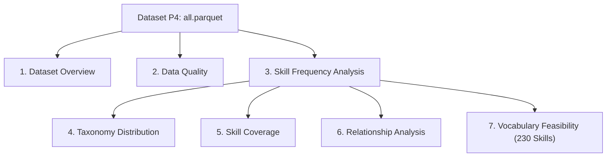

# Kế Hoạch Data Profiling & Khai Phá Dữ Liệu Khám Phá (EDA Plan) Cho P5

> **Mã tài liệu:** `P5-EDA-PLAN-03` (Phiên bản 2.0 — Hiệu chỉnh bằng chứng & Phân loại chuẩn xác)  
> **Người thực hiện:** Hồng Phát (P5 Owner)  
> **Giai đoạn:** Chuẩn bị & Lập kế hoạch (Preparation & Planning — No Mock Data)  
> **Nguyên tắc an toàn:** Tuyệt đối không sinh số liệu giả định (Zero Mocking / Real Numbers Only). Đây là bản thiết kế kế hoạch phân tích chuẩn mực sẽ được thực thi ngay khi tập dữ liệu P4 (`data/preprocessing/04_normalization/all.parquet`) được bàn giao.

---

## 1. Mục Đích & Căn Cứ Thiết Kế Kế Hoạch EDA

- **[Fact] (Căn cứ: `docs/preprocessing/spec/P5_encoding.md` §2):** P5 nhận đầu vào là `all.parquet` từ P4.
- **[Fact] (Căn cứ: Approved Decision 2026-11-07 trong `05_phat_encoding_implementation_contract.md` §2):** Chiều rộng ma trận kỹ năng $X$ bắt buộc phải có đúng 230 cột nhị phân, và ma trận đồng xuất hiện $C = X^T X$ kích thước $230 \times 230$.
- **[Conflict]:** `SPEC-06 §5.1` quy định chọn top $K \in [100, 200]$ kỹ năng có tần suất $\ge 20$ lần. Trong khi đó, file từ điển `skills.json` hiện tại chỉ có 40 keys.
- **[Recommendation]:** Đợt Data Profiling và EDA này có mục tiêu cung cấp căn cứ thực nghiệm (Empirical Evidence) từ dữ liệu thực tế để:
  1. Kiểm định chất lượng dữ liệu bàn giao từ P4 (Completeness, Validity, Uniqueness).
  2. Đo lường phân phối tần suất thực tế của toàn bộ kỹ năng.
  3. Cung cấp số liệu để trả lời các quyết định D1–D9 trước khi triển khai code.

---

## 2. Kế Hoạch Chi Tiết 7 Hạng Mục Phân Tích



---

### Hạng Mục 1: Tổng Quan Tập Dữ Liệu (Dataset Overview)

* **1. Câu hỏi cần trả lời:**
  - Quy mô tổng thể của tập dữ liệu sau bước P4 là bao nhiêu bài đăng tuyển dụng ($N$)?
  - Dữ liệu có bao nhiêu trường thuộc tính và kiểu dữ liệu vật lý (Arrow Dtypes) của từng trường là gì?
  - Cơ cấu số lượng bài đăng giữa 8 sàn tuyển dụng (`topcv`, `topdev`, `vietnamworks`, `careerviet`, `vieclam24h`, `itviec`, `glints`, `jobsgo`) phân bổ như thế nào?
* **2. Trường dữ liệu cần sử dụng:**
  - Toàn bộ các cột trong `all.parquet` (`job_id_global`, `source_platform`,...).
* **3. Phương pháp & Chỉ số dự kiến:**
  - Đo `df.shape` (số dòng, số cột), `df.dtypes`, `df.memory_usage(deep=True)`.
  - Tần suất phân phối sàn: `df["source_platform"].value_counts()`.
* **4. Kết quả cần thu được:**
  - Bảng tổng hợp kích thước tệp (MB), tổng số bản ghi $N$, số thuộc tính, và biểu đồ cột phân bố bài đăng theo sàn.
* **5. Quyết định thiết kế được hỗ trợ:**
  - [Recommendation] Đánh giá chiến lược tối ưu hóa bộ nhớ RAM khi chạy encoding (dùng `uint8` hay `scipy.sparse`).
  - [Recommendation] Kiểm tra tính đại diện của từng sàn để đảm bảo việc trích xuất kỹ năng không bị thiên lệch vị thế về một sàn đơn lẻ.

---

### Hạng Mục 2: Đánh Giá Chất Lượng Dữ Liệu (Data Quality)

* **1. Câu hỏi cần trả lời:**
  - Tỷ lệ khuyết thiếu (Missing Rate) của từng trường dữ liệu là bao nhiêu?
  - Có tồn tại bản ghi trùng lặp khóa chính `job_id_global` hay không?
  - Có trường nào chứa kiểu dữ liệu bất thường (ví dụ: mảng rỗng `[]`, chuỗi rỗng `""`, chuỗi `"null"`, giá trị âm phi lý của lương hay kinh nghiệm)?
* **2. Trường dữ liệu cần sử dụng:**
  - `job_id_global`, `seniority`, `job_family`, `skills_std`, `locations`, `log_salary_min`, `log_salary_max`, `exp_min_years`, `exp_max_years`, `posted_date`, `deadline_date`.
* **3. Phương pháp & Chỉ số dự kiến:**
  - Tỷ lệ Missing: $\text{Missing Rate} = \frac{\sum \text{isna}}{\text{Total Rows}} \times 100\%$.
  - Phát hiện Null trá hình: Kiểm tra chuỗi `"None"`, `"null"`, `"N/A"`, `"Chưa rõ"`.
  - Kiểm tra tính duy nhất: `df["job_id_global"].nunique() == len(df)`.
  - Kiểm tra logic thời gian và dải số: `exp_min_years > exp_max_years`, `deadline_date < posted_date`.
* **4. Kết quả cần thu được:**
  - Bảng ma trận khuyết thiếu, danh sách các trường vi phạm logic nghiệp vụ.
* **5. Quyết định thiết kế được hỗ trợ:**
  - [Fact] Xác nhận danh sách các cột cần sinh cờ `<col>__missing` trong E5 và E7 theo `P5_encoding.md` §4.
  - [Recommendation] Cài đặt cơ chế bẫy lỗi Safe Skip trong `encode_dataset()` để không làm gián đoạn tiến trình khi gặp dữ liệu dị biệt.

---

### Hạng Mục 3: Phân Tích Tần Suất Kỹ Năng (Skill Frequency Analysis)

* **1. Câu hỏi cần trả lời:**
  - Có tổng cộng bao nhiêu kỹ năng phân biệt (Distinct Skills) xuất hiện trong toàn bộ trường `skills_std`?
  - Phân phối tần suất của các kỹ năng có tuân theo luật phân phối lũy thừa (Power Law / Zipf's Law) hay không?
  - Có bao nhiêu kỹ năng đạt các ngưỡng tần suất phổ quát: $\ge 100$, $\ge 50$, $\ge 20$, $\ge 10$, $\ge 5$ bài đăng?
  - Top 30 kỹ năng có tần suất xuất hiện cao nhất thị trường là gì?
* **2. Trường dữ liệu cần sử dụng:**
  - `skills_std` (mảng các kỹ năng đã được P4 chuẩn hóa).
* **3. Phương pháp & Chỉ số dự kiến:**
  - Làm phẳng mảng `skills_std` bằng `collections.Counter`.
  - Vẽ đồ thị hàm phân phối tích lũy (Cumulative Distribution Function - CDF) của tần suất kỹ năng.
  - Vẽ biểu đồ cột ngang cho Top 30 kỹ năng phổ biến nhất.
* **4. Kết quả cần thu được:**
  - Bảng tần suất phân phối kỹ năng (Skill Frequency Table) gồm: Tên kỹ năng, Số tin tuyển dụng chứa kỹ năng, Tỷ lệ % trên toàn thị trường, Nhóm tần suất.
* **5. Quyết định thiết kế được hỗ trợ:**
  - [Conflict] Cung cấp bằng chứng thực nghiệm để đối chiếu giữa ngưỡng $\ge 20$ của `SPEC-06 §5.1` và mục tiêu 230 cột kỹ năng của Approved Decision 2026-11-07.

---

### Hạng Mục 4: Phân Bố Theo Nhóm Taxonomy (Taxonomy Distribution)

* **1. Câu hỏi cần trả lời:**
  - Khi phân loại các kỹ năng tìm thấy vào 6 nhóm ngành công nghệ của `SPEC-06 §3.1`, cơ cấu số lượng kỹ năng và tỷ lệ xuất hiện giữa các nhóm như thế nào?
  - Nhóm nào chiếm ưu thế tuyệt đối (ví dụ: Languages hay Frameworks)?
  - Nhóm nào có nguy cơ bị thiếu hụt kỹ năng (ví dụ: Methodologies/Soft Skills hay Cloud/DevOps)?
* **2. Trường dữ liệu cần sử dụng:**
  - `skills_std`, bảng phân loại 6 nhóm từ `SPEC-06 §3.1`.
* **3. Phương pháp & Chỉ số dự kiến:**
  - Gom cụm các kỹ năng theo 6 nhóm:
    1. *Programming Languages*
    2. *Frameworks & Libraries*
    3. *Databases & Streaming*
    4. *Cloud, Infrastructure, Security & DevOps*
    5. *Tools, Architecture, Protocols & QA*
    6. *Methodologies, Soft Skills, Data/AI & Domain*
  - Tính tổng số kỹ năng phân biệt trong từng nhóm và tổng số lượt xuất hiện.
* **4. Kết quả cần thu được:**
  - Biểu đồ tròn và bảng thống kê cơ cấu 6 nhóm kỹ năng trên thị trường tuyển dụng.
* **5. Quyết định thiết kế được hỗ trợ:**
  - [Recommendation] Căn cứ để thảo luận có nên áp dụng hạn ngạch quota cho 6 nhóm trong danh mục 230 kỹ năng hay để chọn thuần túy theo Top-K tần suất (Quyết định D4).

---

### Hạng Mục 5: Độ Phủ Kỹ Năng & Tỷ Lệ Giữ Lại (Skill Coverage & Retention Rate)

* **1. Câu hỏi cần trả lời:**
  - Tỷ lệ bài đăng tuyển dụng có ít nhất 1 kỹ năng trong `skills_std` là bao nhiêu %?
  - Số lượng kỹ năng trung bình trên một bài tuyển dụng là bao nhiêu (Mean, Median, Min, Max)?
  - Có bao nhiêu bài đăng không chứa bất kỳ kỹ năng nào (`skills_std` rỗng)?
  - Khi giới hạn ma trận giữ đúng 230 kỹ năng hàng đầu, có bao nhiêu % tổng lượt kỹ năng bị rơi vào nhóm ngoài top?
* **2. Trường dữ liệu cần sử dụng:**
  - `skills_std` từ `all.parquet`, danh sách 230 kỹ năng ứng viên.
* **3. Phương pháp & Chỉ số dự kiến:**
  - Tỷ lệ bài đăng có kỹ năng: $\text{Coverage Rate} = \frac{\sum (\text{len}(skills\_std) > 0)}{N} \times 100\%$.
  - Tỷ lệ bảo toàn kỹ năng (Skill Retention Rate):
    $$\text{Retention Rate} = \frac{\text{Tổng số lượt xuất hiện của 230 kỹ năng}}{\text{Tổng số lượt xuất hiện của toàn bộ kỹ năng}} \times 100\%$$
* **4. Kết quả cần thu được:**
  - Histogram phân phối số lượng kỹ năng trên mỗi tin tuyển dụng và chỉ số Retention Rate của bộ vocabulary 230.
* **5. Quyết định thiết kế được hỗ trợ:**
  - [Recommendation] Đánh giá mức độ đại diện của ma trận $X$ kích thước 230 trước khi bàn giao cho nhóm Mining.

---

### Hạng Mục 6: Phân Tích Mối Quan Hệ Giữa Kỹ Năng & Thuộc Tính Nghề Nghiệp (Relationship Analysis)

* **1. Câu hỏi cần trả lời:**
  - Phân bố kỹ năng thay đổi như thế nào theo từng nhóm nghề (`job_family`)?
  - Phân bố kỹ năng thay đổi như thế nào theo cấp bậc kinh nghiệm (`seniority`)?
  - Có sự khác biệt đặc thù về kỹ năng giữa các sàn tuyển dụng hay không?
* **2. Trường dữ liệu cần sử dụng:**
  - `skills_std`, `job_family`, `seniority`, `source_platform`.
* **3. Phương pháp & Chỉ số dự kiến:**
  - Bảng Cross-tabulation / Ma trận nhiệt (Heatmap) giữa Top 20 kỹ năng và 12 Job Families.
  - Tần suất có điều kiện: $P(\text{Skill} \mid \text{Job Family})$.
* **4. Kết quả cần thu được:**
  - Heatmap thể hiện mối tương quan giữa Kỹ năng và Nhóm nghề; biểu đồ phân bổ kỹ năng theo cấp bậc.
* **5. Quyết định thiết kế được hỗ trợ:**
  - [Fact] Kiểm chứng chéo tính nhất quán giữa bước P4 (gán nhãn Job Family) và P5 (mã hóa kỹ năng).
  - [Recommendation] Cung cấp tri thức nền tảng để Phúc đánh giá kết quả phân cụm K-Means và phân tầng FP-Growth (`SPEC-07`).

---

### Hạng Mục 7: Tính Khả Thi Của Vocabulary 230 Cột (Vocabulary Feasibility Analysis)

* **1. Câu hỏi cần trả lời:**
  - Số lượng kỹ năng thỏa mãn ngưỡng tần suất $\ge 20$ trên dataset thật có đủ 230 kỹ năng hay không?
  - Nếu có nhiều hơn 230 kỹ năng thỏa mãn, kỹ năng thứ 230 có tần suất là bao nhiêu?
  - Nếu có ít hơn 230 kỹ năng thỏa mãn, cần hạ ngưỡng xuống bao nhiêu hay sử dụng cơ chế bù từ điển chuẩn?
  - Có kỹ năng nào trong danh mục 230 bị tần suất $= 0$ (cột rỗng hoàn toàn) nếu áp dụng từ điển hiện tại?
* **2. Trường dữ liệu cần sử dụng:**
  - `skills_std` (từ `all.parquet`), danh mục mẫu trong `preprocessing/encoding/skills_taxonomy_230.py`.
* **3. Phương pháp & Chỉ số dự kiến:**
  - Lập bảng danh sách xếp hạng tần suất giảm dần từ vị trí thứ $1$ đến vị trí thứ $300$.
  - Tính toán độ thưa (Sparsity) kỳ vọng của ma trận $M \times 230$:
    $$\text{Sparsity} = \frac{\text{Số lượng giá trị 0}}{M \times 230} \times 100\%$$
* **4. Kết quả cần thu được:**
  - Bảng danh mục chính thức 230 kỹ năng được xếp hạng kèm tần suất thực tế; chỉ số Sparsity chính xác.
* **5. Quyết định thiết kế được hỗ trợ:**
  - [Recommendation] Cung cấp bằng chứng thực nghiệm để chốt Quyết định D1 và D2.

---

## 3. Quy Trình Thực Thi Sau Khi Nhận Được Dataset P4

```
[Nhận tệp all.parquet từ P4]
        ↓
1. Chạy Script EDA & Data Profiling tự động theo 7 hạng mục trên
        ↓
2. Xuất báo cáo số liệu thật ra reports/preprocessing/05_encoding/eda_profiling_report.json
        ↓
3. Đối chiếu các bằng chứng thực nghiệm với danh mục Quyết định D1–D9
        ↓
4. Họp thống nhất cùng Trưởng nhóm và các chủ sở hữu downstream (Phúc, Sơn, Duy)
        ↓
5. Đóng băng taxonomy chính thức và tiến hành nghiệm thu implementation
```
