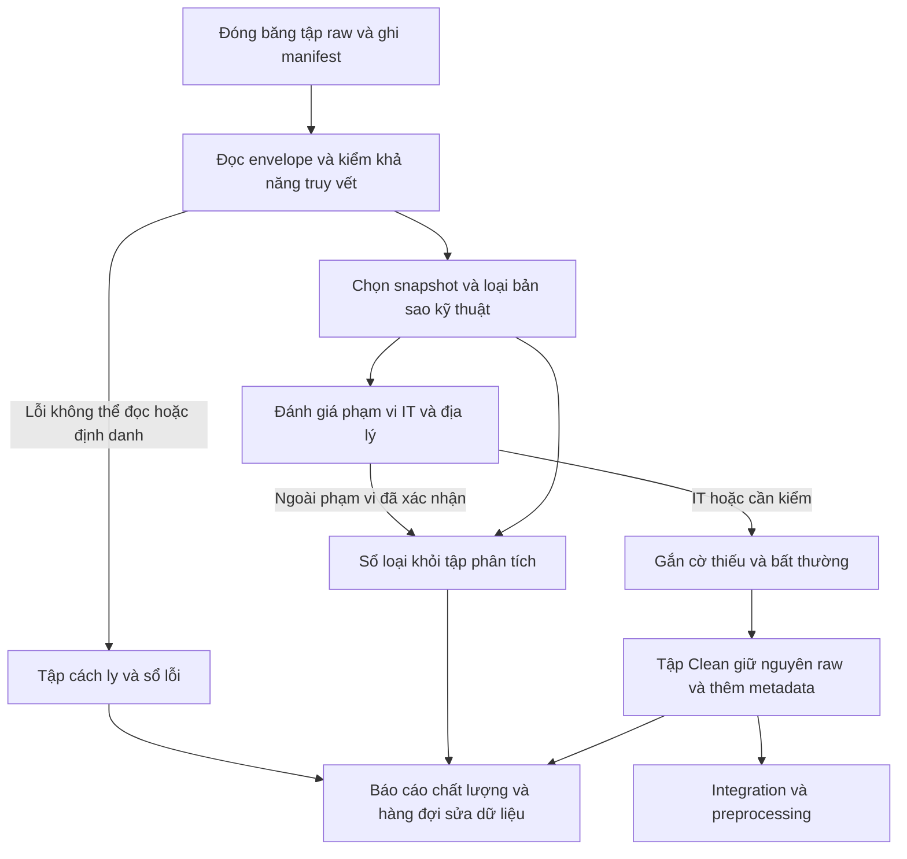

# BÁO CÁO ĐỒ ÁN MÔN HỌC
# KHẢO SÁT DỮ LIỆU VÀ THIẾT KẾ QUY TRÌNH DATA CLEANING

**Đề tài:** Tích hợp và khai phá dữ liệu thị trường lao động phục vụ phân tích nghề nghiệp và kỹ năng trong IT

| Thông tin | Nội dung |
|---|---|
| Trường / Khoa | … |
| Môn học / Lớp | … |
| Giảng viên hướng dẫn | … |
| Sinh viên / Nhóm / MSSV | … |
| Ngày lập báo cáo | 05/11/2026 |
| Phiên bản | 1.0 — Khảo sát hiện trạng và đề xuất thiết kế lại |
| Phạm vi khảo sát mã nguồn | Repository VN-IT-Job-Mining, commit `0cfa1b0` |

## Tóm tắt

Đồ án hướng tới tích hợp tin tuyển dụng đa nguồn để phân tích cơ cấu nghề nghiệp và kỹ năng IT. Trước khi tiếp tục phát triển mã nguồn, cần xác định đơn vị quan sát, phạm vi dữ liệu và ý nghĩa của từng thao tác làm sạch. Báo cáo khảo sát tám nguồn tuyển dụng, tám notebook EDA, mã nguồn Clean và các báo cáo pipeline đang lưu trong repository; từ đó đề xuất quy trình bảo toàn dữ liệu gốc, kiểm soát bản ghi trùng, đánh giá phạm vi IT và quản lý dữ liệu thiếu.

Kết quả khảo sát cho thấy hệ thống đã có pipeline năm bước, nhưng một số quyết định như loại tin có JD ngắn hoặc gộp tin theo khóa đơn giản cần được đánh giá lại theo mục tiêu phân tích. Báo cáo đề xuất giữ các tin còn giá trị phân tích, tách lỗi kỹ thuật khỏi trường hợp thiếu thông tin nghiệp vụ, và lưu lý do của mọi quyết định loại hoặc cách ly. Đây là báo cáo thiết kế, không phải kết quả thực nghiệm của pipeline mới.

**Từ khóa:** tuyển dụng IT, tích hợp dữ liệu, chất lượng dữ liệu, data cleaning, EDA, truy vết dữ liệu.

## Mục lục

1. Đặt vấn đề và mục tiêu nghiên cứu
2. Nguồn, phạm vi và đơn vị dữ liệu
3. Hiện trạng và vấn đề chất lượng dữ liệu
4. Thiết kế quy trình Data Cleaning
5. Đánh giá, nghiệm thu và kế hoạch điều chỉnh
6. Kết luận
7. Tài liệu tham khảo
8. Phụ lục: hồ sơ quyết định và việc cần thực hiện

## 1. Đặt vấn đề và mục tiêu nghiên cứu

### 1.1. Bối cảnh và lý do điều chỉnh

Project đã phát triển các thành phần thu thập, lưu trữ, EDA, tiền xử lý và giám sát. Tuy nhiên, việc có nhiều thành phần kỹ thuật không tự bảo đảm dữ liệu đáp ứng bài toán nghiên cứu. Tài liệu tổng quan vẫn chứa định hướng AI/LLM và phạm vi nghiệm thu chỉ gồm collection, trong khi driver hiện hành đã chạy Clean → Integration → Transformation → Normalization → Encoding bằng luật. Sự khác biệt giữa tài liệu, code và mục tiêu sử dụng là căn cứ cần xác lập lại thiết kế [N1–N3].

Khung CRISP-DM đặt việc hiểu mục tiêu và hiểu dữ liệu trước thiết kế xử lý; các pha có thể được xem xét lại khi xuất hiện bằng chứng mới. Báo cáo vận dụng khung này để nối mục tiêu nghiên cứu với lựa chọn dữ liệu và quy tắc làm sạch. [IBM, *CRISP-DM Guide*, chương 1–4](https://public.dhe.ibm.com/software/analytics/spss/documentation/modeler/18.0/en/ModelerCRISPDM.pdf).

### 1.2. Mục tiêu và câu hỏi nghiên cứu

Mục tiêu chung là tạo cơ sở dữ liệu tuyển dụng đủ nhất quán và có thể truy vết để mô tả nghề nghiệp, kỹ năng IT trong **tập tin đã thu thập**. Đối tượng sử dụng là nhóm thực hiện đồ án, giảng viên đánh giá và người đọc quan tâm tới yêu cầu nghề nghiệp IT.

**Bảng 1. Câu hỏi nghiên cứu và yêu cầu dữ liệu**

| Câu hỏi | Input cần có | Output phân tích dự kiến | Điều kiện chất lượng |
|---|---|---|---|
| Các nhóm nghề IT xuất hiện như thế nào? | Tiêu đề, mô tả, nhóm nghề, nguồn | Số tin và tỷ trọng theo nhóm nghề | Phân loại có căn cứ; nhóm chưa rõ được báo cáo riêng |
| Nhà tuyển dụng đề cập những kỹ năng nào? | Yêu cầu, mô tả, tag kỹ năng | Tần suất kỹ năng theo nghề | Tách kỹ năng khỏi ngành nghề và tag SEO |
| Những kỹ năng nào thường cùng xuất hiện? | Tập kỹ năng trên từng tin | Bảng đồng xuất hiện, dữ liệu cho khai phá quan hệ | Mỗi kỹ năng chỉ đếm một lần trên một tin; kiểm soát tin trùng |
| Nghề và kỹ năng khác nhau theo địa điểm, kinh nghiệm ra sao? | Địa điểm làm việc, kinh nghiệm, nghề, kỹ năng | Bảng phân bố có mẫu số rõ ràng | Giữ nhiều địa điểm; phân biệt thiếu và bằng 0 |
| Lương công bố có đặc điểm gì theo nghề? | Dải lương, tiền tệ, kỳ trả, nghề | Thống kê bổ trợ trên tập lương đủ điều kiện | Không suy rộng sang tin ẩn lương; không đánh đồng lương cứng và tổng thu nhập |

Thu thập và làm sạch là điều kiện chuẩn bị cho khai phá, chưa phải kết quả khai phá. Báo cáo không tuyên bố đã phát hiện luật kỹ năng, dự báo xu hướng hay xây dựng hệ khuyến nghị.

### 1.3. Ranh giới hai báo cáo

Theo nghĩa rộng, cleaning thuộc data preparation/preprocessing. Để phân công công việc rõ ràng, bộ báo cáo dùng quy ước:

- **Cleaning:** xác định bản ghi nào được đưa tiếp vào xử lý, loại trùng kỹ thuật, phát hiện vấn đề và lưu dấu quyết định; raw vẫn bất biến.
- **Preprocessing tiếp sau:** tích hợp schema, biến đổi kiểu, chuẩn hóa nghiệp vụ, trích xuất kỹ năng, xác minh trùng ngữ nghĩa và tạo dữ liệu phân tích. Chi tiết tại [Báo cáo 2](02_bao_cao_data_preprocessing.md).

Văn bản sạch dùng tạm để phân loại trong Clean không thay thế văn bản gốc. Quy tắc chuẩn hóa văn bản chính thức được định nghĩa một lần ở preprocessing, tránh hai phiên bản xử lý khác nhau.

## 2. Nguồn, phạm vi và đơn vị dữ liệu

### 2.1. Phạm vi nghiên cứu

**Bảng 2. Phạm vi đề xuất**

| Chiều phạm vi | Quy định |
|---|---|
| Nội dung | Tin tuyển dụng công việc IT; phân biệt nghề của vị trí với ngành kinh doanh của công ty |
| Nghề giáp ranh | BA, quản lý sản phẩm/dự án, UI/UX, nhúng/IoT chỉ đưa vào tập IT xác nhận khi có ngữ cảnh công nghệ; trường hợp mơ hồ giữ để rà soát |
| Địa lý | Việc làm tại Việt Nam; remote có bằng chứng tuyển tại Việt Nam được giữ; địa điểm nước ngoài hoặc chưa rõ được gắn cờ, không suy từ tên sàn |
| Thời gian | Phân tích lát cắt trên tập dữ liệu đóng băng; chưa có min/max ngày cào và ngày đăng đã kiểm chứng trong phiên khảo sát này |
| Đơn vị phân tích chính | Tin đăng duy nhất trong một nguồn, tại snapshot được chọn; nhóm tin cùng thực thể là lớp liên kết bổ sung |
| Dữ liệu ngoài phạm vi | Hồ sơ ứng viên, kết quả tuyển dụng, chương trình đào tạo, dữ liệu doanh nghiệp không gắn với tin |
| Chưa triển khai | Dự báo dài hạn, suy luận nhân quả, khoảng cách đào tạo–doanh nghiệp và khuyến nghị học tập |

Không coi số tin đăng là số người cần tuyển. `headcount` chỉ sử dụng khi được công bố và đọc đúng; một tin có thể tuyển nhiều người, nhiều nơi hoặc nhiều vai trò. Ngày cào phản ánh quan sát của hệ thống, không thay thế ngày đăng trong phân tích nhu cầu theo thời gian.

### 2.2. Kiểm kê tám nguồn

**Bảng 3. Cấu trúc được bộ đọc hiện hành hỗ trợ và trọng tâm kiểm tra** [N4, N5]

| Nguồn | Ví dụ cấu trúc raw được đọc | Nhóm dữ liệu cần giữ | Điểm cần đào sâu |
|---|---|---|---|
| TopCV | `title`, `salary_raw`, `general_info`, `working_places` | Tiêu đề, yêu cầu, mô tả, lương, tag, địa điểm | Raw thiếu JD; tag ngành nghề; lương một đầu |
| TopDev | `title`, `salary_raw`/`salary`, `published`, `extra`, JSON-LD | Kỹ năng, mô tả, kinh nghiệm, ngày, công ty | Discovery lẫn ngoài IT; raw cũ thiếu trường; nhiều snapshot |
| VietnamWorks | `jobTitle`, `companyName`, `createdOn`, `jobLevelVI`, trường lương cấu trúc | Nghề, kỹ năng, địa điểm, lương và cờ hiển thị | Lương 0 đi cùng ẩn lương; batch cũ; thời điểm đăng/cập nhật |
| CareerViet | `job-company-name`, `map`, `detail-box`, nội dung DOM | Mô tả, yêu cầu, địa điểm, thuộc tính trong chuỗi | Template không chuẩn; tag SEO; ngày cập nhật khác ngày đăng |
| Vieclam24h | `company`, `general_info`, `experience_summary`, `working_address` | Yêu cầu, mô tả, lương, kinh nghiệm | Batch trùng; tag không phải kỹ năng; bullet đứt dòng |
| ITviec | `sections`, `salary_display_text`, `job_posting_jsonld` | Kỹ năng, mô tả, lương, ngày và nhiều địa điểm | Lương ẩn trên giao diện; ngày tương đối; khác biệt phân khúc |
| Glints | `job-title`/`title`, `requirements`, `salary`, JSON-LD | Kỹ năng, yêu cầu, tiền tệ, địa điểm | Mẫu nhỏ; khác biệt tiền tệ; độ mới dữ liệu |
| JobsGO | `salary_raw`, `working_places`, `occupations`, nội dung DOM | Kỹ năng trong JD, nghề, công ty, địa điểm | `occupations` không phải kỹ năng; tin ngoài IT |

Bảng mô tả khả năng đọc của code và các hồ sơ hiện có, không khẳng định mọi tin đều có các trường này. Mỗi nguồn có một [notebook EDA](../../collection/reports/) riêng; chẩn đoán cũ là đầu mối kiểm tra, chưa phải kết quả đo lại trên cùng snapshot.

### 2.3. Quy mô có bằng chứng và giới hạn kiểm chứng

Workspace khảo sát không có thư mục `data/`. Vì vậy chưa kiểm tra trực tiếp toàn bộ raw, chưa chạy lại EDA và chưa đối chiếu với bucket R2. Các số dưới đây lấy từ JSON báo cáo đã lưu, không phải số lượng hiện tại trên cloud.

**Bảng 4. Số liệu lịch sử từ báo cáo Clean trong repository** [N6]

| Nguồn | Bản ghi đầu vào, gồm snapshot/batch | Bản ghi sau Clean |
|---|---:|---:|
| TopCV | 2.749 | 1.561 |
| TopDev | 3.890 | 227 |
| VietnamWorks | 2.878 | 900 |
| CareerViet | 660 | 448 |
| Vieclam24h | 1.276 | 182 |
| ITviec | 911 | 905 |
| Glints | 331 | 271 |
| JobsGO | 1.597 | 683 |
| **Tổng** | **14.292** | **5.177** |

Báo cáo gộp ghi `mode=applied`, `code_version=7dee2a4`, `generated_at=2026-11-03T17:12:12+00:00`, tương ứng 00:12:12 ngày 04/11/2026 tại Việt Nam. Dấu thời gian này là thời điểm sinh báo cáo, **không phải cửa sổ thu thập dữ liệu**. Số 5.177 là số bản ghi sau các luật hiện hành, không chứng minh tất cả đều đúng là IT hay đều là vị trí khác nhau.

**Bảng 5. Phễu loại bản ghi của lần chạy lịch sử**

| Luật hiện hành | Số bản ghi bị loại khỏi output |
|---|---:|
| C1 — Snapshot cũ | 1.987 |
| C2 — Bản batch đã có file riêng | 1.341 |
| C3 — Bản ghi test/không hợp lệ | 0 |
| C4c — Ngoài IT theo policy | 5.514 |
| C5 — JD dưới 30 từ | 188 |
| C6 — Trùng khóa trong nguồn | 72 |
| C7 — Trùng khóa khác nguồn | 13 |
| **Tổng bị loại** | **9.115** |

Kiểm tra số học: **14.292 = 5.177 + 9.115**. Đây chỉ xác nhận phép cộng của báo cáo, chưa xác nhận tính đúng của từng quyết định loại. Không cộng số của P1 ngày 03/11 có output 8.373 với lần báo cáo này: đó là các hiện trạng/lần chạy khác nhau.

### 2.4. Phân biệt đơn vị đếm

| Khái niệm | Ý nghĩa và cách đếm |
|---|---|
| File | Đối tượng lưu trữ; một file batch có thể chứa nhiều tin |
| Snapshot | Một phiên bản nội dung của tin tại thời điểm quan sát |
| Tin trong nguồn | Khóa `(source_platform, source_job_id)`; nhiều snapshot vẫn là cùng tin |
| Nhóm thực thể tuyển dụng | Các tin được xác minh là cùng đợt/vị trí tuyển; có thể xuyên nguồn |
| Chỉ tiêu tuyển | Số người nhà tuyển dụng công bố; không suy từ số snapshot hoặc số tin |

## 3. Hiện trạng và vấn đề chất lượng dữ liệu

### 3.1. Cách phân loại bằng chứng

Trong báo cáo, **đã triển khai** nghĩa là thấy logic trong code; **lịch sử** nghĩa là được ghi trong EDA, issue hoặc output trước đây; **đề xuất** nghĩa là thiết kế cần thực hiện sau. Code tồn tại không đồng nghĩa đã được chạy thành công trên dữ liệu hiện tại.

Các notebook có khuyến nghị GenAI và những nhận định thống kê chưa kèm cùng một tập đầu vào. Ví dụ chẩn đoán Glints mô tả tỷ lệ ẩn lương lớn, nhưng bảng D1 trong hồ sơ ngày 03/11 ghi 0%. Cần kiểm lại định nghĩa “ẩn lương”, trường được đọc và mẫu số; báo cáo không chọn một số làm sự thật mới nhất [N4, N7]. Không thể kết luận cơ chế thiếu là MNAR chỉ từ việc tỷ lệ thiếu cao; chỉ ghi nhận khả năng thiếu có hệ thống và dấu hiệu chủ động không công bố.

### 3.2. Ma trận vấn đề và hướng giải quyết

**Bảng 6. Vấn đề → bằng chứng → tác động → xử lý → kiểm tra**

| Vấn đề | Bằng chứng/trạng thái | Tác động tới phân tích | Giải pháp đề xuất | Cách kiểm tra |
|---|---|---|---|---|
| Snapshot và batch trùng | C1/C2 đã có; số lịch sử ở Bảng 5 | Phóng đại tần suất nghề/kỹ năng | Chọn snapshot ổn định theo nguồn+ID; lưu liên kết các bản không chọn | Kiểm khóa và lịch sử lựa chọn; raw không đổi |
| Tin ngoài IT | C4c + policy; SCRAPE-15 ghi TopDev lọc danh mục không hiệu lực | Sai mẫu nghiên cứu | Phân loại có ngữ cảnh, rà soát từng nguồn; sửa discovery là việc tiếp theo | Mẫu gồm cả nhóm giữ và nhóm loại; đếm IT bị loại nhầm |
| JD thiếu/ngắn | C5 dưới 30 từ trong code; SCRAPE-16 ghi nhận 297 raw TopCV thiếu JD trong đợt cũ | Có thể mất tin IT thật | Thay loại toàn bộ bằng cờ thiếu; đánh giá còn dùng được cho câu hỏi nào | So sánh phân bố nghề/nguồn trước–sau; rà các tin IT bị C5 loại |
| Gộp tin quá sớm | C6/C7 dùng công ty, tiêu đề, tỉnh đầu tiên, tuần; có fallback tuần cào | Gộp nhầm đợt tuyển hoặc bỏ sót trùng | Chỉ tạo ứng viên liên kết; xác minh sau chuẩn hóa | Kiểm cặp cùng khóa nhưng khác JD, nơi làm hoặc đợt tuyển |
| Null theo ngữ nghĩa | Hồ sơ EDA: chuỗi rỗng, `0`, `[]`, thỏa thuận | Làm sai lương và kinh nghiệm | Từ điển null theo trường+nguồn; giữ giá trị gốc và lý do | `experience=0` không trở thành thiếu; lương thỏa thuận không thành 0 |
| Tag ngành lẫn kỹ năng | I4 và bộ lọc tag đã có; EDA JobsGO/Vieclam24h | Tần suất kỹ năng giả | Giữ tag gốc; phân nhóm kỹ năng/nghề/SEO/chưa rõ | Rà nhãn trên tag và đoạn văn chứng minh |
| Lương cực trị | Có cờ, ngưỡng và capping trong code sau Clean | Loại mất phân khúc hoặc biến sai giá trị thật | Clean chỉ gắn cờ; xác minh đơn vị/ngữ cảnh sau | Tin thực tập lương thấp, chuyên gia lương cao không bị xóa |
| Tin hết hạn/ngày thiếu | Hồ sơ ngày 03/11 ghi deadline trước crawl; một số nguồn thiếu ngày đăng | Nhầm dữ liệu lịch sử với nhu cầu đang mở | Giữ cho lát cắt quan sát; gắn trạng thái; không điền ngày cào vào ngày đăng | Phân biệt expired, unknown, ngày cập nhật và ngày đăng |
| Lệch nguồn/địa bàn | PRE-11 ghi các thống kê trên tập 5.177 tin | Suy rộng quá mức ra thị trường | Báo độ phủ và mẫu số từng nhóm; chưa tái cân bằng tự động | So cơ cấu nguồn trước–sau từng luật |

Nguồn: code [N3, N5, N8], hồ sơ lỗi [N7, N9]. Số 297 tin thiếu JD của đợt cũ không phải số C5=188 trong lần chạy Bảng 5: mẫu đầu vào và các bước lọc trước C5 khác nhau.

### 3.3. Nội dung ưu tiên đào sâu

Ưu tiên thứ nhất là **lọc đúng phạm vi IT**, vì sai tại đây làm sai toàn bộ các phân tích tiếp theo. Ưu tiên thứ hai là **tính duy nhất của tin** và nguy cơ mất tin thật do C5–C7. Ưu tiên thứ ba là **chất lượng mô tả, yêu cầu và tag**, do đây là đầu vào trực tiếp cho phân tích kỹ năng. Lương, địa điểm và kinh nghiệm cần được làm đúng ngữ nghĩa, nhưng không dùng độ đầy đủ của chúng làm điều kiện bắt buộc để giữ một tin phục vụ phân tích nghề.

## 4. Thiết kế quy trình Data Cleaning

### 4.1. Hợp đồng input/output đề xuất

**Bảng 7. Hợp đồng dữ liệu**

| Thành phần | Nội dung |
|---|---|
| Input | Raw envelope, metadata nguồn/ID/URL/thời điểm/phiên bản; policy IT; danh mục nguồn; manifest tập đầu vào |
| Tập giữ lại | Envelope còn giá trị phân tích, giữ nguyên `raw_payload`, bổ sung quyết định và cờ chất lượng |
| Tập cách ly | Bản ghi lỗi đọc, thiếu định danh không thể truy vết hoặc nội dung không thể diễn giải; kèm lý do và tham chiếu raw |
| Sổ loại khỏi tập phân tích | Snapshot không chọn, bản trùng kỹ thuật, tin ngoài phạm vi đã xác nhận; không xóa raw |
| Báo cáo chất lượng | Số lượng từng nhánh, từng nguồn, từng luật; ví dụ; phiên bản code/policy; thông tin dữ liệu đầu vào |
| Mẫu rà soát | Mẫu phân tầng có nhãn tay và lý do; không ghi đè nhãn đã có |

Đây là **hợp đồng đề xuất**, mở rộng output Clean hiện tại vốn chủ yếu có JSONL và báo cáo drop. Cờ bổ sung tối thiểu gồm lý do thiếu JD, trạng thái IT, khả năng dùng cho phân tích nghề/kỹ năng, lý do cách ly và tham chiếu snapshot. Không coi `unknown` là `non_it`.

### 4.2. Sơ đồ quy trình đề xuất

### 4.3. Trình tự và quy tắc xử lý

**Bước 1 — Đóng băng dữ liệu.** Lập manifest liệt kê nguồn, đường dẫn, hash, số bản ghi đọc được, khoảng thời gian quan sát và thời điểm chốt. Tệp không đọc được ghi vào sổ lỗi cấp file; không tính nó như một bản ghi JSON đã biết. Chưa có manifest thì chưa dùng cụm từ “toàn bộ dữ liệu thị trường”.

**Bước 2 — Kiểm tính hợp lệ kỹ thuật.** Kiểm JSON, nguồn, ID, URL và cấu trúc envelope. Thiếu một trường nghiệp vụ không đồng nghĩa bản ghi vô hiệu. Nếu thiếu ID nhưng có URL ổn định, đưa vào hàng đợi xác minh định danh; không tự đặt ID nghiệp vụ hoặc gộp tất cả ID rỗng.

**Bước 3 — Xử lý phiên bản và bản sao.** Trong mỗi nguồn, nhóm theo ID. Chọn snapshot mới nhất có timestamp hợp lệ; dùng version để phân giải khi cùng timestamp, rồi đường dẫn để kết quả ổn định. Trường hợp thiếu timestamp hoặc thứ tự version mâu thuẫn được gắn cờ để kiểm. Bản batch giống nội dung với file riêng chỉ giữ một đại diện; khác nội dung được xử lý như ứng viên phiên bản, không mặc định file riêng luôn mới hơn. Mọi bản không chọn có liên kết tới bản đại diện. Không trộn trường giữa hai snapshot để tạo bản “đầy đủ” không từng tồn tại.

**Bước 4 — Lọc phạm vi.** Dùng tiêu đề, mô tả, yêu cầu và nhóm nghề để gắn `it`, `non_it`, `can_kiem`; bằng chứng phải chỉ ra luật và đoạn văn liên quan. Công ty ngân hàng tuyển lập trình viên vẫn thuộc IT; vị trí bán hàng tại công ty công nghệ chưa chắc thuộc IT. Chính sách đã có được lưu cùng phiên bản đánh giá, nhưng không suy rộng độ đúng của mẫu nhỏ sang tất cả dữ liệu. Nhóm chưa rõ vẫn được giữ, có thể tách khỏi mẫu số của tập IT đã xác nhận.

**Bước 5 — Đánh giá khả năng sử dụng.** JD ngắn hoặc thiếu chỉ kích hoạt cờ, không tự loại toàn bộ tin. Tin có tiêu đề rõ nhưng thiếu JD có thể dùng cho thống kê nghề, song không dùng để kết luận “không yêu cầu kỹ năng”. Tin có tag kỹ năng xác thực vẫn có thể đóng góp vào thống kê tag, nhưng cần tách nguồn bằng chứng với trích xuất từ JD. Lương thiếu, hết hạn hoặc địa chỉ không chi tiết không phải lý do xóa tin.

**Bước 6 — Ghi quyết định và chuyển tiếp.** Ghi tập giữ, tập cách ly, sổ loại và báo cáo. Khóa công ty–tiêu đề–địa điểm chỉ tạo ứng viên trùng ngữ nghĩa. Việc xác nhận trùng khác ID hoặc xuyên nguồn chuyển sang preprocessing sau chuẩn hóa; mỗi tin nguồn được giữ để truy vết.

### 4.4. Null, lỗi và ngoại lai

**Bảng 8. Quy tắc ngữ nghĩa cần bảo toàn**

| Giá trị/tình huống | Cách diễn giải đề xuất |
|---|---|
| `""`, khoảng trắng | Thiếu văn bản, ghi nhận trường và nguồn |
| `[]` | Chưa có phần tử được ghi nhận; không mặc định “không yêu cầu kỹ năng” |
| “Thỏa thuận” | Trạng thái công bố lương; giá trị số để null |
| “Không yêu cầu kinh nghiệm” | Thông tin hợp lệ: mức tối thiểu bằng 0 nếu câu chữ rõ |
| Lương số 0 | Kiểm cờ hiển thị và ngữ nghĩa nguồn; không coi mặc định là lương 0 đồng |
| JD rỗng do crawler | Lỗi thu thập nghi ngờ; mở hàng đợi cào lại, không bù bằng suy đoán |
| Lương cao/thấp bất thường | Gắn cờ để xác minh; không khẳng định là lỗi chỉ vì vượt IQR |

Làm sạch đạt yêu cầu không có nghĩa là dữ liệu không còn null. Một giá trị thiếu được giải thích và truy vết tốt hơn một giá trị được điền không có căn cứ.

## 5. Đánh giá, nghiệm thu và kế hoạch điều chỉnh

### 5.1. Chỉ tiêu đánh giá

**Bảng 9. Chỉ tiêu bắt buộc trong lần thực nghiệm tiếp theo**

| Chỉ tiêu | Cách đo |
|---|---|
| Bảo toàn bản ghi | `N_đọc_được = N_giữ + N_cách_ly + N_loại`; các nhánh loại loại trừ nhau |
| Bảo toàn raw | So hash raw trước–sau; output chỉ tham chiếu hoặc sao chép nguyên bản |
| Tính duy nhất kỹ thuật | Không lặp khóa nguồn+ID trong lát cắt đã chọn; không làm mất lịch sử raw |
| Độ phủ | Số và tỷ lệ có giá trị theo trường, nguồn, trạng thái IT; mẫu số ghi rõ |
| Sai sót lọc IT | Ma trận nhầm lẫn, precision/recall IT trên mẫu có nhãn; số IT bị loại nhầm |
| Tác động từng luật | Số sửa/gắn cờ/loại; so cơ cấu nguồn và nghề trước–sau |
| Khả năng tái lập | Cùng manifest, code và policy cho cùng tập khóa và quyết định; bỏ qua thời gian sinh báo cáo |

Đề xuất mẫu kiểm tra ban đầu: mỗi nguồn lấy tối đa 30 tin ở mỗi nhóm `it`, `non_it`, `can_kiem`, chọn ổn định với seed 42; nhóm ít hơn lấy toàn bộ. Ghi tỷ lệ lấy mẫu vì đây là mẫu phân tầng, không dùng accuracy gộp không trọng số để đại diện toàn tập. Bổ sung tập ca khó riêng, không trộn vào ước lượng ngẫu nhiên. Nhãn bất đồng được người thứ hai kiểm và ghi lý do. Chưa đặt ngưỡng chất lượng thống kê khi chưa có baseline và phân tích chi phí loại nhầm.

### 5.2. Kịch bản kiểm thử thiết kế

| Tình huống | Kết quả mong đợi |
|---|---|
| Một ID có v1/v2, cùng ID ở hai sàn | Chọn đúng snapshot trong từng nguồn; không gộp hai nguồn theo ID đơn lẻ |
| Batch và file riêng cùng/khác nội dung | Bản giống chỉ một đại diện; bản khác có lịch sử và kiểm thứ tự |
| “International Sales” | Không khớp “intern” thành IT |
| “Backend Developer” thiếu JD | Giữ tin, gắn thiếu JD và hạn chế khả năng phân tích kỹ năng |
| Công ty cùng tên, tiêu đề giống, khác địa điểm/đợt tuyển | Không gộp tự động chỉ theo khóa ứng viên |
| Kinh nghiệm 0; lương thỏa thuận | Giữ ý nghĩa 0 kinh nghiệm; lương số null có trạng thái |
| JSON lỗi hoặc thiếu định danh | Có mục cách ly/lỗi file, không mất âm thầm |
| Chạy lại cùng dữ liệu | Cùng quyết định; nhãn tay cũ không bị ghi đè |

Đây là yêu cầu kiểm thử cho lần sửa pipeline tiếp theo. Phiên viết báo cáo chỉ kiểm tra tài liệu và đối chiếu số học; chưa thực hiện các kịch bản trên dữ liệu raw.

### 5.3. Thứ tự công việc

| Ưu tiên | Công việc | Sản phẩm nghiệm thu |
|---|---|---|
| P0 | Chốt manifest, ngày chốt, đơn vị đếm và phạm vi | Bảng kiểm kê có thời gian và hash |
| P0 | Rà C4c/C5 và các tin bị loại | Mẫu có nhãn; bảng tác động; policy đề xuất có căn cứ |
| P0 | Tách trùng kỹ thuật khỏi trùng nghiệp vụ | Đặc tả chọn snapshot và danh sách ứng viên liên kết |
| P1 | Bổ sung cách ly, sổ quyết định, khả năng dùng theo bài toán | Hợp đồng Clean và báo cáo bảo toàn |
| P1 | Đo lại EDA cùng snapshot | Ma trận chất lượng tám nguồn, trước–sau |
| P1 | Mở việc sửa collection cho lỗi raw và phạm vi cào | Danh sách lỗi có URL/ID, ví dụ và tiêu chí kiểm lại |
| P2 | Cập nhật tài liệu và giao diện giám sát theo định nghĩa mới | Không còn trộn số file, snapshot, tin và thực thể |

## 6. Kết luận

Data Cleaning trong đề tài phải tạo ra tập tin có phạm vi rõ ràng, có thể truy vết và được đánh giá khả năng sử dụng, thay vì cố làm mọi trường đầy đủ. Hệ thống hiện có là nền tảng có thể tái sử dụng, nhưng cần ưu tiên kiểm lại lọc IT, chính sách JD ngắn và gộp tin sớm. Sau khi xác nhận các quyết định này trên một tập dữ liệu đóng băng, nhóm mới triển khai tích hợp và chuẩn hóa theo Báo cáo 2.

Giới hạn của báo cáo là chưa có raw cục bộ và chưa kiểm chứng trạng thái R2 hiện tại. Các con số lịch sử chỉ mô tả bằng chứng đang lưu; chất lượng của thiết kế đề xuất phải được đo trong đợt thực nghiệm tiếp theo.

## 7. Tài liệu tham khảo

Ngày truy cập/đối chiếu: 05/11/2026. Tài liệu nội bộ được đọc tại commit khảo sát; timestamp riêng của báo cáo pipeline giữ nguyên.

- **[P1]** IBM. *IBM SPSS Modeler CRISP-DM Guide*, phiên bản 18, chương 1–4. [Tài liệu chính thức](https://public.dhe.ibm.com/software/analytics/spss/documentation/modeler/18.0/en/ModelerCRISPDM.pdf).
- **[N1]** [Tổng quan mục tiêu ban đầu](../01_modern_data_mining_overview.md) và [README](../../README.md). Dùng đối chiếu lịch sử định hướng, không làm chuẩn hành vi hiện tại.
- **[N2]** [Ngữ cảnh preprocessing](../../preprocessing/CLAUDE.md), [P0](../preprocessing/spec/P0_pipeline_contract.md), [nhật ký thay đổi L-27/L-28](../issue_log.md).
- **[N3]** [Driver hiện hành](../../scripts/run_preprocessing.py), [Clean](../../preprocessing/clean/run.py), [policy IT](../../preprocessing/clean/it_policy.json).
- **[N4]** Tám notebook: [TopCV](../../collection/reports/EDA_topcv.ipynb), [TopDev](../../collection/reports/EDA_topdev.ipynb), [VietnamWorks](../../collection/reports/EDA_vietnamworks.ipynb), [CareerViet](../../collection/reports/EDA_careerviet.ipynb), [Vieclam24h](../../collection/reports/EDA_vieclam24h.ipynb), [ITviec](../../collection/reports/EDA_itviec.ipynb), [Glints](../../collection/reports/EDA_glints.ipynb), [JobsGO](../../collection/reports/EDA_jobsgo.ipynb). Đọc chẩn đoán qua [bộ trích xuất EDA](../../scripts/read_eda_diagnosis.py); không thực thi lại notebook.
- **[N5]** [Bộ ánh xạ raw](../../preprocessing/integration/json_flattener.py), [Integration](../../preprocessing/integration/run.py).
- **[N6]** [Báo cáo Clean gộp](../../reports/preprocessing/01_clean/_all.json) và các báo cáo từng nguồn cùng thư mục.
- **[N7]** [Hồ sơ vấn đề ngày 03/11/2026](../preprocessing/data_issues_2026-11-03.md). Số liệu lịch sử, có mục đã được sửa về sau.
- **[N8]** [Transformation](../../preprocessing/transformation/run.py), [Normalization](../../preprocessing/normalization/run.py), [trích xuất kỹ năng](../../preprocessing/transformation/skill_extractor.py).
- **[N9]** [Known Issues](../../KNOWN_ISSUED.md), đặc biệt SCRAPE-5, SCRAPE-15, SCRAPE-16 và PRE-11.

## 8. Phụ lục: hồ sơ quyết định và việc cần thực hiện

### 8.1. Mẫu hồ sơ một quyết định cleaning

| Trường hồ sơ | Nội dung cần ghi |
|---|---|
| Định danh | Nguồn, ID, URL, raw reference và snapshot |
| Vấn đề | Quan sát thực tế; không ghi suy đoán như sự thật |
| Quyết định | Giữ / gắn cờ / cách ly / loại khỏi tập phân tích |
| Căn cứ | Mã luật, phiên bản policy, trường và đoạn nội dung liên quan |
| Quan hệ phiên bản | Snapshot được chọn, snapshot không chọn và lý do |
| Kiểm tra | Người/luật kiểm, nhãn tay nếu có, trạng thái xử lý |

### 8.2. Bảng quyết định điều chỉnh project

| Nhóm | Quyết định đề xuất | Lý do | Ưu tiên |
|---|---|---|---|
| Giữ lại | Raw bất biến, metadata, chọn snapshot, báo cáo theo nguồn | Nền tảng tái lập và truy vết | P0 |
| Cần sửa | Loại mọi JD dưới 30 từ | Có thể loại tin IT thật vẫn có giá trị phân tích nghề | P0 |
| Cần sửa | Gộp khác ID/xuyên nguồn ngay ở Clean | Khóa đơn giản chưa đủ bằng chứng cùng thực thể | P0 |
| Cần bổ sung | Rà cả nhóm được giữ lẫn nhóm bị loại | Tránh chỉ đo độ đúng trên nhóm `non_it` | P0 |
| Cần bổ sung | Manifest, cách ly, sổ quyết định và cờ khả năng sử dụng | Giải thích được số liệu và tổn thất dữ liệu | P1 |
| Hoãn | LLM, bù dữ liệu suy đoán, xóa/cap ngoại lai tại Clean | Chưa cần cho mục tiêu và dễ thay đổi ý nghĩa dữ liệu | P2 |
