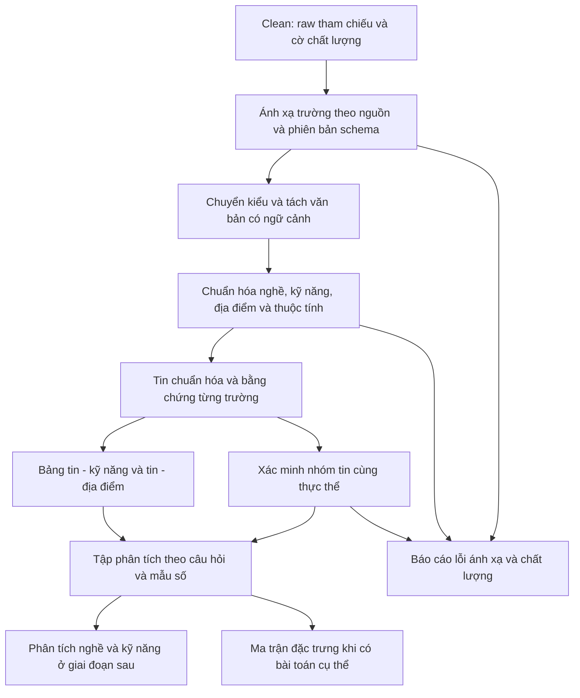

# BÁO CÁO ĐỒ ÁN MÔN HỌC
# THIẾT KẾ QUY TRÌNH TÍCH HỢP VÀ DATA PREPROCESSING

**Đề tài:** Tích hợp và khai phá dữ liệu thị trường lao động phục vụ phân tích nghề nghiệp và kỹ năng trong IT

| Thông tin | Nội dung |
|---|---|
| Trường / Khoa | … |
| Môn học / Lớp | … |
| Giảng viên hướng dẫn | … |
| Sinh viên / Nhóm / MSSV | … |
| Ngày lập báo cáo | 05/11/2026 |
| Phiên bản | 1.0 — Khảo sát hiện trạng và đề xuất thiết kế lại |
| Phạm vi khảo sát mã nguồn | Repository VN-IT-Job-Mining, commit `0cfa1b0` |

## Tóm tắt

Báo cáo trình bày thiết kế tích hợp và tiền xử lý dữ liệu tuyển dụng đa nguồn nhằm phục vụ phân tích nghề nghiệp và kỹ năng IT. Đầu vào là các tin đã qua kiểm tra kỹ thuật và đánh giá phạm vi, còn giữ liên kết với dữ liệu raw. Đầu ra cần ưu tiên là bộ dữ liệu phân tích có ngữ nghĩa nhất quán, gồm tin tuyển dụng chuẩn hóa, quan hệ tin–kỹ năng, quan hệ tin–địa điểm và hồ sơ chất lượng; ma trận đặc trưng cho mô hình là sản phẩm tùy theo bài toán về sau.

Khảo sát mã nguồn cho thấy project đã có tích hợp, parse dữ liệu, chuẩn hóa bằng luật và encoding. Tuy nhiên, việc lọc trường theo độ phủ, gộp nghề theo taxonomy cố định, chọn top kỹ năng và biến đổi lương trên toàn bộ dữ liệu cần được xem xét theo mục tiêu sử dụng. Báo cáo đề xuất tập trung vào nguồn gốc thông tin, ngữ cảnh trích xuất kỹ năng, sự khác biệt giữa nhãn suy ra và thông tin công bố, đồng thời xác định kiểm thử và trình tự điều chỉnh. Chưa có thực nghiệm mới hoặc kết quả khai phá được công bố trong báo cáo này.

**Từ khóa:** data integration, preprocessing, nghề nghiệp IT, kỹ năng, schema, dữ liệu phân tích.

## Mục lục

1. Mục tiêu, phạm vi và cơ sở phương pháp
2. Hiện trạng và hợp đồng dữ liệu
3. Thiết kế tích hợp dữ liệu đa nguồn
4. Thiết kế biến đổi và chuẩn hóa nghiệp vụ
5. Chuẩn bị dữ liệu phân tích và khử trùng nghiệp vụ
6. Đánh giá và kế hoạch điều chỉnh
7. Kết luận
8. Tài liệu tham khảo
9. Phụ lục: ví dụ và bảng quyết định

## 1. Mục tiêu, phạm vi và cơ sở phương pháp

### 1.1. Mục tiêu nghiệp vụ và câu hỏi phân tích

Mục tiêu của đề tài là **tích hợp và khai phá dữ liệu thị trường lao động phục vụ phân tích nghề nghiệp và kỹ năng trong IT**. Trong đợt này, nhóm thiết kế lại quá trình chuẩn bị dữ liệu để trả lời: nhóm nghề nào xuất hiện trong tập tin thu thập; kỹ năng nào được đề cập theo nghề; kỹ năng nào đồng xuất hiện; cơ cấu nghề và kỹ năng thay đổi theo địa điểm hoặc kinh nghiệm như thế nào. Lương công bố là chiều phân tích bổ trợ.

Đối tượng sử dụng là nhóm đồ án, giảng viên và người đọc cần hiểu yêu cầu tuyển dụng IT. Đầu ra phải giải thích được nguồn gốc của một nhãn nghề, một kỹ năng hoặc một giá trị lương; không chỉ cung cấp một bảng số lớn mà chưa xác định cách dùng.

### 1.2. Phạm vi và quy ước

Cleaning thuộc preprocessing theo nghĩa rộng. Báo cáo này dùng “preprocessing” theo nghĩa phần **tiếp sau cleaning**: tích hợp schema, chuyển kiểu, chuẩn hóa nghiệp vụ, trích xuất kỹ năng, xác minh trùng ngữ nghĩa và tạo bảng phân tích. Đầu vào được mô tả đầy đủ trong [Báo cáo Cleaning](01_bao_cao_data_cleaning.md).

Phạm vi gồm tám nguồn TopCV, TopDev, VietnamWorks, CareerViet, Vieclam24h, ITviec, Glints và JobsGO, tập trung tin việc làm IT tại Việt Nam. Remote hoặc địa điểm chưa rõ được quản lý bằng trạng thái riêng. Chưa xác nhận cửa sổ ngày cào/ngày đăng vì workspace không có raw cục bộ; ngày sinh báo cáo pipeline không được dùng thay cho cửa sổ dữ liệu.

Chưa triển khai dự báo, mô hình lương, phân tích chương trình đào tạo hoặc hệ khuyến nghị. Giữ hướng dùng luật và từ điển, không bổ sung LLM. Việc dùng luật để gắn nhãn nghề không được trình bày như kết quả của một mô hình đã huấn luyện và đánh giá.

### 1.3. Cơ sở phương pháp

CRISP-DM phân biệt mục tiêu nghiệp vụ, hiểu dữ liệu và chuẩn bị dữ liệu; trong chuẩn bị dữ liệu có lựa chọn, cleaning, tạo thuộc tính, tích hợp và định dạng. Báo cáo vận dụng khung này để thiết kế đầu ra theo câu hỏi nghiên cứu thay vì theo danh sách công nghệ. [IBM, *CRISP-DM Guide*, chương 2–4](https://public.dhe.ibm.com/software/analytics/spss/documentation/modeler/18.0/en/ModelerCRISPDM.pdf).

Các quy tắc nghiệp vụ dưới đây là **đề xuất cho project dựa trên khảo sát**, không phải quy định phổ quát rằng mọi tập dữ liệu tuyển dụng đều phải dùng cùng ngưỡng, taxonomy hoặc cách xử lý ngoại lai.

## 2. Hiện trạng và hợp đồng dữ liệu

### 2.1. Pipeline đã triển khai

**Bảng 1. Hành vi quan sát được trong mã nguồn** [N1–N5]

| Bước | Hành vi hiện hành | Điểm cần xem xét lại |
|---|---|---|
| Clean | Chọn snapshot, lọc IT theo policy, loại JD ngắn, khử trùng theo khóa | Các quyết định loại có thể làm mất tin hữu ích; xem Báo cáo 1 |
| Integration | 18 trường nghiệp vụ, 5 khóa và 5 trường metadata Clean; gộp vào `all.parquet` | Chưa nên chọn trường chỉ vì nhiều nguồn có; cần metadata truy vết sâu hơn |
| Transformation | Null, HTML/bullet, lương, ngày, kinh nghiệm, headcount, kỹ năng/phúc lợi, địa điểm | Cần phân biệt dữ liệu công bố, trích xuất và giả định |
| Normalization | Kỹ năng, công ty, 12 nhóm nghề, 6 cấp bậc, địa điểm; xử lý lương IQR/capping/log | Taxonomy và suy ra cấp bậc có thể mất chi tiết; không coi capping là mặc định |
| Encoding | One-hot, ordinal, top 10 tỉnh; kỹ năng xuất hiện ≥20 tin, tối đa 200; cờ thiếu | Có thể làm mất kỹ năng hiếm hoặc địa phương; chỉ phù hợp một số đầu ra |

Integration hiện có **28 cột** theo `KEYS + CLEAN_META + KEEP_18`, không phải toàn bộ bảng chỉ có 18 cột. Danh mục nghề trong code cũng khác danh mục của skill cũ: code có `Data/AI` gộp và không có nhóm Embedded riêng. Đây là khác biệt cần quyết định theo mẫu dữ liệu, không tự coi danh mục nào là chuẩn quốc tế.

### 2.2. Kết quả lịch sử có thể đối chiếu

Báo cáo Clean lưu trong repo ghi 14.292 bản ghi vào và 5.177 bản ghi ra. Các báo cáo Integration, Transformation, Normalization và Encoding đều ghi 5.177 → 5.177. Các file này có `code_version=7dee2a4`; thời gian UTC từ 17:12 đến 17:13 ngày 03/11/2026, tức đầu ngày 04/11 theo giờ Việt Nam [N6].

Số dòng được giữ nguyên không chứng minh ý nghĩa dữ liệu đã đúng. Phiên khảo sát ngày 05/11 không chạy lại pipeline, không đọc raw hoặc parquet trên R2. PRE-11 ghi các tỷ lệ như thiếu lương, nhóm nghề “Khác” và độ thưa kỹ năng trên tập lịch sử; chúng là chỉ báo để điều tra, chưa được đo lại ở đây [N7].

### 2.3. Hợp đồng input/output đề xuất

**Bảng 2. Sản phẩm của preprocessing**

| Sản phẩm | Đơn vị một dòng | Vai trò |
|---|---|---|
| Input Clean | Một tin/nguồn ở snapshot đã chọn, kèm cờ | Dữ liệu đầu vào có thể truy vết về raw |
| `jobs_standardized` | Một tin/nguồn | Bảng phân tích nghề, địa điểm, kinh nghiệm, lương |
| `job_skills` | Một cặp tin–kỹ năng chuẩn | Đếm tần suất và dựng tập kỹ năng; giữ danh sách bằng chứng |
| `job_locations` | Một cặp tin–địa điểm đã chuẩn hóa | Giữ các địa điểm, tránh chỉ lấy phần tử đầu |
| `entity_memberships` | Một tin nguồn thuộc một nhóm tuyển dụng đã xác nhận | Phân tích có kiểm soát tin đăng chéo |
| Quality report / manifest | Một lần chạy và các bảng kiểm tra | Phạm vi, số lượng, luật, dictionary, code và nguồn dữ liệu |
| Feature matrix, nếu cần | Theo đơn vị của bài toán cụ thể | Không phải điều kiện bắt buộc để hoàn thành bộ dữ liệu phân tích |

Các tên bảng trên là **giao diện logic đề xuất**, chưa phải file đã được tạo hoặc API đang tồn tại. Có thể xuất Parquet và dùng bảng/view phụ từ dữ liệu đã chuẩn hóa; chưa cần chuyển project sang một hệ quản trị cơ sở dữ liệu mới. Không thay đổi API công khai trong đợt viết báo cáo.

## 3. Thiết kế tích hợp dữ liệu đa nguồn

### 3.1. Sơ đồ dòng dữ liệu đề xuất

### 3.2. Nguyên tắc lựa chọn trường

Giữ nhóm trường cốt lõi theo mục tiêu: định danh, nguồn, thời gian quan sát; tiêu đề, mô tả, yêu cầu; công ty; nghề/cấp bậc; kỹ năng; địa điểm; kinh nghiệm. Lương, loại hợp đồng, học vấn, chỉ tiêu tuyển và phúc lợi hỗ trợ phân tích khi đủ độ phủ.

Một trường ít nguồn có vẫn có thể giá trị, ví dụ cách làm việc remote hoặc chuyên môn đặc thù. Trường đó được giữ trong lớp mở rộng hoặc qua tham chiếu raw, thay vì loại vì không đạt ngưỡng có ở 3–4 nguồn. Chỉ dùng các trường đủ điều kiện trong từng phân tích; không ép tất cả nguồn phải có cùng độ đầy đủ.

### 3.3. Bảng ánh xạ nguồn và điểm kiểm tra

**Bảng 3. Một số ánh xạ đọc được trong flattener hiện hành** [N2]

| Nguồn | Tiêu đề / công ty | Lương | Ngày / thuộc tính cần chú ý |
|---|---|---|---|
| TopCV | `title` / `company` | `salary_raw` | `deadline_raw` là hạn nộp; `general_info` chứa cấp bậc/học vấn |
| TopDev | `title` hoặc `job-title` / thông tin công ty theo cấu trúc nguồn | `salary_raw` hoặc `salary` | `published.date`, `date_posted`, JSON-LD; raw cũ có thể thiếu |
| VietnamWorks | `jobTitle` hoặc `title` / `companyName` hoặc `company.name` | Trường lương số và cờ hiển thị trong payload | `createdOn`, `approvedOn`, `onlineOn` phải giữ đúng nghĩa; không mặc định tương đương |
| CareerViet | `title` / `job-company-name` | Chuỗi trong `detail-box` | Code có fallback ngày cập nhật thành ngày đăng; đề xuất tách loại ngày |
| Vieclam24h | `title` / `company.name` hoặc chuỗi `company` | `salary` | `experience_summary`, `deadline`, `general_info` |
| ITviec | `title` / `company_name` hoặc `company` | `salary_display_text`, dữ liệu JSON-LD nếu có | `job_posting_jsonld.datePosted` trước `posted_at_raw` |
| Glints | `job-title` hoặc `title` / `company-name` hoặc `company` | `salary`, JSON-LD nếu có | `requirements`, `description`, trường lồng |
| JobsGO | `title` / `company` | `salary_raw` | `deadline_raw`, `working_places`; `occupations` là nghề |

Bảng này không thay thế mapping đầy đủ trên raw của một phiên bản nguồn. Khi triển khai, mỗi mapping phải ghi đường dẫn field, kiểu nhận được, điều kiện fallback và ví dụ tin. Nguồn đổi kiểu từ chuỗi sang object phải báo lỗi schema hoặc cách ly trường, không chuyển object thành chuỗi để tiếp tục âm thầm.

### 3.4. Từ điển dữ liệu đích tối thiểu

**Bảng 4. Hợp đồng ngữ nghĩa đề xuất**

| Nhóm | Thuộc tính logic | Kiểu và quy tắc |
|---|---|---|
| Định danh | `job_id_global`, nguồn, ID nguồn, URL | Chuỗi không rỗng, khóa tin duy nhất trong lát cắt |
| Truy vết | Raw reference, snapshot/hash, phiên bản mapping | Không mất khi chuyển JSONL sang Parquet |
| Thời gian | Ngày cào, ngày đăng, ngày cập nhật, hạn nộp | Ngày/thời điểm nullable; mỗi loại có nguồn và mức chính xác |
| Văn bản | Tiêu đề, mô tả, yêu cầu; bản gốc và bản sạch | Giữ ngôn ngữ, cấu trúc đoạn, ký hiệu công nghệ |
| Nghề | Nhóm nghề, vai trò chi tiết nếu có, phương pháp gán | Nhãn từ taxonomy có phiên bản; cho phép chưa rõ |
| Cấp bậc | Nhãn công bố, nhãn chuẩn, nguồn suy ra | Tách nhãn suy luận khỏi công bố; không xem kinh nghiệm là tương đương tuyệt đối |
| Kỹ năng | Tên chuẩn, biến thể gốc, loại, bằng chứng, ngữ cảnh | Quan hệ nhiều giá trị; giữ trạng thái chưa ánh xạ |
| Địa điểm | Địa chỉ gốc, tỉnh/phường đã ánh xạ, remote, độ tin cậy | Không tự bịa cấp địa chỉ thiếu; nhiều nơi được bảo toàn |
| Kinh nghiệm | Min/max năm và loại giới hạn | Số nullable; 0 khác thiếu; một đầu không tự điền đầu kia |
| Lương | Min/max gốc, tiền tệ, kỳ trả, gross/net, loại thu nhập; giá trị quy đổi | Nullable; giữ một đầu, trạng thái công bố và căn cứ quy đổi |
| Chất lượng | Lý do thiếu, xung đột, cần kiểm, khả năng dùng theo bài toán | Cờ và lý do có thể kiểm tra lại |

Khi thông tin giữa tag, JSON-LD và JD mâu thuẫn, giữ cả ứng viên và nguồn chứng minh, chọn theo quy tắc riêng của trường đã kiểm tra trên mẫu. Không có một quy tắc “JSON-LD luôn đúng” cho mọi nguồn. Thiếu trường sau ánh xạ phải phân biệt raw không có, mapping chưa hỗ trợ và parse thất bại.

## 4. Thiết kế biến đổi và chuẩn hóa nghiệp vụ

### 4.1. Văn bản và giá trị thiếu

Giải mã HTML entity, bỏ script/style và thẻ trình bày, giữ ranh giới đoạn/bullet giữa mô tả, yêu cầu và quyền lợi. Chuẩn hóa Unicode và khoảng trắng nhưng giữ `C++`, `C#`, `.NET`, `Node.js`, số phiên bản và dấu phủ định. Không dịch JD; dùng từ điển biến thể Việt–Anh khi đã được kiểm chứng.

Mỗi trường có danh mục null riêng. `0 năm` có thể hợp lệ; `salaryMin=0` phải đọc cùng trạng thái công bố; “thỏa thuận” là thông tin về cách công bố lương. Không điền mean/median cho bảng nghiệp vụ chuẩn. Thiếu do crawler là vấn đề cần cào lại hoặc sửa mapping, không phải nhiệm vụ suy đoán dữ liệu.

### 4.2. Kỹ năng — trọng tâm cần đào sâu

**Bảng 5. Quy trình kỹ năng đề xuất**

| Công đoạn | Quy tắc | Kết quả cần lưu |
|---|---|---|
| Phân loại đầu vào | Tách tag kỹ năng, ngành nghề, nghề, công ty, SEO và chưa rõ | Tag gốc và loại được xác định |
| Trích xuất | Khớp biến thể trong mô tả/yêu cầu; không coi mọi từ khớp là yêu cầu tuyển | Đoạn chứng minh, trường nguồn, vị trí hoặc nội dung trích dẫn |
| Chuẩn hóa | Ví dụ ReactJS/React.js → React; không đồng nhất Java với JavaScript | Tên chuẩn và phiên bản dictionary |
| Xét ngữ cảnh | Phân biệt bắt buộc, ưu tiên, phủ định, chỉ giới thiệu và chưa rõ | Trạng thái ngữ cảnh và lý do |
| Gộp trong tin | Một kỹ năng chuẩn chỉ một quan hệ tin–kỹ năng; có thể nhiều bằng chứng | Không nhân tần suất vì lặp từ nhiều lần |
| Kiểm danh mục | Biến thể mới hoặc tag dài chưa biết đưa vào review | Không loại kỹ năng chỉ vì dài hơn bốn từ |

Code hiện tại có khớp từ nguyên vẹn và từ điển, nhưng bộ lọc metadata loại tag trên bốn từ; hàm trích xuất trả tên kỹ năng, chưa biểu diễn đầy đủ bằng chứng/ngữ cảnh [N3]. Ví dụ “không yêu cầu Java” vẫn chứa từ Java; “công ty sử dụng AWS” không nhất thiết là yêu cầu của vị trí. Bản đề xuất cần giữ bằng chứng và loại ngữ cảnh trước khi tính tần suất kỹ năng yêu cầu.

Các tên ngắn C, R, Go cần ngữ cảnh lập trình để tránh khớp chữ thông thường. Không suy kỹ năng ngầm từ mô tả chung như “xử lý dữ liệu lớn” thành một công nghệ cụ thể. Kỹ năng ngoài từ điển chưa có nhãn chuẩn vẫn được giữ để review. Không gọi từ điển nội bộ là ESCO nếu chưa có mã và ánh xạ kiểm chứng tới ESCO.

### 4.3. Nghề và cấp bậc

Mặc định tái sử dụng 12 nhãn hiện có làm **taxonomy nội bộ baseline**: Backend, Frontend, Fullstack, Mobile, Data/AI, DevOps/Cloud, Kiểm thử, Bảo mật, Hệ thống/Mạng, BA, Quản lý sản phẩm/dự án, Thiết kế UI/UX [N4]. Giữ nguyên tiêu đề và nhãn chi tiết được trích xuất để không mất khả năng tách Data Engineering/Data Science hoặc bổ sung Embedded trong lần cập nhật taxonomy. Tin nhúng có bằng chứng IT vẫn được giữ dù baseline chưa có nhóm riêng.

Ưu tiên bằng chứng chức năng công việc và tiêu đề; kỹ năng chỉ hỗ trợ, không dùng một công nghệ để quyết định nghề duy nhất. Một tin có Python chưa chắc là Data/AI. Vai trò đa nhiệm hoặc mâu thuẫn được gắn cần kiểm; không ép về nhãn đầu tiên chỉ vì thứ tự regex. Nhãn “Khác” và “Chưa rõ” cần tách: khác taxonomy không đồng nghĩa không có thông tin.

Code có sáu cấp bậc chuẩn, nhưng “Nhân viên” trên sàn không mặc nhiên là Junior; số năm kinh nghiệm không quyết định chắc chắn Senior. Nếu suy cấp bậc từ kinh nghiệm, phải lưu `method=inferred_rule` và không trộn với cấp bậc công bố khi đánh giá độ chính xác.

### 4.4. Địa điểm và thời gian

Giữ danh sách địa điểm thay vì chỉ địa điểm đầu tiên. Tách nơi làm việc khỏi trụ sở công ty. Dùng bộ từ điển địa phương đang có trong repo như phiên bản ánh xạ nội bộ; lưu tên gốc, tên chuẩn và phiên bản dictionary. Không tuyên bố tính chính xác pháp lý của danh mục từ việc file tồn tại. Nếu chưa ánh xạ được phường/xã thì để thiếu, không suy từ tỉnh.

Remote là chế độ làm việc, không phải một tỉnh. Khi tính theo tỉnh, một tin nhiều nơi có thể xuất hiện ở nhiều nhóm; tổng số theo tỉnh vì vậy có thể vượt số tin. Báo cáo phải giải thích cách đếm này.

Ngày tương đối chỉ chuyển thành ngày ước lượng khi có thời điểm tham chiếu. Ngày cập nhật không thay thế ngày đăng; ngày cào không thay thế ngày đăng bị thiếu. Tin hết hạn vẫn dùng được cho mô tả tập quan sát lịch sử; thống kê “đang tuyển” chỉ dùng khi có căn cứ trạng thái tại mốc chốt. Chưa đủ cửa sổ và độ phủ thì không dựng kết luận xu hướng thị trường theo tháng.

### 4.5. Kinh nghiệm và chỉ tiêu tuyển

Phân tích dạng khoảng, giới hạn dưới/trên, tháng/năm và “không yêu cầu”. “Từ 2 năm” tạo min=2, max=null; “dưới 1 năm” giữ giới hạn trên và tính chất mở, không đổi thành đúng 1 năm. Thiếu kinh nghiệm không được điền 0. Chỉ tiêu “nhiều người” giữ dạng định tính, không gán một số giả. Không nhân số kỹ năng với headcount nếu chưa xác lập câu hỏi đo theo người tuyển thay vì theo tin.

### 4.6. Lương và ngoại lai — xử lý bổ trợ

**Bảng 6. Quy tắc lương đề xuất và khác biệt với hiện trạng**

| Tình huống | Quy tắc đề xuất |
|---|---|
| “Từ 15 triệu”, “tới 30 triệu” | Giữ một đầu; không tạo khoảng đóng giả hoặc lấy trung bình khi thiếu một đầu |
| “2,000 USD” | Parse dấu hàng nghìn theo ngữ cảnh, lưu giá trị gốc và tiền tệ |
| Lương trong JD | Chỉ nhận câu có ngữ cảnh lương; tách thưởng, phụ cấp, sign-on bonus, tổng thu nhập |
| Lương thỏa thuận nhưng JD có số | Giữ trạng thái công bố ban đầu, thêm ứng viên số và nguồn trích xuất |
| Không rõ tiền tệ/kỳ trả | Để giá trị quy đổi thiếu; không mặc định VND/tháng mà không ghi giả định |
| Gross/net | Không so sánh như tương đương nếu chưa có quy tắc quy đổi và dữ liệu cần thiết |
| Ngoại tệ | Dùng bảng tỷ giá có ngày và nguồn cho lần phân tích; giữ số gốc; thiếu tỷ giá thì không quy đổi |
| Lương theo năm | Chỉ chia 12 khi ý nghĩa khoản thu nhập cho phép; giữ kỳ gốc và loại thu nhập |
| Theo giờ/ngày | Không tự nhân 160 giờ hoặc 22 ngày nếu tin không cho số giờ/ngày làm; ghi rõ nếu dựng kịch bản giả định |
| Ngoại lai | Gắn cờ; kiểm đơn vị và văn bản; không xóa tin hoặc sửa giá trị chỉ vì vượt ngưỡng thống kê |

Code hiện hành dùng tỷ giá cố định 25.400 VND/USD; có quy đổi giờ/ngày theo hằng số, chặn miền lương tháng 1–500 triệu, capping phân vị 1–99% và log [N3, N4]. Đây là lựa chọn kỹ thuật của phiên bản cũ, không phải tỷ giá hiện hành hoặc giới hạn lương đúng cho mọi nghề. Đề xuất giữ giá trị đã parse cùng cờ nghi ngờ; chỉ sửa khi có bằng chứng. Các cột capped/log nếu cần được tạo riêng cho phân tích hoặc mô hình cụ thể, không thay giá trị nghiệp vụ.

Thiếu lương có thể liên quan đến chính sách công bố của nhà tuyển dụng, nhưng chưa đủ chứng minh MNAR. Phân tích lương phải công bố tỷ lệ có dữ liệu theo nguồn/nghề, và chỉ mô tả tập đủ điều kiện; không suy ra phân phối lương của toàn bộ thị trường.

## 5. Chuẩn bị dữ liệu phân tích và khử trùng nghiệp vụ

### 5.1. Xác minh tin đăng chéo

Sau chuẩn hóa, dùng tên công ty, tiêu đề, tập địa điểm và thông tin thời gian để tìm **ứng viên trùng**. Khóa bằng nhau không đủ để tự gộp. Không dùng tuần cào làm bằng chứng cùng đợt tuyển khi thiếu ngày đăng. Mặc định thiết kế v1 chỉ xác nhận nhóm bằng rà soát bằng chứng; chưa chọn ngưỡng fuzzy hoặc cosine tùy ý.

Mỗi cặp được rà theo JD/yêu cầu, vai trò, địa điểm và đợt tuyển. Nếu chưa đủ căn cứ, giữ tách biệt. Nhóm đã xác nhận có `entity_id`, danh sách các `job_id_global`, căn cứ và trạng thái xác nhận. Không xóa các tin thành viên; giá trị mâu thuẫn được giữ với nguồn. Việc chọn tin đại diện cho một phép phân tích phải ghi tiêu chí và trường không thống nhất.

### 5.2. Các tập dữ liệu theo câu hỏi

**Bảng 7. Đầu ra phân tích, điều kiện chọn và mẫu số**

| Tập sử dụng | Điều kiện | Đơn vị và mẫu số |
|---|---|---|
| Nghề nghiệp | IT xác nhận; có nhãn nghề hoặc trạng thái chưa rõ | Tin duy nhất theo nguồn; báo riêng phần chưa rõ; có thể thêm kết quả theo nhóm thực thể xác nhận |
| Kỹ năng được đề cập | Có tag hoặc văn bản đọc được, có bằng chứng trích xuất | Một tin–kỹ năng; mẫu số là tin đủ điều kiện quan sát kỹ năng |
| Kỹ năng yêu cầu | Bằng chứng thuộc ngữ cảnh yêu cầu/ưu tiên theo định nghĩa báo cáo | Không gộp phủ định, giới thiệu hoặc chưa rõ vào nhu cầu |
| Đồng xuất hiện | Có ít nhất một kỹ năng hợp lệ theo ngữ cảnh đã chọn | Mỗi tin hoặc nhóm thực thể xác nhận là một giao dịch; cùng một phép phân tích dùng một đơn vị duy nhất |
| Địa điểm | Có ít nhất một nơi làm việc chuẩn hóa | Số tin distinct tại mỗi địa điểm; nêu rõ tính đa địa điểm |
| Lương | Có số, đơn vị, kỳ và loại thu nhập đủ điều kiện | Chỉ mẫu có thể so sánh; báo số bị loại khỏi phân tích lương, không loại khỏi bảng nghề |

Không có kỹ năng trích xuất được không đồng nghĩa vị trí không cần kỹ năng. Tập đồng xuất hiện loại các tin không quan sát được kỹ năng và phải công bố số lượng bị loại khỏi tập này; mẫu số có điều kiện nên kết quả không đại diện toàn bộ tin tuyển dụng.

### 5.3. Cách tính tần suất và đồng xuất hiện

Với tập đủ điều kiện S, tần suất kỹ năng A = số tin distinct trong S có A / số tin trong S. Đồng xuất hiện A–B được tính trên các tin có cả A và B, không đếm số lần từ xuất hiện trong JD. Khi phân tích theo nghề, mẫu số là các tin đủ điều kiện của nghề đó.

Một tin có hai địa điểm và ba kỹ năng tạo hai dòng tin–địa điểm và ba dòng tin–kỹ năng. Nếu join trực tiếp sẽ có sáu dòng; phải dùng khóa distinct hoặc tổng hợp trước để tránh nhân đôi tần suất. Bảng nghề và bảng quan hệ là cấu trúc phục vụ phân tích, không phải sáu tin tuyển mới.

### 5.4. Encoding khi thật sự cần

Giữ toàn bộ kỹ năng đã chuẩn hóa trong bảng nghiệp vụ. Giới hạn top K chỉ áp dụng cho một ma trận cụ thể và phải ghi các kỹ năng bị gộp; không xóa kỹ năng hiếm khỏi nguồn dữ liệu phân tích. Tương tự, không chỉ giữ top 10 tỉnh trong bảng chuẩn.

Với thống kê mô tả và bảng đồng xuất hiện, không bắt buộc scale lương, mã hóa thứ bậc cấp bậc hoặc one-hot mọi cột. Nếu về sau đánh giá mô hình học máy, cần chia tập trước khi học các phép chọn đặc trưng, bù khuyết hoặc scale; các tham số học trên train rồi áp dụng cho test. [scikit-learn, *Common pitfalls*, mục Data leakage](https://scikit-learn.org/stable/common_pitfalls.html#data-leakage).

Riêng dữ liệu tuyển dụng, đề xuất giữ các tin cùng thực thể/phiên bản trong cùng nhóm chia tập. Không dùng nhãn nghề sinh từ chính từ khóa làm “nhãn chuẩn độc lập” rồi đánh giá trên cùng quy tắc: cần tập nhãn tay riêng nếu nghiên cứu độ chính xác phân loại.

## 6. Đánh giá và kế hoạch điều chỉnh

### 6.1. Ma trận vấn đề, giải pháp và kiểm tra

**Bảng 8. Các điểm cần sửa theo mục tiêu nghiên cứu**

| Vấn đề và bằng chứng | Tác động | Giải pháp đề xuất | Cách kiểm tra |
|---|---|---|---|
| Giữ 18 trường theo cấu hình; hồ sơ cũ chọn theo độ phủ | Có thể bỏ thuộc tính hữu ích hiếm gặp | Tách lõi và mở rộng theo mục tiêu | Kiểm từng trường với câu hỏi phân tích và raw reference |
| CareerViet fallback ngày cập nhật thành ngày đăng trong flattener | Sai thời điểm nhu cầu | Giữ loại ngày và provenance | Fixture có ngày cập nhật nhưng thiếu ngày đăng |
| Tag >4 từ bị loại; kỹ năng chỉ có tên, chưa có ngữ cảnh | Mất kỹ năng dài, khớp phủ định | Bằng chứng và phân loại ngữ cảnh | Tập câu yêu cầu/ưu tiên/phủ định/giới thiệu |
| Gán nghề dựa thứ tự luật; taxonomy nội bộ gộp Data/AI | Sai nhãn hoặc mất chi tiết | Baseline có phiên bản, giữ vai trò gốc, rà mâu thuẫn | Ma trận nhầm lẫn theo nghề và nguồn |
| Suy cấp bậc từ số năm | Nhãn suy luận bị coi như công bố | Tách phương pháp gán và mức chắc chắn | Ca “Nhân viên”, Senior ít năm, tiêu đề không cấp bậc |
| Tỷ giá/ngưỡng lương/capping cố định | Làm sai khả năng so sánh và cực trị thật | Giữ số gốc; quy đổi có metadata; capping riêng | Lương một đầu, giờ/ngày, bonus, thiếu tiền tệ |
| Chỉ lấy tỉnh đầu ở khóa trùng, top 10 ở encoding | Bỏ thông tin đa địa điểm | Quan hệ nhiều nơi, tổng hợp distinct | Một tin hai tỉnh không thành hai tin toàn tập |
| Số liệu EDA và báo cáo khác lần chạy | Kết luận trước–sau không hợp lệ | Cùng manifest và phiên bản luật khi so | So nguồn, thời gian, mẫu số và hash |

### 6.2. Kế hoạch kiểm chứng

Kiểm thử kỹ thuật dùng fixture nhỏ có kết quả mong đợi, bao gồm tối thiểu một cấu trúc đại diện và một ca thiếu/đổi kiểu mỗi nguồn. Không cần toàn bộ dữ liệu để kiểm lỗi parse cơ bản. Kiểm chất lượng nghiệp vụ dùng mẫu có nhãn tay theo nguồn và nhóm nghề, tách mẫu ngẫu nhiên với tập ca khó.

**Bảng 9. Kịch bản kiểm thử và kỳ vọng**

| Kịch bản | Kỳ vọng |
|---|---|
| HTML chứa C++, C#, .NET, bullet và tiếng Việt | Giữ tên kỹ năng, dấu tiếng Việt và ranh giới nội dung |
| “Biết JavaScript”; “không yêu cầu Java” | Không nhận Java từ JavaScript; Java phủ định không tính là yêu cầu |
| ReactJS và React.js lặp trong một tin | Một kỹ năng chuẩn, nhiều bằng chứng nếu có |
| Kỹ năng hợp lệ dài hơn bốn từ | Không tự loại chỉ vì độ dài |
| “Từ 15 triệu”, “tới 30 triệu”, “2,000 USD” | Một đầu đúng; số USD gốc đúng; quy đổi chỉ khi có cấu hình hợp lệ |
| Sign-on bonus 1.000 USD, lương thỏa thuận | Không dùng bonus làm lương tháng |
| Kinh nghiệm 0, thiếu kinh nghiệm, “từ 2 năm” | Ba trường hợp khác nhau, không bù max=min |
| Ngày tương đối, ngày cập nhật, thiếu ngày đăng | Có nguồn và mức chính xác; không lấp bằng ngày cào |
| Tin hai địa điểm, ba kỹ năng | Không nhân số tin khi join bảng quan hệ |
| Hai tin cùng tên khác JD/đợt tuyển | Không tự gộp; ứng viên chưa đủ bằng chứng giữ riêng |
| Tin nhúng chưa có nhóm baseline | Giữ IT khi có bằng chứng; lưu vai trò và trạng thái taxonomy |
| Cùng manifest và dictionary | Kết quả nghiệp vụ ổn định; không mất raw reference |

Chỉ tiêu báo cáo gồm độ phủ theo trường/nguồn; số lỗi parse và lý do; precision/recall/F1 trích xuất kỹ năng trên nhãn tay; ma trận nhầm lẫn nghề; tỷ lệ chưa rõ; độ đúng của nhóm trùng đã xác nhận. Tính precision = TP/(TP+FP), recall = TP/(TP+FN); mẫu số bằng 0 ghi “không xác định”, không tự cho điểm hoàn hảo. Với kỹ năng, nhãn tay phải đọc cả văn bản để đánh giá bỏ sót, không chỉ kiểm danh sách hệ thống trả về.

Chưa đặt ngưỡng accuracy tùy ý khi chưa có baseline. Điều kiện kỹ thuật bắt buộc là raw không đổi, khóa không trùng ngoài chủ đích, quan hệ không có khóa mồ côi, lỗi có log và mọi trường dẫn xuất truy được nguồn. Độ đúng nghiệp vụ phải được công bố cùng số mẫu, cách chọn mẫu và các nhóm chưa được đánh giá.

### 6.3. Trình tự triển khai đề xuất

| Thứ tự | Công việc | Đầu ra kiểm chứng |
|---|---|---|
| 1 — P0 | Chốt mục tiêu, manifest và thay đổi Clean theo Báo cáo 1 | Tập đầu vào và lý do giữ/loại rõ ràng |
| 2 — P0 | Chốt dictionary trường và mapping tám nguồn | Mẫu raw → trường đích, loại ngày, nguồn chứng minh |
| 3 — P0 | Bổ sung bằng chứng kỹ năng và nhãn nghề; lập mẫu tay | Baseline chất lượng và danh sách luật sai |
| 4 — P1 | Chuẩn hóa các thuộc tính bổ trợ và quan hệ nhiều giá trị | Bộ kiểm thử ngữ nghĩa, bảng lỗi parse |
| 5 — P1 | Xác minh trùng nghiệp vụ, giữ thành viên | Danh sách nhóm xác nhận và ứng viên chưa rõ |
| 6 — P1 | Tạo các tập phân tích theo điều kiện và mẫu số | Bảng nghề, kỹ năng, địa điểm và coverage report |
| 7 — P2 | Chọn bài toán khai phá cụ thể và ma trận phù hợp | Đặc tả thực nghiệm sau, chưa thuộc kết quả hai báo cáo này |

Khi thực thi về sau, chạy ứng viên vào thư mục/version riêng trên cùng manifest, so số lượng và các quyết định thay đổi với baseline. Chỉ thay đầu ra dùng chung sau khi đạt kiểm tra kỹ thuật và có đánh giá mẫu. Giữ phiên bản cũ để quay lại nếu phát hiện mapping sai. Mỗi lần chạy theo dõi số trường không ánh xạ, tỷ lệ chưa rõ, số thiếu theo nguồn và thay đổi dictionary; biến động cần giải thích trước khi công bố kết quả mới.

## 7. Kết luận

Đầu ra cần ưu tiên là bộ dữ liệu có thể trả lời câu hỏi về nghề và kỹ năng, giữ được ngữ nghĩa và nguồn gốc, không phải một ma trận số được tạo trước khi chọn bài toán. Hệ thống hiện có đã cung cấp nhiều thành phần tái sử dụng, nhưng cần bổ sung hợp đồng dữ liệu, bằng chứng trích xuất, quản lý đa địa điểm và đánh giá nhãn bằng mẫu độc lập.

Trọng tâm sửa project là nối từng biến đổi với mục tiêu phân tích. Kỹ năng và nghề cần được đào sâu trước; các biến đổi phục vụ mô hình như top K, capping, log hoặc scaling chỉ thực hiện khi có nhu cầu được giải thích. Hai báo cáo tạo cơ sở triển khai lại có kiểm chứng, chưa chứng minh pipeline đề xuất đã đạt chất lượng trên toàn bộ dữ liệu.

## 8. Tài liệu tham khảo

Ngày truy cập/đối chiếu: 05/11/2026. Các số liệu nội bộ là lịch sử theo timestamp gốc.

- **[P1]** IBM. *IBM SPSS Modeler CRISP-DM Guide*, phiên bản 18. [Tài liệu chính thức](https://public.dhe.ibm.com/software/analytics/spss/documentation/modeler/18.0/en/ModelerCRISPDM.pdf).
- **[P2]** scikit-learn. *Common pitfalls and recommended practices*, mục Data leakage. [Tài liệu chính thức](https://scikit-learn.org/stable/common_pitfalls.html#data-leakage).
- **[N1]** [Driver](../../scripts/run_preprocessing.py), [ngữ cảnh preprocessing](../../preprocessing/CLAUDE.md), [P0](../spec/preprocessing/spec/P0_pipeline_contract.md).
- **[N2]** [Flattener tám nguồn](../../preprocessing/integration/json_flattener.py), [Integration](../../preprocessing/integration/run.py).
- **[N3]** [Transformation](../../preprocessing/transformation/run.py), [salary parser](../../preprocessing/transformation/salary_parser.py), [skill extractor](../../preprocessing/transformation/skill_extractor.py).
- **[N4]** [Normalization](../../preprocessing/normalization/run.py), [taxonomy và chuẩn hóa text](../../preprocessing/normalization/text_cleaner.py), [các từ điển](../../preprocessing/dictionaries/).
- **[N5]** [Encoding](../../preprocessing/encoding/run.py).
- **[N6]** Báo cáo gộp: [Clean](../../reports/preprocessing/01_clean/_all.json), [Integration](../../reports/preprocessing/02_integration/_all.json), [Transformation](../../reports/preprocessing/03_transformation/_all.json), [Normalization](../../reports/preprocessing/04_normalization/_all.json), [Encoding](../../reports/preprocessing/05_encoding/_all.json).
- **[N7]** [Known Issues](../../KNOWN_ISSUED.md), [hồ sơ ngày 03/11](../spec/preprocessing/data_issues_2026-11-03.md), [nhật ký sửa lỗi](../issue_log.md).
- **[N8]** EDA tám nguồn: [TopCV](../../collection/reports/EDA_topcv.ipynb), [TopDev](../../collection/reports/EDA_topdev.ipynb), [VietnamWorks](../../collection/reports/EDA_vietnamworks.ipynb), [CareerViet](../../collection/reports/EDA_careerviet.ipynb), [Vieclam24h](../../collection/reports/EDA_vieclam24h.ipynb), [ITviec](../../collection/reports/EDA_itviec.ipynb), [Glints](../../collection/reports/EDA_glints.ipynb), [JobsGO](../../collection/reports/EDA_jobsgo.ipynb). Chẩn đoán có hướng xử lý cũ, không mặc định áp dụng GenAI hoặc capping từ notebook.

## 9. Phụ lục: ví dụ và bảng quyết định

### 9.1. Ví dụ minh họa hợp đồng đầu ra

Ví dụ sau được dựng để giải thích thiết kế, **không phải một tin thực tế hoặc kết quả thực nghiệm**:

| Thành phần | Nội dung |
|---|---|
| Tin đầu vào | “Backend Developer”; yêu cầu “Java, Spring Boot; ưu tiên Docker”; lương “Từ 20 triệu/tháng”; Hà Nội và TP.HCM |
| Bảng tin | Một dòng; nghề Backend kèm căn cứ; min lương 20 triệu, max null; giữ câu gốc |
| Bảng kỹ năng | Ba quan hệ: Java, Spring Boot, Docker; Docker có ngữ cảnh ưu tiên |
| Bảng địa điểm | Hai quan hệ tin–địa điểm; không nhân số tin toàn tập |
| Cấp bậc | Chưa rõ nếu không có bằng chứng; không tự gán Middle chỉ từ lương |
| Khai thác | Một giao dịch kỹ năng; một tin Backend; có thể xuất hiện trong hai thống kê địa điểm |

### 9.2. Mẫu hồ sơ biến đổi một trường

Ghi ID tin, trường đích, giá trị gốc, giá trị dẫn xuất, đường dẫn raw/đoạn văn nguồn, mã luật, phiên bản dictionary, lý do thiếu hoặc xung đột, thời điểm chạy và trạng thái kiểm. Hồ sơ này giải thích được vì sao một thông tin xuất hiện trong kết quả và cách sửa khi phát hiện lỗi.

### 9.3. Bảng quyết định điều chỉnh project

| Nhóm | Quyết định đề xuất | Lý do | Ưu tiên |
|---|---|---|---|
| Giữ lại | Flattener theo nguồn, parser có kiểm thử, raw bất biến, báo cáo theo bước | Tái sử dụng nền tảng đã có | P0 |
| Cần sửa | Chọn trường chỉ theo độ phủ; mất loại ngày và metadata | Đầu ra phải bám câu hỏi và truy vết được | P0 |
| Cần bổ sung | Bằng chứng/ngữ cảnh kỹ năng, nhãn nghề có phương pháp gán | Tránh coi khớp từ là yêu cầu hay nhãn chuẩn | P0 |
| Cần bổ sung | Tập nhãn tay độc lập, baseline theo nguồn/nghề | Đo được độ đúng và bỏ sót | P0 |
| Cần sửa | Giả định tiền tệ/kỳ trả, ngưỡng cứng và capping mặc định | Bảo toàn giá trị nghiệp vụ | P1 |
| Cần bổ sung | Bảng quan hệ và nhóm thực thể đã xác nhận | Bảo toàn nhiều giá trị, kiểm soát đếm trùng | P1 |
| Hoãn | Encoding toàn bộ theo một cấu hình; chọn top K như chuẩn dữ liệu chung | Chưa có bài toán mô hình cụ thể | P2 |
| Hoãn | LLM, dự báo, khuyến nghị và mở rộng SD4–SD5 | Ngoài phạm vi thiết kế lại lần này | P2 |
