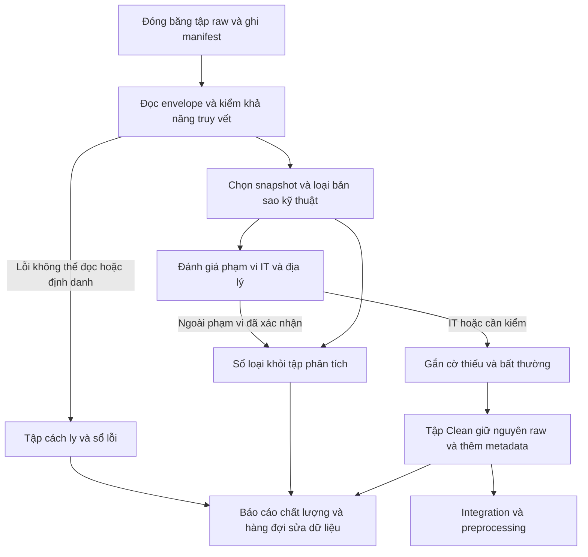
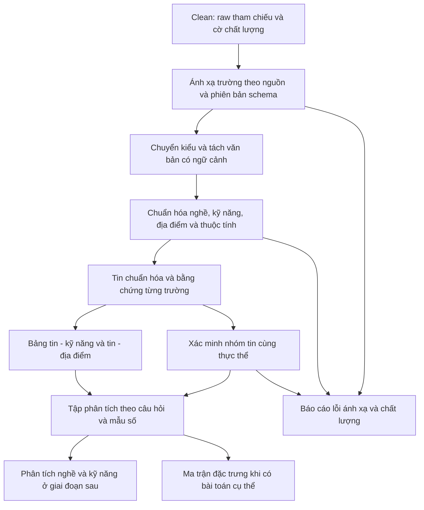

# BÁO CÁO ĐỒ ÁN MÔN HỌC
# KHẢO SÁT DỮ LIỆU, DATA CLEANING VÀ DATA PREPROCESSING

**Đề tài:** Tích hợp và khai phá dữ liệu thị trường lao động phục vụ phân tích nghề nghiệp và kỹ năng trong IT

| Thông tin | Nội dung |
|---|---|
| Trường / Khoa | … |
| Môn học / Lớp | … |
| Giảng viên hướng dẫn | … |
| Sinh viên / Nhóm / MSSV | … |
| Ngày lập báo cáo | 05/11/2026 |
| Phiên bản | 2.0 — Báo cáo tổng hợp Cleaning và Preprocessing |
| Phạm vi khảo sát mã nguồn | Repository VN-IT-Job-Mining, commit `0cfa1b0` |

## Tóm tắt

Báo cáo khảo sát dữ liệu tuyển dụng từ tám nguồn và thiết kế lại hai quy trình Data Cleaning, tích hợp và Data Preprocessing cho đề tài phân tích nghề nghiệp và kỹ năng IT. Nội dung đi từ mục tiêu, input/output, phạm vi và chất lượng dữ liệu đến quy tắc xử lý, tiêu chí đánh giá và thứ tự điều chỉnh project.

Phần Data Cleaning tập trung vào phạm vi IT, snapshot, trùng kỹ thuật, dữ liệu thiếu và việc giữ hoặc loại tin có căn cứ. Phần Data Preprocessing tiếp nối bằng ánh xạ đa nguồn, chuẩn hóa nghề, kỹ năng, địa điểm và các thuộc tính bổ trợ; đầu ra là bộ dữ liệu phân tích có thể truy vết. Các số liệu trong báo cáo được đối chiếu với tài liệu lịch sử và mã nguồn, chưa phải thực nghiệm của pipeline đề xuất. Không bổ sung LLM hay công bố kết quả khai phá chưa thực hiện.

**Từ khóa:** tuyển dụng IT, chất lượng dữ liệu, cleaning, preprocessing, nghề nghiệp, kỹ năng.

## Mục lục

1. Đặt vấn đề và mục tiêu nghiên cứu
2. Nguồn, phạm vi và đơn vị dữ liệu
3. Hiện trạng và vấn đề chất lượng dữ liệu
4. PHẦN I — Thiết kế quy trình Data Cleaning
5. Đánh giá, nghiệm thu và kế hoạch điều chỉnh
6. PHẦN II — Tích hợp và Data Preprocessing: hiện trạng và hợp đồng dữ liệu
7. Thiết kế tích hợp dữ liệu đa nguồn
8. Thiết kế biến đổi và chuẩn hóa nghiệp vụ
9. Chuẩn bị dữ liệu phân tích và khử trùng nghiệp vụ
10. Đánh giá và kế hoạch điều chỉnh
11. Kết luận và định hướng thực hiện
12. Tài liệu tham khảo
13. Phụ lục: hồ sơ quyết định, ví dụ và công việc cần thực hiện

## 1. Đặt vấn đề và mục tiêu nghiên cứu

### 1.1. Bối cảnh và lý do điều chỉnh

Project đã phát triển các thành phần thu thập, lưu trữ, EDA, tiền xử lý và giám sát. Tuy nhiên, việc có nhiều thành phần kỹ thuật không tự bảo đảm dữ liệu đáp ứng bài toán nghiên cứu. Tài liệu tổng quan vẫn chứa định hướng AI/LLM và phạm vi nghiệm thu chỉ gồm collection, trong khi driver hiện hành đã chạy Clean → Integration → Transformation → Normalization → Encoding bằng luật. Sự khác biệt giữa tài liệu, code và mục tiêu sử dụng là căn cứ cần xác lập lại thiết kế [C-N1–C-N3].

Khung CRISP-DM đặt việc hiểu mục tiêu và hiểu dữ liệu trước thiết kế xử lý; các pha có thể được xem xét lại khi xuất hiện bằng chứng mới. Báo cáo vận dụng khung này để nối mục tiêu nghiên cứu với lựa chọn dữ liệu và quy tắc làm sạch. [IBM, *CRISP-DM Guide*, chương 1–4](https://public.dhe.ibm.com/software/analytics/spss/documentation/modeler/18.0/en/ModelerCRISPDM.pdf).

### 1.2. Mục tiêu và câu hỏi nghiên cứu

Mục tiêu chung là tạo cơ sở dữ liệu tuyển dụng đủ nhất quán và có thể truy vết để mô tả nghề nghiệp, kỹ năng IT trong **tập tin đã thu thập**. Đối tượng sử dụng là nhóm thực hiện đồ án, giảng viên đánh giá và người đọc quan tâm tới yêu cầu nghề nghiệp IT.

**Bảng 1. Câu hỏi nghiên cứu và yêu cầu dữ liệu**

| Câu hỏi | Input cần có | Output phân tích dự kiến | Điều kiện chất lượng |
|---|---|---|---|
| Các nhóm nghề IT xuất hiện như thế nào? | Tiêu đề, mô tả, nhóm nghề, nguồn | Số tin và tỷ trọng theo nhóm nghề | Phân loại có căn cứ; nhóm chưa rõ được báo cáo riêng |
| Nhà tuyển dụng đề cập những kỹ năng nào? | Yêu cầu, mô tả, tag kỹ năng | Tần suất kỹ năng theo nghề | Tách kỹ năng khỏi ngành nghề và tag SEO |
| Những kỹ năng nào thường cùng xuất hiện? | Tập kỹ năng trên từng tin | Bảng đồng xuất hiện, dữ liệu cho khai phá quan hệ | Mỗi kỹ năng chỉ đếm một lần trên một tin; kiểm soát tin trùng |
| Nghề và kỹ năng khác nhau theo địa điểm, kinh nghiệm ra sao? | Địa điểm làm việc, kinh nghiệm, nghề, kỹ năng | Bảng phân bố có mẫu số rõ ràng | Giữ nhiều địa điểm; phân biệt thiếu và bằng 0 |
| Lương công bố có đặc điểm gì theo nghề? | Dải lương, tiền tệ, kỳ trả, nghề | Thống kê bổ trợ trên tập lương đủ điều kiện | Không suy rộng sang tin ẩn lương; không đánh đồng lương cứng và tổng thu nhập |

Thu thập và làm sạch là điều kiện chuẩn bị cho khai phá, chưa phải kết quả khai phá. Báo cáo không tuyên bố đã phát hiện luật kỹ năng, dự báo xu hướng hay xây dựng hệ khuyến nghị.

### 1.3. Ranh giới hai quy trình

Theo nghĩa rộng, cleaning thuộc data preparation/preprocessing. Để phân công công việc rõ ràng, báo cáo dùng quy ước:

- **Cleaning:** xác định bản ghi nào được đưa tiếp vào xử lý, loại trùng kỹ thuật, phát hiện vấn đề và lưu dấu quyết định; raw vẫn bất biến.
- **Preprocessing tiếp sau:** tích hợp schema, biến đổi kiểu, chuẩn hóa nghiệp vụ, trích xuất kỹ năng, xác minh trùng ngữ nghĩa và tạo dữ liệu phân tích. Chi tiết tại Chương 6–10.

Văn bản sạch dùng tạm để phân loại trong Clean không thay thế văn bản gốc. Quy tắc chuẩn hóa văn bản chính thức được định nghĩa một lần ở preprocessing, tránh hai phiên bản xử lý khác nhau.

## 2. Nguồn, phạm vi và đơn vị dữ liệu

### 2.1. Phạm vi nghiên cứu

**Bảng 2. Phạm vi đề xuất**

| Chiều phạm vi | Quy định |
|---|---|
| Nội dung | Tin tuyển dụng công việc IT; phân biệt nghề của vị trí với ngành kinh doanh của công ty |
| Nghề giáp ranh | BA, quản lý sản phẩm/dự án, UI/UX, nhúng/IoT chỉ đưa vào tập IT xác nhận khi có ngữ cảnh công nghệ; trường hợp mơ hồ giữ để rà soát |
| Địa lý | Việc làm tại Việt Nam; remote có bằng chứng tuyển tại Việt Nam được giữ; địa điểm nước ngoài hoặc chưa rõ được gắn cờ, không suy từ tên sàn |
| Thời gian | Phân tích lát cắt trên tập dữ liệu đóng băng; chưa có min/max ngày cào và ngày đăng đã kiểm chứng trong phiên khảo sát này |
| Đơn vị phân tích chính | Tin đăng duy nhất trong một nguồn, tại snapshot được chọn; nhóm tin cùng thực thể là lớp liên kết bổ sung |
| Dữ liệu ngoài phạm vi | Hồ sơ ứng viên, kết quả tuyển dụng, chương trình đào tạo, dữ liệu doanh nghiệp không gắn với tin |
| Chưa triển khai | Dự báo dài hạn, suy luận nhân quả, khoảng cách đào tạo–doanh nghiệp và khuyến nghị học tập |

Không coi số tin đăng là số người cần tuyển. `headcount` chỉ sử dụng khi được công bố và đọc đúng; một tin có thể tuyển nhiều người, nhiều nơi hoặc nhiều vai trò. Ngày cào phản ánh quan sát của hệ thống, không thay thế ngày đăng trong phân tích nhu cầu theo thời gian.

### 2.2. Kiểm kê tám nguồn

**Bảng 3. Cấu trúc được bộ đọc hiện hành hỗ trợ và trọng tâm kiểm tra** [C-N4, C-N5]

| Nguồn | Ví dụ cấu trúc raw được đọc | Nhóm dữ liệu cần giữ | Điểm cần đào sâu |
|---|---|---|---|
| TopCV | `title`, `salary_raw`, `general_info`, `working_places` | Tiêu đề, yêu cầu, mô tả, lương, tag, địa điểm | Raw thiếu JD; tag ngành nghề; lương một đầu |
| TopDev | `title`, `salary_raw`/`salary`, `published`, `extra`, JSON-LD | Kỹ năng, mô tả, kinh nghiệm, ngày, công ty | Discovery lẫn ngoài IT; raw cũ thiếu trường; nhiều snapshot |
| VietnamWorks | `jobTitle`, `companyName`, `createdOn`, `jobLevelVI`, trường lương cấu trúc | Nghề, kỹ năng, địa điểm, lương và cờ hiển thị | Lương 0 đi cùng ẩn lương; batch cũ; thời điểm đăng/cập nhật |
| CareerViet | `job-company-name`, `map`, `detail-box`, nội dung DOM | Mô tả, yêu cầu, địa điểm, thuộc tính trong chuỗi | Template không chuẩn; tag SEO; ngày cập nhật khác ngày đăng |
| Vieclam24h | `company`, `general_info`, `experience_summary`, `working_address` | Yêu cầu, mô tả, lương, kinh nghiệm | Batch trùng; tag không phải kỹ năng; bullet đứt dòng |
| ITviec | `sections`, `salary_display_text`, `job_posting_jsonld` | Kỹ năng, mô tả, lương, ngày và nhiều địa điểm | Lương ẩn trên giao diện; ngày tương đối; khác biệt phân khúc |
| Glints | `job-title`/`title`, `requirements`, `salary`, JSON-LD | Kỹ năng, yêu cầu, tiền tệ, địa điểm | Mẫu nhỏ; khác biệt tiền tệ; độ mới dữ liệu |
| JobsGO | `salary_raw`, `working_places`, `occupations`, nội dung DOM | Kỹ năng trong JD, nghề, công ty, địa điểm | `occupations` không phải kỹ năng; tin ngoài IT |

Bảng mô tả khả năng đọc của code và các hồ sơ hiện có, không khẳng định mọi tin đều có các trường này. Mỗi nguồn có một [notebook EDA](../../collection/reports/) riêng; chẩn đoán cũ là đầu mối kiểm tra, chưa phải kết quả đo lại trên cùng snapshot.

### 2.3. Quy mô có bằng chứng và giới hạn kiểm chứng

Workspace khảo sát không có thư mục `data/`. Vì vậy chưa kiểm tra trực tiếp toàn bộ raw, chưa chạy lại EDA và chưa đối chiếu với bucket R2. Các số dưới đây lấy từ JSON báo cáo đã lưu, không phải số lượng hiện tại trên cloud.

**Bảng 4. Số liệu lịch sử từ báo cáo Clean trong repository** [C-N6]

| Nguồn | Bản ghi đầu vào, gồm snapshot/batch | Bản ghi sau Clean |
|---|---:|---:|
| TopCV | 2.749 | 1.561 |
| TopDev | 3.890 | 227 |
| VietnamWorks | 2.878 | 900 |
| CareerViet | 660 | 448 |
| Vieclam24h | 1.276 | 182 |
| ITviec | 911 | 905 |
| Glints | 331 | 271 |
| JobsGO | 1.597 | 683 |
| **Tổng** | **14.292** | **5.177** |

Báo cáo gộp ghi `mode=applied`, `code_version=7dee2a4`, `generated_at=2026-11-03T17:12:12+00:00`, tương ứng 00:12:12 ngày 04/11/2026 tại Việt Nam. Dấu thời gian này là thời điểm sinh báo cáo, **không phải cửa sổ thu thập dữ liệu**. Số 5.177 là số bản ghi sau các luật hiện hành, không chứng minh tất cả đều đúng là IT hay đều là vị trí khác nhau.

**Bảng 5. Phễu loại bản ghi của lần chạy lịch sử**

| Luật hiện hành | Số bản ghi bị loại khỏi output |
|---|---:|
| C1 — Snapshot cũ | 1.987 |
| C2 — Bản batch đã có file riêng | 1.341 |
| C3 — Bản ghi test/không hợp lệ | 0 |
| C4c — Ngoài IT theo policy | 5.514 |
| C5 — JD dưới 30 từ | 188 |
| C6 — Trùng khóa trong nguồn | 72 |
| C7 — Trùng khóa khác nguồn | 13 |
| **Tổng bị loại** | **9.115** |

Kiểm tra số học: **14.292 = 5.177 + 9.115**. Đây chỉ xác nhận phép cộng của báo cáo, chưa xác nhận tính đúng của từng quyết định loại. Không cộng số của P1 ngày 03/11 có output 8.373 với lần báo cáo này: đó là các hiện trạng/lần chạy khác nhau.

### 2.4. Phân biệt đơn vị đếm

| Khái niệm | Ý nghĩa và cách đếm |
|---|---|
| File | Đối tượng lưu trữ; một file batch có thể chứa nhiều tin |
| Snapshot | Một phiên bản nội dung của tin tại thời điểm quan sát |
| Tin trong nguồn | Khóa `(source_platform, source_job_id)`; nhiều snapshot vẫn là cùng tin |
| Nhóm thực thể tuyển dụng | Các tin được xác minh là cùng đợt/vị trí tuyển; có thể xuyên nguồn |
| Chỉ tiêu tuyển | Số người nhà tuyển dụng công bố; không suy từ số snapshot hoặc số tin |

## 3. Hiện trạng và vấn đề chất lượng dữ liệu

### 3.1. Cách phân loại bằng chứng

Trong báo cáo, **đã triển khai** nghĩa là thấy logic trong code; **lịch sử** nghĩa là được ghi trong EDA, issue hoặc output trước đây; **đề xuất** nghĩa là thiết kế cần thực hiện sau. Code tồn tại không đồng nghĩa đã được chạy thành công trên dữ liệu hiện tại.

Các notebook có khuyến nghị GenAI và những nhận định thống kê chưa kèm cùng một tập đầu vào. Ví dụ chẩn đoán Glints mô tả tỷ lệ ẩn lương lớn, nhưng bảng D1 trong hồ sơ ngày 03/11 ghi 0%. Cần kiểm lại định nghĩa “ẩn lương”, trường được đọc và mẫu số; báo cáo không chọn một số làm sự thật mới nhất [C-N4, C-N7]. Không thể kết luận cơ chế thiếu là MNAR chỉ từ việc tỷ lệ thiếu cao; chỉ ghi nhận khả năng thiếu có hệ thống và dấu hiệu chủ động không công bố.

### 3.2. Ma trận vấn đề và hướng giải quyết

**Bảng 6. Vấn đề → bằng chứng → tác động → xử lý → kiểm tra**

| Vấn đề | Bằng chứng/trạng thái | Tác động tới phân tích | Giải pháp đề xuất | Cách kiểm tra |
|---|---|---|---|---|
| Snapshot và batch trùng | C1/C2 đã có; số lịch sử ở Bảng 5 | Phóng đại tần suất nghề/kỹ năng | Chọn snapshot ổn định theo nguồn+ID; lưu liên kết các bản không chọn | Kiểm khóa và lịch sử lựa chọn; raw không đổi |
| Tin ngoài IT | C4c + policy; SCRAPE-15 ghi TopDev lọc danh mục không hiệu lực | Sai mẫu nghiên cứu | Phân loại có ngữ cảnh, rà soát từng nguồn; sửa discovery là việc tiếp theo | Mẫu gồm cả nhóm giữ và nhóm loại; đếm IT bị loại nhầm |
| JD thiếu/ngắn | C5 dưới 30 từ trong code; SCRAPE-16 ghi nhận 297 raw TopCV thiếu JD trong đợt cũ | Có thể mất tin IT thật | Thay loại toàn bộ bằng cờ thiếu; đánh giá còn dùng được cho câu hỏi nào | So sánh phân bố nghề/nguồn trước–sau; rà các tin IT bị C5 loại |
| Gộp tin quá sớm | C6/C7 dùng công ty, tiêu đề, tỉnh đầu tiên, tuần; có fallback tuần cào | Gộp nhầm đợt tuyển hoặc bỏ sót trùng | Chỉ tạo ứng viên liên kết; xác minh sau chuẩn hóa | Kiểm cặp cùng khóa nhưng khác JD, nơi làm hoặc đợt tuyển |
| Null theo ngữ nghĩa | Hồ sơ EDA: chuỗi rỗng, `0`, `[]`, thỏa thuận | Làm sai lương và kinh nghiệm | Từ điển null theo trường+nguồn; giữ giá trị gốc và lý do | `experience=0` không trở thành thiếu; lương thỏa thuận không thành 0 |
| Tag ngành lẫn kỹ năng | I4 và bộ lọc tag đã có; EDA JobsGO/Vieclam24h | Tần suất kỹ năng giả | Giữ tag gốc; phân nhóm kỹ năng/nghề/SEO/chưa rõ | Rà nhãn trên tag và đoạn văn chứng minh |
| Lương cực trị | Có cờ, ngưỡng và capping trong code sau Clean | Loại mất phân khúc hoặc biến sai giá trị thật | Clean chỉ gắn cờ; xác minh đơn vị/ngữ cảnh sau | Tin thực tập lương thấp, chuyên gia lương cao không bị xóa |
| Tin hết hạn/ngày thiếu | Hồ sơ ngày 03/11 ghi deadline trước crawl; một số nguồn thiếu ngày đăng | Nhầm dữ liệu lịch sử với nhu cầu đang mở | Giữ cho lát cắt quan sát; gắn trạng thái; không điền ngày cào vào ngày đăng | Phân biệt expired, unknown, ngày cập nhật và ngày đăng |
| Lệch nguồn/địa bàn | PRE-11 ghi các thống kê trên tập 5.177 tin | Suy rộng quá mức ra thị trường | Báo độ phủ và mẫu số từng nhóm; chưa tái cân bằng tự động | So cơ cấu nguồn trước–sau từng luật |

Nguồn: code [C-N3, C-N5, C-N8], hồ sơ lỗi [C-N7, C-N9]. Số 297 tin thiếu JD của đợt cũ không phải số C5=188 trong lần chạy Bảng 5: mẫu đầu vào và các bước lọc trước C5 khác nhau.

### 3.3. Nội dung ưu tiên đào sâu

Ưu tiên thứ nhất là **lọc đúng phạm vi IT**, vì sai tại đây làm sai toàn bộ các phân tích tiếp theo. Ưu tiên thứ hai là **tính duy nhất của tin** và nguy cơ mất tin thật do C5–C7. Ưu tiên thứ ba là **chất lượng mô tả, yêu cầu và tag**, do đây là đầu vào trực tiếp cho phân tích kỹ năng. Lương, địa điểm và kinh nghiệm cần được làm đúng ngữ nghĩa, nhưng không dùng độ đầy đủ của chúng làm điều kiện bắt buộc để giữ một tin phục vụ phân tích nghề.

## 4. PHẦN I — Thiết kế quy trình Data Cleaning

### 4.1. Hợp đồng input/output đề xuất

**Bảng 7. Hợp đồng dữ liệu**

| Thành phần | Nội dung |
|---|---|
| Input | Raw envelope, metadata nguồn/ID/URL/thời điểm/phiên bản; policy IT; danh mục nguồn; manifest tập đầu vào |
| Tập giữ lại | Envelope còn giá trị phân tích, giữ nguyên `raw_payload`, bổ sung quyết định và cờ chất lượng |
| Tập cách ly | Bản ghi lỗi đọc, thiếu định danh không thể truy vết hoặc nội dung không thể diễn giải; kèm lý do và tham chiếu raw |
| Sổ loại khỏi tập phân tích | Snapshot không chọn, bản trùng kỹ thuật, tin ngoài phạm vi đã xác nhận; không xóa raw |
| Báo cáo chất lượng | Số lượng từng nhánh, từng nguồn, từng luật; ví dụ; phiên bản code/policy; thông tin dữ liệu đầu vào |
| Mẫu rà soát | Mẫu phân tầng có nhãn tay và lý do; không ghi đè nhãn đã có |

Đây là **hợp đồng đề xuất**, mở rộng output Clean hiện tại vốn chủ yếu có JSONL và báo cáo drop. Cờ bổ sung tối thiểu gồm lý do thiếu JD, trạng thái IT, khả năng dùng cho phân tích nghề/kỹ năng, lý do cách ly và tham chiếu snapshot. Không coi `unknown` là `non_it`.

### 4.2. Sơ đồ quy trình đề xuất

### 4.3. Trình tự và quy tắc xử lý

**Bước 1 — Đóng băng dữ liệu.** Lập manifest liệt kê nguồn, đường dẫn, hash, số bản ghi đọc được, khoảng thời gian quan sát và thời điểm chốt. Tệp không đọc được ghi vào sổ lỗi cấp file; không tính nó như một bản ghi JSON đã biết. Chưa có manifest thì chưa dùng cụm từ “toàn bộ dữ liệu thị trường”.

**Bước 2 — Kiểm tính hợp lệ kỹ thuật.** Kiểm JSON, nguồn, ID, URL và cấu trúc envelope. Thiếu một trường nghiệp vụ không đồng nghĩa bản ghi vô hiệu. Nếu thiếu ID nhưng có URL ổn định, đưa vào hàng đợi xác minh định danh; không tự đặt ID nghiệp vụ hoặc gộp tất cả ID rỗng.

**Bước 3 — Xử lý phiên bản và bản sao.** Trong mỗi nguồn, nhóm theo ID. Chọn snapshot mới nhất có timestamp hợp lệ; dùng version để phân giải khi cùng timestamp, rồi đường dẫn để kết quả ổn định. Trường hợp thiếu timestamp hoặc thứ tự version mâu thuẫn được gắn cờ để kiểm. Bản batch giống nội dung với file riêng chỉ giữ một đại diện; khác nội dung được xử lý như ứng viên phiên bản, không mặc định file riêng luôn mới hơn. Mọi bản không chọn có liên kết tới bản đại diện. Không trộn trường giữa hai snapshot để tạo bản “đầy đủ” không từng tồn tại.

**Bước 4 — Lọc phạm vi.** Dùng tiêu đề, mô tả, yêu cầu và nhóm nghề để gắn `it`, `non_it`, `can_kiem`; bằng chứng phải chỉ ra luật và đoạn văn liên quan. Công ty ngân hàng tuyển lập trình viên vẫn thuộc IT; vị trí bán hàng tại công ty công nghệ chưa chắc thuộc IT. Chính sách đã có được lưu cùng phiên bản đánh giá, nhưng không suy rộng độ đúng của mẫu nhỏ sang tất cả dữ liệu. Nhóm chưa rõ vẫn được giữ, có thể tách khỏi mẫu số của tập IT đã xác nhận.

**Bước 5 — Đánh giá khả năng sử dụng.** JD ngắn hoặc thiếu chỉ kích hoạt cờ, không tự loại toàn bộ tin. Tin có tiêu đề rõ nhưng thiếu JD có thể dùng cho thống kê nghề, song không dùng để kết luận “không yêu cầu kỹ năng”. Tin có tag kỹ năng xác thực vẫn có thể đóng góp vào thống kê tag, nhưng cần tách nguồn bằng chứng với trích xuất từ JD. Lương thiếu, hết hạn hoặc địa chỉ không chi tiết không phải lý do xóa tin.

**Bước 6 — Ghi quyết định và chuyển tiếp.** Ghi tập giữ, tập cách ly, sổ loại và báo cáo. Khóa công ty–tiêu đề–địa điểm chỉ tạo ứng viên trùng ngữ nghĩa. Việc xác nhận trùng khác ID hoặc xuyên nguồn chuyển sang preprocessing sau chuẩn hóa; mỗi tin nguồn được giữ để truy vết.

### 4.4. Null, lỗi và ngoại lai

**Bảng 8. Quy tắc ngữ nghĩa cần bảo toàn**

| Giá trị/tình huống | Cách diễn giải đề xuất |
|---|---|
| `""`, khoảng trắng | Thiếu văn bản, ghi nhận trường và nguồn |
| `[]` | Chưa có phần tử được ghi nhận; không mặc định “không yêu cầu kỹ năng” |
| “Thỏa thuận” | Trạng thái công bố lương; giá trị số để null |
| “Không yêu cầu kinh nghiệm” | Thông tin hợp lệ: mức tối thiểu bằng 0 nếu câu chữ rõ |
| Lương số 0 | Kiểm cờ hiển thị và ngữ nghĩa nguồn; không coi mặc định là lương 0 đồng |
| JD rỗng do crawler | Lỗi thu thập nghi ngờ; mở hàng đợi cào lại, không bù bằng suy đoán |
| Lương cao/thấp bất thường | Gắn cờ để xác minh; không khẳng định là lỗi chỉ vì vượt IQR |

Làm sạch đạt yêu cầu không có nghĩa là dữ liệu không còn null. Một giá trị thiếu được giải thích và truy vết tốt hơn một giá trị được điền không có căn cứ.

## 5. Đánh giá, nghiệm thu và kế hoạch điều chỉnh

### 5.1. Chỉ tiêu đánh giá

**Bảng 9. Chỉ tiêu bắt buộc trong lần thực nghiệm tiếp theo**

| Chỉ tiêu | Cách đo |
|---|---|
| Bảo toàn bản ghi | `N_đọc_được = N_giữ + N_cách_ly + N_loại`; các nhánh loại loại trừ nhau |
| Bảo toàn raw | So hash raw trước–sau; output chỉ tham chiếu hoặc sao chép nguyên bản |
| Tính duy nhất kỹ thuật | Không lặp khóa nguồn+ID trong lát cắt đã chọn; không làm mất lịch sử raw |
| Độ phủ | Số và tỷ lệ có giá trị theo trường, nguồn, trạng thái IT; mẫu số ghi rõ |
| Sai sót lọc IT | Ma trận nhầm lẫn, precision/recall IT trên mẫu có nhãn; số IT bị loại nhầm |
| Tác động từng luật | Số sửa/gắn cờ/loại; so cơ cấu nguồn và nghề trước–sau |
| Khả năng tái lập | Cùng manifest, code và policy cho cùng tập khóa và quyết định; bỏ qua thời gian sinh báo cáo |

Đề xuất mẫu kiểm tra ban đầu: mỗi nguồn lấy tối đa 30 tin ở mỗi nhóm `it`, `non_it`, `can_kiem`, chọn ổn định với seed 42; nhóm ít hơn lấy toàn bộ. Ghi tỷ lệ lấy mẫu vì đây là mẫu phân tầng, không dùng accuracy gộp không trọng số để đại diện toàn tập. Bổ sung tập ca khó riêng, không trộn vào ước lượng ngẫu nhiên. Nhãn bất đồng được người thứ hai kiểm và ghi lý do. Chưa đặt ngưỡng chất lượng thống kê khi chưa có baseline và phân tích chi phí loại nhầm.

### 5.2. Kịch bản kiểm thử thiết kế

| Tình huống | Kết quả mong đợi |
|---|---|
| Một ID có v1/v2, cùng ID ở hai sàn | Chọn đúng snapshot trong từng nguồn; không gộp hai nguồn theo ID đơn lẻ |
| Batch và file riêng cùng/khác nội dung | Bản giống chỉ một đại diện; bản khác có lịch sử và kiểm thứ tự |
| “International Sales” | Không khớp “intern” thành IT |
| “Backend Developer” thiếu JD | Giữ tin, gắn thiếu JD và hạn chế khả năng phân tích kỹ năng |
| Công ty cùng tên, tiêu đề giống, khác địa điểm/đợt tuyển | Không gộp tự động chỉ theo khóa ứng viên |
| Kinh nghiệm 0; lương thỏa thuận | Giữ ý nghĩa 0 kinh nghiệm; lương số null có trạng thái |
| JSON lỗi hoặc thiếu định danh | Có mục cách ly/lỗi file, không mất âm thầm |
| Chạy lại cùng dữ liệu | Cùng quyết định; nhãn tay cũ không bị ghi đè |

Đây là yêu cầu kiểm thử cho lần sửa pipeline tiếp theo. Phiên viết báo cáo chỉ kiểm tra tài liệu và đối chiếu số học; chưa thực hiện các kịch bản trên dữ liệu raw.

### 5.3. Thứ tự công việc

| Ưu tiên | Công việc | Sản phẩm nghiệm thu |
|---|---|---|
| P0 | Chốt manifest, ngày chốt, đơn vị đếm và phạm vi | Bảng kiểm kê có thời gian và hash |
| P0 | Rà C4c/C5 và các tin bị loại | Mẫu có nhãn; bảng tác động; policy đề xuất có căn cứ |
| P0 | Tách trùng kỹ thuật khỏi trùng nghiệp vụ | Đặc tả chọn snapshot và danh sách ứng viên liên kết |
| P1 | Bổ sung cách ly, sổ quyết định, khả năng dùng theo bài toán | Hợp đồng Clean và báo cáo bảo toàn |
| P1 | Đo lại EDA cùng snapshot | Ma trận chất lượng tám nguồn, trước–sau |
| P1 | Mở việc sửa collection cho lỗi raw và phạm vi cào | Danh sách lỗi có URL/ID, ví dụ và tiêu chí kiểm lại |
| P2 | Cập nhật tài liệu và giao diện giám sát theo định nghĩa mới | Không còn trộn số file, snapshot, tin và thực thể |

## 6. PHẦN II — Tích hợp và Data Preprocessing: hiện trạng và hợp đồng dữ liệu

### 6.1. Pipeline đã triển khai

**Bảng 10. Hành vi quan sát được trong mã nguồn** [P-N1–P-N5]

| Bước | Hành vi hiện hành | Điểm cần xem xét lại |
|---|---|---|
| Clean | Chọn snapshot, lọc IT theo policy, loại JD ngắn, khử trùng theo khóa | Các quyết định loại có thể làm mất tin hữu ích; xem Chương 4–5 |
| Integration | 18 trường nghiệp vụ, 5 khóa và 5 trường metadata Clean; gộp vào `all.parquet` | Chưa nên chọn trường chỉ vì nhiều nguồn có; cần metadata truy vết sâu hơn |
| Transformation | Null, HTML/bullet, lương, ngày, kinh nghiệm, headcount, kỹ năng/phúc lợi, địa điểm | Cần phân biệt dữ liệu công bố, trích xuất và giả định |
| Normalization | Kỹ năng, công ty, 12 nhóm nghề, 6 cấp bậc, địa điểm; xử lý lương IQR/capping/log | Taxonomy và suy ra cấp bậc có thể mất chi tiết; không coi capping là mặc định |
| Encoding | One-hot, ordinal, top 10 tỉnh; kỹ năng xuất hiện ≥20 tin, tối đa 200; cờ thiếu | Có thể làm mất kỹ năng hiếm hoặc địa phương; chỉ phù hợp một số đầu ra |

Integration hiện có **28 cột** theo `KEYS + CLEAN_META + KEEP_18`, không phải toàn bộ bảng chỉ có 18 cột. Danh mục nghề trong code cũng khác danh mục của skill cũ: code có `Data/AI` gộp và không có nhóm Embedded riêng. Đây là khác biệt cần quyết định theo mẫu dữ liệu, không tự coi danh mục nào là chuẩn quốc tế.

### 6.2. Kết quả lịch sử có thể đối chiếu

Báo cáo Clean lưu trong repo ghi 14.292 bản ghi vào và 5.177 bản ghi ra. Các báo cáo Integration, Transformation, Normalization và Encoding đều ghi 5.177 → 5.177. Các file này có `code_version=7dee2a4`; thời gian UTC từ 17:12 đến 17:13 ngày 03/11/2026, tức đầu ngày 04/11 theo giờ Việt Nam [P-N6].

Số dòng được giữ nguyên không chứng minh ý nghĩa dữ liệu đã đúng. Phiên khảo sát ngày 05/11 không chạy lại pipeline, không đọc raw hoặc parquet trên R2. PRE-11 ghi các tỷ lệ như thiếu lương, nhóm nghề “Khác” và độ thưa kỹ năng trên tập lịch sử; chúng là chỉ báo để điều tra, chưa được đo lại ở đây [P-N7].

### 6.3. Hợp đồng input/output đề xuất

**Bảng 11. Sản phẩm của preprocessing**

| Sản phẩm | Đơn vị một dòng | Vai trò |
|---|---|---|
| Input Clean | Một tin/nguồn ở snapshot đã chọn, kèm cờ | Dữ liệu đầu vào có thể truy vết về raw |
| `jobs_standardized` | Một tin/nguồn | Bảng phân tích nghề, địa điểm, kinh nghiệm, lương |
| `job_skills` | Một cặp tin–kỹ năng chuẩn | Đếm tần suất và dựng tập kỹ năng; giữ danh sách bằng chứng |
| `job_locations` | Một cặp tin–địa điểm đã chuẩn hóa | Giữ các địa điểm, tránh chỉ lấy phần tử đầu |
| `entity_memberships` | Một tin nguồn thuộc một nhóm tuyển dụng đã xác nhận | Phân tích có kiểm soát tin đăng chéo |
| Quality report / manifest | Một lần chạy và các bảng kiểm tra | Phạm vi, số lượng, luật, dictionary, code và nguồn dữ liệu |
| Feature matrix, nếu cần | Theo đơn vị của bài toán cụ thể | Không phải điều kiện bắt buộc để hoàn thành bộ dữ liệu phân tích |

Các tên bảng trên là **giao diện logic đề xuất**, chưa phải file đã được tạo hoặc API đang tồn tại. Có thể xuất Parquet và dùng bảng/view phụ từ dữ liệu đã chuẩn hóa; chưa cần chuyển project sang một hệ quản trị cơ sở dữ liệu mới. Không thay đổi API công khai trong đợt viết báo cáo.

## 7. Thiết kế tích hợp dữ liệu đa nguồn

### 7.1. Sơ đồ dòng dữ liệu đề xuất

### 7.2. Nguyên tắc lựa chọn trường

Giữ nhóm trường cốt lõi theo mục tiêu: định danh, nguồn, thời gian quan sát; tiêu đề, mô tả, yêu cầu; công ty; nghề/cấp bậc; kỹ năng; địa điểm; kinh nghiệm. Lương, loại hợp đồng, học vấn, chỉ tiêu tuyển và phúc lợi hỗ trợ phân tích khi đủ độ phủ.

Một trường ít nguồn có vẫn có thể giá trị, ví dụ cách làm việc remote hoặc chuyên môn đặc thù. Trường đó được giữ trong lớp mở rộng hoặc qua tham chiếu raw, thay vì loại vì không đạt ngưỡng có ở 3–4 nguồn. Chỉ dùng các trường đủ điều kiện trong từng phân tích; không ép tất cả nguồn phải có cùng độ đầy đủ.

### 7.3. Bảng ánh xạ nguồn và điểm kiểm tra

**Bảng 12. Một số ánh xạ đọc được trong flattener hiện hành** [P-N2]

| Nguồn | Tiêu đề / công ty | Lương | Ngày / thuộc tính cần chú ý |
|---|---|---|---|
| TopCV | `title` / `company` | `salary_raw` | `deadline_raw` là hạn nộp; `general_info` chứa cấp bậc/học vấn |
| TopDev | `title` hoặc `job-title` / thông tin công ty theo cấu trúc nguồn | `salary_raw` hoặc `salary` | `published.date`, `date_posted`, JSON-LD; raw cũ có thể thiếu |
| VietnamWorks | `jobTitle` hoặc `title` / `companyName` hoặc `company.name` | Trường lương số và cờ hiển thị trong payload | `createdOn`, `approvedOn`, `onlineOn` phải giữ đúng nghĩa; không mặc định tương đương |
| CareerViet | `title` / `job-company-name` | Chuỗi trong `detail-box` | Code có fallback ngày cập nhật thành ngày đăng; đề xuất tách loại ngày |
| Vieclam24h | `title` / `company.name` hoặc chuỗi `company` | `salary` | `experience_summary`, `deadline`, `general_info` |
| ITviec | `title` / `company_name` hoặc `company` | `salary_display_text`, dữ liệu JSON-LD nếu có | `job_posting_jsonld.datePosted` trước `posted_at_raw` |
| Glints | `job-title` hoặc `title` / `company-name` hoặc `company` | `salary`, JSON-LD nếu có | `requirements`, `description`, trường lồng |
| JobsGO | `title` / `company` | `salary_raw` | `deadline_raw`, `working_places`; `occupations` là nghề |

Bảng này không thay thế mapping đầy đủ trên raw của một phiên bản nguồn. Khi triển khai, mỗi mapping phải ghi đường dẫn field, kiểu nhận được, điều kiện fallback và ví dụ tin. Nguồn đổi kiểu từ chuỗi sang object phải báo lỗi schema hoặc cách ly trường, không chuyển object thành chuỗi để tiếp tục âm thầm.

### 7.4. Từ điển dữ liệu đích tối thiểu

**Bảng 13. Hợp đồng ngữ nghĩa đề xuất**

| Nhóm | Thuộc tính logic | Kiểu và quy tắc |
|---|---|---|
| Định danh | `job_id_global`, nguồn, ID nguồn, URL | Chuỗi không rỗng, khóa tin duy nhất trong lát cắt |
| Truy vết | Raw reference, snapshot/hash, phiên bản mapping | Không mất khi chuyển JSONL sang Parquet |
| Thời gian | Ngày cào, ngày đăng, ngày cập nhật, hạn nộp | Ngày/thời điểm nullable; mỗi loại có nguồn và mức chính xác |
| Văn bản | Tiêu đề, mô tả, yêu cầu; bản gốc và bản sạch | Giữ ngôn ngữ, cấu trúc đoạn, ký hiệu công nghệ |
| Nghề | Nhóm nghề, vai trò chi tiết nếu có, phương pháp gán | Nhãn từ taxonomy có phiên bản; cho phép chưa rõ |
| Cấp bậc | Nhãn công bố, nhãn chuẩn, nguồn suy ra | Tách nhãn suy luận khỏi công bố; không xem kinh nghiệm là tương đương tuyệt đối |
| Kỹ năng | Tên chuẩn, biến thể gốc, loại, bằng chứng, ngữ cảnh | Quan hệ nhiều giá trị; giữ trạng thái chưa ánh xạ |
| Địa điểm | Địa chỉ gốc, tỉnh/phường đã ánh xạ, remote, độ tin cậy | Không tự bịa cấp địa chỉ thiếu; nhiều nơi được bảo toàn |
| Kinh nghiệm | Min/max năm và loại giới hạn | Số nullable; 0 khác thiếu; một đầu không tự điền đầu kia |
| Lương | Min/max gốc, tiền tệ, kỳ trả, gross/net, loại thu nhập; giá trị quy đổi | Nullable; giữ một đầu, trạng thái công bố và căn cứ quy đổi |
| Chất lượng | Lý do thiếu, xung đột, cần kiểm, khả năng dùng theo bài toán | Cờ và lý do có thể kiểm tra lại |

Khi thông tin giữa tag, JSON-LD và JD mâu thuẫn, giữ cả ứng viên và nguồn chứng minh, chọn theo quy tắc riêng của trường đã kiểm tra trên mẫu. Không có một quy tắc “JSON-LD luôn đúng” cho mọi nguồn. Thiếu trường sau ánh xạ phải phân biệt raw không có, mapping chưa hỗ trợ và parse thất bại.

## 8. Thiết kế biến đổi và chuẩn hóa nghiệp vụ

### 8.1. Văn bản và giá trị thiếu

Giải mã HTML entity, bỏ script/style và thẻ trình bày, giữ ranh giới đoạn/bullet giữa mô tả, yêu cầu và quyền lợi. Chuẩn hóa Unicode và khoảng trắng nhưng giữ `C++`, `C#`, `.NET`, `Node.js`, số phiên bản và dấu phủ định. Không dịch JD; dùng từ điển biến thể Việt–Anh khi đã được kiểm chứng.

Mỗi trường có danh mục null riêng. `0 năm` có thể hợp lệ; `salaryMin=0` phải đọc cùng trạng thái công bố; “thỏa thuận” là thông tin về cách công bố lương. Không điền mean/median cho bảng nghiệp vụ chuẩn. Thiếu do crawler là vấn đề cần cào lại hoặc sửa mapping, không phải nhiệm vụ suy đoán dữ liệu.

### 8.2. Kỹ năng — trọng tâm cần đào sâu

**Bảng 14. Quy trình kỹ năng đề xuất**

| Công đoạn | Quy tắc | Kết quả cần lưu |
|---|---|---|
| Phân loại đầu vào | Tách tag kỹ năng, ngành nghề, nghề, công ty, SEO và chưa rõ | Tag gốc và loại được xác định |
| Trích xuất | Khớp biến thể trong mô tả/yêu cầu; không coi mọi từ khớp là yêu cầu tuyển | Đoạn chứng minh, trường nguồn, vị trí hoặc nội dung trích dẫn |
| Chuẩn hóa | Ví dụ ReactJS/React.js → React; không đồng nhất Java với JavaScript | Tên chuẩn và phiên bản dictionary |
| Xét ngữ cảnh | Phân biệt bắt buộc, ưu tiên, phủ định, chỉ giới thiệu và chưa rõ | Trạng thái ngữ cảnh và lý do |
| Gộp trong tin | Một kỹ năng chuẩn chỉ một quan hệ tin–kỹ năng; có thể nhiều bằng chứng | Không nhân tần suất vì lặp từ nhiều lần |
| Kiểm danh mục | Biến thể mới hoặc tag dài chưa biết đưa vào review | Không loại kỹ năng chỉ vì dài hơn bốn từ |

Code hiện tại có khớp từ nguyên vẹn và từ điển, nhưng bộ lọc metadata loại tag trên bốn từ; hàm trích xuất trả tên kỹ năng, chưa biểu diễn đầy đủ bằng chứng/ngữ cảnh [P-N3]. Ví dụ “không yêu cầu Java” vẫn chứa từ Java; “công ty sử dụng AWS” không nhất thiết là yêu cầu của vị trí. Bản đề xuất cần giữ bằng chứng và loại ngữ cảnh trước khi tính tần suất kỹ năng yêu cầu.

Các tên ngắn C, R, Go cần ngữ cảnh lập trình để tránh khớp chữ thông thường. Không suy kỹ năng ngầm từ mô tả chung như “xử lý dữ liệu lớn” thành một công nghệ cụ thể. Kỹ năng ngoài từ điển chưa có nhãn chuẩn vẫn được giữ để review. Không gọi từ điển nội bộ là ESCO nếu chưa có mã và ánh xạ kiểm chứng tới ESCO.

### 8.3. Nghề và cấp bậc

Mặc định tái sử dụng 12 nhãn hiện có làm **taxonomy nội bộ baseline**: Backend, Frontend, Fullstack, Mobile, Data/AI, DevOps/Cloud, Kiểm thử, Bảo mật, Hệ thống/Mạng, BA, Quản lý sản phẩm/dự án, Thiết kế UI/UX [P-N4]. Giữ nguyên tiêu đề và nhãn chi tiết được trích xuất để không mất khả năng tách Data Engineering/Data Science hoặc bổ sung Embedded trong lần cập nhật taxonomy. Tin nhúng có bằng chứng IT vẫn được giữ dù baseline chưa có nhóm riêng.

Ưu tiên bằng chứng chức năng công việc và tiêu đề; kỹ năng chỉ hỗ trợ, không dùng một công nghệ để quyết định nghề duy nhất. Một tin có Python chưa chắc là Data/AI. Vai trò đa nhiệm hoặc mâu thuẫn được gắn cần kiểm; không ép về nhãn đầu tiên chỉ vì thứ tự regex. Nhãn “Khác” và “Chưa rõ” cần tách: khác taxonomy không đồng nghĩa không có thông tin.

Code có sáu cấp bậc chuẩn, nhưng “Nhân viên” trên sàn không mặc nhiên là Junior; số năm kinh nghiệm không quyết định chắc chắn Senior. Nếu suy cấp bậc từ kinh nghiệm, phải lưu `method=inferred_rule` và không trộn với cấp bậc công bố khi đánh giá độ chính xác.

### 8.4. Địa điểm và thời gian

Giữ danh sách địa điểm thay vì chỉ địa điểm đầu tiên. Tách nơi làm việc khỏi trụ sở công ty. Dùng bộ từ điển địa phương đang có trong repo như phiên bản ánh xạ nội bộ; lưu tên gốc, tên chuẩn và phiên bản dictionary. Không tuyên bố tính chính xác pháp lý của danh mục từ việc file tồn tại. Nếu chưa ánh xạ được phường/xã thì để thiếu, không suy từ tỉnh.

Remote là chế độ làm việc, không phải một tỉnh. Khi tính theo tỉnh, một tin nhiều nơi có thể xuất hiện ở nhiều nhóm; tổng số theo tỉnh vì vậy có thể vượt số tin. Báo cáo phải giải thích cách đếm này.

Ngày tương đối chỉ chuyển thành ngày ước lượng khi có thời điểm tham chiếu. Ngày cập nhật không thay thế ngày đăng; ngày cào không thay thế ngày đăng bị thiếu. Tin hết hạn vẫn dùng được cho mô tả tập quan sát lịch sử; thống kê “đang tuyển” chỉ dùng khi có căn cứ trạng thái tại mốc chốt. Chưa đủ cửa sổ và độ phủ thì không dựng kết luận xu hướng thị trường theo tháng.

### 8.5. Kinh nghiệm và chỉ tiêu tuyển

Phân tích dạng khoảng, giới hạn dưới/trên, tháng/năm và “không yêu cầu”. “Từ 2 năm” tạo min=2, max=null; “dưới 1 năm” giữ giới hạn trên và tính chất mở, không đổi thành đúng 1 năm. Thiếu kinh nghiệm không được điền 0. Chỉ tiêu “nhiều người” giữ dạng định tính, không gán một số giả. Không nhân số kỹ năng với headcount nếu chưa xác lập câu hỏi đo theo người tuyển thay vì theo tin.

### 8.6. Lương và ngoại lai — xử lý bổ trợ

**Bảng 15. Quy tắc lương đề xuất và khác biệt với hiện trạng**

| Tình huống | Quy tắc đề xuất |
|---|---|
| “Từ 15 triệu”, “tới 30 triệu” | Giữ một đầu; không tạo khoảng đóng giả hoặc lấy trung bình khi thiếu một đầu |
| “2,000 USD” | Parse dấu hàng nghìn theo ngữ cảnh, lưu giá trị gốc và tiền tệ |
| Lương trong JD | Chỉ nhận câu có ngữ cảnh lương; tách thưởng, phụ cấp, sign-on bonus, tổng thu nhập |
| Lương thỏa thuận nhưng JD có số | Giữ trạng thái công bố ban đầu, thêm ứng viên số và nguồn trích xuất |
| Không rõ tiền tệ/kỳ trả | Để giá trị quy đổi thiếu; không mặc định VND/tháng mà không ghi giả định |
| Gross/net | Không so sánh như tương đương nếu chưa có quy tắc quy đổi và dữ liệu cần thiết |
| Ngoại tệ | Dùng bảng tỷ giá có ngày và nguồn cho lần phân tích; giữ số gốc; thiếu tỷ giá thì không quy đổi |
| Lương theo năm | Chỉ chia 12 khi ý nghĩa khoản thu nhập cho phép; giữ kỳ gốc và loại thu nhập |
| Theo giờ/ngày | Không tự nhân 160 giờ hoặc 22 ngày nếu tin không cho số giờ/ngày làm; ghi rõ nếu dựng kịch bản giả định |
| Ngoại lai | Gắn cờ; kiểm đơn vị và văn bản; không xóa tin hoặc sửa giá trị chỉ vì vượt ngưỡng thống kê |

Code hiện hành dùng tỷ giá cố định 25.400 VND/USD; có quy đổi giờ/ngày theo hằng số, chặn miền lương tháng 1–500 triệu, capping phân vị 1–99% và log [P-N3, P-N4]. Đây là lựa chọn kỹ thuật của phiên bản cũ, không phải tỷ giá hiện hành hoặc giới hạn lương đúng cho mọi nghề. Đề xuất giữ giá trị đã parse cùng cờ nghi ngờ; chỉ sửa khi có bằng chứng. Các cột capped/log nếu cần được tạo riêng cho phân tích hoặc mô hình cụ thể, không thay giá trị nghiệp vụ.

Thiếu lương có thể liên quan đến chính sách công bố của nhà tuyển dụng, nhưng chưa đủ chứng minh MNAR. Phân tích lương phải công bố tỷ lệ có dữ liệu theo nguồn/nghề, và chỉ mô tả tập đủ điều kiện; không suy ra phân phối lương của toàn bộ thị trường.

## 9. Chuẩn bị dữ liệu phân tích và khử trùng nghiệp vụ

### 9.1. Xác minh tin đăng chéo

Sau chuẩn hóa, dùng tên công ty, tiêu đề, tập địa điểm và thông tin thời gian để tìm **ứng viên trùng**. Khóa bằng nhau không đủ để tự gộp. Không dùng tuần cào làm bằng chứng cùng đợt tuyển khi thiếu ngày đăng. Mặc định thiết kế v1 chỉ xác nhận nhóm bằng rà soát bằng chứng; chưa chọn ngưỡng fuzzy hoặc cosine tùy ý.

Mỗi cặp được rà theo JD/yêu cầu, vai trò, địa điểm và đợt tuyển. Nếu chưa đủ căn cứ, giữ tách biệt. Nhóm đã xác nhận có `entity_id`, danh sách các `job_id_global`, căn cứ và trạng thái xác nhận. Không xóa các tin thành viên; giá trị mâu thuẫn được giữ với nguồn. Việc chọn tin đại diện cho một phép phân tích phải ghi tiêu chí và trường không thống nhất.

### 9.2. Các tập dữ liệu theo câu hỏi

**Bảng 16. Đầu ra phân tích, điều kiện chọn và mẫu số**

| Tập sử dụng | Điều kiện | Đơn vị và mẫu số |
|---|---|---|
| Nghề nghiệp | IT xác nhận; có nhãn nghề hoặc trạng thái chưa rõ | Tin duy nhất theo nguồn; báo riêng phần chưa rõ; có thể thêm kết quả theo nhóm thực thể xác nhận |
| Kỹ năng được đề cập | Có tag hoặc văn bản đọc được, có bằng chứng trích xuất | Một tin–kỹ năng; mẫu số là tin đủ điều kiện quan sát kỹ năng |
| Kỹ năng yêu cầu | Bằng chứng thuộc ngữ cảnh yêu cầu/ưu tiên theo định nghĩa báo cáo | Không gộp phủ định, giới thiệu hoặc chưa rõ vào nhu cầu |
| Đồng xuất hiện | Có ít nhất một kỹ năng hợp lệ theo ngữ cảnh đã chọn | Mỗi tin hoặc nhóm thực thể xác nhận là một giao dịch; cùng một phép phân tích dùng một đơn vị duy nhất |
| Địa điểm | Có ít nhất một nơi làm việc chuẩn hóa | Số tin distinct tại mỗi địa điểm; nêu rõ tính đa địa điểm |
| Lương | Có số, đơn vị, kỳ và loại thu nhập đủ điều kiện | Chỉ mẫu có thể so sánh; báo số bị loại khỏi phân tích lương, không loại khỏi bảng nghề |

Không có kỹ năng trích xuất được không đồng nghĩa vị trí không cần kỹ năng. Tập đồng xuất hiện loại các tin không quan sát được kỹ năng và phải công bố số lượng bị loại khỏi tập này; mẫu số có điều kiện nên kết quả không đại diện toàn bộ tin tuyển dụng.

### 9.3. Cách tính tần suất và đồng xuất hiện

Với tập đủ điều kiện S, tần suất kỹ năng A = số tin distinct trong S có A / số tin trong S. Đồng xuất hiện A–B được tính trên các tin có cả A và B, không đếm số lần từ xuất hiện trong JD. Khi phân tích theo nghề, mẫu số là các tin đủ điều kiện của nghề đó.

Một tin có hai địa điểm và ba kỹ năng tạo hai dòng tin–địa điểm và ba dòng tin–kỹ năng. Nếu join trực tiếp sẽ có sáu dòng; phải dùng khóa distinct hoặc tổng hợp trước để tránh nhân đôi tần suất. Bảng nghề và bảng quan hệ là cấu trúc phục vụ phân tích, không phải sáu tin tuyển mới.

### 9.4. Encoding khi thật sự cần

Giữ toàn bộ kỹ năng đã chuẩn hóa trong bảng nghiệp vụ. Giới hạn top K chỉ áp dụng cho một ma trận cụ thể và phải ghi các kỹ năng bị gộp; không xóa kỹ năng hiếm khỏi nguồn dữ liệu phân tích. Tương tự, không chỉ giữ top 10 tỉnh trong bảng chuẩn.

Với thống kê mô tả và bảng đồng xuất hiện, không bắt buộc scale lương, mã hóa thứ bậc cấp bậc hoặc one-hot mọi cột. Nếu về sau đánh giá mô hình học máy, cần chia tập trước khi học các phép chọn đặc trưng, bù khuyết hoặc scale; các tham số học trên train rồi áp dụng cho test. [scikit-learn, *Common pitfalls*, mục Data leakage](https://scikit-learn.org/stable/common_pitfalls.html#data-leakage).

Riêng dữ liệu tuyển dụng, đề xuất giữ các tin cùng thực thể/phiên bản trong cùng nhóm chia tập. Không dùng nhãn nghề sinh từ chính từ khóa làm “nhãn chuẩn độc lập” rồi đánh giá trên cùng quy tắc: cần tập nhãn tay riêng nếu nghiên cứu độ chính xác phân loại.

## 10. Đánh giá và kế hoạch điều chỉnh

### 10.1. Ma trận vấn đề, giải pháp và kiểm tra

**Bảng 17. Các điểm cần sửa theo mục tiêu nghiên cứu**

| Vấn đề và bằng chứng | Tác động | Giải pháp đề xuất | Cách kiểm tra |
|---|---|---|---|
| Giữ 18 trường theo cấu hình; hồ sơ cũ chọn theo độ phủ | Có thể bỏ thuộc tính hữu ích hiếm gặp | Tách lõi và mở rộng theo mục tiêu | Kiểm từng trường với câu hỏi phân tích và raw reference |
| CareerViet fallback ngày cập nhật thành ngày đăng trong flattener | Sai thời điểm nhu cầu | Giữ loại ngày và provenance | Fixture có ngày cập nhật nhưng thiếu ngày đăng |
| Tag >4 từ bị loại; kỹ năng chỉ có tên, chưa có ngữ cảnh | Mất kỹ năng dài, khớp phủ định | Bằng chứng và phân loại ngữ cảnh | Tập câu yêu cầu/ưu tiên/phủ định/giới thiệu |
| Gán nghề dựa thứ tự luật; taxonomy nội bộ gộp Data/AI | Sai nhãn hoặc mất chi tiết | Baseline có phiên bản, giữ vai trò gốc, rà mâu thuẫn | Ma trận nhầm lẫn theo nghề và nguồn |
| Suy cấp bậc từ số năm | Nhãn suy luận bị coi như công bố | Tách phương pháp gán và mức chắc chắn | Ca “Nhân viên”, Senior ít năm, tiêu đề không cấp bậc |
| Tỷ giá/ngưỡng lương/capping cố định | Làm sai khả năng so sánh và cực trị thật | Giữ số gốc; quy đổi có metadata; capping riêng | Lương một đầu, giờ/ngày, bonus, thiếu tiền tệ |
| Chỉ lấy tỉnh đầu ở khóa trùng, top 10 ở encoding | Bỏ thông tin đa địa điểm | Quan hệ nhiều nơi, tổng hợp distinct | Một tin hai tỉnh không thành hai tin toàn tập |
| Số liệu EDA và báo cáo khác lần chạy | Kết luận trước–sau không hợp lệ | Cùng manifest và phiên bản luật khi so | So nguồn, thời gian, mẫu số và hash |

### 10.2. Kế hoạch kiểm chứng

Kiểm thử kỹ thuật dùng fixture nhỏ có kết quả mong đợi, bao gồm tối thiểu một cấu trúc đại diện và một ca thiếu/đổi kiểu mỗi nguồn. Không cần toàn bộ dữ liệu để kiểm lỗi parse cơ bản. Kiểm chất lượng nghiệp vụ dùng mẫu có nhãn tay theo nguồn và nhóm nghề, tách mẫu ngẫu nhiên với tập ca khó.

**Bảng 18. Kịch bản kiểm thử và kỳ vọng**

| Kịch bản | Kỳ vọng |
|---|---|
| HTML chứa C++, C#, .NET, bullet và tiếng Việt | Giữ tên kỹ năng, dấu tiếng Việt và ranh giới nội dung |
| “Biết JavaScript”; “không yêu cầu Java” | Không nhận Java từ JavaScript; Java phủ định không tính là yêu cầu |
| ReactJS và React.js lặp trong một tin | Một kỹ năng chuẩn, nhiều bằng chứng nếu có |
| Kỹ năng hợp lệ dài hơn bốn từ | Không tự loại chỉ vì độ dài |
| “Từ 15 triệu”, “tới 30 triệu”, “2,000 USD” | Một đầu đúng; số USD gốc đúng; quy đổi chỉ khi có cấu hình hợp lệ |
| Sign-on bonus 1.000 USD, lương thỏa thuận | Không dùng bonus làm lương tháng |
| Kinh nghiệm 0, thiếu kinh nghiệm, “từ 2 năm” | Ba trường hợp khác nhau, không bù max=min |
| Ngày tương đối, ngày cập nhật, thiếu ngày đăng | Có nguồn và mức chính xác; không lấp bằng ngày cào |
| Tin hai địa điểm, ba kỹ năng | Không nhân số tin khi join bảng quan hệ |
| Hai tin cùng tên khác JD/đợt tuyển | Không tự gộp; ứng viên chưa đủ bằng chứng giữ riêng |
| Tin nhúng chưa có nhóm baseline | Giữ IT khi có bằng chứng; lưu vai trò và trạng thái taxonomy |
| Cùng manifest và dictionary | Kết quả nghiệp vụ ổn định; không mất raw reference |

Chỉ tiêu báo cáo gồm độ phủ theo trường/nguồn; số lỗi parse và lý do; precision/recall/F1 trích xuất kỹ năng trên nhãn tay; ma trận nhầm lẫn nghề; tỷ lệ chưa rõ; độ đúng của nhóm trùng đã xác nhận. Tính precision = TP/(TP+FP), recall = TP/(TP+FN); mẫu số bằng 0 ghi “không xác định”, không tự cho điểm hoàn hảo. Với kỹ năng, nhãn tay phải đọc cả văn bản để đánh giá bỏ sót, không chỉ kiểm danh sách hệ thống trả về.

Chưa đặt ngưỡng accuracy tùy ý khi chưa có baseline. Điều kiện kỹ thuật bắt buộc là raw không đổi, khóa không trùng ngoài chủ đích, quan hệ không có khóa mồ côi, lỗi có log và mọi trường dẫn xuất truy được nguồn. Độ đúng nghiệp vụ phải được công bố cùng số mẫu, cách chọn mẫu và các nhóm chưa được đánh giá.

### 10.3. Trình tự triển khai đề xuất

| Thứ tự | Công việc | Đầu ra kiểm chứng |
|---|---|---|
| 1 — P0 | Chốt mục tiêu, manifest và thay đổi Clean theo Chương 4–5 | Tập đầu vào và lý do giữ/loại rõ ràng |
| 2 — P0 | Chốt dictionary trường và mapping tám nguồn | Mẫu raw → trường đích, loại ngày, nguồn chứng minh |
| 3 — P0 | Bổ sung bằng chứng kỹ năng và nhãn nghề; lập mẫu tay | Baseline chất lượng và danh sách luật sai |
| 4 — P1 | Chuẩn hóa các thuộc tính bổ trợ và quan hệ nhiều giá trị | Bộ kiểm thử ngữ nghĩa, bảng lỗi parse |
| 5 — P1 | Xác minh trùng nghiệp vụ, giữ thành viên | Danh sách nhóm xác nhận và ứng viên chưa rõ |
| 6 — P1 | Tạo các tập phân tích theo điều kiện và mẫu số | Bảng nghề, kỹ năng, địa điểm và coverage report |
| 7 — P2 | Chọn bài toán khai phá cụ thể và ma trận phù hợp | Đặc tả thực nghiệm sau, chưa thuộc kết quả báo cáo này |

Khi thực thi về sau, chạy ứng viên vào thư mục/version riêng trên cùng manifest, so số lượng và các quyết định thay đổi với baseline. Chỉ thay đầu ra dùng chung sau khi đạt kiểm tra kỹ thuật và có đánh giá mẫu. Giữ phiên bản cũ để quay lại nếu phát hiện mapping sai. Mỗi lần chạy theo dõi số trường không ánh xạ, tỷ lệ chưa rõ, số thiếu theo nguồn và thay đổi dictionary; biến động cần giải thích trước khi công bố kết quả mới.

## 11. Kết luận và định hướng thực hiện

Project cần lấy câu hỏi về nghề nghiệp và kỹ năng IT làm căn cứ cho mọi quyết định xử lý. Cleaning tạo tập tin có phạm vi rõ ràng, giữ được thông tin gốc và giải thích được quyết định giữ, cách ly hoặc loại. Preprocessing tiếp nhận tập này để tích hợp schema, chuẩn hóa nghiệp vụ và tạo các bảng phân tích với bằng chứng và mẫu số rõ ràng.

Thứ tự ưu tiên là đóng băng tập dữ liệu, kiểm lại lọc IT và JD ngắn, tách trùng kỹ thuật khỏi trùng nghiệp vụ, sau đó bổ sung bằng chứng kỹ năng và đánh giá nhãn nghề. Tái sử dụng các thành phần hiện có nhưng không mặc định áp dụng top K, capping, log hoặc encoding trước khi có nhu cầu phân tích cụ thể. Các bảng kế hoạch ở Chương 5 và Chương 10 là cơ sở triển khai; các bảng quyết định trong phụ lục chỉ rõ phần giữ lại, sửa, bổ sung và hoãn.

Giới hạn khảo sát là chưa có raw cục bộ và chưa kiểm chứng trạng thái R2 hiện tại. Số liệu lịch sử không thay thế kết quả thực nghiệm mới. Chất lượng của quy trình đề xuất cần được đo trên cùng manifest và tập nhãn tay độc lập trước khi công bố kết quả khai phá.

## 12. Tài liệu tham khảo

Các mã C-* chỉ căn cứ của phần Cleaning; P-* chỉ căn cứ của phần Preprocessing. Một tài liệu có thể được sử dụng cho cả hai phần.

### 12.1. Căn cứ khảo sát và Cleaning

Ngày truy cập/đối chiếu: 05/11/2026. Tài liệu nội bộ được đọc tại commit khảo sát; timestamp riêng của báo cáo pipeline giữ nguyên.

- **[C-P1]** IBM. *IBM SPSS Modeler CRISP-DM Guide*, phiên bản 18, chương 1–4. [Tài liệu chính thức](https://public.dhe.ibm.com/software/analytics/spss/documentation/modeler/18.0/en/ModelerCRISPDM.pdf).
- **[C-N1]** [Tổng quan mục tiêu ban đầu](../01_modern_data_mining_overview.md) và [README](../../README.md). Dùng đối chiếu lịch sử định hướng, không làm chuẩn hành vi hiện tại.
- **[C-N2]** [Ngữ cảnh preprocessing](../../preprocessing/CLAUDE.md), [C-P0](../preprocessing/spec/P0_pipeline_contract.md), [nhật ký thay đổi L-27/L-28](../issue_log.md).
- **[C-N3]** [Driver hiện hành](../../scripts/run_preprocessing.py), [Clean](../../preprocessing/clean/run.py), [policy IT](../../preprocessing/clean/it_policy.json).
- **[C-N4]** Tám notebook: [TopCV](../../collection/reports/EDA_topcv.ipynb), [TopDev](../../collection/reports/EDA_topdev.ipynb), [VietnamWorks](../../collection/reports/EDA_vietnamworks.ipynb), [CareerViet](../../collection/reports/EDA_careerviet.ipynb), [Vieclam24h](../../collection/reports/EDA_vieclam24h.ipynb), [ITviec](../../collection/reports/EDA_itviec.ipynb), [Glints](../../collection/reports/EDA_glints.ipynb), [JobsGO](../../collection/reports/EDA_jobsgo.ipynb). Đọc chẩn đoán qua [bộ trích xuất EDA](../../scripts/read_eda_diagnosis.py); không thực thi lại notebook.
- **[C-N5]** [Bộ ánh xạ raw](../../preprocessing/integration/json_flattener.py), [Integration](../../preprocessing/integration/run.py).
- **[C-N6]** [Báo cáo Clean gộp](../../reports/preprocessing/01_clean/_all.json) và các báo cáo từng nguồn cùng thư mục.
- **[C-N7]** [Hồ sơ vấn đề ngày 03/11/2026](../preprocessing/data_issues_2026-11-03.md). Số liệu lịch sử, có mục đã được sửa về sau.
- **[C-N8]** [Transformation](../../preprocessing/transformation/run.py), [Normalization](../../preprocessing/normalization/run.py), [trích xuất kỹ năng](../../preprocessing/transformation/skill_extractor.py).
- **[C-N9]** [Known Issues](../../KNOWN_ISSUED.md), đặc biệt SCRAPE-5, SCRAPE-15, SCRAPE-16 và PRE-11.

### 12.2. Căn cứ tích hợp và Preprocessing

Ngày truy cập/đối chiếu: 05/11/2026. Các số liệu nội bộ là lịch sử theo timestamp gốc.

- **[P-P1]** IBM. *IBM SPSS Modeler CRISP-DM Guide*, phiên bản 18. [Tài liệu chính thức](https://public.dhe.ibm.com/software/analytics/spss/documentation/modeler/18.0/en/ModelerCRISPDM.pdf).
- **[P-P2]** scikit-learn. *Common pitfalls and recommended practices*, mục Data leakage. [Tài liệu chính thức](https://scikit-learn.org/stable/common_pitfalls.html#data-leakage).
- **[P-N1]** [Driver](../../scripts/run_preprocessing.py), [ngữ cảnh preprocessing](../../preprocessing/CLAUDE.md), [P-P0](../preprocessing/spec/P0_pipeline_contract.md).
- **[P-N2]** [Flattener tám nguồn](../../preprocessing/integration/json_flattener.py), [Integration](../../preprocessing/integration/run.py).
- **[P-N3]** [Transformation](../../preprocessing/transformation/run.py), [salary parser](../../preprocessing/transformation/salary_parser.py), [skill extractor](../../preprocessing/transformation/skill_extractor.py).
- **[P-N4]** [Normalization](../../preprocessing/normalization/run.py), [taxonomy và chuẩn hóa text](../../preprocessing/normalization/text_cleaner.py), [các từ điển](../../preprocessing/dictionaries/).
- **[P-N5]** [Encoding](../../preprocessing/encoding/run.py).
- **[P-N6]** Báo cáo gộp: [Clean](../../reports/preprocessing/01_clean/_all.json), [Integration](../../reports/preprocessing/02_integration/_all.json), [Transformation](../../reports/preprocessing/03_transformation/_all.json), [Normalization](../../reports/preprocessing/04_normalization/_all.json), [Encoding](../../reports/preprocessing/05_encoding/_all.json).
- **[P-N7]** [Known Issues](../../KNOWN_ISSUED.md), [hồ sơ ngày 03/11](../preprocessing/data_issues_2026-11-03.md), [nhật ký sửa lỗi](../issue_log.md).
- **[P-N8]** EDA tám nguồn: [TopCV](../../collection/reports/EDA_topcv.ipynb), [TopDev](../../collection/reports/EDA_topdev.ipynb), [VietnamWorks](../../collection/reports/EDA_vietnamworks.ipynb), [CareerViet](../../collection/reports/EDA_careerviet.ipynb), [Vieclam24h](../../collection/reports/EDA_vieclam24h.ipynb), [ITviec](../../collection/reports/EDA_itviec.ipynb), [Glints](../../collection/reports/EDA_glints.ipynb), [JobsGO](../../collection/reports/EDA_jobsgo.ipynb). Chẩn đoán có hướng xử lý cũ, không mặc định áp dụng GenAI hoặc capping từ notebook.

## 13. Phụ lục: hồ sơ quyết định, ví dụ và công việc cần thực hiện

### 13.1. Mẫu hồ sơ một quyết định cleaning

| Trường hồ sơ | Nội dung cần ghi |
|---|---|
| Định danh | Nguồn, ID, URL, raw reference và snapshot |
| Vấn đề | Quan sát thực tế; không ghi suy đoán như sự thật |
| Quyết định | Giữ / gắn cờ / cách ly / loại khỏi tập phân tích |
| Căn cứ | Mã luật, phiên bản policy, trường và đoạn nội dung liên quan |
| Quan hệ phiên bản | Snapshot được chọn, snapshot không chọn và lý do |
| Kiểm tra | Người/luật kiểm, nhãn tay nếu có, trạng thái xử lý |

### 13.2. Bảng quyết định điều chỉnh project

| Nhóm | Quyết định đề xuất | Lý do | Ưu tiên |
|---|---|---|---|
| Giữ lại | Raw bất biến, metadata, chọn snapshot, báo cáo theo nguồn | Nền tảng tái lập và truy vết | P0 |
| Cần sửa | Loại mọi JD dưới 30 từ | Có thể loại tin IT thật vẫn có giá trị phân tích nghề | P0 |
| Cần sửa | Gộp khác ID/xuyên nguồn ngay ở Clean | Khóa đơn giản chưa đủ bằng chứng cùng thực thể | P0 |
| Cần bổ sung | Rà cả nhóm được giữ lẫn nhóm bị loại | Tránh chỉ đo độ đúng trên nhóm `non_it` | P0 |
| Cần bổ sung | Manifest, cách ly, sổ quyết định và cờ khả năng sử dụng | Giải thích được số liệu và tổn thất dữ liệu | P1 |
| Hoãn | LLM, bù dữ liệu suy đoán, xóa/cap ngoại lai tại Clean | Chưa cần cho mục tiêu và dễ thay đổi ý nghĩa dữ liệu | P2 |

### 13.3. Ví dụ minh họa hợp đồng đầu ra

Ví dụ sau được dựng để giải thích thiết kế, **không phải một tin thực tế hoặc kết quả thực nghiệm**:

| Thành phần | Nội dung |
|---|---|
| Tin đầu vào | “Backend Developer”; yêu cầu “Java, Spring Boot; ưu tiên Docker”; lương “Từ 20 triệu/tháng”; Hà Nội và TP.HCM |
| Bảng tin | Một dòng; nghề Backend kèm căn cứ; min lương 20 triệu, max null; giữ câu gốc |
| Bảng kỹ năng | Ba quan hệ: Java, Spring Boot, Docker; Docker có ngữ cảnh ưu tiên |
| Bảng địa điểm | Hai quan hệ tin–địa điểm; không nhân số tin toàn tập |
| Cấp bậc | Chưa rõ nếu không có bằng chứng; không tự gán Middle chỉ từ lương |
| Khai thác | Một giao dịch kỹ năng; một tin Backend; có thể xuất hiện trong hai thống kê địa điểm |

### 13.4. Mẫu hồ sơ biến đổi một trường

Ghi ID tin, trường đích, giá trị gốc, giá trị dẫn xuất, đường dẫn raw/đoạn văn nguồn, mã luật, phiên bản dictionary, lý do thiếu hoặc xung đột, thời điểm chạy và trạng thái kiểm. Hồ sơ này giải thích được vì sao một thông tin xuất hiện trong kết quả và cách sửa khi phát hiện lỗi.

### 13.5. Bảng quyết định điều chỉnh project

| Nhóm | Quyết định đề xuất | Lý do | Ưu tiên |
|---|---|---|---|
| Giữ lại | Flattener theo nguồn, parser có kiểm thử, raw bất biến, báo cáo theo bước | Tái sử dụng nền tảng đã có | P0 |
| Cần sửa | Chọn trường chỉ theo độ phủ; mất loại ngày và metadata | Đầu ra phải bám câu hỏi và truy vết được | P0 |
| Cần bổ sung | Bằng chứng/ngữ cảnh kỹ năng, nhãn nghề có phương pháp gán | Tránh coi khớp từ là yêu cầu hay nhãn chuẩn | P0 |
| Cần bổ sung | Tập nhãn tay độc lập, baseline theo nguồn/nghề | Đo được độ đúng và bỏ sót | P0 |
| Cần sửa | Giả định tiền tệ/kỳ trả, ngưỡng cứng và capping mặc định | Bảo toàn giá trị nghiệp vụ | P1 |
| Cần bổ sung | Bảng quan hệ và nhóm thực thể đã xác nhận | Bảo toàn nhiều giá trị, kiểm soát đếm trùng | P1 |
| Hoãn | Encoding toàn bộ theo một cấu hình; chọn top K như chuẩn dữ liệu chung | Chưa có bài toán mô hình cụ thể | P2 |
| Hoãn | LLM, dự báo, khuyến nghị và mở rộng SD4–SD5 | Ngoài phạm vi thiết kế lại lần này | P2 |
