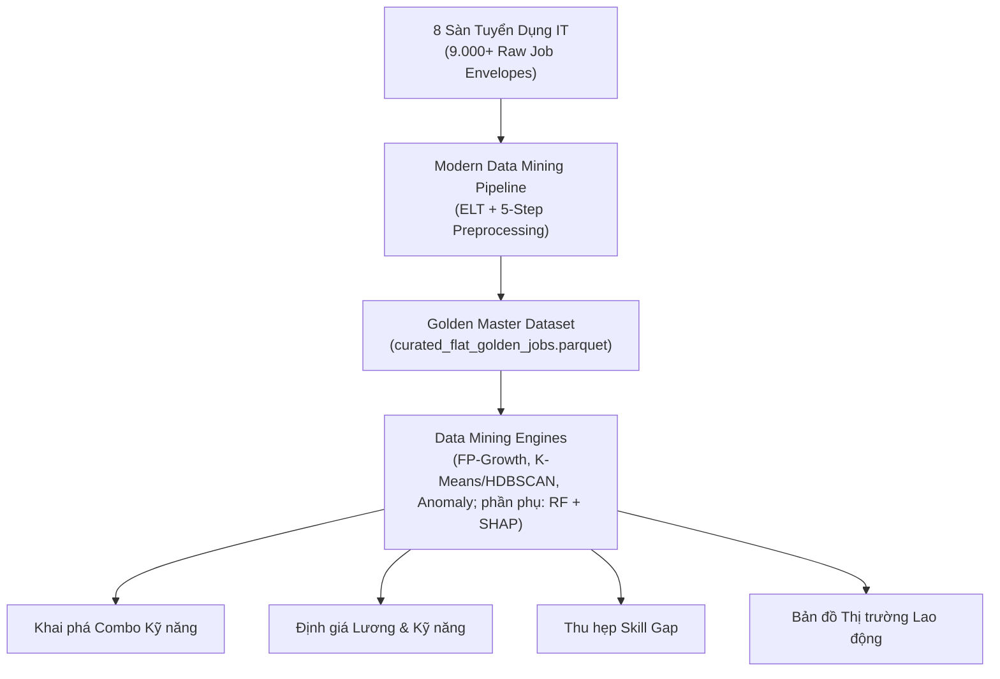
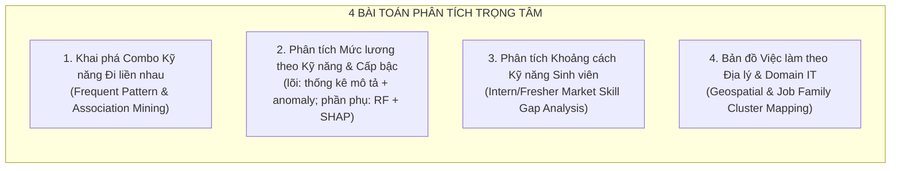
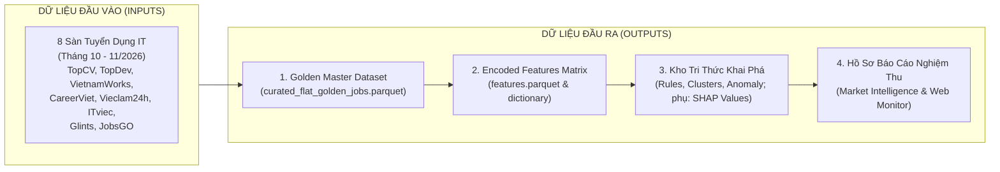

# ĐẶC TẢ SẢN PHẨM (PRODUCT SPECIFICATION)
## DỰ ÁN: HỆ THỐNG KHAI PHÁ DỮ LIỆU TUYỂN DỤNG IT VIỆT NAM (VN-IT-JOB-MINING)

> **Mã tài liệu:** `SPEC-01`  
> **Phiên bản:** `1.0.0`  
> **Ngày cập nhật:** 05/11/2026  
> **Trạng thái:** Chính thức ban hành  
> **Phạm vi dữ liệu:** 8 sàn tuyển dụng CNTT tại Việt Nam (TopCV, TopDev, VietnamWorks, CareerViet, Vieclam24h, ITviec, Glints, JobsGO) trong giai đoạn tháng 10 – tháng 11/2026.

---

## 1. Bối Cảnh & Động Lực Dự Án (Project Context & Background)

### 1.1. Thực trạng thị trường lao động CNTT Việt Nam cuối năm 2026
Bước sang quý 4 năm 2026, thị trường lao động Công nghệ Thông tin (CNTT/IT) tại Việt Nam đang trải qua giai đoạn chuyển dịch cấu trúc sâu sắc:
1. **Làn sóng ứng dụng AI & Tự động hóa:** Các doanh nghiệp chuyển dịch mạnh mẽ từ tuyển dụng ồ ạt sang tuyển dụng có chọn lọc ("Flight to Quality"). Các vị trí chỉ yêu cầu kỹ năng lập trình căn bản đang bị thu hẹp, nhường chỗ cho các vị trí đòi hỏi tư duy hệ thống, năng lực tích hợp AI và kỹ năng liên chức năng (Cross-functional skills).
2. **Nghịch lý việc làm sinh viên mới tốt nghiệp:** Trong khi doanh nghiệp liên tục than phiền về sự khan hiếm nhân lực chất lượng cao (đặc biệt ở cấp độ Middle/Senior và các chuyên ngành dữ liệu, Cloud/DevOps), thì hàng chục nghìn cử nhân/kỹ sư IT mới ra trường (Intern/Fresher) lại đối mặt với tỷ lệ cạnh tranh gay gắt và nguy cơ thất nghiệp cao do không đáp ứng được yêu cầu thực tế của dự án.
3. **Sự nhiễu loạn thông tin tuyển dụng đa nền tảng:** Mỗi sàn tuyển dụng (TopCV, ITviec, VietnamWorks, TopDev...) phục vụ một phân khúc khác nhau, sở hữu cấu trúc dữ liệu, tiêu chuẩn định danh kỹ năng và cách hiển thị mức lương hoàn toàn phân mảnh. Nhiều sàn tổng hợp còn trộn lẫn tin tuyển dụng phi IT (bán hàng công nghệ, tuyển dụng nhân sự, kế toán IT...) gây sai lệch bức tranh toàn cảnh.

### 1.2. Tính cấp thiết của một đồ án tốt nghiệp Data Science thực chiến
Đồ án **VN-IT-Job-Mining** được xây dựng nhằm giải quyết bài toán khoảng cách thông tin nêu trên thông qua phương pháp tiếp cận khoa học dữ liệu hiện đại:
- Xây dựng đường ống thu thập và tinh chế dữ liệu lớn tự động từ **8 nền tảng tuyển dụng lớn nhất Việt Nam**.
- Áp dụng triệt để mô hình chuẩn công nghiệp **CRISP-DM (Cross-Industry Standard Process for Data Mining)** kết hợp quy trình khám phá tri thức **KDD (Knowledge Discovery in Databases)**.
- Đưa ra những phân tích định lượng xác đáng, dựa trên bằng chứng dữ liệu (Data-driven Insights), thay thế cho các nhận định cảm tính hoặc khảo sát mẫu nhỏ truyền thống.

---

## 2. Tầm Nhìn Sản Phẩm & Mục Tiêu Chiến Lược (Product Vision & Strategy)

### 2.1. Tầm nhìn sản phẩm (Product Vision)
> *"Trở thành nền tảng chuẩn mực về Khai phá Dữ liệu Thị trường Tuyển dụng CNTT Việt Nam, cung cấp hồ sơ tri thức minh bạch, định lượng và có khả năng hành động (Actionable Intelligence) nhằm hỗ trợ sinh viên định hướng nghề nghiệp, nhà trường tối ưu hóa khung đào tạo và doanh nghiệp hiểu rõ xu thế nguồn nhân lực."*

### 2.2. Mục tiêu chiến lược (Strategic Objectives)
1. **Chuẩn hóa dữ liệu quy mô lớn (Data Modernization):** Thu thập toàn diện, khử trùng lặp đa sàn, chuẩn hóa từ điển danh mục (Taxonomy) và xuất bản bộ dữ liệu sạch đạt chuẩn **Golden Master Dataset**.
2. **Khai phá tri thức chiều sâu (Deep Knowledge Discovery):** Khám phá các mẫu kỹ năng đồng xuất hiện thường xuyên, phân nhóm công việc tự nhiên và giải mã giá trị kinh tế biên của từng kỹ năng công nghệ đối với mức lương.
3. **Tính ứng dụng cao (High Actionability):** Cung cấp các khuyến nghị lộ trình học tập cụ thể, chỉ ra chính xác các kỹ năng sinh viên còn thiếu hụt so với chuẩn mực thị trường.

---

## 3. Đối Tượng Sử Dụng & Đề Xuất Giá Trị (Target Personas & Value Proposition)

| Nhóm đối tượng (Persona) | Đặc điểm & Nỗi đau (Pain points) | Đề xuất giá trị của sản phẩm (Value Proposition) |
| :--- | :--- | :--- |
| **Sinh viên IT chuẩn bị tốt nghiệp / Fresher** | • Bối rối không biết nên học thêm công nghệ nào để dễ xin việc. • CV rải nhiều nơi nhưng không nhận được phản hồi. • Không biết mức lương bao nhiêu là hợp lý để deal với nhà tuyển dụng. • Chưa nắm rõ combo kỹ năng nào bắt buộc phải đi kèm nhau. | • Cung cấp bản đồ kỹ năng (Skill Matrix) theo từng nhóm nghề cụ thể. • Báo cáo chỉ số khoảng cách kỹ năng (Skill Gap Index) cho cấp độ Intern/Fresher. • Mô hình ước tính lương theo kỹ năng giúp tự tin đàm phán mức lương kỳ vọng. |
| **Giảng viên & Hội đồng Chấm Đồ án** | • Cần thẩm định tính nghiêm túc, tính mới và độ tin cậy khoa học của đồ án tốt nghiệp. • Yêu cầu kiểm chứng quy trình Data Science chuẩn mực, không chấp nhận việc "nặn" số liệu hoặc quy trình chắp vá. • Đánh giá năng lực xử lý dữ liệu thực tế và kỹ năng giải quyết vấn đề của sinh viên. | • Quy trình CRISP-DM + KDD khép kín, minh bạch, kiểm chứng được mã nguồn và dữ liệu. • Áp dụng thuật toán khai phá nâng cao (FP-Growth, K-Means/HDBSCAN, Random Forest + SHAP) có cơ sở toán học. • Báo cáo đánh giá (Evaluation Spec) chuẩn mực với các chỉ số thống kê định lượng. |
| **Nhà trường & Ban chủ nhiệm Khoa CNTT** | • Khung chương trình đào tạo đại học thường chậm cập nhật so với tốc độ biến đổi của công nghệ doanh nghiệp. • Thiếu số liệu thực tế để thuyết minh việc bổ sung môn học mới. | • Báo cáo đối chiếu yêu cầu thực tế doanh nghiệp với khung môn học đại học. • Dự báo các kỹ năng mới nổi (Emerging Skills) giúp điều chỉnh giáo trình đào tạo bắt kịp thị trường. |
| **Nhà tuyển dụng IT & HR Specialist** | • Khó khăn trong việc định giá lương cạnh tranh cho các vị trí tuyển dụng. • Viết JD theo khuôn mẫu cũ, đòi hỏi các kỹ năng không ăn khớp hoặc phi thực tế. | • Bảng tham chiếu giá trị biên của kỹ năng (Marginal Skill Pricing). • Tham khảo các combo kỹ năng tiêu chuẩn thị trường để xây dựng JD thực tế, hấp dẫn ứng viên. |

---

## 4. Bốn Bài Toán Khai Phá Dữ Liệu Trọng Tâm (Core Mining Problems)

Dự án tập trung giải quyết triệt để 4 bài toán khoa học dữ liệu mang tính thời sự cao:

### 4.1. Bài toán 1: Khai phá tập combo kỹ năng đi liền nhau (Frequent Skillsets & Association Rules)
- **Đặt vấn đề:** Một lập trình viên không bao giờ làm việc với một kỹ năng đơn lẻ. Doanh nghiệp luôn tuyển dụng theo các "gói kỹ năng" (Skill Bundles) bổ trợ lẫn nhau (ví dụ: Spring Boot đi kèm Java, Hibernate, Docker, Microservices, PostgreSQL).
- **Mục tiêu kỹ thuật:**
  - Áp dụng thuật toán **FP-Growth (Frequent Pattern Growth)** để tìm các tập kỹ năng phổ biến ($Frequent\ Itemsets$) xuất hiện đồng thời trong các tin tuyển dụng.
  - Khai phá các luật kết hợp dạng: $\{Skill_A, Skill_B\} \Rightarrow \{Skill_C\}$.
  - Đánh giá chất lượng luật thông qua bộ tứ chỉ số: **Support**, **Confidence**, **Lift**, và **Conviction**.
- **Giá trị nghiệp vụ:** Giúp ứng viên hiểu rằng khi học một công nghệ chính (core tech), bắt buộc phải học kèm các công nghệ vệ tinh nào để CV vượt qua vòng lọc hồ sơ tự động (ATS).

### 4.2. Bài toán 2: Phân tích mức lương theo kỹ năng & cấp bậc (lõi mô tả + phần phụ Salary Modeling)
- **Đặt vấn đề:** Lương là thông tin nhạy cảm và thường bị ẩn dưới nhãn "Thỏa thuận" (Negotiable). Trong số các tin công khai lương, mức lương chịu ảnh hưởng phức tạp bởi số năm kinh nghiệm, cấp bậc (Seniority), địa bàn công tác và danh mục kỹ năng yêu cầu.
- **Phạm vi (cập nhật 10/11/2026):** quy trình chuẩn của dự án chỉ khai phá **unsupervised** (clustering, association rules, anomaly detection, dimensionality reduction). Phần lõi của bài toán này là thống kê mô tả lương theo kỹ năng/cấp bậc/tỉnh và phát hiện lương ngoại lai (anomaly). Hồi quy Random Forest + SHAP dưới đây là **phần phụ (supervised, ngoại lệ so với quy trình chuẩn)**, đã chốt giữ lại, không thuộc tiêu chí nghiệm thu lõi.
- **Mục tiêu kỹ thuật (phần phụ):**
  - Xây dựng mô hình hồi quy phi tuyến **Random Forest Regressor** dự đoán mức lương chuẩn hóa $\log(Salary\_VND)$.
  - Sử dụng phương pháp giải thích mô hình **SHAP (SHapley Additive exPlanations)** để tách biệt đóng góp biên (Marginal Contribution) của từng kỹ năng công nghệ độc lập với kinh nghiệm và địa lý.
- **Giá trị nghiệp vụ:** Trả lời câu hỏi định lượng: *"Biết thêm Docker/Kubernetes giúp kỹ sư Backend tăng trung bình bao nhiêu triệu VNĐ/tháng?"* hoặc *"Kỹ năng nào có tỷ suất sinh lời cao nhất (Highest ROI Skill) hiện nay tại Việt Nam?"*.

### 4.3. Bài toán 3: Phân tích khoảng cách kỹ năng thị trường vs Sinh viên mới ra trường (Intern/Fresher Skill Gap)
- **Đặt vấn đề:** Sinh viên mới ra trường thường chỉ được trang bị kiến thức nền tảng trong trường đại học (C++, Java core, cấu trúc dữ liệu, thuật toán, cơ sở dữ liệu lý thuyết), trong khi doanh nghiệp tuyển Intern/Fresher hiện nay đòi hỏi cả kiến thức thực chiến (Git workflow, CI/CD cơ bản, RESTful API, Docker, kiểm thử đơn vị Unit Test).
- **Mục tiêu kỹ thuật:**
  - Lọc phân tập dữ liệu tuyển dụng dành riêng cho cấp bậc **"Thực tập" (Intern)** và **"Mới tốt nghiệp" (Fresher)**.
  - Đối chiếu tần suất xuất hiện của các kỹ năng thực tế trên thị trường với khung chương trình chuẩn khối ngành CNTT (Benchmark Đại học).
  - Tính toán chỉ số thâm hụt kỹ năng (**Skill Deficit Score**) và mức độ khắt khe của thị trường đối với nhân sự đầu vào.
- **Giá trị nghiệp vụ:** Chỉ rõ cho sinh viên các "lỗ hổng tử huyệt" cần bù đắp trước khi ứng tuyển, tránh tâm lý ảo tưởng hoặc hoang mang khi phỏng vấn.

### 4.4. Bài toán 4: Bản đồ việc làm theo miền địa lý & domain IT (Geographic & Job Family Mapping)
- **Đặt vấn đề:** Cơ cấu việc làm IT phân hóa mạnh mẽ giữa các trung tâm kinh tế: Hà Nội thiên về khối cơ quan nhà nước, viễn thông, fintech và doanh nghiệp sản xuất; TP. Hồ Chí Minh dẫn đầu về product công nghệ, outsourcing toàn cầu, e-commerce và startup; Đà Nẵng nổi lên như một cứ điểm outsourcing lớn.
- **Mục tiêu kỹ thuật:**
  - Chuẩn hóa địa lý về 34 tỉnh thành sau sáp nhập hành chính (tập trung 3 đầu tàu: Hà Nội, TP.HCM, Đà Nẵng) và hình thức làm việc Remote/Hybrid.
  - Phân loại tin tuyển dụng vào 12 nhóm nghề chuẩn (**12 Job Families**): Backend, Frontend, Fullstack, Mobile, DevOps/Cloud, Data Engineer, Data Science/AI, QA/QC, Security, Product/Project, System/Network, Embedded/IoT.
  - Ứng dụng phân cụm **K-Means / HDBSCAN** trên không gian vector kết hợp giữa kỹ năng và văn bản mô tả để tìm kiếm các cụm công việc đặc thù (Niche Job Clusters).
- **Giá trị nghiệp vụ:** Cung cấp bức tranh toàn cảnh giúp người lao động lựa chọn địa điểm làm việc và định vị chuyên môn phù hợp với xu thế dịch chuyển của thị trường.

---

## 5. Hợp Đồng Dữ Liệu Đầu Vào & Đầu Ra (Data Contract & Deliverables)

### 5.1. Quy cách dữ liệu đầu vào (Input Specifications)
- **Thời gian thu thập:** Tháng 10/2026 đến tháng 11/2026 (dữ liệu cập nhật liên tục qua Apache Airflow).
- **Phạm vi nguồn (8 sàn):**
  1. `topcv`: Sàn tuyển dụng diện rộng, đa ngành nhưng có lượng tin IT lớn nhất phân khúc Junior/Fresher.
  2. `topdev`: Sàn chuyên biệt hàng đầu về IT, phong phú về tech stack và dữ liệu khảo sát.
  3. `vietnamworks`: Nền tảng tuyển dụng truyền thống, nhiều vị trí Middle/Senior và doanh nghiệp đa quốc gia.
  4. `careerviet`: Sàn tuyển dụng quy mô lớn, nhiều tập đoàn trong nước và ngân hàng.
  5. `vieclam24h`: Sàn đại chúng, chứa nhiều tin công nghệ doanh nghiệp vừa và nhỏ (SME).
  6. `itviec`: Sàn chất lượng cao chuyên biệt IT ("Ít nhưng mà chất"), lương cao, mô tả kỹ thuật chi tiết.
  7. `glints`: Nền tảng khu vực Đông Nam Á, nhiều cơ hội tuyển dụng xuyên biên giới, startup công nghệ.
  8. `jobsgo`: Ứng dụng tìm việc hiện đại, nhiều tin tuyển dụng sinh viên và fresher công nghệ.
- **Dung lượng ước tính:** Hơn **9.000 tin tuyển dụng thô nguyên bản (Raw Job Envelopes)** lưu trữ dạng JSON có định danh content hash SHA-256 trên Cloudflare R2 Data Lakehouse.

### 5.2. Danh mục sản phẩm đầu ra (Deliverables Specification)

| STT | Tên sản phẩm đầu ra | Định dạng | Mô tả chi tiết & Tiêu chuẩn kỹ thuật |
| :---: | :--- | :--- | :--- |
| **1** | **Golden Master Dataset** | `curated_flat_golden_jobs.parquet` | Bảng dữ liệu phẳng chuẩn hóa toàn diện sau 5 bước tiền xử lý; đã khử trùng lặp đa nguồn, loại bỏ tin phi IT, chuẩn hóa lương VND, chuẩn hóa 34 tỉnh thành và 12 Job Families. |
| **2** | **Feature Encoded Matrix** | `features.parquet` & `encoding_dictionary.json` | Ma trận đặc trưng số hóa sẵn sàng cho Machine Learning: One-Hot/Multi-Hot kỹ năng, Ordinal Encoding cho Seniority, Binary flags, Log Salary. |
| **3** | **Mining Knowledge Base** | JSON / CSV / Parquet | • Danh mục Frequent Itemsets & Association Rules (FP-Growth). • Bảng phân cụm công việc và nhãn ngữ nghĩa (K-Means/HDBSCAN). • Danh sách tin bất thường (Anomaly). • Phần phụ: bảng hệ số tác động biên kỹ năng (SHAP Feature Values). |
| **4** | **Báo Cáo Phân Tích Chuyên Đề** | Markdown / PDF | Bộ báo cáo thị trường hoàn chỉnh phục vụ hội đồng chấm đồ án: tổng quan thị trường, phân tích 4 bài toán trọng tâm và khuyến nghị sinh viên. |
| **5** | **Interactive Web Monitoring** | Streamlit Web Application | Dashboard tương tác trực quan hóa sức khỏe pipeline dữ liệu, phân phối tiền xử lý và kết quả mô hình khai phá. |

---

## 6. Tiêu Chuẩn Thành Công Của Sản Phẩm (Product Success Criteria)

1. **Tính trọn vẹn dữ liệu (Data Integrity):** Tỷ lệ bao phủ đạt trên 95% tin tuyển dụng IT đang hoạt động trong kỳ thu thập; không để sót các tin IT cốt lõi; loại bỏ 100% tin tuyển dụng rác phi công nghệ.
2. **Tính tái lập khoa học (Reproducibility):** Toàn bộ pipeline từ tiền xử lý đến khai phá mô hình được đóng gói thành các script độc lập, cấu hình rõ ràng, có thể tái lập kết quả chỉ bằng một lệnh thực thi duy nhất (`make pipeline`).
3. **Giá trị ứng dụng thực tiễn:** Báo cáo cung cấp được ít nhất 10 phát hiện thị trường mới lạ (Actionable Insights) có ý nghĩa thiết thực cho sinh viên IT tốt nghiệp năm 2026.
