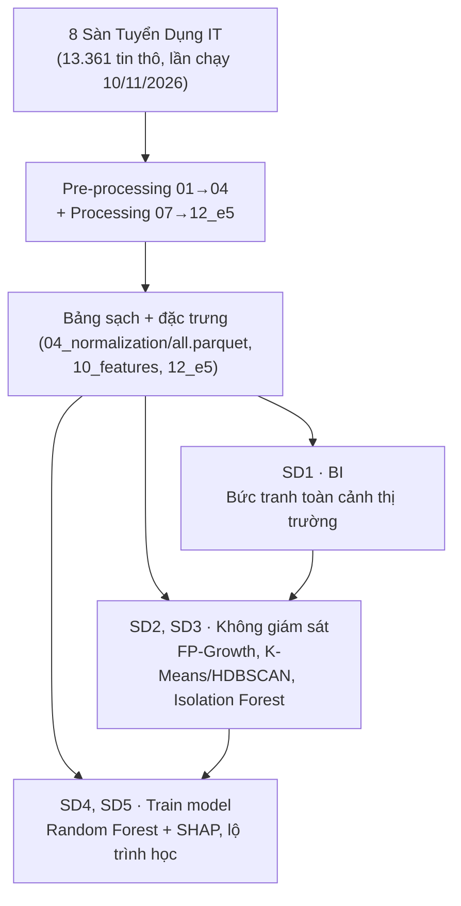
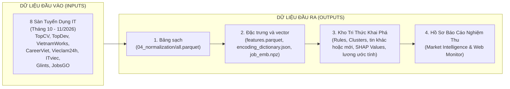

# ĐẶC TẢ SẢN PHẨM (PRODUCT SPECIFICATION)
## ĐỀ TÀI: TÍCH HỢP VÀ KHAI PHÁ DỮ LIỆU THỊ TRƯỜNG LAO ĐỘNG PHỤC VỤ PHÂN TÍCH NGHỀ NGHIỆP VÀ KỸ NĂNG TRONG IT (repo: VN-IT-Job-Mining)

> **Mã tài liệu:** `SPEC-01`  
> **Phiên bản:** `1.1.0`  
> **Ngày cập nhật:** 16/11/2026 (đổi tên đề tài; thay "4 bài toán" bằng 5 mục tiêu SD1–SD5 định nghĩa ở [`docs/target/`](../target/00_de_tai.md))  
> **Trạng thái:** Chính thức ban hành  
> **Phạm vi dữ liệu:** 8 sàn tuyển dụng CNTT tại Việt Nam (TopCV, TopDev, VietnamWorks, CareerViet, Vieclam24h, ITviec, Glints, JobsGO) trong giai đoạn tháng 9 – tháng 11/2026: tin đăng từ tháng 9, được thu thập trong tháng 10–11/2026. Thời gian được tính theo tháng (`posted_month`).

---

## 1. Bối Cảnh & Động Lực Dự Án (Project Context & Background)

### 1.1. Thực trạng thị trường lao động CNTT Việt Nam cuối năm 2026
Bước sang quý 4 năm 2026, thị trường lao động Công nghệ Thông tin (CNTT/IT) tại Việt Nam đang trải qua giai đoạn chuyển dịch cấu trúc sâu sắc:
1. **Làn sóng ứng dụng AI & Tự động hóa:** Các doanh nghiệp chuyển dịch mạnh mẽ từ tuyển dụng ồ ạt sang tuyển dụng có chọn lọc ("Flight to Quality"). Các vị trí chỉ yêu cầu kỹ năng lập trình căn bản đang bị thu hẹp, nhường chỗ cho các vị trí đòi hỏi tư duy hệ thống, năng lực tích hợp AI và kỹ năng liên chức năng (Cross-functional skills).
2. **Nghịch lý việc làm sinh viên mới tốt nghiệp:** Trong khi doanh nghiệp liên tục than phiền về sự khan hiếm nhân lực chất lượng cao (đặc biệt ở cấp độ Middle/Senior và các chuyên ngành dữ liệu, Cloud/DevOps), thì hàng chục nghìn cử nhân/kỹ sư IT mới ra trường (Intern/Fresher) lại đối mặt với tỷ lệ cạnh tranh gay gắt và nguy cơ thất nghiệp cao do không đáp ứng được yêu cầu thực tế của dự án.
3. **Sự nhiễu loạn thông tin tuyển dụng đa nền tảng:** Mỗi sàn tuyển dụng (TopCV, ITviec, VietnamWorks, TopDev...) phục vụ một phân khúc khác nhau, sở hữu cấu trúc dữ liệu, tiêu chuẩn định danh kỹ năng và cách hiển thị mức lương hoàn toàn phân mảnh. Nhiều sàn tổng hợp còn trộn lẫn tin tuyển dụng phi IT (bán hàng công nghệ, tuyển dụng nhân sự, kế toán IT...) gây sai lệch bức tranh toàn cảnh.

### 1.2. Tính cấp thiết của một đồ án tốt nghiệp Data Science thực chiến
Đồ án **VN-IT-Job-Mining** được xây dựng nhằm giải quyết bài toán khoảng cách thông tin nêu trên thông qua phương pháp tiếp cận khoa học dữ liệu hiện đại:
- Xây dựng đường ống thu thập và tinh chế dữ liệu lớn tự động từ **8 nền tảng tuyển dụng lớn nhất Việt Nam**.
- Áp dụng triệt để mô hình chuẩn công nghiệp **CRISP-DM (Cross-Industry Standard Process for Data Mining)** kết hợp quy trình khám phá tri thức **KDD (Knowledge Discovery in Databases)**.
- Đưa ra những phân tích định lượng xác đáng, dựa trên bằng chứng dữ liệu (Data-driven Insights), thay thế cho các nhận định cảm tính hoặc khảo sát mẫu nhỏ truyền thống.

---

## 2. Tầm Nhìn Sản Phẩm & Mục Tiêu Chiến Lược (Product Vision & Strategy)

### 2.1. Tầm nhìn sản phẩm (Product Vision)
> *"Trở thành nền tảng chuẩn mực về Khai phá Dữ liệu Thị trường Tuyển dụng CNTT Việt Nam, cung cấp hồ sơ tri thức minh bạch, định lượng và có khả năng hành động (Actionable Intelligence) nhằm hỗ trợ sinh viên định hướng nghề nghiệp, nhà trường tối ưu hóa khung đào tạo và doanh nghiệp hiểu rõ xu thế nguồn nhân lực."*

### 2.2. Mục tiêu chiến lược (Strategic Objectives)
1. **Chuẩn hóa dữ liệu quy mô lớn (Data Modernization):** Thu thập toàn diện, khử trùng lặp đa sàn, chuẩn hóa từ điển danh mục (Taxonomy) và xuất bản bộ dữ liệu sạch (bảng `04_normalization/all.parquet`, gọi chung là Golden Master) đủ chuẩn cho SD1–SD5.
2. **Khai phá tri thức chiều sâu (Deep Knowledge Discovery):** Khám phá các mẫu kỹ năng đồng xuất hiện thường xuyên, phân nhóm công việc tự nhiên và giải mã giá trị kinh tế biên của từng kỹ năng công nghệ đối với mức lương.
3. **Tính ứng dụng cao (High Actionability):** Cung cấp khuyến nghị kỹ năng ưu tiên và thứ tự học cho người mới vào từng nghề, dựa trên những gì thị trường đòi (dữ liệu chỉ có tin tuyển dụng, không đo được người học đang thiếu gì).

Mục 1 (chuẩn hóa dữ liệu) là **nền tảng dữ liệu**, không phải mục tiêu khai phá. Mục 2 và 3 được cụ thể hóa thành 5 mục tiêu SD1–SD5 ở mục 4.

---

## 3. Đối Tượng Sử Dụng & Đề Xuất Giá Trị (Target Personas & Value Proposition)

| Nhóm đối tượng (Persona) | Đặc điểm & Nỗi đau (Pain points) | Đề xuất giá trị của sản phẩm (Value Proposition) |
| :--- | :--- | :--- |
| **Sinh viên IT chuẩn bị tốt nghiệp / Fresher** | • Bối rối không biết nên học thêm công nghệ nào để dễ xin việc. • CV rải nhiều nơi nhưng không nhận được phản hồi. • Không biết mức lương bao nhiêu là hợp lý để deal với nhà tuyển dụng. • Chưa nắm rõ combo kỹ năng nào bắt buộc phải đi kèm nhau. | • Cung cấp bản đồ kỹ năng (Skill Matrix) theo từng nhóm nghề cụ thể. • Số liệu thị trường đòi gì ở tin cho Intern/Fresher/Junior (SD1) và lộ trình kỹ năng theo nghề (SD5). • Mô hình ước tính lương theo kỹ năng giúp tự tin đàm phán mức lương kỳ vọng. |
| **Giảng viên & Hội đồng Chấm Đồ án** | • Cần thẩm định tính nghiêm túc, tính mới và độ tin cậy khoa học của đồ án tốt nghiệp. • Yêu cầu kiểm chứng quy trình Data Science chuẩn mực, không chấp nhận việc "nặn" số liệu hoặc quy trình chắp vá. • Đánh giá năng lực xử lý dữ liệu thực tế và kỹ năng giải quyết vấn đề của sinh viên. | • Quy trình CRISP-DM + KDD khép kín, minh bạch, kiểm chứng được mã nguồn và dữ liệu. • Áp dụng thuật toán khai phá nâng cao (FP-Growth, K-Means/HDBSCAN, Random Forest + SHAP) có cơ sở toán học. • Báo cáo đánh giá (Evaluation Spec) chuẩn mực với các chỉ số thống kê định lượng. |
| **Nhà trường & Ban chủ nhiệm Khoa CNTT** (người dùng phụ) | • Khung chương trình đào tạo đại học thường chậm cập nhật so với tốc độ biến đổi của công nghệ doanh nghiệp. • Thiếu số liệu thực tế để thuyết minh việc bổ sung môn học mới. | • Số liệu về kỹ năng thị trường đòi ở tin cho người mới (SD1, SD2) và lộ trình kỹ năng theo nghề (SD5) để nhà trường tự đối chiếu với chương trình của mình. • Dự án **không** so sánh với chương trình đào tạo, vì dữ liệu không có chương trình đào tạo. |
| **Nhà tuyển dụng IT & HR Specialist** | • Khó khăn trong việc định giá lương cạnh tranh cho các vị trí tuyển dụng. • Viết JD theo khuôn mẫu cũ, đòi hỏi các kỹ năng không ăn khớp hoặc phi thực tế. | • Bảng tham chiếu giá trị biên của kỹ năng (Marginal Skill Pricing). • Tham khảo các combo kỹ năng tiêu chuẩn thị trường để xây dựng JD thực tế, hấp dẫn ứng viên. |

---

## 4. Năm Mục Tiêu Khai Phá (SD1–SD5)

> Cập nhật 16/11/2026: mục này thay cho "4 bài toán trọng tâm" cũ. Định nghĩa đầy đủ (câu hỏi, dữ liệu, cách trả lời, tiêu chí đánh giá, giới hạn) ở [`docs/target/`](../target/00_de_tai.md). Khi mâu thuẫn thì `docs/target/` thắng.

Thứ tự: **BI → khai phá không giám sát → train model**. Tầng sau dùng kết quả của tầng trước.

| SD | Tầng | Mục tiêu | Thay cho bài toán cũ |
|---|---|---|---|
| **SD1** | BI | Bức tranh toàn cảnh thị trường IT Việt Nam T9–T11/2026: nghề, cấp, tỉnh, hình thức làm việc, lương công khai và tỷ lệ "thỏa thuận", yêu cầu với người mới, phúc lợi | Bài toán 4 (bản đồ địa lý và nhóm nghề), phần mô tả của bài toán 2, phần "yêu cầu với Intern/Fresher" của bài toán 3 |
| **SD2** | Không giám sát | Gói kỹ năng hay đi cùng nhau và kỹ năng hiếm (FP-Growth) | Bài toán 1 |
| **SD3** | Không giám sát | Nhóm việc thật sự theo nội dung tin, so với nhóm nghề gán bằng luật, và tin khác hoặc mới (K-Means/HDBSCAN, Isolation Forest) | Phần phân cụm của bài toán 4 |
| **SD4** | Train model | Kỹ năng nào đáng tiền khi giữ nguyên nghề, cấp, kinh nghiệm, tỉnh; ước tính lương cho tin "thỏa thuận" (Random Forest + SHAP; dự phòng là đoán khung lương) | Phần Salary Modeling của bài toán 2, nay là bước chính thức |
| **SD5** | Train model + tổng hợp | Kỹ năng ưu tiên và thứ tự học cho người mới vào từng nghề | Thay phần "đối chiếu với khung chương trình đại học" của bài toán 3 |

Đã bỏ: so sánh kỹ năng thị trường với chương trình đào tạo đại học (bài toán 3 cũ, SD4 cũ "Education–Industry Skill Gap"). Lý do là dữ liệu chỉ có tin tuyển dụng, không có chương trình đào tạo hay CV, nên không kiểm chứng được.

---

## 5. Hợp Đồng Dữ Liệu Đầu Vào & Đầu Ra (Data Contract & Deliverables)

### 5.1. Quy cách dữ liệu đầu vào (Input Specifications)
- **Thời gian thu thập:** Tháng 10/2026 đến tháng 11/2026 (dữ liệu cập nhật liên tục qua Apache Airflow).
- **Phạm vi nguồn (8 sàn):**
  1. `topcv`: Sàn tuyển dụng diện rộng, đa ngành nhưng có lượng tin IT lớn nhất phân khúc Junior/Fresher.
  2. `topdev`: Sàn chuyên biệt hàng đầu về IT, phong phú về tech stack và dữ liệu khảo sát.
  3. `vietnamworks`: Nền tảng tuyển dụng truyền thống, nhiều vị trí Middle/Senior và doanh nghiệp đa quốc gia.
  4. `careerviet`: Sàn tuyển dụng quy mô lớn, nhiều tập đoàn trong nước và ngân hàng.
  5. `vieclam24h`: Sàn đại chúng, chứa nhiều tin công nghệ doanh nghiệp vừa và nhỏ (SME).
  6. `itviec`: Sàn chất lượng cao chuyên biệt IT ("Ít nhưng mà chất"), lương cao, mô tả kỹ thuật chi tiết.
  7. `glints`: Nền tảng khu vực Đông Nam Á, nhiều cơ hội tuyển dụng xuyên biên giới, startup công nghệ.
  8. `jobsgo`: Ứng dụng tìm việc hiện đại, nhiều tin tuyển dụng sinh viên và fresher công nghệ.
- **Dung lượng:** **13.361 tin thô** ở lần chạy pre-processing 10/11/2026 (còn 4.671 tin IT trong bảng sạch; số sẽ đổi khi chạy lại) lưu trữ dạng JSON có định danh content hash SHA-256 trên Cloudflare R2 Data Lakehouse.

### 5.2. Danh mục sản phẩm đầu ra (Deliverables Specification)

| STT | Tên sản phẩm đầu ra | Định dạng | Mô tả chi tiết & Tiêu chuẩn kỹ thuật |
| :---: | :--- | :--- | :--- |
| **1** | **Bảng sạch (bộ dữ liệu chuẩn cho SD1–SD5)** | `data/preprocessing/04_normalization/all.parquet` | Mỗi dòng một tin, sau bước 01→04 (spec 05 mục 4.1): đã lọc IT, khử trùng 3 tầng, lương VNĐ/tháng có cờ ngoại lai, 34 tỉnh, 10 nhóm nghề + Other, 5 cấp bậc, `posted_month` (PRE-37). Tên cũ `curated_flat_golden_jobs.parquet` không dùng nữa. |
| **2** | **Đặc trưng và vector** | `data/processing/10_features/features.parquet`, `encoding_dictionary.json`, `data/processing/12_e5/job_emb.npz` | Kết quả Processing (spec 06): multi-hot kỹ năng `skill__*`, `seniority_ord`, cờ nhị phân, log lương; vector e5 của JD. |
| **3** | **Mining Knowledge Base** | JSON / CSV / Parquet | • Danh mục Frequent Itemsets & Association Rules (FP-Growth). • Bảng phân cụm công việc và nhãn ngữ nghĩa (K-Means/HDBSCAN). • Danh sách tin khác hoặc mới (SD3). • Bảng giá trị kỹ năng (SHAP) và lương ước tính cho tin "thỏa thuận" (SD4). • Danh sách kỹ năng ưu tiên và lộ trình theo nghề (SD5). |
| **4** | **Báo Cáo Phân Tích Chuyên Đề** | Markdown / PDF | Bộ báo cáo thị trường phục vụ hội đồng chấm đồ án: trả lời câu hỏi của 5 mục tiêu SD1–SD5 (`docs/target/`). |
| **5** | **Interactive Web Monitoring** | FastAPI + React (spec 09) | Dashboard tương tác trực quan hóa sức khỏe pipeline dữ liệu, phân phối tiền xử lý và kết quả mô hình khai phá. |

---

## 6. Tiêu Chuẩn Thành Công Của Sản Phẩm (Product Success Criteria)

1. **Tính trọn vẹn dữ liệu (Data Integrity):** Tỷ lệ bao phủ đạt trên 95% tin tuyển dụng IT đang hoạt động trong kỳ thu thập; không để sót các tin IT cốt lõi; loại bỏ 100% tin tuyển dụng rác phi công nghệ.
2. **Tính tái lập khoa học (Reproducibility):** Toàn bộ pipeline từ tiền xử lý đến khai phá mô hình được đóng gói thành các script độc lập, cấu hình rõ ràng, có thể tái lập kết quả chỉ bằng một lệnh thực thi duy nhất (`make pipeline`).
3. **Giá trị ứng dụng thực tiễn:** Báo cáo cung cấp được ít nhất 10 phát hiện thị trường mới lạ (Actionable Insights) có ý nghĩa thiết thực cho sinh viên IT tốt nghiệp năm 2026.
