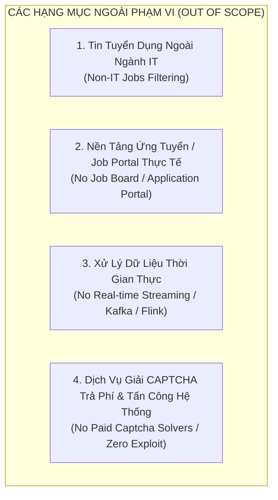
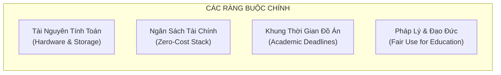

# GIỚI HẠN PHẠM VI & RÀNG BUỘC KỸ THUẬT (OUT OF SCOPE & CONSTRAINTS)
## DỰ ÁN: HỆ THỐNG KHAI PHÁ DỮ LIỆU TUYỂN DỤNG IT VIỆT NAM (VN-IT-JOB-MINING)

> **Mã tài liệu:** `SPEC-02`  
> **Phiên bản:** `1.0.0`  
> **Ngày cập nhật:** 05/11/2026  
> **Trạng thái:** Chính thức ban hành  
> **Mục đích:** Thiết lập ranh giới đanh thép (*Ironclad Boundaries*) cho đồ án tốt nghiệp, phân định rõ ràng giữa những gì hệ thống giải quyết và những gì nằm ngoài phạm vi thực hiện nhằm tránh phân tán nguồn lực và đảm bảo tính khả thi cao nhất.

---

## 1. Nguyên Tắc Thiết Lập Ranh Giới (Scoping Principles)

Trong các dự án kỹ thuật dữ liệu và khai phá tri thức, việc xác định **những gì KHÔNG LÀM** quan trọng không kém việc xác định **những gì CẦN LÀM**. Đồ án tốt nghiệp đại học có giới hạn nghiêm ngặt về thời gian, nhân lực và chi phí cơ sở hạ tầng. Do đó, hệ thống **VN-IT-Job-Mining** tuân thủ nguyên tắc:
1. **Focus on Data Mining & Analytics:** Tập trung 100% vào chuỗi giá trị Kỹ thuật Dữ liệu (Data Engineering) và Khai phá Tri thức (Data Mining). Không biến đồ án thành một sản phẩm công nghệ phần mềm đại trà (Web/App Portal).
2. **Deterministic & Reproducible:** Ưu tiên các giải pháp tất định (Deterministic), có thể kiểm chứng toán học và tái lập dễ dàng, loại bỏ các thành phần "hộp đen" đắt đỏ hoặc thiếu ổn định.
3. **Ethical & Compliant Scraping:** Tuyệt đối tôn trọng đạo đức thu thập dữ liệu web và ranh giới an toàn hệ thống đối tác.

---

## 2. Danh Mục Các Hạng Mục Ngoài Phạm Vi (Out-of-Scope Items)

### 2.1. Loại trừ tin tuyển dụng ngoài ngành IT (Non-IT Job Exclusion)
- **Mô tả:** Trong 8 sàn thu thập, có các sàn đa ngành tổng hợp (như *TopCV, Vieclam24h, CareerViet, JobsGO*). Thuật toán tìm kiếm nội bộ của các sàn này thường trả về các tin có chứa từ khóa công nghệ nhưng bản chất là ngành khác (ví dụ: *"Nhân viên kinh doanh phần mềm"*, *"Kế toán công ty IT"*, *"Chuyên viên tuyển dụng IT / IT Recruiter"*, *"Tư vấn bất động sản ứng dụng công nghệ 4.0"*). Thậm chí sàn chuyên IT như *TopDev* qua khảo sát sơ bộ cũng có khoảng gần 80% tin thuộc các phòng ban phụ trợ hoặc đối tác ngoài IT.
- **Quyết định ngoài phạm vi:**
  - Hệ thống **KHÔNG** phân tích, lưu trữ hoặc mô hình hóa các tin tuyển dụng phi CNTT.
  - Các tin này bị chặn đứng và đào thải ngay tại bước đầu tiên của chuỗi tiền xử lý (**Bước 01 Clean**) bằng bộ quy tắc lọc nghiêm ngặt (Keyword Blacklist + Regex Domain Guard).
  - Không xây dựng các mô hình khai phá cho các ngành nghề kinh doanh tổng hợp ngoài 12 nhóm nghề IT chuẩn.

### 2.2. Không xây dựng Nền tảng Tìm việc / Job Portal Người dùng cuối (No Operational Job Portal)
- **Mô tả:** Đồ án không phải là một website thương mại điện tử tuyển dụng (như TopCV thu nhỏ hay ITViec clone).
- **Quyết định ngoài phạm vi:**
  - **KHÔNG** phát triển các tính năng dành cho ứng viên: Đăng ký tài khoản ứng viên, Upload/Tạo CV trực tuyến, Ứng tuyển một chạm (One-click apply), Theo dõi trạng thái ứng tuyển.
  - **KHÔNG** phát triển cổng thông tin nhà tuyển dụng (Employer Portal): Đăng tin tuyển dụng, Mua gói ghim tin, Quản lý hồ sơ ứng viên.
  - **KHÔNG** gửi email thông báo việc làm tự động (Job Alert Email Daemon) hay tích hợp cổng thanh toán.
  - Giao diện người dùng duy nhất của dự án là **Monitoring Dashboard & BI Report View** phục vụ phân tích dữ liệu và giám sát kỹ thuật.

### 2.3. Không xử lý dòng dữ liệu thời gian thực (No Real-time Streaming Architecture)
- **Mô tả:** Nhu cầu tuyển dụng của thị trường lao động có độ trễ tự nhiên (tin tuyển dụng thường tồn tại từ 15 đến 30 ngày). Việc triển khai hạ tầng streaming thời gian thực (Real-time Streaming qua Apache Kafka, Apache Flink, AWS Kinesis) để bắt từng tin tuyển dụng theo từng giây là hoàn toàn lãng phí tài nguyên và không đem lại giá trị phân tích vượt trội.
- **Quyết định ngoài phạm vi:**
  - Hệ thống vận hành 100% theo mô hình **Batch Processing (Xử lý theo lô định kỳ)**.
  - Dữ liệu được điều phối theo ca chạy của Apache Airflow (mỗi ca cách nhau tối thiểu 55 phút, tối đa 30 tin/batch để bảo vệ tài nguyên).
  - Chu kỳ phát hiện tin mới và kiểm tra tin tái đăng (Re-crawl cycle) được cố định ở ngưỡng **21 ngày** (dựa trên tuổi thọ trung bình của tin tuyển dụng IT).

### 2.4. Không sử dụng dịch vụ giải CAPTCHA trả phí & Can thiệp trái phép (No Paid Captcha Solvers & Ethical Scraping)
- **Mô tả:** Một số sàn tuyển dụng áp dụng hệ thống tường lửa thương mại (như Cloudflare Turnstile, hCaptcha, Google reCAPTCHA v3 Enterprise) hoặc rate limiting nghiêm ngặt.
- **Quyết định ngoài phạm vi:**
  - **KHÔNG** tích hợp các dịch vụ giải mã CAPTCHA của bên thứ ba phải trả phí (như 2Captcha, Anti-Captcha, CapSolver).
  - **KHÔNG** thực hiện các hành vi tấn công từ chối dịch vụ (DDoS), brute-force IP, hay bẻ khóa hạ tầng bảo mật của sàn đối tác.
  - **Cơ chế thay thế chuẩn mực:** Áp dụng giao thức **Safe Skip** và **Exponential Backoff**: Khi gặp trang chặn CAPTCHA hoặc lỗi HTTP 403/429, hệ thống tự động ghi nhận mã lỗi vào URL Ledger, đánh dấu trạng thái `FAILED` và an toàn chuyển sang URL tiếp theo mà không làm tê liệt toàn bộ pipeline. Tốc độ thu thập được điều tiết lịch sự, tôn trọng tệp `robots.txt` của sàn đối tác.

---

## 3. Bảng Ma Trận Phân Định Ranh Giới (Scope In vs. Out Matrix)

| Lĩnh vực | Thuộc phạm vi dự án (IN SCOPE) | Nằm ngoài phạm vi dự án (OUT OF SCOPE) |
| :--- | :--- | :--- |
| **Nguồn dữ liệu** | 8 sàn tuyển dụng lớn tại VN: TopCV, TopDev, VietnamWorks, CareerViet, Vieclam24h, ITviec, Glints, JobsGO. | LinkedIn, Facebook Groups, Telegram Channels, Diễn đàn sinh viên Voz/Reddit, Website tuyển dụng nội bộ từng công ty. |
| **Ngành nghề** | Tin tuyển dụng phần mềm & CNTT thuộc 12 nhóm nghề chuẩn (Backend, Frontend, Fullstack, AI, DevOps...). | Bán hàng (Sales), Marketing phi công nghệ, Nhân sự (HR), Kế toán, Hành chính, Chăm sóc khách hàng, Lao động phổ thông. |
| **Thời gian dữ liệu** | Lát cắt thời gian thực tế tháng 10 - tháng 11/2026 (Quý 4/2026). | Phân tích chuỗi thời gian lịch sử nhiều năm (2020 - 2025) hoặc dự báo thị trường dài hạn 2030. |
| **Chế độ xử lý** | Batch Processing qua Apache Airflow DAGs và CLI Python. | Real-time Streaming (Apache Kafka, Apache Flink, WebSockets stream). |
| **Xử lý ngôn ngữ** | Rule-based, Regex parsing, Dictionary mapping, ESCO Skill Taxonomy. | Gọi API LLM thương mại trả phí (OpenAI GPT-4, Anthropic Claude, Gemini API) trong luồng production. |
| **Ứng dụng cuối** | Data Lakehouse (Parquet), Báo cáo chuyên đề (Markdown/PDF), Streamlit Analytics Dashboard. | Web portal tìm việc, mobile app nộp hồ sơ, tính năng match CV tự động cho người dùng. |
| **Bảo vệ hệ thống sàn** | Safe Skip, Rate Limiting, HTTP Pooling, Adaptive Retry, User-Agent Rotation chuẩn mực. | Bẻ khóa tường lửa WAF, dịch vụ trả phí bypass Cloudflare Turnstile / CAPTCHA, tấn công xâm nhập mạng. |

---

## 4. Các Giả Định Kỹ Thuật (Technical Assumptions)

1. **Giả định về tính đại diện của mẫu dữ liệu (Sample Representativeness):**
   - 8 sàn tuyển dụng được lựa chọn chiếm hơn 85% thị phần tin tuyển dụng CNTT công khai tại Việt Nam. Tập dữ liệu thu thập được trong tháng 10-11/2026 phản ánh chính xác cấu trúc nhu cầu và mặt bằng lương hiện hữu của thị trường.
2. **Giả định về tính khuyết thiếu của mức lương (Missing Not At Random - MNAR):**
   - Các tin ghi mức lương "Thỏa thuận" (Negotiable) là một hành vi có chủ đích của doanh nghiệp (thường rơi vào các vị trí cấp cao, bảo mật nội bộ, hoặc phụ thuộc hoàn toàn vào năng lực ứng viên). Hệ thống giả định rằng việc tách biệt nhóm tin có lương cụ thể để xây dựng mô hình hồi quy vẫn giữ được tính khách quan nếu có kiểm soát biến số cấp bậc và kinh nghiệm.
3. **Giả định về sự ổn định cấu trúc HTML/API:**
   - Trong suốt thời gian thu thập của đồ án (tháng 10 - 11/2026), cấu trúc DOM HTML hoặc endpoint API công khai của 8 sàn đối tác không có những thay đổi mang tính đảo lộn hoàn toàn (breaking architectural rewrite).

---

## 5. Ràng Buộc Nguồn Lực & Rủi Ro Dự Án (Constraints & Risk Management)

### 5.1. Ràng buộc về hạ tầng và ngân sách (Hardware & Zero-Budget Constraints)
- **Phần cứng triển khai:** Hệ thống được thiết kế để chạy trọn vẹn trên môi trường máy trạm cá nhân của sinh viên (Cấu hình tối thiểu: CPU 8 cores, 16GB RAM, ổ cứng SSD) kết hợp hệ điều hành Linux/Ubuntu.
- **Ngân sách vận hành: 0 VNĐ (Zero-Cost Stack):**
  - Lưu trữ đám mây: Sử dụng gói miễn phí **Cloudflare R2 Free Tier** (10 GB lưu trữ miễn phí hàng tháng, miễn phí 100% chi phí Egress băng thông).
  - Cơ sở dữ liệu & Công cụ điều phối: Hoàn toàn mã nguồn mở (Docker, Apache Airflow, PostgreSQL, Python ecosystem: pandas, polars, pyarrow, scikit-learn, mlxtend, shap).
  - Không sử dụng bất kỳ hạ tầng điện toán đám mây trả phí quy mô lớn nào (AWS EC2, Google Cloud Dataproc, Azure Synapse).

### 5.2. Ràng buộc về thời gian học thuật (Academic Time Constraints)
- Toàn bộ chu trình từ thu thập, tiền xử lý, mô hình hóa và bảo vệ đồ án tốt nghiệp diễn ra trong phạm vi học kỳ tốt nghiệp. Do đó, các thuật toán khai phá được ưu tiên lựa chọn có độ phức tạp tính toán vừa phải:
  - Sử dụng **FP-Growth** thay cho **Apriori** để tránh hiện tượng bùng nổ tổ hợp ứng viên ($O(2^{|I|})$).
  - Sử dụng **Random Forest** kết hợp **TreeSHAP** (tối ưu hóa $O(TLD^2)$) thay cho KernelSHAP để tính toán hệ số SHAP chỉ trong vài phút thay vì hàng chục giờ.

### 5.3. Ràng buộc về pháp lý và đạo đức dữ liệu (Legal & Ethical Constraints)
- Dữ liệu thu thập hoàn toàn là dữ liệu công khai trên mạng Internet (Publicly Available Job Postings).
- Dữ liệu chỉ được sử dụng cho mục đích **nghiên cứu khoa học và bảo vệ đồ án tốt nghiệp đại học** (Academic / Fair Use non-commercial purpose).
- Tuyệt đối không trích xuất hoặc lưu trữ thông tin nhận dạng cá nhân nhạy cảm (PII - Personally Identifiable Information) như số điện thoại riêng của HR, số căn cước công dân hay email cá nhân không công khai.
