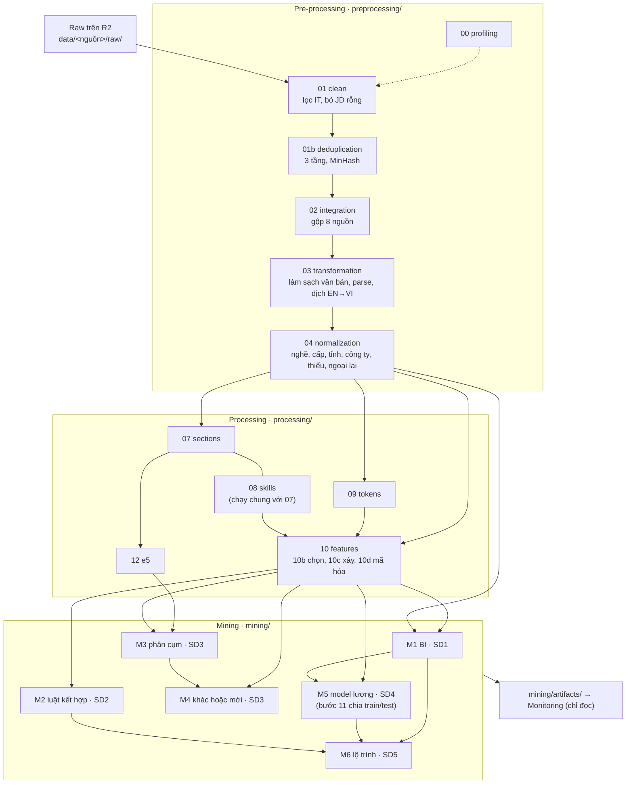

# MÔ TẢ QUY TRÌNH: TỪ MỤC TIÊU ĐẾN TỪNG BƯỚC (DATA MINING LIFECYCLE)
## ĐỀ TÀI: TÍCH HỢP VÀ KHAI PHÁ DỮ LIỆU THỊ TRƯỜNG LAO ĐỘNG PHỤC VỤ PHÂN TÍCH NGHỀ NGHIỆP VÀ KỸ NĂNG TRONG IT

> **Mã tài liệu:** `SPEC-03`  
> **Phiên bản:** `2.0.0`  
> **Ngày cập nhật:** 17/11/2026 (viết lại theo 5 mục tiêu SD1–SD5 và theo thư mục code thật)  
> **Trạng thái:** Đã duyệt 17/11/2026 (chặng 1); bổ sung quyết định chặng 4 (bỏ TF-IDF)  
> **Vai trò:** Tài liệu **mô tả quy trình**, nối mục tiêu ở [`docs/target/`](../target/00_de_tai.md) với đặc tả chi tiết từng bước ở spec 05 (pre-processing), 06 (processing), 07 (mining) và 08 (đánh giá). Spec chi tiết phải dùng đúng mã bước, thư mục và đường dẫn ghi ở đây. Khi lệch nhau thì sửa spec chi tiết cho khớp file này, và sửa file này cho khớp code.

Phạm vi: từ dữ liệu raw đã có trên R2 tới kết quả của 5 mục tiêu. Phần thu thập (crawl) nằm ở spec 04 và không thuộc tài liệu này.

---

## 1. Từ mục tiêu đến quy trình

Đề tài phục vụ 5 mục tiêu, chia thành 3 tầng phân tích (chi tiết ở `docs/target/`):

| Tầng | SD | Câu hỏi lớn |
|---|---|---|
| 1 · BI | SD1 | Thị trường IT T9–T11/2026 trông như thế nào? |
| 2 · Khai phá không giám sát | SD2, SD3 | Kỹ năng nào đi thành gói? Thị trường thật sự chia thành những nhóm việc nào, và tin nào khác hoặc mới? |
| 3 · Train model | SD4, SD5 | Kỹ năng nào đáng tiền? Người mới nên học gì, theo thứ tự nào? |

Muốn trả lời các câu hỏi trên thì dữ liệu phải qua 3 giai đoạn. Mỗi giai đoạn nằm trong một thư mục code:

| Giai đoạn | Thư mục | Việc | Đầu ra cuối |
|---|---|---|---|
| Pre-processing | `preprocessing/` | Lọc tin IT, khử trùng lặp, gộp 8 nguồn, làm sạch văn bản, parse và chuẩn hóa trường, xử lý thiếu và ngoại lai | `data/preprocessing/04_normalization/all.parquet`: bảng sạch, mỗi dòng một tin |
| Processing | `processing/` | Tách section, rút kỹ năng, tách từ, tạo và mã hóa đặc trưng, vector hóa văn bản (e5) | `data/processing/10_features/features.parquet`, `12_e5/` |
| Mining | `mining/` | 6 bước M1–M6, mỗi bước phục vụ một SD | `mining/artifacts/` |

Bảng dưới cho biết mỗi SD cần những bước nào. Bước nào hỏng thì các SD ở cột tương ứng bị ảnh hưởng.

| Bước | SD1 | SD2 | SD3 | SD4 | SD5 |
|---|:-:|:-:|:-:|:-:|:-:|
| 01 clean (lọc IT) | ● | ● | ● | ● | ● |
| 01b deduplication | ● | ● | ● | ● | ● |
| 02 integration | ● | ● | ● | ● | ● |
| 03 transformation (parse lương, kinh nghiệm, tháng; dịch EN→VI) | ● | | ● | ● | ● |
| 04 normalization (nghề, cấp, tỉnh, công ty; thiếu và ngoại lai) | ● | ● | ● | ● | ● |
| 07 sections | | | ● | | |
| 08 skills | ● | ● | ● | ● | ● |
| 09 tokens (chỉ cho `n_tokens` của 10c) | | | ● | | |
| 10 features | ● | ● | ● | ● | ● |
| 12 e5 | | | ● | | |
| M1 BI | ● | | | ● (baseline) | ● |
| M2 luật kết hợp | | ● | | | ● |
| M3 phân cụm | | | ● | | |
| M4 tin khác hoặc mới | | | ● | | |
| M5 model lương (gồm bước 11 chia train/test) | | | | ● | ● |
| M6 lộ trình | | | | | ● |

## 2. Sơ đồ quy trình

## 3. Bảng các bước

Thứ tự chạy dưới đây khớp với `CHAIN` trong `scripts/run_preprocessing.py` (pre-processing và processing) và `STEPS` trong `mining/run_mining_pipeline.py` (M2–M5). Mỗi bước sinh report ở `reports/<giai đoạn>/<bước>/<nguồn>.json` và `_all.json` (`preprocessing/common/step_report.py`). Đặc tả chi tiết từng bước nằm ở spec 05, 06, 07.

### 3.1. Pre-processing (`preprocessing/`, chi tiết ở spec 05)

| Mã | Việc | Code | Đầu vào | Đầu ra | Trạng thái |
|---|---|---|---|---|---|
| 00 | Profiling: đo hiện trạng trước và sau khi làm sạch | `scripts/profile_sources.py` | Raw | `reports/preprocessing/00_profiling/{before_clean,after_clean}/` | Có code, đã chạy |
| 01 | Clean: lọc tin IT bằng luật 2 tầng, bỏ JD rỗng, chọn snapshot mới nhất của mỗi tin | `preprocessing/clean/run.py`, `preprocessing/common/it_filter.py`, `raw_reader.py` | `data/<nguồn>/raw/` | `data/preprocessing/01_clean/<nguồn>.jsonl` | Có code, đã chạy |
| 01b | Deduplication: khử trùng lặp 3 tầng (cùng nguồn + id → hash văn bản → MinHash) | `preprocessing/deduplication/` | `01_clean/<nguồn>.jsonl` | `data/preprocessing/01b_deduplication/<nguồn>.jsonl` | Có code, đã chạy |
| 02 | Integration: làm phẳng 8 nguồn về một schema rồi gộp | `preprocessing/integration/run.py`, `json_flattener.py`, `schema.py` | `01b_deduplication/<nguồn>.jsonl` | `data/preprocessing/02_integration/all.parquet` | Có code, đã chạy |
| 03 | Transformation: làm sạch HTML và ký tự; parse lương, kinh nghiệm, số lượng tuyển, ngày; dịch JD tiếng Anh sang tiếng Việt (envit5); tạo `posted_month` (PRE-37) | `preprocessing/transformation/run.py`, `preprocessing/translation/` | `02_integration/all.parquet` | `data/preprocessing/03_transformation/all.parquet` | Có code, đã chạy; `posted_month` chưa có |
| 04 | Normalization: nhóm nghề, cấp bậc, 34 tỉnh, `company_key`, chuẩn hóa tên kỹ năng; xử lý thiếu và ngoại lai (chỉ gắn cờ, không xóa dòng) | `preprocessing/normalization/run.py`, `preprocessing/missing_outlier/` | `03_transformation/all.parquet` | `data/preprocessing/04_normalization/all.parquet` | Có code, đã chạy |
| 05 | Encoding cũ (P5) | `preprocessing/encoding/` | — | Report 0 dòng | **Đã được bước 10 thay thế**, vẫn còn trong `STEPS` (xem mục 6) |

### 3.2. Processing (`processing/`, chi tiết ở spec 06)

| Mã | Việc | Code | Đầu vào | Đầu ra | Trạng thái |
|---|---|---|---|---|---|
| 07 | Tách JD thành section (`mo_ta`, `yeu_cau`, `uu_tien`, `phuc_loi`, `khac`) và bullet | `processing/extraction/sections.py`, `run.py` | `04_normalization/all.parquet` | `data/processing/07_sections/all.parquet` | Có code, đã chạy |
| 08 | Rút kỹ năng theo từ điển (Aho–Corasick), quét cả bản dịch. Chạy chung một lần với 07 (`processing/extraction/run.py`) | `processing/extraction/skills.py`, `run.py` | `04_normalization/all.parquet` | `data/processing/08_skills/job_skills.parquet` | Có code, đã chạy; chưa đạt F1 (PRE-33) |
| 09 | Tách từ (`underthesea`), bỏ stopword, thay kỹ năng bằng token chuẩn. Tính lại section và kỹ năng trong bộ nhớ bằng cùng hàm `analyze` của 07/08, không đọc file 07/08 | `processing/transformation/tokenize.py`, `run.py` | `04_normalization/all.parquet` | `data/processing/09_tokens/all.parquet` | Có code, đã chạy |
| 10 | Tạo đặc trưng: 10 rời rạc hóa, 10b chọn kỹ năng (`min_df` 15), 10c xây đặc trưng mới, 10d mã hóa | `processing/encoding/features.py`, `transformation/discretize.py`, `selection/sparsity.py`, `construction/features.py` | `04_normalization/all.parquet`, 08, 09 | `data/processing/10_features/features.parquet`, `encoding_dictionary.json` | Có code, đã chạy 11/11 |
| 12_tfidf | TF-IDF 1–2 gram trên token | `processing/extraction/vectorize.py` | 04, 09 | `data/processing/12_tfidf/{tfidf.npz,vocab.json,job_ids.json}` | **Bỏ** (người dùng chốt 17/11, spec 06 mục 3.5); code chưa gỡ (MINE-7) |
| 12_e5 | Embedding bullet bằng `multilingual-e5-base`, gộp thành vector cho mỗi JD | `processing/extraction/embed.py` | 07 | `data/processing/12_e5/job_emb.npz` và các file khác | Có code, đã chạy (cần GPU) |

Bước 11 (chia train/test) không nằm ở processing. Bước này chỉ cần cho model có giám sát nên chuyển vào M5 (mục 3.3).

### 3.3. Mining (`mining/`, chi tiết ở spec 07; đánh giá ở spec 08)

| Mã | SD | Việc | Code | Đầu vào | Đầu ra | Trạng thái |
|---|---|---|---|---|---|---|
| M1 | SD1 | Thống kê mô tả: đếm, tỷ lệ, bảng chéo, trung vị | `mining/bi.py` (đề xuất, mục 7) | `04_normalization/all.parquet`, `10_features/features.parquet` | `mining/artifacts/sd1_*.json` (đề xuất) | **Chưa có code** |
| M2 | SD2 | FP-Growth, luật kết hợp chia theo nghề và cấp | `mining/association.py` | `features.parquet` (cột `skill__*`) | `mining/artifacts/skill_association_rules.parquet` | Có code, đã chạy 11/11; sanity fail (MINE-1) |
| M3 | SD3 | Phân cụm K-Means và HDBSCAN, giảm chiều SVD/PCA | `mining/clustering.py` | `features.parquet`, `12_e5/job_emb.npz`, văn bản JD | `mining/artifacts/job_clusters.parquet` | Có code, đã chạy; cụm yếu (MINE-1, L-47) |
| M4 | SD3 | Tin khác hoặc mới (Isolation Forest + tin HDBSCAN để riêng) | `mining/anomaly.py` | `features.parquet`, kết quả M3 | `mining/artifacts/job_anomalies.parquet` | Có code, đã chạy; chưa tách hai loại "khác" và "mới" |
| M5 | SD4 | Bước 11 (chia train/test 80/20 theo công ty) → Random Forest + SHAP; ước tính lương tin "thỏa thuận"; phương án B đoán khung lương | `mining/salary_model.py` | `features.parquet`, `04_normalization/all.parquet` | `mining/artifacts/skill_salary_shap_values.parquet`, `trained_salary_rf_model.joblib` | Có code phần A, chưa chạy; **chưa có** phần ước tính và phương án B |
| M6 | SD5 | Điểm ưu tiên kỹ năng, thứ tự học, coverage@N | `mining/recommend.py` (đề xuất, mục 7) | Kết quả M1, M2, M5 | `mining/artifacts/sd5_*.json` (đề xuất) | **Chưa có code** |

Chỉ số của M2–M5 ghi chung vào `mining/artifacts/mining_metrics.json`. Monitoring chỉ đọc `mining/artifacts/`, không tự tính lại.

## 4. Những chỗ không được đảo thứ tự

| Thứ tự | Lý do |
|---|---|
| 01 trước 01b | Chỉ khử trùng lặp trên tin IT. Tin không phải IT bị loại sớm để không ghép nhầm với tin IT |
| 01b trước 02 | Khử trùng trong từng nguồn (theo id gốc) phải làm khi còn file riêng mỗi nguồn |
| 01b trước phần dịch ở 03 | Không tốn công dịch các tin sẽ bị loại vì trùng |
| 03 trước 04 | 04 chuẩn hóa trên số đã parse ở 03 (lương, kinh nghiệm). Ngoại lai lương được tính sau khi đã quy về VND/tháng |
| 04 trước 07–10 | Processing đọc bảng đã chuẩn hóa, không đọc lại raw và không sửa giá trị đã chuẩn hóa |
| 08 trước 10 | 10 dựng ma trận kỹ năng từ `job_skills.parquet` |
| 08 và 09 dùng cùng một phiên bản từ điển kỹ năng | 09 tự tính lại kỹ năng bằng cùng hàm `analyze`. Đổi từ điển thì phải chạy lại cả 07/08 lẫn 09, nếu không token và ma trận kỹ năng sẽ lệch nhau |
| Chọn ngưỡng ở 10b trước mọi bước mining | M2–M5 phải dùng cùng một bộ cột kỹ năng |
| M3 trước M4 | Tin "mới" là tin mà HDBSCAN ở M3 để riêng |
| Bước 11 trước khi fit ở M5 | Chỉ fit trên tập train; tin cùng công ty không được nằm ở cả train lẫn test |
| M1, M2, M5 trước M6 | M6 dùng nhu cầu (M1), luật (M2) và giá trị kỹ năng (M5) |

## 5. Vòng phản hồi

Khi kiểm tra ở một bước sau không đạt, quay về bước gây ra lỗi và sửa ở đó. Không vá ở bước sau.

| Dấu hiệu | Quay về | Ví dụ đã gặp |
|---|---|---|
| Luật kỹ năng hiển nhiên không xuất hiện (React⇒JavaScript, Flutter⇒Dart) | 08 (từ điển, alias) | MINE-1 |
| Cụm tách theo số lượng kỹ năng chứ không theo nội dung | 10 (chuẩn hóa ma trận kỹ năng) hoặc 08 | MINE-1, L-47 |
| Trung vị lương không tăng dần theo cấp bậc | 03 (parse lương) hoặc 04 (cấp bậc) | MINE-1 |
| Nhiều tin có nghề hoặc cấp bậc cần kiểm lại | 04 (luật nghề và cấp bậc) | PRE-35 |
| Tin không phải IT lọt vào kết quả | 01 (bộ lọc IT) | PRE-12 |
| Rút kỹ năng sai so với nhãn gold | 08 | PRE-33 |

Sửa xong thì chạy lại từ bước đã sửa tới cuối chuỗi. Không sửa tay file đầu ra.

## 6. Chỗ lệch giữa thiết kế cũ và code

Thiết kế 13 bước cũ (file "Tiền xử lý dữ liệu JD ngành IT cho Data Mining.md", đã bỏ) và các spec trước đây có những chỗ khác với code đang chạy. Từ nay **code là chuẩn** cho thứ tự và vị trí của bước. Phần còn đúng của thiết kế cũ sẽ được viết lại vào spec 05 và 06.

| Thiết kế cũ | Code hiện tại | Xử lý |
|---|---|---|
| Bước 1 đồng nhất schema, chạy trước khi làm sạch | 01 clean đọc raw trực tiếp; 02 integration chạy sau khử trùng | Spec theo code |
| Bước 2 làm sạch ký tự là một bước riêng | Nằm trong 03 transformation | Spec 05 mô tả trong bước 03 |
| Bước 3 lọc phạm vi | 01 clean | Spec theo code |
| Bước 4b dịch JD | Nằm trong 03 (luật T6b) | Spec theo code |
| Bước 5 chuẩn hóa trường | Chia đôi: parse ở 03, chuẩn hóa về danh mục ở 04 | Spec theo code |
| Bước 6 thiếu và ngoại lai | Nằm trong 04 (`normalization/run.py` gọi `missing_outlier/`) | Spec theo code |
| Bước 05 encoding (P5) | Đã được 10 thay; vẫn còn trong `STEPS` | Đề xuất bỏ khỏi chuỗi chạy (mục 7) |
| 10b bỏ kỹ năng dưới 5 lần | `min_df` = 15 | Spec theo code; ngưỡng là quyết định PRE-33 |
| Bước 11 tùy chọn vì "mining chỉ unsupervised" | Cần cho SD4 | Chuyển vào M5 |
| Mining chỉ unsupervised | 3 tầng: BI, không giám sát, train model | Theo `docs/target/` |
| Golden Master là `data/curated/curated_flat_golden_jobs.parquet` | Chuỗi hiện tại kết thúc ở `04_normalization/all.parquet`; `mining/config.py` dùng file này làm dự phòng | Đã duyệt 17/11 (spec 05 mục 4.1): bảng sạch cuối là `04_normalization/all.parquet`, bỏ tên `curated_flat_golden_jobs.parquet` (PRE-39) |
| Ngày đăng `posted_date` | Phủ 63,8% | Thay bằng `posted_month` (PRE-37) |
| M3 dùng TF-IDF bước 12 | `mining/clustering.py` tự dựng TF-IDF 100 từ và dùng e5; không đọc `12_tfidf/` | Chốt 17/11: bỏ TF-IDF, M3 chỉ dùng kỹ năng + e5 (spec 07 mục 4) |

## 7. Đề xuất đã duyệt (chặng 1, 17/11/2026)

1. **M1 BI đặt ở `mining/bi.py`**, ghi kết quả ra `mining/artifacts/sd1_*.json`. Monitoring chỉ đọc các file này, giống M2–M5. Như vậy số liệu SD1 được tính một lần, tái lập được, và không có số tự tính trong giao diện.
2. **M6 đặt ở `mining/recommend.py`**, ghi kết quả ra `mining/artifacts/sd5_*.json`.
3. **Bỏ `05_encoding` khỏi `STEPS`** trong `preprocessing/common/__init__.py`, vì bước 10 đã thay thế. Đây là việc code; nếu duyệt thì sẽ ghi thành mục trong `docs/KNOWN_ISSUED.md`.
4. **Thêm `bi` và `recommend` vào `STEPS` của `mining/run_mining_pipeline.py`**, theo thứ tự `bi, fp, cluster, anomaly, salary, recommend`.

## 8. Đối chiếu với CRISP-DM và KDD

| CRISP-DM | KDD | Trong dự án |
|---|---|---|
| Business Understanding | — | `docs/target/` (đề tài, SD1–SD5) |
| Data Understanding | Selection | Raw trên R2 + bước 00 profiling |
| Data Preparation | Preprocessing, Transformation | Bước 01–04 (pre-processing), 07–12 (processing) |
| Modeling | Data Mining | M1–M6 |
| Evaluation | Interpretation / Evaluation | Spec 08, sanity check trong `mining/sanity.py`, PRE-36 |
| Deployment | — | `mining/artifacts/` → Monitoring (spec 09), báo cáo đồ án |
