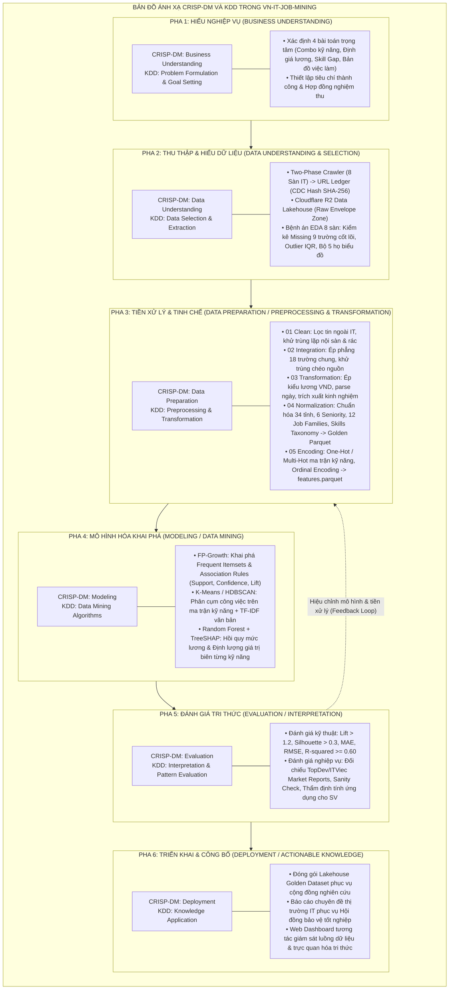
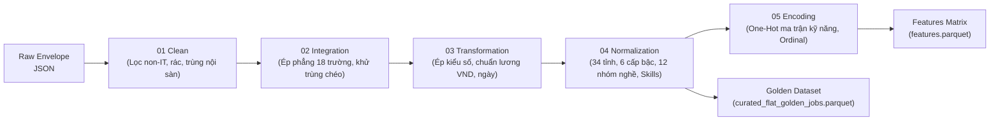
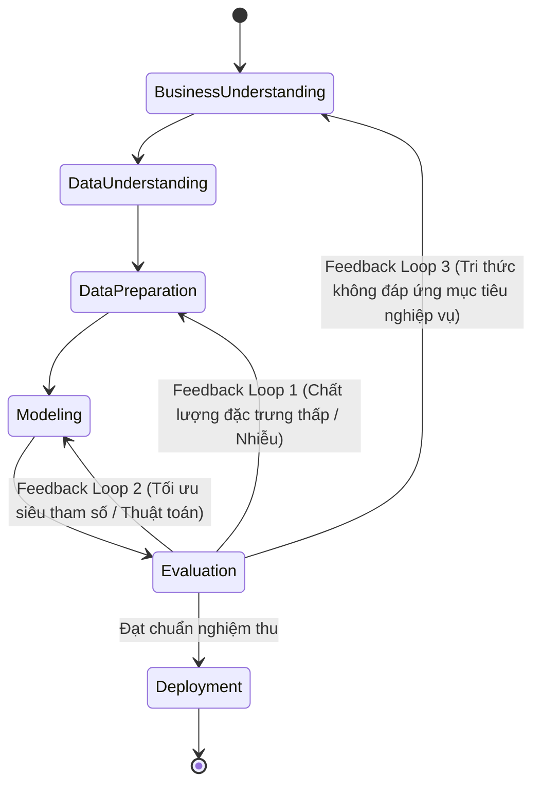

# VÒNG ĐỜI KHAI PHÁ DỮ LIỆU: KẾT HỢP CRISP-DM & KDD (DATA MINING LIFECYCLE)
## DỰ ÁN: HỆ THỐNG KHAI PHÁ DỮ LIỆU TUYỂN DỤNG IT VIỆT NAM (VN-IT-JOB-MINING)

> **Mã tài liệu:** `SPEC-03`  
> **Phiên bản:** `1.0.0`  
> **Ngày cập nhật:** 05/11/2026  
> **Trạng thái:** Chính thức ban hành  
> **Mục tiêu:** Định hình phương pháp luận khoa học cho đồ án thông qua sự tích hợp hài hòa giữa mô hình công nghiệp **CRISP-DM** và tiến trình học thuật **KDD**, ánh xạ trực tiếp vào từng module code của dự án.

---

## 1. Phương Pháp Luận: Tích Hợp CRISP-DM & KDD

Đồ án tốt nghiệp **VN-IT-Job-Mining** kết hợp hai chuẩn mực kinh điển trong khoa học dữ liệu:
- **CRISP-DM (Cross-Industry Standard Process for Data Mining):** Cung cấp khung quản trị dự án 6 giai đoạn lấy nghiệp vụ làm trung tâm (Business-centric), đảm bảo tính thực tiễn và định hướng kết quả rõ ràng.
- **KDD (Knowledge Discovery in Databases):** Cung cấp góc nhìn kỹ thuật phân tầng 5 bước về sự biến đổi của dữ liệu từ dạng thô sơ sang tri thức hữu ích (Data $\rightarrow$ Target Data $\rightarrow$ Preprocessed Data $\rightarrow$ Transformed Data $\rightarrow$ Patterns $\rightarrow$ Knowledge).

---

## 2. Bảng Đối Sánh Toàn Diện: CRISP-DM vs. KDD vs. Triển Khai Thực Tế

| Giai đoạn CRISP-DM | Pha KDD tương ứng | Thành phần triển khai trong VN-IT-Job-Mining | Dữ liệu đầu vào | Dữ liệu đầu ra | Công cụ / Thư viện |
| :--- | :--- | :--- | :--- | :--- | :--- |
| **1. Business Understanding** | Problem Formulation & Domain Research | Xác định bài toán thị trường IT cuối năm 2026; thiết kế 4 bài toán trọng tâm (SD1 - SD5). | Yêu cầu nghiệp vụ, Tài liệu khảo sát thị trường IT Việt Nam. | `docs/spec/01_product_spec.md`, `02_out_of_scope.md`. | Markdown, Mermaid. |
| **2. Data Understanding** | Selection & Data Profiling | • Two-Phase Crawler 8 sàn. • URL Ledger CDC. • Bệnh án EDA 5 trụ cột lỗi. | Web HTML / API công khai từ 8 sàn (TopCV, TopDev...). | • `r2://vn-it-jobs/raw/` • `reports/eda/*.md` • URL Ledger. | Playwright, Requests, PostgreSQL, Pandas, R2 SDK. |
| **3. Data Preparation** | Preprocessing & Transformation | Pipeline 5 bước tuần tự: • 01 Clean • 02 Integration • 03 Transformation • 04 Normalization • 05 Encoding | Raw Envelopes JSON tại `data/<source>/raw/`. | • `curated_flat_golden_jobs.parquet` • `features.parquet` • `encoding_dictionary.json` | Python, Polars, PyArrow, Scikit-learn, Regex. |
| **4. Modeling** | Data Mining | • Khai phá luật kết hợp kỹ năng. • Phân cụm công việc. • Hồi quy mức lương & định lượng giá trị kỹ năng. | `features.parquet`, ma trận nhị phân kỹ năng và TF-IDF. | • Association Rules DF • Cluster Labels • Trained RF Model • SHAP Values Matrix | `mlxtend` (frequent_patterns), `scikit-learn`, `shap`, `hdbscan`. |
| **5. Evaluation** | Interpretation & Validation | • Kiểm định toán học thống kê. • Kiểm định tính đúng đắn logic ngành (Sanity Check). • Đối chiếu báo cáo TopDev. | Kết quả mô hình (Rules, Clusters, SHAP Values) và Holdout Test Set. | `reports/evaluation_report.md`, biểu đồ SHAP Summary, Elbow Curve. | Matplotlib, Seaborn, Scipy, Statsmodels. |
| **6. Deployment** | Knowledge Delivery & Exploitation | • Xuất bản Bộ dữ liệu Vàng. • Giao diện Web Monitoring & Visual Explorer. • Báo cáo Đồ án Tốt nghiệp. | Golden Dataset, Kho tri thức, Kết quả đánh giá. | • Web Streamlit Dashboard • Luận văn & Slide bảo vệ tốt nghiệp. | Streamlit, Altair, Cloudflare R2, Git, Pandoc. |

---

## 3. Chi Tiết Thực Hiện Từng Giai Đoạn Trong Pipeline

### 3.1. Giai đoạn 1: Thấu Hiểu Nghiệp Vụ (Business Understanding)
- **Mục tiêu:** Chuyển hóa mục tiêu tuyển dụng của thị trường thành 4 bài toán kỹ thuật dữ liệu cụ thể.
- **Các quyết định chính:**
  - Không giải quyết các bài toán mơ hồ. Định nghĩa chính xác không gian bài toán: Combo kỹ năng = Luật kết hợp ($Association\ Rules$); Định giá kỹ năng = Đóng góp biên trong hồi quy phi tuyến ($Marginal\ Impact$ qua Shapley values); Phân cụm vị trí = $K\text{-Means} / HDBSCAN$; Khoảng cách kỹ năng = Đối sánh phân phối tần suất thực tế vs. giáo trình đại học.
  - Ban hành hợp đồng dữ liệu đanh thép (Data Contract) và bảng tiêu chí nghiệm thu rõ ràng ngay từ đầu.

### 3.2. Giai đoạn 2: Thu Thập & Thấu Hiểu Dữ Liệu Thô (Data Understanding & Selection)
- **Cơ chế thu thập 2 pha độc lập (Two-Phase Decoupled Crawler):**
  - **Pha 1 (URL Discovery):** Quét trang danh sách, chuẩn hóa Canonical URL, băm SHA-256 lưu vào `catalog_master.json` (URL Ledger) với trạng thái `PENDING`.
  - **Pha 2 (Detail Extraction):** Quét từng URL theo lịch trình Airflow, trích xuất toàn bộ DOM/API payload, đóng gói vào `RawJobEnvelope` (chứa siêu dữ liệu thời gian, mã nguồn, nội dung gốc nguyên bản) và đánh dấu `DONE`.
- **Bảo toàn nguồn sự thật (CDC & Safe Skip):**
  - Áp dụng kỹ thuật **Change Data Capture (CDC)** bằng băm nội dung JSON Hash SHA-256: Nếu tin đã tồn tại nhưng nội dung không đổi sau 21 ngày, không tạo bản ghi mới; nếu có cập nhật lương/mô tả thì nâng phiên bản `_v<N>.json`.
  - Cơ chế **Safe Skip:** Bất kỳ lỗi parse trang đơn lẻ nào chỉ đánh dấu `FAILED` trên Ledger mà không làm sập batch của Airflow.
- **Bệnh án dữ liệu (EDA Profiling):**
  - Đánh giá tỷ lệ khuyết thiếu (Missing Values) trên 9 trường cốt lõi (`title`, `company`, `salary_min`, `salary_max`, `currency`, `experience_years`, `locations`, `skills`, `description`).
  - Phát hiện ngoại lai số học (Outliers) qua IQR cho trường lương và kinh nghiệm.
  - Trực quan hóa 5 họ biểu đồ khám phá để nhận diện đặc thù từng sàn trước khi can thiệp mã nguồn.

### 3.3. Giai đoạn 3: Chuẩn Bị & Chuyển Đổi Dữ Liệu (Data Preparation / Preprocessing)
Giai đoạn này được thực hiện qua chuỗi 5 bước tuần tự khép kín, tuân thủ nguyên tắc: *Đầu ra của bước $N$ là đầu vào duy nhất của bước $N+1$*.

1. **Bước 01 - Clean:**
   - Đào thải tin tuyển dụng ngoài ngành IT bằng hệ luật Blacklist chức danh và mô tả.
   - Khử trùng lặp nội sàn (Deduplication within source) dựa trên băm chuẩn hóa và ID tin.
2. **Bước 02 - Integration:**
   - Ánh xạ cấu trúc JSON phân mảnh của 8 sàn về Schema chung thống nhất gồm 18 trường cốt lõi.
   - Khử trùng lặp chéo sàn (Cross-platform Record Linkage) bằng kỹ thuật khóa chặn Blocking (kết hợp Tên công ty chuẩn hóa + Chức danh tương đồng).
3. **Bước 03 - Transformation:**
   - Chuyển đổi mức lương về đơn vị chuẩn VNĐ/tháng: Quy đổi tỷ giá USD $\rightarrow$ VND (tỷ giá cố định 25.400 VND/USD tại quý 4/2026), xử lý dải lương `[min, max]` và tính giá trị trung vị (`salary_midpoint_vnd`).
   - Chuẩn hóa trường kinh nghiệm thành số thực năm (`experience_years`), phân tách trường hợp không đòi hỏi kinh nghiệm ($0$ năm) và tin ẩn lương có gắn cờ `is_salary_negotiable = True`.
4. **Bước 04 - Normalization:**
   - Chuẩn hóa địa lý về danh mục 34 tỉnh/thành phố sau sáp nhập hành chính (Nghị quyết có hiệu lực từ 01/07/2025).
   - Chuẩn hóa chức danh vào 1 trong 6 cấp bậc **Seniority**: *"Thực tập", "Mới tốt nghiệp", "Junior", "Middle", "Senior", "Trưởng nhóm/Quản lý"*.
   - Chuẩn hóa vị trí vào 1 trong **12 Job Families** công nghệ.
   - Chuẩn hóa tên kỹ năng theo từ điển kỹ năng chuẩn `skills.json` (ví dụ: `reactjs`, `React.js`, `ReactJS` $\rightarrow$ `React`).
   - Xử lý ngoại lai lương qua kỹ thuật Winsorization tại phân vị 1% và 99%, tính toán $\log(1 + Salary)$.
   - Hợp nhất 8 nguồn xuất bản tệp `curated_flat_golden_jobs.parquet` (Bộ Dữ Liệu Vàng).
5. **Bước 05 - Encoding:**
   - Mã hóa ma trận nhị phân (One-Hot / Multi-Hot Encoding) cho hàng trăm kỹ năng công nghệ.
   - Mã hóa thứ bậc (Ordinal Encoding) cho Seniority.
   - Xuất bản tệp đặc trưng `features.parquet` và từ điển ánh xạ `encoding_dictionary.json` phục vụ trực tiếp giai đoạn Modeling.

### 3.4. Giai đoạn 4: Mô Hình Hóa & Khai Phá Tri Thức (Modeling / Data Mining)
- Áp dụng các kỹ thuật khai phá dữ liệu tiên tiến trên ma trận đặc trưng chuẩn hóa:
  - **FP-Growth:** Dựng cây tiền tố FP-Tree nén giao dịch kỹ năng từ các tin tuyển dụng. Trích xuất các tập kỹ năng phổ biến với ngưỡng $min\_sup$ phù hợp và sinh luật kết hợp với $Lift > 1.2$.
  - **K-Means / HDBSCAN Clustering:** Tính toán khoảng cách trên không gian đa chiều (kỹ năng + TF-IDF văn bản), xác định số cụm tối ưu qua phân tích Silhouette Score và Elbow WCSS.
  - **Random Forest Regressor & TreeSHAP:** Huấn luyện mô hình hồi quy dự đoán $\log(Salary)$, trích xuất giá trị đóng góp Shapley để phân tích giá trị kinh tế biên của từng kỹ năng.

### 3.5. Giai đoạn 5: Đánh Giá & Diễn Giải Tri Thức (Evaluation / Interpretation)
- Tiến hành thẩm định song song trên 2 phương diện:
  - **Kiểm định kỹ thuật thống kê:** Đo đạc các chỉ số học thuật khắt khe (Support, Confidence, Lift, Silhouette, Davies-Bouldin, MAE, RMSE, $R^2$).
  - **Kiểm định nghiệp vụ (Sanity Check):** Đối chiếu các luật và cụm tìm được với thực tế ngành phần mềm Việt Nam (ví dụ: Luật `Spring Boot` $\Rightarrow$ `Java` phải có Confidence gần tuyệt đối; giá trị lương của Senior phải vượt trội so với Fresher). Bất kỳ quy luật bất thường nào đều kích hoạt luồng phản hồi quay lại rà soát dữ liệu ở Giai đoạn 3.

### 3.6. Giai đoạn 6: Triển Khai & Báo Cáo Nghiệm Thu (Deployment)
- Chuyển giao các kết quả nghiên cứu thành sản phẩm có thể sử dụng được:
  - **Lưu trữ Lakehouse:** Đóng gói dataset chuẩn lên Cloudflare R2 phục vụ chia sẻ nghiên cứu mở.
  - **Monitoring Dashboard:** Vận hành ứng dụng Streamlit cho phép người dùng lọc tìm kiếm, tra cứu mức lương theo kỹ năng và xem tương quan thị trường.
  - **Báo cáo tốt nghiệp:** Soạn thảo hồ sơ báo cáo khoa học đầy đủ, bảo vệ thành công trước Hội đồng chấm đồ án.

---

## 4. Cơ Chế Vòng Lặp Phản Hồi (Feedback Loops)

Quy trình CRISP-DM là một chu trình lặp (Iterative Cycle), không phải đường thẳng một chiều. Trong dự án **VN-IT-Job-Mining**, 3 vòng lặp phản hồi cốt lõi được thiết lập:

1. **Feedback Loop 1 (Evaluation $\rightarrow$ Data Preparation):** Nếu mô hình hồi quy lương có $R^2 < 0.60$ hoặc phát hiện biến lương bị méo do sót ngoại lai, pipeline lập tức quay lại Bước 03/04 để tinh chỉnh ngưỡng Winsorization hoặc bổ sung từ khóa chuẩn hóa.
2. **Feedback Loop 2 (Evaluation $\rightarrow$ Modeling):** Nếu phân cụm K-Means cho chỉ số Silhouette thấp ($< 0.2$), thực nghiệm chuyển hướng sang thuật toán dựa trên mật độ HDBSCAN hoặc điều chỉnh không gian giảm chiều (PCA/TruncatedSVD).
3. **Feedback Loop 3 (Evaluation $\rightarrow$ Business Understanding):** Nếu kết quả khai phá luật kết hợp chỉ trả về các luật hiển nhiên (Trivial Rules, ví dụ: HTML $\Rightarrow$ CSS), nhóm nghiên cứu sẽ tái định nghĩa bài toán: lọc bỏ các kỹ năng cơ sở phổ quát để tập trung vào các công nghệ chuyên sâu theo từng Job Family.
