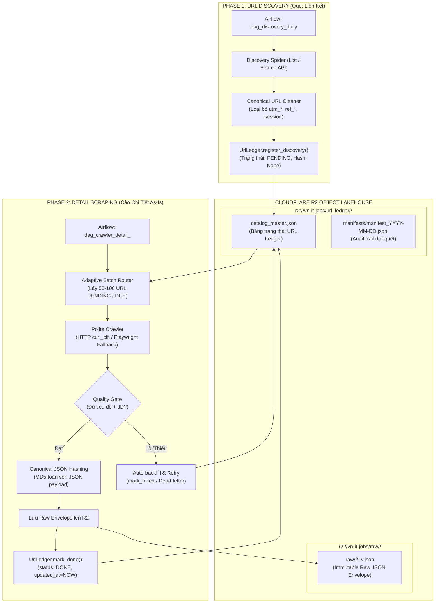
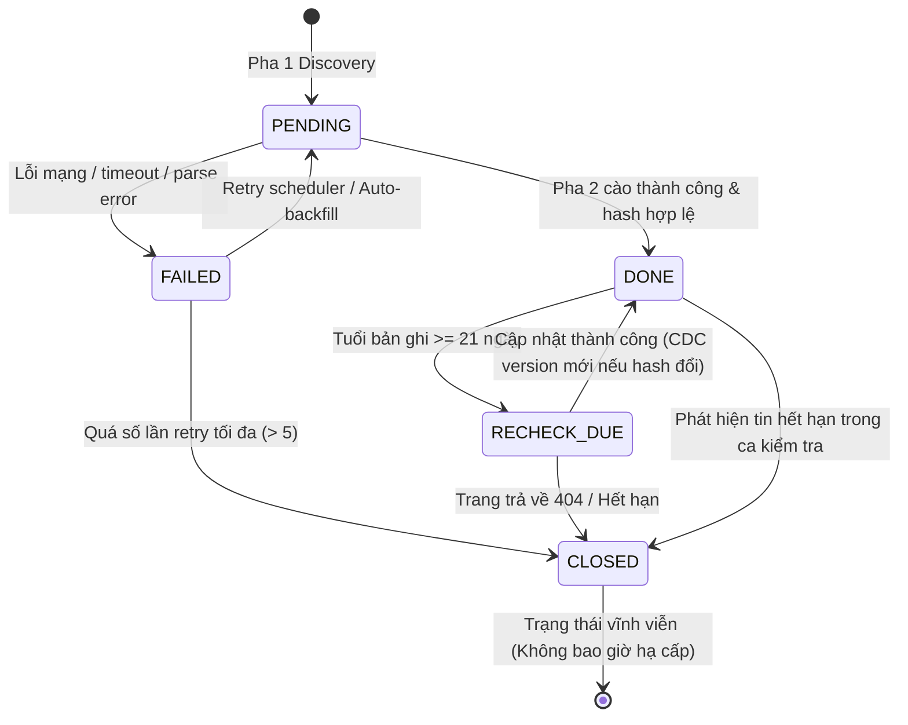
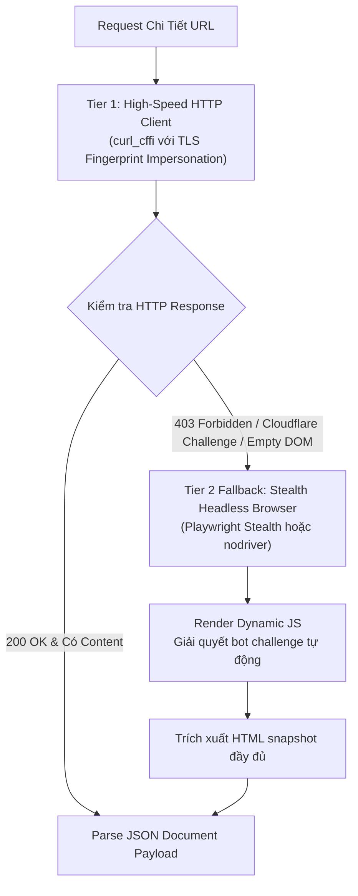

# ĐẶC TẢ KỸ THUẬT HẠ TẦNG THU THẬP DỮ LIỆU
## MODULE 04: DATA COLLECTION SPECIFICATION

> **Tài liệu đặc tả kỹ thuật hệ thống (System Specification Document)**  
> **Dự án:** Phân tích thị trường việc làm IT Việt Nam (VN-IT-Job-Mining)  
> **Phiên bản:** 2.0 — Cập nhật: Tháng 11/2026  
> **Trạng thái:** Official Technical Specification  
> **Phạm vi nguồn:** 8 sàn tuyển dụng hàng đầu: TopCV, TopDev, VietnamWorks, CareerViet, Vieclam24h, ITviec, Glints, JobsGO.

---

## 1. Tổng Quan & Triết Lý Thu Thập Dữ Liệu

Hạ tầng thu thập dữ liệu (Data Collection Infrastructure) của hệ thống **VN-IT-Job-Mining** được thiết kế để giải quyết bài toán cào dữ liệu quy mô lớn (Large-scale Web Scraping) từ 8 sàn việc làm trực tuyến với cấu trúc DOM đa dạng, cơ chế chống bot (Anti-scraping) phức tạp, và tần suất cập nhật liên tục.

### 1.1. Ba Nguyên Tắc Cốt Tử (Core Principles)
1. **Bảo Toàn Thông Tin Tuyệt Đối (Zero Information Loss / Raw As-Is):**
   - Không tự ý format hay chuẩn hóa dữ liệu tại tầng cào (không ép kiểu lương, không bỏ HTML tags, không lọc bớt các key API lồng nhau).
   - Mọi trường dữ liệu gốc đều được giữ nguyên vẹn trong `raw_payload`. Nếu trích xuất sai tại tầng dưới, dữ liệu thô gốc vẫn còn nguyên để tái xử lý mà không cần cào lại từ website.
2. **Kiến Trúc Hai Pha Độc Lập (Two-Phase Decoupled Pipeline):**
   - Tách rời tuyệt đối giữa việc **Quét danh mục tìm kiếm liên kết (Phase 1: Discovery)** và **Tải nội dung chi tiết bài đăng (Phase 2: Detail Scraping)**.
   - Hợp đồng giao tiếp duy nhất giữa 2 pha là **URL Ledger (`catalog_master.json`)** lưu trữ trên Cloudflare R2.
3. **Thu Thập Lịch Sự & Bền Bỉ (Polite, Stealth & Fault-tolerant Crawling):**
   - Không tấn công DoS sàn tuyển dụng; sử dụng cơ chế Adaptive Batching phân bổ thời gian cào đều đặn, giãn cách ngẫu nhiên.
   - Chịu lỗi cao (Safe Skip & Circuit Breaker): Lỗi một bài đăng không bao giờ làm dừng cả đợt cào; tự động ghi nhận và thử lại theo lịch trình.

---

## 2. Kiến Trúc Thu Thập 2 Pha Độc Lập (Two-Phase Decoupled Pipeline)

Hệ thống loại bỏ hoàn toàn mô hình crawler nguyên khối (Monolithic Spider cào danh sách rồi cào ngay chi tiết) nhằm tránh tắc nghẽn bộ nhớ, nghẽn I/O và mất dữ liệu khi gặp sự cố mạng giữa chừng.



### 2.1. Pha 1 — URL Discovery (`--phase discovery`)
- **Tần suất thực thi:** Chạy định kỳ 1 lần/ngày vào lúc 00:00 UTC (07:00 ICT) thông qua DAG Airflow `dag_discovery_daily`.
- **Nhiệm vụ:**
  - Quét qua toàn bộ các trang phân trang danh mục việc làm IT của 8 sàn.
  - Chuẩn hóa URL sang dạng **Canonical URL**: bóc tách scheme chuẩn (`https`), hostname, path; cắt bỏ toàn bộ tracking query params (`utm_source`, `utm_medium`, `utm_campaign`, `ref`, `tracking_id`, `fbclid`).
  - Trích xuất định danh duy nhất của tin trên sàn (`job_id` hoặc URL slug).
  - Tính toán `url_hash = MD5(canonical_url)`.
  - Ghi nhận vào file manifest đợt quét `manifests/manifest_YYYY-MM-DD.jsonl` và gộp vào `catalog_master.json`.
- **Quy tắc bất biến:** Tại Pha 1, **tuyệt đối chưa có content hash** (`content_hash = None`, `status = "PENDING"`), vì nội dung chi tiết bài viết chưa được cào.

### 2.2. Pha 2 — Detail Scraping (`--phase detail`)
- **Tần suất thực thi:** Chạy chia ca theo cơ chế thích ứng (Adaptive Batches) thông qua 8 DAG riêng biệt `dag_crawler_detail_<source>`.
- **Nhiệm vụ:**
  - Đồng bộ `catalog_master.json` mới nhất từ Cloudflare R2 về môi trường cục bộ.
  - Lọc ra tập hợp URL ưu tiên theo thứ tự:
    1. Các URL mới phát hiện: `status == "PENDING"`.
    2. Các URL đến hạn quét lại định kỳ: `status == "DONE"` và `now() - last_scraped_at >= 21 days` (đánh dấu `RECHECK_DUE`).
  - Thực hiện request tải toàn bộ DOM/API payload theo đúng cơ chế phòng vệ (Polite sleep, rotating UA).
  - Kiểm tra tính đầy đủ qua Quality Gate (Auto-backfill & Retry).
  - Tính toán **Canonical JSON Hash** trên toàn vẹn tài liệu đã bóc tách.
  - Đóng gói file `RawJobEnvelope` và lưu trực tiếp lên Cloudflare R2.
  - Cập nhật trạng thái `status = "DONE"` kèm mã hash và version trong URL Ledger.
  - Định kỳ mỗi 15 - 20 bài đăng hoặc kết thúc batch, đồng bộ ngược `catalog_master.json` lên R2 Lakehouse.

---

## 3. Quản Lý Vòng Đời Trạng Thái URL (URL State Lifecycle)

URL Ledger đóng vai trò như một cơ sở dữ liệu trạng thái phân tán dạng tệp (`catalog_master.json`), quản lý chính xác từng liên kết tuyển dụng trong suốt vòng đời của nó.

### 3.1. Máy Trạng Thái URL (State Machine Definition)

| Trạng Thái | Ý Nghĩa Kỹ Thuật | Điều Kiện Chuyển Dịch |
|---|---|---|
| `PENDING` | URL vừa được phát hiện ở Pha 1, đang xếp hàng chờ cào chi tiết. | Khởi tạo từ Pha 1 Discovery. |
| `FETCHED` / `DONE` | Đã cào chi tiết thành công, payload hợp lệ đã ghi vào Cloudflare R2, có `content_hash`. | Cào thành công ở Pha 2. |
| `RECHECK_DUE` | Tin đã cào thành công nhưng đã quá 21 ngày chưa quét lại; cần kiểm tra cập nhật nội dung. | Tự động chuyển trong bộ nhớ khi tuổi tin $\ge 21$ ngày. |
| `FAILED` | Gặp sự cố trong quá trình cào (timeout, lỗi mạng, lỗi phân giải DOM, 5xx server). | Gọi hàm `mark_failed()`, tăng biến `retry_count`. |
| `CLOSED` | Tin tuyển dụng đã bị xóa hoặc đóng bởi nhà tuyển dụng (HTTP 404, 410, hoặc trang thông báo hết hạn). | Phát hiện mã trạng thái 404/410 hoặc text "Việc làm đã hết hạn". |



### 3.2. Cấu Trúc Bản Ghi Trong URL Ledger (`catalog_master.json`)

Mỗi bản ghi trong `catalog_master.json` có cấu trúc chuẩn như sau:

```json
{
  "url_hash": "a1c8f4309b60e68d0fa47b19de63a18e",
  "canonical_url": "https://topdev.vn/viec-lam/senior-backend-engineer-golang-ha-noi-1049281",
  "job_id": "1049281",
  "source": "topdev",
  "status": "DONE",
  "discovered_at": "2026-11-01T08:15:30Z",
  "last_scraped_at": "2026-11-02T14:22:10Z",
  "updated_at": "2026-11-02T14:22:15Z",
  "content_hash": "e5b7d9021a8f9462bc34091f82c40b8a",
  "current_version": 1,
  "retry_count": 0,
  "last_error": null,
  "repost_of_url_hash": null
}
```

### 3.3. Các Nguyên Tắc Xử Lý Trạng Thái Đặc Biệt

1. **Xử Lý Bài Đăng Trùng Lặp Nội Dung (Repost Detection):**
   - Khi bài viết mới có `canonical_url` khác nhưng sau khi cào chi tiết lại sinh ra `content_hash` trùng khớp 100% với một bài viết khác đã tồn tại trong cùng nguồn:
   - Đánh dấu bản ghi là `status = "DONE"`, thiết lập `repost_of_url_hash = "<url_hash_gốc>"`.
   - **Tuyệt đối không sinh file Raw Envelope mới** lên Cloudflare R2 nhằm tiết kiệm dung lượng và tránh trùng lặp dữ liệu lưu trữ.
2. **Nguyên Tắc Bất Biến Của Trạng Thái `CLOSED`:**
   - Một khi URL đã được đánh dấu là `CLOSED` (do trang web trả về HTTP 404, HTTP 410, hoặc thông báo chính thức "Tin tuyển dụng này đã đóng"), crawler **không bao giờ hạ trạng thái `CLOSED` về lại `PENDING` hay `DONE`**.
3. **Quy Tắc Hợp Nhất Xung Đột (Merge Conflict Resolution - Last Write Wins):**
   - Khi đồng bộ `catalog_master.json` giữa môi trường chạy cục bộ và Cloudflare R2:
   - Bản ghi có trường `updated_at` mới hơn sẽ là bản ghi chiến thắng (`updated_at` được ghi đè tự động trong các hàm `mark_done()`, `mark_failed()`, `mark_closed()`).

---

## 4. Chiến Lược Giải Quyết Bài Toán Cào Tự Động & Lập Lịch

Để cào dữ liệu ổn định và lâu dài từ 8 sàn tuyển dụng mà không bị chặn IP hoặc gây gián đoạn dịch vụ của đối tác, hệ thống triển khai bộ kỹ thuật phòng vệ và điều phối thông minh.

### 4.1. Adaptive Batching Trên Apache Airflow

Thay vì kích hoạt crawler cào ồ ạt hàng nghìn tin cùng lúc (dễ kích hoạt cảnh báo WAF/Rate Limiting của sàn), hệ thống áp dụng cơ chế **Adaptive Batching**:
- **Cấu hình ca cào:** Mỗi ca chỉ lấy ra một mẻ nhỏ gồm **50 đến 100 URL** (hoặc 30 tin đối với các sàn nhạy cảm như VietnamWorks, ITviec).
- **Khoảng nghỉ giữa các ca:** Giãn cách tối thiểu **55 phút** giữa hai ca liên tiếp của cùng một nguồn.
- **Airflow Pool Isolation:** Mỗi nguồn tuyển dụng được cấp một tài nguyên riêng biệt trên Airflow (`pool_<source>`, với `slots = 1`). Điều này đảm bảo Pha 1 (Discovery) và Pha 2 (Detail) của cùng một nguồn không bao giờ chạy đồng thời gây nghẽn băng thông hoặc xung đột file Ledger.

```python
# Cấu hình Airflow DAG Task Instance cho Adaptive Batching
from airflow import DAG
from airflow.operators.bash import BashOperator
from datetime import datetime, timedelta

default_args = {
    'owner': 'data_engineering',
    'depends_on_past': False,
    'retries': 3,
    'retry_delay': timedelta(minutes=5),
}

dag = DAG(
    'crawler_detail_topdev',
    default_args=default_args,
    schedule_interval='0 */2 * * *', # Chạy cách nhau mỗi 2 giờ
    max_active_runs=1,
    catchup=False,
)

crawl_batch_task = BashOperator(
    task_id='crawl_adaptive_batch',
    bash_command='python run.py crawl --source topdev --phase detail --batch-size 75 --sync-r2',
    pool='pool_topdev', # Slot cô lập cho TopDev
    dag=dag,
)
```

### 4.2. Xoay Vòng User-Agent & Polite Sleep Ngẫu Nhiên

- **User-Agent Header Rotation:**
  - Hệ thống duy trì một danh sách hơn 50 chuỗi User-Agent của các trình duyệt hiện đại (Google Chrome, Mozilla Firefox, Microsoft Edge, Safari) trên nhiều nền tảng (Windows 11, macOS Sequoia, Ubuntu Linux).
  - Mỗi request được gắn một User-Agent ngẫu nhiên kèm bộ Header chân thực (`Sec-Ch-Ua`, `Sec-Ch-Ua-Mobile`, `Sec-Fetch-Site`, `Accept-Language: vi-VN,vi;q=0.9,en-US;q=0.8`).
- **Polite Random Sleep:**
  - Giữa 2 request cào chi tiết liên tiếp, crawler thực hiện một khoảng dừng ngẫu nhiên:
  $$\Delta t \sim \mathcal{U}(2.0, 4.5) \text{ (giây)}$$
  - Việc đưa yếu tố phân phối ngẫu nhiên (Jitter) nhằm phá vỡ quy luật chu kỳ request, tránh các hệ thống AI Anti-bot nhận diện hành vi máy móc.

```python
import time
import random
import logging

def polite_sleep(min_seconds: float = 2.0, max_seconds: float = 4.5):
    """Giãn cách ngẫu nhiên lịch sự giữa các request cào."""
    sleep_duration = random.uniform(min_seconds, max_seconds)
    logging.debug(f"Polite sleep: {sleep_duration:.2f}s")
    time.sleep(sleep_duration)
```

### 4.3. Exponential Backoff & Circuit Breaker (Xử Lý Lỗi Mạng & HTTP 429)

Khi gặp lỗi phản hồi từ máy chủ (HTTP 429 Too Many Requests, HTTP 502/503/504 Bad Gateway, hoặc kết nối bị drop/timeout):
- **Thuật toán Exponential Backoff kèm Jitter:**
  $$T_{\text{wait}} = \min(T_{\text{max}}, T_{\text{base}} \times 2^{\text{attempt}} + \text{rand}(0, 1))$$
  Với $T_{\text{base}} = 2.0\text{s}$, $T_{\text{max}} = 60.0\text{s}$. Số lần retry tối đa là 5 lần.
- **Cơ chế Ngắt Mạch (Circuit Breaker):**
  - Nếu trong một batch gặp **3 lỗi liên tiếp** cùng mã lỗi HTTP 429 hoặc IP bị block hoàn toàn:
  - Crawler sẽ **ngay lập tức dừng toàn bộ batch hiện tại**, kích hoạt lưu trạng thái URL Ledger, đồng bộ lên R2 và gửi cảnh báo về hệ thống giám sát. Cơ chế này giúp bảo vệ IP của crawler không bị đưa vào Blacklist vĩnh viễn của sàn.

### 4.4. Fallback Cơ Chế Headless Browser (nodriver / Playwright Stealth)

Các sàn tuyển dụng hiện đại (đặc biệt là TopCV, VietnamWorks, ITviec) áp dụng các giải pháp bảo vệ Cloudflare Turnstile, Cloudflare WAF, hoặc ứng dụng cơ chế Single Page Application (SPA / React / Vue) render dữ liệu qua JavaScript phía Client.

Hệ thống thiết kế theo cơ chế **2-Tier Client Architecture (HTTP First, Browser Fallback)**:



- **Tier 1 (Mặc định):** Sử dụng thư viện `curl_cffi` giả lập chuẩn xác dấu vân tay mạng TLS/JA3 của trình duyệt Chrome thật (`impersonate="chrome124"`). Tốc độ xử lý cực nhanh (chỉ mất 100-300ms/request), tiết kiệm 95% CPU và RAM so với trình duyệt thật.
- **Tier 2 (Fallback):** Khi phát hiện trang trả về mã 403, chuỗi `cf-browser-verification`, hoặc DOM thiếu các trường nội dung cốt lõi:
  - Hệ thống tự động chuyển URL đó sang engine `playwright` với chế độ `playwright-stealth` hoặc `nodriver` (không để lại dấu vết `navigator.webdriver = true`).
  - Đợi DOM tải hoàn tất (chờ selector `.job-description` hoặc tương đương xuất hiện), lấy snapshot toàn bộ DOM tĩnh và đưa về bộ bóc tách.

### 4.5. Cơ Chế Bù Dữ Liệu Thiếu & Thử Lại (Auto-Backfill & Retry Gate)

Một lỗi thường gặp khi cào web là trang web tải không hoàn tất dẫn đến trường mô tả công việc (Job Description - JD) hoặc thông tin cốt lõi bị rỗng, dù mã phản hồi HTTP vẫn là 200 OK.

Hệ thống thiết lập một **Quality Gate** kiểm tra payload trước khi lưu:
- **Tiêu chuẩn tính toàn vẹn tối thiểu (Minimum Data Integrity Criteria):**
  1. `job_title` không được rỗng và độ dài $\ge 3$ ký tự.
  2. `company_name` không được rỗng.
  3. `job_description` (hoặc nội dung yêu cầu công việc) bắt buộc có độ dài văn bản thuần $\ge 50$ ký tự.
- **Cơ chế Auto-backfill:**
  - Nếu bản ghi vi phạm một trong các tiêu chuẩn trên:
  - Crawler từ chối tạo file Raw Envelope.
  - Gọi `ledger.mark_failed(record, error="INCOMPLETE_PAYLOAD_MISSING_JD")`.
  - Tăng chỉ số `retry_count`. Nếu `retry_count < 5`, URL sẽ tự động được đưa về danh sách `PENDING` để cào bù (Backfill) vào ca kế tiếp.
  - Nếu sau 5 lần thử vẫn thiếu dữ liệu, URL được chuyển vào **Dead-letter Queue** và đánh dấu `FAILED_PERMANENT` để chuyên viên dữ liệu kiểm tra thủ công.

---

## 5. Đóng Gói & Lưu Trữ Thô Bất Biến (Immutable Raw JSON Envelope)

Mọi dữ liệu chi tiết thu thập từ các sàn đều được đóng gói theo định dạng chuẩn hóa **Raw Job Envelope** trước khi đẩy trực tiếp lên Cloudflare R2 Data Lakehouse.

### 5.1. Cấu Trúc Raw Job Envelope Chuẩn

File JSON thô bao gồm hai phần tách biệt: `metadata` (thông tin phục vụ quản trị dữ liệu, truy vết pipeline) và `raw_payload` (toàn vẹn dữ liệu gốc từ DOM hoặc API của sàn).

```json
{
  "metadata": {
    "job_id": "topcv_8492019",
    "source": "topcv",
    "source_url": "https://www.topcv.vn/viec-lam/senior-java-spring-boot-developer/8492019.html",
    "scraped_at": "2026-11-03T10:15:30.123456Z",
    "version": 1,
    "content_hash": "3f8d9b2a7e4c1056b8214fa390de8712",
    "crawler_engine": "curl_cffi/chrome124",
    "schema_version": "2.0"
  },
  "raw_payload": {
    "box-header-job__title": "Senior Java Spring Boot Developer (Up to $2,500)",
    "box-header-job__company-title": "CÔNG TY CỔ PHẦN CÔNG NGHỆ TÀI CHÍNH ABC",
    "box-header-job__salary--title": "2,000 - 2,500 USD",
    "box-header-job__location": "Tầng 5, Tòa nhà Techno, Cầu Giấy, Hà Nội",
    "box-header-job__experience": "3 - 5 năm kinh nghiệm",
    "job-detail__info--deadline": "30/11/2026",
    "job-detail__body--description": "<div class=\"job-data\"><p><strong>Mô tả công việc:</strong></p><ul><li>Phát triển hệ thống Microservices sử dụng Java Spring Boot...</li></ul></div>",
    "job-detail__body--requirements": "<div class=\"job-data\"><p><strong>Yêu cầu:</strong></p><ul><li>Tối thiểu 3 năm kinh nghiệm với Java, Spring Boot, Hibernate...</li><li>Thành thạo PostgreSQL, Redis, Kafka...</li></ul></div>",
    "job-detail__body--benefits": "<div class=\"job-data\"><ul><li>Lương tháng 13 + thưởng hiệu quả kinh doanh...</li><li>Bảo hiểm sức khỏe cao cấp PVI...</li></ul></div>",
    "badge-tag-list": ["Java", "Spring Boot", "Microservices", "Kafka"]
  }
}
```

### 5.2. Giải Thuật Băm Toàn Vẹn Canonical JSON Hash

Để phát hiện chính xác sự thay đổi nội dung (Change Data Capture - CDC) mà không bị nhảy hash sai lệch do các yếu tố ngẫu nhiên trong HTML (như thời gian render của server, CSRF tokens, banner quảng cáo), hệ thống áp dụng thuật toán **Canonical JSON Hashing**:

1. **Loại bỏ các trường biến động theo thời gian:**
   - Tuyệt đối không hash các chuỗi như "Đăng 3 giờ trước", "Cập nhật hôm nay", hay trường HTML thô chứa script động (`exclude_keys=["raw_html", "scraped_at", "relative_time"]`).
2. **Sắp xếp thứ tự các khóa (Key Sorting):**
   - Đảm bảo tính toán trên chuỗi JSON được chuẩn hóa chuẩn RFC-8785: các key được sắp xếp theo thứ tự từ điển (Lexicographical order).
3. **Mã hóa chuỗi và tính toán MD5:**
   - Chuyển JSON đã sắp xếp thành chuỗi byte UTF-8 và tính mã băm MD5 hoặc SHA-256.

$$\text{content\_hash} = \text{MD5}(\text{json.dumps}(\text{raw\_payload}, \text{sort\_keys}=\text{True}, \text{ensure\_ascii}=\text{False}))$$

### 5.3. Bố Cục Lưu Trữ Trên Cloudflare R2 (R2 Storage Layout)

Dữ liệu lưu trữ trên bucket Cloudflare R2 (`vn-it-jobs`) tuân thủ nghiêm ngặt quy tắc định danh không gian tên phân cấp (Hierarchical Namespace):

```
r2://vn-it-jobs/
├── url_ledger/
│   ├── topcv/
│   │   ├── catalog_master.json            <-- Nguồn sự thật trạng thái URL
│   │   └── manifests/
│   │       ├── manifest_2026-11-01.jsonl  <-- Lịch sử quét Pha 1
│   │       └── manifest_2026-11-02.jsonl
│   ├── topdev/
│   │   └── catalog_master.json
│   └── ... (6 nguồn còn lại)
└── raw/
    ├── topcv/
    │   ├── 2026-11-01/
    │   │   ├── 8492019_v1.json            <-- File Raw Envelope bất biến
    │   │   └── 8492020_v1.json
    │   └── 2026-11-02/
    │       └── 8492019_v2.json            <-- Sinh version 2 khi đổi content_hash
    ├── itviec/
    └── ... (6 nguồn còn lại)
```

- **Tính Bất Biến Của Tầng Thô (Raw Immutability):**
  - Một khi file Raw JSON đã được ghi thành công lên Cloudflare R2, **tuyệt đối không bao giờ được ghi đè hay sửa đổi nội dung**.
  - Nếu bài viết tuyển dụng được nhà tuyển dụng cập nhật nội dung trên sàn, hệ thống phát hiện mã băm mới và ghi ra một file mới với hậu tố phiên bản tăng tiến (`_v2.json`, `_v3.json`). Mọi thay đổi logic trích xuất hoặc sửa lỗi parse schema đều được thực hiện ở các tầng Preprocessing tiếp theo.
