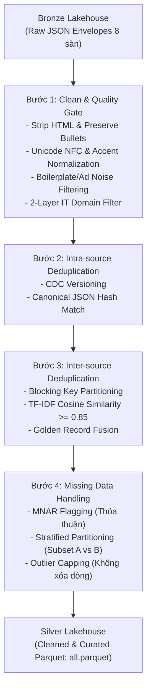
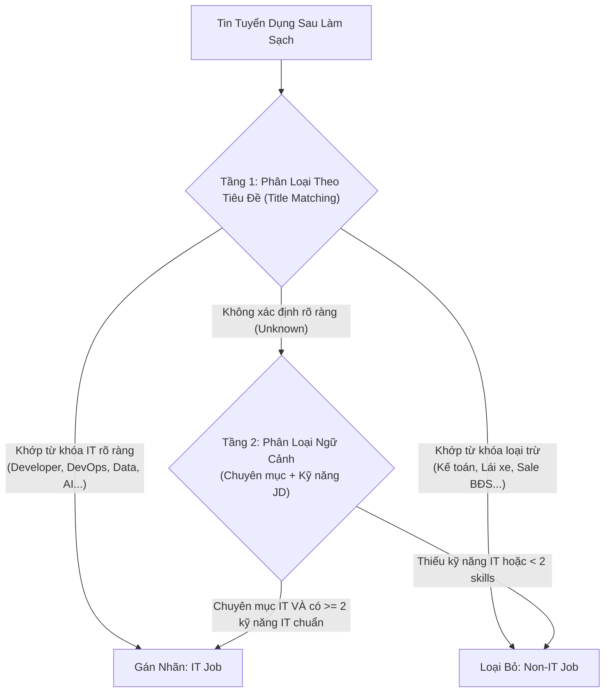
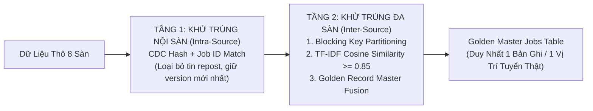
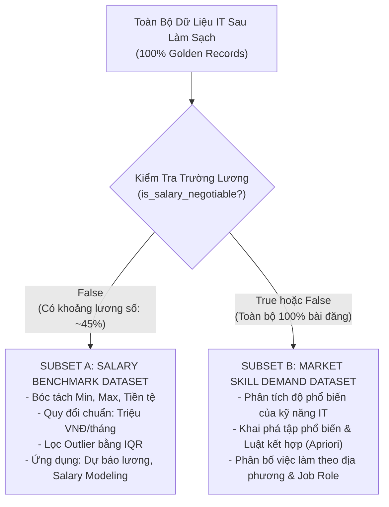

# ĐẶC TẢ KỸ THUẬT TIỀN XỬ LÝ DỮ LIỆU & LÀM SẠCH
## MODULE 05: DATA PREPROCESSING & QUALITY SPECIFICATION

> **Tài liệu đặc tả kỹ thuật hệ thống (System Specification Document)**  
> **Dự án:** Phân tích thị trường việc làm IT Việt Nam (VN-IT-Job-Mining)  
> **Phiên bản:** 2.0 — Cập nhật: Tháng 11/2026  
> **Trạng thái:** Official Technical Specification  
> **Phạm vi xử lý:** Tích hợp, làm sạch và khử trùng từ 8 nguồn dữ liệu thô (Bronze) sang tầng Silver chuẩn hóa.

---

## 1. Tổng Quan Pipeline Tiền Xử Lý (Preprocessing Overview)

Dữ liệu thô thu thập từ 8 sàn tuyển dụng mang bản chất phi cấu trúc (Unstructured) hoặc bán cấu trúc (Semi-structured), chứa nhiều thẻ HTML, ký tự điều khiển, lỗi bảng mã Unicode tiếng Việt, cùng với nội dung quảng cáo và các bài đăng tuyển trùng lặp giữa nhiều nền tảng.

Tầng Preprocessing đóng vai trò như một **Data Quality Firewall**, chuyển hóa dữ liệu thô bất biến (Bronze) thành dữ liệu bảng (Tabular Silver Parquet) sạch, nhất quán, có thể kiểm chứng và phục vụ các bài toán phân tích sâu.



### 1.1. Nguyên Tắc Bảo Toàn Số Lượng Bản Ghi (Audit Integrity Principle)
Tại mỗi công đoạn tiền xử lý, hệ thống phải tuân thủ nghiêm ngặt định luật bảo toàn bản ghi dữ liệu:
$$N_{\text{input}} = N_{\text{output}} + N_{\text{rejected\_non\_it}} + N_{\text{deduplicated}} + N_{\text{invalid\_schema}}$$
Mọi bản ghi bị loại bỏ đều phải được ghi log lý do cụ thể vào báo cáo chất lượng (`StepReport`) để đảm bảo khả năng kiểm toán dữ liệu (Audit Trail) phục vụ đồ án tốt nghiệp.

---

## 2. Quy Trình Làm Sạch Dữ Liệu & Bộ Lọc Chất Lượng (Data Cleaning & Quality Gate)

### 2.1. Bóc Tách HTML & Bảo Tồn Ngữ Nghĩa (HTML Stripping & Text Extraction)
Các mô tả công việc (JD), yêu cầu ứng viên và quyền lợi thường được lưu trữ dưới dạng khối mã HTML phức tạp chứa nhiều thẻ tag (`<div>`, `<p>`, `<ul>`, `<li>`, `<span>`, `<strong>`, `<table>`).
- **Thách thức:** Nếu chỉ dùng regex đơn giản để xóa bỏ tag (ví dụ: `re.sub(r'<[^>]+>', '', html)`), các đoạn văn bản trong `<li>` hoặc `<p>` sẽ bị dính liền vào nhau làm mất ranh giới giữa các yêu cầu kỹ thuật (ví dụ: `<li>Java</li><li>Spring Boot</li>` trở thành `JavaSpring Boot`).
- **Giải pháp bóc tách ngữ nghĩa:**
  1. Sử dụng parser chuyên dụng `BeautifulSoup` với backend `lxml`.
  2. Thay thế các thẻ phân đoạn (`<p>`, `<div>`, `<br>`, `<tr>`) bằng ký tự xuống dòng `\n`.
  3. Thay thế các thẻ danh sách (`<li>`) bằng ký tự gạch đầu dòng chuẩn hóa `• `.
  4. Giải mã toàn bộ thực thể HTML Entities (`&nbsp;` $\rightarrow$ khoảng trắng, `&amp;` $\rightarrow$ `&`, `&lt;` $\rightarrow$ `<`, `&gt;` $\rightarrow$ `>`).
  5. Loại bỏ hoàn toàn các khối mã nhúng độc hại hoặc rác: `<script>`, `<style>`, `<iframe>`, `<!-- comments -->`.
  6. Rút gọn chuỗi khoảng trắng và dòng trống liên tiếp: thay thế 3 ký tự `\n\n\n+` trở lên bằng 2 ký tự `\n\n`.

```python
from bs4 import BeautifulSoup
import re
import html

def clean_html_to_semantic_text(raw_html: str) -> str:
    """Bóc tách HTML sang văn bản thuần, bảo toàn danh sách và xuống dòng."""
    if not raw_html or not isinstance(raw_html, str):
        return ""
    
    # Giải mã HTML entities trước
    unescaped = html.unescape(raw_html)
    soup = BeautifulSoup(unescaped, "lxml")
    
    # Xóa script, style, meta
    for element in soup(["script", "style", "noscript", "header", "footer"]):
        element.extract()
        
    # Chuẩn hóa thẻ danh sách
    for li in soup.find_all("li"):
        li.insert_before("• ")
        li.append("\n")
        
    # Chuẩn hóa thẻ xuống dòng
    for br in soup.find_all("br"):
        br.replace_with("\n")
        
    text = soup.get_text(separator="\n")
    # Thu gọn dòng trống và khoảng trắng
    text = re.sub(r"[ \t]+", " ", text)
    text = re.sub(r"\n\s*\n", "\n\n", text).strip()
    return text
```

### 2.2. Chuẩn Hóa Unicode Tiếng Việt & Dấu Câu (Unicode Normalization)
Dữ liệu tiếng Việt từ 8 sàn tuyển dụng thường gặp hiện tượng phân rã bảng mã (Unicode Normalization Form D - NFD) do bàn phím máy tính hoặc hệ điều hành của nhà tuyển dụng sử dụng các bộ gõ Unikey/EVKey khác nhau (Ví dụ: `o` kết hợp dấu huyền `\u0300` thay vì ký tự dựng sẵn `ò` `\u00f2`).
- **Quy chuẩn chuẩn hóa:**
  1. **NFC Normalization:** Toàn bộ chuỗi văn bản được đưa về chuẩn dựng sẵn UTF-8 NFC thông qua `unicodedata.normalize('NFC', text)`.
  2. **Chuẩn hóa kiểu bỏ dấu tiếng Việt:** Đồng nhất quy tắc bỏ dấu thanh chuẩn hiện đại (ví dụ: `hoà` $\rightarrow$ `hòa`, `thuỷ` $\rightarrow$ `thủy`, `toàn` $\rightarrow$ `toàn`).
  3. **Lọc ký tự điều khiển (Control Characters):** Loại bỏ triệt để các ký tự vô hình gây lỗi index và tokenizer:
     - Null byte: `\x00`
     - Zero-width space: `\u200b`, `\u200c`, `\u200d`, `\ufeff`
     - Ký tự điều khiển ASCII: `[\x01-\x08\x0b\x0c\x0e-\x1f\x7f]`

### 2.3. Lọc Bỏ Boilerplate & Thông Tin Rác Tuyển Dụng (Noise Filtering)
Các bài đăng tuyển dụng chứa nhiều đoạn văn bản quảng cáo vô nghĩa cho sàn tuyển dụng hoặc các điều khoản tuyển dụng chung lặp lại (Boilerplate texts). Những chuỗi này làm nhiễu vector TF-IDF và giảm độ chính xác của trích xuất kỹ năng.
- **Bộ lọc Regex Boilerplate Dictionary:**
  - Chuỗi quảng cáo của sàn: `"Tải ứng dụng TopCV để..."`, `"VietnamWorks cam kết bảo mật..."`, `"Ứng tuyển ngay trên ITviec để nhận phản hồi trong 48h..."`.
  - Thông báo bản quyền và mã tin: `"Mã tin tuyển dụng: [0-9]+"`, `"Hạn nộp hồ sơ: \d{2}/\d{2}/\d{4}"`.
  - Giới thiệu chung không liên quan đến kỹ thuật: `"Công ty chúng tôi được thành lập năm..."`, `"Tự hào là môi trường làm việc năng động, sáng tạo..."`.
  - Các chuỗi này được nhận diện qua tập luật Regex và loại bỏ trước khi chuyển sang bước phân tích văn bản.

### 2.4. Bộ Lọc Phân Loại Tin IT Chuẩn Xác (Domain IT Filter - 2 Layers)
Do một số sàn tuyển dụng tổng hợp (như Vieclam24h, CareerViet, TopCV) có thể xếp nhầm các tin kế toán, nhân sự, telesale vào chuyên mục IT, hệ thống áp dụng cơ chế phân loại 2 tầng bằng luật tất định (Deterministic Rule-based, không sử dụng LLM nhằm đảm bảo tính tái lập và xử lý tốc độ cao):



- **Tầng 1 (Title Filter):** Khớp các từ khóa kỹ thuật cốt lõi trong chức danh công việc (`software`, `developer`, `engineer`, `programmer`, `devops`, `frontend`, `backend`, `fullstack`, `data analyst`, `qa`, `tester`, `sysadmin`, `flutter`, `golang`, v.v.).
- **Tầng 2 (Context & Skill Gate):** Đối với các chức danh chung chung (như "Chuyên viên kỹ thuật", "Nhân viên dự án"), tin chỉ được chấp nhận là việc làm IT nếu danh mục nghề nghiệp thuộc nhóm Công nghệ thông tin **ĐỒNG THỜI** trích xuất được tối thiểu $\ge 2$ kỹ năng IT chuẩn từ bộ từ điển `skills.json` trong phần mô tả chi tiết công việc.

### 2.5. Phân Loại Ngôn Ngữ & Chuẩn Bị Cho Module Dịch Thuật
Sau khi làm sạch văn bản và lọc IT, hệ thống xác định ngôn ngữ chính của mô tả công việc (JD):
1. **Thuật toán nhận diện ngôn ngữ:** Sử dụng `fasttext` (model `lid.176.bin`) hoặc `langdetect` để gán nhãn trường `detected_language` (`vi` hoặc `en`) với ngưỡng xác suất tin cậy $P(\text{lang}) \ge 0.85$.
2. **Tiền xử lý trước dịch:** Với các bài đăng tiếng Anh (`en`), văn bản được tách câu (`sent_tokenize`), chuẩn hóa dấu cách và đưa vào cấu trúc sẵn sàng cho module **Dịch thuật bảo toàn thuật ngữ (Term-Preserving Translation với VietAI/envit5-translation)** tại Bước 3 (SPEC-06).

---

## 3. Khử Trùng Lặp 2 Tầng Toàn Diện (Two-Layer Deduplication Engine)

Thị trường việc làm IT tại Việt Nam có mức độ trùng lặp thông tin rất cao:
- **Nội sàn:** Cùng một tin được nhà tuyển dụng gia hạn, repost hàng tuần hoặc đăng nhiều lần ở các tỉnh thành khác nhau.
- **Đa sàn:** Một doanh nghiệp công nghệ thường đăng tuyển đồng thời một vị trí trên 3-4 sàn tuyển dụng lớn (ví dụ: đăng trên ITviec để tìm Senior, đăng TopCV để tìm Junior, đăng VietnamWorks để mở rộng tệp ứng viên).

Hệ thống thiết lập cơ chế khử trùng lặp 2 tầng nghiêm ngặt:



### 3.1. Tầng 1: Khử Trùng Lặp Nội Sàn (Intra-Source Deduplication & CDC)
- **Định danh khóa chính:** Cặp khóa `(source_platform, job_id)`.
- **Cơ chế CDC (Change Data Capture):**
  - Nếu `job_id` đã tồn tại trong tập dữ liệu lịch sử và `content_hash` mới trùng khớp 100% với `content_hash` cũ:
    - Bỏ qua, không sinh bản ghi mới, chỉ cập nhật trường `last_seen_at`.
  - Nếu `content_hash` thay đổi:
    - Lưu bản ghi mới với số phiên bản tăng tiến (`version = version + 1`), đánh dấu phiên bản cũ là `is_active = False`.
  - Nếu phát hiện nhiều URL khác nhau trên cùng một sàn nhưng nội dung sinh ra cùng một `content_hash`:
    - Xác định là **Repost**, chỉ giữ lại 1 bản ghi chính (Canonical Record), đánh dấu các bản ghi còn lại kèm tham chiếu `repost_of_url_hash`.

### 3.2. Tầng 2: Khử Trùng Lặp Đa Sàn (Inter-Source Entity Resolution)

Đây là bài toán phức tạp nhất trong quá trình tích hợp dữ liệu. Nếu so sánh từng cặp bài viết ($O(N^2)$), với 15.000 bài đăng, số phép tính so sánh sẽ lên tới $\approx 1.12 \times 10^8$ phép tính, gây quá tải tính toán.

Hệ thống triển khai thuật toán **Blocking Key kết hợp TF-IDF Cosine Similarity**:

#### Giai đoạn A: Phân Cụm Khóa Chặn (Blocking Key Partitioning)
Thuật toán chia toàn bộ không gian dữ liệu thành các khối nhỏ (Blocks). Phép so sánh văn bản tương đồng chỉ được thực hiện giữa các bài viết thuộc cùng một block:

$$\text{Blocking\_Key} = \text{Slug}(\text{Company\_Norm}) \;+\; "\_" \;+\; \text{Location\_Code} \;+\; "\_" \;+\; \text{Title\_Group}$$

Trong đó:
- `Company_Norm`: Tên công ty đã được chuẩn hóa (loại bỏ các tiền tố/hậu tố pháp lý: "Công ty Cổ phần", "TNHH", "Chi nhánh", "Tập đoàn", "Software", "Technology", loại bỏ dấu cách và ký tự đặc biệt).
- `Location_Code`: Mã định danh tỉnh/thành phố chuẩn (theo 34 tỉnh/thành phố sáp nhập mới, ví dụ: `HN`, `HCM`, `DN`).
- `Title_Group`: Chức danh rút gọn chính (ví dụ: `backend`, `frontend`, `java`, `qa`).

#### Giai đoạn B: Kiểm Tra Tương Đồng Văn Bản (TF-IDF Cosine Similarity)
Trong cùng một Block, đối với mỗi cặp bài đăng $(J_A, J_B)$ đến từ 2 sàn tuyển dụng khác nhau:
1. Nối chuỗi văn bản đại diện: $D = \text{Clean\_Title} + " " + \text{Clean\_Requirements} + " " + \text{Clean\_Description}$.
2. Trích xuất đặc trưng bằng **Character n-grams (3-gram đến 5-gram)** hoặc **Word n-grams (1-gram đến 2-gram)** kết hợp bảng Stopwords tiếng Việt và tiếng Anh.
3. Chuyển đổi thành hai vector trọng số TF-IDF: $\mathbf{v}_A$ và $\mathbf{v}_B$.
4. Tính toán độ tương đồng Cosine:

$$\text{Cosine\_Similarity}(\mathbf{v}_A, \mathbf{v}_B) = \frac{\mathbf{v}_A \cdot \mathbf{v}_B}{\|\mathbf{v}_A\|_2 \|\mathbf{v}_B\|_2}$$

5. **Ngưỡng quyết định (Decision Threshold):**
   - Nếu $\text{Cosine\_Similarity} \ge 0.85$: Xác định $J_A$ và $J_B$ là cùng một công việc tuyển dụng thực tế (Duplicate Cross-platform Entity).
   - Nếu $\text{Cosine\_Similarity} < 0.85$: Giữ nguyên là 2 bài đăng riêng biệt.

#### Giai đoạn C: Thuật Toán Hợp Nhất Thành Golden Record (Golden Master Fusion)
Khi phát hiện cụm tin trùng lặp $\{J_1, J_2, \dots, J_k\}$, hệ thống không xóa bỏ dữ liệu mà tiến hành hợp nhất (Merge & Fuse) thành một **Golden Record** duy nhất:

| Thuộc Tính | Chiến Lược Hợp Nhất (Fusion Rule) | Giải Thích Nghiệp Vụ |
|---|---|---|
| `master_id` | Tạo UUID v5 dựa trên `Blocking_Key` | Định danh duy nhất toàn hệ thống. |
| `job_title` | Chọn từ sàn có độ uy tín IT cao nhất (`ITviec` > `TopDev` > `VietnamWorks` > Sàn khác) | Giữ tên chuẩn nhất của ngành IT. |
| `company_name` | Tên đầy đủ có độ dài dài nhất | Bảo toàn tên pháp nhân chuẩn của công ty. |
| `job_description` | Bản ghi có độ dài văn bản lớn nhất | Giữ nội dung mô tả đầy đủ nhất, ít bị cắt xén. |
| `skills_extracted`| Phép Hợp tập hợp (Set Union: $S_1 \cup S_2 \dots \cup S_k$) | Thu thập đầy đủ nhất mọi kỹ năng mà các sàn trích xuất được. |
| `salary` | Ưu tiên bản ghi có khoảng lương số thay vì "Thỏa thuận" | Nếu có 1 sàn công khai mức lương, Golden Record sẽ có lương. |
| `source_platforms`| Mảng danh sách các nguồn (`["topcv", "itviec"]`) | Lưu vết phục vụ phân tích độ phủ của từng sàn. |
| `first_posted_at`| $\min(\text{posted\_date})$ | Ngày đầu tiên vị trí tuyển dụng này xuất hiện trên thị trường. |
| `last_seen_at` | $\max(\text{scraped\_date})$ | Thời điểm gần nhất tin vẫn còn hiển thị. |

---

## 4. Chiến Lược Xử Lý Giá Trị Khuyết Thiếu (Missing Data Handling)

Dữ liệu tuyển dụng thực tế có tỷ lệ khuyết thiếu rất cao ở các trường quan trọng như Mức lương (Salary), Số năm kinh nghiệm (Experience), Cấp bậc (Seniority), và Địa chỉ chi tiết. Xử lý sai lệch các giá trị khuyết thiếu sẽ dẫn đến suy luận sai lầm trong mô hình khai phá dữ liệu (Data Mining).

### 4.1. Phân Tích Bản Chất Dữ Liệu Khuyết Thiếu (Missing Data Mechanism)
- **MCAR (Missing Completely at Random):** Khuyết thiếu do lỗi kỹ thuật ngẫu nhiên (ví dụ: parser bị timeout một phần DOM nhỏ).
- **MAR (Missing at Random):** Khuyết thiếu có phụ thuộc vào biến khác (ví dụ: Tin tuyển dụng ở các công ty Nhật/Hàn thường giấu lương nhưng công khai cấp bậc).
- **MNAR (Missing Not at Random):** **Đặc thù của trường Mức Lương IT tại Việt Nam**. Khoảng 55% bài đăng ghi mức lương là "Thỏa thuận", "Cạnh tranh", "Lương hấp dẫn". Các vị trí giấu lương thường rơi vào hai thái cực:
  1. Vị trí cấp cao (Architect, Lead, Manager, Senior) yêu cầu bảo mật dải lương nội bộ.
  2. Vị trí tuyển số lượng lớn mức lương thấp muốn thương lượng trực tiếp khi phỏng vấn.

### 4.2. Chiến Lược Xử Lý Mức Lương Thỏa Thuận: Tuyệt Đối Không Gán Giá Trị Giả Tạo
> [!CAUTION]
> **CẤM KỸ THUẬT GÁN GIÁ TRỊ TRUNG BÌNH (NO MEAN/MEDIAN/MODE IMPUTATION):**  
> Tuyệt đối không được gán giá trị trung bình (Mean), trung vị (Median) của toàn bộ dữ liệu vào các tin có lương "Thỏa thuận". Hành động này sẽ tạo ra một cụm giả tạo (Artificial Peak) tại điểm trung vị, bóp méo hoàn toàn hàm phân phối xác suất mức lương, triệt tiêu phương sai và làm sai lệch nghiêm trọng các mô hình hồi quy (Regression) hoặc phân cụm (Clustering).

Hệ thống triển khai chiến lược **Phân Tầng Phân Tích (Stratified Data Partitioning)**:



1. **Gắn cờ kiểm soát (Audit Flagging):**
   - Với tin lương thỏa thuận: Thiết lập `is_salary_negotiable = True`, `salary_min = NaN`, `salary_max = NaN`, `salary_avg = NaN`.
2. **Tách 2 tập dữ liệu chuyên biệt (Two Analytic Subsets):**
   - **Tập con A (Salary Benchmark Dataset - ~45%):** Chỉ bao gồm các bài viết có dải lương số học rõ ràng. Tập này được dùng riêng cho bài toán: Phân tích phổ lương theo cấp bậc, tương quan mức lương theo số năm kinh nghiệm, và xây dựng mô hình hồi quy/học máy dự báo mức lương (Salary Prediction Model).
   - **Tập con B (Market Skill Demand & Trend Dataset - 100%):** Bao gồm toàn bộ các bài tuyển dụng IT. Tập này phục vụ các bài toán: Khai phá tập kỹ năng phổ biến (Frequent Itemsets), phân tích xu hướng công nghệ mới nổi, đo lường khoảng cách kỹ năng giữa nhà trường và doanh nghiệp.

### 4.3. Xử Lý Khuyết Thiếu Kinh Nghiệm & Địa Điểm

| Thuộc Tính | Tỷ Lệ Khuyết | Bản Chất | Giải Pháp Kỹ Thuật |
|---|---|---|---|
| **Số năm kinh nghiệm** (`experience_years`) | ~18% | Không ghi rõ trong box thông tin, nhưng thường nằm trong đoạn văn yêu cầu của JD. | Áp dụng Regex Parser quét văn bản JD (`r'(\d+)\s*[-–]\s*(\d+)\s*năm'`, `r'tối thiểu (\d+)\s*năm'`). Nếu vẫn không có $\rightarrow$ Gán `NaN` và đánh dấu cờ `experience_level = "Not Specified"`. |
| **Cấp bậc** (`seniority_level`) | ~25% | Nhà tuyển dụng không chọn dropdown cấp bậc trên sàn. | Quét chức danh công việc (`job_title`) tìm các từ khóa: `Intern`, `Fresher`, `Junior`, `Middle`, `Senior`, `Lead`, `Manager`. Nếu không có từ khóa $\rightarrow$ Suy luận dựa trên số năm kinh nghiệm trích xuất được. |
| **Tỉnh / Thành phố** (`location_province`) | ~3% | Ghi "Toàn quốc", "Linh hoạt", hoặc chỉ ghi địa chỉ tòa nhà. | Đối chiếu từ điển 34 Tỉnh/Thành phố (`provinces_34.json`) và 3.321 phường/xã (`wards_34.json`). Nếu làm việc từ xa $\rightarrow$ Gán `location_type = "Remote"`, `province = "Remote"`. |

---

## 5. Xử Lý Giá Trị Ngoại Lai (Outlier Detection & Capping)

Các giá trị ngoại lai thường xuất hiện ở trường mức lương do lỗi nhập liệu của nhà tuyển dụng (ví dụ: gõ thừa số 0, ghi "250 USD" nhưng chọn nhầm tiền tệ "VND", hoặc ghi mức lương 500 triệu VNĐ/tháng để câu view).

### 5.1. Thuật Toán Lọc Ngoại Lai IQR (Interquartile Range)
Trên tập dữ liệu có mức lương số học (Subset A), hệ thống áp dụng kỹ thuật lọc ngoại lai theo từng nhóm chức danh (Job Role) và cấp bậc (Seniority):
1. Tính toán tứ phân vị: $Q_1$ (phân vị 25%), $Q_3$ (phân vị 75%).
2. Tính độ trải giữa (IQR): $\text{IQR} = Q_3 - Q_1$.
3. Xác định ranh giới hợp lệ:
   $$\text{Lower\_Bound} = \max(3.0, Q_1 - 1.5 \times \text{IQR})$$
   $$\text{Upper\_Bound} = \min(250.0, Q_3 + 1.5 \times \text{IQR})$$

### 5.2. Chính Sách Winsorization (Capping - Không Xóa Dòng)
- **Nguyên tắc bảo toàn bản ghi:** Tuyệt đối không xóa bỏ bản ghi khi mức lương vượt ngưỡng ngoại lai, vì bài đăng đó vẫn chứa đầy đủ các kỹ năng IT và thông tin doanh nghiệp có giá trị.
- **Biện pháp xử lý:**
  - Nếu `salary > Upper_Bound`: Đặt cờ `is_salary_outlier = True`, thực hiện Winsorization (gán mức lương bằng giá trị trần `Upper_Bound` hoặc đặt về `NaN` khi huấn luyện mô hình toán học).
  - Loại bỏ các mức lương vô lý dưới 3 triệu VNĐ/tháng (thường do lỗi gõ nhầm đơn vị).
