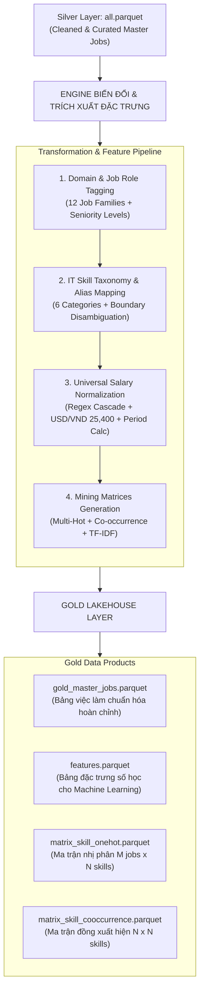
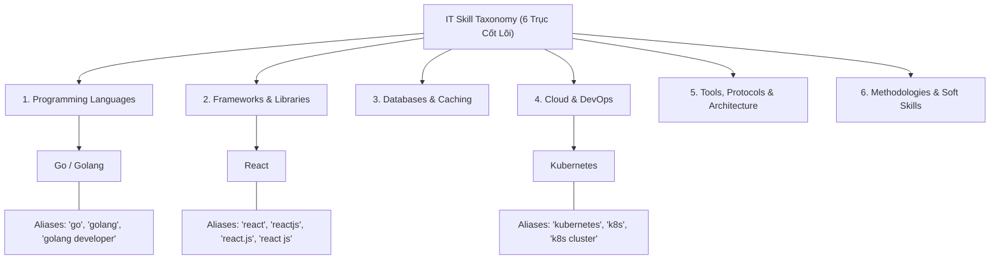
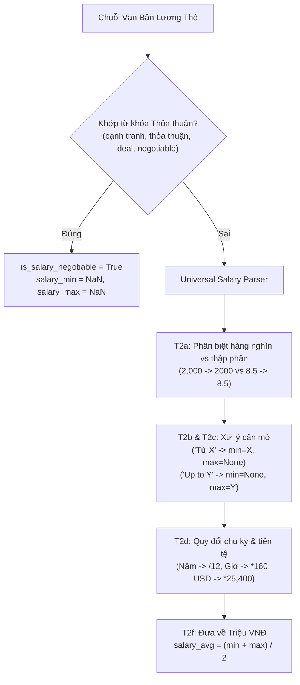
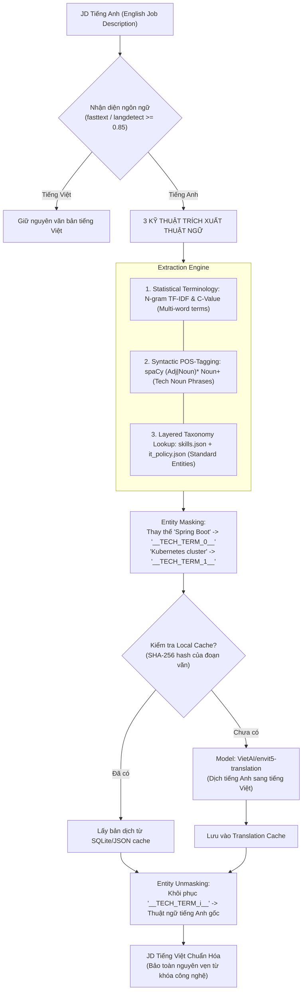

# ĐẶC TẢ BIẾN ĐỔI DỮ LIỆU & TRÍCH XUẤT ĐẶC TRƯNG
## MODULE 06: DATA TRANSFORMATION & FEATURE ENGINEERING SPECIFICATION

> **Tài liệu đặc tả kỹ thuật hệ thống (System Specification Document)**  
> **Dự án:** Phân tích thị trường việc làm IT Việt Nam (VN-IT-Job-Mining)  
> **Phiên bản:** 2.0 — Cập nhật: Tháng 11/2026  
> **Trạng thái:** Official Technical Specification  
> **Phạm vi xử lý:** Chuyển đổi dữ liệu từ tầng Silver (Cleaned Tabular) sang tầng Gold (Curated Features & Mining Matrices).

---

## 1. Tổng Quan Chuyển Đổi Silver $\rightarrow$ Gold

Tầng Silver cung cấp dữ liệu dạng bảng sạch (`all.parquet`), đã giải quyết các vấn đề bóc tách HTML, khử trùng lặp nội sàn/đa sàn và sửa lỗi bảng mã Unicode. Tuy nhiên, các thuộc tính cốt lõi như kỹ năng, cấp bậc, nhóm nghề và mức lương vẫn đang tồn tại dưới dạng chuỗi văn bản tự do (Free-form text) hoặc mảng danh sách thô.

**Tầng Gold (Transformation & Feature Engineering)** chịu trách nhiệm:
1. Chuẩn hóa phân loại vị trí công việc vào **12 Job Families chuẩn**.
2. Phân cấp và đồng nhất kỹ năng IT qua **Taxonomy 6 nhóm cốt lõi** và từ điển Alias Normalization.
3. Bóc tách và quy đổi chuẩn hóa mức lương về thang đo duy nhất (**Triệu VNĐ / Tháng**).
4. Sinh các cấu trúc dữ liệu nâng cao phục vụ trực tiếp cho các thuật toán Khai phá dữ liệu (Data Mining):
   - **One-Hot / Multi-Hot Binary Matrix:** Cho khai phá luật kết hợp (Association Rules: Apriori / FP-Growth).
   - **Co-occurrence Matrix:** Cho phân tích đồ thị và tương quan cặp kỹ năng (Skill Graph Network).
   - **TF-IDF Vector Space:** Cho phân cụm văn bản (Clustering: K-Means / HDBSCAN) và tìm kiếm ngữ nghĩa.



---

## 2. Chuẩn Hóa & Gán Nhãn Nhóm Nghề IT (Domain & Job Role Classification)

Để phân tích cơ cấu cung - cầu lao động, mọi tin tuyển dụng phải được gán nhãn vào một trong **12 Job Family chuẩn** của ngành CNTT tại Việt Nam, kết hợp cùng cấp bậc kinh nghiệm (**Seniority Level**).

### 2.1. Phân Loại 12 Job Family Chuẩn
Hệ thống sử dụng cơ chế luật kết hợp (Title Keyword Matching + JD Context/Skill Constraints) với thứ tự ưu tiên xác định:

| STT | Job Family | Từ Khóa Nhận Diện Trong Tiêu Đề (`job_title`) | Kỹ Năng Ràng Buộc Trong JD |
|---|---|---|---|
| 1 | **Kiểm thử (QA/QC)** | `tester`, `qa`, `qc`, `quality assurance`, `automation test`, `manual test`, `kiểm thử`, `sqa` | `Selenium`, `Cypress`, `Postman`, `JMeter`, `Appium` |
| 2 | **Bảo mật (Security)** | `security`, `soc`, `pentest`, `cyber`, `an ninh mạng`, `bảo mật`, `infosec`, `siem`, `devsecops` | `Penetration Testing`, `Firewall`, `SIEM`, `OWASP`, `CISSP` |
| 3 | **Phân tích nghiệp vụ (BA)**| `business analyst`, `ba`, `phân tích nghiệp vụ`, `product analyst`, `system analyst` | `UML`, `BPMN`, `User Story`, `BRD`, `Jira`, `SQL` |
| 4 | **Thiết kế UI/UX** | `ui/ux`, `ux/ui`, `ui designer`, `ux designer`, `product designer`, `thiết kế giao diện` | `Figma`, `Adobe XD`, `Sketch`, `Wireframing`, `Prototyping` |
| 5 | **Quản lý SP/DA** | `product manager`, `project manager`, `scrum master`, `pm`, `po`, `product owner` | `Agile`, `Scrum`, `Sprint Planning`, `Kanban`, `Roadmapping` |
| 6 | **DevOps/Cloud** | `devops`, `cloud`, `sre`, `infrastructure`, `ci/cd`, `sysadmin`, `site reliability` | `Docker`, `Kubernetes`, `AWS`, `Terraform`, `CI/CD`, `Linux` |
| 7 | **Hệ thống/Mạng** | `system engineer`, `network engineer`, `kỹ sư hệ thống`, `quản trị mạng`, `helpdesk` | `Cisco`, `CCNA`, `Routing`, `Switching`, `TCP/IP`, `Windows Server` |
| 8 | **Data/AI** | `data engineer`, `data analyst`, `data scientist`, `ai`, `machine learning`, `bi`, `nlp` | `Python`, `SQL`, `Spark`, `TensorFlow`, `PyTorch`, `Power BI` |
| 9 | **Mobile** | `mobile`, `android`, `ios`, `flutter`, `react native`, `swift`, `kotlin developer` | `Flutter`, `React Native`, `iOS`, `Android`, `Swift`, `Kotlin` |
| 10 | **Fullstack** | `fullstack`, `full stack`, `full-stack`, `toàn diện` | $\ge 1$ Backend Skill VÀ $\ge 1$ Frontend Skill |
| 11 | **Frontend** | `frontend`, `front-end`, `front end`, `web client`, `reactjs developer`, `vue developer` | `React`, `Vue`, `Angular`, `JavaScript`, `HTML/CSS`, `TypeScript` |
| 12 | **Backend** | `backend`, `back-end`, `back end`, `server-side`, `java dev`, `golang dev`, `.net dev` | `Java`, `Spring Boot`, `Node.js`, `Go`, `Python`, `C#`, `PHP` |

- **Giải quyết nhập nhằng (Disambiguation Logic):**
  - Ưu tiên các nhóm nghề chuyên biệt hẹp trước (QA/QC, Security, BA, UI/UX, Quản lý) để tránh bị rơi nhầm vào nhóm lập trình chung.
  - Vị trí `Fullstack` yêu cầu trong phần mô tả công việc (JD) bắt buộc phải xuất hiện đồng thời kỹ năng thuộc nhóm Backend (ví dụ: `Node.js`, `Java`, `Go`) và Frontend (ví dụ: `React`, `Vue`, `TypeScript`). Nếu chỉ có kỹ năng phía máy chủ, tin sẽ tự động hạ cấp về `Backend`.

### 2.2. Chuẩn Hóa Cấp Bậc Kinh Nghiệm (Seniority Level Mapping)
Cấp bậc được chuẩn hóa thành 5 nhãn theo thứ bậc thứ tự (Ordinal Encoding từ 0 đến 4, gán -1 cho "Chưa rõ"). Chốt 09/11/2026 theo cài đặt của Duy (`preprocessing/transformation/experience_parser.py`); bản 6 nhãn cũ (tách Thực tập và Mới tốt nghiệp) đã bỏ:

$$\text{Seniority} \in \{\text{Intern/Fresher (0)}, \text{Junior (1)}, \text{Middle (2)}, \text{Senior (3)}, \text{Lead/Manager (4)}\}$$

Thứ tự áp dụng: luật theo từ trên `job_title` → trên `raw_seniority_text` → theo số năm kinh nghiệm tối thiểu (≥ 5 Senior, ≥ 2 Middle, > 0 Junior, = 0 Intern/Fresher) → -1 nếu không có căn cứ.

```python
SENIORITY_LEVELS = {"Intern/Fresher": 0, "Junior": 1, "Middle": 2, "Senior": 3, "Lead/Manager": 4}
SENIORITY_TITLE_RULES = (  # kiểm theo thứ tự này, khớp đầu tiên thắng
    (0, (r"\bintern\b", r"thuc tap", r"\bfresher\b", r"\bgraduate\b", r"moi tot nghiep")),
    (4, (r"\blead\b", r"\bleader\b", r"\bmanager\b", r"\bdirector\b", r"\bhead\s+of\b", r"truong nhom", r"truong phong", r"quan ly", r"giam doc")),
    (3, (r"\bsenior\b", r"\bsr\b")),
    (2, (r"\bmiddle\b", r"\bmid\b")),
    (1, (r"\bjunior\b", r"\bjr\b")),
)  # văn bản được bỏ dấu và hạ chữ thường trước khi khớp
```

---

## 3. Bộ Từ Điển Phân Cấp Kỹ Năng IT (IT Skill Taxonomy & Alias Normalization)

Kỹ năng công nghệ là đơn vị phân tích trọng tâm (Atomic Analytical Unit) của đồ án tốt nghiệp. Do các nhà tuyển dụng sử dụng hàng nghìn cách viết hoa-thường, tên gọi thương mại, hoặc từ lóng khác nhau, hệ thống xây dựng cây phân cấp kỹ năng 3 tầng:

$$\text{Category (Nhóm)} \longrightarrow \text{Canonical Skill (Kỹ Năng Chuẩn)} \longrightarrow \text{Aliases (Biến Thể / Từ Đồng Nghĩa)}$$



### 3.1. Bảng Tra Phân Cấp Kỹ Năng IT Chi Tiết (6 Nhóm Cốt Lõi)

#### Nhóm 1: Ngôn Ngữ Lập Trình (Programming Languages)
- **Java:** `java`, `core java`, `java 8`, `java 11`, `java 17`, `java 21`
- **Python:** `python`, `python3`, `py`
- **JavaScript:** `javascript`, `js`, `ecmascript`, `es6`
- **TypeScript:** `typescript`, `ts`
- **Go:** `golang`, `go` (Yêu cầu Regex khớp biên từ `\bgo\b` kèm ngữ cảnh lập trình để tránh nhầm chữ "go" trong tiếng Anh)
- **C#:** `c#`, `csharp`, `c sharp`, `.net c#`
- **C++:** `c++`, `cpp`, `c/c++`
- **PHP:** `php`, `php7`, `php8`
- **Rust:** `rust`, `rustlang`
- **Kotlin:** `kotlin`
- **Swift:** `swift`
- **SQL:** `sql`, `t-sql`, `pl/sql`

#### Nhóm 2: Framework & Thư Viện (Frameworks & Libraries)
- **React:** `react`, `reactjs`, `react.js`
- **Next.js:** `next.js`, `nextjs`, `next`
- **Vue.js:** `vue`, `vuejs`, `vue.js`, `vue 3`, `nuxt`, `nuxtjs`
- **Angular:** `angular`, `angularjs`, `angular 2+`
- **Spring Boot:** `spring`, `springboot`, `spring boot`, `spring framework`, `spring mvc`
- **Node.js:** `node`, `nodejs`, `node.js`, `express`, `expressjs`, `nestjs`
- **.NET Core:** `.net`, `.net core`, `asp.net`, `asp.net core`, `dotnet`
- **Django / FastAPI:** `django`, `fastapi`, `flask`
- **Laravel:** `laravel`, `symfony`
- **Flutter:** `flutter`, `dart/flutter`
- **React Native:** `react native`, `react-native`, `rn`

#### Nhóm 3: Cơ Sở Dữ Liệu & Bộ Nhớ Đệm (Databases & Caching)
- **PostgreSQL:** `postgresql`, `postgres`, `psql`
- **MySQL:** `mysql`, `mariadb`
- **MongoDB:** `mongodb`, `mongo`, `nosql mongodb`
- **Redis:** `redis`, `redis cache`
- **Elasticsearch:** `elasticsearch`, `elastic search`, `elk`, `opensearch`
- **SQL Server:** `sql server`, `mssql`, `ms sql`
- **Oracle:** `oracle`, `oracle db`
- **Kafka:** `kafka`, `apache kafka` (Message broker / Streaming)
- **RabbitMQ:** `rabbitmq`, `message queue`

#### Nhóm 4: Điện Toán Đám Mây & Vận Hành (Cloud & DevOps)
- **Docker:** `docker`, `container`, `docker-compose`
- **Kubernetes:** `kubernetes`, `k8s`, `k8s cluster`, `helm`
- **AWS:** `aws`, `amazon web services`, `ec2`, `s3`, `lambda`, `ecs`, `rds`
- **Google Cloud:** `gcp`, `google cloud`, `google cloud platform`, `bigquery`
- **Microsoft Azure:** `azure`, `microsoft azure`
- **CI/CD:** `ci/cd`, `cicd`, `jenkins`, `gitlab-ci`, `github actions`, `argocd`
- **Terraform:** `terraform`, `iac`, `infrastructure as code`
- **Linux:** `linux`, `ubuntu`, `centos`, `bash shell`

#### Nhóm 5: Công Cụ, Kiến Trúc & Giao Thức (Tools, Architecture & Protocols)
- **Git:** `git`, `github`, `gitlab`, `bitbucket`
- **Microservices:** `microservices`, `micro-services`, `service-oriented`
- **REST API:** `restful api`, `rest api`, `restful`, `rest`
- **GraphQL:** `graphql`, `apollo`
- **gRPC:** `grpc`, `protobuf`
- **Design Patterns:** `design patterns`, `oop`, `solid`, `clean architecture`, `ddd`

#### Nhóm 6: Phương Pháp Luận & Kỹ Năng Mềm (Methodologies & Soft Skills)
- **Agile / Scrum:** `agile`, `scrum`, `kanban`, `sprint`
- **Giao tiếp tiếng Anh:** `tiếng anh`, `english`, `toeic`, `ielts`, `fluent english`
- **Giải quyết vấn đề:** `problem solving`, `tư duy logic`, `critical thinking`
- **Làm việc nhóm:** `teamwork`, `làm việc nhóm`, `collaboration`

### 3.2. Cơ Chế Khớp Kỹ Năng Tên Ngắn (Short-name Disambiguation)
Các kỹ năng có tên rất ngắn như **C**, **R**, **Go**, **AI** rất dễ bị kích hoạt sai (False Positive) khi người tuyển dụng viết câu văn thông thường (ví dụ: "chữ **C** trong CEO", "take ca**r**e", "đi lại (**go**)", "b**ai** toán").
- **Quy tắc phân giải ngữ cảnh (Context-Aware Regex):**
  - Kỹ năng `Go`: Khớp `\b(golang|go\s+developer|lập trình\s+go|go\s+language)\b` hoặc `\bgo\b` khi xung quanh có các từ khóa: `backend`, `microservices`, `docker`, `kubernetes`.
  - Kỹ năng `C`: Chỉ chấp nhận khi viết dưới dạng `\bc/c\+\+\b`, `lập trình c\b`, hoặc `c/embedded`.
  - Kỹ năng `R`: Chỉ khớp khi nằm trong ngữ cảnh phân tích dữ liệu: `\br\s+programming\b`, `python/r`, `r\s+studio`.

---

## 4. Chuẩn Hóa Mức Lương (Universal Salary Normalization)

Bài toán chuẩn hóa lương đối mặt với sự phân mảnh lớn: có tin ghi USD, có tin ghi triệu VND; có tin tính theo giờ, tháng, năm; có tin ghi dạng "Từ 15 triệu", "Up to $2,000", "15 - 25 triệu".

### 4.1. Quy Chuẩn Đơn Vị Đích & Tỷ Giá Chuẩn
- **Đơn vị đích duy nhất:** **Triệu VNĐ / Tháng** (`salary_min_mil_vnd`, `salary_max_mil_vnd`, `salary_avg_mil_vnd`).
- **Tỷ giá ngoại tệ chuẩn (Standard FX Rate):**
  $$1 \text{ USD} = 25.400 \text{ VNĐ}$$
  (Tỷ giá liên ngân hàng tháng 10-11/2026, cố định phục vụ tính toán khoa học cho đồ án).

### 4.2. Giải Thuật Bóc Tách Đa Tầng (Cascade Regex Extractor)



1. **Phân biệt dấu phân cách số (T2a):**
   - Số hàng nghìn: `2,000` hoặc `2.000` hoặc `25,000,000` $\rightarrow$ loại bỏ ký tự ngăn cách, đưa về số nguyên.
   - Số thập phân: `8.5` triệu hoặc `8,5` triệu $\rightarrow$ chuẩn hóa thành `8.5`.
2. **Xử lý khoảng chặn một đầu (T2b, T2c):**
   - Mẫu `"Từ X"` (ví dụ: "Từ 20 triệu"): Gán `salary_min = X`, `salary_max = NaN`.
   - Mẫu `"Lên tới Y"`, `"Up to Y"` (ví dụ: "Up to $2,500"): Gán `salary_min = NaN`, `salary_max = Y`.
   - Mẫu `"X - Y"` (ví dụ: "15 - 25 triệu"): Gán `salary_min = X`, `salary_max = Y`.
3. **Quy đổi chu kỳ thời gian (Period Normalization):**
   - Theo năm: $\text{Lương tháng} = \text{Lương năm} / 12$.
   - Theo giờ: $\text{Lương tháng} = \text{Lương giờ} \times 160$ (chuẩn 160 giờ làm việc/tháng).
   - Theo ngày: $\text{Lương tháng} = \text{Lương ngày} \times 22$ (chuẩn 22 ngày công/tháng).
4. **Tính toán lương đại diện (Representative Salary):**
   $$\text{salary\_avg} = \begin{cases} 
   \frac{\text{salary\_min} + \text{salary\_max}}{2} & \text{khi cả hai đều có giá trị} \\
   \text{salary\_min} & \text{khi chỉ có min} \\
   \text{salary\_max} & \text{khi chỉ có max} \\
   \text{NaN} & \text{khi lương thỏa thuận}
   \end{cases}$$

### 4.3. Quy Trình Dịch Thuật Bảo Toàn Thuật Ngữ IT (Term-Preserving Translation)

Trong thị trường tuyển dụng IT Việt Nam, có khoảng $25\% - 35\%$ tin tuyển dụng được viết hoàn toàn bằng tiếng Anh (đặc biệt trên ITviec, VietnamWorks, Glints). Để phục vụ đối tượng nghiên cứu là **Sinh viên IT Việt Nam** và đồng nhất không gian văn bản TF-IDF, hệ thống tích hợp module dịch thuật máy tại Bước 3 (Transformation) chuyển đổi toàn bộ JD tiếng Anh sang tiếng Việt, nhưng **bắt buộc phải bảo toàn 100% các thuật ngữ kỹ thuật chuyên ngành**.



#### 1. 3 Kỹ Thuật Trích Xuất Cụm Từ Chuyên Ngành Tiếng Anh
Để không dịch sai các từ khóa kỹ thuật (tránh dịch *Java* thành *cà phê*, *Spring Boot* thành *giày bốt mùa xuân*, hay *Thread Pool* thành *hồ bơi chỉ sợi*), hệ thống kết hợp 3 lớp kỹ thuật trích xuất:
1. **Statistical Terminology Extraction (N-gram TF-IDF & C-Value):** Nhận diện các thuật ngữ kỹ thuật đa từ lặp lại với tần suất cao trong ngữ cảnh tuyển dụng IT:
   $$C\text{-Value}(a) = \begin{cases}
   \log_2(|a|) \cdot f(a) & \text{nếu } a \text{ không nằm trong cụm dài hơn} \\
   \log_2(|a|) \cdot \left( f(a) - \frac{1}{|T_a|} \sum_{b \in T_a} f(b) \right) & \text{ngược lại}
   \end{cases}$$
   (Với $|a|$ là số lượng từ trong cụm $a$, $f(a)$ là tần suất xuất hiện, $T_a$ là tập các cụm dài hơn chứa $a$). Giúp nhận diện chính xác các cụm như *"Deadlock Detection"*, *"Garbage Collection"*, *"Continuous Integration"*.
2. **Syntactic POS-Tagging (Cụm Danh Từ Công Nghệ):** Sử dụng `spaCy` (mô hình `en_core_web_sm`) phân tích ngữ pháp với mẫu Regex:
   $$\text{Pattern} = (\text{ADJ} \mid \text{NOUN})^* \ \text{NOUN}^+$$
   Bắt chính xác các cụm danh từ chuyên biệt như *"microservice architecture"*, *"distributed transaction coordinator"*, *"load balancing algorithm"*.
3. **Layered Taxonomy Lookup (Đối Chiếu Từ Điển Phân Tầng):** Quét toàn bộ từ điển 230 kỹ năng chuẩn (`preprocessing/dictionaries/skills.json`) và danh mục các từ khóa IT cốt lõi (`it_policy.json`), đảm bảo 100% các kỹ năng trong từ điển không bao giờ bị mô hình dịch can thiệp.

#### 2. Kỹ Thuật Che Mặt Nạ (Entity Masking & Unmasking)
- Trước khi đưa văn bản tiếng Anh vào mô hình dịch, toàn bộ các thuật ngữ kỹ thuật được trích xuất sẽ được đánh số và thay thế bằng chuỗi token giữ chỗ không bị dịch nhầm: `__TECH_TERM_0__`, `__TECH_TERM_1__`,...
- Văn bản sau khi dịch qua `VietAI/envit5-translation` sẽ được thay thế ngược lại: Token `__TECH_TERM_i__` được thế lại bằng chính xác chuỗi tiếng Anh kỹ thuật ban đầu.

#### 3. Tối Ưu Hiệu Năng & Cơ Chế Dự Phòng (Caching & Fallback Policy)
- **Local Translation Cache:** Sử dụng bảng SQLite cục bộ `data/cache/translation_cache.db` (lưu trữ theo khóa băm `SHA-256(english_text)`). Nhờ đó, các đoạn mô tả tương đồng hoặc các câu lặp lại giữa các bài tuyển dụng chỉ cần dịch một lần duy nhất.
- **Cờ CLI `--skip-translation`:** Khi chạy pipeline trên các máy cá nhân không trang bị GPU (chỉ chạy bằng CPU) hoặc trong môi trường test CI/CD, kỹ sư có thể thêm cờ `--skip-translation` để giữ nguyên trường văn bản gốc tiếng Anh mà không làm treo tiến trình tiền xử lý.

---

## 5. Sinh Ma Trận Kỹ Năng Cho Khai Phá Dữ Liệu (Feature Matrices Generation)

Để các thuật toán Data Mining (Khai phá luật kết hợp Apriori/FP-Growth, Phân cụm K-Means, Phân tích đồ thị mạng xã hội kỹ năng) có thể hoạt động trực tiếp, hệ thống sinh ra 3 ma trận đặc trưng từ tập dữ liệu Gold.

### 5.1. Ma Trận Nhị Phân Kỹ Năng (One-Hot / Multi-Hot Skill Matrix)
- **Kích thước:** Ma trận $M \times K$, trong đó:
  - $M$: Số lượng tin tuyển dụng IT hợp lệ ($M \approx 5.000 - 15.000$ bài đăng).
  - $K$: Số lượng kỹ năng chuẩn hàng đầu (chọn top $K$ kỹ năng có tần suất xuất hiện $\ge 20$ lần, thường $K \in [100, 200]$ kỹ năng).
- **Định nghĩa phần tử:**
  $$X_{ij} = \begin{cases} 1 & \text{nếu công việc } i \text{ yêu cầu kỹ năng } j \\ 0 & \text{ngược lại} \end{cases}$$
- **Ứng dụng khai phá:**
  - Thuật toán **Apriori** và **FP-Growth** chạy trực tiếp trên ma trận nhị phân này để tìm các **Tập kỹ năng phổ biến (Frequent Itemsets)** và các **Luật kết hợp (Association Rules)**.
  - Ví dụ phát hiện luật: $\{\text{React}\} \Rightarrow \{\text{TypeScript}\}$ (Độ tin cậy $\text{Confidence} = 78\%$, Độ nâng $\text{Lift} = 3.2$).

### 5.2. Ma Trận Kỹ Năng Đồng Xuất Hiện (Skill Co-occurrence Matrix)
- **Kích thước:** Ma trận vuông đối xứng $K \times K$.
- **Định nghĩa toán học:**
  $$\mathbf{C} = \mathbf{X}^T \mathbf{X}$$
  Trong đó phần tử $C_{jk}$ tại dòng $j$, cột $k$ đại diện cho số lượng bài đăng tuyển dụng yêu cầu **đồng thời cả hai kỹ năng $j$ và $k$**:
  $$C_{jk} = \sum_{i=1}^M X_{ij} X_{ik}$$
  - Đường chéo chính $C_{jj}$ chính là tần suất xuất hiện độc lập của kỹ năng $j$.
- **Ứng dụng khai phá:**
  - Xây dựng **Skill Graph Network**: Mỗi node là một kỹ năng, trọng số của cạnh (Edge weight) là $C_{jk}$.
  - Thuật toán phát hiện cộng đồng (Community Detection - Louvain Algorithm) trên ma trận này để tự động gom cụm các hệ sinh thái công nghệ (ví dụ: Cụm Java Enterprise, Cụm Modern Web React/Node, Cụm Cloud Data Engineering).

```
          Java   Spring  Docker  React  TypeScript
Java      1250    980     620     110      85
Spring     980   1020     580      90      70
Docker     620    580    1450     450     520
React      110     90     450    1800    1420
TypeScript  85     70     520    1420    1650
```

### 5.3. Không Gian Vector TF-IDF Của Mô Tả Tuyển Dụng (TF-IDF Vector Space)
- **Mục đích:** Chuyển hóa toàn bộ nội dung văn bản mô tả công việc (JD) thành không gian vector số học nhằm phân cụm bài viết (Job Clustering) và phát hiện các bài tuyển dụng có nội dung tương tự.
- **Tham số cấu hình:**
  - Thư viện: `scikit-learn TfidfVectorizer`.
  - Dải N-gram: $(1, 2)$ (từ đơn và từ ghép 2 từ).
  - Tần suất tài liệu tối thiểu (`min_df = 5`): Loại bỏ các từ quá hiếm gặp.
  - Tần suất tài liệu tối đa (`max_df = 0.8`): Loại bỏ các từ xuất hiện trong hơn 80% tài liệu (từ phổ thông, stop words).
  - Kích thước không gian vector: Giới hạn `max_features = 3000` thuộc tính quan trọng nhất.
- **Ứng dụng khai phá:**
  - Sử dụng cho thuật toán phân cụm **K-Means / HDBSCAN** để tìm kiếm các phân khúc công việc ẩn (Latent Job Profiles) mà tiêu đề bài viết chưa phản ánh hết.
  - Giảm chiều dữ liệu với **PCA / t-SNE / UMAP** để trực quan hóa toàn bộ thị trường lao động IT lên biểu đồ phân tán 2D trên Dashboard.
