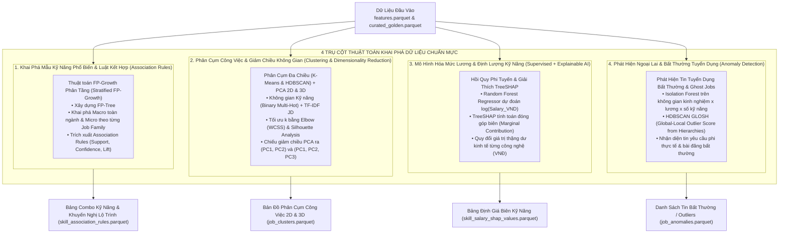
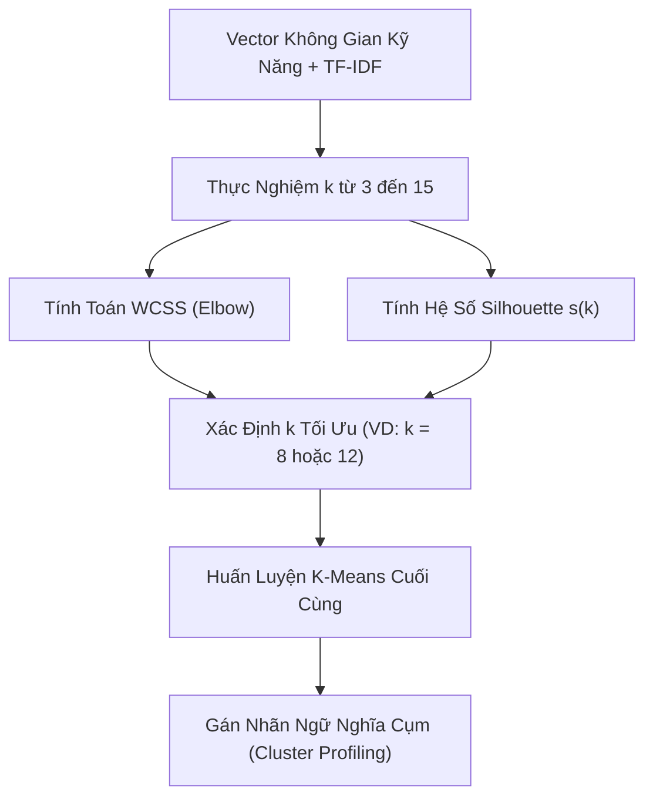

# ĐẶC TẢ THUẬT TOÁN & PHƯƠNG PHÁP KHAI PHÁ DỮ LIỆU (MINING SPECIFICATION)
## DỰ ÁN: HỆ THỐNG KHAI PHÁ DỮ LIỆU TUYỂN DỤNG IT VIỆT NAM (VN-IT-JOB-MINING)

> **Mã tài liệu:** `SPEC-07`  
> **Phiên bản:** `1.0.0`  
> **Ngày cập nhật:** 05/11/2026  
> **Trạng thái:** Chính thức ban hành  
> **Nền tảng kỹ thuật:** Python 3.10+, Scikit-learn, Mlxtend, SHAP, Scipy, Pandas, PyArrow.

---

## 1. Tổng Quan Kiến Trúc Khai Phá (Mining Architecture Overview)

Giai đoạn Mô hình hóa Khai phá (Data Mining) tiếp nhận dữ liệu đầu vào là ma trận đặc trưng `data/preprocessing/05_encoding/features.parquet` và bộ dữ liệu vàng `data/curated/curated_flat_golden_jobs.parquet` để giải quyết **4 trụ cột kỹ thuật học máy không giám sát & giải thích tri thức**:



---

## 2. Trụ Cột 1: Khai Phá Tập Phổ Biến & Luật Kết Hợp Kỹ Năng (FP-Growth)

### 2.1. Động lực học thuật: Tại sao chọn FP-Growth thay vì Apriori?
Trong bài toán khai phá giỏ thị trường kỹ năng tuyển dụng (Skill Market Basket Analysis), mỗi tin tuyển dụng được xem như một giao dịch ($Transaction$) chứa một tập hợp các kỹ năng ($Items$). 
- **Hạn chế của thuật toán Apriori:** Apriori sử dụng nguyên lý sinh ứng viên tầng bậc ($Candidate\ Generation\ and\ Test$). Với danh mục hơn 300 kỹ năng công nghệ chuẩn hóa, số lượng tập ứng viên $k$-itemsets có thể bùng nổ tổ hợp lên tới $\binom{300}{k} \approx O(2^{|I|})$, đồng thời đòi hỏi quét lại toàn bộ cơ sở dữ liệu sau mỗi vòng lặp $k$. Điều này gây tắc nghẽn bộ nhớ và thời gian thực thi nghiêm trọng.
- **Ưu thế vượt trội của FP-Growth (Frequent Pattern Growth):**
  1. Chỉ quét cơ sở dữ liệu đúng **2 lần**: Lần 1 đếm tần suất đơn lẻ để sắp xếp thứ tự ưu tiên; Lần 2 nén toàn bộ giao dịch vào một cây tiền tố cấu trúc cao (**FP-Tree**).
  2. Không sinh tập ứng viên trung gian: Khai phá trực tiếp các tập phổ biến thông qua việc phân chia cơ sở dữ liệu thành các cơ sở mẫu có điều kiện (**Conditional Pattern Bases**).
  3. Tốc độ thực thi nhanh hơn Apriori từ 10 đến 100 lần trên tập dữ liệu tuyển dụng thưa.

### 2.2. Cơ sở toán học & Các chỉ số đánh giá luật
Gọi $I = \{i_1, i_2, \dots, i_m\}$ là tập hợp tất cả các kỹ năng chuẩn hóa. Cơ sở dữ liệu giao dịch $D = \{T_1, T_2, \dots, T_n\}$, trong đó mỗi giao dịch $T_k \subseteq I$. Một luật kết hợp có dạng:
$$X \Rightarrow Y \quad \text{với } X, Y \subset I \text{ và } X \cap Y = \emptyset$$
Trong đó $X$ là tiền đề (Antecedent) và $Y$ là hệ quả (Consequent).

Chất lượng và độ tin cậy của luật được đo lường thông qua 4 chỉ số thống kê:

#### 1. Độ hỗ trợ (Support)
Tỷ lệ các tin tuyển dụng chứa đồng thời cả tập kỹ năng $X$ và $Y$:
$$Support(X \Rightarrow Y) = P(X \cup Y) = \frac{|\{T \in D \mid (X \cup Y) \subseteq T\}|}{|D|}$$

#### 2. Độ tin cậy (Confidence)
Xác suất có điều kiện một tin tuyển dụng yêu cầu kỹ năng $Y$ khi đã biết tin đó yêu cầu kỹ năng $X$:
$$Confidence(X \Rightarrow Y) = P(Y \mid X) = \frac{Support(X \cup Y)}{Support(X)}$$

#### 3. Độ nâng (Lift)
Tỷ số giữa độ tin cậy thực tế của luật so với độ tin cậy kỳ vọng nếu $X$ và $Y$ hoàn toàn độc lập thống kê:
$$Lift(X \Rightarrow Y) = \frac{P(X \cup Y)}{P(X) \cdot P(Y)} = \frac{Confidence(X \Rightarrow Y)}{Support(Y)}$$
- $Lift = 1$: $X$ và $Y$ hoàn toàn độc lập (xuất hiện cùng nhau chỉ là ngẫu nhiên).
- $Lift < 1$: $X$ và $Y$ có quan hệ thay thế hoặc triệt tiêu lẫn nhau (Negative dependency).
- $Lift > 1$: $X$ và $Y$ có quan hệ tương hỗ mạnh mẽ (Positive dependency). Trong bài toán kỹ năng IT, chỉ chấp nhận các luật có **$Lift \ge 1.2$**.

#### 4. Độ tin chắc (Conviction)
Tỷ số đo lường mức độ sai lệch của luật nếu giả định $X$ và $Y$ độc lập:
$$Conviction(X \Rightarrow Y) = \frac{1 - Support(Y)}{1 - Confidence(X \Rightarrow Y)}$$
- $Conviction = 1$: $X$ và $Y$ độc lập.
- $Conviction \to \infty$: Mọi tin có $X$ đều luôn luôn xuất hiện $Y$ (Luật tất yếu hoàn hảo).

### 2.3. Chiến lược phân tầng ngưỡng Support (Stratified Support Strategy)
Do sự mất cân bằng tần suất tự nhiên giữa các nhóm công nghệ, hệ thống áp dụng chiến lược phân tầng hai cấp độ:
1. **Phân tích Vĩ mô Toàn ngành (Macro Market):** Áp dụng $min\_sup = 0.05$ (5%), $min\_conf = 0.50$ để phát hiện các combo kỹ năng phổ quát cốt lõi (Core Industry Stacks).
2. **Phân tích Vi mô theo Nhóm nghề (Domain Micro Analysis):** Chạy FP-Growth riêng rẽ trên từng phân tập của 12 Job Families với $min\_sup = 0.02$ (2%) để không bỏ sót các combo công nghệ chuyên sâu (ví dụ: trong mảng Data/AI: `{PyTorch, HuggingFace} => {Transformers}`).

---

## 3. Trụ Cột 2: Phân Cụm Công Việc Đa Chiều (Job Clustering: K-Means & HDBSCAN)

### 3.1. Không gian biểu diễn vector (Vector Feature Space)
Mỗi tin tuyển dụng $j$ được ánh xạ thành một vector đặc trưng đa chiều $\mathbf{v}_j = [\mathbf{s}_j \parallel \mathbf{t}_j]$:
- **Ma trận kỹ năng nhị phân $\mathbf{s}_j \in \{0, 1\}^M$:** Đại diện cho sự hiện diện của $M$ kỹ năng chuẩn hóa trong từ điển.
- **Vector ngữ nghĩa văn bản $\mathbf{t}_j \in \mathbb{R}^K$:** Trích xuất từ trường mô tả công việc (JD Text) bằng kỹ thuật **TF-IDF (Term Frequency - Inverse Document Frequency)** kết hợp loại bỏ stopwords tiếng Việt và tiếng Anh kỹ thuật, giữ lại $K = 100$ đặc trưng n-gram quan trọng nhất.
- Vector $\mathbf{v}_j$ được chuẩn hóa theo chuẩn L2: $\|\mathbf{v}_j\|_2 = 1$.

### 3.2. Thuật toán K-Means & Tối ưu hóa số cụm $k$
K-Means phân chia $N$ tin tuyển dụng thành $k$ cụm $C = \{C_1, C_2, \dots, C_k\}$ nhằm tối thiểu hóa tổng bình phương khoảng cách nội cụm (Within-Cluster Sum of Squares - WCSS hay Inertia):
$$J(C) = \sum_{l=1}^k \sum_{\mathbf{v}_j \in C_l} \|\mathbf{v}_j - \boldsymbol{\mu}_l\|^2$$
Trong đó $\boldsymbol{\mu}_l$ là trọng tâm (centroid) của cụm $C_l$.

#### Phương pháp xác định số cụm tối ưu $k \in [3, 15]$:
1. **Phương pháp Điểm gãy (Elbow Method):** Vẽ đồ thị đường cong $J(k)$ theo số cụm $k$. Điểm uốn nơi tốc độ giảm của WCSS chậm lại đáng kể được chọn làm ứng viên.
2. **Phân tích Hệ số Silhouette (Silhouette Analysis):**
   Với mỗi mẫu $i$, gọi $a(i)$ là khoảng cách trung bình từ $i$ đến các mẫu khác trong cùng cụm; $b(i)$ là khoảng cách trung bình từ $i$ đến các mẫu trong cụm gần nhất khác cụm của $i$:
   $$s(i) = \frac{b(i) - a(i)}{\max(a(i), b(i))}, \quad s(i) \in [-1, 1]$$
   Hệ số Silhouette trung bình $\overline{s} = \frac{1}{N} \sum_{i=1}^N s(i)$. Giá trị $k$ tối ưu được chọn là giá trị tối đại hóa $\overline{s}$ và không có cụm nào bị điểm Silhouette âm chiếm đa số.



### 3.3. Thuật toán HDBSCAN: Phân cụm dựa trên mật độ phân cấp
Nhược điểm của K-Means là giả định các cụm có dạng hình cầu đồng nhất và bắt buộc mọi điểm dữ liệu phải thuộc về một cụm, kể cả dữ liệu nhiễu. Dự án triển khai song song thuật toán **HDBSCAN (Hierarchical Density-Based Spatial Clustering of Applications with Noise)**:
- **Cơ chế:** Dựa trên khoảng cách tương hỗ (Mutual Reachability Distance) và xây dựng cây khung nhỏ nhất (Minimum Spanning Tree) để tìm các cụm có mật độ tập trung tự nhiên.
- **Xử lý tin lai tạp & ngoại lai:** Các tin tuyển dụng "Fullstack kiêm DevOps kiêm Tester" hoặc các tin viết cẩu thả được HDBSCAN gán nhãn là điểm nhiễu ($Noise = -1$), giúp tinh lọc các cụm nghề cốt lõi có độ thuần khiết (Purity) cao nhất.

### 3.4. Giảm Chiều Không Gian Bằng PCA (2D & 3D Dimensionality Reduction)
Để trực quan hóa không gian phân cụm đa chiều (230 cột kỹ năng + 100 đặc trưng TF-IDF) lên bảng điều khiển Central Observatory, hệ thống áp dụng kỹ thuật **Principal Component Analysis (PCA)**:
1. **PCA 2D ($PC_1, PC_2$):** Phục vụ vẽ biểu đồ phân tán 2D chuẩn trên Dashboard (`pca_x = PC_1`, `pca_y = PC_2`), cho phép sinh viên nhanh chóng nhìn thấy sự tách biệt giữa các nhóm nghề Backend, Frontend, Data, v.v.
2. **PCA 3D ($PC_1, PC_2, PC_3$):** Phục vụ mô hình trực quan hóa không gian 3D tương tác (`pca_x = PC_1`, `pca_y = PC_2`, `pca_z = PC_3`) sử dụng thư viện Plotly / Three.js, giúp người dùng có thể xoay, phóng to/thu nhỏ góc nhìn để quan sát ranh giới giữa các cụm việc làm mà không gian 2D bị chồng lấn.
3. **Tiêu chuẩn chất lượng giảm chiều:** Đảm bảo tỷ lệ phương sai giải thích tích lũy (Cumulative Explained Variance Ratio) của 3 thành phần chính đầu tiên đạt mức chấp nhận được, lưu giữ lại phần lớn cấu trúc phân tán của dữ liệu gốc.

---

## 4. Trụ Cột 3: Mô Hình Hóa Mức Lương & Định Lượng Kỹ Năng (Random Forest + SHAP)

### 4.1. Thiết lập bài toán hồi quy định giá lương
Mục tiêu là dự đoán giá trị trung vị của mức lương hàng tháng bằng VNĐ ($Salary\_Midpoint\_VND$). Do phân phối mức lương thực tế bị lệch phải mạnh (Right-skewed), biến mục tiêu được chuẩn hóa logarit:
$$y = \log(1 + Salary\_Midpoint\_VND)$$
Tập đặc trưng đầu vào bao gồm:
$$\mathbf{x} = [\mathbf{s}_{skills}, x_{exp}, \mathbf{x}_{seniority}, \mathbf{x}_{location}, \mathbf{x}_{job\_family}]$$
- $\mathbf{s}_{skills}$: Vector One-Hot/Multi-Hot của các kỹ năng công nghệ.
- $x_{exp}$: Số năm kinh nghiệm yêu cầu (float).
- $\mathbf{x}_{seniority}$: Cấp bậc tuyển dụng (Ordinal/One-Hot: Intern=0, Fresher=1, Junior=2, Middle=3, Senior=4, Lead=5).
- $\mathbf{x}_{location}$: Địa bàn làm việc chính (One-Hot: Hà Nội, TP.HCM, Đà Nẵng, Remote...).
- $\mathbf{x}_{job\_family}$: Nhóm nghề IT (One-Hot của 12 Job Families).

### 4.2. Mô hình Random Forest Regressor
Random Forest được lựa chọn vì những ưu điểm vượt bậc so với Hồi quy Tuyến tính (OLS) hay Mạng Neural trên dữ liệu bảng dạng này:
1. Tự động nắm bắt các mối quan hệ phi tuyến tính và tương tác phức tạp giữa các đặc trưng (ví dụ: Kỹ năng `Kubernetes` đi kèm với `Senior` có giá trị vượt bậc, nhưng đi kèm với `Intern` thì không tác động nhiều).
2. Cơ chế Bagging (Bootstrap Aggregating) kết hợp chọn tập con đặc trưng ngẫu nhiên giúp chống hiện tượng quá khớp (Overfitting) trên các ma trận kỹ năng thưa.
3. Không đòi hỏi giả định phân phối chuẩn nghiêm ngặt đối với các biến độc lập.

Hàm dự đoán là trung bình kết quả của $B$ cây quyết định độc lập:
$$\hat{y}(\mathbf{x}) = \frac{1}{B} \sum_{b=1}^B T_b(\mathbf{x})$$

### 4.3. Định lượng giá trị biên kỹ năng bằng lý thuyết trò chơi SHAP
Để biến mô hình Random Forest từ một "hộp đen" thành công cụ định giá kinh tế minh bạch, hệ thống áp dụng phương pháp **SHAP (SHapley Additive exPlanations)** dựa trên lý thuyết trò chơi hợp tác của Lloyd Shapley (giải Nobel Kinh tế).

#### Công thức tính giá trị Shapley:
Giá trị đóng góp biên $\phi_i$ của đặc trưng (kỹ năng) thứ $i$ được tính bằng giá trị kỳ vọng đóng góp khi thêm $i$ vào tất cả các tập con đặc trưng có thể có $S \subseteq F \setminus \{i\}$:
$$\phi_i(\mathbf{x}) = \sum_{S \subseteq F \setminus \{i\}} \frac{|S|!(|F| - |S| - 1)!}{|F|!} \left[ f_{\mathbf{x}}(S \cup \{i\}) - f_{\mathbf{x}}(S) \right]$$
Trong đó $F$ là toàn bộ tập đặc trưng, và $f_{\mathbf{x}}(S)$ là dự đoán của mô hình khi chỉ có tập đặc trưng $S$.

Mô hình đảm bảo tính chất cộng hoàn hảo (Additive Efficiency):
$$\hat{y}(\mathbf{x}) = \phi_0 + \sum_{i=1}^{|F|} \phi_i(\mathbf{x})$$
Với $\phi_0 = \mathbb{E}[f(\mathbf{x})]$ là giá trị dự đoán cơ sở (trung bình toàn tập dữ liệu).

#### Quy đổi Giá trị Thặng dư Kinh tế (Marginal Dollar Value in VNĐ):
Vì mô hình dự đoán theo thang đo logarit $\log(Salary)$, giá trị SHAP $\phi_i$ của một kỹ năng phản ánh tỷ lệ phần trăm thay đổi mức lương. Mức tăng lương thặng dư biên bằng tiền VNĐ được tính theo công thức:
$$\Delta Salary_i = \mathbb{E}[Salary] \cdot \left( e^{\phi_i} - 1 \right)$$
Ví dụ: Nếu một kỹ sư phần mềm nắm vững kỹ năng `Go` có giá trị SHAP trung bình $\phi_{Go} = +0.12$, với mức lương trung bình thị trường là $25.000.000\text{ VNĐ}$, thì giá trị thặng dư kinh tế biên của kỹ năng `Go` là:
$$\Delta Salary_{Go} = 25.000.000 \cdot (e^{0.12} - 1) \approx 3.187.000\text{ VNĐ/tháng}$$

---

## 5. Trụ Cột 4: Phát Hiện Ngoại Lai & Bất Thường Tuyển Dụng (Anomaly Detection)

### 5.1. Động Lực Nghiệp Vụ & Thực Tiễn Thị Trường
Trong thực tế thị trường tuyển dụng IT, tồn tại nhiều bài đăng mang tính chất bất thường:
1. **Tin tuyển dụng ma (Ghost Jobs / Spam Jobs):** Tin đăng liên tục nhưng không có nhu cầu tuyển dụng thực, hoặc tin tuyển dụng đa cấp/lừa đảo lọt qua khâu kiểm duyệt.
2. **Yêu cầu kỹ năng phi thực tế (Unrealistic Skill Demand):** Đăng tuyển vị trí *Intern* hoặc *Fresher* (0 năm kinh nghiệm) nhưng liệt kê danh sách đòi hỏi hơn 15 kỹ năng cấp cao (Docker, Kubernetes, Microservices, CI/CD, System Architecture,...).
3. **Mức lương ngoại lai bất thường (Salary Outliers):** Mức lương quá cao vượt trội (ví dụ tuyển Junior lương $10.000\text{ USD/tháng}$) hoặc quá thấp so với khối lượng kỹ năng yêu cầu.

### 5.2. Giải Thuật Đa Tầng Phát Hiện Bất Thường
Hệ thống áp dụng kết hợp 2 phương pháp học máy không giám sát:

#### 1. Isolation Forest (Cây Cô Lập Đa Chiều):
- **Cơ chế:** Dựa trên nguyên lý các điểm ngoại lai ($Anomalies$) thường hiếm và có giá trị thuộc tính khác biệt lớn, do đó chúng bị cô lập rất nhanh (độ sâu cây $h(x)$ rất nông) trong các cây phân chia ngẫu nhiên.
- **Không gian thuộc tính:**
  $$\mathbf{x}_{\text{anomaly}} = [x_{\text{exp}}, x_{\text{salary\_midpoint}}, N_{\text{skills}}, R_{\text{seniority\_vs\_skills}}]$$
  Trong đó $N_{\text{skills}}$ là số lượng kỹ năng yêu cầu trong tin, và $R_{\text{seniority\_vs\_skills}}$ là tỷ số giữa số kỹ năng và cấp bậc kinh nghiệm.
- **Điểm bất thường (Anomaly Score):**
  $$s(x, n) = 2^{-\frac{\mathbb{E}[h(x)]}{c(n)}}$$
  - $s \to 1$: Điểm bất thường rõ rệt (gán nhãn `is_anomaly = True`).
  - $s < 0.5$: Điểm dữ liệu bình thường.

#### 2. HDBSCAN GLOSH Score (Global-Local Outlier Score from Hierarchies):
- Đo lường mức độ ngoại lai cục bộ của bài đăng so với cụm mật độ tự nhiên mà bài đăng thuộc về:
  $$GLOSH(x) = 1 - \frac{\lambda_{\text{death}}(x)}{\lambda_{\text{birth}}(C)}$$
  Giúp phát hiện những bài đăng có tiêu đề là "Backend Developer" nhưng mô tả công việc và kỹ năng hoàn toàn không tương thích với bất kỳ cộng đồng công nghệ chuẩn mực nào.

### 5.3. Hợp Đồng Đầu Ra Bàn Giao (Deliverable Parquet Artifacts)
Kết quả của module Data Mining được lưu tại `mining/artifacts/` phục vụ nạp vào PostgreSQL Analytics Mart:

| Tên File Parquet | Cấu Trúc Các Cột Cốt Lõi | Mục Đích Sử Dụng |
|---|---|---|
| `skill_association_rules.parquet` | `antecedents TEXT[]`, `consequents TEXT[]`, `support FLOAT`, `confidence FLOAT`, `lift FLOAT`, `job_family_scope VARCHAR` | Hiển thị bảng luật kết hợp và đồ thị mạng lưới kỹ năng trên Dashboard. |
| `job_clusters.parquet` | `job_id VARCHAR`, `job_title TEXT`, `job_family VARCHAR`, `cluster_id INT`, `cluster_name VARCHAR`, `pca_x FLOAT`, `pca_y FLOAT`, `pca_z FLOAT`, `is_outlier BOOLEAN`, `glosh_outlier_score FLOAT` | Hiển thị biểu đồ phân cụm việc làm **2D và 3D Scatter Plot**. |
| `job_anomalies.parquet` | `job_id VARCHAR`, `job_title TEXT`, `company_name TEXT`, `anomaly_score FLOAT`, `reason_code VARCHAR`, `detected_by VARCHAR` | Cảnh báo và lọc các tin tuyển dụng bất thường / ảo. |
| `skill_salary_shap_values.parquet` | `skill_name VARCHAR`, `job_family VARCHAR`, `mean_shap_value FLOAT`, `marginal_dollar_vnd FLOAT`, `sample_size INT` | Định lượng giá trị thặng dư kinh tế biên của từng kỹ năng. |

---

## 6. Thiết Kế Thực Nghiệm & Pipeline Mã Nguồn Tham Chiếu (Reference Pipeline)

Dưới đây là thiết kế module mã nguồn Python chuẩn mực triển khai trọn vẹn 4 trụ cột thuật toán khai phá:

```python
"""
Module: src/mining/pipeline_runner.py
Mục đích: Thực thi toàn diện chuỗi khai phá dữ liệu VN-IT-Job-Mining
Thư viện: pandas, numpy, scikit-learn, mlxtend, shap
"""

import json
import logging
from pathlib import Path
import numpy as np
import pandas as pd
from mlxtend.frequent_patterns import fpgrowth, association_rules
from sklearn.cluster import KMeans
from sklearn.metrics import silhouette_score, mean_absolute_error, r2_score
from sklearn.model_selection import train_test_split
from sklearn.ensemble import RandomForestRegressor
import shap

logging.basicConfig(level=logging.INFO, format="%(asctime)s [%(levelname)s] %(message)s")
logger = logging.getLogger(__name__)


class MiningEngine:
    def __init__(self, golden_path: str, features_path: str):
        self.golden_df = pd.read_parquet(golden_path)
        self.features_df = pd.read_parquet(features_path)
        logger.info(f"Loaded Golden DF: {self.golden_df.shape}, Features DF: {self.features_df.shape}")

    # =========================================================================
    # 1. FP-GROWTH: KHAI PHÁ TẬP PHỔ BIẾN & LUẬT KẾT HỢP KỸ NĂNG
    # =========================================================================
    def run_fpgrowth(self, min_support: float = 0.03, min_confidence: float = 0.50):
        logger.info(f"Starting FP-Growth with min_support={min_support}, min_confidence={min_confidence}...")
        
        # Lọc các cột kỹ năng nhị phân (tiền tố 'skill_')
        skill_cols = [c for c in self.features_df.columns if c.startswith("skill_")]
        skill_df = self.features_df[skill_cols].astype(bool)
        # Đổi tên cột bỏ tiền tố 'skill_' để báo cáo trực quan
        skill_df.columns = [c.replace("skill_", "") for c in skill_cols]

        # 1. Sinh tập phổ biến bằng FP-Growth
        frequent_itemsets = fpgrowth(skill_df, min_support=min_support, use_colnames=True)
        frequent_itemsets["length"] = frequent_itemsets["itemsets"].apply(lambda x: len(x))
        logger.info(f"Generated {len(frequent_itemsets)} frequent itemsets.")

        # 2. Sinh luật kết hợp
        rules = association_rules(frequent_itemsets, metric="confidence", min_threshold=min_confidence)
        # Lọc luật chất lượng cao với Lift >= 1.2
        high_lift_rules = rules[rules["lift"] >= 1.2].sort_values(by="lift", ascending=False)
        logger.info(f"Extracted {len(high_lift_rules)} association rules with Lift >= 1.2.")

        return frequent_itemsets, high_lift_rules

    # =========================================================================
    # 2. K-MEANS: PHÂN CỤM CÔNG VIỆC TRÊN KHÔNG GIAN KỸ NĂNG
    # =========================================================================
    def run_job_clustering(self, max_k: int = 12):
        logger.info("Executing K-Means Clustering on Skill Features Space...")
        skill_cols = [c for c in self.features_df.columns if c.startswith("skill_")]
        X = self.features_df[skill_cols].values

        metrics = []
        best_k = 3
        best_score = -1.0

        for k in range(3, max_k + 1):
            km = KMeans(n_clusters=k, random_state=42, n_init=10)
            labels = km.fit_predict(X)
            sil = silhouette_score(X, labels, sample_size=2000, random_state=42)
            metrics.append({"k": k, "inertia": float(km.inertia_), "silhouette": float(sil)})
            logger.info(f"Evaluated k={k}: Inertia={km.inertia_:.2f}, Silhouette={sil:.4f}")

            if sil > best_score:
                best_score = sil
                best_k = k

        # Huấn luyện mô hình tối ưu
        final_km = KMeans(n_clusters=best_k, random_state=42, n_init=10)
        self.features_df["cluster_label"] = final_km.fit_predict(X)
        logger.info(f"Optimal cluster selected: k={best_k} (Silhouette: {best_score:.4f})")

        return pd.DataFrame(metrics), final_km

    # =========================================================================
    # 3. RANDOM FOREST + SHAP: HỒI QUY ĐỊNH GIÁ LƯƠNG & GIÁ TRỊ BIÊN
    # =========================================================================
    def run_salary_valuation(self):
        logger.info("Training Random Forest Regressor & Computing TreeSHAP values...")
        
        # Chỉ lấy các tin có mức lương cụ thể
        salary_mask = self.features_df["salary_midpoint_vnd"].notnull() & (self.features_df["salary_midpoint_vnd"] > 0)
        df_valid = self.features_df[salary_mask].copy()
        
        # Biến mục tiêu chuẩn hóa logarit
        y = np.log1p(df_valid["salary_midpoint_vnd"].values)
        
        # Tập biến độc lập
        feature_cols = [c for c in df_valid.columns if c.startswith(("skill_", "exp_", "sen_", "loc_", "jf_"))]
        X = df_valid[feature_cols]

        X_train, X_test, y_train, y_test = train_test_split(X, y, test_size=0.2, random_state=42)

        rf = RandomForestRegressor(n_estimators=150, max_depth=15, random_state=42, n_jobs=-1)
        rf.fit(X_train, y_train)

        # Đánh giá trên tập test
        y_pred = rf.predict(X_test)
        mae = mean_absolute_error(np.expm1(y_test), np.expm1(y_pred))
        r2 = r2_score(y_test, y_pred)
        logger.info(f"Salary Model Trained -> MAE: {mae:,.0f} VND, R2 Score: {r2:.4f}")

        # Tính toán giá trị TreeSHAP
        explainer = shap.TreeExplainer(rf)
        shap_values = explainer.shap_values(X_test)

        # Tính toán giá trị thặng dư biên trung bình của từng kỹ năng
        mean_base_salary = np.mean(np.expm1(y_train))
        shap_importance = pd.DataFrame({
            "feature": feature_cols,
            "mean_shap_value": np.mean(shap_values, axis=0),
            "abs_mean_shap": np.mean(np.abs(shap_values), axis=0)
        })
        shap_importance["marginal_dollar_vnd"] = mean_base_salary * (np.exp(shap_importance["mean_shap_value"]) - 1)
        shap_importance = shap_importance.sort_values(by="abs_mean_shap", ascending=False)

        return rf, shap_importance, {"mae_vnd": mae, "r2": r2}
```
