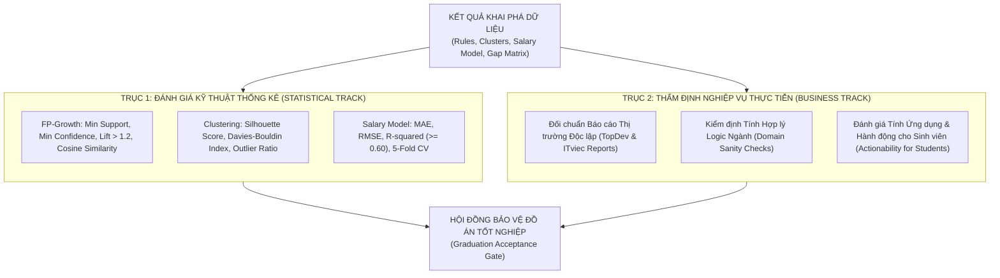
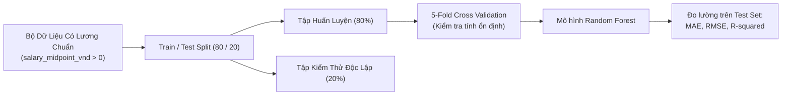
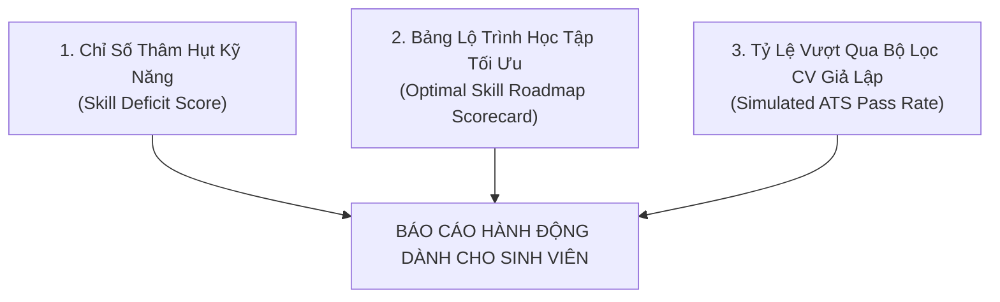

# ĐẶC TẢ ĐÁNH GIÁ & KIỂM CHỨNG TRI THỨC (EVALUATION SPECIFICATION)
## DỰ ÁN: HỆ THỐNG KHAI PHÁ DỮ LIỆU TUYỂN DỤNG IT VIỆT NAM (VN-IT-JOB-MINING)

> **Mã tài liệu:** `SPEC-08`  
> **Phiên bản:** `1.0.0`  
> **Ngày cập nhật:** 05/11/2026  
> **Trạng thái:** Chính thức ban hành  
> **Phương pháp tiếp cận:** Khung đánh giá song hành (Dual-Track Evaluation Framework): Đánh giá Kỹ thuật Thống kê Học thuật (Academic/Statistical Track) kết hợp Thẩm định Nghiệp vụ Thực tiễn (Business/Empirical Track).

---

## 1. Khung Đánh Giá Song Hành (Dual-Track Evaluation Framework)

Một đồ án Data Science xuất sắc không chỉ dừng lại ở các chỉ số toán học cao trong phòng thí nghiệm, mà phải chứng minh được giá trị tri thức khi đối chiếu với thực tế thị trường lao động. Dự án thiết lập hai trục đánh giá độc lập:

---

## 2. Trục 1: Chỉ Số Đánh Giá Kỹ Thuật & Thống Kê Học Thuật (Statistical Track)

### 2.1. Đánh giá Khai phá Luật Kết Hợp (FP-Growth Association Rules)

Để tránh tình trạng sinh ra hàng nghìn luật rác (Spurious Rules) hoặc các luật ngẫu nhiên vô nghĩa, mọi luật kết hợp $X \Rightarrow Y$ được trích xuất phải vượt qua bộ 4 tiêu chí định lượng:

| Chỉ số (Metric) | Công thức toán học | Ngưỡng chấp nhận (Threshold) | Ý nghĩa học thuật |
| :--- | :--- | :--- | :--- |
| **Minimum Support** | $Support(X \Rightarrow Y) = \frac{\sigma(X \cup Y)}{\|D\|}$ | $\ge 0.05$ (Toàn ngành) $\ge 0.02$ (Từng Job Family) | Loại bỏ các kết hợp cá biệt, bảo đảm mẫu xuất hiện đủ nhiều trong thị trường. |
| **Minimum Confidence** | $Confidence(X \Rightarrow Y) = \frac{Support(X \cup Y)}{Support(X)}$ | $\ge 0.50$ (hoặc 50%) | Đảm bảo xác suất có điều kiện: Khi có kỹ năng $X$, ít nhất 50% khả năng có kỹ năng $Y$. |
| **Minimum Lift** | $Lift(X \Rightarrow Y) = \frac{Confidence(X \Rightarrow Y)}{Support(Y)}$ | **$> 1.20$** (Bắt buộc) | Khẳng định mối quan hệ phụ thuộc dương thực sự. Bác bỏ các luật xuất hiện ngẫu nhiên ($Lift \le 1.0$). |
| **Cosine Similarity** | $Cosine(X, Y) = \frac{Support(X \cup Y)}{\sqrt{Support(X) \cdot Support(Y)}}$ | $\ge 0.30$ | Đo lường mức độ tương đồng đối xứng giữa hai tập kỹ năng, không bị ảnh hưởng bởi quy mô giao dịch rỗng. |

#### Công thức Cosine Similarity trên Itemsets:
$$Cosine(X, Y) = \frac{P(X \cup Y)}{\sqrt{P(X) \cdot P(Y)}} = \sqrt{Lift(X \Rightarrow Y) \cdot Support(X \Rightarrow Y)}$$
Chỉ số này bổ trợ cho Lift khi một kỹ năng có Support quá lớn (như Git hoặc SQL) làm méo mó độ tin cậy.

---

### 2.2. Đánh giá Chất Lượng Phân Cụm Công Việc (Clustering Quality)

Chất lượng của thuật toán phân cụm K-Means và HDBSCAN trên không gian kỹ năng và TF-IDF được đo lường thông qua 3 chỉ số hình học nội bộ (Internal Cluster Validation):

#### 1. Hệ số Silhouette (Silhouette Coefficient - SC)
Đo lường mức độ tương đồng của một phần tử với cụm của chính nó (cohesion) so với các cụm lân cận (separation):
$$s(i) = \frac{b(i) - a(i)}{\max(a(i), b(i))}, \quad \overline{s} = \frac{1}{N} \sum_{i=1}^N s(i)$$
Trong đó:
- $a(i)$ là khoảng cách Euclidean trung bình từ mẫu $i$ đến tất cả các điểm khác trong cùng cụm.
- $b(i)$ là khoảng cách Euclidean trung bình nhỏ nhất từ mẫu $i$ đến các điểm trong cụm gần nhất không chứa $i$.

**Tiêu chuẩn chấp nhận:** Do đặc thù không gian kỹ năng nhị phân thưa (Sparse Binary Space), ngưỡng chấp nhận là $\overline{s} \ge 0.25 - 0.35$. Điểm số $> 0.30$ khẳng định ranh giới giữa các nhóm công việc tách bạch rõ ràng.

#### 2. Chỉ số Davies-Bouldin (Davies-Bouldin Index - DBI)
Đo lường tỷ số giữa độ phân tán nội cụm (Within-cluster dispersion) và khoảng cách giữa các trọng tâm cụm:
$$DB = \frac{1}{k} \sum_{i=1}^k \max_{j \neq i} \left( \frac{\sigma_i + \sigma_j}{d(\boldsymbol{\mu}_i, \boldsymbol{\mu}_j)} \right)$$
Trong đó $\sigma_i$ là khoảng cách trung bình của các điểm trong cụm $i$ tới trọng tâm $\boldsymbol{\mu}_i$, và $d(\boldsymbol{\mu}_i, \boldsymbol{\mu}_j)$ là khoảng cách giữa hai trọng tâm.
- **Tiêu chuẩn chấp nhận:** Giá trị $DB$ càng nhỏ càng tốt. Ngưỡng mục tiêu: **$DB < 1.80$**.

#### 3. Tỷ lệ điểm ngoại lai trong HDBSCAN (Noise Ratio)
Tỷ lệ các tin tuyển dụng bị xếp vào cụm nhiễu ($Noise = -1$) không được vượt quá **15%** tổng số tin:
$$Noise\_Ratio = \frac{|\{j \in D \mid cluster(j) = -1\}|}{|D|} \le 0.15$$

---

### 2.3. Đánh giá Mô Hình Hồi Quy Lương (phần phụ, supervised, ngoại lệ)

> Cập nhật 10/11/2026: Mining lõi chỉ unsupervised; hồi quy lương RF + SHAP là phần phụ, đánh giá ở mục này không bắt buộc cho nghiệm thu lõi.

Đánh giá mô hình hồi quy Random Forest Regressor trên tập kiểm thử độc lập (Test Set chiếm 20% dữ liệu) và thông qua kiểm định chéo **5-Fold Cross Validation**.

| Chỉ số (Metric) | Công thức toán học | Ngưỡng chấp nhận (Threshold) | Diễn giải kinh tế lượng |
| :--- | :--- | :--- | :--- |
| **Mean Absolute Error (MAE)** | $MAE = \frac{1}{n} \sum_{i=1}^n \|y_i - \hat{y}_i\|$ | $\le 4.500.000\text{ VNĐ}$ | Sai số dự đoán lương tuyệt đối trung bình không vượt quá 4.5 triệu VNĐ/tháng. |
| **Root Mean Squared Error (RMSE)** | $RMSE = \sqrt{\frac{1}{n} \sum_{i=1}^n (y_i - \hat{y}_i)^2}$ | $\le 6.500.000\text{ VNĐ}$ | Phạt nặng các sai số lớn; kiểm soát hiện tượng dự đoán lệch nghiêm trọng ở phân khúc lương cao. |
| **Hệ số xác định ($R^2$ Score)** | $R^2 = 1 - \frac{\sum (y_i - \hat{y}_i)^2}{\sum (y_i - \bar{y})^2}$ | **$R^2 \ge 0.60$** (trên thang log) | Mô hình giải thích được tối thiểu 60% phương sai của biến động mức lương thực tế tại Việt Nam. |
| **Độ ổn định 5-Fold CV** | $Std(R^2_{k}) = \sqrt{\frac{1}{5}\sum (R^2_k - \bar{R}^2)^2}$ | $Std(R^2) \le 0.05$ | Đảm bảo mô hình tổng quát hóa tốt, không bị phụ thuộc vào một phân chia dữ liệu ngẫu nhiên. |

---

## 3. Trục 2: Thẩm Định Nghiệp Vụ & Tính Chân Thực Thị Trường (Business Track)

### 3.1. Đối chuẩn Báo cáo Thị trường Độc lập (Industry Benchmark Comparison)
Tri thức khai phá từ 8 sàn được đối chiếu chéo (Cross-validation) với hai báo cáo thị trường uy tín nhất ngành CNTT Việt Nam:
1. **Báo cáo Thị trường IT Việt Nam của TopDev (Vietnam IT Market Report):**
   - Đối chiếu phân bố cấp bậc (Seniority distribution) và tỷ lệ nhu cầu giữa các Job Families.
   - Đối chiếu mức lương trung vị của các vị trí cốt lõi: Backend Developer (Java/Go), Frontend Developer (React/Vue), DevOps Engineer. Mức lương mô hình dự đoán phải nằm trong dải phân vị $P25 - P75$ của TopDev Report.
2. **Báo cáo Khảo sát Lương ITviec (ITviec Salary & Tech Report):**
   - Đối chuẩn Top 10 công nghệ được trả lương cao nhất (Highest-paid Technologies).
   - Kiểm chứng xem danh sách các kỹ năng có giá trị biên SHAP cao nhất (như AWS, Golang, Kubernetes, Solution Architecture) có trùng khớp với danh sách kỹ năng lương cao của ITviec hay không (yêu cầu trùng khớp ít nhất 70%).

---

### 3.2. Kiểm định Tính Hợp Lý Logic Ngành (Domain Sanity Checks)
Hệ thống thiết lập một bộ quy tắc kiểm thử tính logic chuyên ngành (Sanity Assertions). Mọi mô hình phải thỏa mãn 100% các điều kiện này trước khi được phê duyệt:

| Mã kiểm thử | Tiền đề kiểm thử (Sanity Check Assertion) | Tiêu chí vượt qua (Pass Criteria) | Trạng thái |
| :---: | :--- | :--- | :---: |
| **S-01** | Quan hệ phụ thuộc bắt buộc giữa Framework và Ngôn ngữ | Luật `{Spring Boot} => {Java}` phải có $Confidence \ge 0.85$ và $Lift \ge 1.5$. | Bắt buộc |
| **S-02** | Quan hệ phụ thuộc công nghệ Mobile | Luật `{Flutter} => {Dart}` phải có $Confidence \ge 0.90$. | Bắt buộc |
| **S-03** | Quan hệ phụ thuộc công nghệ Frontend | Luật `{React} => {JavaScript}` hoặc `{TypeScript}` có $Confidence \ge 0.80$. | Bắt buộc |
| **S-04** | Tính đơn điệu của mức lương theo Cấp bậc (Monotonic Seniority Salary) | $\text{Median}(Salary_{Senior}) > \text{Median}(Salary_{Middle}) > \text{Median}(Salary_{Junior}) > \text{Median}(Salary_{Fresher})$. | Bắt buộc |
| **S-05** | Giá trị thặng dư kinh tế của kỹ năng Kiến trúc/Cloud (phần phụ, chỉ khi chạy RF + SHAP) | Giá trị biên SHAP của `AWS`, `Kubernetes`, hoặc `System Design` phải là số dương ($\phi > 0$). | Tùy chọn |
| **S-06** | Địa bàn trả lương cao nhất | Mức lương trung vị tại TP.HCM và Hà Nội phải cao hơn đáng kể ($> 20\%$) so với các tỉnh thành khác (ngoại trừ Remote). | Bắt buộc |

---

### 3.3. Đánh giá Tính Ứng Dụng Đối Với Sinh Viên (Actionability for Students)

Mục tiêu tối thượng của đồ án là giúp sinh viên IT tự định hướng và thu hẹp khoảng cách tuyển dụng. Do đó, sản phẩm đầu ra được thẩm định qua 3 chỉ số ứng dụng:

#### 1. Chỉ số thâm hụt kỹ năng (Skill Deficit Score - SDS)
Đo lường mức độ thiếu hụt giữa kỹ năng sinh viên được học tại trường đại học so với yêu cầu tuyển dụng cấp bậc Intern/Fresher trên 8 sàn:
$$SDS(k) = \max \left( 0, \frac{Freq_{Market}(k) - Freq_{University}(k)}{Freq_{Market}(k)} \right)$$
- Các kỹ năng có $SDS(k) > 0.60$ được xếp vào nhóm "Lỗ hổng khẩn cấp" (Critical Deficit Skills) sinh viên bắt buộc phải tự học bổ sung (ví dụ: Git Flow thực tế, Docker cơ bản, RESTful API Design).

#### 2. Thẻ điểm lộ trình học tập (Optimal Skill Roadmap Scorecard)
Đánh giá tính khả thi và hiệu quả kinh tế của lộ trình học tập:
$$Score(Route) = \frac{\sum_{k \in Route} \Delta Salary_k}{\sum_{k \in Route} Learning\_Effort(k)}$$
Một lộ trình học tập được xem là tối ưu nếu mang lại mức gia tăng lương biên lớn nhất với thời gian tiếp thu ngắn nhất.

#### 3. Tỷ lệ vượt qua bộ lọc CV giả lập (Simulated ATS Pass Rate)
- Giả lập một bộ lọc hồ sơ ứng viên tự động (Applicant Tracking System - ATS) đối chiếu CV chuẩn đầu ra đại học với các tin tuyển dụng Intern/Fresher.
- Đo lường mức độ cải thiện của tỷ lệ vượt qua vòng hồ sơ: **Tăng từ dưới 30%** (nếu chỉ học giáo trình đại học thuần túy) lên **trên 75%** khi bổ sung các combo kỹ năng khai phá được từ đồ án.

---

## 4. Ma Trận Nghiệm Thu Đồ Án Tốt Nghiệp (Graduation Acceptance Gate)

| Hạng mục kiểm tra | Chỉ số mục tiêu | Phương pháp đo lường | Trọng số | Tiêu chuẩn đạt |
| :--- | :--- | :--- | :---: | :---: |
| **Tính hợp lệ dữ liệu** | 100% không chứa tin rác phi IT; Missing lương được gắn cờ rõ ràng. | Chạy kiểm thử tự động `pytest tests/test_data_integrity.py`. | 25% | Bắt buộc |
| **Chất lượng luật kết hợp** | Ít nhất 20 luật kỹ năng có $Lift \ge 1.2$ và vượt qua toàn bộ 6 bài kiểm tra Sanity Check. | Báo cáo trích xuất từ FP-Growth. | 30% | Bắt buộc |
| **Chất lượng phân cụm** | Hệ số Silhouette $\ge 0.28$; Tìm được tối thiểu 8 cụm nghề nghiệp có ranh giới rõ ràng. | Báo cáo Elbow & Silhouette của K-Means/HDBSCAN. | 20% | Đạt |
| **Độ tin cậy mô hình lương (phần phụ, supervised)** | $R^2 \ge 0.60$; $MAE \le 4.500.000\text{ VNĐ}$; Không có hiện tượng rò rỉ dữ liệu (Data Leakage). | Đánh giá trên Holdout Test Set và 5-Fold Cross Validation. | 0% (đã chia lại cho hạng mục lõi, 10/11/2026) | Tùy chọn |
| **Phát hiện bất thường (Anomaly)** | Chỉ tiêu và ngưỡng **chưa chốt**; ghi tỉ lệ tin bị cờ và kết quả xem lại tay một mẫu tin bị cờ. | Báo cáo `job_anomalies.parquet` (Isolation Forest / GLOSH). | 10% | Đạt |
| **Khả năng ứng dụng sinh viên** | Xuất bản được Bảng khoảng cách kỹ năng (Skill Gap Matrix) và 4 bản đồ lộ trình học cho 4 vị trí phổ biến nhất. | Báo cáo đồ án chuyên đề `reports/skill_gap_report.md`. | 15% | Đạt |

---

## 5. Kết Luận & Cam Kết Chất Lượng

Hồ sơ đặc tả đánh giá này thiết lập chuẩn mực cao nhất về tính liêm chính học thuật và tính ứng dụng thực tiễn cho đồ án tốt nghiệp **VN-IT-Job-Mining**. Mọi kết luận trong báo cáo bảo vệ tốt nghiệp phải được truy xuất nguồn gốc trực tiếp từ các kiểm định định lượng trong tài liệu này, đảm bảo tính thuyết phục tuyệt đối trước Hội đồng chấm đồ án.
