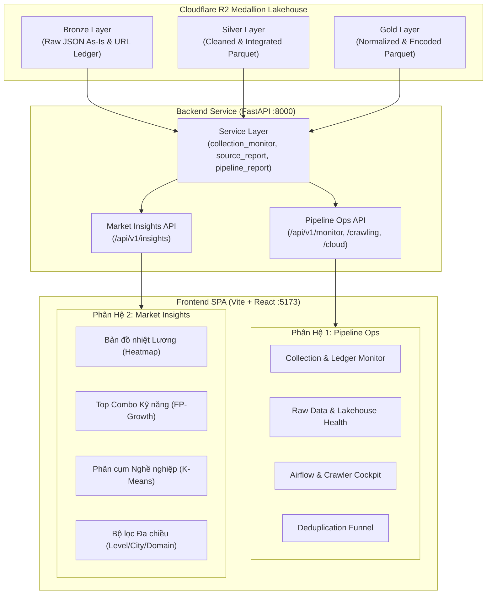
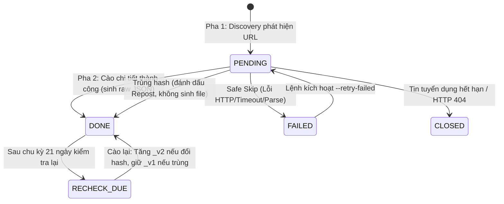
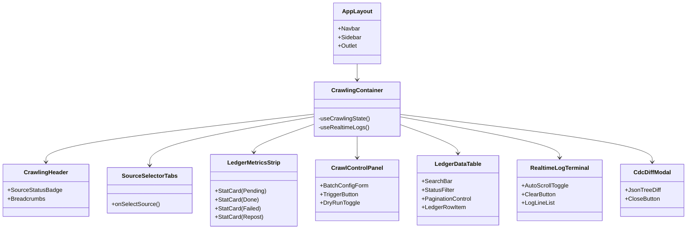

# ĐẶC TẢ PHÂN HỆ TRỰC QUAN HÓA & GIÁM SÁT (MONITORING & VISUALIZATION OBSERVATORY SPECIFICATION)

> **Mã tài liệu:** `SPEC-09` | **Trạng thái:** Hoàn thành & Phê duyệt | **Phân hệ:** Trực quan hóa & Giám sát  
> **Công nghệ lõi:** FastAPI (Python 3.12 Backend) + React 18 / TypeScript / Tailwind CSS (Vite Frontend)  
> **Tài liệu liên quan:** [agents.md](../../agents.md), [11_technical_decisions.md](11_technical_decisions.md), [12_coding_standards.md](12_coding_standards.md), [13_working_documentation.md](13_working_documentation.md)

---

## 1. Tổng Quan & Triết Lý Thiết Kế Hệ Thống

Hệ thống Giám sát & Trực quan hóa (**Central Observatory**) của dự án `VN-IT-Job-Mining` đóng vai trò là "Bộ máy miêu tả hình ảnh thực tế" (**Visual Truth Engine**). Hệ thống phục vụ song song hai đối tượng người dùng với hai mục đích rõ rệt:

1. **Kỹ sư Dữ liệu (Data Engineers & Tech Leads):** Cần một buồng lái vận hành (**Data Pipeline Cockpit**) theo dõi trực tiếp dòng chảy dữ liệu thực tế, kiểm soát sức khỏe thu thập trên 8 sàn tuyển dụng IT tại Việt Nam, tiến độ sổ cái URL (URL Ledger), trạng thái Cloudflare R2 Lakehouse, Apache Airflow DAG runs và hiệu quả khử trùng lặp qua từng giai đoạn.
2. **Sinh viên & Nhà nghiên cứu (IT Students & Researchers):** Cần một bảng điều khiển phân tích thông minh (**Market Insights Dashboard**) để khám phá xu hướng kỹ năng, bản đồ nhiệt mức lương theo vị trí và thâm niên, các tổ hợp kỹ năng "vàng" từ thuật toán FP-Growth, và các cụm nghề nghiệp thực tế được phân nhóm bởi thuật toán K-Means.



### 1.1. Các Nguyên Tắc Bắt Buộc (Non-Negotiable Rules)
- **Real Numbers Only (Chỉ dùng số thật):** Nghiêm cấm tạo số liệu giả, số ngẫu nhiên (`Math.random()`) hay placeholder tĩnh để đối phó giao diện. Khi thiếu dữ liệu hoặc pipeline chưa chạy đến bước tương ứng, Backend phải trả về `null` kèm lý do cụ thể (`reason: "NO_DATA"`), và Frontend bắt buộc phải hiển thị trạng thái rỗng (**Empty State**) minh bạch.
- **Zero-Auth Architecture:** Đây là hệ thống Cockpit nội bộ phục vụ nghiên cứu và đồ án kỹ thuật. Tuyệt đối không tạo màn hình đăng nhập (Login/Sign-in), đăng xuất (Logout) hay modal xác thực rườm rà. Hệ thống mở trực tiếp vào trang tổng quan khi khởi động.
- **Phân tách Tuyệt đối giữa Vận hành (Ops) và Trực quan hóa (Insights):**
  - Trang Vận hành (`/crawling`, `/collection`, `/raw`, `/airflow`): Chỉ phục vụ kích hoạt batch, kiểm soát ledger, theo dõi log console thời gian thực, đo tỷ lệ lỗi mạng và độ trễ sync R2.
  - Trang Khoa học & Thông tin chi tiết (`/insights`, `/eda`, `/preprocessing`): Chỉ phục vụ biểu đồ phân phối, bản đồ nhiệt, tương quan kỹ năng và phân cụm mô hình. Tuyệt đối không đặt nút bấm cào dữ liệu hay can thiệp tác vụ cào tại đây.
- **100% Strict TypeScript:** Toàn bộ mã nguồn Frontend sử dụng TypeScript, định kiểu tường minh trong `types.ts`, không sử dụng kiểu `any` tùy tiện và cấm tuyệt đối file `.js` / `.jsx`.

---

## 2. Phân Hệ 1: Data Pipeline Ops (Giám Sát Vận Hành)

Phân hệ Pipeline Ops cung cấp năng lực giám sát toàn diện cho chu trình thu thập và tinh chế dữ liệu từ 8 nguồn: **TopCV, TopDev, VietnamWorks, CareerViet, Vieclam24h, ITviec, Glints, JobsGO**.

### 2.1. Giám Sát Thu Thập & Tiến Độ URL Ledger
URL Ledger (`collection/common/url_ledger.py`, file lưu trữ `catalog_master.json`) là hợp đồng trạng thái giữa Pha 1 (Discovery) và Pha 2 (Detail). Phân hệ Ops trực quan hóa chu trình vòng đời của từng URL:

$$\text{PENDING} \xrightarrow{\text{Crawl Detail}} \text{DONE (kèm content\_hash)} \xrightarrow{\ge 21\text{ ngày}} \text{RECHECK\_DUE} \xrightarrow{\text{Crawl}} \text{DONE}$$

Các trạng thái đặc biệt:
- **`repost`:** Bài đăng có nội dung trùng lặp hash SHA-256 với một URL khác trong cùng sàn. Bản ghi được chuyển sang `DONE` kèm trường `repost_of_url_hash` và **không sinh file raw mới**.
- **`FAILED`:** URL gặp lỗi mạng hoặc lỗi phân tích trang; cơ chế **Safe Skip** ghi nhận lỗi và tiếp tục batch, không làm dừng tiến trình cào.
- **`CLOSED`:** Tin tuyển dụng đã bị nhà tuyển dụng gỡ hoặc trả về HTTP 404/410. Không bao giờ hạ cấp trạng thái `CLOSED`.



**Bảng Chỉ số Giám sát URL Ledger:**
| Chỉ số | Mô tả kỹ thuật | Ngưỡng Cảnh báo |
|---|---|---|
| **Pending Backlog** | Số lượng URL đã quét nhưng chưa cào chi tiết | $> 1,000$ URL chưa xử lý |
| **Done Count** | Tổng số bài đăng đã hoàn thành cào chi tiết | Theo dõi tiến độ mục tiêu |
| **Repost Rate (%)** | Tỷ lệ tin đăng lại nội sàn (không sinh file) | Thường dao động $5\% - 15\%$ |
| **Failure Rate (%)** | Tỷ lệ cào lỗi trên tổng số URL thực thi | Cảnh báo vàng nếu $> 5\%$, đỏ nếu $> 10\%$ |
| **Closed Count** | Số bài tuyển dụng đã đóng trước khi kịp cào | Phản ánh tốc độ biến động tin |

### 2.2. Kiểm Soát Sức Khỏe Cloudflare R2 Lakehouse
Hệ thống giám sát định kỳ đối chiếu giữa hệ thống file trên máy cục bộ (`data/`) và kho lưu trữ đám mây Cloudflare R2 (`r2://vn-it-jobs/`):

1. **Đo đạc Độ trễ (Latency Check):** Đo thời gian phản hồi ping tới Cloudflare R2 qua S3 API endpoint (< 200ms là tiêu chuẩn).
2. **Kiểm toán Chênh lệch (Diff Audit via SHA-256):**
   - **Ledger chậm hơn Raw:** Phát hiện các trường hợp file raw đã được đẩy lên R2 nhưng file ledger chưa được đồng bộ (sự cố `SCRAPE-4`).
   - **DONE thiếu Raw:** Các bản ghi `DONE` trong ledger không tìm thấy file raw tương ứng (sau khi đã trừ đi các bản ghi `repost`).
   - **Raw ngoài Ledger:** Các file raw tồn tại trên bucket nhưng không được lập chỉ mục trong ledger.
3. **Phân bổ Lưu trữ 4 Tầng Medallion:**
   - Tầng 1: `url_ledger/<source>/` (Sổ cái URL & manifests).
   - Tầng 2: `raw/<source>/<YYYY-MM-DD>/` (Bronze raw JSON files).
   - Tầng 3: `staging/<source>/` (Silver integrated Parquet files).
   - Tầng 4: `curated/` & `gold/` (Gold Golden Master Parquet datasets).

### 2.3. Bảng Điều Khiển Apache Airflow Orchestration
Truy vấn trực tiếp trạng thái tiến trình hệ điều hành và cơ sở dữ liệu PostgreSQL của Airflow:
- **Scheduler Heartbeat:** Trạng thái tiến trình Scheduler (`ONLINE` / `STOPPED`), PID, dung lượng bộ nhớ sử dụng.
- **Webserver Daemon:** Kiểm tra cổng mạng `:8080` và số lượng worker active.
- **DAG Execution Grid:**
  - `dag_discovery_daily`: Chạy quét URL mới lúc 05:00 hàng ngày trên 8 nguồn.
  - 8 DAGs cào chi tiết theo nguồn (`crawler_detail_<source>`): Chạy dồn dập cuối tuần với cơ chế Adaptive Batch (30 tin/batch, nghỉ 55 phút giữa các ca, độc quyền tài nguyên theo `pool_<source>`).
  - Lịch sử chạy 10 lần gần nhất kèm trạng thái (`success`, `running`, `failed`), thời gian thực thi (duration).

### 2.4. Phễu Khử Trùng Lặp 3 Cấp (Deduplication Funnel Ops)
Trực quan hóa số lượng bài đăng bị loại bỏ qua từng bước để chứng minh độ sạch của dữ liệu:
1. **Cấp 1 - Intra-source CDC:** Khử trùng lặp nội sàn ngay khi cào bằng mã băm canonical JSON (loại bỏ bài đăng lặp, giữ lại 1 file raw duy nhất).
2. **Cấp 2 - Clean Phase Dedup:** Khử trùng các file batch lịch sử trùng với file từng tin và trùng lặp mã tuyển dụng (`job_id`).
3. **Cấp 3 - Inter-source Cross-platform Dedup:** Khử trùng xuyên sàn giữa 8 trang tuyển dụng bằng thuật toán Blocking kết hợp Jaccard từ khóa và Cosine TF-IDF mô tả công việc.

---

## 3. Phân Hệ 2: Market Insights Dashboard (Phân Tích Thị Trường)

Phân hệ Market Insights được thiết kế hướng tới đối tượng người dùng cuối là **sinh viên IT tại Việt Nam**, cung cấp các góc nhìn đa chiều về thị trường tuyển dụng trong giai đoạn tháng 10 - tháng 11/2026.

### 3.1. Bản Đồ Nhiệt Mức Lương (Salary Heatmap Matrix)
Phân tích tương quan giữa Vị trí chuyên môn (**Job Family / Title**) và Số năm kinh nghiệm (**Seniority / Experience**):

- **Trục Tung (Y-axis - 12 Nhóm Nghề Chuẩn):**
  1. Backend Developer
  2. Frontend Developer
  3. Fullstack Developer
  4. Mobile Developer (iOS/Android/Flutter/React Native)
  5. DevOps / Cloud / SRE
  6. Data Engineer
  7. Data Scientist / AI / Machine Learning Engineer
  8. Software QA / QC / Automation Tester
  9. Information Security / Cyber Security
  10. Product Management / IT Business Analyst (BA)
  11. System / Network Engineer
  12. Embedded Systems / IoT Engineer
- **Trục Hoành (X-axis - Dải Kinh Nghiệm):**
  - Intern / Fresher (< 1 năm)
  - Junior (1 - 2 năm)
  - Middle (3 - 4 năm)
  - Senior (5+ năm)
  - Lead / Technical Manager
- **Giá trị hiển thị trên từng Cell:**
  - Mức lương trung vị (**Median Salary** - triệu VNĐ/tháng) nhằm tránh bị sai lệch bởi các giá trị ngoại lai cực đoan.
  - Khoảng tứ phân vị (**IQR:** 25% percentile - 75% percentile) khi di chuột hiển thị Tooltip.
  - Số lượng tin tuyển dụng đóng góp vào cell ($N_{samples}$).
- **Quy tắc làm sạch & Cảnh báo:**
  - Tin tuyển dụng ghi "Thỏa thuận" (MNAR - Missing Not At Random) được đưa vào bộ đếm riêng, không tính lương bằng 0.
  - Mức lương ngoài khoảng 1 - 500 triệu VNĐ/tháng bị đánh cờ `salary_suspect` và loại khỏi ma trận tính toán.

### 3.2. Top Tổ Hợp Kỹ Năng "Vàng" Từ Luật Kết Hợp (FP-Growth Association Rules)
Thay vì các biểu đồ tròn đơn giản đếm từng kỹ năng riêng lẻ, hệ thống áp dụng thuật toán **FP-Growth** trên ma trận đặc trưng kỹ năng (230 cột kỹ năng chuẩn hóa) để tìm ra các gói kỹ năng nhà tuyển dụng luôn yêu cầu đi kèm nhau:

- **Các chỉ số cốt lõi:**
  - **Support ($P(A \cap B)$):** Tỷ lệ phần trăm tin tuyển dụng yêu cầu đồng thời cả tập kỹ năng $A$ và $B$.
  - **Confidence ($P(B|A)$):** Xác suất nếu một JD đã yêu cầu kỹ năng $A$ thì chắc chắn sẽ yêu cầu thêm kỹ năng $B$.
  - **Lift ($\frac{P(A \cap B)}{P(A) \cdot P(B)}$):** Đo lường mức độ phụ thuộc tích cực giữa các kỹ năng. $Lift > 1.0$ thể hiện hai kỹ năng tương hỗ mạnh mẽ; $Lift > 2.5$ thể hiện bộ combo bắt buộc.
- **Thành phần Trực quan hóa:**
  - **Bảng Tra cứu Luật kết hợp:** Hỗ trợ sắp xếp theo Lift, Confidence, Support; cho phép lọc Antecedent (Kỹ năng sinh viên đã có) để xem Consequent (Kỹ năng sinh viên cần học bổ sung).
  - **Network Graph (Đồ thị Liên kết Kỹ năng):** Các node biểu thị kỹ năng, kích thước node tương ứng độ phổ biến, đường nối giữa các node biểu thị giá trị Lift. Người dùng có thể click vào node để làm nổi bật cụm công nghệ liên quan (ví dụ cụm Python Data, cụm React Ecosystem, cụm Java Spring Enterprise).

### 3.3. Biểu Đồ Phân Cụm Nghề Nghiệp (K-Means Clustering Scatter Plot)
Kiểm chứng thực tế: Các tin tuyển dụng trên thị trường tự động nhóm thành những cụm nào khi dựa trên không gian đặc trưng kỹ năng và dải lương?

- **Giảm chiều dữ liệu:** Sử dụng thuật toán **PCA (Principal Component Analysis)** hoặc **t-SNE** để chiếu ma trận 230 chiều kỹ năng xuống không gian 2D ($PC_1$ và $PC_2$).
- **Trực quan hóa Scatter Plot:**
  - Mỗi điểm đại diện cho một tin tuyển dụng sạch trong bộ dữ liệu Gold.
  - Màu sắc đại diện cho Cụm được gán bởi K-Means ($k=6 \dots 8$).
  - Điểm Centroid của từng cụm được đánh dấu nổi bật kèm nhãn tóm tắt các kỹ năng đại diện nhất (ví dụ: *Cluster 1: Modern Frontend - TypeScript, React, Tailwind, Next.js*).
  - Hỗ trợ di chuột để xem chi tiết: Tên công việc, Công ty, Mức lương, Nguồn sàn và độ xa so với tâm cụm.

### 3.4. Hệ Thống Bộ Lọc Linh Hoạt Đa Chiều (Multi-Faceted Filtering)
Toàn bộ biểu đồ và bảng phân tích trong phân hệ Insights liên kết động với thanh điều khiển bộ lọc:
1. **Cấp bậc tuyển dụng (Seniority Level):** Intern, Fresher, Junior, Middle, Senior, Lead/Manager.
2. **Địa bàn Tỉnh/Thành phố:** Chuẩn hóa theo danh mục 34 tỉnh/thành phố sau sáp nhập (tập trung 5 đô thị hạt nhân: Hà Nội, TP.HCM, Đà Nẵng, Cần Thơ, Hải Phòng và hình thức Remote/Hybrid).
3. **Lĩnh vực hoạt động (Domain / Industry):** Fintech, E-Commerce, EdTech, Game Development, AI Solutions, Software Outsourcing, Product Company.
4. **Sàn tuyển dụng nguồn (Source Platform):** Cho phép bật/tắt để so sánh dữ liệu giữa các sàn.

---

## 4. Thiết Kế API RESTful (FastAPI Backend)

Toàn bộ dịch vụ backend được cung cấp qua chuẩn RESTful API với tiền tố `/api/v1/`, tài liệu tương tác tự động sinh tại `/docs` (Swagger UI).

### 4.1. Danh Sách Endpoints Chi Tiết

| Phương thức | Endpoint URI | Mô tả | Tham số Truy vấn / Body |
|---|---|---|---|
| `GET` | `/api/v1/monitor/collection/status` | Lấy tình trạng thu thập tổng thể của 8 nguồn | Không |
| `GET` | `/api/v1/monitor/ledger/summary` | Thống kê số lượng URL theo từng trạng thái | `source` (tùy chọn) |
| `GET` | `/api/v1/monitor/ledger/{source}/records` | Phân trang danh sách URL trong ledger | `page`, `page_size`, `status`, `search` |
| `GET` | `/api/v1/monitor/cloud/health` | Đo độ trễ ping và kết nối Cloudflare R2 | Không |
| `GET` | `/api/v1/monitor/cloud/breakdown` | Kiểm toán dung lượng & số object 4 tầng R2 | Không |
| `GET` | `/api/v1/monitor/airflow/overview` | Lấy trạng thái Scheduler, Webserver & DAGs | Không |
| `GET` | `/api/v1/monitor/dedup/funnel` | Báo cáo số liệu phễu khử trùng lặp qua các bước | Không |
| `POST` | `/api/v1/crawling/trigger` | Kích hoạt tác vụ cào dữ liệu batch | JSON Body: `{source, phase, max_items, sync_r2, engine}` |
| `GET` | `/api/v1/crawling/logs/stream` | Server-Sent Events (SSE) stream log tiến trình | `task_id` |
| `GET` | `/api/v1/insights/salary-heatmap` | Dữ liệu ma trận bản đồ nhiệt lương | `city`, `level`, `domain` |
| `GET` | `/api/v1/insights/skill-combos` | Danh sách luật kết hợp kỹ năng (FP-Growth) | `min_support`, `min_confidence`, `min_lift`, `limit` |
| `GET` | `/api/v1/insights/clusters` | Tọa độ 2D và nhãn cụm nghề nghiệp (K-Means) | `n_clusters`, `algorithm` (`pca` hoặc `tsne`) |
| `GET` | `/api/v1/insights/filters/options` | Lấy danh mục các giá trị bộ lọc hợp lệ | Không |

### 4.2. Đặc Tả Request & Response Schemas (Pydantic Models)

#### Schema: Kích hoạt tác vụ cào (`/api/v1/crawling/trigger`)
```python
from pydantic import BaseModel, Field
from typing import Literal, Optional

class CrawlTriggerRequest(BaseModel):
    source: Literal[
        "topcv", "topdev", "vietnamworks", "careerviet",
        "vieclam24h", "itviec", "glints", "jobsgo"
    ] = Field(..., description="Nguồn dữ liệu tuyển dụng cần cào")
    phase: Literal["discover", "detail", "all"] = Field(
        default="detail", description="Pha thực thi: quét URL hoặc cào chi tiết"
    )
    max_items: int = Field(default=30, ge=1, le=100, description="Số lượng URL tối đa xử lý")
    sync_r2: bool = Field(default=True, description="Tự động đồng bộ file raw và ledger lên Cloudflare R2")
    engine: Literal["curl_cffi", "playwright"] = Field(
        default="curl_cffi", description="Trình thu thập dữ liệu (áp dụng cho TopCV)"
    )
    retry_failed: bool = Field(default=False, description="Chỉ cào lại các URL đang ở trạng thái FAILED")

class CrawlTriggerResponse(BaseModel):
    task_id: str
    status: Literal["ACCEPTED", "REJECTED"]
    message: str
    command_executed: str
```

#### Schema: Dữ liệu Ma trận Bản đồ nhiệt Lương (`/api/v1/insights/salary-heatmap`)
```python
from pydantic import BaseModel
from typing import List, Optional

class SalaryHeatmapCell(BaseModel):
    job_family: str
    seniority_level: str
    median_salary_million_vnd: Optional[float]
    q25_salary_million_vnd: Optional[float]
    q75_salary_million_vnd: Optional[float]
    sample_count: int
    negotiable_count: int

class SalaryHeatmapResponse(BaseModel):
    total_valid_jobs: int
    total_negotiable_jobs: int
    matrix: List[SalaryHeatmapCell]
    updated_at: str
```

#### Schema: Luật kết hợp Kỹ năng (`/api/v1/insights/skill-combos`)
```python
class AssociationRuleItem(BaseModel):
    antecedents: List[str] = Field(..., description="Tập kỹ năng tiền đề (Ví dụ: ['React', 'TypeScript'])")
    consequents: List[str] = Field(..., description="Tập kỹ năng hệ quả (Ví dụ: ['Next.js'])")
    support: float = Field(..., description="Độ hỗ trợ P(A ∩ B)")
    confidence: float = Field(..., description="Độ tin cậy P(B|A)")
    lift: float = Field(..., description="Độ nâng (Lift score)")

class SkillCombosResponse(BaseModel):
    algorithm: str = "FP-Growth"
    total_rules_mined: int
    rules: List[AssociationRuleItem]
```

---

## 5. Thiết Kế Cấu Trúc Component Frontend (React / Tailwind)

Nhằm khắc phục triệt để lỗi file nguyên khối (**Monolithic Component**) từng xảy ra ở phiên bản cũ (vấn đề `VIZ-5`: file `CrawlingPage.tsx` phình to tới 892 dòng code, trộn lẫn giữa state quản lý bảng, SSE logging, modal CDC diff và forms kích hoạt), phân hệ Frontend được tái cấu trúc theo mô hình phân tầng **Atomic / Container-Presenter Pattern**:



### 5.1. Phân Tách Chi Tiết Phân Hệ Vận Hành (Crawling Page Refactoring)
Thay vì duy trì một file `CrawlingPage.tsx` khổng lồ, toàn bộ mã nguồn được chia nhỏ vào thư mục `monitoring/frontend/src/components/crawling/`:

1. **`CrawlingContainer.tsx` (< 150 dòng):** Đóng vai trò orchestrator, quản lý state cấp cao thông qua custom hooks (`useLedgerData`, `useCrawlTask`), kết nối dữ liệu và truyền props xuống các view components con.
2. **`SourceSelectorTabs.tsx`:** Thanh chuyển đổi giữa 8 sàn tuyển dụng, hiển thị biểu tượng sàn và badge trạng thái đang cào/hoàn thành.
3. **`LedgerMetricsStrip.tsx`:** Thanh 4 thẻ chỉ số nhanh: Tổng số URL, Đã xong (`DONE`), Đang chờ (`PENDING`), Lỗi (`FAILED`), và Trùng lặp (`repost`).
4. **`CrawlControlPanel.tsx`:** Khối form điều khiển tách biệt, quản lý việc chọn Pha (Discovery/Detail), số lượng items, engine, và nút bấm kích hoạt có cơ chế xác nhận an toàn.
5. **`LedgerDataTable.tsx`:** Bảng dữ liệu URL Ledger độc lập, hỗ trợ lọc theo trạng thái, tìm kiếm từ khóa trong URL, xem chi tiết `job_id`, `version`, và `content_hash`.
6. **`RealtimeLogTerminal.tsx`:** Cửa sổ terminal giả lập hiển thị log streaming qua SSE, tự động cuộn (auto-scroll) và tô màu cú pháp (syntax highlighting) theo log level (`INFO`, `WARN`, `ERROR`).
7. **`CdcDiffModal.tsx`:** Hộp thoại pop-up so sánh nội dung khi có thay đổi version giữa các lần cào lại.

### 5.2. Cấu Trúc Thành Phần Phân Hệ Insights (Market Insights Components)
Toàn bộ thành phần phân tích thị trường được tổ chức tại `monitoring/frontend/src/components/insights/`:

```
monitoring/frontend/src/components/insights/
├── MarketInsightsContainer.tsx       # Container quản lý bộ lọc chung & nạp dữ liệu
├── GlobalInsightFilterBar.tsx        # Thanh lọc: Level, 34 Tỉnh thành, Domain, Nguồn
├── SalaryHeatmapCard.tsx             # Card ma trận nhiệt mức lương (Recharts / ECharts)
├── SkillAssociationGraph.tsx         # Đồ thị mạng lưới liên kết kỹ năng (Force-directed)
├── SkillRulesTable.tsx               # Bảng tra cứu luật kết hợp (Support, Conf, Lift)
├── CareerClusterScatterCard.tsx      # Biểu đồ phân cụm nghề nghiệp K-Means (PCA 2D)
└── StudentActionRecommendations.tsx  # Khối khuyến nghị lộ trình kỹ năng cho sinh viên
```

### 5.3. Tiêu Chuẩn Thẩm Mỹ & Responsive (Design Tokens)
- **Hệ Bảng màu (Palette Tokens):**
  - Nền trang chủ: `#F4F4F7` (Màu trung tính nhẹ dịu mắt, tránh mỏi mắt cho kỹ sư vận hành).
  - Khối Panels & Cards: `#FFFFFF` với đường viền mỏng `#ECEBF2` và bo góc `rounded-xl`.
  - Màu nhấn thương hiệu (**Brand Accent**): Màu tím chủ đạo `#5B4CE6`.
  - Màu phân loại 8 nguồn (Source Identifiers): Đồng nhất màu sắc cố định tại `constants/sources.ts` trên mọi biểu đồ.
  - Cấm sử dụng bảng màu `slate` cũ; chỉ sử dụng các semantic tokens: `ink` (chữ), `line` (viền), `panel` (nền khối), `brand` (nhấn), `state` (trạng thái).
- **Responsive Web Design:**
  - **Mobile 390px Viewport (iPhone 12/14/15 standard):** Bắt buộc các thanh lọc phải chuyển thành `flex-wrap`, bảng dữ liệu kích hoạt thanh trượt ngang mềm (`overflow-x-auto`), các chuỗi URL dài sử dụng lớp `[overflow-wrap:anywhere]` để tuyệt đối không làm vỡ bề ngang trang (`scrollWidth <= innerWidth`).
  - **Desktop 1440px Viewport:** Bố cục dạng lưới (CSS Grid) 2 cột hoặc 3 cột tận dụng tối đa không gian màn hình độ phân giải cao.

---

## 6. Tiêu Chí Nghiệm Thu & Kiểm Thử Phân Hệ Monitoring

1. **Khởi động Nhanh Không Lỗi:** Lệnh `./start_monitoring.sh --no-db --no-browser` phải khởi động thành công Backend FastAPI trên port 8000 và Frontend Vite trên port 5173 trong thời gian dưới 15 giây.
2. **Kiểm tra Kiểu Tĩnh (Typecheck):** Lệnh `cd monitoring/frontend && npm run build` phải biên dịch thành công 100% không có lỗi TypeScript (`tsc --noEmit`).
3. **Endpoint Tests:** Toàn bộ integration tests tại `tests/integration/test_monitor_endpoints.py` và `tests/integration/test_monitoring_api.py` phải vượt qua với mã trạng thái HTTP 200/422 chuẩn mực.
4. **Không Lỗi Tràn Màn Hình:** Kiểm tra tự động bằng Playwright headless trên cả 2 độ phân giải 390px và 1440px ghi nhận `document.documentElement.scrollWidth === window.innerWidth`.
