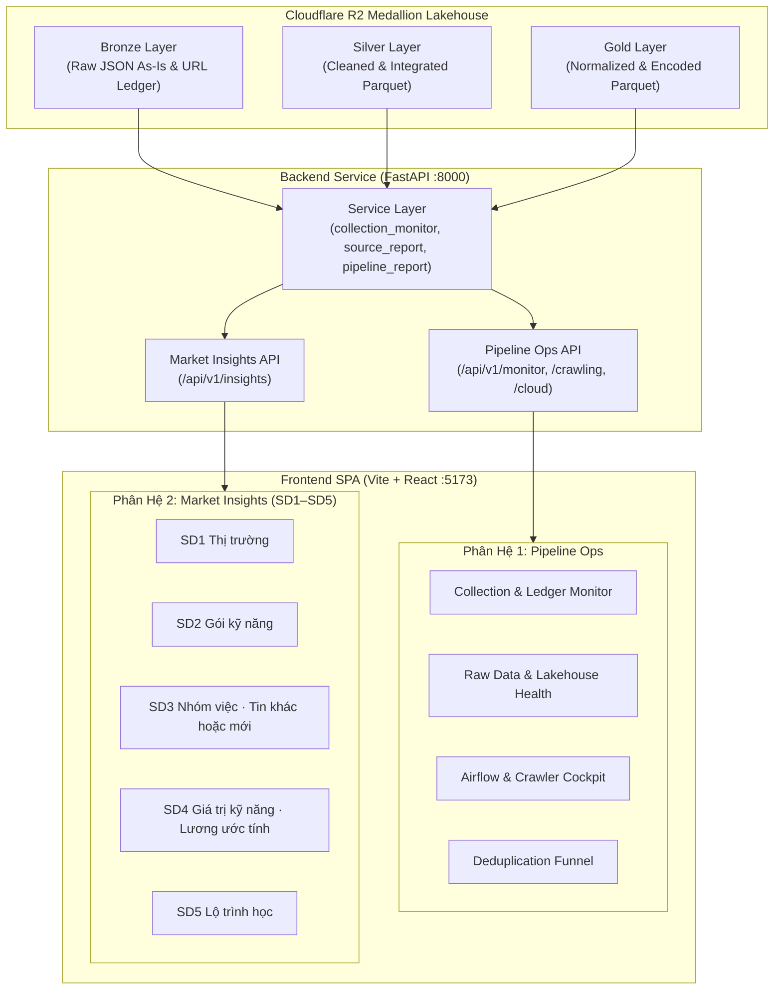
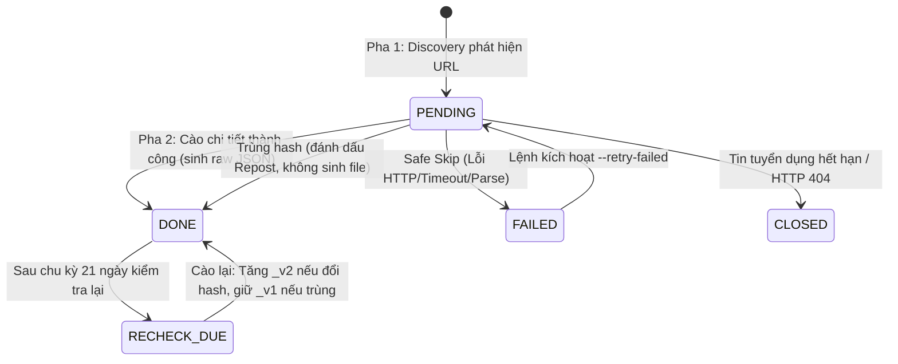
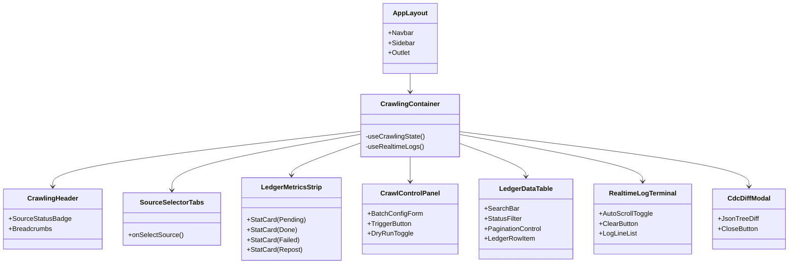

# ĐẶC TẢ PHÂN HỆ TRỰC QUAN HÓA & GIÁM SÁT (MONITORING & VISUALIZATION OBSERVATORY SPECIFICATION)

> **Mã tài liệu:** `SPEC-09` | **Phiên bản:** 1.1.0, 17/11/2026 | **Trạng thái:** Đã duyệt 17/11/2026 (chặng 5: viết lại mục 3 theo SD1–SD5, sửa mục 2.4, 4, 5.2; phần crawl giữ nguyên) | **Phân hệ:** Trực quan hóa & Giám sát  
> **Công nghệ lõi:** FastAPI (Python 3.12 Backend) + React 18 / TypeScript / Tailwind CSS (Vite Frontend)  
> **Tài liệu liên quan:** [AGENTS.md](../../AGENTS.md), [11_technical_decisions.md](11_technical_decisions.md), [12_coding_standards.md](12_coding_standards.md), [13_working_documentation.md](13_working_documentation.md)

---

## 1. Tổng Quan & Triết Lý Thiết Kế Hệ Thống

Hệ thống Giám sát & Trực quan hóa (**Central Observatory**) của dự án `VN-IT-Job-Mining` đóng vai trò là "Bộ máy miêu tả hình ảnh thực tế" (**Visual Truth Engine**). Hệ thống phục vụ song song hai đối tượng người dùng với hai mục đích rõ rệt:

1. **Kỹ sư Dữ liệu (Data Engineers & Tech Leads):** Cần một buồng lái vận hành (**Data Pipeline Cockpit**) theo dõi trực tiếp dòng chảy dữ liệu thực tế, kiểm soát sức khỏe thu thập trên 8 sàn tuyển dụng IT tại Việt Nam, tiến độ sổ cái URL (URL Ledger), trạng thái Cloudflare R2 Lakehouse, Apache Airflow DAG runs và hiệu quả khử trùng lặp qua từng giai đoạn.
2. **Sinh viên IT và người mới vào nghề:** Cần trang **Market Insights** trả lời 5 mục tiêu SD1–SD5 (`docs/target/`): bức tranh thị trường, gói kỹ năng, nhóm việc và tin "khác hoặc mới", giá trị kỹ năng và lương ước tính, lộ trình học (mục 3).

> **Phạm vi giao diện hiện tại** (leader chốt 09/11/2026, xem `monitoring/CLAUDE.md`): `App.tsx` chỉ gắn 4 route `/` (Collection), `/eda`, `/preprocessing`, `/processing`. `MarketInsightsPage.tsx` có file nhưng chưa gắn route. Các trang vận hành khác (`/crawling`, `/raw`, `/airflow`, R2) có file trang, không gắn route.



### 1.1. Các Nguyên Tắc Bắt Buộc (Non-Negotiable Rules)
- **Real Numbers Only (Chỉ dùng số thật):** Nghiêm cấm tạo số liệu giả, số ngẫu nhiên (`Math.random()`) hay placeholder tĩnh để đối phó giao diện. Khi thiếu dữ liệu hoặc pipeline chưa chạy đến bước tương ứng, Backend phải trả về `null` kèm lý do cụ thể (`reason: "NO_DATA"`), và Frontend bắt buộc phải hiển thị trạng thái rỗng (**Empty State**) minh bạch.
- **Zero-Auth Architecture:** Đây là hệ thống Cockpit nội bộ phục vụ nghiên cứu và đồ án kỹ thuật. Tuyệt đối không tạo màn hình đăng nhập (Login/Sign-in), đăng xuất (Logout) hay modal xác thực rườm rà. Hệ thống mở trực tiếp vào trang tổng quan khi khởi động.
- **Phân tách Tuyệt đối giữa Vận hành (Ops) và Trực quan hóa (Insights):**
  - Trang Vận hành (`/crawling`, `/collection`, `/raw`, `/airflow`): Chỉ phục vụ kích hoạt batch, kiểm soát ledger, theo dõi log console thời gian thực, đo tỷ lệ lỗi mạng và độ trễ sync R2.
  - Trang Khoa học & Thông tin chi tiết (`/insights`, `/eda`, `/preprocessing`, `/processing`): Chỉ phục vụ biểu đồ phân phối, bản đồ nhiệt, tương quan kỹ năng và phân cụm mô hình. Tuyệt đối không đặt nút bấm cào dữ liệu hay can thiệp tác vụ cào tại đây.
- **100% Strict TypeScript:** Toàn bộ mã nguồn Frontend sử dụng TypeScript, định kiểu tường minh trong `types.ts`, không sử dụng kiểu `any` tùy tiện và cấm tuyệt đối file `.js` / `.jsx`.

---

## 2. Phân Hệ 1: Data Pipeline Ops (Giám Sát Vận Hành)

Phân hệ Pipeline Ops cung cấp năng lực giám sát toàn diện cho chu trình thu thập và tinh chế dữ liệu từ 8 nguồn: **TopCV, TopDev, VietnamWorks, CareerViet, Vieclam24h, ITviec, Glints, JobsGO**.

### 2.1. Giám Sát Thu Thập & Tiến Độ URL Ledger
URL Ledger (`collection/common/url_ledger.py`, file lưu trữ `catalog_master.json`) là hợp đồng trạng thái giữa Pha 1 (Discovery) và Pha 2 (Detail). Phân hệ Ops trực quan hóa chu trình vòng đời của từng URL:

$$\text{PENDING} \xrightarrow{\text{Crawl Detail}} \text{DONE (kèm content\_hash)} \xrightarrow{\ge 21\text{ ngày}} \text{RECHECK\_DUE} \xrightarrow{\text{Crawl}} \text{DONE}$$

Các trạng thái đặc biệt:
- **`repost`:** Bài đăng có nội dung trùng lặp hash SHA-256 với một URL khác trong cùng sàn. Bản ghi được chuyển sang `DONE` kèm trường `repost_of_url_hash` và **không sinh file raw mới**.
- **`FAILED`:** URL gặp lỗi mạng hoặc lỗi phân tích trang; cơ chế **Safe Skip** ghi nhận lỗi và tiếp tục batch, không làm dừng tiến trình cào.
- **`CLOSED`:** Tin tuyển dụng đã bị nhà tuyển dụng gỡ hoặc trả về HTTP 404/410. Không bao giờ hạ cấp trạng thái `CLOSED`.



**Bảng Chỉ số Giám sát URL Ledger:**
| Chỉ số | Mô tả kỹ thuật | Ngưỡng Cảnh báo |
|---|---|---|
| **Pending Backlog** | Số lượng URL đã quét nhưng chưa cào chi tiết | $> 1,000$ URL chưa xử lý |
| **Done Count** | Tổng số bài đăng đã hoàn thành cào chi tiết | Theo dõi tiến độ mục tiêu |
| **Repost Rate (%)** | Tỷ lệ tin đăng lại nội sàn (không sinh file) | Thường dao động $5\% - 15\%$ |
| **Failure Rate (%)** | Tỷ lệ cào lỗi trên tổng số URL thực thi | Cảnh báo vàng nếu $> 5\%$, đỏ nếu $> 10\%$ |
| **Closed Count** | Số bài tuyển dụng đã đóng trước khi kịp cào | Phản ánh tốc độ biến động tin |

### 2.2. Kiểm Soát Sức Khỏe Cloudflare R2 Lakehouse
Hệ thống giám sát định kỳ đối chiếu giữa hệ thống file trên máy cục bộ (`data/`) và kho lưu trữ đám mây Cloudflare R2 (`r2://vn-it-jobs/`):

1. **Đo đạc Độ trễ (Latency Check):** Đo thời gian phản hồi ping tới Cloudflare R2 qua S3 API endpoint (< 200ms là tiêu chuẩn).
2. **Kiểm toán Chênh lệch (Diff Audit via SHA-256):**
   - **Ledger chậm hơn Raw:** Phát hiện các trường hợp file raw đã được đẩy lên R2 nhưng file ledger chưa được đồng bộ (sự cố `SCRAPE-4`).
   - **DONE thiếu Raw:** Các bản ghi `DONE` trong ledger không tìm thấy file raw tương ứng (sau khi đã trừ đi các bản ghi `repost`).
   - **Raw ngoài Ledger:** Các file raw tồn tại trên bucket nhưng không được lập chỉ mục trong ledger.
3. **Phân bổ Lưu trữ 4 Tầng Medallion:**
   - Tầng 1: `url_ledger/<source>/` (Sổ cái URL & manifests).
   - Tầng 2: `raw/<source>/<YYYY-MM-DD>/` (Bronze raw JSON files).
   - Tầng 3: `staging/<source>/` (Silver integrated Parquet files).
   - Tầng 4: `curated/` (Golden Master Parquet); tầng 5: `pipeline/` (đầu ra từng bước).

### 2.3. Bảng Điều Khiển Apache Airflow Orchestration
Truy vấn trực tiếp trạng thái tiến trình hệ điều hành và cơ sở dữ liệu PostgreSQL của Airflow:
- **Scheduler Heartbeat:** Trạng thái tiến trình Scheduler (`ONLINE` / `STOPPED`), PID, dung lượng bộ nhớ sử dụng.
- **Webserver Daemon:** Kiểm tra cổng mạng `:8080` và số lượng worker active.
- **DAG Execution Grid:**
  - `dag_discovery_daily`: Chạy quét URL mới lúc 05:00 hàng ngày trên 8 nguồn.
  - 8 DAGs cào chi tiết theo nguồn (`crawler_detail_<source>`): Chạy dồn dập cuối tuần với cơ chế Adaptive Batch (30 tin/batch, nghỉ 55 phút giữa các ca, độc quyền tài nguyên theo `pool_<source>`).
  - Lịch sử chạy 10 lần gần nhất kèm trạng thái (`success`, `running`, `failed`), thời gian thực thi (duration).

### 2.4. Phễu Khử Trùng Lặp (Deduplication Funnel Ops)
Trực quan hóa số tin bị loại qua từng chặng. Luật và số liệu theo [spec 05](05_preprocessing_spec.md) (sửa 17/11/2026; bản cũ ghi "Blocking + Jaccard + Cosine TF-IDF" là thiết kế đã thay):
1. **Khi cào (Collection):** CDC trong từng sàn bằng hash canonical JSON; tin trùng hash ghi `repost`, không sinh file raw.
2. **Bước 01 Clean:** bỏ file batch lịch sử trùng file từng tin và trùng (`nguồn`, `job_id`), giữ bản mới nhất.
3. **Bước 01b Deduplication** (spec 05 mục 3.2), 3 tầng: (`nguồn`, `job_id`); `sha1(text_fold)` trùng và cùng `company_slug` (cùng sàn, khác sàn); MinHash/LSH sinh cặp ứng viên rồi Jaccard chính xác ≥ 0,85 và cùng `company_slug`.

Trang Pre-processing (`/preprocessing`) đọc phễu từ report từng bước (`reports/preprocessing/<bước>/_all.json`). Phễu 10/11: 13.361 → 4.799 (01) → 4.672 (01b) → 4.671 (02, giữ nguyên qua 03 và 04).

---

## 3. Phân Hệ 2: Market Insights theo 5 mục tiêu SD1–SD5

> **Viết lại 17/11/2026** theo [`docs/target/`](../target/00_de_tai.md) và [spec 07](07_mining_spec.md). Bản cũ (bản đồ nhiệt 12 nhóm nghề × 6 dải kinh nghiệm, K-Means k = 6–8, bộ lọc "Domain/Industry") đã bỏ: nhóm nghề nay là 10 + Other, cấp bậc là 5 nhãn, k = 10, và dữ liệu không có cột lĩnh vực.

### 3.1. Nguyên tắc riêng của Insights

- **Người đọc:** sinh viên IT và người mới vào nghề. Mỗi số đi kèm một câu giải thích ngắn bằng lời thường.
- **Monitoring chỉ đọc, không tự tính.** Số liệu lấy từ kết quả Mining (`mining/artifacts/*`, `mining_metrics.json`) hoặc từ PostgreSQL Mart nạp từ các file đó (spec 03 mục 7, spec 07 mục 5). Backend và frontend không tự tính chỉ số mới. Ngoại lệ hiện có: `insights_service.py` tính trung vị lương bằng SQL trên `curated_jobs`; khi M1 có code thì chuyển sang đọc `sd1_*.json` (MINE-7).
- **Ghi nguồn số:** mỗi khối ghi n (số tin), ngày chạy và sha256 đầu vào lấy từ `mining_metrics.json`.
- **Ô ít dữ liệu:** ô có n < 30 ghi "ít dữ liệu", không hiện số (ngưỡng theo PRE-36).
- **Lương:** luôn ghi "lương công khai" và hiện số tin có lương cạnh biểu đồ. Tin "thỏa thuận" đếm riêng, không tính là lương 0. Lương ước tính của SD4 (câu 4.4) chỉ hiện ở cột hoặc màu riêng có nhãn "ước tính".
- **Theo tháng:** dùng `posted_month`, tách theo `posted_month_source`, chỉ so cơ cấu trong từng tháng, không so tổng số tin (spec 02 mục 2.6).
- **Kỹ năng:** kỹ năng kỹ thuật và kỹ năng mềm, ngoại ngữ xếp hai bảng riêng (spec 07 mục 4).
- **Từ ngữ:** dùng "khác hoặc mới", không dùng "bất thường". Giá trị SHAP ghi là "model gắn với", không ghi là "làm tăng lương" (MINE-6).
- **Thiếu dữ liệu:** trả và hiện Empty State theo mục 4.3, kèm lý do (ví dụ "M1 chưa chạy").

### 3.2. Các trang theo SD

| Trang | SD | Câu hỏi | Nguồn dữ liệu | Nội dung chính | Trạng thái 17/11 |
|---|---|---|---|---|---|
| Thị trường | SD1 | 1.1–1.7 | `mining/artifacts/sd1_*.json` (M1) | Số tin và tỷ lệ theo nghề, theo sàn; cơ cấu 5 cấp bậc theo nghề; tỉnh và `work_mode`; tỷ lệ công khai lương; lương công khai nghề × cấp (trung vị, P25–P75, n); so tin người mới với tin Middle trở lên; top phúc lợi; cơ cấu theo `posted_month` | Chưa có: M1 chưa có code. API `/salary-heatmap` hiện tính từ Mart |
| Gói kỹ năng | SD2 | 2.1–2.4 | `skill_association_rules.parquet` qua Mart `skill_rules`; top kỹ năng và kỹ năng hiếm từ M1, M2 | Top 15 kỹ năng mỗi nghề (2 bảng); bảng luật lọc theo `job_family_scope`, sắp theo lift, confidence, support; đồ thị kỹ năng (cạnh = lift); danh sách kỹ năng hiếm | Có API `/skill-combos`; chưa có trang |
| Nhóm việc | SD3 (3.1, 3.2) | 3.1, 3.2 | `job_clusters.parquet` qua Mart `job_clusters`; `mining_metrics.json` khối `clustering` | Scatter PCA 2D/3D tô màu theo cụm (k = 10); hồ sơ cụm (8 kỹ năng đặc trưng, nghề chiếm đa số, lương trung vị); bảng chéo cụm × `job_family`; Silhouette, ARI ghi kèm | Có API `/clusters` và `CareerClusterScatterCard.tsx`; trang chưa gắn route |
| Tin khác hoặc mới | SD3 (3.3) | 3.3 | `job_anomalies.parquet` qua Mart `job_anomalies` | Danh sách tin chia loại "mới" và "khác", mỗi tin có lý do đọc được (`reason_code`) | Chưa có API; M4 chưa chia hai loại |
| Giá trị kỹ năng và lương ước tính | SD4 | 4.1–4.4 | `skill_salary_shap_values.parquet`, `mining_metrics.json` khối `salary` | Xếp hạng yếu tố; mỗi kỹ năng (n ≥ 30) gắn với bao nhiêu triệu/tháng; MAE so với baseline; lương ước tính cho tin thỏa thuận kèm khoảng P10–P90 | Chưa có: M5 chưa chạy thật, Mart chưa có bảng SHAP (MINE-5) |
| Lộ trình học | SD5 | 5.1–5.4 | `mining/artifacts/sd5_<nghề>.json` (M6) | Chọn nghề → danh sách ưu tiên, bậc học kèm luật dẫn chứng, danh sách "để sau", coverage@5/10/15. Mỗi kỹ năng một câu giải thích kèm số | Chưa có: M6 chưa có code |

### 3.3. Bộ lọc dùng chung

1. **Nhóm nghề** (`job_family`): 10 nhóm + Other (Web, Mobile, Game, Bridge, DevOps/Cloud, Tester, Security, IoT, Design, Data/AI).
2. **Cấp bậc** (`seniority`): Intern/Fresher, Junior, Middle, Senior, Lead/Manager (`SENIORITY_ORDER_LABELS` trong `mining/config.py`).
3. **Tỉnh** (`tinh_chinh`): theo danh mục 34 tỉnh sau sáp nhập; remote và nước ngoài là giá trị riêng.
4. **Sàn** (`source_platform`): bật tắt để so 8 sàn.

Bộ lọc chỉ lọc trên dữ liệu đã có trong file kết quả. Trang nào mà Mining không tính sẵn theo bộ lọc (ví dụ luật kết hợp chỉ có phạm vi nghề) thì ẩn bộ lọc đó, không tự tính lại.

---

## 4. Thiết Kế API RESTful (FastAPI Backend)

Toàn bộ dịch vụ backend được cung cấp qua chuẩn RESTful API với tiền tố `/api/v1/`, tài liệu tương tác tự động sinh tại `/docs` (Swagger UI).

### 4.1. Danh Sách Endpoints Chi Tiết

| Phương thức | Endpoint URI | Mô tả | Tham số Truy vấn / Body |
|---|---|---|---|
| `GET` | `/api/v1/monitor/collection/status` | Lấy tình trạng thu thập tổng thể của 8 nguồn | Không |
| `GET` | `/api/v1/monitor/ledger/summary` | Thống kê số lượng URL theo từng trạng thái | `source` (tùy chọn) |
| `GET` | `/api/v1/monitor/ledger/{source}/records` | Phân trang danh sách URL trong ledger | `page`, `page_size`, `status`, `search` |
| `GET` | `/api/v1/monitor/cloud/health` | Đo độ trễ ping và kết nối Cloudflare R2 | Không |
| `GET` | `/api/v1/monitor/cloud/breakdown` | Kiểm toán dung lượng & số object 4 tầng R2 | Không |
| `GET` | `/api/v1/monitor/airflow/overview` | Lấy trạng thái Scheduler, Webserver & DAGs | Không |
| `GET` | `/api/v1/monitor/dedup/funnel` | Báo cáo số liệu phễu khử trùng lặp qua các bước | Không |
| `POST` | `/api/v1/crawling/trigger` | Kích hoạt tác vụ cào dữ liệu batch | JSON Body: `{source, phase, max_items, sync_r2, engine}` |
| `GET` | `/api/v1/crawling/logs/stream` | Server-Sent Events (SSE) stream log tiến trình | `task_id` |
| `GET` | `/api/v1/insights/salary-heatmap` | Lương công khai nghề × cấp (SD1 câu 1.4), tính bằng SQL trên Mart `curated_jobs` | `city`, `level`, `job_family` |
| `GET` | `/api/v1/insights/skill-combos` | Luật kết hợp kỹ năng (SD2), đọc Mart `skill_rules` | `min_support` (0,02), `min_confidence` (0,5), `min_lift` (1,2), `job_family_scope` (`ALL`), `antecedent`, `limit` (100) |
| `GET` | `/api/v1/insights/clusters` | Tọa độ PCA và nhãn cụm (SD3), đọc Mart `job_clusters` | `city`, `level`, `job_family` |
| `GET` | `/api/v1/insights/filters/options` | Giá trị hợp lệ của bộ lọc (`job_family`, `seniority_level`, `province_norm`) | Không |

Bảng trên khớp `monitoring/backend/app/api/v1/endpoints/insights.py` ngày 17/11/2026. Mọi endpoint Insights trả HTTP 503 `MART_UNAVAILABLE` khi không kết nối được Mart. Endpoint cho SD1 (đọc `sd1_*.json`), tin khác hoặc mới (SD3 câu 3.3), SD4 và SD5 **chưa có**; khi thêm thì đọc file kết quả của Mining hoặc bảng Mart nạp từ đó (mục 3.1).

### 4.2. Đặc Tả Request & Response Schemas (Pydantic Models)

#### Schema: Kích hoạt tác vụ cào (`/api/v1/crawling/trigger`)
```python
from pydantic import BaseModel, Field
from typing import Literal, Optional

class CrawlTriggerRequest(BaseModel):
    source: Literal[
        "topcv", "topdev", "vietnamworks", "careerviet",
        "vieclam24h", "itviec", "glints", "jobsgo"
    ] = Field(..., description="Nguồn dữ liệu tuyển dụng cần cào")
    phase: Literal["discover", "detail", "all"] = Field(
        default="detail", description="Pha thực thi: quét URL hoặc cào chi tiết"
    )
    max_items: int = Field(default=30, ge=1, le=100, description="Số lượng URL tối đa xử lý")
    sync_r2: bool = Field(default=True, description="Tự động đồng bộ file raw và ledger lên Cloudflare R2")
    engine: Literal["curl_cffi", "playwright"] = Field(
        default="curl_cffi", description="Trình thu thập dữ liệu (áp dụng cho TopCV)"
    )
    retry_failed: bool = Field(default=False, description="Chỉ cào lại các URL đang ở trạng thái FAILED")

class CrawlTriggerResponse(BaseModel):
    task_id: str
    status: Literal["ACCEPTED", "REJECTED"]
    message: str
    command_executed: str
```

#### Schema: Dữ liệu Ma trận Bản đồ nhiệt Lương (`/api/v1/insights/salary-heatmap`)
```python
from pydantic import BaseModel
from typing import List, Optional

class SalaryHeatmapCell(BaseModel):
    job_family: str
    seniority_level: str
    median_salary_million_vnd: Optional[float]
    q25_salary_million_vnd: Optional[float]
    q75_salary_million_vnd: Optional[float]
    sample_count: int
    negotiable_count: int

class SalaryHeatmapResponse(BaseModel):
    total_valid_jobs: int
    total_negotiable_jobs: int
    matrix: List[SalaryHeatmapCell]
    updated_at: str
```

#### Schema: Luật kết hợp Kỹ năng (`/api/v1/insights/skill-combos`)
```python
class AssociationRuleItem(BaseModel):
    antecedents: List[str] = Field(..., description="Tập kỹ năng tiền đề (Ví dụ: ['React', 'TypeScript'])")
    consequents: List[str] = Field(..., description="Tập kỹ năng hệ quả (Ví dụ: ['Next.js'])")
    support: float = Field(..., description="Độ hỗ trợ P(A ∩ B)")
    confidence: float = Field(..., description="Độ tin cậy P(B|A)")
    lift: float = Field(..., description="Độ nâng (Lift score)")

class SkillCombosResponse(BaseModel):
    algorithm: str = "FP-Growth"
    total_rules_mined: int
    rules: List[AssociationRuleItem]
```

#### Schema: Phân Cụm Nghề Nghiệp 2D & 3D (`/api/v1/insights/clusters`)
```python
class JobClusterPoint(BaseModel):
    job_id: str
    job_title: str
    job_family: str
    cluster_id: int
    cluster_name: str
    pca_x: float
    pca_y: float
    pca_z: Optional[float] = None
    is_outlier: bool = False
    glosh_outlier_score: Optional[float] = None

class JobClustersResponse(BaseModel):
    total_points: int
    n_clusters: int
    silhouette_score: Optional[float] = None
    points: List[JobClusterPoint]
```

### 4.3. Đặc Tả PostgreSQL Analytics Mart & Chuẩn Zero-Mock (Empty State Contract)

Nhằm khắc phục triệt để vấn đề `VIZ-3` (phụ thuộc vào báo cáo tĩnh cũ) và tuân thủ nguyên tắc `Real Numbers Only`:

#### 1. Cấu Trúc Bảng Dữ Liệu Trong PostgreSQL Data Mart (`vn_it_jobs`):
- `curated_jobs`: Chứa toàn bộ việc làm IT đã chuẩn hóa (ID, Title, Company, `job_family` 10 nhóm + Other, `seniority` 5 nhãn, Lương min/max/avg, 34 Tỉnh thành, Mảng kỹ năng `skills_array TEXT[]`). Đánh B-Tree trên `job_family`, `seniority_level`, `province_norm` và GIN index trên `skills_array`.
- `skill_rules`: Chứa danh sách luật kết hợp FP-Growth (`antecedents TEXT[]`, `consequents TEXT[]`, `support`, `confidence`, `lift`, `job_family_scope`). Đánh GIN trên `antecedents` và B-Tree trên `lift`.
- `job_clusters`: Chứa dữ liệu phân cụm và tọa độ giảm chiều (`job_id`, `cluster_id`, `cluster_name`, `pca_x`, `pca_y`, `pca_z`, `is_outlier`, `glosh_outlier_score`).
- `job_anomalies`: Chứa danh sách tin "khác hoặc mới" do Isolation Forest và GLOSH gắn cờ (`job_id`, `anomaly_score`, `reason_code`, `detected_by`).
- **Nạp Mart:** `scripts/load_mart_from_parquet.py` (`--dry-run` trước). Script còn đọc `curated_jobs` từ `data/curated/curated_flat_golden_jobs.parquet`, tên cũ; bảng sạch cuối nay là `data/preprocessing/04_normalization/all.parquet` (spec 05 mục 4.1, PRE-39). Script biến cột list thành chuỗi và chưa có bảng SHAP (MINE-5). Chưa có bảng cho SD1 và SD5.

#### 2. Chính Sách Xử Lý Khi Chưa Có Dữ Liệu (Zero-Mock / Empty State):
Khi các bảng trong Mart chưa được nạp dữ liệu (pipeline chưa chạy xong):
- Backend FastAPI **tuyệt đối không trả số liệu ngẫu nhiên hay mock data**.
- Backend trả về cấu trúc chuẩn:
  ```json
  {
    "data": null,
    "status": "EMPTY",
    "reason": "NO_DATA",
    "message": "Dữ liệu phân tích đang được tinh chế hoặc chưa hoàn tất nạp vào PostgreSQL Mart."
  }
  ```
- Frontend nhận phản hồi trên và hiển thị component `EmptyStateCard` minh bạch, kèm nút "Làm mới dữ liệu" (Refresh).

---

## 5. Thiết Kế Cấu Trúc Component Frontend (React / Tailwind)

Nhằm khắc phục triệt để lỗi file nguyên khối (**Monolithic Component**) từng xảy ra ở phiên bản cũ (vấn đề `VIZ-5`: file `CrawlingPage.tsx` phình to tới 892 dòng code, trộn lẫn giữa state quản lý bảng, SSE logging, modal CDC diff và forms kích hoạt), phân hệ Frontend được tái cấu trúc theo mô hình phân tầng **Atomic / Container-Presenter Pattern**:



### 5.1. Phân Tách Chi Tiết Phân Hệ Vận Hành (Crawling Page Refactoring)
Thay vì duy trì một file `CrawlingPage.tsx` khổng lồ, toàn bộ mã nguồn được chia nhỏ vào thư mục `monitoring/frontend/src/components/crawling/`:

1. **`CrawlingContainer.tsx` (< 150 dòng):** Đóng vai trò orchestrator, quản lý state cấp cao thông qua custom hooks (`useLedgerData`, `useCrawlTask`), kết nối dữ liệu và truyền props xuống các view components con.
2. **`SourceSelectorTabs.tsx`:** Thanh chuyển đổi giữa 8 sàn tuyển dụng, hiển thị biểu tượng sàn và badge trạng thái đang cào/hoàn thành.
3. **`LedgerMetricsStrip.tsx`:** Thanh 4 thẻ chỉ số nhanh: Tổng số URL, Đã xong (`DONE`), Đang chờ (`PENDING`), Lỗi (`FAILED`), và Trùng lặp (`repost`).
4. **`CrawlControlPanel.tsx`:** Khối form điều khiển tách biệt, quản lý việc chọn Pha (Discovery/Detail), số lượng items, engine, và nút bấm kích hoạt có cơ chế xác nhận an toàn.
5. **`LedgerDataTable.tsx`:** Bảng dữ liệu URL Ledger độc lập, hỗ trợ lọc theo trạng thái, tìm kiếm từ khóa trong URL, xem chi tiết `job_id`, `version`, và `content_hash`.
6. **`RealtimeLogTerminal.tsx`:** Cửa sổ terminal giả lập hiển thị log streaming qua SSE, tự động cuộn (auto-scroll) và tô màu cú pháp (syntax highlighting) theo log level (`INFO`, `WARN`, `ERROR`).
7. **`CdcDiffModal.tsx`:** Hộp thoại pop-up so sánh nội dung khi có thay đổi version giữa các lần cào lại.

### 5.2. Cấu Trúc Thành Phần Phân Hệ Insights (Market Insights Components)
Thành phần Insights đặt tại `monitoring/frontend/src/components/insights/`. Ngày 17/11/2026 thư mục này **chỉ có** `CareerClusterScatterCard.tsx` (scatter cụm, SD3); trang `pages/MarketInsightsPage.tsx` chưa gắn route. Cấu trúc dưới đây là **đề xuất**, mỗi file ứng với một trang ở mục 3.2:

```
monitoring/frontend/src/components/insights/
├── InsightFilterBar.tsx         # Bộ lọc chung: nghề, cấp, tỉnh, sàn (mục 3.3)
├── MarketOverview*.tsx          # SD1: cơ cấu nghề, cấp, tỉnh, lương công khai, tin người mới, theo tháng
├── SkillTop15Table.tsx          # SD2: top 15 theo nghề, 2 bảng (kỹ thuật / mềm, ngoại ngữ)
├── SkillRulesTable.tsx          # SD2: bảng luật (support, confidence, lift)
├── SkillAssociationGraph.tsx    # SD2: đồ thị kỹ năng
├── CareerClusterScatterCard.tsx # SD3: scatter PCA 2D/3D (đã có)
├── OtherOrNewJobsTable.tsx      # SD3 câu 3.3: tin "mới" / "khác" kèm lý do
├── SkillValueCard.tsx           # SD4: giá trị kỹ năng, lương ước tính
└── LearningPathCard.tsx         # SD5: lộ trình học theo nghề
```

### 5.3. Tiêu Chuẩn Thẩm Mỹ & Responsive (Design Tokens)
- **Hệ Bảng màu (Palette Tokens):**
  - Nền trang chủ: `#F4F4F7` (Màu trung tính nhẹ dịu mắt, tránh mỏi mắt cho kỹ sư vận hành).
  - Khối Panels & Cards: `#FFFFFF` với đường viền mỏng `#ECEBF2` và bo góc `rounded-xl`.
  - Màu nhấn thương hiệu (**Brand Accent**): Màu tím chủ đạo `#5B4CE6`.
  - Màu phân loại 8 nguồn (Source Identifiers): Đồng nhất màu sắc cố định tại `constants/sources.ts` trên mọi biểu đồ.
  - Cấm sử dụng bảng màu `slate` cũ; chỉ sử dụng các semantic tokens: `ink` (chữ), `line` (viền), `panel` (nền khối), `brand` (nhấn), `state` (trạng thái).
- **Responsive Web Design:**
  - **Mobile 390px Viewport (iPhone 12/14/15 standard):** Bắt buộc các thanh lọc phải chuyển thành `flex-wrap`, bảng dữ liệu kích hoạt thanh trượt ngang mềm (`overflow-x-auto`), các chuỗi URL dài sử dụng lớp `[overflow-wrap:anywhere]` để tuyệt đối không làm vỡ bề ngang trang (`scrollWidth <= innerWidth`).
  - **Desktop 1440px Viewport:** Bố cục dạng lưới (CSS Grid) 2 cột hoặc 3 cột tận dụng tối đa không gian màn hình độ phân giải cao.

---

## 6. Tiêu Chí Nghiệm Thu & Kiểm Thử Phân Hệ Monitoring

1. **Khởi động Nhanh Không Lỗi:** Lệnh `./start_monitoring.sh --no-db --no-browser` phải khởi động thành công Backend FastAPI trên port 8000 và Frontend Vite trên port 5173 trong thời gian dưới 15 giây.
2. **Kiểm tra Kiểu Tĩnh (Typecheck):** Lệnh `cd monitoring/frontend && npm run build` phải biên dịch thành công 100% không có lỗi TypeScript (`tsc --noEmit`).
3. **Endpoint Tests:** Toàn bộ integration tests tại `tests/integration/test_monitor_endpoints.py` và `tests/integration/test_monitoring_api.py` phải vượt qua với mã trạng thái HTTP 200/422 chuẩn mực.
4. **Không Lỗi Tràn Màn Hình:** Kiểm tra tự động bằng Playwright headless trên cả 2 độ phân giải 390px và 1440px ghi nhận `document.documentElement.scrollWidth === window.innerWidth`.
