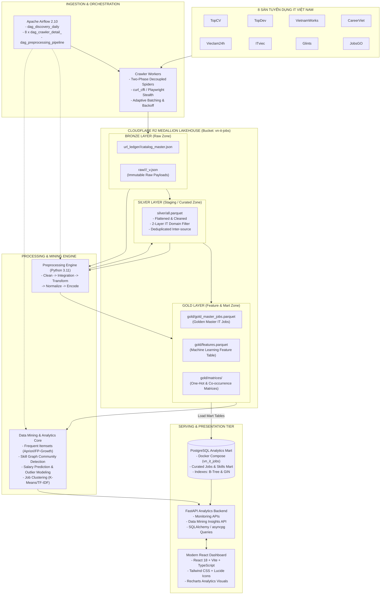
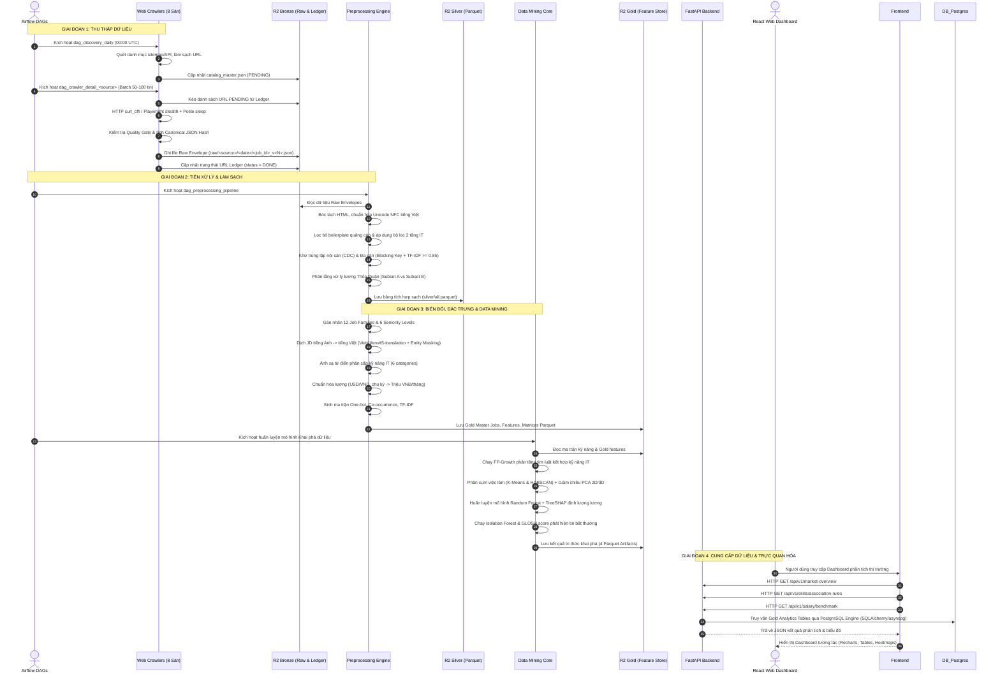

# KIẾN TRÚC TỔNG THỂ HỆ THỐNG LAKEHOUSE & PIPELINE
## MODULE 10: END-TO-END DATA ARCHITECTURE SPECIFICATION

> **Tài liệu đặc tả kiến trúc hệ thống (System Architecture Specification)**  
> **Dự án:** Phân tích thị trường việc làm IT Việt Nam (VN-IT-Job-Mining)  
> **Phiên bản:** 2.0 — Cập nhật: Tháng 11/2026  
> **Trạng thái:** Official Architectural Blueprint  
> **Công nghệ chủ đạo:** Cloudflare R2 Object Storage, Apache Airflow, PostgreSQL (Analytical Serving & Airflow DB), Polars/Pandas, Parquet, Scikit-learn, FastAPI, React + Tailwind CSS.

---

## 1. Tổng Quan Kiến Trúc Hệ Thống (System Architecture Overview)

Hệ thống **VN-IT-Job-Mining** được xây dựng nhằm giải quyết bài toán thu thập, xử lý và khai phá dữ liệu thị trường việc làm ngành Công nghệ Thông tin tại Việt Nam ở quy mô lớn. 

Hệ thống áp dụng kiến trúc **Medallion Lakehouse** hiện đại trên nền tảng **Cloudflare R2** (tương thích giao thức AWS S3 API nhưng không tính phí Egress Data Transfer), kết hợp mô hình điều phối tập trung **Apache Airflow**, động cơ tiền xử lý dữ liệu dạng bảng tốc độ cao, và kiến trúc phân phối dữ liệu đa tầng phục vụ khai phá tri thức (Data Mining) cùng bảng điều khiển giám sát thời gian thực.



---

## 2. Chi Tiết Các Tầng Dữ Liệu Medallion (Lakehouse Layers Breakdown)

Kiến trúc Medallion chia dữ liệu thành 3 tầng logic với mức độ tinh chế tăng dần:

```
+-----------------------------------------------------------------------------------+
| BRONZE (Raw Zone)    : JSON thô bất biến, giữ nguyên 100% DOM/API từ 8 sàn        |
+-----------------------------------------------------------------------------------+
                                         |
                                         v
+-----------------------------------------------------------------------------------+
| SILVER (Clean Zone)  : Parquet dạng bảng, unnest, lọc non-IT, khử trùng 2 tầng    |
+-----------------------------------------------------------------------------------+
                                         |
                                         v
+-----------------------------------------------------------------------------------+
| GOLD (Feature Store) : Golden Master Jobs, chuẩn hóa lương, ma trận kỹ năng       |
+-----------------------------------------------------------------------------------+
```

### 2.1. Tầng Bronze (Raw Data Lakehouse)
- **Vị trí lưu trữ:** `r2://vn-it-jobs/raw/<source>/<YYYY-MM-DD>/` và `r2://vn-it-jobs/url_ledger/<source>/`.
- **Định dạng:** JSON Encapsulation (`RawJobEnvelope`).
- **Đặc tính kỹ thuật:**
  - **Bất biến (Immutable):** Dữ liệu một khi đã ghi vào Bronze thì không bao giờ được cập nhật (No in-place updates). Mọi thay đổi nội dung trang web đều được ghi nhận bằng một file mới với phiên bản tăng dần (`_v2.json`, `_v3.json`) thông qua cơ chế CDC.
  - **Bảo toàn nguyên bản (Zero Information Loss):** Giữ nguyên cấu trúc phân cấp, toàn bộ các thẻ HTML, dữ liệu rác, lỗi chính tả, thuộc tính riêng biệt của từng sàn tuyển dụng.
  - **Quản lý danh bạ URL (URL Ledger):** File `catalog_master.json` quản lý trạng thái vòng đời của toàn bộ các liên kết từng được phát hiện (`PENDING`, `DONE`, `FAILED`, `CLOSED`, `RECHECK_DUE`).

### 2.2. Tầng Silver (Cleaned & Integrated Parquet)
- **Vị trí lưu trữ:** `r2://vn-it-jobs/silver/all.parquet` (hoặc `data/preprocessing/04_normalization/all.parquet`).
- **Định dạng:** Apache Parquet (Snappy Compression, Columnar Storage).
- **Đặc tính kỹ thuật:**
  - **Làm phẳng cấu trúc (Unnesting & Schema Mapping):** Trích xuất các trường từ cấu trúc JSON lồng nhau phức tạp của 8 sàn về một lược đồ chung chuẩn hóa (Canonical Target Schema).
  - **Làm sạch văn bản (Text Cleansing):** Bóc tách HTML bảo toàn danh sách, chuẩn hóa Unicode UTF-8 NFC, lọc bỏ các chuỗi quảng cáo boilerplate.
  - **Phân loại chuyên ngành (Domain IT Gatekeeper):** Sử dụng bộ luật 2 tầng loại bỏ triệt để các tin tuyển dụng không thuộc lĩnh vực IT.
  - **Khử trùng lặp đa nguồn (Inter-source Deduplication):** Sử dụng kỹ thuật phân khối Blocking Key kết hợp độ tương đồng văn bản TF-IDF Cosine ($\ge 0.85$) để liên kết các bài đăng cùng tuyển 1 vị trí giữa các sàn khác nhau thành một thực thể duy nhất.

### 2.3. Tầng Gold (Curated Marts & Feature Store)
- **Vị trí lưu trữ:** `r2://vn-it-jobs/gold/` (bao gồm `gold_master_jobs.parquet`, `features.parquet`, và thư mục ma trận `matrices/`).
- **Định dạng:** Apache Parquet và JSON metadata từ điển.
- **Đặc tính kỹ thuật:**
  - **Golden Master Jobs:** Dữ liệu hoàn chỉnh nhất của từng việc làm thực tế trên thị trường, đã được điền khuyết theo quy tắc hợp nhất uy tín, chuẩn hóa địa phương theo 34 tỉnh/thành phố sáp nhập mới.
  - **Gán nhãn nghiệp vụ (Business Tagging):** Phân loại vào 12 Job Family chuẩn và 6 cấp bậc Seniority.
  - **Chuẩn hóa mức lương (Salary Standardization):** Bóc tách dải lương, quy đổi ngoại tệ (USD $\rightarrow$ VND tỷ giá 25.400) về đơn vị duy nhất Triệu VNĐ/tháng.
  - **Ma trận khai phá dữ liệu (Mining Feature Matrices):** Sinh sẵn One-hot Matrix, Co-occurrence Matrix, và Vector Space TF-IDF để các mô hình Data Mining truy xuất với độ trễ thấp nhất.

---

## 3. Sơ Đồ Dòng Dữ Liệu Chi Tiết (End-to-End Data Flow)

Dưới đây là sơ đồ chi tiết luồng di chuyển của dữ liệu từ khi được quét trên Internet cho đến khi hiển thị biểu đồ phân tích trên giao diện người dùng:



---

## 4. Điều Phối Luồng Công Việc (Airflow Workflow Orchestration)

Toàn bộ hệ thống được tự động hóa thông qua hệ thống lập lịch **Apache Airflow 2.10**:

### 4.1. Kiến Trúc DAG Phân Tán Độc Lập
1. **`dag_discovery_daily`:**
   - Chạy hàng ngày vào lúc nửa đêm (00:00 UTC).
   - Lần lượt kích hoạt 8 task discovery tương ứng với 8 sàn: `discover_topcv`, `discover_topdev`, `discover_vietnamworks`, `discover_careerviet`, `discover_vieclam24h`, `discover_itviec`, `discover_glints`, `discover_jobsgo`.
   - Ghi nhận hàng nghìn liên kết mới vào file Ledger trên Cloudflare R2.
2. **8 x `dag_crawler_detail_<source>`:**
   - Mỗi sàn có 1 DAG chi tiết chạy theo ca độc lập (ví dụ: mỗi 2 tiếng một ca).
   - Sử dụng **Airflow Pool** riêng biệt (`pool_topcv`, `pool_itviec`...) với `concurrency = 1` để đảm bảo không có 2 ca cào cùng lúc vào một sàn gây quá tải hoặc xung đột file Ledger.
   - Tham số hóa: `--batch-size 75 --sync-r2`.
3. **`dag_preprocessing_pipeline`:**
   - Kích hoạt tuần tự 5 công đoạn xử lý dữ liệu:
     $$\text{Clean (P1)} \longrightarrow \text{Integration (P2)} \longrightarrow \text{Transformation (P3)} \longrightarrow \text{Normalization (P4)} \longrightarrow \text{Encoding (P5)}$$
   - Tự động kiểm tra chất lượng (Data Quality Assertions) sau mỗi bước; nếu tỷ lệ lỗi schema $> 2\%$, DAG sẽ ngắt mạch (Pipeline Stop) và gửi cảnh báo.
4. **`dag_data_mining_models`:**
   - Chạy định kỳ sau khi pipeline tiền xử lý hoàn tất.
   - Thực thi các notebook/script khai phá tri thức, trích xuất luật kết hợp và cập nhật báo cáo thị trường.

---

## 5. Tầng Phục Vụ Dữ Liệu & Giao Diện Người Dùng (Serving & UI)

### 5.1. Backend API Dữ Liệu Tốc Độ Cao (FastAPI & PostgreSQL Data Mart)
- **Tận dụng PostgreSQL Container cho Phân tích & Serving:**
  - Hệ thống tận dụng máy chủ **PostgreSQL** (chạy sẵn trong Docker Compose cùng Airflow) để tạo database phân tích `vn_it_jobs`. Dữ liệu sau khi xử lý thành công ở tầng Gold được nạp tự động (bulk load qua COPY hoặc SQLAlchemy) vào các bảng dữ liệu chuẩn hóa (`curated_jobs`, `job_skills`, `skill_rules`, `market_metrics`).
  - Thiết lập chỉ mục chuyên dụng: B-Tree Index cho `(domain, city, experience_level)` và GIN Index cho mảng kỹ năng `skills_array` giúp FastAPI thực thi các câu truy vấn phức tạp (Aggregation, Group by, Window functions) trong thời gian dưới 50ms.
- **RESTful Endpoints phục vụ:**
  - `/api/v1/overview`: Thống kê tổng số lượng việc làm, phân bổ theo nguồn, tỷ lệ tin tuyển dụng có lương.
  - `/api/v1/jobs/roles`: Phân tích nhu cầu tuyển dụng theo 12 Job Family và cấp bậc.
  - `/api/v1/skills/top`: Bảng xếp hạng các kỹ năng công nghệ được săn đón nhiều nhất.
  - `/api/v1/skills/rules`: Danh sách các luật kết hợp kỹ năng (Support, Confidence, Lift).
  - `/api/v1/salary/distribution`: Phân phối phổ lương theo công nghệ và số năm kinh nghiệm.
  - `/api/v1/monitoring/health`: Giám sát sức khỏe hạ tầng cào, số lượng bản ghi của 8 sàn.

### 5.2. Bảng Điều Khiển Trực Quan Hóa (React + Tailwind Dashboard)
- **Giao diện hiện đại:** Được xây dựng bằng React 18, Vite, TypeScript và Tailwind CSS với chế độ Dark/Light mode tối ưu cho hiển thị báo cáo khoa học.
- **Biểu đồ trực quan:** Sử dụng Recharts và Lucide Icons hiển thị:
  - Phễu chuyển đổi dữ liệu qua các tầng Medallion (Bronze $\rightarrow$ Silver $\rightarrow$ Gold).
  - Bản đồ nhiệt (Heatmap) ma trận đồng xuất hiện giữa các kỹ năng IT.
  - Biểu đồ phân bổ mức lương Boxplot & Violin Plot theo từng vị trí công việc.
  - Bản đồ địa lý phân bố việc làm IT giữa 34 tỉnh/thành phố tại Việt Nam.

---

## 6. Bảo Mật, Độ Tin Cậy & Quản Trị Hệ Thống (Governance & SLA)

### 6.1. Bảo Mật & Quản Lý Khóa Truy Cập
- **Cloudflare R2 Access:** Toàn bộ thông tin định danh `R2_ACCOUNT_ID`, `R2_ACCESS_KEY_ID`, `R2_SECRET_ACCESS_KEY` được bảo vệ nghiêm ngặt qua biến môi trường (`.env`), không bao giờ đưa vào mã nguồn Git.
- **Mã hóa đường truyền:** 100% kết nối giữa Crawlers, Airflow, R2 Storage và Web Backend đều được mã hóa bằng giao thức bảo mật cao nhất **TLS 1.3**.

### 6.2. Chỉ Số Đảm Bảo Chất Lượng (Service Level Indicators - SLI)

| Tiêu Chí Đánh Giá | Chỉ Số Mục Tiêu (SLA) | Cơ Chế Kiểm Soát |
|---|---|---|
| **Tỷ lệ cào thành công (Crawl Success Rate)** | $\ge 98.5\%$ | Tự động Safe Skip, Exponential Backoff và Retry Queue. |
| **Bảo toàn dữ liệu thô (Data Loss Prevention)** | $0\%$ thất thoát | Lưu trữ đa phiên bản (CDC Versioning) trên Cloudflare R2 Lakehouse. |
| **Độ chính xác lọc tin IT (IT Domain Precision)** | $\ge 96.0\%$ | Bộ lọc 2 tầng (Title Keywords + Context $\ge 2$ Skills). |
| **Độ chính xác khử trùng đa sàn (Inter-source Deduplication Precision)** | $\ge 92.0\%$ | Blocking Key kết hợp kiểm tra TF-IDF Cosine Similarity $\ge 0.85$. |
| **Thời gian phản hồi API (API Response Time)** | $P_{95} \le 150\text{ms}$ | Truy vấn tối ưu hóa bằng PostgreSQL Indexing (B-Tree + GIN). |
