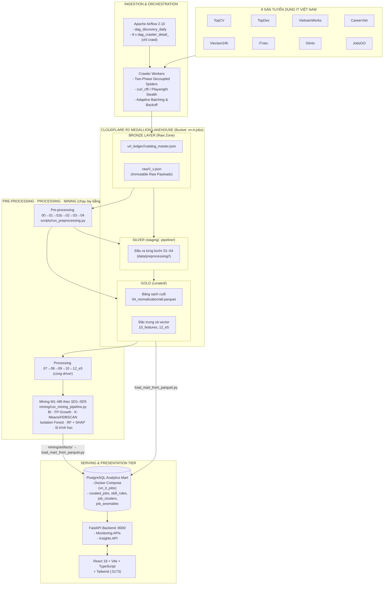

# KIẾN TRÚC TỔNG THỂ HỆ THỐNG LAKEHOUSE & PIPELINE
## MODULE 10: END-TO-END DATA ARCHITECTURE SPECIFICATION

> **Tài liệu đặc tả kiến trúc hệ thống (System Architecture Specification)**  
> **Dự án:** Phân tích thị trường việc làm IT Việt Nam (VN-IT-Job-Mining)  
> **Phiên bản:** 2.1 — Cập nhật: 17/11/2026 (đường dẫn theo spec 03, 05, 06, 07; Mining theo SD1–SD5; phần crawl giữ nguyên)  
> **Trạng thái:** Đã duyệt 17/11/2026 (chặng 5)  
> **Công nghệ chủ đạo:** Cloudflare R2 Object Storage, Apache Airflow, PostgreSQL (Analytical Serving & Airflow DB), Polars/Pandas, Parquet, Scikit-learn, FastAPI, React + Tailwind CSS.

---

## 1. Tổng Quan Kiến Trúc Hệ Thống (System Architecture Overview)

Hệ thống **VN-IT-Job-Mining** được xây dựng nhằm giải quyết bài toán thu thập, xử lý và khai phá dữ liệu thị trường việc làm ngành Công nghệ Thông tin tại Việt Nam ở quy mô lớn. 

Hệ thống áp dụng kiến trúc **Medallion Lakehouse** hiện đại trên nền tảng **Cloudflare R2** (tương thích giao thức AWS S3 API nhưng không tính phí Egress Data Transfer), kết hợp mô hình điều phối tập trung **Apache Airflow**, động cơ tiền xử lý dữ liệu dạng bảng tốc độ cao, và kiến trúc phân phối dữ liệu đa tầng phục vụ khai phá tri thức (Data Mining) cùng bảng điều khiển giám sát thời gian thực.



---

## 2. Chi Tiết Các Tầng Dữ Liệu Medallion (Lakehouse Layers Breakdown)

Kiến trúc Medallion chia dữ liệu thành 3 tầng logic với mức độ tinh chế tăng dần:

```
+-----------------------------------------------------------------------------------+
| BRONZE (Raw Zone)    : JSON thô bất biến, giữ nguyên 100% DOM/API từ 8 sàn        |
+-----------------------------------------------------------------------------------+
                                         |
                                         v
+-----------------------------------------------------------------------------------+
| SILVER (Clean Zone)  : đầu ra bước 01–03: lọc IT, khử trùng 3 tầng, làm phẳng      |
+-----------------------------------------------------------------------------------+
                                         |
                                         v
+-----------------------------------------------------------------------------------+
| GOLD (Curated)       : bảng sạch cuối (04), đặc trưng (10), vector e5 (12_e5)      |
+-----------------------------------------------------------------------------------+
```

### 2.1. Tầng Bronze (Raw Data Lakehouse)
- **Vị trí lưu trữ:** `r2://vn-it-jobs/raw/<source>/<YYYY-MM-DD>/` và `r2://vn-it-jobs/url_ledger/<source>/`.
- **Định dạng:** JSON Encapsulation (`RawJobEnvelope`).
- **Đặc tính kỹ thuật:**
  - **Bất biến (Immutable):** Dữ liệu một khi đã ghi vào Bronze thì không bao giờ được cập nhật (No in-place updates). Mọi thay đổi nội dung trang web đều được ghi nhận bằng một file mới với phiên bản tăng dần (`_v2.json`, `_v3.json`) thông qua cơ chế CDC.
  - **Bảo toàn nguyên bản (Zero Information Loss):** Giữ nguyên cấu trúc phân cấp, toàn bộ các thẻ HTML, dữ liệu rác, lỗi chính tả, thuộc tính riêng biệt của từng sàn tuyển dụng.
  - **Quản lý danh bạ URL (URL Ledger):** File `catalog_master.json` quản lý trạng thái vòng đời của toàn bộ các liên kết từng được phát hiện (`PENDING`, `DONE`, `FAILED`, `CLOSED`, `RECHECK_DUE`).

> **Nguồn sự thật cho đường dẫn trên máy:** [spec 03](03_data_mining_lifecycle.md) mục 3 (bảng các bước), [spec 05](05_preprocessing_spec.md) mục 2.2, [spec 06](06_processing_spec.md), [spec 07](07_mining_spec.md) mục 5. Pre-processing, Processing và Mining **ghi trên máy** (`data/preprocessing/<bước>/`, `data/processing/<bước>/`, `mining/artifacts/`); đẩy lên R2 là việc riêng, chạy thử trước và cần người dùng duyệt. Tên Silver/Gold dưới đây chỉ là cách gọi tầng.

### 2.2. Tầng Silver (đầu ra trung gian của Pre-processing)
- **Trên máy:** `data/preprocessing/01_clean/`, `01b_deduplication/`, `02_integration/all.parquet`, `03_transformation/all.parquet`. Report ở `reports/preprocessing/<bước>/`.
- **Trên R2:** `staging/` và `pipeline/<bước>/` (mục 2.4).
- **Định dạng:** JSONL theo nguồn ở bước 01, 01b; Parquet gộp 8 nguồn từ bước 02.
- **Nội dung:**
  - **Lọc IT** (bước 01): luật 2 tầng trên tiêu đề và kỹ năng; không dùng model.
  - **Khử trùng 3 tầng** (bước 01b): (`nguồn`, `job_id`); hash văn bản cùng công ty; MinHash/LSH sinh cặp ứng viên rồi Jaccard chính xác ≥ 0,85 và cùng `company_slug` (`docs/spec/preprocessing/01b_deduplication.md`).
  - **Làm phẳng** (bước 02): 8 nguồn về 18 trường chung.
  - **Làm sạch và parse** (bước 03): HTML, Unicode NFC, lương, kinh nghiệm, ngày; nhận ngôn ngữ (fastText `lid.176`) và dịch EN→VI (`VietAI/envit5-translation`).

### 2.3. Tầng Gold (bảng sạch, đặc trưng, kết quả Mining)
- **Bảng sạch cuối:** `data/preprocessing/04_normalization/all.parquet` (người dùng duyệt 17/11, spec 05 mục 4.1). Trên R2 đẩy vào `curated/preprocessing/` bằng `scripts/push_preprocessing_to_r2.py`. Tên cũ `curated/gold_master_jobs.parquet`, `data/curated/curated_flat_golden_jobs.parquet` không dùng nữa (PRE-39).
- **Nội dung bảng sạch:** `job_family` 10 nhóm + Other, `seniority` 5 nhãn, 34 tỉnh sau sáp nhập (`tinh_chinh`), lương VNĐ/tháng có cờ ngoại lai, `posted_month` thay `posted_date` (PRE-37; không có `posted_month_source`). Bảng target gọn tên tiếng Anh: `04_normalization/silver.parquet` (spec 05 mục 4.4). Thiếu dữ liệu xử lý bằng cờ, không điền giá trị (spec 05 mục 4.3).
- **Đặc trưng và vector** (Processing, spec 06): `data/processing/10_features/features.parquet` (cột `skill__*`, `fam__*`, `seniority_ord`…), `encoding_dictionary.json`, `data/processing/12_e5/job_emb.npz`. TF-IDF đã bỏ 17/11.
- **Kết quả Mining** (spec 07 mục 5): `mining/artifacts/` gồm `sd1_*.json` (đề xuất), `skill_association_rules.parquet`, `job_clusters.parquet`, `job_anomalies.parquet`, `skill_salary_shap_values.parquet`, `trained_salary_rf_model.joblib`, `sd5_*.json` (đề xuất), `mining_metrics.json`. Thư mục này không vào git và chưa có quy ước đẩy lên R2.

---

### 2.4. Tiền tố `pipeline/` (đầu ra từng bước)
- **Vị trí lưu trữ:** `r2://vn-it-jobs/pipeline/<bước>/`, không chia theo nguồn.
- **Nội dung:** đầu ra và báo cáo của từng bước tiền xử lý, để xem lại và chạy lại riêng một bước. Tên thư mục con theo bước chưa chốt.
- **Chốt 10/11/2026:** R2 chỉ còn 5 tiền tố `url_ledger/`, `raw/`, `staging/`, `curated/`, `pipeline/`. Tiền tố cũ `silver/`, `gold/` vẫn đọc được và được đổi sang `staging/`, `curated/` (`collection/common/r2_storage.py`). Tên file bên trong `staging/`, `curated/` (ví dụ `all.parquet`) chưa chốt, xem `fixes/F13_r2_layout.md`.

## 3. Sơ Đồ Dòng Dữ Liệu Chi Tiết (End-to-End Data Flow)

Dưới đây là sơ đồ chi tiết luồng di chuyển của dữ liệu từ khi được quét trên Internet cho đến khi hiển thị biểu đồ phân tích trên giao diện người dùng:

```mermaid
sequenceDiagram
    autonumber
    actor Scheduler as Airflow DAGs
    participant Crawler as Web Crawlers (8 Sàn)
    participant R2_Bronze as R2 Bronze (Raw & Ledger)
    participant Engine as Preprocessing Engine
    participant R2_Silver as R2 Silver (Parquet)
    participant Mining as Data Mining Core
    participant R2_Gold as R2 Gold (Feature Store)
    participant API as FastAPI Backend
    actor User as React Web Dashboard

    %% Ingestion Phase
    Note over Scheduler, Crawler: GIAI ĐOẠN 1: THU THẬP DỮ LIỆU
    Scheduler->>Crawler: Kích hoạt dag_discovery_daily (00:00 UTC)
    Crawler->>Crawler: Quét danh mục sitemap/API, làm sạch URL
    Crawler->>R2_Bronze: Cập nhật catalog_master.json (PENDING)
    
    Scheduler->>Crawler: Kích hoạt dag_crawler_detail_<source> (Batch 50-100 tin)
    Crawler->>R2_Bronze: Kéo danh sách URL PENDING từ Ledger
    Crawler->>Crawler: HTTP curl_cffi / Playwright stealth + Polite sleep
    Crawler->>Crawler: Kiểm tra Quality Gate & tính Canonical JSON Hash
    Crawler->>R2_Bronze: Ghi file Raw Envelope (raw/<source>/<date>/<job_id>_v<N>.json)
    Crawler->>R2_Bronze: Cập nhật trạng thái URL Ledger (status = DONE)

    %% Preprocessing Phase (chạy tay, không qua Airflow)
    Note over Scheduler, Engine: GIAI ĐOẠN 2: PRE-PROCESSING (scripts/run_preprocessing.py, spec 05)
    Engine->>R2_Bronze: Tải raw về máy (sync_cloud_lakehouse.py --download)
    Engine->>Engine: 01 lọc IT 2 tầng, chọn snapshot · 01b khử trùng 3 tầng (MinHash + Jaccard >= 0.85)
    Engine->>Engine: 02 làm phẳng 8 nguồn · 03 parse, nhận ngôn ngữ, dịch EN→VI (envit5)
    Engine->>Engine: 04 chuẩn hóa 10 nhóm nghề + Other, 5 cấp, 34 tỉnh; cờ thiếu và ngoại lai
    Engine->>Engine: Ghi data/preprocessing/04_normalization/all.parquet (bảng sạch)
    Engine-->>R2_Silver: (tùy chọn, dry-run trước, người dùng duyệt) push_preprocessing_to_r2.py

    %% Processing & Mining Phase
    Note over Engine, Mining: GIAI ĐOẠN 3–4: PROCESSING (spec 06) VÀ MINING (spec 07)
    Engine->>Engine: 07 tách section · 08 trích kỹ năng (taxonomy 230) · 09 tách từ
    Engine->>Engine: 10 đặc trưng (skill__*, fam__*, seniority_ord…) · 12_e5 embedding
    Mining->>Mining: M1 BI (SD1)
    Mining->>Mining: M2 FP-Growth theo nghề (SD2)
    Mining->>Mining: M3 K-Means k=10 + HDBSCAN, PCA (SD3) · M4 Isolation Forest + GLOSH: tin khác hoặc mới (SD3)
    Mining->>Mining: M5 Random Forest + SHAP: giá trị kỹ năng, lương ước tính (SD4)
    Mining->>Mining: M6 lộ trình học cho người mới (SD5)
    Mining->>Mining: Ghi mining/artifacts/ + mining_metrics.json

    %% Serving Phase
    Note over API, User: GIAI ĐOẠN 5: PHỤC VỤ & TRỰC QUAN HÓA (spec 09)
    Mining->>API: load_mart_from_parquet.py nạp Mart (curated_jobs, skill_rules, job_clusters, job_anomalies)
    User->>API: GET /api/v1/insights/salary-heatmap, /skill-combos, /clusters, /filters/options
    API-->>User: JSON; Mart rỗng thì EMPTY/NO_DATA, lỗi kết nối thì 503 MART_UNAVAILABLE
```

---

## 4. Điều Phối Luồng Công Việc (Airflow Workflow Orchestration)

Toàn bộ hệ thống được tự động hóa thông qua hệ thống lập lịch **Apache Airflow 2.10**:

### 4.1. Kiến Trúc DAG Phân Tán Độc Lập
1. **`dag_discovery_daily`:**
   - Chạy hàng ngày vào lúc nửa đêm (00:00 UTC).
   - Lần lượt kích hoạt 8 task discovery tương ứng với 8 sàn: `discover_topcv`, `discover_topdev`, `discover_vietnamworks`, `discover_careerviet`, `discover_vieclam24h`, `discover_itviec`, `discover_glints`, `discover_jobsgo`.
   - Ghi nhận hàng nghìn liên kết mới vào file Ledger trên Cloudflare R2.
2. **8 x `dag_crawler_detail_<source>`:**
   - Mỗi sàn có 1 DAG chi tiết chạy theo ca độc lập (ví dụ: mỗi 2 tiếng một ca).
   - Sử dụng **Airflow Pool** riêng biệt (`pool_topcv`, `pool_itviec`...) với `concurrency = 1` để đảm bảo không có 2 ca cào cùng lúc vào một sàn gây quá tải hoặc xung đột file Ledger.
   - Tham số hóa: `--batch-size 75 --sync-r2`.
3. **Pre-processing, Processing, Mining không chạy qua Airflow** (sửa 17/11/2026). `airflow/dags/` chỉ có `crawler_dags.py` (DAG discovery và DAG cào chi tiết). Thiết kế cũ có `dag_preprocessing_pipeline` (P1–P5) và `dag_data_mining_models`, nhưng chưa bao giờ được viết. Hiện chạy tay:
   - `python scripts/run_preprocessing.py --step all --source all` (chuỗi 00→04 rồi 07→12_e5; spec 05 mục 2.1, spec 06 mục 2.1). Bước `05_encoding` đã thay bằng bước 10 (PRE-39).
   - `python mining/run_mining_pipeline.py` (hiện `STEPS` = `fp, cluster, anomaly, salary`; đích là `bi, fp, cluster, anomaly, salary, recommend`, MINE-7).
   - Kiểm tra chất lượng nằm trong report từng bước (`checks`, luật bảo toàn số dòng), không phải ngưỡng ngắt mạch của DAG.

---

## 5. Tầng Phục Vụ Dữ Liệu & Giao Diện Người Dùng (Serving & UI)

### 5.1. Backend API Dữ Liệu Tốc Độ Cao (FastAPI & PostgreSQL Data Mart)
- **Tận dụng PostgreSQL Container cho Phân tích & Serving:**
  - Hệ thống tận dụng máy chủ **PostgreSQL** (chạy sẵn trong Docker Compose cùng Airflow) để tạo database phân tích `vn_it_jobs`. Mart được nạp **bằng tay** qua `scripts/load_mart_from_parquet.py` (`--dry-run` trước) vào 4 bảng: `curated_jobs`, `skill_rules`, `job_clusters`, `job_anomalies` (spec 09 mục 4.3).
  - Chỉ mục: B-Tree trên `job_family`, `seniority_level`, `province_norm`, `lift`; GIN trên `skills_array`, `antecedents`.
  - Chưa có bảng cho SHAP (SD4, MINE-5), cho SD1 (`sd1_*.json`) và SD5 (`sd5_*.json`).
- **Endpoints:** danh sách đúng với code ở spec 09 mục 4.1. Các endpoint `/api/v1/overview`, `/jobs/roles`, `/skills/top`, `/salary/distribution` trong bản 2.0 chưa bao giờ có.

### 5.2. Giao diện (React + Tailwind)
- React 18, Vite, TypeScript, Tailwind CSS (token màu và quy tắc 390px trong `monitoring/CLAUDE.md`).
- Route đang gắn (leader chốt 09/11/2026): `/` Collection, `/eda`, `/preprocessing`, `/processing`. Trang Insights theo SD1–SD5 là đề xuất ở spec 09 mục 3.2.

---

## 6. Bảo Mật, Độ Tin Cậy & Quản Trị Hệ Thống (Governance & SLA)

### 6.1. Bảo Mật & Quản Lý Khóa Truy Cập
- **Cloudflare R2 Access:** Toàn bộ thông tin định danh `R2_ACCOUNT_ID`, `R2_ACCESS_KEY_ID`, `R2_SECRET_ACCESS_KEY` được bảo vệ nghiêm ngặt qua biến môi trường (`.env`), không bao giờ đưa vào mã nguồn Git.
- **Mã hóa đường truyền:** 100% kết nối giữa Crawlers, Airflow, R2 Storage và Web Backend đều được mã hóa bằng giao thức bảo mật cao nhất **TLS 1.3**.

### 6.2. Chỉ Số Đảm Bảo Chất Lượng (Service Level Indicators - SLI)

| Tiêu Chí Đánh Giá | Chỉ Số Mục Tiêu (SLA) | Cơ Chế Kiểm Soát |
|---|---|---|
| **Tỷ lệ cào thành công (Crawl Success Rate)** | $\ge 98.5\%$ | Tự động Safe Skip, Exponential Backoff và Retry Queue. |
| **Bảo toàn dữ liệu thô (Data Loss Prevention)** | $0\%$ thất thoát | Lưu trữ đa phiên bản (CDC Versioning) trên Cloudflare R2 Lakehouse. |
| **Độ chính xác lọc tin IT (IT Domain Precision)** | Chưa chốt, chưa đo (PRE-12) | Bộ lọc 2 tầng (bước 01); đo bằng nhãn tay `data/preprocessing/review/it_<nguồn>.csv`. |
| **Độ chính xác khử trùng đa sàn** | Chưa chốt, chưa đo | Bước 01b: MinHash/LSH + Jaccard chính xác $\ge 0.85$ và cùng `company_slug`; kiểm tay `duplicates_audit.csv`. |

Ngưỡng chất lượng dữ liệu phục vụ 5 mục tiêu nằm ở [spec 08](08_evaluation_spec.md) và PRE-36; bảng trên chỉ giữ chỉ số vận hành. Hai con số 96% và 92% trong bản 2.0 không có số đo đi kèm nên đã bỏ.
| **Thời gian phản hồi API (API Response Time)** | $P_{95} \le 150\text{ms}$ | Truy vấn tối ưu hóa bằng PostgreSQL Indexing (B-Tree + GIN). |
