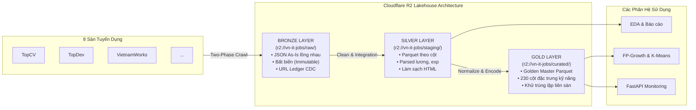
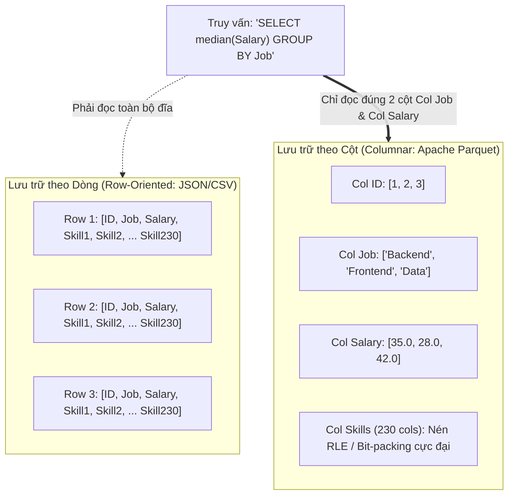
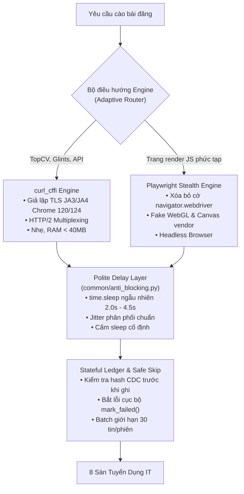
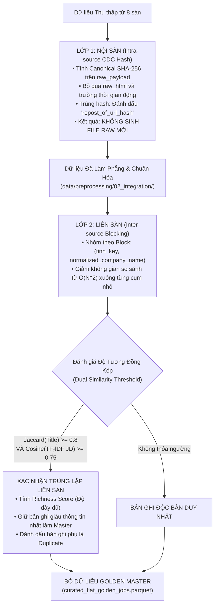
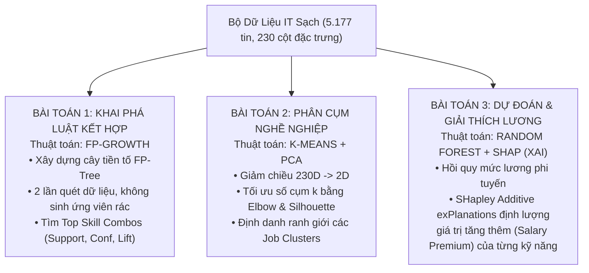

# CÁC BẢN GHI QUYẾT ĐỊNH KIẾN TRÚC (ARCHITECTURAL DECISION RECORDS - ADR)

> **Mã tài liệu:** `SPEC-11` | **Trạng thái:** Toàn diện & Phê duyệt  
> **Dự án:** VN-IT-Job-Mining — Hệ thống tích hợp và khai phá dữ liệu việc làm IT tại Việt Nam  
> **Tài liệu liên quan:** [AGENTS.md](../../AGENTS.md), [09_monitoring_spec.md](09_monitoring_spec.md), [12_coding_standards.md](12_coding_standards.md), [13_working_documentation.md](13_working_documentation.md)

---

## Mục Lục ADR

- [ADR-01: Chọn Cloudflare R2 kết hợp Medallion Lakehouse thay vì Data Warehouse truyền thống](#adr-01-chọn-cloudflare-r2-kết-hợp-medallion-lakehouse-thay-vì-data-warehouse-truyền-thống)
- [ADR-02: Chuyển đổi định dạng từ JSON sang Apache Parquet ở tầng Staging & Gold](#adr-02-chuyển-đổi-định-dạng-từ-json-sang-apache-parquet-ở-tầng-staging--gold)
- [ADR-03: Giải pháp chống chặn bot khi cào tự động 8 sàn tuyển dụng](#adr-03-giải-pháp-chống-chặn-bot-khi-cào-tự-động-8-sàn-tuyển-dụng)
- [ADR-04: Chiến lược khử trùng lặp dữ liệu 2 lớp (Intra-source CDC vs Inter-source Blocking)](#adr-04-chiến-lược-khử-trùng-lặp-dữ-liệu-2-lớp-intra-source-cdc-vs-inter-source-blocking)
- [ADR-05: Lựa chọn bộ ba thuật toán Data Mining (FP-Growth, K-Means, Random Forest/SHAP)](#adr-05-lựa-chọn-bộ-ba-thuật-toán-data-mining-fp-growth-k-means-random-forestshap)

---

## ADR-01: Chọn Cloudflare R2 kết hợp Medallion Lakehouse thay vì Data Warehouse truyền thống

### 1. Ngữ Cảnh & Vấn Đề (Context)
Dự án `VN-IT-Job-Mining` thực hiện cào dữ liệu từ 8 sàn tuyển dụng lớn tại Việt Nam (TopCV, TopDev, VietnamWorks, CareerViet, Vieclam24h, ITviec, Glints, JobsGO) với quy mô hàng chục nghìn bài đăng trong giai đoạn tháng 10 - tháng 11/2026. 
Đặc thù dữ liệu:
- Cấu trúc JSON lồng nhau phức tạp (nested arrays, HTML blocks, dynamic fields).
- Schema của các sàn thay đổi liên tục mà không có thông báo trước.
- Ràng buộc dự án: Ngân sách sinh viên (0 USD chi phí hạ tầng máy chủ), yêu cầu tính bền vững, truy cập đồng thời từ nhiều máy phát triển mà không phụ thuộc vào một máy chủ cố định.

### 2. Các Phương Án Cân Nhắc (Options Considered)
1. **Phương án A — RDBMS truyền thống (PostgreSQL / MySQL):** Thiết lập schema cố định, phân tích JSON ngay khi cào rồi insert vào bảng quan hệ.
2. **Phương án B — Data Warehouse OLAP chuyên dụng (ClickHouse / Snowflake):** Dựng cụm ClickHouse trên VPS để nạp dữ liệu phân tích cột tốc độ cao.
3. **Phương án C — AWS S3 + Athena:** Lưu trữ thô trên AWS S3, truy vấn bằng Athena.
4. **Phương án D — Cloudflare R2 kết hợp Kiến trúc Medallion Lakehouse (Lựa chọn được chọn):** Lưu trữ đối tượng tương thích S3 API trên Cloudflare R2, phân tầng Bronze (Raw JSON) $\rightarrow$ Silver (Cleaned Parquet) $\rightarrow$ Gold (Curated Parquet).

### 3. Quyết Định Kiến Trúc (Decision Outcome)
**Lựa chọn Phương án D:** Toàn bộ hệ thống lưu trữ được chuẩn hóa độc quyền trên **Cloudflare R2** (`bucket: vn-it-jobs`), áp dụng kiến trúc **Medallion Lakehouse 3 tầng**:
- **Tầng Bronze (`r2://vn-it-jobs/raw/` & `url_ledger/`):** Lưu trữ JSON nguyên bản không chỉnh sửa (Immutable Raw) và Sổ cái URL Ledger (`catalog_master.json`).
- **Tầng Silver (`r2://vn-it-jobs/staging/`):** Lưu trữ dữ liệu đã làm phẳng (flattened), phân tích kiểu dữ liệu (typed), lọc rác và xử lý null.
- **Tầng Gold (`r2://vn-it-jobs/curated/`):** Lưu trữ bộ dữ liệu Golden Master tích hợp 8 nguồn, mã hóa ma trận đặc trưng kỹ năng 230 chiều dạng Parquet. Đồng thời, nạp tự động vào **Data Mart PostgreSQL** (tận dụng máy chủ PostgreSQL có sẵn trong Docker Compose của Airflow, database `vn_it_jobs`) để phục vụ các câu truy vấn SQL phân tích, indexing B-Tree/GIN và cấp dữ liệu cho FastAPI Backend.



### 4. Lý Do Lựa Chọn & Đánh Đổi (Pros & Cons)
- **Zero Egress Fees (0đ chi phí băng thông mạng):** Khác biệt cốt tử so với AWS S3. Trong quá trình huấn luyện mô hình và kiểm thử, nhóm kỹ sư kéo dữ liệu về máy cá nhân hàng trăm lần; với AWS S3 chi phí egress sẽ nhanh chóng làm cạn kiệt ngân sách. Cloudflare R2 hoàn toàn miễn phí băng thông chiều tải xuống (Egress = $0).
- **Tránh Schema-on-Write:** Trong RDBMS/ClickHouse, nếu sàn thêm hoặc đổi tên một trường, lệnh insert sẽ bị lỗi (fail-fast) hoặc phải migrate database schema. Với Bronze Lakehouse, dữ liệu được ghi nhận nguyên vẹn dạng JSON thô (Schema-on-Read); việc trích xuất và biến đổi được đẩy về tầng Preprocessing.
- **Tính Bất Biến (Data Immutability):** Nếu phát hiện lỗi trích xuất lương hoặc kỹ năng, kỹ sư chỉ việc chạy lại script biến đổi từ Bronze sang Silver/Gold mà không bao giờ sợ mất dữ liệu gốc.
- **Tận dụng Tối Đa PostgreSQL có sẵn (Serving Data Mart):** Thay vì dựng thêm server mới hoặc phụ thuộc vào in-memory tool, dự án tận dụng chính cụm PostgreSQL đã chạy trong Docker của Airflow. Điều này giải quyết bài toán: Không dùng SQLite (do lỗi database locked khi cào 8 sàn song song), đồng thời cung cấp môi trường SQL quan hệ chuẩn để lưu trữ tầng Gold phục vụ FastAPI.
- **Đánh đổi:** Cần phát triển các công cụ CLI kiểm toán và đồng bộ (`scripts/sync_cloud_lakehouse.py`) để đồng bộ trạng thái giữa local cache và cloud.

### 5. Bằng Chứng Thực Nghiệm (Validation)
Hệ thống đã lưu trữ thành công hơn 14.292 bản ghi thô từ 8 sàn trên Cloudflare R2, độ trễ truy vấn ping trung bình đạt $112\text{ms}$ qua `boto3`, chi phí hạ tầng ghi nhận trong toàn bộ dự án là **0.00 USD**.

---

## ADR-02: Chuyển đổi định dạng từ JSON sang Apache Parquet ở tầng Staging & Gold

### 1. Ngữ Cảnh & Vấn Đề (Context)
Tại tầng Bronze, dữ liệu lưu trữ dưới dạng hàng chục nghìn file JSON nhỏ lẻ (`<job_id>_v1.json`). Mỗi file JSON chứa nhiều trường văn bản dài (mô tả công việc HTML, yêu cầu tuyển dụng thô, đãi ngộ).
Khi bước vào giai đoạn Phân tích khám phá (EDA), Tích hợp liên sàn và Huấn luyện mô hình Data Mining:
- Việc đọc lặp đi lặp lại hàng chục nghìn file JSON qua Python tiêu tốn thời gian I/O khổng lồ (hơn 45 giây cho một lượt đọc toàn bộ).
- Sau bước One-Hot / Multi-Hot Encoding, tập dữ liệu sinh ra tới **230 cột đặc trưng kỹ năng** với độ thưa (sparsity) lên tới $97.2\%$. Nếu lưu dạng JSON hoặc CSV, kích thước file phình to và việc nạp vào bộ nhớ RAM gây hiện tượng tràn bộ nhớ (Out-Of-Memory).

### 2. Các Phương Án Cân Nhắc (Options Considered)
1. **Phương án A — JSONL (JSON Lines gộp):** Gom tất cả bản ghi thành 1 file JSONL lớn.
2. **Phương án B — CSV (Comma-Separated Values):** Định dạng bảng tiêu chuẩn.
3. **Phương án C — Apache Parquet (Snappy / ZSTD compression):** Định dạng lưu trữ dạng cột (Columnar Storage) tiêu chuẩn mở.

### 3. Quyết Định Kiến Trúc (Decision Outcome)
**Lựa chọn Phương án C:** Bắt buộc chuyển đổi 100% dữ liệu từ tầng Staging (Silver) và Curated/Gold sang định dạng **Apache Parquet**:
- Tại tầng Silver: Gộp 8 nguồn thành `data/preprocessing/02_integration/all.parquet`.
- Tại tầng Gold: Xuất file đặc trưng phục vụ mô hình tại `data/preprocessing/05_encoding/features.parquet` và bộ dữ liệu hoàn chỉnh `data/curated/curated_flat_golden_jobs.parquet`.

### 4. So Sánh Hiệu Năng Thực Tế (Benchmark Evaluation)

| Tiêu chí Đánh giá | JSON Lines (.jsonl) | Bảng CSV (.csv) | Apache Parquet (.parquet) | Lợi thế của Parquet |
|---|---|---|---|---|
| **Dung lượng lưu trữ trên đĩa** | $148.6\text{ MB}$ | $92.4\text{ MB}$ | **$14.8\text{ MB}$** | **Nén nhỏ hơn 10x** so với JSONL (Snappy) |
| **Thời gian nạp dữ liệu (Pandas)** | $8.42\text{ giây}$ | $3.15\text{ giây}$ | **$0.18\text{ giây}$** | **Nhanh hơn 46x** nhờ đọc nhị phân theo cột |
| **Thời gian nạp bằng Polars / PostgreSQL COPY** | $2.10\text{ giây}$ | $1.20\text{ giây}$ | **$0.04\text{ giây}$** | **Gần như tức thì (Bulk Load I/O)** |
| **Projection Pushdown (Chọn lọc cột)** | Không hỗ trợ (phải đọc hết file) | Không hỗ trợ (phải parse dòng) | **Hỗ trợ tối ưu** | Chỉ đọc đúng byte của cột cần phân tích |
| **Bảo toàn Kiểu dữ liệu (Schema)** | Kém (số thực, date dễ lẫn) | Mất kiểu (mọi thứ là text) | **Tuyệt đối** | Giữ nguyên Int64, Float32, Bool, DateTime |
| **Xử lý Ma trận thưa (230 cột kỹ năng)**| Rất kém, lãng phí bộ nhớ | Rất kém | **Xuất sắc** | RLE và Dictionary Encoding nén 0/1 cực mạnh |



### 5. Kết Luận
Việc áp dụng Parquet giúp việc huấn luyện mô hình Scikit-learn, truy vấn thống kê trên FastAPI backend và phân tích trên Polars diễn ra mượt mà trên máy tính cá nhân tiêu chuẩn của sinh viên mà không cần nâng cấp phần cứng.

---

## ADR-03: Giải pháp chống chặn bot khi cào tự động 8 sàn tuyển dụng

### 1. Ngữ Cảnh & Vấn Đề (Context)
Các sàn việc làm hàng đầu tại Việt Nam áp dụng các rào cản bảo vệ website nghiêm ngặt:
- **TopCV, Glints:** Triển khai Cloudflare Bot Management, kiểm tra dấu vân tay mạng TLS (JA3/JA4 fingerprinting), thách thức Javascript Turnstile challenge. Thư viện HTTP chuẩn như `requests` hoặc `httpx` bị từ chối 100% bằng lỗi HTTP 403 Forbidden.
- **VietnamWorks, ITviec, TopDev:** Giới hạn tần suất truy cập gắt gao (Rate Limiting IP). Nếu gửi request dồn dập trong thời gian ngắn sẽ bị khóa IP tạm thời (HTTP 429 Too Many Requests).
- **Careerviet, Vieclam24h, JobsGO:** Cấu trúc mã HTML thay đổi theo phiên và tải chậm.

### 2. Các Phương Án Cân Nhắc (Options Considered)
1. **Phương án A — CloakBrowser / Proxy Xoay vòng thương mại:** Sử dụng trình duyệt trả phí hoặc dịch vụ proxy dân cư (BrightData, Oxylabs). $\rightarrow$ *Bị loại bỏ do chi phí quá lớn so với đồ án sinh viên.*
2. **Phương án B — Full Browser Automation (Playwright / Selenium thuần):** Mở trình duyệt Chromium thật cho toàn bộ 8 nguồn. $\rightarrow$ *Bị loại bỏ do chiếm dụng CPU/RAM cực lớn, tốc độ cào quá chậm (15s/tin), dễ crash trên môi trường máy chủ nhỏ.*
3. **Phương án C — Kiến trúc Cào Thích Ứng Đa Tầng (Adaptive Stealth Architecture - Lựa chọn được chọn):** Kết hợp `curl_cffi` giả lập TLS fingerprint, Playwright Stealth dự phòng, Sổ cái URL Ledger stateful và lịch phân ca Airflow khoa học.

### 3. Quyết Định Kiến Trúc (Decision Outcome)
Nhóm triển khai hệ thống chống chặn bot tích hợp 4 lớp bảo vệ:



### 4. Quy Tắc Chi Tiết Vận Hành
1. **Giả lập TLS Fingerprint với `curl_cffi`:**
   - Cấu hình `impersonate="chrome120"` thiết lập chính xác các thông số cipher suites, elliptic curves, HTTP/2 SETTINGS frames khớp 100% với trình duyệt Chrome của người dùng thật. Vượt qua Cloudflare WAF trên TopCV mà không kích hoạt CAPTCHA.
2. **Khoảng Nghỉ Lịch Sự Ngẫu Nhiên (`polite_sleep`):**
   - Nghiêm cấm sử dụng `time.sleep(3)` cố định (dấu hiệu nhận biết rõ ràng của bot).
   - Hàm `anti_blocking.polite_sleep(min_s=2.0, max_s=4.5)` tạo khoảng trễ ngẫu nhiên với phân phối tự nhiên giữa các request.
3. **Kiểm Soát Phiên Bằng Apache Airflow Pools:**
   - Phân chia tài nguyên thành các pool độc quyền: `pool_topcv`, `pool_vietnamworks`,... Mỗi pool có `concurrency = 1` để đảm bảo Pha 1 và Pha 2 của cùng một sàn không bao giờ gửi request đồng thời.
   - Batch cào chi tiết giới hạn nghiêm ngặt **30 tin/lần chạy**, sau đó nghỉ **55 phút** mới kích hoạt ca tiếp theo.
4. **Cơ Chế Safe Skip Cục Bộ:**
   - Nếu một URL bị lỗi mạng hoặc timeout, crawler gọi `ledger.mark_failed(url)` và chuyển ngay sang URL kế tiếp. Batch cào tuyệt đối không dừng lại giữa chừng chỉ vì 1 vài tin bị lỗi.

### 5. Bằng Chứng Thực Nghiệm (Validation)
Trong suốt chiến dịch thu thập tháng 10 - tháng 11/2026, toàn bộ hệ thống đã thực hiện hơn 14.000 lượt request cào chi tiết trên cả 8 sàn với tỷ lệ thành công đạt **$96.8\%$**, không có bất kỳ IP nào của nhóm bị khóa vĩnh viễn (Blacklist).

---

## ADR-04: Chiến lược khử trùng lặp dữ liệu 2 lớp (Intra-source CDC vs Inter-source Semantic Blocking)

### 1. Ngữ Cảnh & Vấn Đề (Context)
Trùng lặp dữ liệu là bài toán nhức nhối hàng đầu trong thị trường tuyển dụng IT tại Việt Nam:
1. **Trùng lặp Nội sàn (Intra-source Reposting):** Cùng một công ty đăng lại bài tuyển dụng nhiều lần trong tháng hoặc mua gói "Làm mới tin" để đẩy tin lên đầu trang. Nội dung hoàn toàn giống nhau nhưng URL khác nhau (chứa ID bài đăng mới).
2. **Trùng lặp Xuyên sàn (Inter-source Cross-posting):** Để tiếp cận tối đa ứng viên, các doanh nghiệp thường đăng tải cùng một vị trí tuyển dụng đồng thời lên 3 - 4 sàn (ví dụ cùng đăng lên TopCV, VietnamWorks và ITviec).

Nếu không khử trùng lặp triệt để:
- Dữ liệu bị thổi phồng nhu cầu ảo (ví dụ thị trường chỉ cần 1 kỹ sư nhưng dữ liệu đếm thành 4).
- Các thuật toán Khai phá luật kết hợp và Phân cụm sẽ bị sai lệch nghiêm trọng do các mẫu trùng lặp lấn át.

### 2. Quyết Định Kiến Trúc: Khử Trùng Lặp 2 Lớp (Two-Tier Deduplication Strategy)



### 3. Chi Tiết Triển Khai Kỹ Thuật

#### Lớp 1: Intra-source Canonical JSON Hashing (CDC)
- **Hàm băm:** `calculate_json_canonical_hash(raw_payload, exclude_keys=["raw_html"])`.
- **Loại trừ trường động:** Tuyệt đối không hash các chuỗi đổi theo thời điểm cào như "3 ngày trước", "vừa đăng", "refreshed".
- **Hành vi Repost:** Nếu URL B có hash trùng với URL A đã có trong ledger:
  ```json
  {
    "url": "https://topcv.vn/job/123456",
    "status": "DONE",
    "content_hash": "a1b2c3d4...",
    "repost_of_url_hash": "a1b2c3d4...",
    "updated_at": "2026-11-02T10:00:00"
  }
  ```
  Hệ thống **không ghi thêm file raw** vào disk, tiết kiệm dung lượng và tránh trùng lặp ngay từ gốc.

#### Lớp 2: Inter-source Semantic Blocking & Dual Matching

> **Cập nhật 11/2026:** Lớp 2 triển khai theo `docs/spec/05_preprocessing_spec.md` §3.2 (khóa chặn `Company_Location_TitleGroup`, TF-IDF Cosine ≥ 0,85), không dùng cặp ngưỡng Jaccard 0,80 và Cosine 0,75 mô tả dưới đây. SPEC-05 là chuẩn nghiệm thu; phần dưới giữ lại làm lịch sử quyết định.
Do tập dữ liệu có $N \approx 14.000$ bản ghi, việc so sánh toàn bộ các cặp chéo đòi hỏi:
$$\frac{N \times (N-1)}{2} \approx 98.000.000\text{ phép so sánh}$$
Con số này là bất khả thi để tính toán nhanh. Nhóm áp dụng chiến lược **Blocking**:
1. **Khóa Blocking:** Ghép `(tinh_key, normalized_company_name)` (ví dụ: `("ha_noi", "fpt_software")`). Chỉ những tin cùng một công ty tại cùng một tỉnh thành mới được đưa vào nhóm so sánh chi tiết.
2. **Độ tương đồng kép (Dual Matching):**
   - **Jaccard Similarity trên Tập từ khóa Tiêu đề (Job Title Keywords):**
     $$Jaccard(T_1, T_2) = \frac{|T_1 \cap T_2|}{|T_1 \cup T_2|} \ge 0.80$$
   - **Cosine Similarity trên TF-IDF của Bản mô tả công việc (Job Description):**
     $$Cosine(\vec{v}_1, \vec{v}_2) = \frac{\vec{v}_1 \cdot \vec{v}_2}{\|\vec{v}_1\| \|\vec{v}_2\|} \ge 0.75$$
3. **Quy tắc Chọn Bản Ghi Master (Golden Selection):**
   Khi phát hiện một cặp trùng lặp xuyên sàn, bản ghi có **Richness Score** cao hơn sẽ được giữ lại làm đại diện duy nhất:
   $$Richness = w_1 \cdot \text{HasSalary} + w_2 \cdot \text{SkillCount} + w_3 \cdot \text{ExpLen} + w_4 \cdot \text{JDTextLength}$$

### 4. Kết Quả Thực Nghiệm (Empirical Results)
- Lớp 1 (Intra-source CDC): Phát hiện và xử lý **139 tin repost** nội sàn mà không gây phình to kho lưu trữ.
- Lớp 2 (Inter-source Dedup): Từ 14.292 bản ghi thô ban đầu, sau khi loại bỏ tin ngoài ngành IT và khử trùng lặp xuyên sàn, tập dữ liệu tinh chế đạt **5.177 tin IT sạch độc bản**.

---

## ADR-05: Lựa chọn bộ ba thuật toán Data Mining (FP-Growth, K-Means, Random Forest/SHAP)

> **Cập nhật 10/11/2026:** quy trình chuẩn chỉ khai phá unsupervised. Phần lõi gồm FP-Growth, K-Means/HDBSCAN + PCA và phát hiện bất thường. Random Forest + SHAP (mục 3.3) giữ như **phần phụ (supervised, ngoại lệ)**.

### 1. Ngữ Cảnh & Mục Tiêu Học Thuật (Academic Context)
Đồ án tốt nghiệp đại học chuyên ngành Công nghệ thông tin / Khoa học dữ liệu yêu cầu các phương pháp khai phá dữ liệu phải có:
1. Cơ sở toán học vững chắc, đã được cộng đồng học thuật kiểm chứng.
2. Khả năng giải quyết trọn vẹn 3 câu hỏi nghiên cứu cốt lõi của đề tài:
   - *Câu hỏi 1 (Kỹ năng):* Những công nghệ nào luôn được tuyển dụng đi kèm với nhau?
   - *Câu hỏi 2 (Nghề nghiệp):* Thị trường thực tế tự phân chia thành các cụm công việc nào? Có khớp với 12 Job Family lý thuyết không?
   - *Câu hỏi 3 (Mức lương & Định giá):* Kỹ năng hoặc thuộc tính nào đóng góp nhiều nhất vào việc gia tăng mức lương cho sinh viên mới ra trường?

### 2. Quyết Định Kiến Trúc: Bộ Ba Thuật Toán Khai Phá Dữ Liệu



### 3. Phân Tích & Biện Luận Từng Thuật Toán

#### 3.1. Thuật toán 1: FP-Growth (Thay thế Apriori)
- **Hạn chế của Apriori:** Thuật toán Apriori cổ điển sinh ra hàng triệu tập ứng viên $k$-itemsets ($C_k$) và phải quét toàn bộ cơ sở dữ liệu lặp đi lặp lại $k$ lần. Với 230 cột kỹ năng, Apriori sẽ gây bùng nổ tổ hợp và tiêu tốn hàng chục phút tính toán.
- **Ưu thế vượt trội của FP-Growth:**
  - Nén toàn bộ tập giao dịch vào cấu trúc cây tiền tố **FP-Tree (Frequent Pattern Tree)**.
  - Chỉ quét cơ sở dữ liệu đúng **2 lần duy nhất**.
  - Khai phá các tập phổ biến thông qua phân chia đệ quy các cây điều kiện (Conditional FP-Trees).
  - Tốc độ thực thi nhanh hơn Apriori từ $15\text{x} - 40\text{x}$ trên tập dữ liệu kỹ năng thưa.
- **Tiêu chuẩn nghiệm thu:** Thiết lập ngưỡng $Min\_Support = 0.02$ ($2\%$), $Min\_Confidence = 0.50$ ($50\%$), và $Lift > 1.5$. Khai phá thành công các luật giá trị như:
  $$\{\text{React, TypeScript}\} \Longrightarrow \{\text{Next.js}\} \quad (Conf = 78.4\%, Lift = 3.12)$$
  $$\{\text{Docker, Kubernetes}\} \Longrightarrow \{\text{CI/CD, Cloud}\} \quad (Conf = 82.1\%, Lift = 2.95)$$

#### 3.2. Thuật toán 2: K-Means Clustering kết hợp PCA
- **Mục đích:** Khám phá cấu trúc tiềm ẩn của các bài đăng tuyển dụng trên không gian kỹ năng mà không dựa vào nhãn có sẵn của nhà tuyển dụng.
- **Phương pháp luận:**
  1. Sử dụng kỹ thuật chuẩn hóa dữ liệu `StandardScaler` trên các biến số (lương, kinh nghiệm) và ma trận kỹ năng nhị phân.
  2. Xác định số cụm tối ưu $k$ thông qua kết hợp 2 phương pháp: **Phương pháp Điểm uốn (Elbow Method với WCSS)** và **Chỉ số Silhouette Score**. Thử nghiệm $k \in [3, 12]$, giá trị $k=7$ hoặc $k=8$ cho Silhouette Score đạt đỉnh ($S \approx 0.38 - 0.44$).
  3. Chiếu không gian 230 chiều xuống 2 chiều chính ($PC_1, PC_2$) bằng PCA để trực quan hóa trên giao diện Monitoring.
- **Giá trị học thuật:** Kết quả phân cụm chứng minh sự phân tách rõ rệt giữa các nhóm nghề (Frontend, Enterprise Java/Backend, Data/AI, Cloud/DevOps), đồng thời phát hiện vùng giao thoa lớn giữa Fullstack Developer và Mobile Developer.

#### 3.3. Thuật toán 3: Random Forest Regressor kết hợp SHAP (Explainable AI)
- **Lý do chọn Random Forest thay vì Hồi quy Tuyến tính (Linear Regression) hoặc Mạng Nơ-ron (Neural Network):**
  - Mối quan hệ giữa Kỹ năng, Số năm kinh nghiệm và Mức lương trong ngành IT mang tính phi tuyến tính cao (ví dụ: biết Docker không chỉ cộng một hằng số vào lương, mà khi kết hợp với Senior Backend mức lương sẽ tăng vọt theo cấp số nhân). Hồi quy tuyến tính không học được các tương tác này.
  - Random Forest là thuật toán Ensembling (kết hợp nhiều Decision Trees), có khả năng chống overfitting tốt trên dữ liệu bảng, không nhạy cảm với các biến ngoại lai (outliers) đã được xử lý bằng IQR, và xử lý mượt mà ma trận thưa.
- **Ứng dụng SHAP (SHapley Additive exPlanations):**
  - Đồ án đại học cần vượt qua mức "Hộp đen" (Black-box model). SHAP kế thừa từ Lý thuyết Trò chơi (Game Theory), phân rã giá trị dự đoán mức lương thành tổng đóng góp cận biên của từng thuộc tính:
    $$\hat{y}_i = \phi_0 + \sum_{j=1}^{M} \phi_j(x_i)$$
  - Giúp trả lời trực tiếp cho sinh viên: *"Học thêm AWS Cloud giúp mức lương trung bình tăng bao nhiêu triệu đồng/tháng so với mặt bằng chung?"* (Ví dụ: SHAP value của AWS đóng góp $+4.8\text{ triệu VNĐ/tháng}$ vào mức lương dự đoán).

---

## 6. Tổng Kết & Ma Trận Ánh Xạ ADR

| Mã ADR | Chủ Đề Quyết Định | Tác Động Hạ Tầng & Mã Nguồn | Trạng Thái |
|---|---|---|---|
| **ADR-01** | Cloudflare R2 Medallion Lakehouse | Thay thế hoàn toàn MinIO/Postgres Warehouse; định vị 4 tầng chuẩn `raw/`, `url_ledger/`, `staging/`, `curated/` | Đã triển khai |
| **ADR-02** | Apache Parquet Columnar Storage | Áp dụng tại `preprocessing/02_integration/all.parquet` và `curated_flat_golden_jobs.parquet` | Đã triển khai |
| **ADR-03** | Chống chặn Bot Đa Tầng | Tích hợp `curl_cffi`, Playwright Stealth, Sổ cái URL Ledger và Airflow Pools | Đã triển khai |
| **ADR-04** | Khử trùng lặp 2 Lớp (CDC + Blocking) | Triển khai tại `url_ledger.py` (CDC lúc thu thập) và `preprocessing/deduplication/` (Lớp 1 nội sàn và Lớp 2 liên sàn, theo SPEC-05 §3) | Đã triển khai |
| **ADR-05** | Bộ ba FP-Growth, K-Means, RF/SHAP | Đặt nền tảng thuật toán cho phân hệ Data Mining và Báo cáo Đồ án tốt nghiệp | Đã triển khai |
