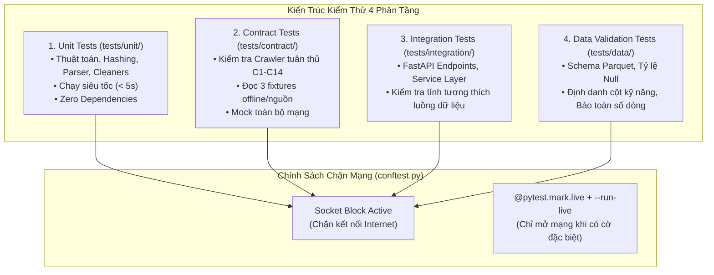

# TIÊU CHUẨN LẬP TRÌNH & QUY TẮC AN TOÀN MÃ NGUỒN (CODING STANDARDS & QUALITY ASSURANCE)

> **Mã tài liệu:** `SPEC-12` | **Trạng thái:** Bắt buộc tuân thủ (Mandatory)  
> **Dự án:** VN-IT-Job-Mining — Nền tảng khai phá thị trường lao động IT Việt Nam  
> **Tài liệu liên quan:** [AGENTS.md](../../AGENTS.md), [09_monitoring_spec.md](09_monitoring_spec.md), [11_technical_decisions.md](11_technical_decisions.md), [13_working_documentation.md](13_working_documentation.md)

---

## 1. Môi Trường Phát Triển & Chuẩn Ngôn Ngữ

### 1.1. Chuẩn Python 3.12+ (Bắt Buộc)
- **Phiên bản Runtime:** Toàn bộ hệ thống backend, crawler và data pipeline bắt buộc chạy trên **Python 3.12+**.
- **Cú pháp Python 3.12:** Mã nguồn sử dụng tính năng cú pháp mở rộng của f-string trong Python 3.12 (ví dụ: lồng dấu ngoặc kép, biểu thức phức hợp và escape quotes bên trong biểu thức f-string tại `collection/careerviet/crawler.py`). Sử dụng Python < 3.12 sẽ gây lỗi `SyntaxError` ngay khi biên dịch.
- **Quản lý Môi trường Ảo:**
  - Thư mục ảo mặc định đặt tại `.venv/` ở thư mục gốc của repository.
  - Khởi tạo môi trường:
    ```bash
    python3.12 -m venv .venv
    source .venv/bin/activate
    ```
- **Quản lý Thư viện Phụ thuộc (Dependencies):**
  - `requirements.txt`: Chứa các thư viện phục vụ vận hành chính (FastAPI, Uvicorn, Boto3, Polars, Pandas, Scikit-learn, Mlxtend, Pydantic, curl_cffi, Playwright).
  - `requirements-dev.txt`: Chứa công cụ phát triển, kiểm thử và định dạng (Pytest, Ruff, Pytest-cov, Pytest-asyncio).
  - Nghiêm cấm cài đặt các gói ngoài danh mục mà không ghi nhận vào `requirements.txt`.
  - Riêng Apache Airflow được cài đặt độc lập theo kịch bản `scripts/setup_airflow.sh` để tránh xung đột ràng buộc phiên bản (constraints) với các thư viện dữ liệu khác.

### 1.2. Định Dạng & Kiểm Tra Tĩnh Mã Nguồn (Linting & Formatting)
- **Công cụ:** Dự án sử dụng **Ruff** làm linter và formatter tốc độ cao, cấu hình trong `pyproject.toml`.
- **Phạm vi kiểm tra:**
  ```bash
  make lint    # Chạy ruff check trên collection/ và tests/
  make format  # Chạy ruff format trên collection/ và tests/
  ```
- **Quy tắc sửa đổi an toàn:** Repository có hơn 1.000 cảnh báo tồn đọng từ các module cũ. Kỹ sư hoặc AI Agent chỉ được phép định dạng và sửa cảnh báo ruff trên **những dòng mã mình trực tiếp thêm mới hoặc sửa đổi**, tuyệt đối không chạy format diện rộng trên toàn bộ repo gây nhiễu loạn git blame và git diff.

### 1.3. Chuẩn Giao Diện Frontend (100% Strict TypeScript)
- **Cấm JavaScript:** Toàn bộ thư mục `monitoring/frontend/` chỉ chứa tệp `.ts` và `.tsx`. Tuyệt đối cấm tạo các file `.js` hoặc `.jsx`.
- **Cờ kiểm tra nghiêm ngặt:** Không tắt `"allowJs": false` trong `tsconfig.json`. Mọi component, hook và API service đều phải định kiểu tường minh tại `monitoring/frontend/src/types.ts`.
- **Kiểm tra kiểu tĩnh trước khi commit:**
  ```bash
  cd monitoring/frontend && npm run build
  ```

---

## 2. Tiêu Chuẩn Bộ Thu Thập Dữ Liệu (Crawler Standards C1 – C14)

Bộ tiêu chuẩn **C1 – C14** là quy chuẩn bất khả xâm phạm dành cho tất cả các crawler của 8 nguồn tuyển dụng (TopCV, TopDev, VietnamWorks, CareerViet, Vieclam24h, ITviec, Glints, JobsGO), được kiểm tra tự động qua bộ test hợp đồng (`tests/contract/`).

```mermaid
flowchart TD
    subgraph DiscoveryPhase["Pha 1: Discovery (C1, C2, C14)"]
        D1["discover_urls()"] --> D2["Làm sạch URL (Bỏ utm_*, ref)"]
        D2 --> D3["Ghi PENDING vào URL Ledger"]
        D3 --> D4{"Bắt được >= 1 trang?"}
        D4 -- Không --> D_Err["Raise DiscoveryError (Airflow báo đỏ - C14)"]
        D4 -- Có --> D_Success["Ghi nhận số lượng PENDING"]
    end

    subgraph DetailPhase["Pha 2: Detail (C1, C3-C12)"]
        Detail1["crawl_details() lấy URL PENDING & RECHECK_DUE (C3)"] --> Detail2["anti_blocking.polite_sleep 2.0-4.5s (C10)"]
        Detail2 --> Detail3["Cào dữ liệu (curl_cffi / Playwright)"]
        Detail3 -- Lỗi --> Skip["Safe Skip: mark_failed(), đi tiếp (C7)"]
        Detail3 -- Thành công --> Envelope["Đóng gói RawJobEnvelope (C4, C11)"]
        Envelope --> HashCalc["Tính Canonical SHA-256 (C5)"]
        HashCalc --> DupCheck{"Trùng Hash đã có?"}
        DupCheck -- Có trùng --> Repost["Đánh dấu Repost, KHÔNG sinh file (C6)"]
        DupCheck -- Không trùng --> VersionCheck{"Đã từng có file raw?"}
        VersionCheck -- Có đổi hash --> IncVer["Tăng phiên bản _v(N+1) (C12)"]
        VersionCheck -- Mới tinh --> NewVer["Tạo file phiên bản _v1 (C12)"]
        IncVer --> Save["Ghi file layout chuẩn C8"]
        NewVer --> Save
        Save --> Sync["Đồng bộ R2, bắt buộc báo lỗi nếu fail (C9)"]
    end

    subgraph Testing["Tiêu Chuẩn Kiểm Thử C13"]
        C13["3 fixtures offline/nguồn tại tests/fixtures/<nguồn>/\n(Tin thường, Tin VIP/Hot, Lương thỏa thuận)"]
    end
```



### Bảng Đặc Tả Chi Tiết 14 Tiêu Chuẩn C1 – C14

| Tiêu Chuẩn | Tên Quy Chuẩn | Mô Tả Kỹ Thuật & Yêu Cầu Thực Hiện | Cách Thức Kiểm Tra |
|---|---|---|---|
| **C1** | **Two-Phase Decoupling** | Bắt buộc chia tách thành 2 pha độc lập: `discover_urls()` và `crawl_details()`. Hai hàm không được gọi đan xen hoặc phụ thuộc trực tiếp vào nhau. | Unit test kiểm tra chữ ký hàm class crawler kế thừa `BaseCrawler`. |
| **C2** | **URL Cleaning & Status** | Pha Discovery chỉ được ghi trạng thái `PENDING` vào ledger. Mọi tham số tracking quảng cáo (`utm_source`, `utm_medium`, `utm_campaign`, `ref`, `source`, `tracking_id`) phải bị cắt bỏ hoàn toàn trước khi lưu. | Kiểm tra danh mục URL trong `catalog_master.json`. |
| **C3** | **Detail Batch Selection** | Pha Detail chỉ được lấy các URL đang có trạng thái `PENDING` hoặc `RECHECK_DUE` (tin đã cào quá 21 ngày). Cờ `--retry-failed` chỉ được phép chọn lọc các URL `FAILED`. | Kiểm tra query filter trong `get_pending_or_due_records()`. |
| **C4** | **Standard Envelope** | File JSON thô bắt buộc tuân thủ schema `RawJobEnvelope` gồm 2 khối gốc: `metadata` (chứa `job_id`, `source`, `source_url`, `scraped_at`, `version`, `content_hash`) và `raw_payload` (chứa toàn bộ phản hồi API hoặc dữ liệu parse thô). | Contract test đối chiếu Pydantic schema `RawJobEnvelope`. |
| **C5** | **Deterministic Hash** | Mã băm `content_hash` được tính bằng thuật toán SHA-256 trên chuỗi JSON canonical của `raw_payload`, loại trừ `raw_html` và các trường thời gian động ("vừa đăng", "3 ngày trước"). Cùng một nội dung cào lại bắt buộc ra mã hash y hệt nhau. | `calculate_json_canonical_hash(payload)` chạy lặp 100 lần. |
| **C6** | **Zero-Raw on Repost** | Khi phát hiện bài đăng trùng mã hash với một URL khác trong cùng sàn, hệ thống đánh dấu bản ghi đó là `DONE` kèm trường `repost_of_url_hash` và **tuyệt đối không sinh thêm file raw mới**. | Kiểm tra số lượng file sinh ra trên disk bằng 0 khi hash trùng. |
| **C7** | **Safe Skip Isolation** | Lỗi xảy ra tại một URL đơn lẻ (HTTP 404, 500, Parse Error, Timeout) phải được bắt cục bộ, ghi nhận qua `ledger.mark_failed(url)`, và chuyển sang URL tiếp theo. Cấm để exception làm crash toàn bộ batch. | Mock lỗi mạng trên 1 URL và kiểm tra batch hoàn tất các URL còn lại. |
| **C8** | **Standard Key Layout** | Đường dẫn lưu trữ bắt buộc tuân theo quy chuẩn duy nhất: `raw/<source>/<YYYY-MM-DD>/<job_id>_v<N>.json` trên đĩa và Cloudflare R2 bucket. Cấm sử dụng layout kiểu `dt=` hay gom batch. | Hàm `canonicalize_lakehouse_key()` từ chối mọi key sai quy cách. |
| **C9** | **Explicit Sync Failure** | Khi đồng bộ dữ liệu hoặc ledger lên Cloudflare R2 gặp lỗi, crawler phải ghi nhận log mức `ERROR` hoặc raise exception, tuyệt đối không được nuốt lỗi (silent failure). | Test mock ngắt mạng R2 và xác nhận có exception/cảnh báo đỏ. |
| **C10** | **Polite Random Sleep** | Nghỉ giữa hai request liên tiếp bằng hàm `anti_blocking.polite_sleep()`, thời gian ngẫu nhiên từ 2.0s đến 4.5s. Nghiêm cấm sử dụng `time.sleep()` cố định. | Phân tích log thời gian chạy; khoảng cách giữa 2 request phải biến thiên ngẫu nhiên. |
| **C11** | **Field Coverage F1-F8** | Mỗi trường thông tin từ F1 đến F8 (Tiêu đề, Công ty, Lương, Địa điểm, Kinh nghiệm, Cấp bậc, Kỹ năng, Mô tả) phải đạt độ bao phủ $\ge 90\%$ trên tổng số tin cào (trừ các trường sàn không hiển thị theo `RAW_PATHS`). | Chạy `python scripts/audit_raw_data.py` kiểm tra tỷ lệ null. |
| **C12** | **CDC Versioning** | Khi cào lại tin tuyển dụng ở trạng thái `RECHECK_DUE`: nếu hash nội dung thay đổi thì lưu file mới với phiên bản `_v<N+1>`; nếu hash không đổi thì giữ nguyên phiên bản cũ và không ghi file mới. | Test cào lại 2 lần với nội dung giữ nguyên và nội dung đổi. |
| **C13** | **Offline Test Fixtures** | Mỗi nguồn crawler bắt buộc phải có 3 mẫu dữ liệu offline lưu tại `tests/fixtures/<source>/`: (1) Tin tuyển dụng thông thường, (2) Tin VIP/Hot/Featured, (3) Tin ghi lương thỏa thuận. Contract test phải chạy offline hoàn toàn trên 3 mẫu này. | `pytest tests/contract/test_<source>_contract.py` chạy không cần mạng. |
| **C14** | **Discovery Error Signal** | Nếu pha Discovery chạy mà không quét được bất kỳ trang danh sách nào (bị chặn bot, đổi CSS selector), crawler bắt buộc phải raise `DiscoveryError` để Airflow báo trạng thái đỏ; chỉ cần lấy được ít nhất 1 trang là thành công. | Test mock trang rỗng và kiểm tra `DiscoveryError` được raise. |

---

## 3. Quy Tắc Bảo Mật & An Toàn Dữ Liệu

### 3.1. Tuyệt Đối Không Hardcode Thông Tin Nhạy Cảm (Secrets Management)
- **Cấu hình độc quyền qua `.env`:** Toàn bộ thông tin nhạy cảm bao gồm:
  - Thông tin đăng nhập Cloudflare R2 (`R2_ACCOUNT_ID`, `R2_ACCESS_KEY_ID`, `R2_SECRET_ACCESS_KEY`, `R2_BUCKET_NAME`).
  - Chuỗi kết nối cơ sở dữ liệu PostgreSQL của Apache Airflow (`AIRFLOW__DATABASE__SQL_ALCHEMY_CONN`).
  - Bắt buộc phải được cấu hình thông qua file `.env` tại thư mục gốc của dự án.
- **Không Commit File Nhạy Cảm:** File `.env` được ghi nhận trong `.gitignore`. Không tạo các file `.env.example` chứa thông tin nhạy cảm thực tế.
- **Nguyên tắc Che giấu Giá trị (No Printing Rule):**
  - Trong toàn bộ mã nguồn, script vận hành và file log, tuyệt đối không được in trực tiếp giá trị của các biến môi trường ra terminal (`print(os.environ)`).
  - Khi cần đối chiếu hoặc so sánh xem cấu hình môi trường có khớp giữa các máy hay không, chỉ được phép in mã băm ngắn SHA-256 của giá trị:
    ```python
    import hashlib
    def safe_mask_secret(secret_value: str) -> str:
        if not secret_value:
            return "NOT_SET"
        return f"SHA256:{hashlib.sha256(secret_value.encode()).hexdigest()[:8]}... (len={len(secret_value)})"
    ```

### 3.2. Quy Tắc Thao Tác An Toàn Trên Cloudflare R2 (Dry-Run First)
- **Nguyên tắc Xác nhận Thực thi:** Mọi script có hành vi ghi đè (`upload`), thay đổi đường dẫn (`migrate`) hoặc xóa (`delete`) object trên Cloudflare R2 đều bắt buộc phải chạy ở chế độ **Dry-Run** mặc định.
- **Cờ Kích Hoạt Tường Minh:** Thao tác thực tế chỉ được diễn ra khi người vận hành truyền cờ tường minh:
  ```bash
  # Chế độ kiểm tra an toàn (Mặc định)
  python scripts/push_raw_to_r2.py --source topcv --dry-run
  
  # Chế độ ghi thật (Cần người vận hành gõ rõ ràng)
  python scripts/push_raw_to_r2.py --source topcv --apply
  ```
- **Nguyên tắc Raw Bất Biến (Immutable Raw Data):** File JSON thô đã lưu trên R2 tầng Bronze là nguồn sự thật tối cao (Source of Truth). Nghiêm cấm viết bất kỳ script nào can thiệp sửa đổi nội dung các file raw đã cào. Mọi chỉnh sửa, vá lỗi trường dữ liệu chỉ được phép thực hiện thông qua code của tầng Tiền xử lý (`preprocessing/`).

---

## 4. Chiến Lược Kiểm Thử Phần Mềm (Pytest Architecture)

Hệ thống kiểm thử được thiết kế theo 4 phân tầng độc lập nhằm bảo đảm độ tin cậy từ mức hàm nhỏ nhất đến toàn bộ luồng tích hợp:



### 4.1. Phân Tầng Thư Mục Tests
1. **`tests/unit/` (Unit Tests):**
   - Kiểm tra các hàm logic độc lập: hàm băm canonical hash, hàm parse lương (`salary_parser.py`), chuẩn hóa tên tỉnh thành 34 tỉnh, bộ lọc IT 2 tầng.
   - Thời gian thực thi toàn bộ unit tests phải dưới 5 giây (`make test-fast`).
2. **`tests/contract/` (Contract Tests):**
   - Đảm bảo 8 crawler tuân thủ đầy đủ tiêu chuẩn C1 – C14.
   - Đọc dữ liệu từ thư mục fixture offline `tests/fixtures/<source>/` mà không cần kết nối mạng.
3. **`tests/integration/` (Integration Tests):**
   - Kiểm thử các API endpoints của FastAPI backend trong `monitoring/backend/app/`.
   - Kiểm tra tính tương thích giữa flattener và target schema.
4. **`tests/data/` (Data Quality Tests):**
   - Kiểm tra chất lượng dữ liệu trên file Parquet: kiểm tra kiểu dữ liệu, các ràng buộc không null, và quy tắc bảo toàn dòng dữ liệu qua các bước tiền xử lý:
     $$\text{Input Rows} = \text{Output Rows} + \text{Dropped Rows}$$

### 4.2. Chính Sách Cách Ly Mạng Tuyệt Đối (Zero-Network Policy)
- **Cơ chế Chặn Socket:** File `tests/conftest.py` cài đặt socket blocker can thiệp vào tầng hệ điều hành. Mọi lệnh gọi mạng ra ngoài localhost (`127.0.0.1`) trong lúc chạy test suite đều tự động bị ngắt và raise lỗi `NetworkBlockedError`.
- **Mục đích:** Đảm bảo test suite chạy độc lập, có tính tất định (deterministic), không bị ảnh hưởng bởi đường truyền mạng hay thay đổi bên ngoài.
- **Ngoại lệ duy nhất:** Chỉ khi lập trình viên chủ động kiểm tra cào thật từ internet với số lượng nhỏ, test phải được đánh dấu bằng `@pytest.mark.live` và kích hoạt tường minh bằng cờ:
  ```bash
  pytest tests/integration/test_live_crawler.py --run-live
  ```

---

## 5. Quy Trình Xử Lý Lỗi & Ghi Nhật Ký (Issue Tracking Protocol)

Khi phát hiện và sửa chữa bất kỳ lỗi phát sinh nào trong mã nguồn hoặc dữ liệu:
1. **Ghi nhật ký lỗi:** Thêm mục mới vào `docs/issue_log.md` theo mẫu mã `L-<số tiếp theo>`:
   ```markdown
   ### L-xx. <Tên lỗi ngắn gọn>
   - **Lỗi:** Hiện tượng quan sát thấy, vị trí phát sinh, số liệu cụ thể.
   - **Nguyên nhân:** Giải thích bản chất kỹ thuật, chỉ rõ file và dòng mã gây lỗi.
   - **Cách xử lý:** Mô tả phương án sửa mã; cách dữ liệu được cập nhật lại.
   - **Còn lại:** Những việc tồn đọng (nếu có, trỏ về KNOWN_ISSUED.md).
   - **Kiểm chứng:** Tên test case hoặc lệnh CLI chứng minh lỗi đã được khắc phục hoàn toàn.
   ```
2. **Cập nhật việc tồn đọng:** Xóa bỏ mục lỗi tương ứng trong `KNOWN_ISSUED.md`.
3. **Bổ sung bẫy phòng ngừa:** Nếu lỗi thuộc dạng dễ tái diễn, bắt buộc bổ sung một dòng cảnh báo vào file `CLAUDE.md` của thư mục chứa lỗi đó.
