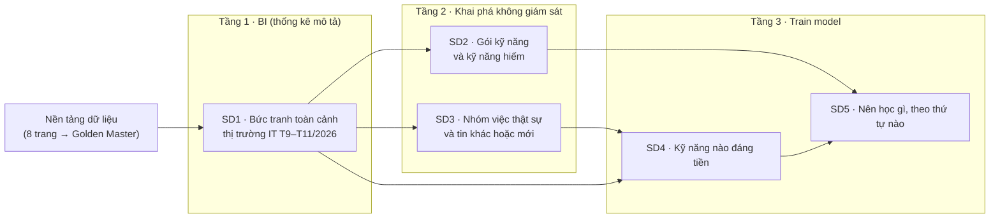

# Đề tài và 5 mục tiêu (SD1–SD5)

> Cập nhật 16/11/2026. Đây là tài liệu gốc về **mục tiêu sử dụng** của dự án. Spec kỹ thuật (`docs/spec/`), code và báo cáo phải phục vụ các mục tiêu ở đây. Khi mâu thuẫn thì sửa chỗ kia cho khớp với file này.

## 1. Tên đề tài

**Tích hợp và khai phá dữ liệu thị trường lao động phục vụ phân tích nghề nghiệp và kỹ năng trong IT**

## 2. Bối cảnh

- Tin tuyển dụng IT ở Việt Nam nằm rải rác trên nhiều trang: dự án lấy từ 8 trang là TopCV, TopDev, VietnamWorks, CareerViet, Vieclam24h, ITviec, Glints và JobsGO.
- Mỗi trang ghi nghề, cấp bậc, lương, địa điểm và kỹ năng theo một kiểu riêng.
- Các trang tổng hợp còn trộn nhiều tin không phải IT.
- Cùng một tin có thể được đăng lại trên nhiều trang.

Vì vậy, người tìm việc (trước hết là sinh viên IT) không có một bức tranh chung đáng tin. Họ không biết thị trường đang tuyển nghề gì và ở cấp nào, người mới bị đòi hỏi gì, kỹ năng nào hay đi cùng nhau, kỹ năng nào đáng tiền, và nên học gì trước.

## 3. Mục đích chính

Gom tin tuyển dụng IT của 8 trang về **một bộ dữ liệu sạch, không trùng lặp**. Từ bộ đó trả lời bằng số liệu thật các câu hỏi về **nghề nghiệp** và **kỹ năng** trên thị trường IT Việt Nam trong giai đoạn **tháng 9 – tháng 11/2026**: tin được đăng từ tháng 9 và được thu thập (cào) trong tháng 10–11/2026.

Người dùng chính là **sinh viên IT sắp ra trường và người mới vào nghề**. Kết quả cũng dùng được cho giảng viên chấm đồ án và nhà tuyển dụng, nhưng không thiết kế riêng cho hai nhóm này.

## 4. Dữ liệu có gì, không có gì

Đây là phần quyết định mục tiêu nào làm được và mục tiêu nào không.

| Có (lấy từ tin tuyển dụng) | Không có |
|---|---|
| Tiêu đề, nhóm nghề (`job_family`), cấp bậc (`seniority`), số năm kinh nghiệm | CV hay hồ sơ ứng viên |
| Kỹ năng yêu cầu (`skills_std`, ma trận kỹ năng ở `10_features`) | Chương trình đào tạo của các trường đại học |
| Lương công khai (`salary_min_vnd`, `salary_max_vnd`), cờ "thỏa thuận" (`salary_status`) | Lương thật lúc nhận việc, số người ứng tuyển |
| Tỉnh (`tinh_chinh`), hình thức làm việc (`work_mode`), ngôn ngữ JD (`language`), phúc lợi (`benefits_std`) | Chuỗi thời gian dài: chỉ có khoảng 3 tháng (T9–T11), nên không nói được xu hướng |
| Tháng đăng `posted_month` (`YYYY-MM`), kèm nguồn tháng `posted_month_source` (`posted` = lấy từ ngày đăng; `crawled` = lấy từ lần cào đầu tiên khi trang không ghi ngày đăng) | Ngày đăng đầy đủ: dữ liệu sạch bỏ `posted_date` (PRE-37) |
| Nội dung JD đã làm sạch, embedding e5 | Thông tin doanh nghiệp ngoài tên công ty |

Từ bảng trên suy ra 5 mục tiêu:

- Mọi mục tiêu chỉ được hỏi về **phía cầu**: doanh nghiệp đăng gì, đòi gì, trả gì.
- Không được hỏi về phía cung (ứng viên có gì) hay phía đào tạo (trường dạy gì).

## 5. Năm mục tiêu, xếp theo tầng phân tích

Thứ tự là **BI → khai phá không giám sát → train model**. Tầng sau dùng kết quả của tầng trước.

| SD | Tầng | Câu hỏi lớn | File |
|---|---|---|---|
| **SD1** | BI | Thị trường IT Việt Nam T9–T11/2026 trông như thế nào: tuyển nghề gì, cấp nào, ở đâu, trả bao nhiêu, người mới bị đòi gì? | [01_sd1_buc_tranh_thi_truong.md](01_sd1_buc_tranh_thi_truong.md) |
| **SD2** | Không giám sát | Học một kỹ năng thì thường phải biết thêm kỹ năng gì? Kỹ năng nào hiếm? | [02_sd2_goi_ky_nang.md](02_sd2_goi_ky_nang.md) |
| **SD3** | Không giám sát | Nếu bỏ qua tên nghề và chỉ nhìn nội dung, thị trường chia thành những nhóm việc nào? Tin nào khác hoặc mới? | [03_sd3_nhom_viec_va_tin_khac_hoac_moi.md](03_sd3_nhom_viec_va_tin_khac_hoac_moi.md) |
| **SD4** | Train model | Cùng nghề, cấp, kinh nghiệm và tỉnh, biết thêm một kỹ năng thì lương công bố hơn bao nhiêu? Tin "thỏa thuận" ước tính được bao nhiêu? | [04_sd4_gia_tri_ky_nang.md](04_sd4_gia_tri_ky_nang.md) |
| **SD5** | Model + tổng hợp | Người mới vào từng nghề nên học kỹ năng gì, theo thứ tự nào? | [05_sd5_lo_trinh_hoc.md](05_sd5_lo_trinh_hoc.md) |

Tóm tắt:

- **SD1:** đếm và so sánh. Đây là lớp nền để các SD sau dùng làm chuẩn so sánh.
- **SD2:** tìm những kỹ năng hay xuất hiện cùng nhau trong một tin. Đây là các "gói" mà doanh nghiệp tuyển theo.
- **SD3:** để máy tự gom các tin giống nhau, rồi so với nhóm nghề gán bằng luật. Từ đó thấy nghề lai, nghề ngách và những tin không giống nhóm nào.
- **SD4:** train model lương trên các tin công khai lương, rồi đọc model để biết từng kỹ năng đáng bao nhiêu tiền.
- **SD5:** gộp nhu cầu (SD1), gói kỹ năng (SD2) và giá trị kỹ năng (SD4) thành danh sách ưu tiên và thứ tự học cho người mới.

## 6. Nền tảng dữ liệu (không phải mục tiêu)

Thu thập 2 pha, URL Ledger, CDC theo hash, lọc tin IT, khử trùng lặp và chuẩn hóa về một schema (`collection/`, `preprocessing/`, `processing/`) là **phương tiện để có dữ liệu**. Đây không phải câu hỏi khai phá. Phần này được đánh giá theo 5 tiêu chí chất lượng trong `CLAUDE.md`: completeness, accuracy, consistency, timeliness, uniqueness.

## 7. Thay đổi so với bộ SD cũ

Bộ cũ có trong `docs/guides/01_modern_data_mining_overview.md` mục 1, viết ngày 14/10/2026.

| Cũ | Mới | Lý do |
|---|---|---|
| SD1 Labor Market Data Integration | Bỏ khỏi danh sách mục tiêu, chuyển thành "Nền tảng dữ liệu" (mục 6) | Tích hợp dữ liệu là việc phải làm để có dữ liệu, không phải câu hỏi phân tích |
| SD2 Occupational Demand Analysis | **SD1**, mở rộng thành bức tranh toàn cảnh: thêm lương công khai, yêu cầu với người mới, điều kiện làm việc | Chỉ giữ một SD ở tầng BI |
| SD3 Skill Intelligence | **SD2** (gói kỹ năng, kỹ năng hiếm); phần "kỹ năng được trả lương cao" chuyển sang SD4 | Phần lương cần train model nên thuộc tầng 3 |
| SD4 Education–Industry Skill Gap | Bỏ; thay bằng **SD3** (nhóm việc và tin khác hoặc mới) | Dữ liệu không có chương trình đào tạo hay CV, nên không kiểm chứng được |
| — | **SD4** Kỹ năng nào đáng tiền (mới) | Cần một mục tiêu ngoài BI có train model; SD5 cần con số này |
| SD5 Career & Skill Development Recommendations | **SD5**, giữ nguyên ý, chỉ dùng dữ liệu tin tuyển dụng | — |

Quy tắc tầng Mining cũng đổi:

- **Trước đây:** "Mining chỉ unsupervised", còn Random Forest + SHAP chỉ là phần phụ.
- **Từ 16/11/2026:** khai phá không giám sát vẫn là lõi của tầng 2. Train model (tầng 3) trở thành bước chính thức, phục vụ SD4 và SD5.

## 8. Ảnh chụp dữ liệu (sẽ đổi)

Số liệu ở bảng dưới lấy ngày **10/11/2026** từ `reports/processing/10_features/_all.json`, `reports/preprocessing/03_transformation/_all.json` và `reports/preprocessing/04_normalization/_all.json`. Bộ dữ liệu **chưa sạch 100%** cho cả 5 tầng (xem **PRE-35** trong [`docs/KNOWN_ISSUED.md`](../KNOWN_ISSUED.md)), nên các số này sẽ đổi. Các file SD không chép lại số, chỉ ghi cột cần dùng và mức cần đạt.

| Chỉ số | Giá trị |
|---|---|
| Số tin IT sau lọc và khử trùng lặp | 4.671 (topcv 1.520, itviec 818, vietnamworks 774, jobsgo 547, careerviet 400, glints 246, topdev 202, vieclam24h 164) |
| Cột kỹ năng trong ma trận đặc trưng | 171 (min_df 15) |
| `skills_std` có giá trị | 92,9% |
| `job_family` | 100% (10 nhóm + Other) |
| `seniority` | 91,7% |
| `exp_min_years` | 94,8% |
| `tinh_chinh` | 97,8% |
| `work_mode` | 100% |
| `language` | vi 3.390, en 1.274, khác 7 |
| `benefits_std` | 92,7% |
| `salary_min_vnd` / `salary_max_vnd` | 40,2% / 44,5% |
| `posted_date` | 63,8% (topcv 0%, topdev 32,7%, các nguồn khác ≥ 96%). Sẽ được thay bằng `posted_month` (PRE-37) |

Quy tắc chung cho mọi SD khi báo số:

- Mọi bảng đều ghi **n** và **độ phủ** của cột đang dùng.
- Ô nào có n < 30 thì không kết luận, chỉ ghi "ít dữ liệu". Ngưỡng 30 là đề xuất, chờ chốt ở PRE-36.
- Không nói "xu hướng tăng/giảm", vì dữ liệu chỉ có khoảng 3 tháng.
- Số tin theo tháng phụ thuộc lịch cào, nên chỉ so **cơ cấu** trong từng tháng, không so tổng số tin giữa các tháng.
- Tháng 9 chỉ có tin của những nguồn ghi ngày đăng (`posted_month_source = posted`), vì tháng 9 chưa cào. Khi so tháng 9 với tháng 10–11 phải tách theo `posted_month_source`.
- Lương ước tính (từ SD4) luôn ghi nhãn "ước tính" và không trộn với lương công khai.

## 9. Tài liệu cần đối chiếu lại

Các file dưới đây còn dùng bộ SD cũ hoặc quy tắc "Mining chỉ unsupervised". Các spec 02–13 (trừ phần crawl) đã đối chiếu xong trong 5 chặng ngày 17/11/2026; chặng 5 (spec 02, 09–13) duyệt cùng ngày. Các file còn lại sửa khi đụng tới.

| File | Chỗ lệch | Sửa khi |
|---|---|---|
| ~~`docs/spec/02_out_of_scope.md`~~ | ~~RF + SHAP ghi là phần phụ~~ | **Đã sửa 17/11/2026** (chặng 5, v1.1.0): thêm §2.5 (phía ứng viên, đào tạo), §2.6 (xu hướng, nhân quả); train model là bước chính thức |
| ~~`docs/spec/03_data_mining_lifecycle.md`~~ | ~~"4 bài toán", có Skill Gap~~ | **Đã viết lại 17/11/2026** (chặng 1): nay là tài liệu mô tả quy trình |
| ~~`docs/spec/05_preprocessing_spec.md:36`~~ | ~~"Bước 11 tùy chọn vì Mining chỉ unsupervised"~~ | **Đã viết lại 17/11/2026** (chặng 2, v3.0.0): spec 05 chỉ còn bước 00–04; bước 11 chuyển vào M5 (spec 03) |
| ~~`docs/spec/06_processing_spec.md:23`~~ | ~~"Bước 11 tùy chọn vì Mining chỉ unsupervised"~~ | **Đã viết lại 17/11/2026** (chặng 3, v3.0.0): spec 06 mục 4 ghi bước 11 thuộc M5 |
| ~~`docs/spec/07_mining_spec.md`~~ | ~~"chỉ unsupervised"; chưa ánh xạ sang SD~~ | **Đã viết lại 17/11/2026** (chặng 4, v3.0.0): M1–M6 theo SD, cột "Thiếu so với SD" |
| ~~`docs/spec/08_evaluation_spec.md`~~ | ~~RF không bắt buộc; "Skill Gap Matrix"~~ | **Đã viết lại 17/11/2026** (chặng 4, v3.0.0): nghiệm thu theo từng SD |
| ~~`docs/spec/09_monitoring_spec.md`~~ | ~~Trang Insights chưa chia theo SD~~ | **Đã sửa 17/11/2026** (chặng 5, v1.1.0): §3 chia trang theo SD1–SD5, ghi trạng thái code từng trang |
| ~~`docs/spec/10_architecture.md`~~ | ~~Đường dẫn Gold cũ, DAG preprocessing/mining không có thật, TF-IDF, 12 nhóm nghề~~ | **Đã sửa 17/11/2026** (chặng 5, v2.1) |
| ~~`docs/spec/11_technical_decisions.md`~~ | ~~ADR-05 "RF là phần phụ"; số ví dụ không có lần chạy~~ | **Đã sửa 17/11/2026** (chặng 5): thêm ADR-06 (bộ SD mới, train model chính thức), ADR-07 (`posted_month`) |
| ~~`docs/spec/12_coding_standards.md`, `docs/spec/13_working_documentation.md`~~ | ~~Test chưa có processing/mining; lệnh "5 bước", "phần phụ"~~ | **Đã sửa 17/11/2026** (chặng 5) |
| `docs/guides/01_modern_data_mining_overview.md` | Định nghĩa SD cũ (mục 1) | Khi chốt bộ SD này |
| `.agents/skills/data-integration-miner/SKILL.md`, `.agents/skills/job-crawler-analyzer/SKILL.md` | Nhãn SD cũ (SD1 = tích hợp, SD2 = job family, SD3 = kỹ năng) | Khi chốt bộ SD này |
| Comment trong `scripts/run_staging_integration_pipeline.py` (file này sinh ra `reports/*_transformation_manifest.md`), `scripts/create_golden_master_eda_notebook.py`, `collection/common/schema.py`, `collection/sources/glints/crawler.py`, `collection/sources/vieclam24h/crawler.py`, `scripts/lakehouse_loader.py`, `scripts/build_slides.py` | Nhãn SD cũ | Khi sửa code ở các file đó |

Không sửa: `docs/tasks/legacy_TASKS.md`, `docs/reports/*` và `docs/archive/`, vì đó là tài liệu lịch sử.
