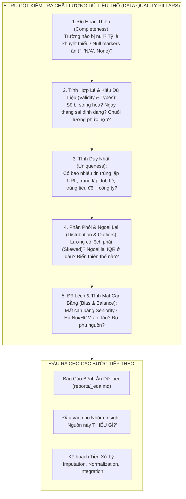

# 📊 CẨM NANG NHIỆM VỤ NHÓM EDA (3 THÀNH VIÊN)
## QUY TRÌNH EDA KIỂM TRA CHẤT LƯỢNG DỮ LIỆU CHUYÊN SÂU & CHẨN ĐOÁN HÌNH THÁI DỮ LIỆU THÔ

> **Dự án:** Phân tích thị trường lao động IT và nhu cầu kỹ năng nghề nghiệp tại Việt Nam (VN-IT-Job-Mining)  
> **Bộ phận chuyên trách:** Nhóm EDA Intelligence & Data Quality (3 thành viên)  
> **Nguyên tắc chỉ đạo cốt lõi:** **Khám phá đi lên từ câu hỏi (Inquiry-Driven Framework)** — Tiếp nhận trực tiếp dữ liệu thô (Raw As-Is) vừa cào về từ Lakehouse, kiểm tra toàn diện chất lượng dữ liệu qua 5 trụ cột kỹ thuật, chẩn đoán độ lệch (Bias) và tính mất cân bằng (Balance) bằng hệ thống trực quan hóa phong phú (Visual phong phú) để làm cơ sở khoa học cho chuỗi xử lý Pre-processing.  
> **Phạm vi nguồn dữ liệu:** 8 sàn việc làm IT hàng đầu (TopCV, ITViec, VietnamWorks, TopDev, Glints, JobsGO, CareerViet, Vieclam24h) lưu trữ trên Lakehouse (Cloudflare R2).

---

## 1. TỔNG QUAN & ĐỊNH HƯỚNG CỐT LÕI CỦA NHÓM EDA

Khi dữ liệu thô (Raw As-Is JSON / HTML Payload) vừa được các crawler kéo về Lakehouse, dữ liệu đang ở trạng thái nguyên bản: chứa nhiễu, có thể bị khuyết thiếu trường, dị biệt về kiểu dữ liệu, lẫn lộn các null marker giả và mất cân bằng phân phối.

**EDA KHÔNG PHẢI LÀ PHÂN TÍCH KINH TẾ VĨ MÔ HAY BÁO CÁO THỊ TRƯỜNG.**  
Nhiệm vụ của **Nhóm EDA (3 thành viên)** là đóng vai trò **"Kính hiển vi chẩn đoán chất lượng dữ liệu"**, thực hiện 3 sứ mệnh kỹ thuật:
1. **Kiểm tra chất lượng dữ liệu chuyên sâu (Deep Data Quality Check):** Vạch trần toàn bộ các lỗi tiềm ẩn của dữ liệu thô (kiểu dữ liệu sai, chuỗi lương/kinh nghiệm lộn xộn, bản ghi trùng lặp, giá trị rác).
2. **Đo lường hình thái phân phối, độ lệch & tính mất cân bằng (Distribution, Bias & Balance Profiling):** Đo Skewness, Kurtosis, ngoại lai bằng IQR, và tính toán độ mất cân bằng lớp (Class Imbalance) ở Cấp bậc (Seniority), Địa lý (Location), và Nguồn dữ liệu.
3. **Cung cấp "Bệnh án dữ liệu" (Data Quality Diagnosis):** Làm đầu vào chuẩn xác để Nhóm Insight tìm ra các khoảng trống dữ liệu (Data Gaps) và nhóm Kỹ thuật thiết kế luật Tiền xử lý (Pre-processing Pipeline: Integration, Imputation, Normalization, Scaling).

---

## 2. HỆ THỐNG CÂU HỎI ĐỊNH HƯỚNG: 5 TRỤ CỘT CHẤT LƯỢNG DỮ LIỆU



---

### 2.1. Trụ Cột 1: Độ Hoàn Thiện (Completeness & Missing Value Profiling)
- **What?** Có bao nhiêu trường bị khuyết thiếu (null/empty)? Tỷ lệ khuyết thiếu của 9 trường cốt lõi trong Data Contract là bao nhiêu %?
- **Why?** Có những giá trị null nào bị ẩn dưới dạng text không (ví dụ: `""`, `"N/A"`, `"null"`, `"None"`, `"Chưa cập nhật"`, `"Thỏa thuận"`) khiến hàm `df.isnull()` bỏ sót?
- **How?**
  - Viết hàm quét sạch các null marker trá hình đưa về chuẩn `np.nan`.
  - Dùng ma trận trực quan hóa `missingno.matrix()` và biểu đồ thanh `missingno.bar()` để phơi bày cấu trúc khuyết thiếu.
  - Phân loại cơ chế thiếu: Thiếu ngẫu nhiên (MCAR) hay thiếu có chủ đích (MNAR - ví dụ: nhà tuyển dụng cố tình ẩn lương để đàm phán).

### 2.2. Trụ Cột 2: Tính Hợp Lệ & Kiểu Dữ Liệu (Validity & Schema Types)
- **What?** Kiểu dữ liệu thực tế (`dtypes`) của từng trường có khớp với Data Contract không?
  - Có cột số nào bị lưu thành dạng chuỗi (`object`) do dính ký tự đơn vị (ví dụ: `"15,000,000 VND"`, `"3 năm"`)?
  - Cột ngày tháng (`created_at`, `expired_at`) có đúng chuẩn ISO 8601 (`YYYY-MM-DD`) hay đang là chuỗi tương đối (`"3 ngày trước"`, `"Hôm qua"`)?
  - Cột thẻ kỹ năng (`tags`) có đúng là mảng `list[str]` hay bị string hóa thành `"['Python', 'SQL']"`?
- **Why?** Nếu không phát hiện sớm, bước tiền xử lý sẽ bị lỗi sập pipeline (crash) hoặc ép kiểu sai làm biến dạng dữ liệu.
- **How?** Sử dụng `df.info()`, viết hàm kiểm tra tính hợp lệ và bóc tách cấu trúc phức hợp của chuỗi lương (tách `salary_min`, `salary_max`, `currency`, `is_negotiable`) để chuẩn bị cho việc phân tích số học.

### 2.3. Trụ Cột 3: Tính Duy Nhất & Trùng Lặp (Uniqueness & Duplication)
- **What?** Trong tập dữ liệu cào về có bao nhiêu bản ghi bị trùng lặp?
  - Trùng lặp tuyệt đối (Exact duplicate: 100% các cột giống nhau).
  - Trùng lặp khóa định danh (`url` hoặc `source_job_id`).
  - Trùng lặp logic (`company` + `title` + `location`).
- **Why?** Trùng lặp xảy ra do crawler quét qua các trang phân trang bị chồng lấn (overlap), hoặc do nhà tuyển dụng đăng lại tin (repost).
- **How?** Đo lường tỷ lệ trùng lặp bằng `df.duplicated().sum() / len(df) * 100`, ghi nhận log số lượng bản ghi dư thừa cần loại bỏ khi tích hợp.

### 2.4. Trụ Cột 4: Hình Thái Phân Phối & Ngoại Lai (Distribution & Outliers)
- **What?** Hình thái phân phối của các biến định lượng (Lương tối thiểu, Lương tối đa, Số năm kinh nghiệm, Độ dài mô tả JD) như thế nào?
  - Độ lệch (Skewness): Phân phối có bị lệch phải nặng (Right-skewed, Skewness $> 1.0$) không?
  - Độ nhọn (Kurtosis): Phân phối có đuôi dày (heavy-tailed) chứa nhiều giá trị cực đoan không?
  - Ngoại lai (Outliers): Có bao nhiêu bản ghi vượt qua ngưỡng $1.5 \times IQR$? Mức lương lớn nhất (Max) và nhỏ nhất (Min) là bao nhiêu?
- **Why?** Ngoại lai có thể là lỗi nhập liệu của nhà tuyển dụng (ví dụ: gõ thừa số 0 thành lương 500 triệu/tháng cho Junior, hoặc gõ nhầm 15,000 USD thành 15,000 VND).
- **How?**
  - Dùng Histogram kết hợp KDE curves để kiểm tra độ lệch; vẽ thêm biểu đồ Log-transformed ($\log(1+x)$) để kiểm tra khả năng đưa về phân phối chuẩn (Gaussian).
  - Dùng Boxplot kết hợp Stripplot phân tầng theo Cấp bậc để định vị chính xác tọa độ các điểm ngoại lai.
  - Đề xuất quyết định tiền xử lý: Không xóa dòng (drop) để tránh làm mất dữ liệu kỹ năng, mà đề xuất **Winsorization (Capping tại phân vị 1% và 99%)** hoặc dùng **RobustScaler**.

### 2.5. Trụ Cột 5: Độ Thiên Lệch & Tính Mất Cân Bằng (Bias & Balance Profiling)
- **What?** Tập dữ liệu có bị mất cân bằng mẫu nghiêm trọng ở các chiều phân loại không?
  - **Mất cân bằng Cấp bậc (Seniority Class Imbalance):** Tỷ lệ vị trí Middle/Senior chiếm bao nhiêu %? Vị trí Intern/Fresher và Lead/Manager chiếm bao nhiêu %?
  - **Thiên lệch Địa lý (Geographic Bias):** Hà Nội và TP.HCM chiếm bao nhiêu % tổng số tin? Các tỉnh thành khác có bị thiếu đại diện (underrepresented) không?
  - **Thiên lệch Hình thức làm việc (Work Mode Bias):** Tỷ lệ Onsite vs Hybrid vs Remote?
  - **Tính Thưa thớt Kỹ năng (Skill Sparsity & Pareto 80/20):** Có hiện tượng 20% kỹ năng phổ biến chiếm 80% tần suất xuất hiện, trong khi hàng trăm kỹ năng ngách chỉ xuất hiện 1-2 lần không?
- **Why?** Mất cân bằng dữ liệu sẽ khiến các mô hình phân loại (Classification models) sau này bị thiên vị (bias) theo nhóm đa số, bỏ qua nhóm thiểu số.
- **How?**
  - Đo tỷ lệ mất cân bằng (Imbalance Ratio = Max class count / Min class count).
  - Dùng Pareto Plot (Bar chart + Cumulative line) và Donut chart để trực quan hóa mức độ thiên lệch.
  - Đề xuất kỹ thuật tiền xử lý: Resampling (SMOTE/Undersampling), Class Weighting (`class_weight='balanced'`), hoặc gộp nhãn hiếm thành `"Other"`.

---

## 3. THƯ VIỆN TRỰC QUAN HÓA PHONG PHÚ: BỘ 7 HỌ BIỂU ĐỒ BẮT BUỘC

Toàn bộ 7 biểu đồ dưới đây PHẢI được xuất ra định dạng `.png` độ phân giải cao (DPI 300) và lưu tại `reports/figures/<source>/`:

```
reports/figures/<source>/
├── 01_data_completeness_missingno.png # Ma trận khuyết thiếu & % hoàn thiện
├── 02_salary_distribution_skewness.png # Phân phối lương gốc & sau Log-transform
├── 03_salary_outliers_seniority.png    # Boxplot + Stripplot ngoại lai theo cấp bậc
├── 04_experience_vs_salary_relation.png# Scatter plot hồi quy kinh nghiệm vs lương
├── 05_spearman_correlation_matrix.png  # Heatmap tương quan hạng định lượng
├── 06_skills_pareto_distribution.png   # Bar chart Top 20 skills & Đường Pareto 80/20
└── 07_bias_and_class_balance.png       # Đánh giá mất cân bằng Seniority & Địa lý
```

### 3.1. Biểu Đồ 1: Đánh Giá Độ Hoàn Thiện & Khuyết Thiếu (Missing Value Profiling)
```python
import missingno as msno
import matplotlib.pyplot as plt

def plot_completeness(df, save_path):
    fig, axes = plt.subplots(1, 2, figsize=(16, 6))
    
    # 1. Ma trận khuyết thiếu trực quan từng dòng
    msno.matrix(df, ax=axes[0], sparkline=False, color=(0.18, 0.45, 0.71))
    axes[0].set_title("Ma Trận Khuyết Thiếu Dữ Liệu (Missing Matrix)", fontsize=13, pad=10)
    
    # 2. Tỷ lệ đầy đủ của từng cột (%)
    msno.bar(df, ax=axes[1], color="#2a9d8f", fontsize=10)
    axes[1].set_title("Tỷ Lệ Đầy Đủ Từng Trường Dữ Liệu (%)", fontsize=13, pad=10)
    
    plt.tight_layout()
    plt.savefig(save_path, dpi=300)
    plt.close()
```

### 3.2. Biểu Đồ 2: Phân Phối Lương & Chẩn Đoán Độ Lệch (Skewness & Log-Transform)
```python
import numpy as np
import seaborn as sns
import matplotlib.pyplot as plt

def plot_salary_distribution(df, save_path):
    fig, axes = plt.subplots(1, 2, figsize=(15, 5))
    salaries = df["salary_max_vnd"].dropna()
    
    # 1. Phân phối lương gốc (Triệu VNĐ)
    sns.histplot(salaries, kde=True, ax=axes[0], color="#1d3557", bins=30)
    axes[0].axvline(salaries.median(), color="red", linestyle="--", label=f"Median: {salaries.median():.1f}M")
    axes[0].axvline(salaries.mean(), color="orange", linestyle="-", label=f"Mean: {salaries.mean():.1f}M")
    axes[0].set_title(f"Phân Phối Lương Gốc (Skewness = {salaries.skew():.2f})", fontsize=12)
    axes[0].set_xlabel("Triệu VNĐ/tháng")
    axes[0].legend()
    
    # 2. Phân phối sau Log-Transformation: log(1 + x)
    log_sal = np.log1p(salaries)
    sns.histplot(log_sal, kde=True, ax=axes[1], color="#e76f51", bins=30)
    axes[1].set_title(f"Phân Phối Sau Log-Transform (Skewness = {log_sal.skew():.2f})", fontsize=12)
    axes[1].set_xlabel("log(1 + Lương)")
    
    plt.tight_layout()
    plt.savefig(save_path, dpi=300)
    plt.close()
```

### 3.3. Biểu Đồ 3: Phát Hiện Ngoại Lai Bằng IQR & Boxplot Theo Cấp Bậc
```python
def plot_outliers_seniority(df, save_path):
    plt.figure(figsize=(12, 6))
    order = ["Intern", "Fresher", "Junior", "Middle", "Senior", "Lead / Manager"]
    valid = df[df["seniority_level"].isin(order)].dropna(subset=["salary_max_vnd"])
    
    # Boxplot thể hiện IQR
    sns.boxplot(data=valid, x="seniority_level", y="salary_max_vnd", order=order, 
                palette="Blues", showmeans=True, meanprops={"marker":"o", "markerfacecolor":"red"})
    # Stripplot thể hiện các điểm dữ liệu thực tế (Outlier jitter)
    sns.stripplot(data=valid, x="seniority_level", y="salary_max_vnd", order=order, 
                  color="black", alpha=0.35, jitter=0.2, size=5)
    
    plt.title("Độ Biến Thiên Lương & Phát Hiện Ngoại Lai (IQR) Theo Cấp Bậc", fontsize=13)
    plt.ylabel("Lương tối đa (Triệu VNĐ/tháng)")
    plt.xlabel("Cấp bậc tuyển dụng")
    plt.grid(axis="y", linestyle="--", alpha=0.5)
    plt.tight_layout()
    plt.savefig(save_path, dpi=300)
    plt.close()
```

### 3.4. Biểu Đồ 4: Mối Quan Hệ Kinh Nghiệm vs Lương (Scatter Plot & Regression)
```python
def plot_experience_salary_relationship(df, save_path):
    plt.figure(figsize=(10, 6))
    valid = df.dropna(subset=["min_experience_years", "salary_max_vnd"])
    
    sns.regplot(data=valid, x="min_experience_years", y="salary_max_vnd",
                scatter_kws={"alpha": 0.35, "color": "#264653", "s": 35},
                line_kws={"color": "#e76f51", "linewidth": 2.5})
    
    plt.title("Mối Quan Hệ Số Năm Kinh Nghiệm vs Mức Lương Tối Đa (95% CI)", fontsize=13)
    plt.xlabel("Số năm kinh nghiệm tối thiểu (Năm)")
    plt.ylabel("Lương tối đa (Triệu VNĐ/tháng)")
    plt.grid(True, linestyle="--", alpha=0.5)
    plt.tight_layout()
    plt.savefig(save_path, dpi=300)
    plt.close()
```

### 3.5. Biểu Đồ 5: Ma Trận Tương Quan Định Lượng (Spearman Correlation Heatmap)
```python
def plot_correlation_heatmap(df, save_path):
    plt.figure(figsize=(8, 6))
    num_cols = ["salary_min_vnd", "salary_max_vnd", "min_experience_years", "jd_word_count", "total_skills_count"]
    cols_exist = [c for c in num_cols if c in df.columns]
    
    corr = df[cols_exist].corr(method="spearman")
    mask = np.triu(np.ones_like(corr, dtype=bool))
    
    sns.heatmap(corr, mask=mask, annot=True, fmt=".2f", cmap="coolwarm", vmin=-1, vmax=1, 
                linewidths=0.8, cbar_kws={"shrink": 0.8})
    plt.title("Ma Trận Tương Quan Hạng Spearman Giữa Các Thuộc Tính Định Lượng", fontsize=13)
    plt.tight_layout()
    plt.savefig(save_path, dpi=300)
    plt.close()
```

### 3.6. Biểu Đồ 6: Tần Suất Kỹ Năng & Đường Tích Lũy Pareto (80/20)
```python
def plot_skills_pareto(skills_series, save_path):
    top20 = skills_series.value_counts().head(20).reset_index()
    top20.columns = ["Skill", "Frequency"]
    top20["Cum_Percent"] = (top20["Frequency"].cumsum() / top20["Frequency"].sum()) * 100
    
    fig, ax1 = plt.subplots(figsize=(13, 6))
    ax2 = ax1.twinx()
    
    sns.barplot(data=top20, x="Skill", y="Frequency", ax=ax1, palette="viridis")
    ax1.set_xticklabels(ax1.get_xticklabels(), rotation=45, ha="right", fontsize=10)
    ax1.set_ylabel("Tần suất xuất hiện", fontsize=11)
    
    sns.lineplot(data=top20, x="Skill", y="Cum_Percent", ax=ax2, color="#d62828", marker="o", linewidth=2)
    ax2.axhline(80, color="gray", linestyle="--", alpha=0.7, label="Ngưỡng 80% Pareto")
    ax2.set_ylabel("Tỷ lệ tích lũy (%)", fontsize=11)
    ax2.set_ylim(0, 105)
    ax2.legend(loc="lower right")
    
    plt.title("Phân Phối Tần Suất Kỹ Năng & Kiểm Định Quy Luật Pareto (80/20)", fontsize=13)
    plt.tight_layout()
    plt.savefig(save_path, dpi=300)
    plt.close()
```

### 3.7. Biểu Đồ 7: Chẩn Đoán Tính Mất Cân Bằng (Bias & Class Balance Profiling)
```python
def plot_bias_and_balance(df, save_path):
    fig, axes = plt.subplots(1, 2, figsize=(15, 6))
    
    # 1. Mất cân bằng Cấp bậc (Class Imbalance)
    order = ["Intern", "Fresher", "Junior", "Middle", "Senior", "Lead / Manager"]
    seniority_counts = df["seniority_level"].value_counts().reindex(order).dropna()
    sns.barplot(x=seniority_counts.values, y=seniority_counts.index, ax=axes[0], palette="flare")
    axes[0].set_title(f"Mất Cân Bằng Cấp Bậc (Imbalance Ratio = {seniority_counts.max()/seniority_counts.min():.1f}x)", fontsize=12)
    axes[0].set_xlabel("Số lượng bài đăng")
    
    # 2. Thiên lệch Địa lý (Geographic Bias)
    top_loc = df["normalized_location"].value_counts().head(5)
    axes[1].pie(top_loc, labels=top_loc.index, autopct="%1.1f%%", startangle=140,
                colors=sns.color_palette("Set2"), pctdistance=0.75)
    centre_circle = plt.Circle((0,0), 0.55, fc='white')
    axes[1].add_artist(centre_circle)
    axes[1].set_title("Thiên Lệch Địa Lý (Top Tỉnh / Thành Phố)", fontsize=12)
    
    plt.tight_layout()
    plt.savefig(save_path, dpi=300)
    plt.close()
```

---

## 4. MA TRẬN PHÂN CÔNG 3 THÀNH VIÊN (HYBRID RESPONSIBILITY)

| Thành viên | Trọng tâm kỹ thuật phụ trách toàn team | Nguồn tuyển dụng trực tiếp thực hiện EDA | Sản phẩm bàn giao chính |
|:---|---|---|---|
| **Thành viên 1** | **Chất Lượng Dữ Liệu & Phân Phối Số Học**<br>- Chuẩn hóa kiểm tra khuyết thiếu (`Missingno Profiling`)<br>- Thuật toán phát hiện ngoại lai (`IQR / Outlier bounds`)<br>- Đánh giá độ lệch lương & phép biến đổi Log | **TopCV**<br>**Vieclam24h**<br>**CareerViet** | - `reports/EDA_topcv.ipynb`<br>- `reports/EDA_vieclam24h.ipynb`<br>- `reports/EDA_careerviet.ipynb`<br>- 3 file Markdown EDA tương ứng |
| **Thành viên 2** | **Kỹ Năng, Văn Bản & Mất Cân Bằng Cấp Bậc**<br>- Trích xuất & chuẩn hóa thẻ Tags kỹ năng<br>- Kiểm định phân phối Pareto 80/20 Tech Stack<br>- Đánh giá độ dài JD & rác trong văn bản<br>- Đo lường Class Imbalance ở Cấp bậc (Seniority) | **ITViec**<br>**TopDev**<br>**VietnamWorks** | - `reports/EDA_itviec.ipynb`<br>- `reports/EDA_topdev.ipynb`<br>- `reports/EDA_vietnamworks.ipynb`<br>- 3 file Markdown EDA tương ứng |
| **Thành viên 3** | **Tương Quan Đa Chiều & Pipeline Đa Nguồn**<br>- Phân tích tương quan hạng Spearman/Pearson<br>- Đo lường Geographic Bias & Work Mode Bias<br>- Xây dựng kịch bản tự động hóa EDA cho cả 8 sàn (`lakehouse_loader.py` & notebook template) | **Glints**<br>**JobsGO**<br>*(+ Master Pipeline Đa Nguồn)* | - `reports/EDA_glints.ipynb`<br>- `reports/EDA_jobsgo.ipynb`<br>- `reports/cross_platform_preliminary_eda.md`<br>- Bộ bảng số liệu thống kê trong `reports/generated/` |

---

## 5. TIÊU CHUẨN NGHIỆM THU ĐẦU VIỆC (DEFINITION OF DONE - DOD)

Một thành viên nhóm EDA được nghiệm thu khi thỏa mãn đủ 5 tiêu chuẩn:
1. **Jupyter Notebook chạy mượt mà:** File `reports/EDA_<source>.ipynb` chạy từ đầu đến cuối không có lỗi (Run All), có markdown chẩn đoán kỹ thuật dưới mỗi biểu đồ.
2. **Đủ bộ 7 biểu đồ chất lượng cao:** Xuất đủ 7 file `.png` (DPI 300) vào `reports/figures/<source>/`.
3. **Chẩn đoán đầy đủ 5 trụ cột:** File `reports/<source>_eda.md` trả lời toàn bộ các chỉ số định lượng: Tỷ lệ thiếu, số lượng ngoại lai IQR, Skewness, Kurtosis, Imbalance Ratio.
4. **Không hardcode dữ liệu:** Dữ liệu nạp trực tiếp từ thư mục `data/<source>/` hoặc qua `scripts/lakehouse_loader.py`.
5. **Bàn giao kết quả đúng hạn:** Commit toàn bộ notebook, markdown report và biểu đồ lên nhánh Git của dự án.
