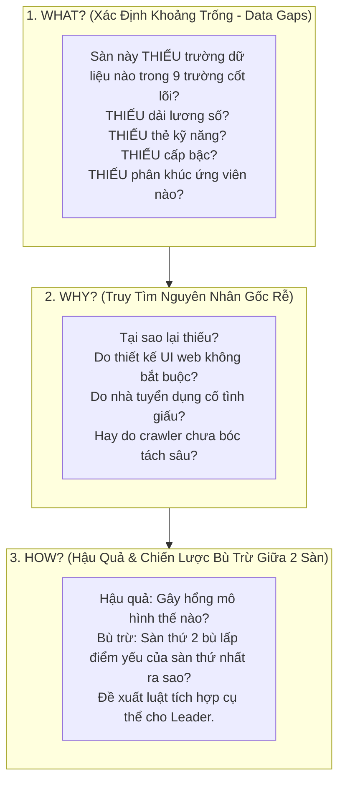
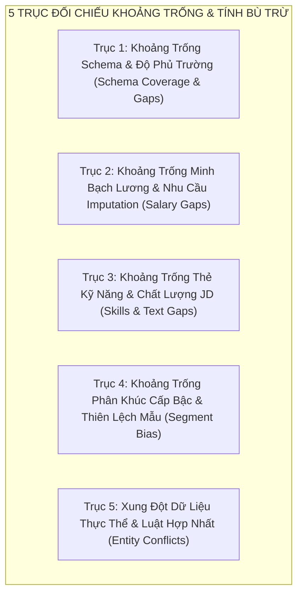

# 💡 CẨM NANG KHAI PHÁ KHOẢNG TRỐNG DỮ LIỆU & SO SÁNH ĐỐI ĐẦU ĐA NGUỒN
## PHƯƠNG PHÁP LUẬN TƯ DUY "WHY - WHAT - HOW" ĐỂ XÁC ĐỊNH BỘ DỮ LIỆU THIẾU GÌ & GIẢI PHÁP BÙ TRỪ KHI HỢP NHẤT TRÊN 8 SÀN

> **Dự án:** Phân tích thị trường lao động IT và nhu cầu kỹ năng nghề nghiệp tại Việt Nam (VN-IT-Job-Mining)  
> **Bộ phận chuyên trách:** Nhóm Nghiên cứu Insight & So Sánh Đa Nguồn (Các thành viên còn lại)  
> **Nguyên tắc tổ chức:** **Tự do bắt cặp song song** — Mỗi nhóm 2 người tự chọn 2 nguồn cào bất kỳ trong 8 nguồn (TopCV, ITViec, VietnamWorks, TopDev, Glints, JobsGO, CareerViet, Vieclam24h) để thực hiện đối chiếu chéo.  
> **Mục tiêu tối thượng:** Tìm ra **"Bộ dữ liệu nguồn đó THIẾU GÌ?" (Data Gap Analysis)**, giải thích nguyên nhân gốc rễ, và chứng minh xem **2 nguồn có thể bù trừ (complement) khoảng trống thông tin cho nhau như thế nào** để nộp báo cáo giải pháp cho Leader phục vụ bước Data Integration & Pre-processing.

---

## 1. TÁI ĐỊNH NGHĨA INSIGHT TRONG DỰ ÁN KHOA HỌC DỮ LIỆU

Trong một bài toán Khai phá Dữ liệu (Data Mining), Insight không phải là các nhận định chung chung về kinh tế hay thị trường lao động.

**INSIGHT THỰC SỰ LÀ: PHÁT HIỆN RA KHOẢNG TRỐNG (DATA GAPS), ĐỘ DỊ BIỆT (ANOMALIES) VÀ TÍNH BÙ TRỪ (COMPLEMENTARITY) CỦA DỮ LIỆU:**

```
❌ FACT (Chỉ là con số thống kê thông thường):
   "Trên sàn Vieclam24h, 85% bài đăng không có thẻ kỹ năng (tags), còn trên ITViec 100% bài đăng có 3-5 tags."
   -> Leader sẽ hỏi: "Biết vậy rồi thì làm được gì cho bước tích hợp dữ liệu?"

✅ DATA GAP INSIGHT (Khoảng trống dữ liệu có giá trị hành động):
   "Vieclam24h THIẾU HOÀN TOÀN trường kỹ năng chuyên môn dạng cấu trúc (Structured Tags) do giao diện web 
   chỉ cho nhà tuyển dụng nhập tự do trong phần mô tả; trong khi ITViec BẮT BUỘC chọn thẻ tags chuẩn hóa.
   -> NGUYÊN NHÂN (Why): Do mô hình nhập liệu tự do của sàn đại chúng vs sàn chuyên biệt Tech.
   -> HẬU QUẢ: Nếu gộp dữ liệu mà không trích xuất lại kỹ năng, Vieclam24h sẽ trở thành 'vùng chết thông tin' 
   về mặt kỹ thuật, làm sai lệch mô hình dự đoán xu hướng công nghệ.
   -> GIẢI PHÁP BÙ TRỪ (How): Dùng từ điển kỹ năng (Skill Taxonomy) trích xuất được từ ITViec và TopDev 
   làm bộ luật Regex/NLP Few-shot để quét ngược lại toàn bộ văn bản mô tả (JD) của Vieclam24h, 
   khôi phục lại 90%+ thông tin kỹ năng bị khuyết thiếu."
```

---

## 2. PHƯƠNG PHÁP LUẬN TƯ DUY 3 TẦNG: WHAT? WHY? HOW? VỀ KHOẢNG TRỐNG DỮ LIỆU

Mọi phân tích của nhóm bạn đều PHẢI xoay quanh câu hỏi cốt tử: **"BỘ DỮ LIỆU NGUỒN NÀY ĐANG THIẾU GÌ?"**



---

### 2.1. TẦNG 1: CÂU HỎI "WHAT?" (Bộ dữ liệu này THIẾU những gì?)
Hãy nhìn vào các biểu đồ EDA (Missingno matrix, Distribution, Boxplot) của nguồn bạn phụ trách và liệt kê 3 loại khoảng trống:
1. **Thiếu trường dữ liệu cấu trúc (Missing Attributes):**
   - Trường nào có tỷ lệ khuyết thiếu $> 50\%$? (Ví dụ: Thiếu số năm kinh nghiệm `min_experience`, thiếu địa chỉ chi tiết quận/huyện `location`).
   - Có bị thiếu mức lương số không? (Bao nhiêu % tin bị giấu lương dưới dạng `"Thỏa thuận"`?).
2. **Thiếu độ chi tiết thông tin (Information Granularity Deficiency):**
   - Thông tin có bị nén gộp vào một chuỗi thô không? (Ví dụ: Kinh nghiệm chỉ ghi chung chung `"Có kinh nghiệm"` mà không có số năm; Lương ghi dạng text lộn xộn `"Lương cứng 10tr + hoa hồng"`).
   - Mô tả công việc (JD word count) có quá ngắn $(< 100$ từ) không?
3. **Thiếu phân khúc đại diện (Missing Segments & Representation Bias):**
   - Sàn này thiếu hoàn toàn cấp bậc nào? (Ví dụ: Hoàn toàn không có tin tuyển Intern/Fresher, hoặc không có tin cấp quản lý Lead/Manager).
   - Sàn này thiếu hoàn toàn phân nhánh IT nào? (Ví dụ: Toàn tin Web/App, hoàn toàn vắng bóng Data Science, AI, DevOps, Embedded).
   - Sàn này có bị thiếu đại diện vùng miền không? (Ví dụ: 98% tin ở TP.HCM, hoàn toàn không có dữ liệu các tỉnh khác).

---

### 2.2. TẦNG 2: CÂU HỎI "WHY?" (Tại sao lại thiếu hụt như vậy?)
Áp dụng kỹ thuật truy tìm nguyên nhân để lý giải sự thiếu hụt:
- **Do Cơ chế & Thiết kế giao diện nhập liệu của sàn (Platform UI/UX Constraints):** Form đăng tuyển của sàn có ô nhập riêng cho lương và kinh nghiệm không, hay để nhà tuyển dụng paste toàn bộ vào 1 ô text tự do?
- **Do Chiến lược kinh doanh của sàn (Platform Business Model):** Sàn thu hút tệp nhà tuyển dụng nào? (SMEs/Startup nhỏ thường giấu lương để dễ ép giá; tập đoàn lớn thường công khai dải lương minh bạch).
- **Do Hành vi ứng viên mục tiêu (Target Audience Behavior):** Ứng viên trên sàn chủ yếu là ai? (Nếu là Senior, họ quan tâm phúc lợi và công nghệ; nếu là Fresher, họ quan tâm cơ hội đào tạo).
- **Do Giới hạn kỹ thuật cào (Crawler Limitations):** Dữ liệu bị thiếu do web thực sự không có, hay do crawler chưa gọi API chi tiết hoặc bỏ sót container ẩn?

---

### 2.3. TẦNG 3: CÂU HỎI "HOW?" (Hậu quả & Cơ chế bù trừ thông tin)
- **Hậu quả kỹ thuật (Technical Impact):** Nếu để nguyên tập dữ liệu bị khuyết này đưa vào huấn luyện mô hình (Machine Learning) hoặc phân tích tương quan, điều gì tồi tệ sẽ xảy ra? (Ví dụ: Làm lệch median lương thị trường, làm mất đi các kỹ năng quan trọng).
- **Cơ chế bù trừ đa nguồn (Cross-Source Complementary Strategy):** Đặt sàn này cạnh sàn thứ hai mà nhóm bạn chọn để xem hai bên **bù đắp khoảng trống cho nhau thế nào**:
  * Sàn A thiếu lương số $\longleftrightarrow$ Sàn B có 90% lương số rõ ràng.
  * Sàn A có thẻ tags chuẩn $\longleftrightarrow$ Sàn B giấu kỹ năng trong text thô.
  * Sàn A chuyên phân khúc Senior $\longleftrightarrow$ Sàn B chuyên phân khúc Fresher/Junior.
  * $\to$ **Giải pháp kết hợp:** Ghép 2 sàn lại để tạo nên một bức tranh thị trường toàn diện và dùng sàn mạnh để gán nhãn bù cho sàn yếu.

---

## 3. KHUNG ĐỐI CHIẾU 5 TRỤC VỀ KHOẢNG TRỐNG & TÍNH BÙ TRỪ GIỮA 2 SÀN

Bất kỳ cặp sàn nào được nhóm bạn tự do lựa chọn (ví dụ: ITViec vs TopCV, VietnamWorks vs TopDev, Glints vs JobsGO, Vieclam24h vs CareerViet...) đều PHẢI được đối chiếu trên **5 trục khoảng trống kỹ thuật**:



### 3.1. Trục 1: Khoảng Trống Schema & Độ Phủ Trường (Schema Coverage & Gaps)
- **Đối chiếu:** Lập bảng so sánh xem trong 9 trường của Data Contract, Sàn A có những trường nào mà Sàn B bị khuyết hoàn toàn?
- **Bù trừ:** Khi ánh xạ về Common Target Schema, trường nào cần lấy từ Sàn A, trường nào cần lấy từ Sàn B?

### 3.2. Trục 2: Khoảng Trống Minh Bạch Lương & Nhu Cầu Imputation (Salary Gaps)
- **Đối chiếu:** Tỷ lệ tin công khai mức lương số của Sàn A vs Sàn B (ví dụ: Sàn A 80% có lương vs Sàn B chỉ 25% có lương).
- **Bù trừ:** Sàn A có thể đóng vai trò là tập dữ liệu huấn luyện chuẩn (Ground Truth) để huấn luyện mô hình dự đoán và điền khuyết (Imputation) mức lương cho các tin "Thỏa thuận" của Sàn B không?

### 3.3. Trục 3: Khoảng Trống Thẻ Kỹ Năng & Chất Lượng JD (Skills & Text Gaps)
- **Đối chiếu:** Sàn nào có trường `tags` được chuẩn hóa, sàn nào bỏ trống `tags` buộc phải đọc trong văn bản JD? Độ dài trung bình của mô tả công việc (JD word count) giữa 2 sàn chênh lệch bao nhiêu?
- **Bù trừ:** Danh mục kỹ năng (Skill Taxonomy) bóc tách được từ Sàn A có thể dùng làm bộ từ điển để quét trích xuất ngược lại cho văn bản của Sàn B không?

### 3.4. Trục 4: Khoảng Trống Phân Khúc Cấp Bậc & Thiên Lệch Mẫu (Segment Bias)
- **Đối chiếu:** So sánh sự phân bổ Cấp bậc (`seniority_level`) giữa 2 sàn. Có phải Sàn A bị thiên lệch nặng nề về Middle/Senior (thiếu Fresher), trong khi Sàn B bị thiên lệch về Junior/Intern (thiếu Senior)?
- **Bù trừ:** Khi hợp nhất 2 sàn, tổng thể tập dữ liệu có giải quyết được bài toán mất cân bằng lớp (Class Imbalance) không?

### 3.5. Trục 5: Xung Đột Dữ Liệu Thực Thể & Luật Hợp Nhất (Entity Conflicts)
- **Đối chiếu:** Khi cùng một công ty đăng tuyển cùng một vị trí trên cả Sàn A và Sàn B (Cross-platform duplicate), dữ liệu có xung đột không? (Ví dụ: Trên Sàn A ghi lương 1,000 USD, trên Sàn B ghi 20 - 25 triệu VND; trên Sàn A đòi hỏi 3 năm kinh nghiệm, trên Sàn B ghi 2 năm).
- **Giải pháp:** Đề xuất quy tắc ưu tiên (Priority Rule): Chọn sàn nào làm "Nguồn chuẩn (Master Source)" cho trường Lương, chọn sàn nào làm chuẩn cho trường Kỹ năng?

---

## 4. MẪU BÁO CÁO KHOẢNG TRỐNG DỮ LIỆU NỘP CHO LEADER (REPORT TEMPLATE)

Mỗi nhóm 2 người khi hoàn thành phân tích cặp sàn của mình PHẢI điền báo cáo theo cấu trúc Markdown chuẩn mực dưới đây và lưu tại `reports/insight_comparison_<source1>_vs_<source2>.md`:

```markdown
# 📑 BÁO CÁO PHÂN TÍCH KHOẢNG TRỐNG DỮ LIỆU & GIẢI PHÁP BÙ TRỪ ĐA NGUỒN
## ĐỐI CHIẾU CHUYÊN SÂU: [TÊN SÀN A] VS. [TÊN SÀN B]

> **Nhóm thực hiện:** [Tên 2 thành viên phụ trách]  
> **Cặp nguồn phân tích:** [Source A] vs. [Source B]  
> **Kích thước mẫu thô:** N_[Source A] = ... bài đăng, N_[Source B] = ... bài đăng  
> **Dữ liệu chẩn đoán:** Tham chiếu từ reports/figures/ và reports/<source>_eda.md  

---

### 1. TÓM TẮT ĐIỀU HÀNH CHO LEADER (EXECUTIVE SUMMARY)
*(Viết cô đọng trong 1 đoạn văn: Khoảng trống lớn nhất của từng sàn là gì? Hai sàn bù trừ thông tin cho nhau ra sao? Ý nghĩa then chốt đối với bước thiết kế Pre-processing & Integration của đề tài).*

---

### 2. BẢNG ĐỐI CHIẾU KHOẢNG TRỐNG CHẤT LƯỢNG DỮ LIỆU (DATA GAP MATRIX)

| Tiêu chí chất lượng & Khoảng trống | [Tên Sàn A] | [Tên Sàn B] | Đánh giá khoảng trống & Độ bù trừ |
|---|:---:|:---:|:---|
| **Tổng số bài đăng cào được (Volume)** | ... tin | ... tin | Sàn ... có độ phủ mẫu lớn hơn |
| **Tỷ lệ thiếu trường Lương số (%)** | ...% | ...% | Sàn ... thiếu lương trầm trọng |
| **Tỷ lệ thiếu trường Kinh nghiệm (%)** | ...% | ...% | Sàn ... cần trích xuất bù từ JD |
| **Tỷ lệ bài đăng KHÔNG có thẻ Tags (%)** | ...% | ...% | Sàn ... thiếu trường kỹ năng cấu trúc |
| **Độ dài JD trung vị (Median Word Count)** | ... từ | ... từ | Sàn ... mô tả quá ngắn, nghèo thông tin |
| **Tỷ lệ tin trùng lặp URL / Nội dung (%)** | ...% | ...% | Sàn ... có rủi ro tin rác/repost cao hơn |
| **Độ lệch Skewness của mức lương** | ... | ... | Sàn ... cần áp dụng Log-transformation |
| **Phân khúc Cấp bậc chiếm đa số** | ... (chiếm ...%) | ... (chiếm ...%) | Hai sàn bù trừ 2 đầu phân khúc |
| **Tỷ lệ bài đăng niêm yết USD (%)** | ...% | ...% | Sàn ... cần quy đổi tỷ giá sang VND |

---

### 3. TOP 4 PHÁT HIỆN SÂU SẮC VỀ KHOẢNG TRỐNG DỮ LIỆU (KEY DATA GAP INSIGHTS)

#### 🔹 Insight 1: [Tên khoảng trống dữ liệu lớn nhất của Sàn A]
- **WHAT (Sàn A thiếu gì?):** ...
- **WHY (Tại sao lại thiếu?):** ... (Phân tích do UI sàn, hành vi nhà tuyển dụng, hay crawler)
- **HOW (Hậu quả & Cách dùng Sàn B để bù trừ):** ... (Rủi ro nếu không xử lý, và cách lấy thông tin từ Sàn B bù sang)

#### 🔹 Insight 2: [Tên khoảng trống dữ liệu lớn nhất của Sàn B]
- **WHAT (Sàn B thiếu gì?):** ...
- **WHY (Tại sao lại thiếu?):** ...
- **HOW (Hậu quả & Cách bù trừ):** ...

#### 🔹 Insight 3: [Khoảng trống phân khúc Cấp bậc & Tính mất cân bằng mẫu]
- **WHAT:** ...
- **WHY:** ...
- **HOW:** ...

#### 🔹 Insight 4: [Xung đột dữ liệu thực thể khi cùng 1 công ty đăng tuyển trên cả 2 sàn]
- **WHAT:** ...
- **WHY:** ...
- **HOW:** ...

---

### 4. ĐỀ XUẤT GIẢI PHÁP KỸ THUẬT CHO BƯỚC PRE-PROCESSING & DATA INTEGRATION
1. **Chiến lược điền khuyết (Imputation Strategy):** 
   - Những trường nào của Sàn A bị thiếu cần dùng thuật toán gì để bù đắp (Median imputation, KNN, hay dùng NLP regex trích xuất từ JD)?
2. **Quy tắc giải quyết xung đột (Conflict Resolution / Master Source Rule):** 
   - Khi phát hiện tin trùng giữa 2 sàn, ưu tiên lấy trường nào của sàn nào làm chuẩn (Ground Truth)?
3. **Chiến lược xử lý mất cân bằng & thiên lệch (Bias Mitigation):** 
   - Cần áp dụng kỹ thuật Resampling hay gán trọng số lớp (`class_weight`) như thế nào khi gộp 2 sàn?
```

---

## 5. TIÊU CHUẨN NGHIỆM THU ĐẦU VIỆC (DEFINITION OF DONE - DOD)

Một nhóm phân tích được nghiệm thu khi thỏa mãn đủ 4 điều kiện:
- [ ] Báo cáo được hoàn thiện theo đúng cấu trúc mẫu tại Mục 4, lưu tại `reports/insight_comparison_<source1>_vs_<source2>.md`.
- [ ] Xác định rõ ràng **tối thiểu 3 khoảng trống dữ liệu cốt lõi (Data Gaps)** của từng sàn kèm số liệu dẫn chứng (% khuyết, median, outlier count).
- [ ] Trả lời đầy đủ chu trình **WHAT - WHY - HOW** cho từng phát hiện, không có nhận định cảm tính về kinh tế vi mô.
- [ ] Có phương án kỹ thuật cụ thể, khả thi để **bù trừ khoảng trống thông tin giữa 2 sàn** nộp cho Leader phục vụ bước Data Integration.
