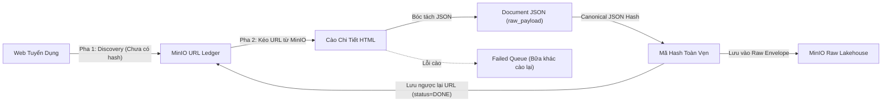

# Cẩm Nang Kiến Trúc: Two-Phase Decoupled Crawler & MinIO Lakehouse Playbook

> **Mục đích tài liệu:** Hướng dẫn toàn diện và quy chuẩn mẫu để xây dựng, tái cấu trúc hoặc nghiệm thu crawler cho bất kỳ website tuyển dụng nào (CareerViet, TopCV, TopDev, ITViec, VietnamWorks, Vieclam24h, JobsGO, Glints...) đạt chuẩn **Modern Data Stack** của dự án VN-IT-Job-Mining.

---

## 1. Triết Lý & Nguyên Tắc Cốt Tử



1. **Kiến Trúc Hai Pha Tách Rời (Two-Phase Decoupled Pipeline):**
   - **Pha 1 (Discovery):** Thu thập URL từ danh mục/API, ghi nhận vào URL Ledger.
   - **Pha 2 (Details):** Đọc danh sách URL từ URL Ledger trên MinIO để cào chi tiết. Hai pha chạy độc lập, có thể chạy cách nhau vài giờ hoặc vài ngày.
2. **Ban Đầu Chưa Có Hash:**
   - Khi phát hiện URL ở Pha 1, bài viết chưa được cào chi tiết nên **tuyệt đối không có hash** (`content_hash = None`, `status = "PENDING"`).
3. **Băm Toàn Vẹn Document JSON (Tuyệt Đối Không Băm HTML Thô):**
   - Không được băm file HTML thô (vì HTML chứa CSRF token, thời gian render server, banner quảng cáo xoay vòng... sẽ gây nhảy hash oan).
   - Bắt buộc bóc tách toàn bộ dữ liệu bài đăng vào cấu trúc **Document JSON (`raw_payload`)**, sau đó áp dụng **Canonical JSON Hashing** (`calculate_json_canonical_hash`) trên toàn vẹn đối tượng JSON này.
4. **Lưu Ngược Lại Mã Hash Vào Cả URL Ledger Và Raw Envelope:**
   - Sau khi băm: Lưu ngược lại mã hash vào URL trong Ledger (đánh dấu `status = "DONE"`).
   - Đóng gói mã hash vào `metadata` của file Raw Envelope JSON và lưu trực tiếp lên MinIO Lakehouse.
5. **Cơ Chế Safe Skip & Failed Queue (Không Bao Giờ Mất Dấu Tin Lỗi):**
   - Khi 1 URL bị lỗi (timeout, mạng, 404, bot block) $\rightarrow$ Không được làm dừng chương trình.
   - Ghi nhận `mark_failed`, đưa vào **Failed Queue** để bữa khác có thể cào lại (`--retry-failed`).
6. **Checkpoint Sync Định Kỳ:**
   - Cứ mỗi 15 - 20 bài đăng cào thành công, crawler tự động lưu và đồng bộ Ledger lên MinIO Lakehouse để bảo toàn tiến độ dù có mất điện hay ngắt mạng.
7. **Single-File Pattern (Gọn Gàng & Dễ Bảo Trì):**
   - Toàn bộ crawler, parser, envelope builder và CLI nên nằm gọn trong 1 file `crawlers/sources/<tenweb>/crawler.py` duy nhất.

---

## 2. Quy Trình 2 Pha Chuẩn Hóa

### 2.1. Pha 1 — URL Discovery (`--phase discovery`)

- **Nhiệm vụ:** Quét qua toàn bộ trang danh mục hoặc gọi API phân trang để thu thập tất cả các bài tuyển dụng trong phạm vi ngành IT.
- **Thao tác:**
  1. Trích xuất URL canonical sạch (loại bỏ tracking tokens: `utm_*`, `ref`, `source`, v.v.).
  2. Bóc tách thẻ tiêu đề định danh ban đầu (`preliminary_title`).
  3. Đăng ký vào ledger:
     ```python
     ledger.register_url(raw_url=url, job_id=job_id, preliminary_title=title)
     ```
     *(Lúc này `status = "PENDING"`, `content_hash = None` — chưa có hash).*
  4. Xuất file manifest ngày: `data/<source>/url_ledger/manifests/manifest_YYYY-MM-DD.jsonl`.
  5. **Đẩy lên MinIO Lakehouse:**
     ```python
     ledger.save_catalog()
     ledger.sync_to_minio()
     ```
     Đích đến: `minio://vn-it-jobs/url_ledger/<source>/catalog_master.json`.

---

### 2.2. Pha 2 — Detail Extraction & Post-Crawl Hashing (`--phase details`)

- **Nhiệm vụ:** Đọc các bài viết cần cào từ MinIO, tải HTML, bóc tách JSON, băm toàn vẹn document và đẩy snapshot lên MinIO.
- **Thao tác:**
  1. **Kéo danh sách URL từ MinIO về máy:**
     ```python
     if self.sync_minio and online:
         ledger.pull_from_minio()  # Kéo catalog mới nhất từ MinIO về local
     ```
  2. **Lọc danh sách cần cào:**
     - Bình thường: Lấy các tin `status == "PENDING"` hoặc đã cào quá 21 ngày (`RECHECK_DUE`).
     - Chế độ cào lại lỗi (`--retry-failed`): Lấy các tin `status == "FAILED"` từ Failed Queue.
  3. **Vòng lặp cào từng bài đăng kèm Polite Sleep:**
     - Delay ngẫu nhiên giữa 2 bài đăng: 2.0s - 4.5s.
     - Kiểm tra phát hiện chặn/Cloudflare: nếu nghi ngờ bị chặn $\rightarrow$ dừng an toàn, giữ nguyên trạng thái PENDING.
  4. **Bóc tách Document JSON (Zero Information Loss):**
     ```python
     raw_payload = build_raw_payload(html)
     # raw_payload chứa: title, company, salary, experience, level,
     # description, requirements, benefits, tags, map, etc.
     ```
  5. **Băm toàn vẹn Document JSON sau cào (Post-Crawl Canonical JSON Hashing):**
     ```python
     from crawlers.common.url_ledger import (
         calculate_json_canonical_hash,
     )

     # 1. Băm mã SHA-256 trên toàn vẹn cấu trúc JSON (đã sắp xếp khóa sort_keys=True)
     canonical_hash = calculate_json_canonical_hash(raw_payload, exclude_keys=["raw_html"])

     ```
  6. **Kiểm tra bài đăng lặp (Repost Detection):**
     - Tìm kiếm trong ledger: `existing = ledger.find_by_content_hash(canonical_hash)`.
     - Nếu trùng hash với một bài khác: Đánh dấu `repost_of_url_hash = existing["url_hash"]`, không sinh file mới để tiết kiệm dung lượng Lakehouse.
  7. **Lưu file Raw Envelope lên MinIO Lakehouse:**
     - Đóng gói Envelope chuẩn:
       ```python
       envelope = {
           "metadata": {
               "job_id": job_id,
               "source": self.source_name,
               "source_url": source_url,
               "scraped_at": datetime.now(timezone.utc).isoformat(),
               "scraper_version": "1.0.0",
               "version": new_version,
               "content_hash": canonical_hash,        # Hash toàn vẹn document JSON
           },
           "raw_payload": raw_payload,
       }
       ```
     - Lưu cục bộ: `data/<source>/raw/<YYYY-MM-DD>/{job_id}_v{version}.json`.
     - Đẩy trực tiếp lên MinIO: `minio://vn-it-jobs/raw/<source>/<YYYY-MM-DD>/{job_id}_v{version}.json`.
  8. **Lưu ngược lại mã Hash vào URL trong Ledger:**
     ```python
     ledger.mark_done(url_hash, content_hash=canonical_hash, new_version=new_version)
     ```
  9. **Checkpoint Sync định kỳ:**
     - Cứ mỗi 15 - 20 tin thành công:
       ```python
       if count % 15 == 0:
           ledger.save_catalog()
           ledger.sync_to_minio()
       ```
  10. **Bắt lỗi Safe Skip & Failed Queue:**
      - Nếu bất kỳ lỗi nào xảy ra trong quá trình tải/parse:
        ```python
        ledger.mark_failed(url_hash, error_msg=str(exc))
        # Không dừng chương trình, tiếp tục URL tiếp theo!
        ```

---

## 3. Cấu Trúc Khung Mã Nguồn Chuẩn (Template Code)

Dưới đây là mẫu khung sườn chuẩn áp dụng cho bất kỳ nguồn nào:

```python
# crawlers/sources/<source_name>/crawler.py
import argparse
import json
import logging
import re
from datetime import datetime, timezone
from pathlib import Path
from typing import Any

from bs4 import BeautifulSoup
from crawlers.base.base_crawler import BaseCrawler
from crawlers.common.http_client import HttpClient
from crawlers.common.minio_raw_pipeline import MinioRawStore
from crawlers.common.url_ledger import (
    UrlLedger,
    calculate_json_canonical_hash,
)

log = logging.getLogger("<source_name>.crawler")

def build_raw_payload(html: str) -> dict[str, Any]:
    """Bóc tách 100% trường dữ liệu đặc thù của sàn vào đối tượng JSON (Zero Info Loss)."""
    soup = BeautifulSoup(html, "html.parser")
    # ... Bóc tách các trường: title, company, salary, description, tags, etc.
    return {
        "title": ...,
        "company": ...,
        "salary_raw": ...,
        "detail_sections": ...,
        "tags": ...,
    }

def build_raw_envelope(html: str, job_id: str, url: str, version: int = 1) -> dict[str, Any]:
    """Đóng gói Envelope kèm mã băm toàn vẹn document JSON sau cào."""
    raw_payload = build_raw_payload(html)
    canonical_hash = calculate_json_canonical_hash(raw_payload, exclude_keys=["raw_html"])
    return {
        "metadata": {
            "job_id": job_id,
            "source": "<source_name>",
            "source_url": url,
            "scraped_at": datetime.now(timezone.utc).isoformat(),
            "scraper_version": "1.0.0",
            "version": version,
            "content_hash": canonical_hash,
            "canonical_hash": canonical_hash
        },
        "raw_payload": raw_payload,
    }

class StandardSourceCrawler(BaseCrawler):
    def __init__(self, **kwargs):
        super().__init__(**kwargs)
        self.ledger_dir = kwargs.get("ledger_dir", "data/<source_name>/url_ledger")
        self.raw_dir = kwargs.get("raw_dir", "data/<source_name>/raw")
        self.sync_minio = kwargs.get("sync_minio", False)
        self._ledger = None
        self._minio_store = None

    def _get_ledger(self) -> UrlLedger:
        if self._ledger is None:
            self._ledger = UrlLedger(source="<source_name>", storage_dir=self.ledger_dir)
        return self._ledger

    def _get_minio_store(self) -> MinioRawStore:
        if self._minio_store is None:
            self._minio_store = MinioRawStore()
        return self._minio_store

    def discover_urls(self, online: bool = False, max_pages: int | None = None) -> int:
        """Pha 1: Quét danh mục, ban đầu chưa có hash, lưu lên MinIO."""
        ledger = self._get_ledger()
        # ... Quét web, bóc URL & title ...
        # ledger.register_url(raw_url=u, job_id=jid, preliminary_title=t)
        ledger.save_catalog()
        ledger.export_daily_manifest()
        if self.sync_minio:
            ledger.sync_to_minio()
        return len(ledger.records)

    def crawl_details(self, online: bool = False, limit: int | None = None, retry_failed: bool = False) -> dict[str, Any]:
        """Pha 2: Kéo URL từ MinIO, cào chi tiết, băm JSON sau cào, lưu ngược lại hash."""
        ledger = self._get_ledger()
        if self.sync_minio and online:
            ledger.pull_from_minio()

        candidates = ledger.get_failed_records() if retry_failed else ledger.get_pending_or_due_records(21)
        if limit:
            candidates = candidates[:limit]

        client = self._online_client()
        for idx, rec in enumerate(candidates, 1):
            try:
                html = client.get_html(rec["canonical_url"])
                raw_payload = build_raw_payload(html)
                content_hash = calculate_json_canonical_hash(raw_payload)

                # Repost check
                existing = ledger.find_by_content_hash(content_hash)
                if existing and existing["url_hash"] != rec["url_hash"]:
                    ledger.mark_done(rec["url_hash"], content_hash=content_hash, repost_of_url_hash=existing["url_hash"])
                    continue

                # Tạo envelope và lưu MinIO
                env = build_raw_envelope(html, rec["job_id"], rec["canonical_url"])
                s3_key = f"raw/<source_name>/{today}/{rec['job_id']}_v1.json"
                self._get_minio_store().put_json(s3_key, env)

                # Lưu ngược lại hash vào URL
                ledger.mark_done(rec["url_hash"], content_hash=content_hash)

                # Checkpoint sync định kỳ
                if self.sync_minio and idx % 15 == 0:
                    ledger.save_catalog()
                    ledger.sync_to_minio()
            except Exception as exc:
                # Safe skip đưa vào Failed Queue
                ledger.mark_failed(rec["url_hash"], str(exc))

        ledger.save_catalog()
        if self.sync_minio:
            ledger.sync_to_minio()
```

---

## 4. Giao Diện Dòng Lệnh (CLI Arguments Chuẩn)

Mỗi file `crawler.py` bắt buộc hỗ trợ các tham số dòng lệnh sau:

| Tham số | Ý nghĩa |
| :--- | :--- |
| `--phase discovery` | Chạy Pha 1: Thu thập URL vào ledger và đẩy lên MinIO |
| `--phase details` | Chạy Pha 2: Cào chi tiết, băm JSON sau cào, lưu ngược hash |
| `--phase sync` | Chỉ đồng bộ ledger và raw files cục bộ lên MinIO (không gọi mạng ngoài) |
| `--phase view` | Xem tóm tắt thống kê trạng thái ledger hiện tại |
| `--online` | Cho phép kết nối internet cào trực tuyến (mặc định tắt) |
| `--sync-minio` | Tự động đồng bộ URL Ledger và Raw Snapshots lên MinIO Lakehouse |
| `--retry-failed` | Cào lại các URL đang nằm trong Failed Queue |
| `--limit N` | Giới hạn số lượng tin xử lý (dùng để test thử nghiệm) |
| `--local-html-dir DIR` | Chạy cào offline từ thư mục HTML có sẵn trên đĩa |

---

## 5. Các Bước Áp Dụng Cho Nguồn Cào Mới

Khi nhận nhiệm vụ xây dựng crawler cho nguồn mới (ví dụ: `itviec`):
1. **Bước 1 (Lấy 3 HTML mẫu):** Tải 3 file HTML thô đại diện vào `crawlers/sources/itviec/samples/{job_id}.html`.
2. **Bước 2 (Viết `build_raw_payload`):** Bóc tách đầy đủ tất cả các trường dữ liệu của trang tuyển dụng vào dictionary JSON (Zero Information Loss).
3. **Bước 3 (Băm toàn vẹn JSON):** Gọi `calculate_json_canonical_hash(raw_payload)` để làm `content_hash`.
4. **Bước 4 (Viết Pha 1 Discovery):** Thu thập URL vào `UrlLedger` (ban đầu chưa có hash), đẩy lên `url_ledger/itviec/`.
5. **Bước 5 (Viết Pha 2 Details):** Kéo URL từ MinIO, cào chi tiết với Polite Sleep, băm JSON sau cào, lưu ngược hash vào URL và đẩy raw envelope lên MinIO. Bắt lỗi đưa vào Failed Queue.
6. **Bước 6 (Tạo 3 cặp mẫu & Unit Tests):** Chạy script sinh 3 file `{job_id}_v1.json` và viết test kiểm tra tính tất định.
7. **Bước 7 (Nghiệm thu):** Chạy DoD Scorer:
   ```bash
   python3 .agents/skills/collection-submission/scripts/verify_submission.py --source itviec
   ```
   Đạt $\ge 100/100$ điểm là hoàn thành nhiệm vụ!
